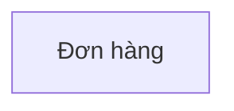

# Bản đồ đối tượng

## 0. Sơ đồ tổng quan

<!-- object-map:diagram:begin -->

<!-- object-map:diagram:end -->

## Vai trò nghiệp vụ

| Vai trò | Thuộc actor | Nguồn |
|---|---|---|
| Người duyệt đơn | Quản lý | sop.md:9 |

## 1. Đối tượng

| Mã | Tên | Định nghĩa | Subsystem | Nguồn |
|---|---|---|---|---|
| OBJ_Don_Hang | Đơn hàng | x | Bán hàng | sop.md:2 |
| OBJ-kho | Kho | x | Kho | 🟡 Suy luận |

## 2. Quan hệ

| Từ | Quan hệ | Tới | Bản số | Đi được từ màn chi tiết | Nguồn |
|---|---|---|---|---|---|
| Khách hàng | đặt | Đơn hàng | nhiều | không | sop.md:4 |

## 3. Hành động theo vai trò

| Đối tượng | Hành động | Vai trò | Kênh | Đổi trạng thái | Nguồn |
|---|---|---|---|---|---|
| Đơn hàng | Tạo | Thủ kho | Web | — → Mới tinh | sop.md:5 |

## 4. Thuộc tính

| Đối tượng | Thuộc tính | Loại nghiệp vụ | Hiện ở | Lọc / Sắp | Nguồn |
|---|---|---|---|---|---|
| Đơn hàng | Mã đơn | mã định danh | Popup | Lọc | sop.md:2 |

## 5. Đề xuất hiển thị dùng chung

| Đối tượng | Dùng ở feature | Thẻ hiện | Dòng danh sách hiện | Gợi ý CMP |
|---|---|---|---|---|

## 6. Câu hỏi mở

| # | Câu hỏi | Liên quan |
|---|---|---|
