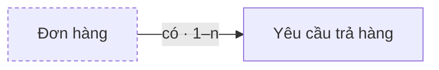

# Bản đồ đối tượng — returns

## 0. Sơ đồ tổng quan

<!-- object-map:diagram:begin -->

<!-- object-map:diagram:end -->

## Vai trò nghiệp vụ

| Vai trò | Thuộc actor | Nguồn |
|---|---|---|

## 1. Đối tượng

| Mã | Tên | Định nghĩa | Subsystem | Nguồn |
|---|---|---|---|---|
| OBJ-yeu-cau-tra-hang | Yêu cầu trả hàng | Khách xin trả lại đơn đã nhận | Bán hàng | brainstorm.md:12 |

## 2. Quan hệ

| Từ | Quan hệ | Tới | Bản số | Đi được từ màn chi tiết | Nguồn |
|---|---|---|---|---|---|
| Đơn hàng | có | Yêu cầu trả hàng | 1–n | 2 chiều | brainstorm.md:14 |

## 3. Hành động theo vai trò

| Đối tượng | Hành động | Vai trò | Kênh | Đổi trạng thái | Nguồn |
|---|---|---|---|---|---|
| Yêu cầu trả hàng | Gửi | Người mua | Web | — | brainstorm.md:15 |
| Yêu cầu trả hàng | Thu hồi | Người mua | Web | — | brainstorm.md:16 |

## 4. Thuộc tính

| Đối tượng | Thuộc tính | Loại nghiệp vụ | Hiện ở | Lọc / Sắp | Nguồn |
|---|---|---|---|---|---|
| Yêu cầu trả hàng | Lý do | danh mục | Thẻ · Chi tiết | Lọc | brainstorm.md:17 |

## 5. Đề xuất hiển thị dùng chung

| Đối tượng | Dùng ở feature | Thẻ hiện | Dòng danh sách hiện | Gợi ý CMP |
|---|---|---|---|---|

## 6. Câu hỏi mở

| # | Câu hỏi | Liên quan |
|---|---|---|
