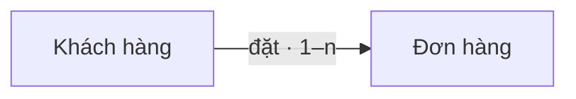

# Bản đồ đối tượng

## 0. Sơ đồ tổng quan

<!-- object-map:diagram:begin -->

<!-- object-map:diagram:end -->

## Vai trò nghiệp vụ

| Vai trò | Thuộc actor | Nguồn |
|---|---|---|
| Người mua | Khách hàng | sop.md:3 |
| Người duyệt đơn | Nhân viên cửa hàng | sop.md:9 |

## 1. Đối tượng

| Mã | Tên | Định nghĩa | Subsystem | Nguồn |
|---|---|---|---|---|
| OBJ-khach-hang | Khách hàng | [[docs/_shared/definitions.md#Khách hàng\|xem]] | Bán hàng | definitions.md:5 |
| OBJ-don-hang | Đơn hàng | [[docs/_shared/definitions.md#Đơn hàng\|xem]] | Bán hàng | sop.md:2 |

## 2. Quan hệ

| Từ | Quan hệ | Tới | Bản số | Đi được từ màn chi tiết | Nguồn |
|---|---|---|---|---|---|
| Khách hàng | đặt | Đơn hàng | 1–n | 2 chiều | sop.md:4 |

## 3. Hành động theo vai trò

| Đối tượng | Hành động | Vai trò | Kênh | Đổi trạng thái | Nguồn |
|---|---|---|---|---|---|
| Đơn hàng | Tạo | Người mua | Web | — → Chờ xác nhận | sop.md:5 |
| Đơn hàng | Xác nhận | Người duyệt đơn | Web | Chờ xác nhận → Đã xác nhận | sop.md:9 |
| Đơn hàng | Huỷ | Người mua | Web | Chờ xác nhận → Đã huỷ | sop.md:11 |
| Khách hàng | Cập nhật hồ sơ | 🟡 chưa rõ | Web | — | 🟡 Suy luận · OQ-1 |

## 4. Thuộc tính

| Đối tượng | Thuộc tính | Loại nghiệp vụ | Hiện ở | Lọc / Sắp | Nguồn |
|---|---|---|---|---|---|
| Khách hàng | Họ tên | văn bản | Thẻ · Danh sách · Chi tiết | Sắp | sop.md:3 |
| Đơn hàng | Mã đơn | mã định danh | Thẻ · Danh sách · Chi tiết | Lọc + Sắp | sop.md:2 |
| Đơn hàng | Tổng tiền | tiền | Thẻ · Chi tiết | Sắp | sop.md:6 |

## 5. Đề xuất hiển thị dùng chung

| Đối tượng | Dùng ở feature | Thẻ hiện | Dòng danh sách hiện | Gợi ý CMP |
|---|---|---|---|---|

## 6. Câu hỏi mở

| # | Câu hỏi | Liên quan |
|---|---|---|
| OQ-1 | Ai được sửa hồ sơ khách hàng? | Mục 3, Khách hàng |
