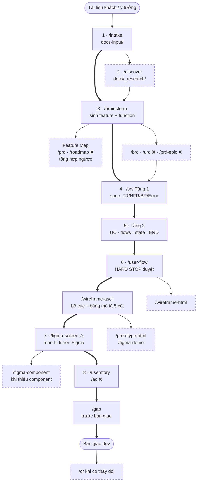

# Pipeline: từ con số 0 → BA → Design

Bản đồ toàn bộ quy trình của workspace `dispatch-management`, đúng với những gì **đang cài thật**
trong `.claude/skills/` ngày 2026-10-04. Dùng làm nền để cải tiến: mỗi bước ghi rõ mức bắt buộc,
skill, đầu vào, đầu ra, ai review, máy kiểm gì, và chỗ đang đứt.

**Ký hiệu**

| Mức | Nghĩa |
|---|---|
| 🟢 Bắt buộc | Bỏ qua thì bước sau không chạy được hoặc chạy trên nền thiếu |
| 🟡 Có điều kiện | Bắt buộc khi gặp điều kiện ghi kèm |
| ⚪ Tuỳ chọn | Thêm giá trị, bỏ qua không vỡ luồng |

Cài đặt: ✅ đã cài · ❌ chưa cài (có skill khác nhắc tới) · ⚠️ có vấn đề, xem Mục 7.

## 1. Toàn cảnh

Đường đậm là xương sống bắt buộc; ô viền đứt là tuỳ chọn hoặc có điều kiện.



**Một câu:** tài liệu khách → `/intake` → `/brainstorm` (feature và function hình thành tại đây) →
`/srs` (spec → mô hình) → `/user-flow` → `/wireframe-ascii` → `/figma-screen` → `/userstory` →
`/gap` → bàn giao; `/cr` cho mọi thay đổi sau đó.

**Feature không có sẵn từ đầu.** Mỗi lần `/brainstorm` chạy, skill tự đặt slug và tạo
`docs/{feature}/`. Danh sách feature (Feature Map) là thứ **tổng hợp ngược** từ các brainstorm,
không phải đầu vào bắt buộc.

## 2. Từng giai đoạn

### 0 · Nền dự án (làm 1 lần, bổ sung dần)

| Mức | Thành phần | File | Ai dùng | Tình trạng |
|---|---|---|---|---|
| 🟢 | Bối cảnh dự án | `docs/_shared/project-profile.md` | brainstorm, brd, srs, discover | Có domain + người dùng (từ SRS cũ LG). Thiếu bối cảnh điều vận + đối thủ (BL-008). Skill tự hỏi khi thiếu |
| 🟡 | Thuật ngữ, môi trường, kiến trúc | `definitions.md`, `operating-environment.md`, `system-overview.md` | mọi skill BA | Có |
| 🟡 có UI | Quy tắc giao diện chung | `design/ui-common/conventions.md` (20 GR + E-common) | srs, usecase, wireframe, figma | Bản **web** |
| 🟡 có UI | Component dùng chung | `design/ui-common/screen-patterns.md` (11 CMP) | như trên | Bản **web**; bản **mobile** chưa chuyển (BL-001) |
| 🟢 cho hi-fi | Design system | `design/design.md`, `design-tokens.css`, `components.md`, `ba-crosswalk.md`, `figma-library-keys.json` | wireframe (bố cục), figma-*, prototype | Có; chỉ chuẩn **desktop 1920×1080** |
| 🟡 1 lần | Setup file Figma | `design/setup-figma.md` | người, trước lần vẽ đầu | Có |

Công cụ: `/update-overview` (sửa 6 file `_shared`), `/kg` (đồ thị liên kết).

### 1 · Thu nhận nguồn

| Mức | Bước | Skill / máy | Vào | Ra |
|---|---|---|---|---|
| 🟡 có tài liệu khách | Chuyển tài liệu | `/intake` ✅ | docx/pdf/xlsx/pptx/ảnh | `docs-input/{nhóm}/{slug}/` (`.md` + `images/` + `source/`); bản mới của tài liệu cũ → báo cáo `docs-input/_changes/` |
| 🟢 tự động | Đăng ký + theo dõi | `_scripts/intake-sync.py` (hook) | file trong `docs-input/` | sổ nguồn `docs-input/README.md` (SRC-NN) + task `_workspace/backlog.md` (BL-NNN) |

### 2 · Khám phá

| Mức | Bước | Skill | Vào | Ra |
|---|---|---|---|---|
| ⚪ | Điều tra 1 chủ đề còn phân vân | `/discover` ✅ | chủ đề + profile + nguồn | `docs/_research/{date}-{slug}.md` (build/skip/adjust) |
| ⚪ | Feature Map + xếp đợt | `/prd` ❌ · `/roadmap` ❌ | các brainstorm đã có | `docs/_product/prd.md`, `roadmap.md` |

### 3 · Định hình feature

| Mức | Bước | Skill | Vào | Ra |
|---|---|---|---|---|
| 🟢 | Phỏng vấn, sinh feature + function | `/brainstorm` ✅ | ý tưởng / `@nguồn` / research | `docs/{feature}/brainstorms/{idea}.md` (user, capability P0-P2, luồng chính, edge case, wording, OQ) |
| ⚪ | Lý do kinh doanh | `/brd` ✅ | brainstorm | `{feature}-brd.md` |
| ⚪ | Nhu cầu người dùng / đặc tả epic | `/urd` ❌ · `/prd-epic` ❌ | brainstorm | `{feature}-urd.md`, `{feature}-prd.md` |

`/srs` đọc upstream theo thứ tự `prd > urd > brd > brainstorms/`, nên chỉ brainstorm là đủ để đi tiếp.

### 4 · Đặc tả — `/srs` Tầng 1

| Mức | Vào | Ra |
|---|---|---|
| 🟢 | upstream + profile + CMP/GR | `docs/{feature}/srs/{feature}-spec.md`: FR / NFR / BR / Error Matrix / Success Criteria / OQ + Phụ lục A (UI common, máy chép) |

`/srs` là bộ điều phối: sau Tầng 1 hỏi chạy tới tầng nào — [1] spec · [2] +Mô hình · [3] +UX ·
[4] +Delivery · [all]. Chạy tuần tự, duyệt trước mỗi lần ghi.

### 5 · Mô hình — `/srs` Tầng 2

| Mức | Skill | Ra |
|---|---|---|
| 🟡 có UI / có story | `/usecase` ✅ | `usecases/uc-{slug}.md` + `{feature}-usecase-index.md` (ma trận UC↔FR↔Screen↔Error↔OQ) |
| 🟡 entity có trạng thái | `/state` ✅ | `srs/{feature}-states.md` — `/gap` cần file này để dò luồng kẹt |
| 🟡 nhiều hệ thống / có tích hợp | `/sequence` ✅ | `srs/{feature}-flows.md` |
| 🟡 nhiều nhánh quyết định | `/activity` ✅ · `/activity-swimlane` ✅ (đa vai trò) | `flows.md` / `.puml` + `.svg` |
| 🟡 có dữ liệu mới | `/erd` ✅ | `srs/{feature}-erd.md` |
| ⚪ | `/usecase-diagram` · `/bpmn` · `/dbdiagram` ✅ | `.puml/.svg` · `.bpmn` · `.dbml/.sql` |
| ⚪ | Bản Figma: `/figma-activity` `/figma-bpmn` `/figma-sequence` `/figma-state` `/figma-erd` `/figma-usecase` | minh hoạ trên Figma, không phải nguồn |

### 6 · UX lo-fi — `/srs` Tầng 3

| Mức | Bước | Skill | Vào | Ra |
|---|---|---|---|---|
| 🟢 có UI | Chia luồng | `/user-flow` ✅ | spec / UC | `srs/{feature}-userflow.md`: luồng chính + lỗi + biên, chia flow, `primary_device` |
| 🟢 có UI | Phác màn | `/wireframe-ascii` ✅ | userflow + spec + UC + CMP/GR + design.md (bố cục) | `ascii-wireframe/{flow}.md` (màn + bảng mô tả 5 cột) + `{feature}-wireframe-index.md` |
| ⚪ | Wireframe HTML | `/wireframe-html` ✅ | userflow (+ ASCII) | `html-wireframe/{flow}.html` |

Bảng mô tả 5 cột (`# / Items / Control type / Data type / Description`) là **hợp đồng BA ↔
design**: validation, mã lỗi, wording, điều hướng nằm ở đây.

### 7 · Design hi-fi

| Mức | Skill | Vào | Ra | Ghi lại về repo? |
|---|---|---|---|---|
| 🟢 | `/figma-screen` ✅ ⚠️ | design.md, components.md, srs, states, userflow **trên Figma** | artboard trên Figma (3 phương án bố cục, instance thật, token, đủ trạng thái) | Không (chỉ quyền đọc) |
| 🟡 thiếu component | `/figma-component` ✅ ⚠️ | spec component trong design.md | component set trên Figma; cập nhật spec trong design.md | Có (design.md) |
| 🟡 1 lần | `/figma-design-system` ✅ | design.md | token + component set trên Figma | — |
| ⚪ | `/prototype-html` ✅ | userflow + ASCII + design-tokens.css | `html-design/{feature}-prototype.html` | file trong repo |
| ⚪ | `/figma-demo` · `/figma-userflow` · `/figma-sitemap` · `/figma-persona` · `/figma-journey` ✅ | mô tả / màn đã vẽ | demo tự chạy, sơ đồ trên Figma | — |
| ⚪ (cũ) | `/figma` ✅ ⚠️ | ASCII + wireframe-index | frame trên Figma | Có |

### 8 · Bàn giao & duy trì

| Mức | Skill | Việc |
|---|---|---|
| 🟢 có backlog dev | `/userstory` ✅ · `/ac` ❌ | story `US-NNN` từ FR/UC/màn; AC chưa có skill |
| 🟢 trước bàn giao | `/gap` ✅ | soi luồng còn thiếu + ma trận truy vết |
| 🟡 có thay đổi | `/cr` ✅ | phân tích tác động → `apply` |
| ⚪ | `/dashboard` · `/preview` · `/export` ✅ | tiến độ, viewer HTML, gói gửi stakeholder |

## 3. Lớp review và audit

Có 3 tầng kiểm, độ tin khác nhau — đừng gộp thành một chữ "đã kiểm":

| Tầng | Ai | Độ tin |
|---|---|---|
| **Máy** | script / linter / audit của Figma MCP | Tất định, nhưng chỉ bắt lỗi kỹ thuật + cấu trúc |
| **Agent độc lập** | sub-agent đọc sản phẩm với 1 góc nhìn riêng, chỉ trả finding, không tự sửa | Bắt được lỗi nghiệp vụ mà người viết mù |
| **Tự kiểm** | chính skill tự soi checklist trước khi trình | Yếu nhất — tự chấm bài của mình |

Agent trả finding theo `.claude/rules/review-format.md`: `BLOCKING` (phải sửa, doc sang
`revisions`) · `WARNING` (sửa hoặc ghi nhận) · `SUGGESTION`. 2 agent cùng báo 1 WARNING → nâng
thành BLOCKING. Lỗi an toàn (câu chữ, nhất quán nội bộ) skill tự sửa; còn lại trình người duyệt.

### 3.1 Agent review — ai soi cái gì

| Bước | Agent | Soi gì | Khi nào chạy |
|---|---|---|---|
| `/discover` | `@feature-researcher` | (không phải review) nghiên cứu đối thủ làm tính năng đó thế nào: 3-5 phân tích, mẫu tích hợp, bẫy | Luôn |
| `/brd` Phase F | `@senior-ba` | đủ chưa, edge case, chỗ mơ hồ | Luôn, 3 agent song song |
| | `@po-reviewer` | giá trị kinh doanh, phình phạm vi, P0/P1/P2 có hợp lý | |
| | `@pm-reviewer` | phụ thuộc chéo feature, timeline, ảnh hưởng roadmap | |
| | chung | mục tiêu ↔ chỉ số đo, rule nghiệp vụ lẫn rule kỹ thuật, bằng chứng | |
| `/srs` Phase G | `@senior-ba` | đủ, edge case, mơ hồ, actor khai đủ | Luôn |
| | `@qa-reviewer` | FR/NFR test được không (có điều kiện đạt), Error Matrix phủ mọi FR P0, Success Criteria đo được | Luôn |
| | `@tech-reviewer` | NFR khả thi, giải pháp kỹ thuật lọt vào SRS | Luôn |
| | `@uxui-reviewer` | đủ trạng thái màn (loading/empty/error/success), luồng nhất quán, đúng CMP/GR + design.md | Khi chạy ≥ Tầng 3 |
| | chung | truy vết CAP→FR, BR→FR, Error→FR (máy dựng danh sách nghi vấn từ KG trước) | |
| `/user-flow` Phase E.5 | `flow-reviewer` | thiếu nhánh, dead-end, thiếu màn, case happy/error/edge, chia flow sai | Luôn, trước HARD STOP, tối đa 2 vòng |
| `/sequence`, `/activity` | `diagram-reviewer` | thiếu actor/lane, bỏ sót nhánh lỗi so với danh sách sự kiện, dead-end, gateway thiếu nhánh | Chỉ khi phức tạp (vd ≥ 3 nhánh lỗi, ≥ 4 bên, lồng ≥ 2 tầng, có callback/timeout) |
| `/prototype-html` | `@uxui-reviewer` | trạng thái, luồng, khớp bảng mô tả 5 cột | Mặc định; bỏ nếu user nói "khỏi review" |
| `/gap` | `@flow-reviewer` (+ `@senior-ba` khi ≥ 8 UC) | đọc prose toàn feature tìm luồng thiếu mà máy không thấy | Luôn |
| `/cr` | `@change-tracker` | thay đổi chạm doc / FR / story / AC nào, thứ tự sửa | Luôn khi phân tích |
| | `@gap-analyst` | FR mồ côi, thiếu AC, mã lỗi cũ, link gãy sau thay đổi | |

### 3.2 Máy audit — kiểm cái gì

| Bước | Công cụ | Bắt gì |
|---|---|---|
| `/intake` | `verify.py` | chữ rơi khi chuyển đổi, đủ số mục/bảng/ảnh/đính kèm |
| `/usecase-diagram` | `puml-usecase-lint.mjs` | sai ngữ pháp UML (association, include/extend, boundary) |
| `/activity-swimlane` | `puml-activity-lint.mjs` | `if`/`endif` lệch, thiếu start/stop, nhánh không nhãn |
| `/sequence` `/activity` `/state` `/erd` `/user-flow` | `mermaid-verify.mjs` | cú pháp, nhãn an toàn renderer, state mồ côi, ERD quan hệ không FK, nhánh cụt |
| `/erd` `/dbdiagram` | `erd-consistency.mjs` | các bản ERD lệch nhau |
| `/bpmn` | `bpmn-semcheck.mjs` | id trùng, ≠ 1 start, gateway không nhãn, không tới được end, thiếu actor/nhánh so với nguồn |
| `/srs`, `/export`, `/preview` | `ui-common-expand.py --check` | Phụ lục A cũ/thiếu so với CMP/GR |
| `/wireframe-html` | đo bề rộng khung bằng Chrome | khung sai bề rộng device |
| `/figma-screen` | `layout_audit` | tràn, bị cắt, chữ bị cắt |
| | `a11y_audit` + skill `accessibility-review` (WCAG 2.1 AA) | tương phản, vùng chạm, control thiếu tên, thứ tự focus |
| | `auditDesignSystem` | giá trị gõ cứng thay vì token; mục tiêu compliance = 1.00 |
| mọi lúc | `/kg --verify`, hook `post-edit-stale.sh` | link gãy, doc downstream cũ khi upstream đổi |

Mọi máy audit **không kiểm nghiệp vụ** (màn có khớp spec, nhãn có đúng, có thiếu nhánh) — phần đó
chỉ agent hoặc người kiểm.

### 3.3 Tự kiểm (skill tự chấm)

| Bước | Checklist |
|---|---|
| `/brainstorm` | quality checklist trước khi ghi (đủ section, còn TBD gì) |
| `/userstory` | DoR + INVEST |
| `/wireframe-ascii` | Do's and Don'ts của design.md (1 nút chính/nhóm, trạng thái có chữ, đủ rỗng/lỗi/đang tải, form không trải rộng) |
| `/figma-component` | ảnh chụp từng set, chữ dài, không còn mã hex, Do's and Don'ts |

### 3.4 Chỗ chưa có review độc lập

| # | Bước | Hiện có | Vấn đề |
|---|---|---|---|
| R-1 | `/brainstorm` | chỉ tự kiểm | P-15 |
| R-2 | `/usecase` | không có (trừ khi chạy qua `/srs` Phase G) | P-16 |
| R-3 | `/wireframe-ascii`, `/wireframe-html` chạy riêng | chỉ tự kiểm; `@uxui-reviewer` chỉ chạy khi đi qua `/srs` Tầng 3 | P-17 |
| R-4 | `/figma-screen`, `/figma-component` | máy audit + tự kiểm | P-18 |
| R-5 | `/state`, `/erd` | chỉ linter | P-19 |

## 4. Cơ chế xuyên suốt

| Cơ chế | Làm gì | Ở đâu |
|---|---|---|
| Duyệt L1 / L2 / L3 | xem kế hoạch / xem diff / sửa nhiều vòng trước khi ghi | `.claude/rules/approval-gate.md` |
| Changelog | 1 dòng mỗi lần ghi file | hook `auto-changelog.sh` → `_workspace/changelog.md` |
| Lan truyền "cũ" | sửa upstream → đánh dấu downstream `stale` theo `links:` | hook `post-edit-stale.sh` → `staleness.md` |
| Câu hỏi mở | sau mỗi doc: gom OQ của mình + kế thừa từ upstream, giải từng câu, lan sửa xuống doc liên quan | `.claude/rules/resolve-oqs.md` |
| Backlog | task tự thêm/tự đóng theo điều kiện máy kiểm được | `intake-sync.py` → `backlog.md` |
| Profile dự án | hỏi 1 lần, mọi skill dùng lại | `project-profile.md` |
| Knowledge Graph | chọn file cần đọc, đếm coverage | `/kg`, `.claude/rules/kg-usage.md` |
| UI common | gọi `CMP-xx` / `GR-xx` / `E-common-NNN` | `.claude/rules/ui-common-rules-components.md` |
| Design system | design.md là nguồn duy nhất, đọc theo mục | `.claude/rules/design-system.md` |

## 5. Đang ở đâu (2026-10-04)

Pipeline đang được hoàn thiện **trước** khi chạy brainstorm sinh feature. Chưa có `docs/{feature}/`
nào — đây là chủ ý, không phải chậm tiến độ.

| Giai đoạn | Trạng thái |
|---|---|
| 0 · Nền | Có bản web; thiếu CMP/GR mobile (BL-001), thiếu bối cảnh điều vận trong profile (BL-008) |
| 1 · Nguồn | 22 nguồn đã vào sổ; 15 chưa feed; VETC scan chưa gõ lại chữ (BL-006) |
| 2 · Khám phá | 4 báo cáo `/discover` |
| 3 · Feature | Chờ hoàn thiện pipeline; brainstorm điều phối dở vòng 1 (BL-005) |

## 6. Quyết định đã chốt

| # | Ngày | Quyết định | Áp dụng |
|---|---|---|---|
| D-01 | 2026-10-04 | Desktop dùng **1920×1080** cho mọi bậc (wireframe, prototype, Figma) | Đã áp 2026-10-04 (commit `bed9b46`) |
| D-02 | 2026-10-04 | Feature/function hình thành khi brainstorm; Feature Map là tổng hợp ngược, không bắt buộc có trước | Đã phản ánh ở Mục 1-2 |
| D-03 | 2026-10-04 | Wireframe HTML desktop xếp **1 màn mỗi hàng** (mobile/tablet giữ nhiều màn mỗi hàng) | Đã áp 2026-10-04 — đo thật: khung 1920px ở cửa sổ 1440, xếp dọc |
| D-04 | 2026-10-04 | Chuẩn thiết kế (design system + CMP/GR) chuyển ra **`design/`** ở gốc repo, tách khỏi `docs/` | Đã áp 2026-10-04 — chạy lại `_scripts/relayout.py` sau mỗi lần cài kit |
| D-05 | 2026-10-04 | Log máy (changelog, staleness, backlog, kg) chuyển sang **`_workspace/`** | Đã áp 2026-10-04 |

## 7. Chỗ đứt và vấn đề

| # | Giai đoạn | Vấn đề | Hệ quả |
|---|---|---|---|
| P-01 | 2-3 | Chưa có nơi gom danh sách feature sau mỗi brainstorm (`/prd` chưa cài; brainstorm chỉ đồng bộ ngược khi đã có `_product/prd.md`) | Có nhiều feature rồi thì khó nhìn toàn cảnh, khó xếp ưu tiên |
| P-02 | 3 | `/urd`, `/prd-epic` chưa cài, nhưng `/brainstorm` và `/srs` vẫn gợi ý (6 và 4 skill nhắc tới) | Gợi ý bước tiếp không chạy được |
| P-03 | 1→4 | `/reverse-doc` chưa cài (BL-002) | SRS cũ LG chưa thành bộ SRS chuẩn (BL-003, BL-004) |
| P-04 | 8 | `/ac` chưa cài; `/srs` Tầng 4 hứa "+AC" | Story không có AC |
| P-05 | 6→7 | `/figma-screen` không đọc ASCII + bảng mô tả 5 cột | Validation, mã lỗi, wording, điều hướng không sang Figma |
| P-06 | 7 | `/figma-screen` không ghi link Figma về `{feature}-wireframe-index.md` | Mất truy vết repo ↔ Figma |
| P-07 | 6↔7 | 2 nguồn userflow: repo và trên Figma (`/figma-screen` lấy thứ tự màn từ Figma) | Flow sống 2 nơi, dễ lệch |
| P-08 | 7 | `/figma-screen` không gọi CMP/GR | Màn hi-fi có thể lệch quy tắc chung |
| ~~P-09~~ ✅ | 6↔7 | (Đã xử lý bằng D-01) D-01 chưa áp: `ba-conventions.md` Mục 7, `/user-flow`, `/wireframe-html`, `/prototype-html`, `/figma`, 2 template HTML vẫn ghi desktop 1024 | Wireframe và Figma lệch bề rộng |
| P-10 | 7 | `/figma` (cũ) và `/figma-screen` trùng vai | Gọi nhầm skill |
| P-11 | 7 | `/figma-component` dùng connector Figma chính thức, chưa được cấp quyền | Chưa chạy được |
| P-12 | 7 | Tham chiếu tới file không có: `_guides/workflow-figma-screen.md`, `design/design-backlog.md` | Known Gaps của `/figma-component` không có chỗ ghi |
| P-13 | 0→7 | App Lái xe là mobile, nhưng CMP/GR mobile chưa có (BL-001) và design.md chỉ có chuẩn desktop | Mọi màn mobile đều "chưa có chuẩn" |
| P-14 | — | CLAUDE.md / AGENTS.md liệt kê skill chưa cài, chưa có skill Figma mới | Tài liệu điều hướng sai |
| P-15 | 3 | `/brainstorm` chỉ có tự kiểm, không có agent review (R-1) | Là gốc của mọi thứ phía sau — thiếu actor, sai phạm vi, bỏ sót edge case ở đây lan xuống SRS, UC, màn hình |
| P-16 | 5 | `/usecase` không có agent review khi chạy riêng (R-2) | UC thiếu nhánh rẽ / nhánh lỗi không ai bắt; UC lại là nguồn của userflow và story |
| P-17 | 6 | `/wireframe-ascii`, `/wireframe-html` chạy riêng không có agent review; `@uxui-reviewer` chỉ chạy khi đi qua `/srs` Tầng 3 (R-3) | Bảng mô tả 5 cột (hợp đồng BA↔design) thiếu trạng thái, sai wording, lệch CMP/GR mà không ai soát |
| P-18 | 7 | `/figma-screen`, `/figma-component` tự ghi "[Cao] màn có khớp nghiệp vụ không — máy không kiểm" nhưng không có agent nào kiểm phần đó (R-4) | Màn hi-fi sạch audit kỹ thuật nhưng có thể sai nghiệp vụ (sai nhãn, thiếu trường, sai số liệu so với spec) |
| P-19 | 5 | `/state`, `/erd` chỉ có linter (R-5) | Trạng thái / quan hệ sai nghiệp vụ vẫn qua vì linter chỉ kiểm ngữ pháp |
| ~~P-20~~ ✅ | — | (Đã xử lý bằng D-04, D-05) Cấu trúc thư mục trộn đầu vào với đầu ra: design system ở gốc `docs/`; `docs/_shared/` trộn tri thức dự án + chuẩn UI + log máy; tài liệu quy trình nằm trong `docs/` | Khó phân biệt đâu là chuẩn để đọc, đâu là sản phẩm, đâu là log (D-04, D-05) |
| P-21 | — | Bản Codex chép tay: `AGENTS.md` ghi sai đường dẫn `.Codex/skills`; `.agents/skills/` lệch bản gốc và thiếu 16 mục Figma; `.codex/agents` thiếu `feature-researcher` | Codex chạy trên bộ skill cũ/thiếu |
| P-22 | — | Không ghi lại skill nào cài từ kit nào, bản nào | Lẫn bản (đã gặp: 2 bản Reqwise khác license) |

## 8. Luồng mục tiêu (đề xuất, chưa chốt)

```
docs-input ─/intake─► nguồn .md
     │                         (⚪ /discover cho chủ đề còn phân vân)
     ▼  mỗi feature
/brainstorm [+review P-15] ─► (⚪ /brd) ─► /srs Tầng 1 [senior-ba · qa · tech]
     │                       └─► Feature Map cập nhật ngược
     ▼
/srs Tầng 2: UC [+review P-16] · state · flows · ERD [linter + review P-19]
     │
     ▼
/user-flow [flow-reviewer, HARD STOP]  ── repo là nguồn flow DUY NHẤT
     │
     ▼
/wireframe-ascii 1920 [uxui-reviewer P-17]  ── bảng mô tả 5 cột = hợp đồng BA↔design
     │
     ▼
/figma-screen 1920 (đọc ASCII + bảng mô tả + CMP/GR, ghi link về wireframe-index)
     │   [máy: layout · a11y · DS compliance] [uxui-reviewer P-18]
     │   └─ /figma-component khi thiếu component
     ▼
/userstory + /ac ─► /gap [flow-reviewer] ─► bàn giao ─► /cr [change-tracker · gap-analyst]
```

Việc cần làm, theo thứ tự:

1. ~~Áp D-01 + D-03 (P-09)~~ — xong 2026-10-04.
2. ~~Áp D-04 + D-05 (P-20)~~ — xong 2026-10-04.
3. Sửa `/figma-screen` trong `kits/figma-skills/custom/` rồi cài lại: đọc ASCII + bảng mô tả, gọi
   CMP/GR, lấy thứ tự màn từ userflow repo, ghi link về wireframe-index, thêm `@uxui-reviewer`
   (P-05 → P-08, P-18).
4. Thêm review độc lập cho `/brainstorm`, `/usecase`, wireframe chạy riêng, `/state` + `/erd`
   (P-15 → P-17, P-19).
5. Bỏ `/figma` cũ (P-10).
6. Cài skill còn thiếu từ kit ai4ba (`/prd`, `/urd`, `/prd-epic`, `/ac`, `/reverse-doc`) hoặc gỡ
   tham chiếu (P-01 → P-04).
7. Chuyển CMP/GR mobile (BL-001) và bổ sung chuẩn mobile vào design.md trước khi vẽ App Lái xe (P-13).
8. Cấp quyền connector Figma cho `/figma-component`, tạo file ghi Known Gaps (P-11, P-12).
9. Script đồng bộ bản Codex + manifest nguồn kit; cập nhật CLAUDE.md + AGENTS.md (P-14, P-21, P-22).
