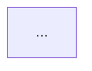

# Brief chung — reverse SRS cũ Delta (SRC-22 web + SRC-23 mobile)

> Dùng cho agent **viết** (1 agent / 1 phần) và agent **soát** (1 agent khác / 1 phần). Đọc hết file này trước
> khi làm. Skill gốc: `.claude/skills/reverse-doc/SKILL.md` — brief này là cách chạy skill đó cho nguồn rất lớn,
> chỗ nào brief nói khác skill thì theo brief.

## 1. Việc cần làm

Tái lập **bộ SRS hiện trạng** (as-is) của hệ thống ERP Delta từ SRS cũ, cho đúng 1 **phần** của 1 feature.
Đầu vào là 1 lát nguồn `_workspace/reverse-run/slices/{feature}--{phần}.md`. Mọi thứ cần đọc nằm trong lát đó
(kèm ảnh link trong lát). KHÔNG đọc thêm `docs/` hay nguồn khác, trừ file mẫu ở Mục 9.

- **Nguồn = bằng chứng, không hỏi lại ai.** Chưa rõ / thiếu / mâu thuẫn → ghi OQ, Gap hoặc Conflict ở `gaps.md`.
- **Bóc hết, không lược.** Mỗi use case, điều kiện, nhánh, thông báo, quy tắc nhập liệu, thông báo hệ thống, lịch
  sử hoạt động có trong lát đều phải có chỗ trong bộ tài liệu. Mục lục đầu lát là danh sách phải phủ hết.
- **Không sáng tạo.** Không thêm chức năng, quy tắc, con số nào không có trong lát. Không "cải tiến".
- **Không sinh:** userflow, wireframe, prototype, tài liệu API, user story.
- **Bộ reverse là đầu vào cho bước cải tiến.** Sau reverse, mỗi feature được brainstorm lại (flow, chức năng,
  UI/UX theo design system mới). Vì vậy ngoài chép đúng nguồn, phải **làm lộ ra chỗ hệ thống cũ chưa xử lý**
  theo Mục 6b — vẫn chỉ dựa trên nguồn, không tự đề xuất giải pháp.
- Tài liệu viết bằng tiếng Việt, ngôn ngữ nghiệp vụ cho BA/PO đọc. Không tên cột DB, endpoint, tên hàm, payload.
  Chi tiết kỹ thuật có trong nguồn mà mang ý nghĩa nghiệp vụ (vd "tìm kiếm phản hồi sau 300ms") → ghi thành NFR.
- Không dùng `§` (viết "Mục N"); `→` chỉ dùng trong bảng và sơ đồ.

## 2. Đọc nguồn

- Lát giữ mốc trang: SRS Web `<!-- Page N -->`, SRS Mobile `<!-- Trang N -->`. Mỗi mệnh đề ghi được số trang.
- Bảng chuyển từ PDF hay bị cắt ô (chữ dồn sang dòng dưới, `Cột n` là nhãn kỹ thuật). Ghép lại theo nghĩa; chỗ
  không ghép chắc được → 🟡 + Gap "bảng nguồn bị cắt, cần đối chiếu PDF trang N".
- **Ảnh:** link ảnh trong lát là đường dẫn từ gốc repo, mở bằng Read.
  - Ảnh tên `…-flow.png` (lưu đồ hoạt động) và `…-state.png` (lưu đồ trạng thái): **đọc hết**.
  - Ảnh `…-screen.png` (mockup màn hình) và `…-img.png`: **đọc hết**. Câu chữ popup xác nhận, popup lỗi, toast,
    màn kết quả, lịch sử hoạt động thường chỉ có trên ảnh. Chữ nhìn thấy trên ảnh = ✅ (chép nguyên văn); quy tắc
    phía sau màn hình suy từ ảnh = 🟡. Chữ ảnh khác chữ bảng mô tả → ghi cả hai + Conflict (Nguồn A = bảng mô tả,
    Nguồn B = ảnh), không tự chọn.
  - Ảnh có dữ liệu thật (tên người, biển số) → không chép dữ liệu đó vào tài liệu.
- Mục ghi `[not done]` trong nguồn → vẫn tái lập, nhãn tối đa 🟡, ghi chú "bản gốc ghi chưa xong" + OQ.
- Mục ghi `[v2.0]` → là một phần bản gốc, giữ nhãn bình thường; ghi `[v2.0]` trong cột Nguồn.
- **Cùng chức năng có 2 bản** (vd `[v1.0] UC04.00.01 …` và `[v2.0] UC04.00.01 …`, hoặc mục ghi "old version"):
  lấy **bản mới** làm hiện trạng để viết FR/BR/flow. Bản cũ chỉ ghi điểm khác vào `gaps.md` Mục 3 Conflicts
  (cột Nguồn A = bản mới, Nguồn B = bản cũ) + 1 OQ "bản cũ còn dùng không / bỏ hẳn được không".
- SRS Web và SRS Mobile nói cùng một điểm: khớp → 🔵 lên được ✅ nếu cả hai ghi rõ; lệch → ghi cả hai, 🟡, Conflict.

## 3. Nhãn tin cậy (bắt buộc cho mọi dòng bảng và mọi câu suy luận)

| Nhãn | Khi nào |
|---|---|
| ✅ chắc chắn | Nguồn ghi rõ đúng điều đó (chữ, bảng, hoặc chữ nhìn thấy trên ảnh) |
| 🔵 suy đoán | Suy ra từ ≥2 chỗ trong nguồn cùng chỉ về một hướng |
| 🟡 cần xác nhận | Suy từ 1 chỗ, hoặc nguồn thiếu hẳn (khi thiếu hẳn: để `<!-- TBD -->` + OQ) |

Không viết giọng chắc nịch cho 🔵/🟡. Không đánh ✅ cho dòng không có nguồn.

## 4. Cách ghi nguồn — phải đọc được, không mã trơn

Người đọc phải biết ngay nguồn là gì mà không phải tra. **Cấm** ghi trơn `S1`, `03.01`, `tr.288`, `CHG-20`.

| Trường hợp | Cách ghi trong cột Nguồn |
|---|---|
| Một mục SRS Web | `SRS Web tr.288 — UC03.01.01 Xem danh mục dịch vụ kỹ thuật` |
| Một mục SRS Mobile | `SRS Mobile tr.145 — UC04.01.02 Xem chi tiết báo cáo sự cố` |
| Mục không có mã UC | `SRS Web tr.1205 — Lưu đồ trạng thái lệnh sửa chữa` |
| Hình | `SRS Web tr.288 — hình lưu đồ UC03.01.01 Xem danh mục dịch vụ kỹ thuật` |
| Nhiều chỗ | ngăn bằng `; ` — `SRS Web tr.1205 — Lưu đồ trạng thái lệnh sửa chữa; SRS Mobile tr.116 — UC03.01.03 Nghiệm thu lệnh sửa chữa` |
| Ghi chép thay đổi (chỉ ở Mục 0.3) | `Thay đổi CHG-20 (loại phí hạch toán theo địa điểm)` |

Tên mục lấy đúng theo nguồn (có thể rút gọn chữ thừa, giữ nghĩa). Trong câu văn (Mục 1, 9, 10) ghi nguồn cuối câu
trong ngoặc vuông cùng định dạng: `… ✅ [SRS Web tr.288 — UC03.01.01 Xem danh mục dịch vụ kỹ thuật]`.

**Câu hỏi mở ghi 2 lớp nguồn** (OQ sẽ được hỏi khách):
- `Nguồn nội bộ:` đường dẫn file + trang, vd `docs-input/srs-cu/lg-srs-export.md` trang 288.
- `Nguồn khách:` tên tài liệu như khách gọi + bản + mục + trang, vd `Tài liệu SRS - ERP Delta 3.0 (Web) (bản 30/9/2026), UC03.01.01 Xem danh mục Dịch vụ kỹ thuật, trang 288`.
  Mobile: `Tài liệu SRS - ERP Delta 3.0 (Mobile) (bản 5/10/2026), …`.

## 5. Mã tạm theo phần

Nhiều phần của cùng feature viết song song, nên dùng **mã tạm có chữ phần** (`a`, `b`, `c` = id phần trong tên lát).
Script ghép sẽ đánh lại thành mã chính thức và sửa mọi chỗ tham chiếu. Dùng đúng dạng, không tự đặt dạng khác:

| Loại | Mã tạm (phần `a`) | Sau khi ghép |
|---|---|---|
| Yêu cầu chức năng | `FR-a001` | `FR-{feature}-001` |
| Yêu cầu phi chức năng | `NFR-a001` | `NFR-{feature}-001` |
| Quy tắc nghiệp vụ | `BR-a001` | `BR-{feature}-001` |
| Lỗi / thông báo lỗi | `E-a001` | `E-{feature}-001` |
| Tiêu chí thành công | `SC-a01` | `SC-{feature}-01` |
| Câu hỏi mở | `OQ-a1` | `OQ-1` |
| Use case | `uc-{slug}` (slug tiếng Anh, kebab-case, duy nhất trong phần, vd `uc-view-service-catalog`) | giữ nguyên |

## 6. File phải ghi (chỉ trong `_workspace/reverse-run/staging/{feature}/{phần}/`)

Không ghi ở bất kỳ chỗ nào khác. Không frontmatter (script ghép thêm). Đầu mục dùng đúng chữ dưới đây.

### `spec.md`

```
## 0.3 Khác biệt với thay đổi đã chốt     ← chỉ khi lát có bảng "Thay đổi …"; không có thì bỏ hẳn mục này
| Điểm | SRS cũ nói | Thay đổi nói | Đề xuất |
## 1. Scope                                 ← văn xuôi: phần này đặc tả gì + "Ngoài phạm vi:" (bullet)
## 2. Actors & Stakeholders                 ← bảng theo template
## 3. Functional Requirements (FR)
## 4. Non-Functional Requirements (NFR)
## 5. Business Rules
## 6. Error Matrix
## 7. Success Criteria
## 8. Data Entities                         ← bảng phân loại đối tượng (Mục 6b.1), chi tiết ở erd.md
## 9. Flows                                 ← bullet tóm tắt mỗi flow 1 dòng, chi tiết ở flows.md
## 10. Screens                              ← mỗi màn 1 bullet: tên màn — mục đích — trường/nút chính — nguồn
## 11. Constraints, Dependencies & Assumptions   ← 3 bảng con theo template
## 12. Open Questions                       ← chỉ OQ chặn tiến độ, dạng "- [ ] OQ-a1: …"
```

Cột các bảng lấy đúng theo `_templates/reverse-srs-spec.md` (mọi bảng có cột **Nguồn** và **Nhãn**).

- **FR:** mỗi use case trong nguồn ≥1 FR. Description ghi đủ điều kiện, nhánh, câu chữ — không 1 dòng chung chung.
  Priority: nguồn không ghi → để `—` (không tự đặt P0/P1).
- **BR:** mỗi quy tắc nhập liệu, điều kiện được làm, ràng buộc trạng thái, quy tắc tính toán = 1 BR. Cột
  Implements FR trỏ mã FR tạm.
- **Error Matrix:** mỗi thông báo lỗi / cảnh báo / toast lỗi có trong nguồn = 1 dòng, **câu chữ chép nguyên văn**
  trong ngoặc kép ở cột Title hoặc Recovery.
- **Thông báo & Lịch sử hoạt động** (bảng "Thông báo & Lịch sử hoạt động" trong nguồn): ghi thành FR (gửi thông báo
  cho ai, khi nào, nội dung) + BR, giữ nguyên câu chữ thông báo.
- **Nhóm cùng khuôn:** khi ≥3 mục con dùng cùng bộ use case (vd 5 danh mục đều có Xem danh sách / Xem chi tiết /
  Tạo đề xuất / Huỷ đề xuất / Phê duyệt-Từ chối), viết FR và use case **một lần cho cả khuôn**, rồi thêm bảng
  **"Khác biệt theo {mục con}"** ngay sau bảng FR: `| Mục con | Khác ở đâu (trường, quy tắc, câu chữ, quyền) | Nguồn | Nhãn |`.
  Mọi khác biệt dù nhỏ đều phải vào bảng này. Không có khác biệt thì ghi rõ "không khác" kèm nguồn đã so.
- **0.3** (khi có): mỗi dòng thay đổi trong lát → 1 dòng: SRS cũ nói gì (nguồn SRS) · thay đổi nói gì (ghi
  `Thay đổi CHG-xx (mô tả)` + trạng thái ✅/🟡/⏳ của dòng đó) · Đề xuất: `/cr` hoặc `/gap`.

### `gaps.md`

```
## 1. Open Questions        ← "- [ ] OQ-a1: {câu hỏi} — liên quan: Mục {n} · cần: PO/BA/khách quyết — Nguồn nội bộ: … — Nguồn khách: …"
## 2. Gaps                  ← bảng | Mục spec | Thiếu gì | Hệ quả nếu không bổ sung | Cần ai bổ sung |
## 3. Conflicts             ← bảng | Điểm | Nguồn A nói | Nguồn B nói | Ghi chú |
## 4. Inferred assumptions  ← "- {giả định} — validate: {cách} · nếu sai: {hệ quả}"
## 5. Ứng viên tham số (cho /srs)
| Tên đề xuất | Loại | Giá trị Delta | Dùng ở | Nguồn |
```

**Mục 1 — chỉ câu còn phải hỏi.** OQ là câu sẽ hỏi khách. Câu mà chính nguồn đã trả lời (kể cả nhờ ảnh) → không
ghi OQ; ghi kết luận thẳng vào chỗ liên quan kèm nguồn.

**Mục 5 — ứng viên tham số SaaS.** Sản phẩm sẽ bán cho nhiều khách, Delta là khách đầu. Liệt kê mọi thứ trong
phần này mà khách khác có thể muốn khác: con số chính sách (hạn mức tiền, số ngày, số lần, thời gian, tỷ lệ),
danh sách lựa chọn (loại, lý do, trạng thái có thể đổi tên), tính năng có thể bật/tắt, tên riêng của Delta (tên
công ty, chi nhánh, đối tác, mã chứng từ riêng).
- Tên đề xuất: kebab-case tiếng Việt không dấu, vd `nguong-tam-ung`. **KHÔNG có tiền tố `P-`** (gate SaaS sẽ báo lỗi
  mã P chưa đăng ký; mã P gán ở bước `/srs`).
- Loại: `con số` / `danh sách` / `bật-tắt` / `tên riêng`.
- Dùng ở: mã FR/BR tạm.
- Không xếp tầng Lõi/Cấu hình ở bước này — chỉ liệt kê ứng viên.

### `flows.md`

Mỗi flow nghiệp vụ chính (thường 1 use case = 1 flow; gộp các use case quá đơn giản):

````
## Flow: {tên flow}

> Nguồn: {cách ghi Mục 4}. {ghi chú bước suy đoán nếu có}

### Sequence — {tên flow}
```mermaid
sequenceDiagram
...
```

### Activity — {tên flow}

````

- **Mỗi flow PHẢI có đủ cả 2 sơ đồ.** Chỉ vẽ bước có trong nguồn (lưu đồ ảnh hoặc chữ); bước suy đoán ghi `(🟡)` trong nhãn.
- An toàn cú pháp mermaid: không dùng `;` trong nhãn; nhãn có ký tự đặc biệt `( ) / : , " < >` thì bọc `"..."`;
  nhãn mũi tên ngắn; không xuống dòng trong nhãn (dùng `<br>` trong flowchart); tên participant không dấu cách
  (dùng `participant HT as Hệ thống`).

### `states.md`

Mỗi đối tượng có trạng thái (bảng/lưu đồ trạng thái trong nguồn): `## State: {tên đối tượng}` + `> Nguồn: …` +
`stateDiagram-v2` + bảng `| Trạng thái | Ý nghĩa | Vào bằng | Ra bằng | Nguồn | Nhãn |`. Không có đối tượng nhiều
trạng thái → ghi 1 dòng "Phần này không có đối tượng nhiều trạng thái" + nguồn đã xem.

### `erd.md`

`erDiagram` (tên entity viết HOA không dấu, thuộc tính dạng `chuoi ten_thuoc_tinh "mô tả"`) + bảng Entity Reference
+ bảng Quan hệ theo `_templates/reverse-srs-erd.md`. Chỉ thuộc tính nghiệp vụ có trong nguồn.

### `usecases/uc-{slug}.md` + `usecases/index-rows.md`

Mỗi use case (hoặc mỗi khuôn use case nếu là nhóm cùng khuôn) 1 file, đủ 8 mục:

```
# UC-{slug} — {tên use case}
## a. Introduction        ← mục đích + mã UC gốc (vd UC03.01.01) + nhãn + nguồn
## b. Actors & Objects
## c. Pre-conditions
## d. Expected result     ← điều kiện sau
## e. Activity diagram    ← "Xem flows.md — Flow: {tên}" + Main Success Scenario (đánh số) + Extensions (3a, 3b…), mỗi bước có nhãn + nguồn
## f. Screens             ← màn liên quan (tên màn như Mục 10)
## g. Related FR          ← bảng | Bước | FR | BR | Error | Nguồn |
## h. Open Questions      ← OQ tạm liên quan, hoặc "Không có"
```

`usecases/index-rows.md` chỉ chứa các dòng bảng (không đầu bảng), mỗi use case 1 dòng:
`| [uc-{slug}](./uc-{slug}.md) | {tên} | {actor chính} | FR-a001..a005 | {màn} | E-a001..a003 | OQ-a1 | {nguồn} | {nhãn} |`

`gaps.md` **không viết Mục 6** — script ghép tự chép các vấn đề đội đã ghi nhận cho feature này
(`docs/_product/legacy-issues.md`).

## 6b. Soi để cải tiến (bắt buộc, chỉ dựa trên nguồn)

1. **Phân loại đối tượng.** Trong `spec.md` Mục 8, mỗi đối tượng 1 dòng bảng
   `| Đối tượng | Loại | Mô tả | Nguồn | Nhãn |`, cột Loại là một trong:
   - `Chứng từ nghiệp vụ (BusinessDocument)` — phát sinh từ nghiệp vụ, có vòng đời riêng, có thể sinh chứng từ
     khác (vd báo giá, lệnh sửa chữa, phiếu nhập/xuất, phiếu cấp dầu, đề nghị thanh toán).
   - `Yêu cầu thay đổi (ChangeRequest)` — đề xuất tạo mới / cập nhật một bản ghi danh mục, qua phê duyệt mới có
     hiệu lực (vd đề xuất tạo mới dịch vụ kỹ thuật, yêu cầu cập nhật phương tiện, yêu cầu định mức).
   - `Danh mục` — bản ghi gốc dùng lại (sản phẩm, xưởng, nhà cung cấp, phương tiện).
   - `Khác` — ghi rõ là gì.
   Không phân loại chắc được → 🟡 + OQ.
2. **Kết thúc và ngõ cụt.** Trong `states.md`, sau mỗi sơ đồ trạng thái thêm bảng
   `| Trạng thái | Là kết thúc? | Đường ra (huỷ / đóng / sửa) | Chứng từ đã sinh phía sau xử lý thế nào khi huỷ | Sửa được sau khi chốt? | Nguồn | Nhãn |`.
   Mỗi trạng thái không phải kết thúc mà nguồn không cho đường ra, mỗi trường hợp huỷ giữa chừng mà nguồn không
   nói chứng từ phía sau (vd đã xuất kho) xử lý thế nào, mỗi chứng từ đã chốt mà không sửa/điều chỉnh được →
   1 dòng Gap trong `gaps.md` Mục 2 với cột Mục spec = `Ngõ cụt — {đối tượng}: {trạng thái}`.
3. **Vòng đời danh mục.** Feature có danh mục → trong `spec.md` Mục 3, ngay sau bảng FR, thêm bảng
   `| Danh mục | Tạo | Sửa | Ngừng dùng | Xoá | Nguồn | Nhãn |` (ô = `có — {cách}` / `không có trong nguồn`).
   Thiếu sửa / ngừng dùng / xoá → 1 dòng Gap `Vòng đời danh mục — {danh mục}`.
4. **Báo cáo, dashboard.** Mỗi báo cáo trong Mục 10 ghi thêm: lọc theo gì, có cấu hình / chọn chỉ tiêu được không
   (theo nguồn). Báo cáo cố định, không lọc → 1 dòng Gap `Báo cáo cố định — {tên}`.

## 7. Agent viết — trình tự

1. Đọc brief này, `_templates/reverse-srs-spec.md`, rồi đọc **hết** lát nguồn (đọc theo đoạn nếu dài) và ảnh lưu đồ.
2. Viết các file ở Mục 6 vào đúng thư mục staging.
3. Tự soát trước khi báo xong: đi lần lượt Mục lục phần đầu lát, mỗi mục đã có FR/use case chưa; mọi dòng bảng có
   Nguồn đọc được (Mục 4) + Nhãn; mỗi flow đủ 2 sơ đồ; không còn mã chính thức kiểu `FR-workshop-catalog-001` (chỉ mã tạm).
4. Trả lời ngắn (KHÔNG dán nội dung file): số FR / NFR / BR / E / use case / flow / OQ / ứng viên tham số; số dòng
   ✅/🔵/🟡; mục nào trong Mục lục phần không đủ nguồn để viết; chỗ nào nguồn khó đọc.

## 8. Agent soát — trình tự

Agent soát **không sửa file nội dung**. Chỉ ghi `review.md` trong cùng thư mục staging.

1. Đọc brief này, lát nguồn, rồi các file agent viết đã ghi.
2. Soát theo 4 câu, mỗi phát hiện ghi rõ file + mã/dòng + bằng chứng nguồn:
   - **Thiếu:** mục nào trong Mục lục phần, quy tắc, thông báo, câu chữ, trường có điều kiện trong nguồn mà tài
     liệu không có? (soát kỹ bảng mô tả trường cột Validate/Mô tả, bảng Thông báo & Lịch sử hoạt động)
   - **Sai / bịa:** mệnh đề nào không neo được về nguồn, hoặc nói khác nguồn? Câu chữ nào không đúng nguyên văn?
   - **Nhãn:** dòng nào nhãn cao hơn bằng chứng (✅ mà chỉ suy ra, 🔵 mà chỉ có 1 chỗ, quy tắc suy từ ảnh mà ✅)?
   - **Nguồn đọc được:** ô Nguồn nào ghi mã trơn hoặc sai trang?
   - **Soi để cải tiến (Mục 6b):** đối tượng nào chưa phân loại hoặc phân loại sai; trạng thái nào không có đường
     ra mà chưa ghi Gap ngõ cụt; danh mục nào thiếu bảng vòng đời; báo cáo nào chưa ghi lọc/cấu hình.
3. `review.md`: bảng `| # | Loại (Thiếu/Sai/Nhãn/Nguồn) | File · mã | Phát hiện | Bằng chứng (nguồn) | Đề xuất sửa |`,
   xếp Thiếu và Sai lên trước. Cuối file 1 dòng tổng: số phát hiện theo loại.
4. Trả lời ngắn: số phát hiện theo loại + 3 phát hiện nặng nhất. Không chép nội dung tài liệu.

## 9. File mẫu được đọc

- `_templates/reverse-srs-spec.md`, `_templates/reverse-gaps.md`, `_templates/reverse-srs-flows.md`,
  `_templates/reverse-srs-states.md`, `_templates/reverse-srs-erd.md`, `_templates/reverse-usecase-index.md`
- `.claude/skills/reverse-doc/references/example-reverse-doc.md` (mẫu đầu ra; cách ghi nguồn `S1` trong mẫu
  KHÔNG dùng — theo Mục 4 của brief này)
