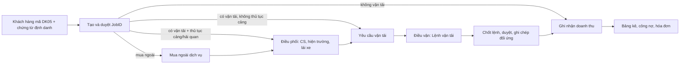

# Bộ kiến thức nghiệp vụ Điều vận - Logistics

Sep 26, 2026 · @szi

Tài liệu này gom 3 SOP của Delta (Giao nhận container, Quy trình điều phối, Quy trình cung cấp dịch vụ tổng quát) thành một "bản đồ" và một bảng thuật ngữ để BA nắm nhanh trước khi đọc chi tiết. Nội dung được rút ra từ 3 file gốc; chỗ nào tài liệu chưa rõ thì ghi ở phần cuối.

## Cách dùng và thứ tự đọc

Đọc theo thứ tự dưới đây sẽ nhanh hơn đọc lần lượt từng file, vì file 1 cho thuật ngữ, file 2 cho luồng vận hành, file 3 cho phần tiền và chứng từ.

| Bước | Đọc gì | Mục đích | Thời gian gợi ý |
| --- | --- | --- | --- |
| 1 | Đọc phần 2 và 3 của tài liệu này (bản đồ + thuật ngữ) | Có khung tư duy trước khi vào chi tiết | 20 phút |
| 2 | Giao nhận container, toàn bộ | Hiểu cảng/bãi, EIR, Lệnh nâng/hạ, SI-CY-DEM-DET, tình huống bất thường | 30 phút |
| 3 | Điều phối, mục 4 (Định nghĩa) + mục 5.1 (FCL xuất) | Hiểu JobID → Yêu cầu vận tải → Lệnh vận tải và cách chia việc CS / hiện trường / lái xe | 60 phút |
| 4 | Điều phối, mục 5.2 đến 5.6 | Chỉ đọc chỗ khác với FCL xuất (LCL, air, FCL nhập, CFS nhập, air nhập) | 45 phút |
| 5 | Cung cấp dịch vụ tổng quát, mục 4.1 đến 4.3 và 5.1 đến 5.2 | Bảng mã JobID J01 đến J12, luồng tạo và duyệt JobID | 45 phút |
| 6 | Cung cấp dịch vụ tổng quát, phần còn lại (mua ngoài, hạch toán nội bộ, công nợ, hóa đơn) | Đọc khi cần, vì ít ảnh hưởng trực tiếp tới module điều vận | Khi cần |

Với 2 file quy trình, xem bảng "Theo dõi những thay đổi" ở đầu file trước khi đọc. Ngày 24/9/2026 có các chỗ mới đổi: thông tin viết hóa đơn trả hộ chuyển về bước tạo JobID, trigger ghi nhận số lượng container "phục vụ BA", và xử lý tiền nâng vỏ đã thanh toán nhưng không chọn được vỏ.

## Từ viết tắt thường gặp

Bảng dưới ghi cả dạng đầy đủ tiếng Anh và nghĩa tiếng Việt để dễ nhớ. Các dòng đánh dấu "SOP không giải thích" là dạng phổ biến trong ngành hoặc tôi suy ra từ ngữ cảnh, cần xác nhận với khách hàng.

### Loại hàng và đơn vị vận chuyển

| Viết tắt | Viết đầy đủ | Nghĩa |
| --- | --- | --- |
| FCL | Full Container Load | Hàng nguyên container, một chủ hàng đóng trọn container |
| LCL | Less than Container Load | Hàng lẻ, gộp nhiều chủ hàng trong một container, đóng/dỡ tại kho CFS |
| CFS | Container Freight Station | Kho gom hàng lẻ đóng vào container hoặc dỡ ra khỏi container. SOP dùng "CFS" cho hàng lẻ ở mã JobID J02, J05 |
| HC | High Cube | Container cao hơn thường (ví dụ 40ft HC) |
| CBT | SOP không giải thích. Thường hiểu là Cross-Border Transport | Vận tải qua biên giới/cửa khẩu (mã J07). Cần xác nhận |
| Air | Air freight | Hàng hàng không |

### Chứng từ và lệnh

| Viết tắt | Viết đầy đủ | Nghĩa |
| --- | --- | --- |
| B/L | Bill of Lading | Vận đơn đường biển, hợp đồng vận tải giữa người gửi hàng và người vận tải |
| MB/L | Master Bill of Lading | Vận đơn chính, do hãng tàu (carrier) cấp |
| HB/L | House Bill of Lading | Vận đơn thứ cấp, do NVOCC cấp |
| MAWB | Master Air Waybill | Vận đơn hàng không chính, do hãng hàng không cấp |
| HAWB | House Air Waybill | Vận đơn hàng không thứ cấp, do đại lý hàng hóa cấp |
| D/O | Delivery Order | Lệnh giao hàng, cho phép nhận hàng tại cảng, kho CFS hoặc kho hàng không |
| eDO | electronic Delivery Order | Lệnh giao hàng điện tử |
| EIR | Equipment Interchange Receipt | Phiếu giao nhận container, dân trong nghề gọi là "phơi" |
| VGM | Verified Gross Mass | Phiếu khai tổng khối lượng container đã xác minh (hàng cộng vỏ) |
| eBooking | electronic Booking | Đặt chỗ vận tải điện tử, nhận qua ePort |
| P/L | Packing List | Phiếu đóng gói: số kiện, shipping mark (SOP LCL xuất dùng để kho đối chiếu). Lưu ý: trong tài chính, "P/L jobsheet" lại là Profit and Loss, xem bên dưới |

### Mốc thời gian và phí

| Viết tắt | Viết đầy đủ | Nghĩa |
| --- | --- | --- |
| SI | Shipping Instruction | Hạn nộp chi tiết lô hàng cho hãng tàu để phát hành vận đơn |
| CY | Container Yard (cut-off) | Hạn hạ container hàng xuất về cảng, còn gọi là closing time |
| DEM | Demurrage | Phí lưu container hàng nhập quá thời gian miễn phí tại cảng |
| DET | Detention | Phí lưu container ngoài cảng quá số ngày miễn phí |
| THC | Terminal Handling Charge | Phí xếp dỡ tại cảng, một trong các local charges khách phải nộp để lấy D/O |

### Đối tác, hệ thống và vai trò

| Viết tắt | Viết đầy đủ | Nghĩa |
| --- | --- | --- |
| NVOCC | Non-Vessel Operating Common Carrier | Người vận tải không sở hữu tàu (đại lý hàng hóa), cấp HB/L |
| 3PL | Third-Party Logistics | Khách hàng thuê ngoài dịch vụ logistics, có nhiều account con |
| CS | Customer Service. SOP không giải thích | Nhân viên chăm sóc khách hàng, khai JobID và làm lệnh |
| DK05 | SOP không giải thích | Mã khách hàng dùng để tạo JobID; cần hỏi nghĩa của ký hiệu này |
| MIS | Management Information System. SOP không giải thích | Hệ thống thông tin quản lý; "Delta MIS" là phần mềm đang xây dựng |
| VNACCS/VCIS | Vietnam Automated Cargo And Port Consolidated System / Vietnam Customs Intelligence Information System | Hệ thống thông quan tự động và thông tin nghiệp vụ hải quan Việt Nam |
| ePort | electronic Port | Hệ thống cảng điện tử |
| API | Application Programming Interface | Giao diện kết nối giữa hai phần mềm (ví dụ gửi yêu cầu lập hóa đơn sang MISA) |

### Quy trình nội bộ của Delta

| Viết tắt | Viết đầy đủ | Nghĩa |
| --- | --- | --- |
| QTCCDV | Quy trình cung cấp dịch vụ tổng quát | Tạo và duyệt JobID, mua ngoài, công nợ, hóa đơn |
| QTĐP | Quy trình điều phối | Biến JobID thành Yêu cầu vận tải sau thủ tục cảng/kho |
| QTĐV | Quy trình điều vận | Lập Lệnh vận tải từ Yêu cầu vận tải, giao xe và lái xe |
| QTTT | Quy trình quản lý quỹ và thanh toán | Thanh toán chi phí trả hộ, tạm ứng |
| YCVT | Yêu cầu vận tải | Viết tắt do tôi dùng trong sơ đồ cho ngắn, SOP viết đầy đủ |

### Tài chính

| Viết tắt | Viết đầy đủ | Nghĩa |
| --- | --- | --- |
| COGS | Cost of Goods Sold | Giá vốn hàng bán; mã phí 02xx, chi phí trực tiếp tạo doanh thu |
| P/L (jobsheet) | Profit and Loss | Bảng lãi lỗ của từng JobID |
| BA | Business Analyst | Chuyên viên phân tích nghiệp vụ |

## Bản đồ tổng thể: từ JobID đến Lệnh vận tải

Mọi lô hàng đi qua chuỗi JobID nghiệp vụ, Yêu cầu vận tải, Lệnh vận tải; dữ liệu chạy hai chiều giữa ba đối tượng này. Chức năng Điều phối (thay cho "Phân công công việc" của Delta 2.0) chỉ chuyển thông tin qua lại, không lưu dữ liệu; khi Lệnh vận tải chốt và ghi chép đối ứng xong, JobID bị gỡ khỏi danh sách điều phối.

Sơ đồ trên đơn giản hóa: JobID có mua ngoài nhưng không vận tải thì đi thẳng tới ghi nhận doanh thu.

### Các đối tượng chính

| Đối tượng | Là gì | Quan hệ | Trạng thái |
| --- | --- | --- | --- |
| Mã DK05 | Mã khách hàng dùng để tạo JobID; chứa hạn mức tín dụng, thông tin viết hóa đơn trả hộ, nhân viên CS phụ trách. Khách 3PL có quan hệ Mẹ-Con | 1 DK05 có nhiều JobID | Không nêu |
| JobID nghiệp vụ | Đối tượng trung tâm của một lô hàng; gom phạm vi dịch vụ, doanh thu, chi phí. Có 12 loại (xem bảng dưới) | 1 JobID → 1 hoặc nhiều Yêu cầu vận tải. Không nối trực tiếp với Lệnh vận tải | Chờ xử lý → Đã tạo Yêu cầu vận tải → Đã thực hiện Lệnh vận tải |
| Yêu cầu vận tải | Bước trung gian biến JobID thành Lệnh vận tải; được tạo sau khi xong thủ tục giao nhận tại cảng, sân bay, cửa khẩu. Mã: JobID00 (1 yêu cầu) hoặc JobIDxx, xx từ 01 đến 99 (J01, J04) | Chỉ tạo 1 lần cho 1 JobID (hay 1 container). 1 Yêu cầu vận tải → 1 Lệnh vận tải mặc định | Đã được tạo → Đã lập Lệnh vận tải → Đã thực hiện Lệnh vận tải |
| Lệnh vận tải | Do điều vận lập: gán xe + lái xe, xác định cung đường (Map API). Lái xe cập nhật thông tin, chứng từ lên lệnh và dữ liệu được đẩy ngược về JobID | Hàng cần nhiều xe (bulk, CFS/air lớn): 1 Yêu cầu vận tải → nhiều Lệnh, điều vận khai số xe trước. Hàng nhỏ (CFS/air): nhiều Yêu cầu → 1 Lệnh | Chi tiết nằm ở Quy trình điều vận, chưa có trong 3 file này |

### 12 loại JobID

| Mã | Loại | Chứng từ định danh | Yêu cầu vận tải tạo ra |
| --- | --- | --- | --- |
| J01 | Hàng xuất FCL | Booking Note | Nhiều, theo số container chọn được |
| J02 | Hàng xuất CFS | Booking Note | 1 |
| J03 | Hàng xuất air | Booking Note | 1 |
| J04 | Hàng nhập FCL | Vận đơn + Giấy báo hàng đến | Nhiều, theo số container trên vận đơn |
| J05 | Hàng nhập CFS | Vận đơn + Giấy báo hàng đến | 1 |
| J06 | Hàng nhập air | Vận đơn + Giấy báo hàng đến | 1 |
| J07 | Hàng CBT | Biên bản giao nhận hàng hóa ký khi nhận hàng | 1. Phần lớn không có thủ tục cảng nên thành Yêu cầu vận tải ngay |
| J08 | Đóng hàng đường sắt | Kế hoạch chạy hàng của khách | 1, không qua thủ tục cảng |
| J09 | Trả hàng đường sắt | Kế hoạch chạy hàng của khách | 1, không qua thủ tục cảng |
| J10 | Vận tải milkrun | Kế hoạch chạy hàng của khách | 1, không qua thủ tục cảng |
| J11 | Xe thuê bao | Biên bản giao nhận hàng hóa. Mỗi ngày làm việc tạo 1 JobID (đối tượng thu cước và tính lương lái xe), 1 JobID có nhiều Lệnh vận tải theo số chuyến | 1, không qua thủ tục cảng |
| J12 | Dịch vụ giá trị gia tăng | Không có | Không đi qua điều phối |

## Bảng thuật ngữ

Thuật ngữ chia theo 5 nhóm; mỗi dòng ghi nghĩa theo cách 3 SOP dùng.

### 1. Cảng, bãi, thiết bị

| Thuật ngữ | Nghĩa trong SOP |
| --- | --- |
| Cảng | Nơi tàu vào, nên là nơi nhận hàng nhập và giao hàng xuất. Có thể nhận hoặc trả vỏ container rỗng |
| Bãi (depot) | Nơi nhận hoặc trả vỏ container rỗng; tàu không vào nên thường không giao nhận container hàng |
| Shipside | Depot ký hợp đồng với hãng tàu, nhận container hàng xuất rồi chuyển tiếp ra cảng xuất tàu để giảm ùn tắc. Depot không nhận container phải kiểm hóa hải quan |
| Vỏ container | Container rỗng |
| Chì (seal) | Niêm phong container hàng xuất. Nơi cấp chì có thể là bãi cấp vỏ, lái xe nhận khi lấy vỏ, hoặc một nơi thứ hai |
| ePort | Hệ thống cảng điện tử: đăng ký lịch nâng/hạ, nhận eDO/eBooking từ hãng tàu, thanh toán online, tra cứu vị trí container và EIR. Cảng/bãi có hay không có ePort quyết định ai làm lệnh (CS hay lái xe/hiện trường) |
| Mooc | Rơ moóc chở container (SOP nhắc đến "xe/mooc vào cảng/bãi") |
| VNACCS/VCIS, mã trung chuyển | Hệ thống hải quan. Depot phải đăng ký mã trung chuyển thì mới nhận container hàng xuất, và tờ khai phải kê mã này |

### 2. Chứng từ và lệnh

| Thuật ngữ | Nghĩa trong SOP | Ai làm hoặc cần gì |
| --- | --- | --- |
| Booking Note | Chứng từ của hãng tàu; định danh JobID hàng xuất và là căn cứ lập bảng kê công nợ. Ghi nơi nhận vỏ, nơi hạ hàng, các mốc SI/CY | Khách gửi; một số hãng không ghi nơi nhận vỏ nên phải xin email hãng |
| Vận đơn (B/L) | Chứng từ gửi hàng quan trọng nhất, là hợp đồng vận tải. MB/L (MAWB) do carrier cấp; HB/L (HAWB) do NVOCC cấp | Định danh JobID hàng nhập (kèm Giấy báo hàng đến) |
| Lệnh giao hàng D/O, eDO | Cho phép nhận hàng tại cảng, kho CFS, kho hàng không. Phát hành sau khi khách nộp đủ local charges và xuất trình vận đơn gốc hoặc telex release. Ghi hạn DEM/DET | Hãng tàu hoặc đại lý |
| Lệnh nối | Hàng đi qua NVOCC cần 2 D/O: carrier cấp cho NVOCC, NVOCC cấp cho người nhận | Đại lý hàng hóa |
| Phiếu EIR ("phơi") | Biên nhận giao container. Ghi tình trạng container (căn cứ phí vệ sinh, bồi thường) và thời gian nhận/trả (căn cứ phí lưu). Cấp mỗi lần giao nhận: cấp vỏ rỗng, hạ hàng xuất, lấy hàng nhập, trả vỏ rỗng | Lái xe nhận; cảng có ePort thì lấy online, không thì lái xe chụp ảnh |
| Lệnh nâng container rỗng (xuất) | Chọn và nhận vỏ để đóng hàng xuất. Cần Booking Note có nơi nhận vỏ | CS, hiện trường, hoặc lái xe tùy cảng/bãi |
| Lệnh cấp container khống | Lệnh nâng vỏ không ghi số container; dùng khi bãi bắt buộc có xe vào mới được chọn vỏ. Lái xe tự chọn vỏ và lấy chì | CS hoặc hiện trường làm lệnh, lái xe thực hiện |
| Lệnh hạ container hàng (xuất) | Cho phép hạ container hàng xuống cảng/bãi. Điều kiện: Booking Note, đã trả phí hạ, đã kê VGM trên ePort | CS (cảng có ePort) hoặc lái xe (không ePort) |
| Lệnh nâng container hàng (nhập) | Cho phép lấy hàng nhập. Điều kiện: có eDO, hải quan thanh lý tờ khai, đã trả phí nâng. Làm 1 lần cho cả vận đơn | CS trên ePort; không có ePort thì hiện trường |
| Lệnh hạ container rỗng (nhập) | Cho phép trả vỏ sau khi dỡ hàng. Điều kiện: EIR nhận hàng, D/O, email nơi trả vỏ của hãng. Thường làm từng container vì mỗi loại 20ft/40ft/40HC có thể trả ở nơi khác nhau | CS hoặc lái xe |
| VGM | Phiếu khai tổng khối lượng container do người xuất khẩu kê, nộp hãng tàu để xếp hàng. Phải có trước khi làm lệnh hạ hàng | Khách cung cấp; CS khè trên ePort |
| Biên bản giao hàng | Ghi nhận giao nhận với khách: ngày giờ, địa điểm, số container, số chì, biển số xe, tên lái xe, số lượng và tình trạng hàng, hai bên ký. Lập 2 bản; lái xe chụp ảnh gửi ngay nhóm Zalo chứng từ | Lái xe. Căn cứ đối chiếu công nợ |
| Phiếu xuất kho, phiếu cân | Khách phát hành phiếu xuất kho; phiếu cân là cơ sở lập VGM | Khách |
| Tờ khai hải quan, mã QR | Được upload lên JobID; node AI đọc số tờ khai để ghi tự động | CS |

### 3. Mốc thời gian và phí tàu

Bốn mốc SI, CY, DEM, DET quyết định lô hàng có kịp tàu và có bị phạt không. CS ghi đủ bốn mốc lên bảng kế hoạch ngay khi nhận Booking Note hoặc D/O; điều vận rà hàng ngày.

| Mốc | Nghĩa | Cảnh báo | Nếu trễ |
| --- | --- | --- | --- |
| SI (Shipping Instruction) | Hạn nộp chi tiết lô hàng cho hãng tàu để phát hành vận đơn; Delta phải cung cấp số container và số chì cho khách trước hạn | Trước 24 giờ | Phí sửa vận đơn, vận đơn trễ, có thể phải chuyển Booking Note sang chuyến sau |
| CY (cut-off, closing time) | Hạn hạ container hàng xuất về cảng để kịp xếp tàu; ghi nhận bằng thời gian trên EIR hạ hàng | Trước 12 giờ | Rớt tàu, phí lưu bãi, phí đổi Booking Note |
| DEM (Demurrage) | Hạn lưu container hàng nhập miễn phí, tính từ khi tàu cập cảng, ghi trên D/O | Trước 2 ngày | Phí lưu container hàng |
| DET (Detention) | Số ngày miễn phí giữ container ngoài cảng, tính từ EIR nhận container hàng đến khi trả vỏ đúng nơi hãng chỉ định | Trước 2 ngày | Phí lưu container |

Khi sắp quá hạn phải báo khách và hãng tàu bằng văn bản, không dùng điện thoại. Mọi trường hợp quá hạn phải ghi nguyên nhân theo 3 nhóm (khách giao chậm, Delta điều xe chậm hoặc xe hỏng, bên thứ ba như cảng, hải quan, hãng tàu) để quy trách nhiệm trả phí.

### 4. Loại hàng, đối tác, vai trò trong Delta

| Thuật ngữ | Nghĩa trong SOP |
| --- | --- |
| FCL | Container nguyên, do khách đóng; JobID J01 (xuất), J04 (nhập). Mỗi JobID sinh nhiều Yêu cầu vận tải theo số container |
| LCL / CFS | hàng lẻ gom qua kho CFS; JobID J02 (xuất), J05 (nhập). SOP điều phối gọi "LCL xuất" ở mục 5.2 và "CFS nhập" ở mục 5.5 |
| Air | Hàng hàng không; J03, J06. Lệnh giao hàng nhập tại Nội Bài có 3 cách cấp: giấy, eDO có cấp cho khách, eDO gửi thẳng kho mà không cấp cho khách |
| CBT | Hàng vận tải qua cửa khẩu sang nước khác (SOP nêu phụ cấp cửa khẩu, hải quan hai nước); J07. SOP không viết đầy đủ chữ CBT |
| Bulk, milkrun, xe thuê bao | Bulk cần nhiều xe cho 1 JobID; milkrun (J10) và xe thuê bao (J11) là vận tải không thủ tục cảng |
| Carrier, NVOCC | Carrier là người vận tải thực (hãng tàu, hãng không). NVOCC là người vận tải không tàu (đại lý hàng hóa), cấp HB/L |
| 3PL | Khách hàng dịch vụ logistics thuê ngoài; có mã DK05 Mẹ-Con cho các account của họ. Account nhỏ chưa có DK05 phải duyệt thông tin viết hóa đơn trả hộ từng lần |
| CS | Nhân viên chăm sóc khách hàng: tạo JobID, khai thông tin chứng từ lên JobID, làm lệnh trên ePort. Là người có quyền thanh toán mặc định của JobID |
| Nhân viên hiện trường | Làm lệnh, chọn vỏ, thanh toán tại cảng/bãi; có ca trực 17h30 đến 8h sáng |
| Cán bộ quản lý hiện trường | Operations manager; giao việc cho hiện trường hoặc lái xe trên phần mềm |
| Điều vận | Lập Lệnh vận tải từ Yêu cầu vận tải; gán xe, lái xe; rà và cảnh báo các mốc SI/CY/DEM/DET |
| Lái xe | Trực tiếp giao nhận container tại cảng/bãi và khách, nhận EIR, chụp ảnh chứng từ. Gặp bất thường phải dừng lại, không tự quyết định |

### 5. Tài chính và phần mềm

| Thuật ngữ | Nghĩa trong SOP |
| --- | --- |
| Delta MIS, Delta 3.0 | Phần mềm đang xây dựng; Điều phối nằm ở trung tâm của Delta MIS giai đoạn 1. Delta 2.0 là bản hiện tại có chức năng "Phân công công việc" |
| QTCCDV, QTĐP, QTĐV, QTTT | Quy trình cung cấp dịch vụ tổng quát, điều phối, điều vận, quản lý quỹ và thanh toán |
| Quyền thanh toán | Quyền thanh toán chi phí gắn với JobID, mặc định thuộc CS; chuyển sang hiện trường hoặc lái xe chỉ khi quản lý giao việc hoặc điều vận lập Lệnh vận tải. CS giao việc mà không từ chối trên phần mềm thì quyền chưa chuyển |
| Phân luồng | Phần mềm đưa JobID vào đúng nhánh xử lý tùy cảng/bãi có ePort hay không, có yêu cầu xe mới được chọn vỏ hay không (FCL xuất có 6 trường hợp) |
| Node AI | Thành phần AI đọc ảnh số container khi chọn vỏ và đọc số tờ khai; người dùng xác nhận hoặc sửa |
| Chi phí trả hộ, doanh thu trả hộ | Chi phí trả hộ mã phí 03xx, doanh thu trả hộ mã phí 0201; đối tác xuất hóa đơn loại này không phải Nhà cung cấp. Viết hóa đơn trả hộ theo thông tin trên DK05 |
| Mua ngoài dịch vụ | Chi phí trực tiếp tạo doanh thu, mã phí 02xx (COGS): khai hải quan, thủ tục chuyên ngành, nâng hạ, vận tải thuê ngoài. Nhà cung cấp có thời hạn thanh toán và hạn mức tín dụng |
| Hạch toán nội bộ | Chia chi phí, lợi nhuận giữa các chi nhánh khi 1 JobID có nhiều chi nhánh tham gia. 3 cách đã nêu: cost plus, revenue minus, profit share |
| Duyệt JobID | 3 nguyên tắc: không có nợ quá hạn; nếu DK05 có hạn mức tín dụng thì dư nợ cộng chi phí dở dang phải nhỏ hơn hạn mức; không có hạn mức thì bỏ nguyên tắc 2. Trước khi xong Giai đoạn 1 người tạo JobID tự duyệt, sau đó phần mềm duyệt |
| Chi phí dở dang | Phí dịch vụ và trả hộ đã thực hiện nhưng chưa lập bảng kê |
| Bảng kê, P/L jobsheet | Bảng kê doanh thu/chi phí trên JobID dùng để thu nợ khách; P/L jobsheet là lãi lỗ từng JobID |
| Công tác phí | Chi phí không hóa đơn như phí bến bãi, tiền chọn vỏ, phụ cấp cửa khẩu; hạch toán theo định mức và quyết định giao việc |
| MISA meInvoice | Giải pháp phát hành hóa đơn điện tử qua API từ bảng kê doanh thu; trả mã cơ quan thuế, link PDF và XML |

## Điểm cần lưu ý và câu hỏi cần làm rõ

Các mục dưới đây là chỗ chính SOP đánh dấu "cần phát triển" hoặc chỗ tôi thấy chưa khớp giữa các file; đây là danh sách để bạn mang đi hỏi khách hàng.

### Điểm SOP đã nêu là việc cần làm

- **Số container trên Booking Note khác số trên JobID.** Xảy ra khi khách chia Booking Note cho nhiều nhà cung cấp, hoặc khi không chọn đủ vỏ đạt chuẩn. Với trường hợp thứ hai có 3 hướng: chốt số đã chọn và giảm JobID, chờ chọn đủ (tính thời gian lưu xe), hoặc đổi Booking Note. SOP yêu cầu một trigger ghi ngược số container về JobID từ bước chọn vỏ (hiện trường) và QTĐV (lái xe).
- **Đổi Booking Note sau khi đã phân luồng hay lập Lệnh vận tải:** không hủy được JobID; cần quy trình mới để sửa JobID theo Booking Note mới, SOP ghi "sẽ phát triển trong quá trình BA".
- **Tiền nâng vỏ đã thanh toán nhưng không chọn được vỏ:** chưa có giải pháp ghi nhận hóa đơn; SOP Giao nhận container nêu thực tế là hoàn tiền sau 7 ngày về tài khoản người làm lệnh, và bãi THT thu 120.000 đồng mỗi lần đổi vỏ.
- **Bước giao việc làm Lệnh hạ hàng cho hiện trường:** SOP ghi cần phát triển thêm để cán bộ quản lý tham gia.
- **Lệnh giao hàng air nhập ở Nội Bài:** phải xử lý được cả 3 cách cấp lệnh (giấy, eDO có cấp, eDO không cấp).
- **Nhân viên hiện trường trực ngoài giờ:** cần chức năng phân công người trực theo ngày và cho người trực quyền như cán bộ quản lý để tự giao việc trên mọi JobID đang điều phối.
- **Nguyên tắc vận hành xuyên suốt:** không ai tự giao việc cho nhau, vì quyền thanh toán, workload và KPI đều tính theo việc được giao trên phần mềm. Khi có bất thường, lái xe dừng lại, chụp ảnh, báo điều vận; rời cảng/kho trước khi ghi nhận thì Delta chịu trách nhiệm.

### Câu hỏi nên làm rõ

- Quy trình điều vận (QTĐV) chưa nằm trong 3 file này. Cần xin để biết trạng thái của Lệnh vận tải, cách gộp nhiều Yêu cầu vận tải vào 1 Lệnh, và cách lái xe chọn vỏ.
- "CBT" viết đầy đủ là gì, và quy trình CBT có khác ở phần thủ tục cửa khẩu không? Điều phối nhắc J07 "phần lớn" không có thủ tục cảng, chưa nêu phần còn lại.
- SOP Giao nhận container có dòng "Cái này không cần" ngay sau yêu cầu lập bảng số ngày miễn phí DEM/DET theo từng hãng tàu. Cần xác nhận đây là bỏ yêu cầu đó hay ghi chú còn sót lại từ bản nháp.
- Quy tắc tạo Yêu cầu vận tải nói "chỉ tạo một lần cho một JobID" nhưng đồng thời J01 và J04 tạo nhiều Yêu cầu vận tải. Nên hiểu là một lần cho mỗi container, và cần khách hàng xác nhận.
- SOP điều phối viết "J01 đến J011" ở một chỗ (chắc là J11) và nói bảng thông tin JobID đủ cho J01 đến J07, trong khi J08 đến J11 không qua thủ tục cảng và tự thành Yêu cầu vận tải. Nên xác nhận phạm vi J01 đến J11 và bộ trường dữ liệu riêng của J08 đến J11.
- Ngưỡng 5 triệu đồng để phân biệt tạm ứng tiền mặt và chuyển khoản có thay đổi theo chi nhánh hay khách hàng không?
- Phụ lục (Bảng thông tin JobID, định mức chi phí, danh mục địa điểm giao nhận) là bảng dữ liệu chính cho thiết kế; trong SOP điều phối, phụ lục này hiện đang trống (ghi "sẽ hoàn thiện" hoặc "chưa phát triển"), nên cần xin bản đầy đủ.

## So sánh 6 luồng điều phối

Cả 6 luồng chung một khung: CS khai thông tin, chứng từ lên JobID, sau đó thủ tục tại cảng/kho được làm, Yêu cầu vận tải được tạo, điều vận lập Lệnh vận tải, và phần mềm chặn chốt lệnh nếu còn bước nào thiếu. Chỗ khác nhau là (1) ai làm thủ tục tại cảng/kho, (2) Yêu cầu vận tải được tạo khi nào, và (3) dữ liệu nào phải ghi ngược về JobID.

| Luồng | CS chuẩn bị trên JobID | Thủ tục tại cảng/kho, ai làm | Yêu cầu vận tải tạo khi nào | Dữ liệu hoặc đặc thù riêng |
| --- | --- | --- | --- | --- |
| FCL xuất (J01, mục 5.1) | Thời gian đóng hàng, nhận vỏ, cảng hạ hàng, email hãng tàu, tờ khai + QR. Sau đó CS làm Lệnh nâng vỏ (khống hoặc thật) hoặc từ chối để chuyển cho quản lý | Chọn vỏ và làm Lệnh nâng vỏ: CS, hiện trường hoặc lái xe, chia 6 trường hợp theo cảng/bãi có ePort hay không và có yêu cầu xe mới được chọn vỏ hay không. Lệnh hạ hàng làm sau, do CS hoặc lái xe | Theo từng trường hợp: ngay khi CS làm xong lệnh khống hoặc khi giao lái xe chọn vỏ, hoặc sau khi hiện trường chọn vỏ xong. Số yêu cầu = số container chọn được | Chọn vỏ có node AI đọc ảnh số container. Số container có thể ít hơn Booking Note. Quyền thanh toán chuyển từ CS sang hiện trường hoặc lái xe theo giao việc |
| LCL xuất (J02, mục 5.2) | Thời gian nhận hàng, Packing List, link Google Maps kho CFS, tờ khai + QR. Kho Pan Hải An cần thêm truck sheet | Nhân viên hiện trường làm Phiếu nhập kho tại kho CFS (thanh lý tờ khai, kiểm hóa nếu có, Booking Note của co-loader, Packing List) | Ngay sau khi quản lý giao việc cho hiện trường | Số kiện, CBM, kgs trên Phiếu nhập kho (tally sheet) thay cho số ước tính trên Booking Note, dùng tính cước. Có hạn cut-off kho |
| Air xuất (J03, mục 5.3) | Thời gian nhận hàng, Commercial Invoice, link Google Maps kho hàng không, tờ khai + QR | Nhân viên hiện trường làm Phiếu cân hàng tại kho hàng không | Ngay sau khi quản lý giao việc | Số kiện, kích thước kiện để ra chargeable weight, gross weight trên Phiếu cân thay số trên Booking Note. Phần mềm cần tự tính CBM. Có closing time |
| FCL nhập (J04, mục 5.4) | Thời gian trả hàng, nhận container, trả vỏ, cảng/bãi hạ vỏ, email hãng, tờ khai + QR. Thanh toán hãng tàu để lấy eDO, gia hạn eDO, cược vỏ | Cảng có ePort: CS đổi eDO thành Lệnh nâng hàng cho mọi container trên vận đơn. Không có ePort: quản lý giao hiện trường làm. Lệnh hạ vỏ làm sau, do CS hoặc lái xe | Khi đủ Lệnh nâng hàng cho tất cả container trên vận đơn. Nhiều yêu cầu, theo số container | Lái xe upload EIR lúc nhận hàng và biên bản giao hàng lúc trả. Thời hạn eDO, thời hạn trả vỏ ghi lên JobID để theo dõi DEM/DET. Một số cảng có ePort vẫn cần hiện trường đến thanh lý tờ khai |
| CFS nhập (J05, mục 5.5) | Thời gian trả hàng, link Google Maps kho CFS, tờ khai + QR. CS thanh toán đại lý để lấy eDO/D/O | Nhân viên hiện trường thanh lý tờ khai, thanh toán phí facility và lưu kho, làm Phiếu xuất kho. Kho giao, hiện trường làm thủ tục, lái xe nhận, ba bên gần như đồng thời | Ngay sau khi quản lý giao việc | Hiện trường chụp ảnh hàng khi nhận để xử lý tranh chấp. Lái xe upload biên bản giao hàng. Thêm trách nhiệm theo từng khách, chưa liệt kê |
| Air nhập (J06, mục 5.6) | Như CFS nhập nhưng kho hàng không nhận hàng. Thanh toán đại lý để lấy eDO | Như CFS nhập: hiện trường làm thanh lý tờ khai và Phiếu xuất kho, ba bên tại kho | Ngay sau khi quản lý giao việc | Lệnh giao hàng tại Nội Bài có 3 cách cấp (giấy, eDO có cấp cho khách, eDO gửi thẳng kho). Chi phí ngoài định mức thanh toán theo quy trình quỹ và thanh toán |

Nhóm xuất FCL là luồng phức tạp nhất vì có 6 nhánh và việc chọn vỏ; các luồng hàng lẻ và air đơn giản hơn, chủ yếu là một người hiện trường được giao việc và cập nhật số liệu thực đo vào JobID.

### Sơ đồ khung chung

&#91;embedded content: khung chung của 6 luồng điều phối · 3 nhánh\]

Sau khi CS khai JobID, luồng đi theo một trong ba nhánh tùy ai làm thủ tục và khi nào cần Yêu cầu vận tải; từ đó trở đi cả 6 luồng giống nhau.

### FCL xuất: 6 nhánh chọn vỏ

&#91;embedded content: FCL xuất · 2 câu hỏi, 6 trường hợp\]

Luồng FCL xuất rẽ theo hai câu hỏi về cảng/bãi cấp vỏ: có bắt buộc có xe mới được chọn vỏ không, và có ePort không. YCVT là Yêu cầu vận tải; các số 1 đến 6 khớp với 6 trường hợp trong SOP mục 5.1.2.2.

### Hàm ý cho thiết kế module

- **Một khung, nhiều biến thể.** Nên mô hình hóa 6 luồng bằng một máy trạng thái chung cho JobID (Chờ xử lý, Đã tạo Yêu cầu vận tải, Đã thực hiện Lệnh vận tải) và cấu hình các bước theo loại JobID và thuộc tính cảng/kho, thay vì viết 6 quy trình riêng.
- **Danh mục cảng, bãi, kho quyết định phân luồng.** Các thuộc tính SOP đã dùng để rẽ nhánh: có ePort hay không, bắt buộc có xe mới được chọn vỏ hay không, có cho chọn vỏ trước hay không, có cần hiện trường đến thanh lý tờ khai dù có ePort hay không. Luồng FCL nhập có câu hỏi còn để ngỏ: phân biệt thuộc tính cuối cùng trên danh mục như thế nào.
- **Số liệu thực thay số ước tính.** Với LCL và air xuất, số kiện, CBM, kgs trên Booking Note chỉ là ước tính; số trên phiếu nhập kho hoặc phiếu cân ghi đè lên JobID để tính cước. SOP muốn có bước xác thực nhưng ở air ghi rõ không làm tăng workload, nên cần thảo luận cách xác thực đơn giản.
- **Quyền thanh toán đi theo giao việc.** Bước quản lý giao việc vừa để chia việc vừa để cấp quyền thanh toán và ghi chi phí định mức cho hiện trường, nên không thể bỏ bước này dù luồng đơn giản.
- **Chặn chốt lệnh khi thiếu việc.** Cả 6 luồng đều kết thúc bằng quy tắc này, nên mỗi luồng cần danh sách "việc bắt buộc" để phần mềm kiểm tra.

### Điểm chưa rõ riêng của phần so sánh

- Phụ lục của SOP điều phối đang trống: Bảng thông tin JobID ghi "sẽ hoàn thiện", Định mức chi phí ghi "chưa phát triển", Danh mục địa điểm nằm trong tài liệu "Giao nhận hàng hóa" phát hành 1/9/2026, không có trong 3 file này.
- Trách nhiệm của lái xe với CFS nhập và air nhập có dòng "cần làm rõ theo từng khách hàng".
- Đánh số tham chiếu trong SOP lệch: luồng air xuất viết bước là 5.2.2.x thay vì 5.3.2.x, và air nhập tham chiếu "Bước 5.5.2.2" thay vì 5.6.2.2. Nên hỏi tác giả trước khi lấy số bước làm mã yêu cầu.

## Mã chi phí trong luồng điều phối

Chỗ này cần nói rõ trước: 3 file SOP chỉ nêu **nhóm mã phí** (02xx, 03xx, 0201), không liệt kê mã chi tiết cho từng khoản như phí nâng vỏ hay phí hạ hàng. Bảng chi tiết nằm ở "Danh mục" mà SOP tham chiếu và "Định mức chi phí" (SOP điều phối ghi "chưa phát triển"). Tôi không đoán mã để tránh bạn phải sửa lại sau, nên dưới đây chỉ gồm những gì SOP nói chắc, cộng cột "mã cần xin" để bạn đánh dấu khi nhận được danh mục.

### Nhóm mã phí SOP đã nêu

| Mã phí | Nhóm | Phạm vi theo SOP | Quy trình liên quan |
| --- | --- | --- | --- |
| 02xx | Chi phí hàng bán (COGS), mua ngoài dịch vụ trực tiếp tạo doanh thu | Mua dầu diesel cho đội xe; mua ngoài khai báo hải quan, thủ tục chuyên ngành, dịch vụ giá trị gia tăng như nâng hạ, bốc xếp; mua ngoài vận tải | Quản lý dầu diesel, QTCCDV, QTĐV |
| 0201 | Doanh thu trả hộ | Đối tác xuất hóa đơn loại này không được coi là Nhà cung cấp | QTCCDV (ghi nhận doanh thu trả hộ lên JobID), QTTT |
| 03xx | Chi phí trả hộ (có hóa đơn, trả thay khách) | Đối tác xuất hóa đơn loại này không phải Nhà cung cấp | QTCCDV, QTTT (SOP điều phối nói chi phí trả hộ thanh toán theo QTTT) |
| Các mã khác (trừ 03xx) | Chi phí phục vụ quản lý | Phụ tùng, vật tư, dịch vụ sửa chữa xe; hàng hóa dịch vụ quản lý khác | Quản lý xưởng, QTTT. Không thuộc luồng điều phối |

### Khoản chi trong luồng điều phối và cách SOP phân loại

Cột "loại" lấy từ SOP; cột "mã cần xin" để trống vì SOP chưa gán mã.

| Khoản chi | Ai trả | Loại theo SOP | Hạch toán | Mã cần xin |
| --- | --- | --- | --- | --- |
| Phí nâng vỏ container rỗng (xuất) | CS, hiện trường hoặc lái xe theo giao việc | Chi phí trả hộ có hóa đơn hoặc phiếu thu | Theo JobID | Ô trống |
| Phí hạ container hàng (xuất) | CS trên ePort, hoặc lái xe | Như trên | Theo JobID | Ô trống |
| Phí nâng container hàng (nhập) | CS trên ePort, hoặc hiện trường | Như trên | Theo JobID | Ô trống |
| Phí hạ vỏ rỗng (nhập) | CS trên ePort, hoặc lái xe | Như trên | Theo JobID | Ô trống |
| Phí lấy eDO, D/O; gia hạn eDO | CS (yêu cầu thanh toán nợ hóa đơn) | Trả cho hãng tàu hoặc đại lý | Theo JobID | Ô trống |
| Tiền cược vỏ container | CS | Thanh toán cho hãng tàu; SOP không nói rõ có tính là chi phí hay khoản cược thu hồi | Theo JobID | Ô trống, cần hỏi cách ghi nhận |
| Phí facility, lưu kho (CFS, air nhập) | Hiện trường | Chi phí trả hộ có hóa đơn | Theo JobID | Ô trống |
| Phí vệ sinh, sửa chữa container; phí lưu container, lưu bãi (DEM, DET) | Phát sinh theo trách nhiệm (khách, Delta, bên thứ ba) | SOP yêu cầu ghi nguyên nhân để quy trách nhiệm trả phí | Theo bên chịu | Ô trống |
| Phí đổi vỏ (bãi THT 120.000 đồng/lần) | Lái xe hoặc hiện trường | Phát sinh khi đổi vỏ sau khi đã lên mooc | Theo bên gây ra | Ô trống |
| Tiền chọn vỏ container tại cảng | Hiện trường, trả cho quản lý bãi | Chi phí định mức, không hóa đơn | Công tác phí | Ô trống |
| Tiền lấy container tại cảng | Lái xe, trả cho lái xe nâng | Chi phí định mức, không hóa đơn | Thu nhập chịu thuế của lái xe | Ô trống |
| Phí bến bãi không hóa đơn | Lái xe, hiện trường | Chi phí định mức, không hóa đơn | Công tác phí | Ô trống |
| Tiền nộp đội mở tờ khai, tiền kiểm hóa, tiền thanh lý tờ khai tại bãi | CS, hiện trường | Chi phí định mức, không hóa đơn. HCM đã bỏ hết; Hải Phòng mới bỏ cho hàng nhập FCL và xuất FCL tại một số cảng | Công tác phí theo lô hàng | Ô trống |
| Phụ cấp hỗ trợ vận hành xe (đường cấm, quá tải) | Lái xe, kê trên Lệnh vận tải | Chi phí định mức, không hóa đơn | Thu nhập chịu thuế của lái xe | Ô trống |
| Phụ cấp cửa khẩu và chi phí trả hộ tại cửa khẩu (hàng CBT) | Lái xe | Chi phí định mức, không hóa đơn | Công tác phí đi nước ngoài | Ô trống |

Quy tắc thanh toán đi kèm: hóa đơn dưới 5 triệu đồng thanh toán bằng tạm ứng tiền mặt cá nhân, trên 5 triệu làm tạm ứng chuyển khoản hoặc thanh toán nợ hóa đơn để kế toán chuyển; khoản chi không định mức thì thanh toán theo quy trình quỹ và thanh toán. Việc phân loại 03xx cho nhóm phí nâng hạ trên là suy luận của tôi từ định nghĩa "chi phí trả hộ có hóa đơn"; SOP chưa xác nhận.

## Nhân sự tham gia và flow theo vai trò

Có 5 vai trò làm việc trong luồng điều phối, cộng phần mềm đứng giữa để chuyển việc và chặn lỗi. Việc phân vai trò quan trọng vì quyền thanh toán chi phí chỉ được chuyển theo bước giao việc.

| Vai trò | Việc chính trong luồng điều phối | Quyền phần mềm cấp |
| --- | --- | --- |
| Trợ lý AI (khâu tạo JobID, trước điều phối) | Đọc chứng từ định danh để tạo JobID. Trong điều phối có thêm node AI đọc số tờ khai và số container từ ảnh | Không có; người dùng xác nhận hoặc sửa |
| CS | Khai thông tin, chứng từ lên JobID; thanh toán lấy eDO (nhập); làm lệnh trên ePort; để chuyển cho quản lý thì phải từ chối trên phần mềm | Quyền thanh toán mặc định của JobID, sau khi khai đủ thông tin |
| Cán bộ quản lý hiện trường (Operations manager) | Giao việc cho hiện trường hoặc lái xe; phân người trực ngoài giờ 17h30 đến 8h sáng | Giao việc là bước bắt buộc để chuyển quyền thanh toán, ghi chi phí định mức |
| Nhân viên hiện trường | Làm lệnh, chọn vỏ, thanh lý tờ khai, làm phiếu nhập kho/cân/xuất kho tại cảng, kho | Được thanh toán theo JobID được giao |
| Điều vận | Lập Lệnh vận tải, gán xe và lái xe, xác định cung đường; bàn giao chì, giấy tờ; rà cảnh báo SI, CY, DEM, DET | Chuyển quyền thanh toán cho lái xe khi lập Lệnh vận tải |
| Lái xe | Giao nhận container tại cảng, bãi và với khách; chụp ảnh, upload chứng từ lên Lệnh vận tải | Thanh toán chi phí theo Lệnh vận tải |
| Kế toán | Chuyển khoản khoản trên 5 triệu; nếu chưa có API Banking thì upload UNC lên yêu cầu thanh toán | Theo quy trình quỹ và thanh toán |

&#91;embedded content: flow theo vai trò · 5 vai trò, 3 điểm phần mềm tự chuyển việc\]

Sơ đồ dùng cho trường hợp phổ biến nhất. Với hàng nhập, bước 2 gồm thanh toán hãng tàu để lấy eDO trước; nếu cảng có ePort, CS làm luôn lệnh nâng hàng và bỏ qua bước 3, 4. Với FCL xuất, bước 3 còn có nhánh giao lái xe chọn vỏ (xem sơ đồ 6 nhánh). Bước 7 do CS, hiện trường hoặc lái xe làm tùy cảng có ePort hay không.

### Checklist theo vai trò

Mỗi checklist là những gì người đó phải chuẩn bị hoặc làm xong trước khi chuyển việc. Các mục có ngoặc đơn chỉ áp dụng cho luồng được nêu.

#### CS

- [ ] Thời gian khách yêu cầu (đóng hàng, nhận hàng hoặc trả hàng) và các yêu cầu khác của khách
- [ ] Tờ khai hải quan, số tờ khai và mã QR. Nếu Delta không làm hải quan mà vẫn có việc hiện trường thì xin khách cung cấp. Nếu Delta không có việc hiện trường thì JobID không qua điều phối
- [ ] Cảng/bãi hạ hàng (xuất) hoặc cảng nhận container và cảng/bãi hạ vỏ (nhập); email của hãng tàu chỉ định nơi hạ, nếu có
- [ ] Ghi đủ 4 mốc SI, CY, DEM, DET lên bảng kế hoạch ngay khi nhận Booking Note hoặc D/O, không để trống
- [ ] LCL xuất: Packing List, link Google Maps kho CFS, truck sheet (nếu kho Pan Hải An yêu cầu)
- [ ] Air xuất: Commercial Invoice, link Google Maps kho hàng không
- [ ] Nhập: thanh toán lấy eDO (và phí gia hạn nếu có), ghi thời hạn eDO và thời hạn trả vỏ lên JobID, làm thủ tục cược vỏ (FCL) và upload chứng từ cược
- [ ] Cảng có ePort: làm lệnh (nâng vỏ khống, hoặc đổi eDO ra lệnh nâng hàng) và upload lên JobID. Muốn giao lại cho quản lý thì phải từ chối trên phần mềm, không thì quyền thanh toán vẫn thuộc CS
- [ ] Trả phí: hóa đơn dưới 5 triệu đồng tạm ứng tiền mặt, trên 5 triệu làm tạm ứng chuyển khoản hoặc yêu cầu thanh toán nợ hóa đơn
- [ ] Sau khi giao lái xe lệnh vận tải: làm Lệnh hạ (VGM cho hàng xuất; EIR, D/O, email nơi hạ vỏ cho hàng nhập) nếu cảng có ePort và không giao cho hiện trường

#### Cán bộ quản lý hiện trường

- [ ] Giao việc trên phần mềm cho hiện trường hoặc lái xe; không giao miệng vì bước này cấp quyền thanh toán và ghi chi phí định mức
- [ ] FCL xuất: quyết định giao ai làm lệnh nâng vỏ và ai chọn vỏ (hiện trường hoặc lái xe) theo 6 trường hợp
- [ ] Phân nhân viên hiện trường trực từ 17h30 đến 8h sáng và cấp quyền để người trực tự giao việc trên mọi JobID đang điều phối
- [ ] Giao lại khi hiện trường từ chối (đưa JobID trở lại để giao người khác)

#### Nhân viên hiện trường

- [ ] FCL xuất: chọn vỏ, chụp ảnh số container qua app, xác nhận số node AI đọc; ghi số container thực chọn được lên JobID (có thể ít hơn Booking Note); thanh toán tiền nâng vỏ; làm lệnh nâng vỏ; bàn giao Booking Note có số container, chì, dấu xác nhận (hoặc file lệnh cấp từ ePort) cho điều vận
- [ ] LCL xuất: làm Phiếu nhập kho; đối chiếu Booking Note của co-loader, Packing List, tờ khai đã thông quan; upload phiếu và ghi số kiện, CBM, kgs lên JobID
- [ ] Air xuất: làm Phiếu cân hàng; ghi số kiện, kích thước kiện, gross weight lên JobID
- [ ] FCL nhập (giao hiện trường): thanh toán phí nâng hàng, trình eDO, chứng từ cược vỏ, QR tờ khai để lấy Lệnh nâng cho mọi container trên vận đơn; ở một số cảng có ePort vẫn phải đến thanh lý tờ khai
- [ ] CFS nhập và air nhập: chụp ảnh hàng khi nhận; trình eDO và QR để thanh lý tờ khai; trả phí facility, lưu kho; làm Phiếu xuất kho cùng lúc lái xe nhận hàng

#### Điều vận

- [ ] Lập Lệnh vận tải từ Yêu cầu vận tải: gán xe và lái xe, xác định cung đường theo quy trình Map API
- [ ] Hàng cần nhiều xe: khai số xe trên Yêu cầu vận tải trước; không khai thì chỉ lập được 1 lệnh
- [ ] Bàn giao cho lái xe: chì (nếu hiện trường đã nhận), Booking Note kèm giấy giới thiệu hoặc dấu treo của Delta hoặc email hãng tàu (nhận vỏ rỗng)
- [ ] Rà hàng ngày và cảnh báo: SI trước 24 giờ, CY trước 12 giờ, DEM và DET trước 2 ngày; báo khách và hãng tàu bằng văn bản
- [ ] Khi đổi xe hoặc đổi lái xe: cập nhật biển số và tên lái xe mới lên chứng từ

#### Lái xe

- [ ] Nhận đầy đủ thông tin, chứng từ trên Yêu cầu vận tải trước khi đi
- [ ] Chụp ảnh và upload phiếu EIR lên Lệnh vận tải sau mỗi lần nhận hoặc hạ container (lấy trên ePort nếu cảng có)
- [ ] Chụp ảnh Biên bản giao hàng và gửi ngay về nhóm Zalo chứng từ, không đợi về công ty
- [ ] Hàng xuất: upload VGM và Phiếu xuất kho của khách; chụp ảnh thùng xe đã niêm phong nếu khách yêu cầu
- [ ] FCL xuất (khi được giao chọn vỏ): chọn vỏ tại bãi, lấy chì, thanh toán tiền nâng vỏ
- [ ] Khi không cảng có ePort: tự làm lệnh hạ, lấy phiếu thu hoặc hóa đơn về thanh toán với công ty
- [ ] Gặp bất thường (vỏ xấu, chì đứt, hàng thiếu, cảng từ chối): dừng lại, chụp ảnh, báo điều vận, không tự quyết định, không rời cảng hoặc nơi giao khi chưa ghi nhận

#### Kiểm tra cuối trước khi chốt lệnh

- [ ] Mọi việc nêu trong luồng và QTĐV đã xong; nếu còn thiếu, phần mềm không cho lái xe chốt lệnh và không cho điều vận, quản lý duyệt
- [ ] Chi phí nâng và hạ container đã đủ trên JobID thì mới lập được Bảng kê với khách

## Phần mềm bên thứ ba và dữ liệu cần trao đổi

SOP nhắc tới 7 hệ thống ngoài Delta: ePort, hải quan (VNACCS/VCIS), hãng tàu và đại lý, MISA, API Banking, Map API/Google Maps, Zalo. Chỉ MISA và API Banking được mô tả có kết nối API rõ ràng; các hệ thống còn lại đang là thao tác thủ công rồi upload file lên JobID, nên đây là chỗ cần hỏi khách xem có muốn tích hợp hay không.

&#91;embedded content: bản đồ tích hợp · Delta MIS ở giữa, 8 hệ thống xung quanh\]

| Hệ thống | Delta gửi đi | Delta nhận về | Hiện trạng theo SOP | Cần hỏi |
| --- | --- | --- | --- | --- |
| ePort | Trọng lượng VGM, Booking Note upload, yêu cầu đăng ký lịch nâng hạ, thanh toán phí nâng hạ, lưu bãi | Lệnh nâng, hạ, cấp container (file có tên khách, số Booking Note, seal), phiếu EIR, eDO/eBooking, vị trí container, trạng thái thông quan, lịch tàu | CS, hiện trường làm thủ công trên ePort rồi upload file lên JobID; cảng không có ePort thì lái xe chụp ảnh EIR | ePort có API cho doanh nghiệp không; cảng nào có ePort (thuộc tính danh mục cảng) |
| Hải quan (VNACCS/VCIS) | Thủ tục khai báo, thanh lý, kiểm hóa do Delta hoặc khách làm ngoài quy trình điều phối | Tờ khai, số tờ khai, mã QR; mã trung chuyển của depot; kết quả thanh lý, kiểm hóa | Upload tờ khai và QR lên JobID; node AI đọc số tờ khai (SOP nói cần làm); Delta không nối trực tiếp | Phần mềm khai hải quan Delta đang dùng (SOP không nêu tên) có xuất được dữ liệu không |
| Hãng tàu, đại lý (email, cổng eDO) | Phí lấy eDO, phí gia hạn eDO, tiền cược vỏ, yêu cầu gia hạn DEM, DET | eDO, Lệnh nối, Booking Note, thông báo nơi hạ hàng, hạ vỏ, nhận vỏ; thời hạn eDO, thời hạn trả vỏ; ngày miễn phí DEM, DET | Qua email và upload thủ công; SOP không nêu cổng riêng của từng hãng | Hãng nào có cổng eDO; với air nhập Nội Bài cần xử lý cả 3 cách cấp lệnh |
| MISA meInvoice, eSign, AMIS | Thông tin xuất hóa đơn theo mã DK05 và Bảng kê; khi điều chỉnh hoặc thay thế thì thêm số hóa đơn, ký hiệu, ngày phát hành của hóa đơn sai; luồng riêng khi thanh toán nhà cung cấp (QTTT 5.10) | Mã cơ quan thuế, link PDF, link XML; trạng thái hóa đơn gốc (Bị thay thế, Bị điều chỉnh) | Đã mô tả luồng API 100% tự động qua Open API. Ngoài phạm vi điều phối nhưng dùng Bảng kê sinh ra từ JobID và các chi phí ở trên. Thông tin viết hóa đơn trả hộ lấy từ JobID | Phạm vi đợt 1 có gồm MISA không; các mã phí 02xx, 03xx, 0201 ánh xạ sang mã nào trong AMIS |
| API Banking | UNC thanh toán nhà cung cấp (nếu chưa tích hợp, kế toán upload) | Sổ phụ ngân hàng, khoản khách thanh toán theo tên và số tài khoản của mã DK05; các khoản thanh toán làm chi phí dở dang | SOP ghi "nếu đã triển khai" và "nếu chưa triển khai" nên chưa chắc đã có. CS xác nhận các khoản trước khi tính dư nợ | Ngân hàng nào, đã có API chưa |
| Map API, Google Maps | Địa điểm giao nhận để xác định cung đường | Cung đường vận tải khi lập Lệnh vận tải; link Google Maps của kho CFS, kho hàng không được lưu trên JobID hoặc danh mục | SOP nói "quy trình Map API" nhưng không nêu nhà cung cấp | Nhà cung cấp Map API; danh mục địa điểm giao nhận (nằm trong tài liệu phát hành 1/9/2026) |
| Zalo (nhóm chứng từ) | Ảnh Biên bản giao hàng do lái xe gửi ngay sau khi ký | Không | Quy ước hiện tại trong SOP giao nhận container; SOP điều phối chuyển sang upload lên Lệnh vận tải bằng app | Có giữ kênh Zalo song song hay thay hẳn bằng app |

Hai thành phần AI của Delta không phải bên thứ ba nhưng cần quyết định nhà cung cấp mô hình: trợ lý AI đọc chứng từ định danh để tạo JobID (đầu vào ảnh chứng từ, đầu ra thông tin định danh theo loại JobID), và node AI đọc số tờ khai và số container từ ảnh, kèm node tạo debit note từ Bảng kê.
