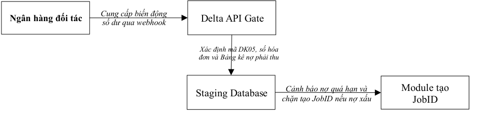
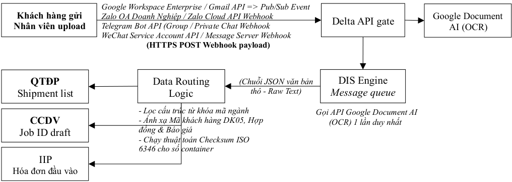
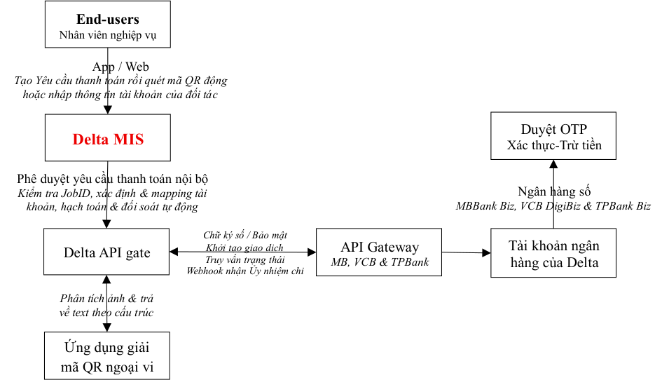
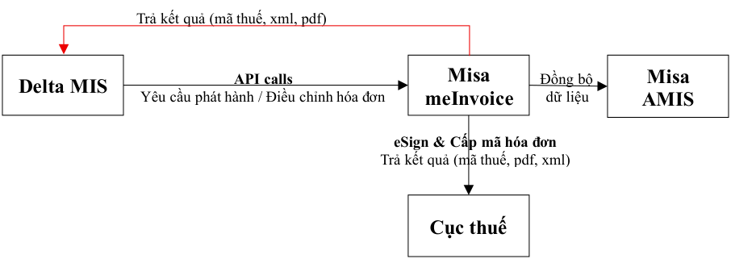
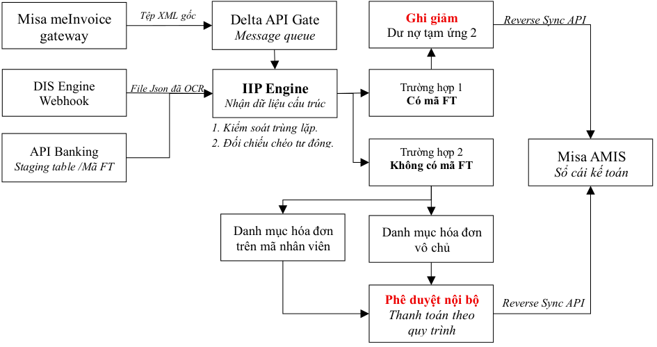
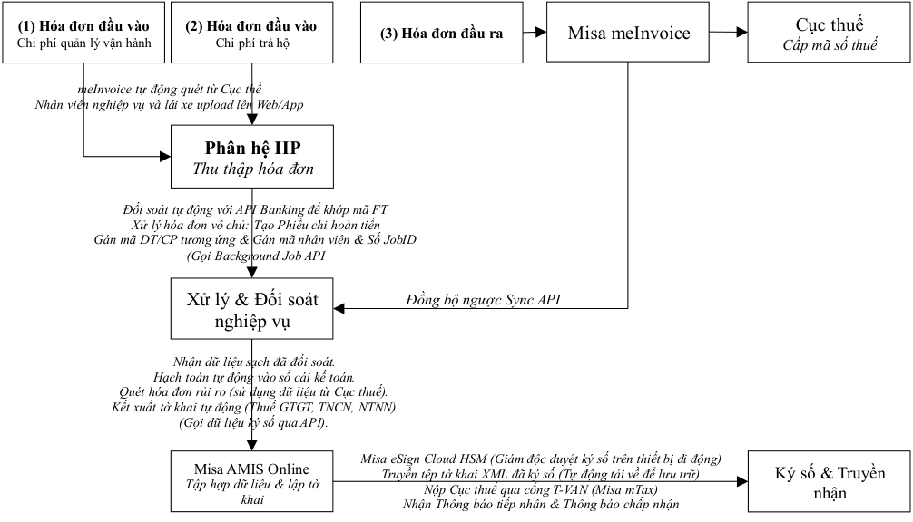

# PHÂN HỆ APAS — Hệ thống tự động hóa thanh toán & Đối soát công nợ

> Nguồn: [`Phân hệ APAS_October 17 2026.pdf`](source/apas-thanh-toan-doi-soat.pdf) (PDF, 22 trang) · Nhận: 2026-10-19 · Chuyển sang Markdown bằng `/intake`.
> Phiên bản: 17/10/2026 (nhận 2026-10-19) — thay bản "Solutions for Invoice Management (SIM)" 12/10/2026 (nhận 2026-10-12), đổi tên thành APAS; xem [thay đổi](../../_changes/2026-10-19-apas-thanh-toan-doi-soat.md).
> Phiên bản: 12/10/2026 (nhận 2026-10-12) — thay bản 11/10/2026 (nhận 2026-10-11); xem [thay đổi](../../_changes/2026-10-12-quan-ly-hoa-don-sim-ban-12-10.md).
> Phiên bản: 11/10/2026 (nhận 2026-10-11) — thay bản 10/10/2026 (nhận 2026-10-11); xem [thay đổi](../../_changes/2026-10-11-quan-ly-hoa-don-sim-ban-11-10.md).
> Phiên bản: 10/10/2026 (nhận 2026-10-11) — thay bản "Hóa đơn trả hộ" 01/10/2026 (nhận 2026-10-02), nay là mục 3.1; xem [thay đổi](../../_changes/2026-10-11-quan-ly-hoa-don-sim.md).
> Thông tin trang: chân trang "SIM_October 17, 2026 — Trang: N/22".

**CÔNG TY CỔ PHẦN QUỐC TẾ DELTA**

**PHÂN HỆ APAS**

**Hệ thống tự động hóa thanh toán & Đối soát công nợ**

=================

**Hà Nội, ngày 17 tháng 10 năm 2026**

## MỤC LỤC

- I. ĐẶT VẤN ĐỀ
- II. GIẢI PHÁP KỸ THUẬT
  - 2.1. Luồng thanh toán tự động qua API Banking
  - 2.2. Khai thác và số hóa tài liệu trung tâm (DIS)
- III. GIẢI PHÁP NGHIỆP VỤ
  - 3.1. Thanh toán qua luồng API Banking (PAB)
    - _3.1.1. Sơ đồ kiến trúc hệ thống_
    - _3.1.2. Các thành phần hệ thống và kết nối ngoại vi_
    - _3.1.3. Kiến trúc luồng dữ liệu_
    - _3.1.4. Xử lý rủi ro kỹ thuật & nghiệp vụ_
  - 3.2. Phát hành và điều chỉnh hóa đơn tự động (SII)
    - _3.2.1. Các vấn đề có liên quan_
    - _3.2.2. Sơ đồ kiến trúc luồng dữ liệu (Data Flow)_
    - _3.2.3. Luồng xử lý nghiệp vụ tự động qua API_
  - 3.3. Tự động đối soát hóa đơn đầu vào và thanh toán (IIP)
  - 3.4. Tự động kê khai & nộp báo cáo thuế hàng tháng (ATR)
- IV. RỦI RO VẬN HÀNH
- V. PHỤ LỤC
  - 5.1. Hướng dẫn phân loại hóa đơn
  - 5.2. Chi phí thực hiện kết nối API Banking

Phân hệ APAS _(Automated Payment & Account Reconciliation System)_ là giải pháp xử lý nghiệp vụ được thiết kế nhằm số hóa toàn diện quy trình quản lý hóa đơn đầu vào và đầu ra tại Delta. Hệ thống đóng vai trò kết nối trực tiếp ba cấu phần trọng yếu: Quy trình vận hành nội bộ (Delta MIS), Cổng thanh toán ngân hàng (API Banking) và Hệ thống kế toán (MISA AMIS).

Mục tiêu cốt lõi của phân hệ là giải quyết bài toán xử lý khối lượng lớn các chứng từ, hóa đơn phát sinh từ các chi phí trả hộ cảng bãi, hãng tàu và chi phí vận hành. Hệ thống tự động thu thập chứng từ đa kênh, trích xuất dữ liệu tài chính và thực hiện đối soát tự động 1-1 với dòng tiền thực chi trên sổ phụ ngân hàng thông qua mã giao dịch (mã FT). Đối với các trường hợp lỗi thông tin hoặc lệch cấu trúc, dữ liệu sẽ được cô lập tại tài khoản ngoại bảng để nhân viên và kế toán tra soát thủ công qua quy trình phê duyệt ba cấp chặt chẽ nhằm bảo vệ an toàn dòng tiền.

Khi thông tin được xác thực chính xác, hệ thống tự động gạch nợ công nợ, đồng bộ dữ liệu sang phần mềm kế toán để ghi sổ cái và lập sẵn các tờ khai thuế định kỳ (GTGT, TNCN, Thuế nhà thầu). Giải pháp này giúp Delta kiểm soát chặt chẽ rủi ro thanh toán trùng, loại bỏ sai sót nhập liệu bằng tay và giảm tải áp lực công việc cho bộ phận kế toán.

## I. ĐẶT VẤN ĐỀ

Là một công ty logistics có dịch vụ cốt lõi là vận tải nội địa, thủ tục hải quan và các thủ tục chuyên ngành, Delta phải xử lý các giao dịch có trị giá nhỏ nhưng khối lượng lớn, vượt quá khả năng xử lý dữ liệu và thực hiện hạch toán chi tiết bằng phương pháp thủ công.

Vì vậy, Delta phát triển giải pháp số hóa toàn diện quy trình quản lý hóa đơn đầu vào, đầu ra (gọi tắt là SIM) từ khâu phát hành (hóa đơn đầu ra) và từ khi thực hiện thanh toán (hóa đơn đầu vào) để làm cơ sở cho việc quản trị dòng tiền trên tài khoản ngân hàng và quỹ tiền mặt của Công ty. Mục tiêu của các giải pháp này:

- Thực hiện phát hành hóa đơn tự động nhằm mapping giữa bảng kê nợ phải thu (doanh thu dịch vụ, doanh thu trả hộ & chi phí trả hộ) với dòng tiền vào tài khoản ngân hàng của Công ty để quản lý nợ phải thu.

- Thực hiện thanh toán tự động qua tài khoản ngân hàng (API Banking) để tích hợp với quy trình nghiệp vụ nhằm giảm workload và cung cấp dữ liệu để quản lý nợ phải thu, nợ phải trả.

- Tự động thu thập hóa đơn đầu vào và mapping từng hóa đơn đầu vào với khoản chi qua luồng API Banking để thực hiện thanh toán và hạch toán chi tiết tự động.

## II. GIẢI PHÁP KỸ THUẬT

### 2.1. Luồng thanh toán tự động qua API Banking

Hiện tại, việc quản lý dòng tiền và đối soát công nợ tại Delta đang gặp các nút thắt lớn (1) Kế toán phải lập lệnh thanh toán chi phí trả hộ và chi phí nhà cung cấp bằng tay trên ngân hàng điện tử (2) Việc quản lý công nợ phải thu và phải trả làm hoàn toàn bằng phương pháp thủ công, dễ gây sai sót và chậm trễ. Vì vậy, phân hệ API Banking được phát triển nhằm tích hợp trực tiếp luồng tiền từ các tài khoản ngân hàng (MB Bank, Vietcombank, TPBank) vào Hệ thống SIM, làm cơ sở dữ liệu thời gian thực để Phân hệ IIP đối chiếu chéo, định danh hóa đơn và tự động hóa quy trình đóng/mở công nợ.

#### 2.1.1. Luồng thực hiện Ủy nhiệm chi (UNC) tự động

Mở rộng quy trình duyệt chi nội bộ trên Delta MIS sang môi trường ngân hàng liên kết, khép kín luồng dữ liệu từ lúc tạo yêu cầu đến khi nhận UNC điện tử.

| Bước | Hành động | Diễn giải luồng dữ liệu & Nghiệp vụ | Hệ thống/Người thực hiện |
|---|---|---|---|
| **1** | **Gửi Yêu cầu thanh toán** | Kích hoạt khi Yêu cầu thanh toán (phí trả hộ, phí NCC...) được duyệt nội bộ trên Delta MIS. Hệ thống tự động đóng gói dữ liệu theo chuẩn định dạng API của ngân hàng. | Delta MIS (Tự động) |
| **2** | **Xác thực Lệnh chi** | Cấp quản lý nhận thông báo trên ứng dụng Ngân hàng số. Thực hiện kiểm tra chéo thông tin định danh (JobID, Khách hàng) và xác thực bằng OTP. | Chủ tài khoản / Đồng chủ tài khoản |
| **3** | **Thực hiện trích tiền** | Hệ thống Core Banking của Ngân hàng kiểm tra số dư và thực hiện chuyển khoản theo lệnh đã xác thực ở Bước 2. | Ngân hàng liên kết |
| **4** | **Trả Ủy nhiệm chi điện tử** | Ngân hàng tự động gửi Webhook trả kết quả kèm file UNC điện tử và **Mã giao dịch tham chiếu (Mã FT)** về Delta MIS để làm cơ sở cho IIP đối soát hóa đơn. | Ngân hàng => Delta MIS |

#### 2.1.2. Luồng số hóa Sổ phụ ngân hàng để quản lý công nợ

Cung cấp dữ liệu đầu vào theo thời gian thực để hệ thống tự động gạch nợ phải thu và đưa ra cảnh báo rủi ro khi khởi tạo JobID mới.

Chữ trong sơ đồ:

- Ngân hàng đối tác — *Cung cấp biến động số dư qua webhook* → Delta API Gate
- Staging Database — Xác định mã DK05, số hóa đơn và Bảng kê nợ phải thu
- Cảnh báo nợ quá hạn và chặn tạo JobID nếu nợ xấu → Module tạo JobID

#### 2.1.3. Quy trình thanh toán qua API Banking

Quy trình này áp dụng cho luồng thanh toán chi phí trả hộ theo JobID, chi phí nhà cung cấp và tiến tới áp dụng cho toàn bộ các trách nhiệm tài chính của Delta. Các bước thực hiện luồng nghiệp vụ:

- **Bước 1 - Yêu cầu thanh toán:** Nhân viên lập Yêu cầu thanh toán trên Delta MIS từ JobID nghiệp vụ hoặc Lệnh vận tải. Bắt buộc phải chọn tài khoản đích từ danh mục đối tác đã chuẩn hóa hoặc quét mã QR động hoặc tĩnh để loại bỏ lỗi nhập liệu nhầm.

- **Bước 2 - Ghi chép đối ứng:** Delta MIS tự động trích xuất dữ liệu, kiểm tra tính hợp lệ của mã QR (đảm bảo thời gian hiệu lực ≥ 3 phút) và tự động tạo nội dung chuyển tiền chứa: Mã nhân viên - Số JobID - Số vận đơn/Booking - Tên chi phí - Tên khách hàng.

- ✓ Nếu sử dụng mã QR động thì không được chèn vào nội dung chuyển tiền trên UNC mà phải mapping số tham chiếu FT của UNC với Yêu cầu thanh toán.

- **Bước 3 - Định tuyến & Lập UNC:** Hệ thống tự động xác định pháp nhân chi trả (Delta HN, Delta HCM, Delta Vận tải) để chọn tài khoản nguồn tương ứng và đẩy lệnh chi qua Transfer API sang ngân hàng.

- **Bước 4 - Phê duyệt tối cao:** Chủ tài khoản hoặc Đồng chủ tài khoản kiểm tra thông tin và thực hiện duyệt OTP trên môi trường App/Web doanh nghiệp của Ngân hàng (MBBank Biz, VCB DigiBiz, TPBank Biz).

- **Bước 5 - Đồng bộ & Lưu vết:** Sau khi ngân hàng trừ tiền thành công, Webhook của ngân hàng bắn dữ liệu về Delta MIS. Hệ thống lưu vết mã giao dịch tham chiếu trên UNC (Mã FT) vào Cơ sở dữ liệu tạm thời (Staging Database/Table) để phục vụ Phân hệ IIP đối chiếu với hóa đơn đầu vào sẽ thu thập về sau.

#### 2.1.4. Rủi ro vận hành

- Xác thực tối cao: Delta MIS không có quyền kiểm soát tài khoản và không được can thiệp dòng tiền đi. Quyền kiểm soát tài khoản tối cao thuộc về môi trường ngân hàng. Delta MIS chỉ có vai trò khởi tạo và lập UNC, dòng tiền chỉ được giải ngân khi có OTP từ Chủ tài khoản/Đồng chủ tài khoản.

- Để chia sẻ workload cho cán bộ quản lý mà vẫn kiểm soát được rủi ro, Delta áp dụng cơ chế đăng ký đồng chủ tài khoản ngân hàng có điều kiện:

   - ✓ Cán bộ quản lý nghiệp vụ: Phê duyệt lệnh chi ≤ 15 triệu/lệnh; tổng hạn mức ≤ 50 triệu/ngày.

   - ✓ Cán bộ quản lý hiện trường: Phê duyệt lệnh chi ≤ 10 triệu/lệnh; tổng hạn mức ≤ 30 triệu/ngày.

   - ✓ _Lưu ý:_ Toàn bộ các lệnh chi do đồng chủ tài khoản duyệt đều được gửi tin nhắn thông báo về Chủ tài khoản chính và tổng hợp báo cáo kiểm soát định kỳ hàng tháng.

- Giải pháp khi mã QR động hết hạn hiệu lực

- ✓ Trường hợp chủ động: Khi thời gian hiệu lực gốc của mã QR quá ngắn (<15 phút), Delta MIS sẽ chặn đẩy lệnh và yêu cầu nhân viên chuyển sang phương thức thanh toán thủ công (mã QR tĩnh/số tài khoản) hoặc yêu cầu cấp quản lý phối hợp duyệt nhanh.

- ✓ Trường hợp bị động (Tiền đã cắt nhưng QR hết hạn): Hệ thống không thực hiện lệnh chi lại. Delta MIS sẽ tự động thu thập UNC điện tử từ Webhook ngân hàng, nhân viên nghiệp vụ cung cấp UNC này cho đối tác để xử lý hạch toán thủ công ngoài hệ thống.

- Đồng bộ trạng thái giữa Delta MIS và MISA AMIS

   - ✓ Rủi ro: Giao dịch API Banking thành công trên Delta MIS nhưng hệ thống kế toán độc lập (MISA AMIS) không ghi nhận, dẫn đến lệch sổ phụ thực tế và sổ sách thuế.

   - ✓ Giải pháp (Luồng đồng bộ ngược): Ngay khi nhận được Webhook báo giao dịch thành công (kèm mã FT), Delta MIS tự động kích hoạt một tiến trình ngầm (Background Job) gọi API sang MISA AMIS để tự động lập chứng từ chi tiền, khớp nối hóa đơn đầu vào tương ứng và ghi nhận mã FT vào trường "Số chứng từ gốc".

### 2.2. Khai thác và số hóa tài liệu trung tâm (DIS)

Thay vì vận hành các giải pháp rời rạc bao gồm gom đơn hàng đa kênh và trích xuất chứng từ tạo Job ID nghiệp vụ làm tăng chi phí phát triển và trùng lặp chi phí gọi API, Delta phát triển giải pháp DIS (Document Ingestion & Structure Engine) đóng vai trò là Hạ tầng thu thập và số hóa dữ liệu tập trung nằm trong hệ thống Delta MIS. DIS hoạt động theo cơ chế quét một lần, dùng nhiều nơi (Single-Scan): Tập trung toàn bộ luồng tiếp nhận chứng từ đa kênh, gọi API sang Google Document AI một lần duy nhất cho mỗi chứng từ để lấy chuỗi chữ thô (Raw Text JSON), sau đó rẽ nhánh xử lý logic để xuất bản đồng thời 3 kết quả đầu ra độc lập.

#### 2.2.1. Giới hạn phạm vi thông tin (scope of data flow)

Thiết kế của DIS Engine phải tuân thủ tuyệt đối phạm vi và luồng dữ liệu như sau:

- Phạm vi dữ liệu đầu vào: Tin nhắn chat (Zalo OA, Telegram, WeChat), email Google Workspace Enterprise và các tệp tin do nhân viên nghiệp vụ, lái xe chủ động tải lên qua giao diện App/Web.

- Phạm vi kết xuất đầu ra song song (Triple-Output) bao gồm:

   - ✓ Kết quả 1: Danh mục lô hàng (Shipment List) cho phòng nghiệp vụ.

   - ✓ Kết quả 2: Bản ghi JobID nghiệp vụ nháp điền sẵn 90% thông tin.

   - ✓ Kết quả 3: Trả dữ liệu cấu trúc Hóa đơn đầu vào sạch về Phân hệ IIP.

- Ranh giới vận hành: DIS cô lập hoàn toàn ở phân lớp xử lý từ ngữ; hệ thống KHÔNG tham gia vào bất kỳ một quy trình nghiệp vụ nào.

#### 2.2.2. Kiến trúc luồng dữ liệu tập trung (data pipeline)

Hệ thống vận hành theo cơ chế hướng sự kiện event-driven (Webhook) qua giao thức bảo mật HTTPS nhằm tối ưu hóa băng thông và tài nguyên mạng.

Chữ trong sơ đồ:

- Nguồn: Khách hàng gửi · Nhân viên upload
- Kênh: Google Workspace Enterprise / Gmail API => Pub/Sub Event · Zalo OA Doanh Nghiệp / Zalo Cloud API Webhook · Telegram Bot API (Group / Private Chat Webhook · WeChat Service Account API / Message Server Webhook
- (HTTPS POST Webhook payload) → Delta API gate → Message queue → DIS Engine — Gọi API Google Document AI (OCR) 1 lần duy nhất → Google Document AI (OCR)
- (Chuỗi JSON văn bản thô - Raw Text) → Data Routing Logic:
  - Lọc cấu trúc từ khóa mã ngành
  - Ánh xạ Mã khách hàng DK05, Hợp đồng & Báo giá
  - Chạy thuật toán Checksum ISO 6346 cho số container
- Đầu ra: QTĐP — Shipment list · CCDV — Job ID draft · IIP — Hóa đơn đầu vào

#### 2.2.3. Logic xử lý theo đối tượng đầu vào và định tuyến đầu ra

Ngay khi nhận được chuỗi text thô từ Google Document AI, bộ mã lọc Regex/Query nội bộ của DIS sẽ tiến hành phân loại từ khóa và kích hoạt luồng logic định tuyến:

##### Luồng xử lý Chứng từ vận tải

- Dấu hiệu nhận diện: Chuỗi văn bản chứa các từ khóa chuyên ngành Logistics ( _Booking Confirmation, Bill of Lading, Vận đơn, Arrival Notice, Closing time, POL, POD..._ ).

- Logic bóc tách & Định danh Context:

   - ✓ _Đối với Hàng nhập (Vận đơn):_ Trích xuất Số vận đơn (B/L Number), hãng tàu, cảng xếp/dỡ, tên tàu/số chuyến, danh sách Số container và Số chì (Seal No.).

   - ✓ _Đối với Hàng xuất (Booking):_ Trích xuất Số Booking (Booking No.), hãng tàu, thời gian Giờ cắt máng (Closing Time) và vị trí địa giới ảo (Geofence) bãi cấp vỏ/hạ hàng.

   - ✓ _Logic mapping dữ liệu:_ Đối chiếu thông tin người gửi để tự động ánh xạ về Mã khách hàng (DK05) và quét database liên kết với Số báo giá/Hợp đồng còn hiệu lực.

   - ✓ _Xác thực an toàn:_ Chạy thuật toán _Validate Checksum ISO 6346_ để kiểm tra lỗi nhận diện ký tự số container.

- Kết xuất đồng thời 2 Đầu ra: Đẩy dữ liệu sang phân hệ vận hành để lập Danh mục lô hàng, đồng thời tạo sẵn bản ghi JobID nghiệp vụ nháp trên Delta MIS để nhân viên kiểm tra và thực hiện quy trình tạo JobID nghiệp vụ.

##### Luồng xử lý Hóa đơn đầu vào

- Dấu hiệu nhận diện: Chuỗi văn bản chứa các từ khóa pháp lý kế toán Việt Nam ( _Hóa đơn giá trị gia tăng, Hóa đơn điện tử, Mẫu số, Ký hiệu, Mã số thuế - MST, Tiền thuế, Tổng tiền thanh toán..._ ).

- Logic bóc tách & Gửi kết quả về IIP:

   - ✓ DIS sử dụng lõi trích xuất số hóa toàn bộ dữ liệu tài chính: Mã số thuế người bán, Ký hiệu, Số hóa đơn, Ngày lập, Tiền trước thuế, Tiền thuế, và Tổng tiền thanh toán.

   - ✓ Hệ thống đóng gói toàn bộ dữ liệu hóa đơn đã cấu trúc hóa sạch này thành một gói tin định dạng thống nhất và chuyển tiếp sang Phân hệ IIP.

- Tích hợp bộ lọc Image Quality Gate (Bộ chặn chất lượng ảnh) trực tiếp trên giao diện App Mobile để ứng dụng tự động đo độ nét (Blur detection), nếu ảnh quá mờ hoặc lóa, nút "Gửi" sẽ bị khóa và yêu cầu lái xe chụp lại, đảm bảo dữ liệu đầu vào sạch trước khi gửi về DIS Engine.

#### 2.2.4. Ma trận điều phối danh mục đầu ra của DIS Engine

Bảng sau mô tả luồng dữ liệu sau khi DIS Engine tiếp nhận và phân loại.

| Kênh tiếp nhận | Chứng từ gốc thu thập | Khách hàng nhận diện | Mã DK05 | Loại tài liệu nhận diện | Định tuyến đầu ra của DIS Engine |
|---|---|---|---|---|---|
| Email | B/L No: ONEU765432 | Bellinturf | DK050001 | Chứng từ Hàng nhập | Xuất bản đồng thời _Danh mục lô hàng_ và _JobID Draft_ |
| WeChat | BKG No: COSCO98765 | Hauhoa | DK050002 | Chứng từ Hàng xuất | Xuất bản đồng thời _Danh mục lô hàng_ và _JobID Draft_ |
| Upload (App/Web) | _Ảnh chụp hóa đơn đầu vào_ | Ivory | DK050003 | Hóa đơn GTGT | Đẩy sang IIP: Trả dữ liệu hóa đơn cấu trúc sạch để đối soát khớp mã FT ngân hàng. |
| Zalo | BKG No: MAEU001122 | GS Battery | DK050004 | Chứng từ Hàng xuất | Xuất bản đồng thời _Danh mục lô hàng_ và _JobID Draft_ |
| Telegram | B/L No: MSCH888999 | LG Electronics | DK050005 | Chứng từ lỗi (Null đích) | Kích hoạt bẫy lỗi (Fail-safe): Chuyển về Hàng đợi tra soát thủ công, chặn tạo JobID. |

Thiết kế và triển khai giải pháp DIS và dùng cho nhiều mục đích sẽ đạt được các mục tiêu sau:

- Cắt giảm chi phí token do một tài liệu bị quét lặp ở nhiều giải pháp. Một trang chứng từ/hóa đơn chỉ tiêu tốn đúng một lượt gọi duy nhất sang hệ thống Google Document AI.

- Quản trị bảo mật tập trung (Vendor Security Review): Đội IT chỉ cần cấu hình an ninh đường truyền (mTLS, Token, Chữ ký số) và thiết lập hạn mức gọi API (Quota Limits) tại một điểm duy nhất là DIS Engine. Cơ chế _Memory Flush_ tự động xóa dữ liệu đệm ngay khi kết thúc tác vụ bóc tách bảng đảm bảo tính bảo mật tối cao của doanh nghiệp.

#### 2.2.5. Hạ tầng đám mây và Nội dung làm việc với Đại lý Google (HVN Group)

Để đảm bảo hạ tầng DIS Engine vận hành thông suốt theo cơ chế hướng sự kiện (Event-driven), không bị ngắt mạch đường truyền và sẵn sàng cho các Quy trình kiểm toán bảo mật dữ liệu, Delta cần làm việc với Đại lý Google (HVN Group) để bổ sung và chuẩn hóa cấu hình hệ thống đám mây theo các hạng mục bắt buộc dưới đây, dựa trên nội dung Hợp đồng cung cấp và sử dụng dịch vụ gia tăng trên Internet số 29042026-HVN/DELTA ký ngày 29/4/2026.

##### 2.2.5.1. Kích hoạt và Cam kết hạn mức tài chính cho Google Cloud Platform (GCP)

- Theo Hợp đồng số 29042026-HVN/DELTA và Phụ lục đính kèm, Delta hiện tại mới chỉ sở hữu quyền sử dụng gói bản quyền Google Workspace Business Starter (Annually) cho 200 người dùng (Danh mục dịch vụ bổ sung có bật On/Off cho Google Cloud Platform nhưng chưa được cấu hình tài nguyên và hạn mức điện toán).

- _Công việc cần làm với Đại lý:_ Trên cơ sở hệ thống tài khoản Tổ chức (GCP Organization) được khởi tạo từ hòm thư doanh nghiệp thuộc Hợp đồng số 29042026-HVN/DELTA, Delta yêu cầu HVN Group thiết lập phương thức thanh toán trả sau theo lượng sử dụng thực tế (Pay-as-yougo). Đại lý phải cam kết giữ đường truyền kết nối API luôn ở trạng thái mở 24/7, không khóa lệnh gọi do vượt hạn mức mặc định khi chưa có cảnh báo bằng văn bản.

##### 2.2.5.2. Cấu hình các Bộ xử lý chuyên dụng (Processor) tại Google Document AI

Delta phối hợp với kỹ thuật của Đại lý truy cập vào bảng điều khiển Google Cloud Platform Console theo  Hợp đồng số 29042026-HVN/DELTA để thiết lập:

- Kích hoạt quyền sử dụng bộ xử lý chuyên dụng Lending DocAI và Procurement DocAI để nhận diện sâu các loại chứng từ logistics đặc thù (Bill of Lading, Booking Confirmation, Packing List).

- Khởi tạo bộ xử lý Document OCR nền tảng để DIS Engine trích xuất chuỗi JSON văn bản thô (Raw Text JSON) phục vụ bộ lọc Regex nội bộ.

- Quản lý mã truy cập (Credentials): Đại lý hướng dẫn thiết lập quyền Document AI API User, xuất file Key truy cập dạng JSON bảo mật mã hóa cao để nhúng trực tiếp vào Trục tích hợp Gateway nội bộ của Delta MIS.

##### 2.2.5.3. Mở cổng Gmail API và cấu hình Google Cloud Pub/Sub cho luồng Email

Gói Business Starter theo Hợp đồng số 29042026-HVN/DELTA bị giới hạn tính năng Enterprise nâng cao, Đại lý có trách nhiệm hỗ trợ kỹ thuật thực hiện:

- Cấp quyền đặc quyền (Cấu hình OAuth 2.0 Scopes) cho ứng dụng DIS Engine truy cập vào hòm thư Gmail Enterprise của Delta qua cổng Gmail API.

- Cấu hình dịch vụ Google Cloud Pub/Sub tại tầng GCP kết nối thẳng tới Webhook của Delta API Gateway. Đảm bảo ngay khi khách hàng gửi email chứa chứng từ, hệ thống đám mây tự động bắn sự kiện dữ liệu (HTTPS POST Webhook payload) về hệ thống nội bộ ngay lập tức, triệt tiêu hoàn toàn cơ chế quét lặp (Polling) gây lãng phí băng thông mạng.

##### 2.2.5.4. Cấu hình bộ chặn hạn mức an toàn và Quản trị chi phí (Cost Control Gate)

Để triệt tiêu rủi ro bùng nổ chi phí phát sinh ngoài ý muốn (Token Bleeding/Cost Bleeding) khi người dùng hoặc lái xe vô tình upload tệp tin rác hoặc tệp trùng lặp lên App/Web, bộ phận IT Delta cùng Đại lý thiết lập:

- Cài đặt Hạn mức gọi API (Quota Limits) cứng theo ngày cho dịch vụ Document AI trực tiếp trên GCP Console của dự án thuộc Hợp đồng số 29042026-HVN/DELTA.

- Cấu hình hệ thống cảnh báo tự động (Billing Budgets & Alerts) gửi email/tin nhắn trực tiếp đến Ban giám đốc và Kế toán trưởng khi chi phí gọi AI đạt các ngưỡng 50%, 80%, và 90% ngân sách tháng quy định.

- Đảm bảo cơ chế tự động giải phóng bộ nhớ đệm (Memory Flush) xóa sạch hoàn toàn dữ liệu đệm ngay khi kết thúc tác vụ bóc tách bảng nhằm tuân thủ cam kết bảo mật dữ liệu tối cao của doanh nghiệp.

## III. GIẢI PHÁP NGHIỆP VỤ

### 3.1. Thanh toán qua luồng API Banking (PAB)

Sử dụng mã QR động để nhận thanh toán tiền bán hàng hóa dịch vụ là xu hướng sẽ dẫn dắt phương thức thanh toán trong tương lai gần vì sự tiện lợi của nó. Không chỉ gạch nợ tự động cho từng khoản tiền phải thu, sử dụng mã QR động trong thanh toán còn cho phép thực hiện bút toán kế toán tự động, loại bỏ việc hạch toán chi tiết thủ công giúp tăng tính chính xác của báo cáo kế toán. Vì vậy, phát triển giải pháp để số hóa toàn diện quy trình thanh toán **_khoảng 7,000 hóa đơn trả hộ/tháng_** (phí local charges trả hãng tàu, phí facility, nâng hạ lưu kho tại các kho CFS và kho hàng không, phí nâng hạ container, vệ sinh, lưu bãi...) là yêu cầu bắt buộc. Hệ thống này được phát triển thông qua kết hợp giải pháp trích xuất dữ liệu mã QR động & tĩnh hoặc sử dụng tài khoản nhận tiền của đối tác để nhân viên nghiệp vụ tạo và phê duyệt Yêu cầu thanh toán trên Delta MIS, sau đó chuyển qua luồng API Banking để thanh toán từ tài khoản của Delta tại ba ngân hàng là MB Bank, Vietcombank và TPBank. Mục tiêu của giải pháp là (1) loại bỏ quỹ tiền mặt tạm ứng (2) giảm dẫn đến loại bỏ sai sót do nhập liệu thủ công (3) giảm workload tối đa cho nhân viên nghiệp vụ và (4) tuân thủ quy định về việc sử dụng tiền mặt.

#### 3.1.1. Sơ đồ kiến trúc hệ thống

Chữ trong sơ đồ:

- End-users — Nhân viên nghiệp vụ — App / Web: Tạo Yêu cầu thanh toán rồi quét mã QR động hoặc nhập thông tin tài khoản của đối tác
- Delta MIS: Phê duyệt yêu cầu thanh toán nội bộ; Kiểm tra JobID, xác định & mapping tài khoản, hạch toán & đối soát tự động
- Ngân hàng số MBBank Biz, VCB DigiBiz & TPBank Biz — *Duyệt OTP* · *Xác thực-Trừ tiền*
- Delta API gate — *Khởi tạo giao dịch* · *Truy vấn trạng thái* · *Webhook nhận Ủy nhiệm chi* · *Chữ ký số / Bảo mật* → API Gateway MB, VCB & TPBank → Tài khoản ngân hàng của Delta
- Ứng dụng giải mã QR ngoại vi — *Phân tích ảnh & trả về text theo cấu trúc*

#### 3.1.2. Các thành phần hệ thống và kết nối ngoại vi

- Lớp người dùng (End-users): Giao diện dành cho nhân viên CS & nhân viên hiện trường khởi tạo Yêu cầu thanh toán từ JobID, lái xe khởi tạo Yêu cầu thanh toán từ Lệnh vận tải. Sau khi khởi tạo Yêu cầu thanh toán thì chụp và tải ảnh QR động & tĩnh lên Yêu cầu thanh toán.

   - ✓ Khi lái xe khởi tạo Yêu cầu thanh toán trên Lệnh vận tải để thanh toán chi phí trả hộ, các chi phí này sẽ được chuyển tiếp từ Lệnh vận tải lên JobID.

   - ✓ Nhân viên  CS hoặc hiện trường có trách nhiệm thu thập hóa đơn GTGT (nếu có) của khoản thanh toán này để upload lên JobID. Phần mềm sẽ giao nhiệm vụ này cho nhân viên CS hoặc hiện trường theo nguyên tắc giao cho người gần lái xe nhất theo luồng phân công công việc của Lệnh vận tải đó. Quy định chi tiết tại quy trình nghiệp vụ.

- Lớp nghiệp vụ: Delta MIS có các nhiệm vụ sau.

   - ✓ Phê duyệt Yêu cầu thanh toán: Tiếp nhận yêu cầu từ lớp người dùng, thực hiện kiểm tra kiểm soát nội bộ để duyệt thanh toán. Ngay sau khi Yêu cầu thanh toán được phê duyệt thì Delta MIS bắt đầu quá trình thực hiện thanh toán qua luồng API Banking.

   - ✓ Định tuyến & Hạch toán: Xác định pháp nhân thực hiện yêu cầu thanh toán (Delta HN, Delta HCM, Delta Vận tải) và chọn tài khoản ngân hàng tương ứng và tự động hạch toán chi tiết cho khoản chi.

- Sử dụng giao thức REST API (HTTPS) để kết nối sang Ứng dụng giải mã QR ngoại vi:. Khi nhận ảnh chụp mã QR từ Delta MIS, ứng dụng ngoại vi thực hiện bóc tách chuỗi ký tự được mã hóa (String) và trả về dữ liệu cấu trúc JSON (gồm số tài khoản đối tác, tên ngân hàng hưởng, số tiền, nội dung) với thời gian phản hồi < 1 giây.

- Kết nối ngoại vi sang Hệ thống ngân hàng. Kết nối này đòi hỏi tiêu chuẩn an ninh nghiêm ngặt - Sử dụng giao thức mã hóa đường truyền mTLS (Mutual TLS) kết hợp mã hóa dữ liệu đầu cuối bằng thuật toán AES-256 và chữ ký số RSA. Kết nối bao gồm:

   - ✓ Outbound API: Delta MIS đẩy lệnh chi sang hệ thống ngân hàng.

   - ✓ Inbound Webhook: Ngân hàng tự động bắn tín hiệu biến động số dư (Sổ phụ điện tử & Ủy nhiệm chi) về Delta MIS ngay khi giao dịch thành công.

- Môi trường ngân hàng số (xác thực tối cao) là nơi tiếp nhận lệnh từ luồng API. Chủ tài khoản hoặc Đồng chủ tài khoản kiểm tra, kiểm soát rủi ro độc lập với phần mềm nội bộ, xác thực OTP để phê duyệt dòng tiền đi ra khỏi tài khoản công ty.

#### 3.1.3. Kiến trúc luồng dữ liệu

Quy trình nghiệp vụ và luồng dữ liệu trao đổi giữa các hệ thống được chia làm 5 giai đoạn khép kín, bắt đầu từ bước tạo Yêu cầu thanh toán tại hiện trường cho đến khi hoàn tất hạch toán kế toán.

##### Bước 1: Khởi tạo Yêu cầu thanh toán

Nhân viên nghiệp vụ (CS hoặc hiện trường) đăng nhập vào Delta MIS trên web hoặc App để tạo Yêu cầu thanh toán phí trả hộ từ JobID nghiệp vụ (hoặc Lệnh vận tải, nếu là lái xe), sau đó tải ảnh mã QR của khoản thanh toán lên Yêu cầu thanh toán và chuyển duyệt.

- ✓ Nếu không sử dụng mã QR động hoặc QR tĩnh thì bắt buộc phải chọn người nhận tiền từ danh mục cảng bãi, đại lý, hãng tàu hoặc kho hàng không, kho hàng CFS. Quy định này nhằm loại bỏ sai sót lập lệnh chuyển tiền sai hoặc chuyển tiền nhầm người nhận.

- ✓ Tại quy trình nghiệp vụ, thiết lập cơ chế để kiểm tra hai vòng với những Yêu cầu thanh toán chọn người nhận tiền từ danh mục để loại bỏ sai sót.

##### Bước 2: Tự động trích xuất thông tin mã QR qua API giải mã

Delta MIS chuyển tiếp dữ liệu hình ảnh mã QR qua API ngoại vi cho ứng dụng giải mã (VietQR.io hoặc thư viện decoder nội bộ) để trích xuất dữ liệu và trả về  Delta MIS các trường dữ liệu sau:

- ✓ Tài khoản nhận tiền.

- ✓ Chủ tài khoản nhận (Mã BIN ngân hàng cảng).

- ✓ Số tiền thanh toán.

- ✓ Nội dung thanh toán mặc định.

Nếu dữ liệu đầu vào của Yêu cầu thanh toán là thông tin tài khoản của đối tác hoặc mã QR tĩnh thì luồng công việc sẽ bỏ qua bước này và đến thẳng Bước 4.

- ✓ Về việc kê khai nội dung chuyển tiền tại bước này, cần thiết lập quy tắc để Delta MIS lấy thông tin từ JobID và kê khai tự động với các thông tin bao gồm (1) số JobID (2) số vận đơn hoặc booking note (3) tên chi phí trả hộ (4) tên khách hàng.

##### Bước 3: Phê duyệt Yêu cầu thanh toán

Delta MIS kiểm tra thời gian hiệu lực còn lại của mã QR được trích xuất từ Bước 2.

- ✓ Nếu thời gian hiệu lực còn lại của mã QR ngắn hơn 3 phút, Delta MIS sẽ chặn và chuyển trả Yêu cầu thanh toán lại Bước 1 để nhân viên nghiệp vụ hoặc lái xe chủ động tạo mã QR động mới nhằm đảm bảo an toàn cho luồng API Banking.

- ✓ Nếu thời gian hiệu lực của mã QR từ 3 phút trở lên (đủ thời gian tối thiểu để hệ thống trích xuất thông tin và thực hiện thanh toán qua API Banking), Delta MIS chuyển Yêu cầu thanh toán cho cán bộ quản lý phê duyệt theo phân quyền.

##### Bước 4: Lập Ủy nhiệm chi (UNC) và đẩy lệnh qua API Banking

Delta MIS sử dụng thông tin trích xuất từ mã QR lập UNC và tự động chèn thêm thông tin định danh của khoản chi (Số JobID, Vận đơn/Booking, tên chi phí, khách hàng) vào nội dung thanh toán để phục vụ đối soát. Hệ thống gọi Transfer API sang hệ thống ngân hàng liên kết theo đúng tài khoản nguồn của pháp nhân chịu trách nhiệm chi trả.

- ✓ Nội dung thanh toán trên UNC thanh toán bằng mã QR động không cho phép chèn thêm thông tin để phục vụ nhu cầu hạch toán tự động ở phía người nhận tiền. Vì vậy, khi triển khai luồng API Banking với từng ngân hàng thì thiết kế cơ chế lưu vết và đối chiếu song song (mapping) giữa Mã giao dịch tham chiếu của ngân hàng (Mã FT...) với JobID để phục vụ mục đích hạch toán chi tiết tự động trên Delta MIS.

##### Bước 5: Phê duyệt trên môi trường ngân hàng & Trả kết quả

Để phương thức thanh toán qua luồng API Banking không tạo ra rủi ro mới, Delta MIS không giữ quyền trích tiền trực tiếp. Chủ tài khoản hoặc đồng chủ tài khoản phải đăng nhập vào App/Web doanh nghiệp của ngân hàng (MBBank Biz, VCB DigiBiz & TPBank Biz) để kiểm tra nội dung và thực hiện xác thực bằng OTP và phê duyệt khoản chi. Sau khi chuyển tiền thành công, ngân hàng tự động trả dữ liệu Ủy nhiệm chi điện tử (kèm mã giao dịch tham chiếu FT...) về Delta MIS qua luồng API/Webhook. Module Kế toán của Delta MIS tự động ghi sổ hạch toán và kết thúc quy trình.

#### 3.1.4. Xử lý rủi ro kỹ thuật & nghiệp vụ

##### Mã QR động hết hạn bị động

Đây là tình huống mà khi ngân hàng đã cắt tiền khỏi tài khoản của Delta nhưng khoản thanh toán chưa đến được tài khoản nhận thì mã QR động hết hạn hiệu lực. Trong trường hợp này, không thanh toán lại mà xử lý theo các bước sau:

- Bước 1: Thu thập Ủy nhiệm chi chuyển tiền từ luồng API Banking.

- Bước 2: Liên lạc với đối tác tạo mã QR động (thường là cảng, bãi, kho hàng), cung cấp Ủy nhiệm chi của khoản thanh toán và yêu cầu thực hiện hạch toán thủ công để tiếp tục giải quyết công việc. Thực hiện việc này theo quy trình hướng dẫn của từng đối tác.

##### Mã QR động hết hạn chủ động

Nếu thời hạn hiệu lực gốc của một mã QR động quá ngắn (<15 phút) thì toàn bộ quy trình thanh toán sẽ không thể thực hiện trọn vẹn trong thời hạn hiệu lực gốc của mã QR này. Trong trường hợp này, khoản thanh toán có thể thực hiện qua một trong ba luồng sau:

- Yêu cầu đối tác cung cấp giải pháp thanh toán thủ công (mã QR tĩnh hoặc số tài khoản) để tránh rủi ro khoản thanh toán bị treo trên hệ thống khi chuyển tiền bằng một mã QR động đã hết hạn.

- Đề nghị cán bộ quản lý phối hợp việc phê duyệt để có thể hoàn tất thanh toán bằng giải pháp trình bày trong tài liệu này trong thời hạn hiệu lực của mã QR động.

- Mở rộng phân quyền phê duyệt lệnh chi bằng cách đăng ký đồng chủ tài khoản ngân hàng có điều kiện. Lệnh chi do đồng chủ tài khoản phê duyệt sẽ được thông báo cho chủ tài khoản chính bằng tin nhắn sau khi thực hiện và lập báo cáo định kỳ hàng tháng để kiểm soát. Giải pháp này cũng giúp phân bổ công việc và trách nhiệm hợp lý hơn giữa các cán bộ quản lý.

   - ✓ Cán bộ quản lý nghiệp vụ: Hạn mức 50 triệu/ngày với giới hạn 15 triệu/lệnh chi.

   - ✓ Cán bộ quản lý hiện trường: Hạn mức 30 triệu/ngày với giới hạn 10 triệu/lệnh chi.

### 3.2. Phát hành và điều chỉnh hóa đơn tự động (SII)

Trong quá trình phát triển quy trình nghiệp vụ để xây dựng Module nghiệp vụ, Delta cần phát triển một giải pháp phát hành và điều chỉnh hóa đơn điện tử (SII - Solutions for Invoice Issuance) để tích hợp vào Quy trình 5.2 (Quy trình cung cấp dịch vụ tổng quát). Tài liệu này (1) trình bày các vấn đề liên quan đến việc phát hành hóa đơn điện tử mới và (2) điều chỉnh hóa đơn điện tử đã phát hành và tìm giải pháp thực hiện hai công việc này để tích hợp vào Quy trình 5.2.

#### 3.2.1. Các vấn đề có liên quan

##### 3.2.1.1. Quy trình chuẩn

Quy trình này đang được thực hiện tại doanh nghiệp sử dụng hóa đơn điện tử có mã của cơ quan thuế. Quy trình bắt đầu bằng việc đăng nhập trực tiếp qua trang web hoặc app của nhà cung ứng (như MISA, Bkav, Viettel...) để thực hiện 5 bước dưới đây để xuất hóa đơn thủ công.

- _Xác định thời điểm xuất hóa đơn._

Căn cứ vào thỏa thuận với khách hàng về kỳ xuất hóa đơn để tiến hành xuất hóa đơn, không phụ thuộc vào việc đã thu được tiền hay chưa.

- _Khởi tạo dữ liệu trên phần mềm._

Kế toán đăng nhập vào hệ thống phần mềm HĐĐT của doanh nghiệp. Chọn chức năng "Lập hóa đơn", nhập đầy đủ thông tin bắt buộc: Thông tin người mua (Mã số thuế, tên đơn vị), danh mục hàng hóa/dịch vụ, số lượng, đơn giá, thuế suất và tổng tiền.

- _Ký số điện tử._

Sau khi kiểm tra dữ liệu chính xác, kế toán cắm USB Token chữ ký số hoặc sử dụng chữ ký số từ xa (Cloud HSM) để ký số lên hóa đơn. Bước này thay thế hoàn toàn cho việc ký tên và đóng dấu đỏ trước đây.

- _Gửi dữ liệu cấp mã đến cơ quan thuế._

Đối với doanh nghiệp dùng hóa đơn có mã, sau khi ký số, phần mềm sẽ tự động gửi dữ liệu hóa đơn lên hệ thống của Cục thuế. Hệ thống thuế tự động kiểm tra cấu trúc dữ liệu và cấp một chuỗi mã cơ quan thuế duy nhất (gồm chuỗi số và mã QR) trả về phần mềm.

- _Gửi hóa đơn cho khách hàng & Lưu trữ._

Hóa đơn sau khi có mã hợp lệ sẽ được gửi trực tiếp cho người mua qua Email, SMS hoặc gửi link tra cứu dưới dạng file định dạng XML (giá trị pháp lý) và PDF (bản thể hiện trực quan). Dữ liệu tự động đồng bộ lên Cục thuế và lưu trữ an toàn trên hệ thống đám mây tối thiểu 10 năm.

##### 3.2.1.2. Quy trình tích hợp

Việc vận hành phần mềm hóa đơn hiện nay diễn ra rất linh hoạt nhờ hạ tầng công nghệ phát triển, cho phép tích hợp phần mềm xuất hóa đơn vào phần mềm quản trị của doanh nghiệp với mô hình tổng quát như sau:

- Phần mềm hóa đơn điện tử được kết nối API với phần mềm quản lý. Khi phát hành hóa đơn, phần mềm quản lý sẽ cung cấp dữ liệu gồm (1) người mua hàng hóa dịch vụ (2) nội dung hàng hóa dịch vụ và giá cả sang phần mềm hóa đơn để ký số và phát hành mà không cần nhập tay.

##### 3.2.1.3. Quy trình phù hợp với Delta

Giải pháp phát hành và điều chỉnh hóa đơn tự động để tích hợp vào quy trình nghiệp vụ của Delta là kết nối trực tiếp qua cổng Open API của MISA meInvoice trong đó Delta MIS đóng vai trò điều phối (cung cấp dữ liệu, duyệt phát hành và nhận hóa đơn với mã của cơ quan thuế), phần mềm kế toán MISA đóng vai trò lưu trữ hóa đơn và dịch vụ MISA meInvoice đóng vai trò là cổng phát hành hóa đơn điện tử trực tiếp với Cục thuế.

#### 3.2.2. Sơ đồ kiến trúc luồng dữ liệu (Data Flow)

Sơ đồ kiến trúc mô hình phát hành và điều chỉnh hóa đơn tự động, kết nối giữa Delta MIS, MISA meInvoice và MISA AMIS, sử dụng giải pháp chữ ký số từ xa MISA eSign (Gói Doanh nghiệp kết nối API) để đạt mức độ tự động hóa cao nhất (100% không con người can thiệp).

Chữ trong sơ đồ:

- Delta MIS — *API calls / Yêu cầu phát hành / Điều chỉnh hóa đơn* → Misa meInvoice
- Misa meInvoice — *Trả kết quả (mã thuế, xml, pdf)* → Delta MIS
- Misa meInvoice — *Đồng bộ dữ liệu* → Misa AMIS
- Misa meInvoice — *eSign & Cấp mã hóa đơn* → Cục thuế — *Trả kết quả (mã thuế, pdf, xml)* → Misa meInvoice

#### 3.2.3. Luồng xử lý nghiệp vụ tự động qua API

##### Phát hành hóa đơn điện tử mới

1. Khởi tạo yêu cầu. Nhân viên khởi tạo yêu cầu lập hóa đơn từ Bảng kê doanh thu dịch vụ hoặc Doanh thu trả hộ trên Delta MIS. Hệ thống tự động thu thập dữ liệu và gọi API tạo hóa đơn của MISA meInvoice.

   - ✓ Delta MIS gửi thông tin xuất hóa đơn theo mã DK05 và Bảng kê cần xuất hóa đơn.

2. Phát hành hóa đơn

   - ✓ Misa meInvoice tạo hóa đơn từ dữ liệu nhận được, tự động gọi API của Misa eSign Cloud để ký hóa đơn.

   - ✓ Misa meInvoice gửi hóa đơn đã ký lên Cục thuế để lấy mã số thuế.

3. Misa meInvoice trả kết quả, bao gồm mã cơ quan thuế, link PDF và link XML.

   - ✓ Delta MIS: Lưu trữ và gửi cho khách hàng.

   - ✓ Misa AMIS. Lưu trữ và hạch toán.

##### Thay thế / Điều chỉnh hóa đơn đã phát hành

1. Khởi tạo yêu cầu. Nhân viên khởi tạo yêu cầu từ hóa đơn bị sai và chọn “Điều chỉnh” hoặc “Thay thế”, nhập lý do và chọn Bảng kê doanh thu dịch vụ hoặc Doanh thu trả hộ mới. Hệ thống tự động thu thập dữ liệu và gọi API tạo hóa đơn của MISA meInvoice.

   - ✓ Delta MIS gửi (1) thông tin định danh của hóa đơn sai bao gồm số hóa đơn, ký hiệu, ngày phát hành và (2) thông tin xuất hóa đơn mới theo mã DK05 và Bảng kê mới.

2. Phát hành hóa đơn

   - ✓ Misa meInvoice tạo hóa đơn từ dữ liệu nhận được, tự động gọi API của Misa eSign Cloud để ký hóa đơn.

   - ✓ Misa meInvoice gửi hóa đơn đã ký lên Cục thuế để lấy mã số thuế.

3. Misa meInvoice trả kết quả, bao gồm mã cơ quan thuế, link PDF và link XML cập nhật trạng thái hóa đơn gốc thành “Bị thay thế” hoặc “Bị điều chỉnh”.

   - ✓ Delta MIS: Cập nhật trạng thái hóa đơn cũ, lưu trữ và gửi hóa đơn mới.

   - ✓ Misa AMIS. Cập nhật trạng thái hóa đơn cũ, lưu trữ và hạch toán hóa đơn mới.

Hệ thống Delta MIS chỉ mở khóa lệnh gọi API phát hành hóa đơn mới khi tệp Thông báo sai sót hóa đơn điện tử (Mẫu 04/SS-HĐĐT) đã được ký số và ghi nhận trạng thái gửi thành công lên Cục thuế.

### 3.3. Tự động đối soát hóa đơn đầu vào và thanh toán (IIP)

Giải pháp IIP (Invoice Ingestion & Processing) đóng vai trò là lõi xử lý trung tâm, tiếp nhận hai nguồn dữ liệu cấu trúc sạch bao gồm: (1) tệp XML trực tiếp từ MISA meInvoice Gateway và (2) gói dữ liệu JSON hóa đơn đã được DIS Engine bóc tách hoàn chỉnh. Hệ thống vận hành dựa trên cơ chế phân tầng dữ liệu thành hai lớp định danh độc lập để kiểm soát dòng tiền và công nợ một cách deterministic (định tính chính xác):

- Định danh Lớp 1 (Thông tin pháp lý): Tự động ghi nhận các thuộc tính pháp lý cốt lõi của hóa đơn do Cơ quan Thuế cấp bao gồm: Số hóa đơn, mã số hóa đơn, mã số thuế người phát hành, ngày phát hành và tổng trị giá thanh toán.

- Định danh Lớp 2 (Thông tin quản trị nội bộ): Xác định chính xác mã nhân viên sử dụng hóa đơn lập Yêu cầu thanh toán, mã phí cấp 2 để đồng bộ ngược và mã JobID nghiệp vụ sẽ  hạch toán.

Hệ thống IIP sẽ tự động thiết lập ma trận đối chiếu giữa dữ liệu thực chi từ cổng API Banking với dữ liệu hóa đơn nhận được từ DIS để thực hiện Mã hóa gán Định danh Lớp 2 tự động. Trong trường hợp không thể tự động nhận diện thông tin quản trị, IIP Engine sẽ kích hoạt bộ lọc rẽ nhánh theo nguồn tiếp nhận chứng từ để điều phối dữ liệu vào các danh mục biệt lập:

1. Đối với hóa đơn nhân viên upload thủ công: Tự động chuyển thẳng vào Danh mục hóa đơn chờ thanh toán trên mã nhân viên để cá nhân hóa trách nhiệm định danh, hoàn toàn ẩn khỏi giao diện MIS Portal chung.

2. Đối với hóa đơn nhận từ meInvoice Gateway: Hệ thống phân loại vào Danh mục hóa đơn vô chủ để chuyển giao cho bộ phận kế toán thực hiện tra soát thủ công.

Thông qua trục tích hợp khép kín này, giải pháp IIP hướng tới việc triệt tiêu 100% rủi ro thanh toán trùng nhờ cơ chế kiểm soát va chạm dữ liệu lịch sử; đồng thời tự động hóa quy trình Quyết toán và Đồng bộ ngược kế toán (gạch nợ sổ cái, ghi giảm dư nợ tạm ứng, tự động lập Chứng từ chi tiền) sang hệ thống MISA AMIS ngay khi hóa đơn được định danh thành công.

#### 3.3.1. Sơ đồ kiến trúc hệ thống

Chữ trong sơ đồ:

- Misa meInvoice gateway — *Tệp XML gốc* → Delta API Gate → Message queue → IIP Engine
- DIS Engine — *File Json đã OCR* · *Webhook Nhận dữ liệu cấu trúc* → IIP Engine
- API Banking — Staging table /Mã FT → IIP Engine
- IIP Engine: 1. Kiểm soát trùng lặp. 2. Đối chiếu chéo tự động.
  - Trường hợp 1 — Có mã FT → Ghi giảm Dư nợ tạm ứng 2 → Reverse Sync API → Misa AMIS Sổ cái kế toán
  - Trường hợp 2 — Không có mã FT → Danh mục hóa đơn trên mã nhân viên → Phê duyệt nội bộ → Thanh toán theo quy trình
  - Danh mục hóa đơn vô chủ → Reverse Sync API

#### 3.3.2. Quy trình xử lý dữ liệu và logic nghiệp vụ

##### Bước 1: Tiếp nhận và Trích xuất thông tin hóa đơn (XML Parser Only)

Do đầu vào đã được chuẩn hóa, IIP Engine chỉ đọc dữ liệu đã được bóc tách.

- Đối với nguồn XML (meInvoice): Hệ thống dùng bộ phân tích XML Parser nội bộ đọc trực tiếp các thẻ dữ liệu cấu trúc.

- Đối với nguồn PDF/Ảnh (Qua kênh DIS): IIP tiếp nhận trực tiếp gói tin JSON trích xuất sạch từ Webhook của DIS Engine.

- Các trường thuộc tính ghi nhận vào bộ nhớ đệm (Cache): Mã số thuế (MST) người bán, Ký hiệu hóa đơn, Số hóa đơn, Ngày lập, Tổng tiền trước thuế, Tiền thuế, và Tổng tiền thanh toán.

##### Bước 2: Kiểm soát trùng lặp lịch sử (Idempotency Check)

Trước khi thực hiện đối soát tài chính, IIP sử dụng bộ ba thông tin định danh pháp lý: MST người bán + Ký hiệu + Số hóa đơn để truy vấn đối chiếu với toàn bộ cơ sở dữ liệu lịch sử (Database):

- Trường hợp TRÙNG LẶP: Hệ thống lập tức từ chối, khóa tính năng sử dụng lại và đẩy vào Danh mục hóa đơn từ chối thanh toán.

- Trường hợp KHÔNG TRÙNG LẶP: Hóa đơn hợp lệ, chuyển tiếp sang luồng đối soát.

##### Bước 3: Đối chiếu chéo tự động (Rule-based Cross-Matching) để định danh

Hệ thống tiến hành so khớp dữ liệu hóa đơn trong Cache với dữ liệu giao dịch thực chi từ luồng API Banking đang lưu trữ tại cơ sở dữ liệu tạm thời (Staging Table).

**Luồng khớp tiêu chuẩn (Khớp 1-1):**

Hệ thống tự động xác định tờ hóa đơn và giao dịch ngân hàng trùng khớp tuyệt đối khi thỏa mãn đồng thời 3 tiêu chí:

1. Khớp số tiền: Tổng tiền thanh toán trên hóa đơn bằng chính xác số tiền thực chi qua ngân hàng.

2. Khớp đối tác: MST hoặc Tên nhà cung cấp trên hóa đơn trùng khớp với thông tin tài khoản nhận tiền trên lệnh chi. T hiết lập một Bảng danh mục ánh xạ (Mapping Table) giữa MST/Tên trên hóa đơn và Tên tài khoản ngân hàng thường dùng của đối tác đó để giải quyết các trường hợp không trùng khớp 100% do chất lượng chứng từ scan.

3. Khớp thời gian: Ngày lập hóa đơn và Ngày giao dịch ngân hàng không lệch nhau quá 3 ngày.

**Luồng xử lý cấu trúc phức tạp (N-1 và 1-N):**

- ✓ Quy tắc xử lý luồng gộp N-1 (Nhiều giao dịch ngân hàng - 1 Hóa đơn): Giao diện đối soát cho phép kế toán viên tick chọn thủ công nhiều mã giao dịch (Mã FT) trên Staging Table để liên kết gộp với 01 hóa đơn đầu vào. Điều kiện hợp lệ:

   - _Tổng số tiền của N giao dịch = Tổng tiền thanh toán trên hóa đơn._

- ✓ Quy tắc xử lý luồng tách 1-N (1 Giao dịch ngân hàng - Nhiều Hóa đơn): Khi một giao dịch ngân hàng có giá trị lớn hơn hóa đơn đầu vào, hệ thống chỉ cho phép khớp toàn phần trị giá giao dịch ngân hàng để xác định các hóa đơn liên kết có tổng trị giá bằng số tiền thực chi trên luồng API Banking.

##### Bước 4: Điều phối trạng thái danh mục và Xử lý thanh toán phân nhánh

Hệ thống thực thi logic lập trình phân nhánh để tự động đóng/mở công nợ theo phương thức chi ban đầu của nhân viên:

|**Phân loại luồng chi** **tiền**|**Logic xử lý nghiệp vụ định danh**|**Hành động nghiệp vụ**|
|---|---|---|
|**Trường hợp 1: Nhân** **viên thanh toán nợ** **hóa đơn qua luồng** **API Banking**|- Hệ thống so khớp thành công hóa đơn với giao dịch ngân hàng lưu vết mã FT (tại Bước 3). - Tự động kế thừa Mã nhân viên và Số JobID nghiệp vụ từ giao dịch gốc để gán sang hóa đơn.|**Tự động làm thanh toán giảm nợ:** - Chuyển hóa đơn sang trạng thái đóng, khóa tính năng sử dụng lại và đưa dữ liệu lên JobID. - IIP ghi giảm “_Dư nợ tạm ứng 2_” của nhân viên thực hiện và kích hoạt tiến trình ngầm (Background Job) gọi API sang MISA AMIS tự động lập Chứng từ chi tiền (Ủy nhiệm chi), ghi nhận mã FT và gạch nợ.|
|**Trường hợp 2: Nhân** **viên chi bằng tiền cá** **nhân**|- Hệ thống kiểm tra và xác nhận không tìm thấy giao dịch đối ứng phù hợp trên cổng API Banking. - Hệ thống gán mã nhân viên thực hiện upload và tự động đưa hóa đơn lên danh mục hóa đơn chờ thanh toán trên mã nhân viên|**Thanh toán thủ công:** - Nhân viên upload hóa đơn sẽ sử dụng hóa đơn đã được IIP đưa lên bảng kê danh mục hóa đơn chờ thanh toán thiết kế trên mã nhân viên của mình để làm Yêu cầu thanh toán theo quy định. - Yêu cầu thanh toán này sẽ được phê duyệt ba cấp gồm cán bộ quản lý, kế toán và Ban giam đốc. Đây là một quy trình phê duyệt phức tạp và kéo dài có chủ đích nhằm tập trung các khoản chi qua luồng API Banking.|
|**Trường hợp 3: Không** **xác định nguồn chi** **tiền**|- Hệ thống kiểm tra và xác nhận không tìm thấy giao dịch đối ứng phù hợp trên cổng API Banking. - Do nhận được từ Misa meInvoice, đây là các hóa đơn lỗi đối soát từ hệ thống tự quét về hoặc hóa đơn đối tác xuất nhầm mã số thuế của Delta mà công ty không thể kiểm soát.| Tại màn hình tra soát của Delta MIS, kế toán sẽ tra soát để quyết định có kê khai hóa đơn vô chủ hay không.|

##### Quy tắc xử lý thuật toán đối soát cấu trúc phức tạp (N-1 và 1-N)

Để đảm bảo tính chính xác tuyệt đối (Deterministic) của số liệu kế toán và triệt tiêu 100% rủi ro sai lệch dòng tiền, IIP Engine bắt buộc phải thực thi cơ chế kiểm tra chéo dựa trên các quy tắc cứng (Rule-based) sau:

- **Quy tắc xử lý luồng gộp N-1 (Nhiều giao dịch ngân hàng - 1 Hóa đơn):**

   - ✓ _Điều kiện kích hoạt:_ Phát sinh khi một hóa đơn tổng của nhà cung cấp/cảng bãi gửi về có trị giá bằng tổng của nhiều lệnh chi tiền/tạm ứng lẻ trước đó của nhân viên.

   - ✓ _Thuật toán thực thi:_ Hệ thống cho phép kế toán viên hoặc tiến trình tự động tích chọn nhiều mã giao dịch (Mã FT) chưa đối soát (reconciled = FALSE) trên bảng tạm staging_bank_transactions. Hệ thống chạy hàm kiểm tra điều kiện cứng (Assertion Check):

     `∑(i=1..N) Amount_FT_i == Total_Amount_Invoice`

   - ✓ _Hành động hệ thống:_ Chỉ khi kết quả so khớp bằng đúng (sai số ± 0 VND), hệ thống mới mở khóa lệnh "Phê duyệt đối soát". Đồng thời, kích hoạt một Database Transaction ngầm để chuyển trạng thái hóa đơn sang CLOSED, chuyển toàn bộ N giao dịch ngân hàng sang reconciled = TRUE, và gọi API sang MISA AMIS lập chứng từ chi gạch nợ, ghi nhận toàn bộ các mã FT này vào trường "Số chứng từ gốc".

- **Quy tắc xử lý luồng tách 1-N (1 Giao dịch ngân hàng - Nhiều Hóa đơn):**

   - ✓ _Điều kiện kích hoạt:_ Phát sinh khi Delta thực hiện một lệnh chuyển khoản gộp duy nhất cho đối tác (Hãng tàu/Đại lý), nhưng đối tác xuất trả về nhiều hóa đơn đầu vào riêng lẻ cho từng JobID.

      - ✓ _Thuật toán thực thi:_ Hệ thống áp dụng thuật toán tìm tổ hợp (Subset Sum Algorithm) để tự động quét kho dữ liệu hóa đơn đầu vào của nhà cung cấp đó. Hệ thống sẽ tự động hiển thị gợi ý kết hợp các hóa đơn thỏa mãn điều kiện:

        `Amount_FT == ∑(j=1..M) Total_Amount_Invoice_j`

   - ✓ _Hành động hệ thống:_ Khi người dùng bấm duyệt xác nhận tổ hợp khớp 100% về số tiền, IIP Engine thực hiện lệnh phân bổ (Allocation): Gắn nhãn mã giao dịch (Mã FT) của lệnh chi duy nhất đó vào cả M bản ghi hóa đơn liên quan, và đẩy lệnh đồng bộ ngược (Reverse Sync API) sang MISA để tất toán công nợ đồng loạt cho các hóa đơn này trên sổ sách thuế.

- **Chốt chặn an toàn (Fail-safe for Mismatches):** Tuyệt đối nghiêm cấm hệ thống tự động duyệt đối soát hoặc tự động làm tròn nếu tổng số tiền lệch nhau (dù chỉ 1 VND). Mọi giao dịch lệch tiền bắt buộc phải bị ngắt mạch, đẩy thẳng vào Hàng đợi chờ tra soát (Pending Queue) trong 24 giờ để kế toán xử lý thủ công.

#### 3.3.3. Quản lý hóa đơn vô chủ

Giải pháp IIP sẽ đưa đến danh mục **"Hóa đơn vô chủ"** hai nhóm hóa đơn sau:

- **Nhóm 1:** Giao dịch lỗi đối soát (sai cú pháp, thiếu JobID, chuyển khoản gộp lệch cấu trúc) Những hóa đơn thuộc về các khoản tiền mà nhân viên nghiệp vụ thực hiện Yêu cầu thanh toán qua luồng API Banking nhưng IIP không thể thực hiện định danh lớp 2 vì các nguyên nhân như giao dịch lỗi đối soát (sai cú pháp, chuyển khoản gộp lệch cấu trúc, ….). Kế toán sẽ là người rà soát trên màn hình tra soát Delta MIS, hệ thống hiển thị gợi ý thông minh dựa trên số tiền tương đương. Sau khi xác định chính xác hóa đơn thuộc về mã FT nào thì kế toán sẽ gán mã FT cho hóa đơn đó và Delta MIS sẽ tự động chuyển hóa đơn về danh mục hóa đơn chờ thanh toán trên mã nhân viên nghiệp vụ đã thực hiện Ủy nhiệm chi qua API Banking để nhân viên nghiệp vụ thực hiện Yêu cầu thanh toán thủ công.

   - ✓ Căn cứ mã FT đã được gán cho hóa đơn, IIP thực hiện định danh lớp 2 cho hóa đơn này làm căn cứ để thực hiện luồng đồng bộ ngược về Misa.

- ✓ Kế toán thực hiện thủ công các ghi chép đối ứng để xử lý chênh lệch giữa số tiền đã thanh toán và trị giá hóa đơn.

- **Nhóm 2:** Các hóa đơn xuất nhầm mã số thuế mà công ty không thể kiểm soát hoặc là những giao dịch chưa được định nghĩa.  Kế toán có trách nhiệm rà soát định kỳ các hóa đơn này và thực hiện một trong các lựa chọn sau:

   - ✓ Từ chối hóa đơn, loại bỏ ra khỏi báo cáo thuế và chuyển hóa đơn này đến danh mục hóa đơn không rõ nguồn gốc.

   - ✓ Chấp nhận hóa đơn, đưa ra lý do chấp nhận. Delta MIS sẽ tự động tạo một Yêu cầu thanh toán có hóa đơn (Quy trình 5.3) để thanh toán và ghi nhận chi phí vào chi phí kê khai theo JobID kế toán và phê duyệt theo quy định.

#### 3.3.4. Quy trình thanh toán hóa đơn không có mã FT (trả bằng tiền cá nhân)

Quy trình này được thiết kế để nhân viên thanh toán các hóa đơn mà họ đã dùng tiền cá nhân để trả trước. Các hóa đơn này trong danh mục này sẽ được thanh toán bằng các quy trình khác nhau dựa trên phân loại JobID và nhóm phí mà nhân viên kê khai và được phê duyệt. Chi tiết như sau:

##### Bước 1: Kê khai JobID và nhóm phí

Đây là bước rất quan trọng nhằm đảm bảo tính chính xác của báo cáo kế toán và quản trị do Delta MIS sẽ lập tự động. Một hóa đơn đầu vào sẽ được kê khai số JobID và nhóm phí (nếu là JobID nghiệp vụ). Sau khi kê khai xong thì thực hiện phê duyệt ba bước “Cán bộ quản lý => Kế toán => Ban giám đốc”.

##### Bước 2: Delta MIS sẽ tự động phân luồng như sau:

- Nếu hóa đơn được kê khai theo JobID kế toán: Tự động tạo Yêu cầu thanh toán và chuyển đến Quy trình 5.2 thuộc Quy trình quản lý quỹ và thanh toán để thực hiện ngay. ✓ Chuyển hóa đơn về cho IIP thực hiện luồng đồng bộ ngược về Misa.

- Nếu hóa đơn được kê khai theo JobID nghiệp vụ: Chuyển hóa đơn này đến JobID nghiệp vụ tương ứng và thực hiện thanh toán từ JobID nghiệp vụ theo các quy trình đã có.

### 3.4. Tự động kê khai & nộp báo cáo thuế hàng tháng (ATR)

Delta sẽ phát triển phần mềm quản lý, viết tắt là Delta MIS, trong đó triển khai cấu trúc kết nối quy trình nghiệp vụ với tài khoản ngân hàng để thực hiện thanh toán tự động qua luồng API Banking. Đây là cơ sở nền tảng để Delta vận hành giải pháp IIP, sử dụng Delta MIS để mapping dữ liệu thanh toán qua tài khoản ngân hàng nhằm định danh hai lớp cho từng hóa đơn nhận được qua meInvoice:

- Định danh lớp 1 (Thông tin pháp lý): Số hóa đơn, ngày phát hành, mã số thuế của đối tác, số tiền trên hóa đơn.

- Định danh lớp 2 (Thông tin quản trị nội bộ): Mã nhân viên, mã phí và số JobID.

Mặt khác, khi có dữ liệu từ luồng thanh toán qua API Banking, Delta MIS sẽ thực hiện đồng bộ ngược về MISA để tự động tạo chứng từ thanh toán và gạch nợ cho từng hóa đơn. Để quản trị rủi ro vận hành, hệ thống thiết lập cơ chế xử lý dòng tiền nghiêm ngặt:

- Các giao dịch khớp mã FT: Hệ thống lập tức tự động gạch nợ và đồng bộ kế toán.

- Các giao dịch lỗi đối soát (Sai cú pháp, lệch số tiền, chuyển khoản gộp hoặc tách hóa đơn) sẽ dduwwocj giải pháp IIP xử lý nghiêm ngặt (Mục 3.3) để đảm bảo an toán dòng tiền.

Với các giải pháp và kết nối ngoại vi đồng bộ này, việc kê khai và nộp báo cáo thuế tự động qua Misa AMIS Online (ATR - Automation of Tax Report) là bước đi tất yếu để hoàn tất quá trình chuyển đổi số toàn diện. Tài liệu này outline các vấn đề cơ bản nhất về giải pháp “Tự động kê khai & nộp báo cáo thuế hàng tháng” để bắt đầu làm việc với đối tác MISA chuẩn bị triển khai dự án.

#### 3.4.1. Luồng dữ liệu đối soát & Kết nối thuế toàn diện.

Chữ trong sơ đồ:

- Nguồn hóa đơn: (1) Hóa đơn đầu vào — Chi phí quản lý vận hành · (2) Hóa đơn đầu vào — Chi phí trả hộ · (3) Hóa đơn đầu ra — Misa meInvoice — Cục thuế Cấp mã số thuế
  - meInvoice tự động quét từ Cục thế
  - Nhân viên nghiệp vụ và lái xe upload lên Web/App
- Phân hệ IIP — Xử lý & Đối soát nghiệp vụ:
  - Thu thập hóa đơn
  - Đối soát tự động với API Banking để khớp mã FT
  - Xử lý hóa đơn vô chủ: Tạo Phiếu chi hoàn tiền
  - Gán mã DT/CP tương ứng & Gán mã nhân viên & Số JobID
- Đồng bộ ngược Sync API (Gọi Background Job API
- Misa AMIS Online — Tập hợp dữ liệu & lập tờ khai:
  - Nhận dữ liệu sạch đã đối soát.
  - Hạch toán tự động vào sổ cái kế toán.
  - Quét hóa đơn rủi ro (sử dụng dữ liệu từ Cục thuế).
  - Kết xuất tờ khai tự động (Thuế GTGT, TNCN, NTNN)
- (Gọi dữ liệu ký số qua API). → Misa eSign Cloud HSM (Giám độc duyệt ký số trên thiết bị di động)
- Ký số & Truyền nhận: Truyền tệp tờ khai XML đã ký số (Tự động tải về để lưu trữ) · Nộp Cục thuế qua cổng T-VAN (Misa mTax) · Nhận Thông báo tiếp nhận & Thông báo chấp nhận

#### 3.4.2. Quy trình tự động hóa & Kê khai các loại thuế hàng tháng

##### 3.4.2.1. Thuế GTGT - Tờ khai mẫu 01/GTGT

Phân hệ Thuế trên MISA AMIS Online tự động tổng hợp dữ liệu từ 5 nhóm hóa đơn cốt lõi được Phân hệ IIP định danh và chuyển sang:

- Hóa đơn Doanh thu đầu ra (Mã nhóm DT02 - Doanh thu dịch vụ & Doanh thu xuất lại từ phí trả hộ): Tự động điền dữ liệu vào các chỉ tiêu hàng hóa, dịch vụ bán ra tương ứng với từng dải thuế suất (0%, 5%, 10% hoặc không chịu thuế).

- Hóa đơn Chi phí vận hành đầu vào (Mã nhóm CP01 - Quản lý chung; Mã nhóm CP02 - Chi phí hàng bán): Tự động tập hợp vào chỉ tiêu hàng hóa dịch vụ mua vào và số thuế GTGT đầu vào được khấu trừ.

- Hóa đơn Trả hộ đầu vào (Mã nhóm CP03): Hệ thống tách biệt để theo dõi riêng và đưa vào phụ lục bảng kê mua vào phục vụ đối soát hoàn ứng công nợ theo JobID.

- Hóa đơn Tài sản cố định & Đầu tư (Mã nhóm CP04): Tự động ghi nhận thuế đầu vào giá trị lớn của xe đầu kéo, container, kho bãi. Hệ thống tự động phân tách luồng: nếu phục vụ dự án đầu tư mới sẽ được hướng dẫn lập Tờ khai mẫu 02/GTGT riêng biệt.

- Hóa đơn Điều chỉnh, Thay thế & Chiết khấu thương mại: Khi MISA meInvoice cập nhật trạng thái hóa đơn gốc thành “Bị thay thế” hoặc “Bị điều chỉnh”, MISA AMIS Online tự động điều chỉnh tăng/giảm chỉ tiêu thuế hoặc lập tờ khai bổ sung nếu phát sinh sai sót thuộc về kỳ trước.

   - ✓ Hệ thống chỉ tự động lập sẵn tờ khai bổ sung dạng dự thảo và gửi Alert (Cảnh báo). Việc bấm nút nộp chính thức phải do Kế toán trưởng phê duyệt bằng tay sau khi đã kiểm tra nguyên nhân.

##### 3.4.2.2. Thuế TNCN - Tờ khai mẫu 05/KK-TNCN

Hệ thống xử lý tự động thông qua việc kết nối Phân hệ Nhân sự tiền lương (Delta HR) với Phân hệ Thuế trên MISA AMIS Online:

- Lao động chính thức: MISA AMIS Online tự động đồng bộ Bảng tổng hợp lương hàng tháng, tự động tính thuế TNCN theo biểu thuế lũy tiến từng phần, xác định tổng thu nhập chịu thuế, tổng các khoản giảm trừ (bản thân, gia cảnh, bảo hiểm) để điền vào tờ khai.

- Lao động thuê ngoài & Nhà thầu cung cấp dịch vụ cá nhân: Khi kế toán thực hiện lập phiếu chi tiền thù lao hoặc mua dịch vụ cho cá nhân không ký hợp đồng lao động, hệ thống tự động kiểm tra nếu mức chi từ 2.000.000 đồng/lần trở lên sẽ tự động khấu trừ 10% thuế TNCN.

- Chứng từ điện tử khấu trừ thuế TNCN: MISA AMIS Online tự động liên kết dữ liệu để phát hành và gửi chứng từ khấu trừ thuế TNCN điện tử cho cá nhân qua Email/SMS, đồng thời tổng hợp số lượng chứng từ đã sử dụng lên tờ khai.

##### 3.4.2.3. Thuế FCT - Tờ khai mẫu 01/NTNN

Delta thường phát sinh chi phí trả cho các đại lý vận tải nước ngoài (Overseas Agent) không có cơ sở thường trú tại Việt Nam và hoa hồng bán hàng cho đại lý nước ngoài.

- Nhận diện chứng từ (Mã nhóm CP05 - Chi phí khác): Khi nhân viên nghiệp vụ đưa hóa đơn thương mại (Commercial Invoice) từ đại lý nước ngoài lên hệ thống, Delta MIS dựa vào cấu hình quốc gia của MIS để gắn cờ theo dõi thuế nhà thầu trước khi đồng bộ sang MISA AMIS Online.

- Tự động tính thuế: Phần mềm tự động bóc tách và tính toán số thuế nhà thầu phải nộp bao gồm: Thuế TNDN nhà thầu (thường là 2% trên doanh thu dịch vụ logistics) và Thuế GTGT nhà thầu (thường là 5% hoặc được miễn nếu là dịch vụ vận tải quốc tế).

   - ✓ Thanh toán cho đại lý nước ngoài vẫn thực hiện qua luồng API Banking nên sẽ được ghi nhận và xử lý trực tiếp tại phân hệ quản lý dịch vụ forwarding.

- Lập tờ khai: Toàn bộ danh sách các đại lý nước ngoài phát sinh chi trả trong tháng được tự động tổng hợp vào bảng kê chi tiết và đẩy số liệu lên Tờ khai mẫu 01/NTNN.

#### 3.4.3. Quy trình nộp tờ khai thuế tự động lên Cục thuế

Quy trình nộp tất cả các loại tờ khai thuế (GTGT, TNCN, NTNN) sau khi kết xuất được thực hiện tập trung theo 3 bước chuẩn hóa:

- Bước 1: Kiểm tra chéo hệ thống (Ngày 15 - 18 hàng tháng): Kế toán chọn phân hệ Thuế, phần mềm tự động chạy tính năng "Đối chiếu chứng từ và tờ khai". Hệ thống so khớp 100% số liệu giữa Sổ cái tài khoản kế toán (TK 133, TK 3331, TK 3335, TK 3338) với các chỉ tiêu trên tờ khai thuế nhằm phát hiện chênh lệch trước khi ký.

- Bước 2: Ký số tập trung từ xa qua MISA eSign Cloud HSM (Ngày 18 - 19 hàng tháng): Toàn bộ tệp tờ khai thuế XML hoàn tất đối chiếu được chuyển thẳng lên hàng đợi ký số Cloud. Giám đốc hoặc người giữ quyền ký số mở ứng dụng MISA eSign trên thiết bị di động, kiểm tra bảng tổng hợp nghĩa vụ thuế và bấm "Phê duyệt ký số". Hệ thống tự động ký đồng loạt lên tất cả các tờ khai.

- Bước 3: Truyền nhận dữ liệu qua cổng T-VAN MISA mTax (Trước ngày 20 hàng tháng): Tệp tờ khai đã ký số được truyền trực tiếp đến hệ thống cổng tiếp nhận của Cục Thuế quản lý. Tiến trình ngầm (Background Job) tự động tải và lưu vết kết quả trực tiếp trên phần mềm:

   - ✓ _Thông báo bước 1:_ Tiếp nhận hồ sơ khai thuế điện tử (Có sau 15 phút).

   - ✓ _Thông báo bước 2:_ Chấp nhận hồ sơ khai thuế điện tử hợp lệ (Có sau 1-2 ngày làm việc).

#### 3.4.4. Kế hoạch triển khai

Để triển khai giải pháp này thì Delta cần làm các công việc chuẩn bị sau:

- Làm việc với Misa để tư vấn chuyên sâu về việc triển khai giải pháp, đặc biệt là xác định các luồng dữ liệu sẽ triển khai qua Open API giữa Delta MIS và Misa AMIS Online.

- Tư vấn các vấn đề tiềm tàng có thể xảy ra khi chuyển đổi từ nộp tờ khai thủ công sang giải pháp tự động hóa.

- Chuẩn hóa dữ liệu đầu vào: Ban hành quy định bắt buộc cho toàn bộ nhân viên, lái xe hoàn tất upload hóa đơn chi phí (vận hành, trả hộ) lên Phân hệ IIP và hoàn tất chốt bảng lương trên Delta HR trước ngày 12 hàng tháng. Phân hệ IIP thực hiện đẩy toàn bộ dữ liệu sạch sang MISA AMIS Online trước ngày 15 hàng tháng.

- Đăng ký dịch vụ: Làm việc với MISA để đồng bộ nâng cấp hệ thống bao gồm Phân hệ AMIS Kế toán Online mở cổng Open API, Cổng truyền nhận dữ liệu T-VAN (MISA mTax), và tài khoản ký số liên kết MISA eSign Cloud HSM gói Doanh nghiệp.

## IV. RỦI RO VẬN HÀNH

- 4.1. Rủi ro xử lý mã QR động: Rủi ro này liên quan đến thời gian hiệu lực của mã QR động.

- 4.2. Rủi ro nghẽn chữ ký số (MISA eSign Cloud HSM) & Cục thuế từ chối cấp mã

   Việc gọi API liên tục vào hệ thống eSign để ký số trong thời gian cuối tháng có thể gặp tình trạng phản hồi chậm từ nhà mạng, hoặc hệ thống của Cục thuế bị quá tải dẫn đến từ chối cấp mã định danh thời gian thực (Real-time). Phát triển các giải pháp sau để giải quyết vấn đề.

- Delta MIS không thực hiện gọi API trực tiếp theo cơ chế đồng bộ (Synchronous). Toàn bộ các yêu cầu xuất/điều chỉnh hóa đơn từ Bảng kê sẽ được đẩy vào một Hàng đợi ký số (Signing Queue) riêng biệt.

- Thiết lập cơ chế Tự động thử lại (Retry Mechanism) với cấu hình lũy tiến (Exponential Backoff): Nếu API báo lỗi kết nối hoặc timeout, hệ thống sẽ tự động gửi lại yêu cầu sau 1 phút, 5 phút, 15 phút.

- Nếu sau 5 lần thử lại vẫn thất bại, hóa đơn sẽ được chuyển sang trạng thái Ký số lỗi và thông báo cho Kế toán qua hệ thống Alert Center để kiểm tra thủ công tình trạng hạ tầng của MISA/Cục Thuế.

- 4.3. Rủi ro mất đồng bộ trạng thái thanh toán giữa Delta MIS và MISA AMIS

Khi Delta MIS kết hợp với API Banking thực hiện trích tiền thanh toán thành công cho một hóa đơn đầu vào, nếu luồng dữ liệu dừng lại ở Delta MIS thì hệ thống kế toán thuế độc lập (MISA AMIS) sẽ không ghi nhận được trạng thái Đã thanh toán. Điều này dẫn đến sai lệch nghiêm trọng giữa Sổ phụ ngân hàng thực tế và Sổ sách kế toán Thuế. Phát triển các giải pháp kỹ thuật (Luồng đồng bộ ngược - Reverse sync API) để giải quyết vấn đề.

- Ngay khi nhận được Webhook báo kết quả giao dịch thành công (kèm mã FT của ngân hàng) từ tầng Core Banking, Delta MIS sẽ kích hoạt một tiến trình ngầm (Background Job).

- Tiến trình này gọi API đối ứng sang MISA AMIS để thực hiện: (1) Tự động lập chứng từ chi tiền/ủy nhiệm chi trên AMIS, (2) Khớp nối hóa đơn đầu vào tương ứng với chứng từ chi này, và (3) Chuyển trạng thái công nợ của nhà cung cấp đó trên hệ thống kế toán thành Đã thanh toán.

- Mã giao dịch ngân hàng (Mã FT...) bắt buộc phải được ghi nhận vào trường Số chứng từ gốc trên MISA AMIS để phục vụ công tác kiểm toán đối soát cuối kỳ.

## V. PHỤ LỤC

### 5.1. Hướng dẫn phân loại hóa đơn

| TT | Nhóm phí _(Phân loại hóa đơn lần 1 theo nhóm phí)_ | Mã nhóm phí | Phân nhóm cấp 1 | Phân loại hóa đơn lần 2 |
|---|---|---|---|---|
| 1 | Chi phí trả hộ | 03 | Tất cả các hóa đơn trả hộ thu tiền lại từ khách hàng | Phân loại theo JobID nghiệp vụ (ô gộp dòng 1–2) |
| 2 | Chi phí hàng bán | 02 | Chi phí trả hộ xuất lại hóa đơn cho khách | ↑ |
| 2 | Chi phí hàng bán | 02 | Tất cả các hóa đơn chi phí hàng bán khác | Phân loại theo JobID kế toán (ô gộp dòng 2b–5) |
| 3 | Chi phí quản lý chung | 01 | Tất cả các hóa đơn thanh toán chi phí quản lý chung | ↑ |
| 4 | Chi phí đầu tư | 04 | Tất các các hóa đơn thuộc chi phí đầu tư | ↑ |
| 5 | Chi phí khác | 05 | Tất các các hóa đơn thuộc chi phí khác | ↑ |

_Tiêu đề "(Phân loại hóa đơn lần 1 theo nhóm phí)" và cột "Phân loại hóa đơn lần 2" in chữ đỏ trong bản gốc._

### 5.2. Chi phí thực hiện kết nối API Banking

Nhóm cột "CHI PHÍ API" gồm 4 cột phí; nhóm "Các yêu cầu của ngân hàng" gồm Casa và Trị giá giao dịch chi hộ.

| TT | NGÂN HÀNG | Phí kết nối trả một lần _(VND/tài khoản)_ | Phí duy trì hàng tháng | Phí truy vấn lịch sử giao dịch _(VND/tài khoản/tháng)_ | Phí giao dịch | Casa | Trị giá (số lượng) giao dịch chi hộ / tháng |
|---|---|---|---|---|---|---|---|
| 1 | MB Bank | Miễn phí | 7 triệu/tài khoản nếu không đạt trị giá thanh toán phí trả hộ 3 tỷ/tháng cho cả 3 tài khoản. | 3,000,000 | Trong MB: 1,000 đồng / giao dịch. Ngoài MB (1) 1,500 đồng / giao dịch < 500 triệu (2) 0,025%*Giá trị giao dịch, phí tối đa 300,000 đồng / giao dịch > = 500 triệu. | Không yêu cầu cam kết nhưng đề nghị Delta hỗ trợ mỗi tháng một thời điểm duy trì mức 10-15 tỷ. | 3 tỷ đồng cho 3 tài khoản thì được miễn phí phí duy trì hàng tháng. |
| 2 | TP Bank | 50 triệu | 20 triệu/3 tài khoản (Miễn phí cho Delta). | Miễn phí | 3,000 – 5,000 đồng / Giao dịch (Tùy vào Casa mỗi tháng). | 6 tháng đầu: 10 tỷ/tháng Sau 6 tháng: 15 tỷ/tháng | Không đề cập. |
| 3 | Vietcombank _(Đồng ý cung cấp API Banking, chờ báo giá chi phí)_ | | | | | | |
