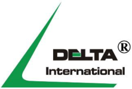
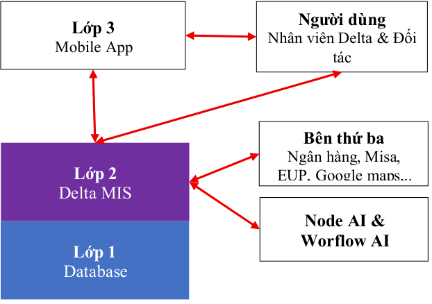
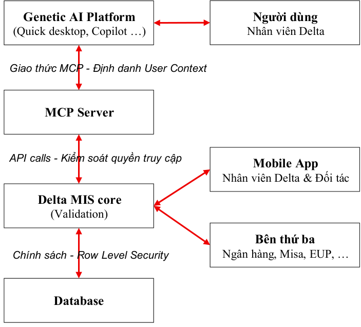
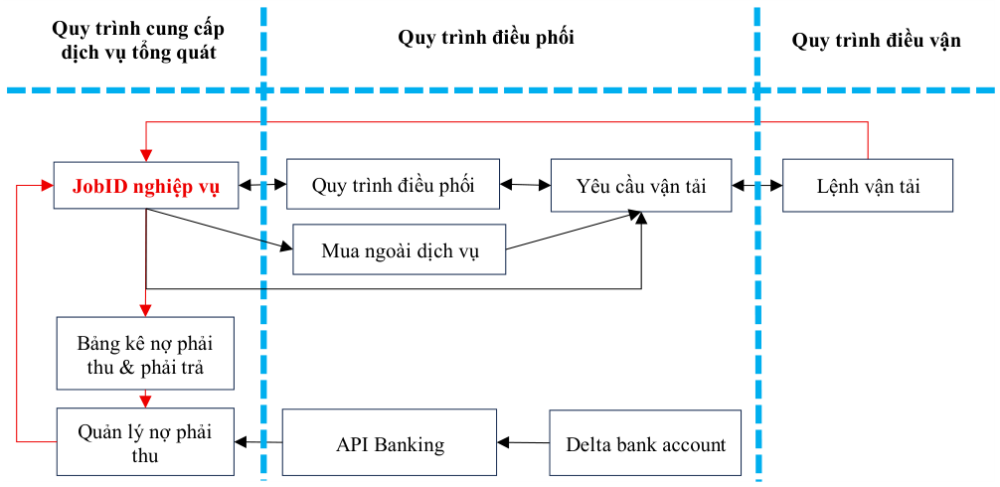
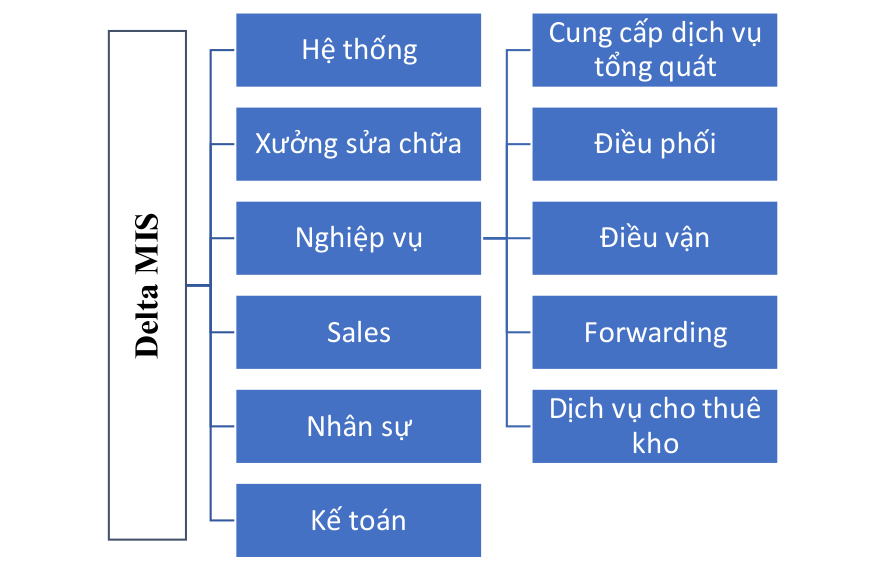

# PHẦN MỀM DELTA 3.0 — Thiết kế kiến trúc & Lộ trình phát triển

> Nguồn: [`Master plan for Delta 3.0_October 16, 2026.pdf`](source/delta-3-0-master-plan.pdf) (PDF, 15 trang) · Nhận: 2026-10-19 · Chuyển sang Markdown bằng `/intake`.
> Phiên bản: 16/10/2026 (nhận 2026-10-19).
> Thông tin trang: chân trang "Phần mềm Delta 3.0_October 16, 2026 — Trang: N / 15".

**CÔNG TY CỔ PHẦN QUỐC TẾ DELTA**

**PHẦN MỀM DELTA 3.0**
**Thiết kế kiến trúc & Lộ trình phát triển**

=================

**Hà Nội, ngày 16 tháng 10 năm 2026**

## MỤC LỤC

- I. MỤC TIÊU
- II. CẤU TRÚC DELTA 3.0
  - 2.1. Delta 3.0 với node AI & workflow AI
  - 2.2. Delta 3.0 với Genetic AI platform
- III. PHÂN HỆ & LỘ TRÌNH PHÁT TRIỂN
  - 3.1. Phân hệ và chức năng.
  - 3.2. Sơ đồ phân hệ Delta MIS.
  - 3.3. Lộ trình phát triển.
- IV. ỨNG DỤNG AI
  - 4.1. Mục tiêu sử dụng AI
  - 4.2. Nguyên tắc sử dụng AI.
  - 4.3. Phương pháp sử dụng AI
  - 4.4. Chi phí sử dụng AI
- V. MÃ NGUỒN & VẬN HÀNH LIÊN TỤC
  - 5.1. Quyền sở hữu tài sản số.
  - 5.2. Quyền và trách nhiệm hệ thống
  - 5.3. Sao lưu mã nguồn
  - 5.4. Ký gửi mã nguồn _(Software Escrow)_
  - 5.5. Đồng bộ tự động mã nguồn sang kho ký gửi
  - 5.6. Quản lý tài khoản & Bàn giao khi chấm dứt hợp đồng
  - 5.7. Quy định xử lý sự cố khẩn cấp _(Hotfix)_
- VI. QUẢN TRỊ DỮ LIỆU _(DATA GOVERNANCE)_
  - 6.1. Phân loại và dịnh danh dữ liệu _(Data classification)_
  - 6.2. Nguyên tắc lưu trữ dữ liệu _(Data lifecycle)_
  - 6.3. Quyền truy cập dữ liệu _(Access control)_
  - 6.4. Sao lưu cơ sở dữ liệu _(Database backup)_
- VII. RỦI RO VẬN HÀNH
  - 7.1. API Ngân hàng gặp sự cố
  - 7.2. API Phần mềm kế toán Misa gặp sự cố
  - 7.3. API Bản đồ (Google Maps / Việt MAP) gặp sự cố
  - 7.4. Quản lý chi phí Token
  - 7.5. Xử lý vòng lặp vô hạn _(Infinite Loop / Token Bleeding)_

## I. MỤC TIÊU

Phần mềm Delta 3.0 (gọi tắt là Delta 3.0) được xây dựng để giải quyết các vấn đề về vận hành và báo cáo kế toán mà Công ty đang gặp phải nhằm duy trì và tăng năng lực cạnh tranh trên thị trường. Tài liệu này cung cấp cái nhìn tổng thể về cấu trúc của Delta 3.0 và các phân hệ chức năng của Delta MIS, lộ trình phát triển các phân hệ này.

Tích hợp công cụ AI với Delta MIS để tăng năng lực cạnh tranh của Delta trên thị trường cũng là một mục tiêu quan trọng của Delta MIS và Delta 3.0. Các ứng dụng AI sẽ được phát triển cùng với việc phát triển Delta MIS và sau khi Delta 3.0 đi vào hoạt động. Delta MIS sẽ cung cấp nền tảng công nghệ cần thiết để vừa bảo vệ dữ liệu khi sử dụng công cụ AI, vừa kết nối quy trình và liên thông dữ liệu để tăng hiệu quả hoạt động. Delta MIS cũng sẽ cung cấp nền tảng công nghệ cho phép triển khai các công cụ AI vào mọi quy trình nghiệp vụ để tăng hiệu quả hoạt động và kiểm soát rủi ro mất an toàn dữ liệu vận hành và dữ liệu của khách hàng khi dùng công cụ AI.

Ngay sau khi triển khai xong và đi vào hoạt động, Delta 3.0, Delta MIS và các công cụ AI phục vụ quy trình nghiệp vụ (Gọi chung là “Phần mềm Delta 3.0”) sẽ trở thành một tài sản số có giá trị lớn của Công ty. Giá trị tài sản số này sẽ lớn theo thời gian phát triển và sử dụng. Hơn thế, hoạt động kinh doanh của Delta sẽ lệ thuộc vào phần mềm Delta 3.0 và mức độ lệ thuộc này sẽ tăng theo tỷ lệ thuận với mức độ hoàn thiện của phần mềm, quy trình và công cụ AI. Vì vậy, tài liệu sẽ đưa ra các nguyên tắc, nền tảng và phương pháp để đảm bảo quyền sở hữu tài sản và khả năng vận hành liên tục của phần mềm Delta 3.0 một cách độc lập.

## II. CẤU TRÚC DELTA 3.0

Cấu trúc phần mềm Delta 3.0 sẽ thay đổi cùng với quá trình phát triển Delta MIS trong ba giai đoạn trong đó (1) Giai đoạn 1 sẽ phát triển một hệ thống MIS cơ bản để phục vụ vận hành dịch vụ vận tải, khai báo hải quan, thủ tục chuyên ngành và các dịch vụ giá trị gia tăng khác cho các dịch vụ này (2) Giai đoạn 2 sẽ phát triển toàn bộ các phân hệ còn lại của Delta MIS và (3) Giai đoạn 3 sẽ chuyển đổi sử dụng node AI/workflow AI sang dùng Genetic AI platform.

### 2.1. Delta 3.0 với node AI & workflow AI

Trong giai đoạn phát triển quy trình nghiệp vụ và hoàn thiện Delta MIS, cấu trúc của phần mềm Delta 3.0 sẽ gồm có ba lớp bao gồm (1) dữ liệu (2) phần mềm nghiệp vụ gọi tắt là Delta MIS và (3) các ứng dụng mobile app cho nhân viên Delta và nhà cung cấp dầu, dịch vụ vận tải sử dụng. Các đối tác như ngân hàng, dịch vụ kế toán, bản đồ sẽ kết nối với Delta MIS thông qua API. Tương tự, các công cụ AI sẽ được tích hợp vào quy trình nghiệp vụ và kết nối API với Delta MIS để hỗ trợ nhân viên thu thập, xử lý thông tin chứng từ đầu vào và chia sẻ, cung cấp cho Delta MIS. Cấu trúc ba lớp này được mô tả như sơ đồ bên cạnh.

Chữ trong sơ đồ:

- Lớp 3 — Mobile App — Người dùng: Nhân viên Delta & Đối tác
- Lớp 2 — Delta MIS — Node AI & Worflow AI — Bên thứ ba: Ngân hàng, Misa, EUP, Google maps,..
- Lớp 1 — Database

Liên kết (1) giữa Lớp 2 với Lớp 3 (2) liên kết ngoại vi giữa Lớp 2 với ngân hàng, Google Maps, Việt MAP, EUP và phần mềm kế toán Misa được thực hiện thông qua kết nối API để trao đổi và chia sẻ dữ liệu vận hành & dữ liệu kế toán nhằm tuân thủ chế độ kế toán và lập báo cáo quản trị nội bộ. Lớp 2 là Delta MIS và là phần mềm lõi của Delta 3.0 nên các liên kết ngoại vi quan trọng với mục tiêu tăng hiệu quả hoạt động và khả năng tuân thủ, giảm khối lượng công việc cho từng vị trí nhân sự và loại bỏ nguy cơ lộ lọt dữ liệu quản trị.

#### 2.1.1. Liên kết giữa lớp 2 và lớp 3.

Mobile App được phát triển để duy trì kết nối giữa Delta MIS với đội ngũ lái xe, nhân viên Delta thực hiện công việc trên Delta MIS khi làm việc ở hiện trường cũng như cán bộ quản lý phê duyệt các giao dịch khi không làm việc tại văn phòng và không có máy tính. Mobile App cũng sẽ cung cấp thêm một nền tảng kết nối giữa Delta MIS và các nhà cung cấp dầu, dịch vụ vận tải, ….

#### 2.1.2. Liên kết ngoại vi.

Đây là một liên kết phức tạp vì phải duy trì kết nối với nhiều đối tác khác nhau như ngân hàng, Google maps, Việt MAP và EUP. Khi tích hợp node/workflow AI vào quy trình nghiệp vụ thì liên kết giữa Delta MIS và các LLM mở cần thực thi quy tắc ” _Dữ liệu rời rạc_ ” để bảo vệ thông tin quản trị vừa phải đảm bảo tính kết nối quy trình và ” _Dữ liệu liên thông_ ” để tăng hiệu quả hoạt động. Các liên kết ngoại vi này sẽ được đề cập đến tại Mục III - Các phân hệ Delta MIS và lộ trình triển khai và mục ứng dụng AI.

- _Liên kết với phần mềm kế toán Misa._

Delta MIS sẽ định tuyến các dòng dữ liệu từ quy trình nghiệp vụ thông qua các luồng ghi chép đối ứng, bản chất là các bút toán kế toán, để đưa dữ liệu từng giao dịch từ Delta MIS sang Misa. Việc trao đổi dữ liệu này sẽ được thực hiện thông qua API. Mục tiêu của liên kết này là Misa sẽ thực hiện lập Tờ khai thuế hàng tháng, Báo cáo tài chính hàng năm và thực hiện các trách nhiệm báo cáo khác theo chế độ kế toán hiện hành.

✓ Cần xác định quy tắc chia sẻ dữ liệu giữa Delta MIS và Misa để hạn chế việc chỉnh sửa.

### 2.2. Delta 3.0 với Genetic AI platform

Sau khi kết thúc giai đoạn phát triển Delta MIS và (1) hệ thống Delta MIS đã hoàn thiện và đáp ứng các mục tiêu quản trị (2) các kết nối ngoại vi với đối tác cũng đã chạy ổn định, cấu trúc phần mềm Delta 3.0 sẽ chuyển đổi thành cấu trúc đa lớp (Xem sơ đồ bên) và chuyển đổi từ sử dụng node AI/workflow AI sang sử dụng Genetic AI platform. Quá trình chuyển đổi nảy sẽ kiến tạo một môi trường làm việc đẳng cấp thế giới cho nhân viên Delta về giao diện làm việc, công cụ sử dụng cũng như hiệu suất. Nhân viên Delta sẽ không làm việc trên màn hình giao diện của Delta MIS mà sẽ làm việc với các trợ lý ảo trên các giao diện Quick Desktop hoặc Copilot. Các trợ lý ảo này sẽ làm việc với Delta MIS thông qua MCP server. Mobile App dành cho lái xe, nhân viên Delta và nhà cung cấp vẫn duy trì hoạt động như trong cấu trúc cũ. Tương tự, các kết nối ngoại vi với đối tác như ngân hàng, Misa, EUP, Google Maps và Việt Maps vẫn duy trì như trong cấu trúc cũ.

Chữ trong sơ đồ (từ trên xuống):

- Genetic AI Platform (Quick desktop, Copilot …) — Người dùng: Nhân viên Delta
- Giao thức MCP - Định danh User Context
- MCP Server
- API calls - Kiểm soát quyền truy cập
- Delta MIS core (Validation) — Mobile App: Nhân viên Delta & Đối tác — Bên thứ ba: Ngân hàng, Misa, EUP, …
- Chính sách - Row Level Security
- Database

#### 2.2.1. Thiết lập ranh giới dữ liệu sạch (Data Validation Gateway) chống Rác AI

Khi hệ thống chuyển sang cấu trúc Giai đoạn 3 (Sử dụng AI Agent tương tác trực tiếp qua MCP Server, không qua giao diện UI truyền thống), để ngăn chặn tuyệt đối rủi ro "ảo tưởng" (Hallucination) hoặc trích xuất sai cấu trúc dữ liệu từ AI làm nhiễm bẩn Database, tầng API Gateway của Delta MIS bắt buộc phải thiết lập bộ chặn Data Validation 3 tầng bằng code lập trình cổ điển trước khi xử lý nghiệp vụ:

- **Tầng 1: Schema Validation cứng (Xác thực cấu trúc thô)**

   - ✓ Mọi Request JSON do AI Agent đẩy qua MCP Server bắt buộc phải đi qua bộ lọc cấu trúc. Hệ thống tự động từ chối và trả lỗi HTTP 422 Unprocessable Entity ngay lập tức nếu: Kiểu dữ liệu sai (ví dụ: Số tiền là String thay vì Float); Số tiền có giá trị âm (≤ 0); Định dạng ngày tháng không khớp chuẩn ISO-8601 (YYYY-MM-DD); Hoặc thiếu các trường thông tin pháp lý bắt buộc (Mã số thuế, Số hóa đơn, Tổng tiền).

- **Tầng 2: Domain Logic Validation (Xác thực quy định ngành)**

   - ✓ _Bộ chặn số Container:_ Hệ thống bắt buộc phải chạy thuật toán kiểm tra mã kiểm tra toàn vẹn (Validate Checksum ISO 6346) đối với chuỗi 11 ký tự số container do AI trích xuất. Nếu thuật toán báo lỗi ký tự (AI đọc nhầm chữ sang số hoặc ngược lại), hệ thống hủy lệnh tạo JobID nháp.

   - ✓ _Bộ chặn định dạng Mã số thuế:_ Áp biểu thức chính quy (Regex) cổ điển ^[0-9]{10}(-[0-9]{3})?$ để khóa các chuỗi mã số thuế chứa ký tự chữ do AI nhận diện sai.

   - ✓ _Bộ chặn toán học tài chính:_ Thực hiện kiểm tra chéo toán học: Tiền trước thuế (Net) + Tiền thuế (VAT) = Tổng tiền thanh toán (Gross). Lệch số tiền, API Gateway sẽ lập tức REJECT request.

- **Tầng 3: Khóa khớp quyền hạn (Security & User Context Validation)**

   - ✓ API Gateway tiếp nhận thông tin định danh (User Context) từ MCP Server gửi đến. Hệ thống chạy code cổ điển để kiểm tra phân quyền thực tế của nhân viên đang vận hành AI Agent đó. Nếu tác vụ vượt quá thẩm quyền hoặc không thuộc phạm vi cấu hình của chính sách Row-Level Security (RLS) gắn với chi nhánh của nhân viên đó, API sẽ chặn đứng hành động của AI Agent.

#### 2.2.2. Thành phần kiến trúc và Cơ chế vận hành

Hệ thống được vận hành dựa trên ba thành phần cốt lõi:

- _Tầng suy luận và thu thập dữ liệu (AI Agent):_ Các phần mềm Agentic AI (như Quick Desktop, Microsoft Copilot) đóng vai trò là giao diện tương tác trực tiếp với nhân viên. AI Agent tận dụng tối đa sức mạnh suy luận của các LLM hiện đại để chủ động sử dụng công cụ, quét dữ liệu đa nguồn (email, tài liệu, web, cuộc gọi) để tự động hóa các tác vụ lặp lại (nhập liệu, trích xuất hóa đơn, tạo JobID) với độ chính xác cao hơn thao tác thủ công của con người.

- _Tầng kết nối trung gian (MCP Server):_ Delta xây dựng một MCP Server (Model Context Protocol) đóng vai trò là cầu nối giao tiếp an toàn. MCP Server tiếp nhận yêu cầu từ AI Agent, truyền thông tin định danh (User Context) của người dùng một cách minh bạch tới hệ thống lõi.

- _Tầng nghiệp vụ và dữ liệu (Delta MIS Core):_ Hệ thống Delta MIS định nghĩa dữ liệu và quy trình chuẩn ngay tại tầng API. Hệ thống tiếp nhận các API call từ MCP Server thay mặt cho người dùng và thực thi nghiệp vụ. Mọi giao tiếp với phần mềm kế toán Misa hoặc các đối tác bên ngoài (API Banking, Google Maps, EUP, ..) đều do Delta MIS xử lý tập trung qua API.

#### 2.2.3. Kiến trúc bảo mật đa tầng (Multi-Layer Security)

Để sẵn sàng cho các Quy trình kiểm toán bảo mật dữ liệu (Second-Party Audit / Vendor Security Review) từ các khách hàng lớn, kiến trúc mới thiết lập hệ thống phòng thủ 3 lớp chặt chẽ:

- _Lớp 1 - Kiểm soát đầu vào tại tầng API (Data Validation)._ Mọi logic xác thực dữ liệu bắt buộc phải thực thi tại tầng API của Delta MIS. Hệ thống chủ động từ chối hoàn toàn các input không chuẩn chỉ hoặc sai cấu trúc từ AI Agent, ngăn chặn rủi ro "rác dữ liệu" ngay cả khi thao tác không đi qua giao diện UI truyền thống.

- _Lớp 2 - Xác thực thẩm quyền tại tầng API._ Tầng API tiếp nhận User Context từ MCP Server để nhận diện và áp dụng chính xác các phân quyền bảo mật hiện có của người dùng trong hệ thống Delta MIS. AI Agent không thể thực hiện bất kỳ tác vụ nào vượt quá thẩm quyền của nhân viên đang vận hành nó.

- _Lớp 3 - Cô lập dữ liệu tại tầng Database_ . Hệ thống cơ sở dữ liệu cấu hình chặt chẽ chính sách Row-Level Security (RLS), đảm bảo người dùng và AI Agent tương ứng chỉ được phép truy cập, chỉnh sửa các hàng dữ liệu thuộc phạm vi thẩm quyền được cấp phép.

## III. PHÂN HỆ & LỘ TRÌNH PHÁT TRIỂN

### 3.1. Phân hệ và chức năng.

Delta MIS trong Delta 3.0 sẽ có 6 phân hệ thực hiện các chức năng được mô tả vắn tắt như bên dưới. Mục này cũng liệt kê các quy trình nghiệp vụ cần có để thực hiện các chức năng của từng phân hệ và tình trạng phát triển các tài liệu nghiệp vụ này.

#### 3.1.1. Hệ thống

Phân hệ này sẽ quản lý (1) người dùng (2) phân quyền người dùng và (3) danh mục của Delta MIS.

#### 3.1.2. Xưởng sửa chữa

Phân hệ này có chức năng (1) quản lý phương tiện vận tải, các trang thiết bị phục vụ hoạt động vận tải (2) chi phí sửa chữa tất cả các trang thiết bị vận tải và quản lý tồn kho phụ tùng vật tư phục vụ hoạt động sửa chữa và (3) quản lý dầu diesel bao gồm mua, cấp phát dầu diesel theo mã iGas và quản lý dầu tồn kho. Phân hệ này sẽ thực hiện các liên kết ngoại vi (Xem Mục II) như sau:

- iGas: Tích hợp phần mềm quản lý cây dầu nội bộ với Delta MIS để cấp dầu theo Lệnh vận tải cho lái xe và quản lý xuất nhập tồn dầu diesel. Delta đã mua bản quyền phần mềm này và đang thực hiện việc tích hợp vào phần mềm quản lý dầu diesel, cho phép quản lý dầu tồn tại các cây dầu nội bộ theo thời gian thực.

- Nhà cung cấp dầu diesel theo phiếu cấp dầu/mã iGas: Cấp tài khoản cho các nhà cung cấp này để tiếp nhận yêu cầu cấp dầu từ phần mềm xưởng và thực hiện việc lập, chốt bảng kê công nợ, tiếp nhận hóa đơn bán hàng từ nhà cung cấp.

#### 3.1.3. Nghiệp vụ

Phân hệ này có chức năng quản lý quá trình cung cấp dịch vụ của Delta từ khi chấp nhận lô hàng cho đến khi thu hồi công nợ, bao gồm cả mua ngoài dịch vụ, nếu có. Phạm vi của phân hệ này sẽ bao gồm các dịch vụ sau:

- Khai thuê hải quan, thủ tục chuyên ngành.

- Vận tải đường bộ và vận tải xuyên biên giới bằng xe ô tô (CBT).

- Các dịch vụ giá trị gia tăng khác.

- Vận tải quốc tế (sea & air freight) và các dịch vụ giá trị gia tăng.

- Dịch vụ cho thuê kho. Delta cung cấp dịch vụ kho như một phần của dịch vụ 3PL nên cần dùng WMS độc lập và kết nối API với Delta MIS để chia sẻ dữ liệu và phân chia nhiệm vụ như sau:
  - ✓ Delta MIS (Quản lý tài chính - kinh doanh).
    - Lưu trữ thông tin đối tác và khách hàng.
    - Quản lý hợp đồng, hạn mức công nợ và phát hành hóa đơn thu tiền dịch vụ.
  - ✓ WMS (Vận hành - tính cước).
    - Quản lý hàng tồn kho theo từng vị trí (ô kệ, pallet) và mã vạch (Barcode).
    - Xử lý quy trình nhập / xuất và kiểm đếm thực tế.
    - Tập hợp số liệu và lập bảng kê phí dịch vụ.

- **_Lưu đồ Quy trình cung cấp dịch vụ tổng quát_**

Lưu đồ sau mô tả quy trình cung cấp tất cả các loại hình dịch vụ của Delta bao gồm dịch vụ cho thuê kho, cước quốc tế, hải quan, thủ tục chuyên ngành, dịch vụ vận tải đường bộ và các dịch vụ giá trị gia tăng khác chiếm ~100% doanh thu và chi phí hàng bán của Delta, là phạm vi của Delta MIS ở Giai đoạn 1 trong lộ trình phát triển Delta 3.0. Lưu đồ này chưa bao gồm việc triển khai phần mềm quản lý kho hàng (WHS) sẽ được phát triển ở Giai đoạn 2.

Chữ trong lưu đồ:

- Làn: Quy trình cung cấp dịch vụ tổng quát · Quy trình điều phối · Quy trình điều vận
- Ô: JobID nghiệp vụ · Quy trình điều phối · Yêu cầu vận tải · Lệnh vận tải · Mua ngoài dịch vụ · Bảng kê nợ phải thu & phải trả · Quản lý nợ phải thu · API Banking · Delta bank account

Phân hệ nghiệp vụ sẽ có các nhiệm vụ cụ thể như liệt kê bên dưới, tương ứng với các quy trình nghiệp vụ thực hiện các nhiệm vụ này:

- Quy trình cung cấp dịch vụ tổng quát: Tiếp nhận yêu cầu dịch vụ, tạo JobID, thực hiện mua ngoài dịch vụ (nếu có), lập và chốt bảng kê công nợ với khách hàng và quản lý công nợ.

   - ✓ Nhiệm vụ trọng tâm của quy trình này là ghi nhận, doanh thu và chi phí hàng bán (COGS) để lập P/L Jobsheet cho từng JobID. Các chi phí cần ghi nhận tại quy trình này.
     - Chi phí định mức bao gồm hải quan và hiện trường (Kê khai là công tác phí).
     - Hoa hồng chi trả cho khách hàng (Nộp thuế TNDN cho chi phí này).

   - ✓ Quy trình này sẽ hoàn thiện trong tháng 9/2026.

- Quy trình điều phối: Giải quyết các thủ tục giao nhận tại cửa khẩu, cảng biển và cảng hàng không để thực hiện Lệnh vận tải, nếu có.

   - ✓ Nhiệm vụ trọng tâm của quy trình này là (1) ghi nhận chi phí trả hộ và doanh thu trả hộ để lập bảng kê hoặc lập hóa đơn thu tiền khách hàng và (2) quản lý tiền cược vỏ container khi thực hiện dịch vụ vận tải container.

   - ✓ Ghi nhận, lưu giữ và chia sẻ thông tin chứng từ vận hành.

   - ✓ Quy trình này sẽ hoàn thiện trong tháng 9/2026.

- Quy trình điều vận: Lập Lệnh vận tải trên cơ sở thông tin và chứng từ tiếp nhận từ ”Quy trình cung cấp dịch vụ tổng quát” và ”Quy trình điều phối” để thực hiện dịch vụ vận tải.

   - ✓ Nhiệm vụ trọng tâm của quy trình này là ghi nhận các chi phí bao gồm (1) chi phí vận hành phương tiện vận tải và cấp phát dầu cho lái xe. Đây là COGS của dịch vụ vận tải (2) chi phí trả hộ phát sinh theo Lệnh vận tải và chuyển dữ liệu cho Module kế toán để thanh toán và (3) chi phí mua ngoài dịch vụ vận tải.

   - ✓ Quy trình này sẽ hoàn thiện cùng với quá trình nâng cấp Module điều vận trên Delta 2.0.

Phân hệ này sẽ thực hiện liên kết ngoại vi qua API (Xem Mục II) như sau:

- Google Maps và Việt MAP: Kết nối API giữa các đối tác này với Module điều vận, lấy thông số cung đường và trạm thu phí để lập Lệnh vận tải.

- Nhà cung cấp dịch vụ vận tải: Cấp tài khoản cho các nhà cung cấp vận tài để cung cấp dữ liệu vận hành lên Module điều vận và thực hiện việc lập và chốt bảng kê công nợ, tiếp nhận hóa đơn phí dịch vụ vận tải từ nhà cung cấp.

#### 3.1.4. Kế toán

Phân hệ này có các chức năng chính bao gồm (1) lập báo cáo quản trị (2) cung cấp dữ liệu sang phần mềm Misa để lập báo cáo thuế. Phân hệ này sẽ có các nhiệm vụ cụ thể như liệt kê bên dưới tương ứng với các quy trình nghiệp vụ để thực hiện các nhiệm vụ này:

- Quy trình quản lý quỹ và thanh toán. Quy trình này thực hiện chi trả tất cả các trách nhiệm tài chính của Delta với nhân viên, nhà cung cấp, đối tác và khách hàng bao gồm chi phí trả hộ và tiền đặt cọc vỏ container cho hàng nhập FCL.

- Quy trình quản lý tài sản và chi phí khấu hao.

- Quy trình quản lý công cụ dụng cụ và chi phí phân bổ.

- Quy trình quản lý chi phí không hóa đơn (Điều chỉnh báo cáo).

Phân hệ này sẽ thực hiện liên kết ngoại vi qua API (Xem Mục II) với ngân hàng và Misa như sau:

- Kết nối Delta MIS với tài khoản ngân hàng của Delta với các mục tiêu sau:

   - ✓ Khi kết thúc quy trình phê duyệt thanh toán hoặc tạm ứng tiền trên Delta MIS và khoản chi được phê duyệt thì Delta MIS sẽ chuyển dữ liệu cho ngân hàng để thực hiện Lệnh chuyển tiền tương ứng. Việc phê duyệt Ủy nhiệm chi này sẽ thực hiện lần 2 trên môi trường ngân hàng theo phân quyền quản lý tài khoản để đảm bảo thực hiện giao dịch ngân hàng thông qua kết nối này không tạo ra bất kỳ một rủi ro mới nào so với khi thực hiện thanh toán thủ công trên tài khoản ngân hàng. Đã có ba ngân hàng chấp nhận cung cấp kết nối API Banking này cho Delta bao gồm MB, TP Bank và Vietcombank.

   - ✓ Nhận sổ phụ ngân hàng và định tuyến dữ liệu thanh toán của khách hàng đến chức năng quản lý công nợ. Tại đây, nhân viên CS sẽ thực hiện nhiệm vụ quản lý công nợ của khách hàng để cung cấp thông tin cho phần mềm phê duyệt JobID tự động.

- Kết nối Delta MIS với phần mềm kế toán Misa để cung cấp dữ liệu cho Misa lập tờ khai thuế hàng tháng, báo cáo tài chính hàng năm và thực hiện các trách nhiệm tuân thủ khác.

   - ✓ Đồng bộ hóa danh mục giữa Delta MIS và Misa. Vấn đề này liên quan đến việc định danh các luồng dữ liệu từ Delta MIS theo hệ thống tài khoản kế toán Việt Nam và cần giải quyết bằng một hợp đồng tư vấn triển khai kết nối API với Misa.

#### 3.1.5. Sales

Phân hệ này có các chức năng (1) quản lý hợp đồng, báo giá (2) hoa hồng bán hàng chi trả cho nhân viên sales và sales fund (3) hoa hồng chi trả cho khách hàng và (4) thu hồi công nợ. Hiện có 3 quy trình nghiệp vụ sales và chưa bắt đầu quá trình phát triển quy trình nghiệp vụ mới.

#### 3.1.6. Nhân sự

Tiếp nhận thông tin từ Module Điều vận để tính lương, thưởng của nhân viên bao gồm lái xe, báo cáo trích nộp bảo hiểm y tế, xã hội và các khoản phải nộp khác. Quản lý nợ cá nhân, quỹ hỗ trợ lái xe, quỹ sales fund và các khoản mà người lao động phải nộp Công ty như trả nợ vay, phạt. Nhân sự sẽ quản lý bộ phận thanh tra vận tải và giải quyết sự cố nghề nghiệp liên quan đến hoạt động vận tải, bao gồm cả bảo hiểm trách nhiệm dân sự và bảo hiểm tài sản của phương tiện vận tải.

### 3.2. Sơ đồ phân hệ Delta MIS.

Chữ trong sơ đồ:

- Delta MIS
  - Hệ thống
  - Xưởng sửa chữa
  - Nghiệp vụ
    - Cung cấp dịch vụ tổng quát
    - Điều phối
    - Điều vận
    - Forwarding
    - Dịch vụ cho thuê kho
  - Sales
  - Nhân sự
  - Kế toán

### 3.3. Lộ trình phát triển.

| TT | Tên phân hệ | Giai đoạn 1 _(01/9/2026 - 31/3/2027)_ | Giai đoạn 2 _(01/4/2027 - 31/12/2027)_ |
|---|---|---|---|
| 1 | Xưởng sửa chữa ô tô | _Đã hoàn thiện, đang hiệu chỉnh và go live_ (ô gộp 2 giai đoạn) | |
| 2 | Quản lý dầu diesel | _Đang triển khai và sẽ go live vào ngày 15/10/2026_ (ô gộp 2 giai đoạn) | |
| 3 | Nghiệp vụ _(Hải quan, thủ tục chuyên ngành, vận tải nội địa & CBT và các dịch vụ giá trị gia tăng)_ | x | |
| 4 | Kế toán _(Quản lý quỹ và thanh toán)_ Chức năng này sẽ triển khai và go live trên Delta 2.0 trước 31/12/2026 để thực hiện các kết nối với tài khoản ngân hàng trước 31/12/2026. _(chữ đỏ trong bản gốc)_ | x | |
| 5 | Kế toán _(Quản lý công nợ, TSCĐ, CCDC và chi phí phân bổ)_ | x | |
| 6 | Sales | | x |
| 7 | Nhân sự | | x |
| 8 | Nghiệp vụ _(Cước vận tải quốc tế và các dịch vụ giá trị gia tăng)_ | x | |
| 9 | Kế toán _(Thực hiện các bút toán điều chỉnh báo cáo)_ | | x |
| 10 | Nghiệp vụ _(Dịch vụ cho thuê kho - Quản lý doanh thu/chi phí)_ | x | |
| 11 | Nghiệp vụ _(Dịch vụ cho thuê kho - Triển khai WHS)_ | | x |

Ước tính thời gian triển khai Giai đoạn 3, chuyển đổi cấu trúc Delta 3.0 để chuyển sang sử dụng Genetic AI platform, sẽ kéo dài khoảng 6 tháng. Căn cứ vào kết quả thực hiện Giai đoạn 2 để xây dựng lộ trình tiếp theo cho Giai đoạn 3, chuyển đổi từ sử dụng node/workflow AI sang sử dụng Genetic AI platform. Các nội dung ở Mục IV và VII của tài liệu này được trình bày phù hợp với Giai đoạn 1 và 2 và sẽ được viết mới cho Giai đoạn 3.

## IV. ỨNG DỤNG AI

Sử dụng công cụ AI là cần thiết để duy trì và tăng năng lực cạnh tranh của Delta trên thị trường. Tuy nhiên, Delta đang sử dụng công cụ AI rời rạc và chưa có định hướng chung nên chưa tối ưu hóa lợi ích từ nguồn lực dành cho phát triển và sử dụng công cụ AI, gây ra rủi ro vận hành. Mục này giải quyết các vấn đề đang gặp khi sử dụng công cụ AI bằng việc giải quyết các vấn đề sau:

- Xác định mục tiêu sử dụng AI.

- Đặt ra các nguyên tắc sử dụng AI.

- Quy định phương pháp sử dụng AI.

Khách hàng hoặc khách hàng tiềm năng của Delta có thể thực hiện kiểm toán bảo mật dữ liệu (Second-Party Audit / Vendor Security Review) để đánh giá năng lực bảo đảm an toàn dữ liệu trước khi quyết định có tiếp tục hoặc bắt đầu hợp tác với Delta. Với xu hướng làm việc với nhóm khách hàng lớn và sự phát triển ứng dụng AI như hiện nay, Delta có thể nhận được yêu cầu kiểm toán bảo mật dữ liệu trong thời gian gần. Vì vậy, phát triển và sử dụng công cụ AI sẽ phải sẵn sàng với một ” **_Quy trình kiểm toán bảo mật dữ liệu_** ” do khách hàng hoặc khách hàng tiềm năng có thể hoặc sẽ thực hiện nhằm đánh giá năng lực đảm bảo an toàn dữ liệu của Delta. Một mặt, sẵn sàng với ” **_Quy trình kiểm toán bảo mật dữ liệu_** ” sẽ là yếu tố sống còn với dịch vụ Delta, mặt khác, sự sẵn sàng đó sẽ tạo nên khác biệt cho dịch vụ Delta, trở thành selling point của dịch vụ.

### 4.1. Mục tiêu sử dụng AI

Công cụ AI được sử dụng để giúp việc nhân viên Delta (1) trong các công việc có tính chất lặp đi lặp lại như nhập dữ liệu và đọc chứng từ để trích xuất dữ liệu (2) thu thập, xử lý và phân tích dữ liệu. Căn cứ vào cấu trúc phần mềm Delta gồm có 3 lớp như mô hình ở Mục II trong đó lớp 2 gọi tắt là Delta MIS thì Delta có thể sử dụng công cụ AI như sau:

- **_Sử dụng AI ở lớp 2._**

Đưa AI tham gia vào quy trình nghiệp vụ để giải quyết một nhiệm vụ cụ thể, có dữ liệu đầu vào và đầu ra rõ ràng để tăng độ chính xác và giảm workload cho nhân viên. AI sẽ đóng vai trò như một node của quy trình nghiệp vụ, nhận các dữ liệu rời rạc từ MIS để xử lý, trích xuất và trả kết quả lại cho Delta MIS nhằm mục tiêu bảo mật dữ liệu quản trị. Các ví dụ của thể là AI01 (Tạo JobID) và AI02 (Quản lý hóa đơn).

- **_Sử dụng AI ở lớp 3._**

Công cụ AI có thể thực hiện một quy trình độc lập bên ngoài phần mềm Delta, tiếp nhận thông tin từ Delta MIS và từ các nguồn xác định khác (email Delta, khách hàng cung cấp, …) để giải quyết một nhiệm vụ cụ thể rồi trả kết quả cho nhân viên Delta và/hoặc Delta MIS thông qua kết nối API.

### 4.2. Nguyên tắc sử dụng AI.

Để tối đa hóa lợi ích khi phát triển và sử dụng các công cụ AI trong công việc và kiểm soát dữ liệu quản trị thì cần tuân thủ các nguyên tắc sử dụng AI sau đây.

- **_Có trách nhiệm._**

Nguyên tắc này nhằm loại bỏ rác AI và khẳng định rõ ràng vai trò của con người khi sử dụng công cụ AI. Nội dung cụ thể của nguyên tắc này:

- ✓ Không sử dụng kết quả do AI cung cấp nếu không xem xét đầy đủ các dữ liệu, phương pháp tính toán và các lập luận liên quan đến quá trình tạo ra kết quả đó.

- _Có tổ chức._

Nguyên tắc này nhằm đảm bảo việc sử dụng nguồn lực của công ty một cách thống nhất, có tổ chức và nhằm mục tiêu chung. Nội dung cụ thể của nguyên tắc này:

- ✓ Khi nhận biết hoặc có nhu cầu sử dụng công cụ AI trong công việc được giao, nhân viên Delta cần phối hợp với IT để phân tích vấn đề, đưa ra các giải pháp khả thi và làm đề xuất bằng văn bản để TGĐ phê duyệt trước khi thực hiện.

- _Rõ ràng, tin cậy._

Nguyên tắc này nhằm đảm bảo quy trình và nguồn dữ liệu đầu vào, đầu ra của quy trình sử dụng công cụ AI là rõ ràng và tin cậy. Nội dung cụ thể của nguyên tắc này:

- ✓ Khi đề xuất phát triển/sử dụng công cụ AI, người đề xuất cần làm rõ nguồn dữ liệu mà công cụ AI cần, quy trình giải quyết vấn đề và kết quả mà công cụ AI sẽ trả về và nơi tiếp nhận kết quả.

- _Dữ liệu rời rạc trên AI node & Workflow AI._ Nguyên tắc này nhằm ngăn chặn việc sử dụng công cụ AI dẫn để lộ lọt dữ liệu quản trị quan trọng. Nội dung của nguyên tắc này:

   - ✓ Tăng cường sử dụng công cụ AI (node AI và Workflow AI ) ở lớp 2 để kết nối, trao đổi dữ liệu với Delta MIS, giúp nhân viên Delta tiếp nhận và xử lý dữ liệu đầu vào và đưa lên Delta MIS cũng như lập các loại báo cáo, bảng kê theo yêu cầu của khách hàng.

   - ✓ Kiểm soát chặt chẽ việc sử dụng Workflow AI tại lớp 2 (Hệ thống lõi phần mềm Delta) vì khi có sự tham gia của nhiều AI assistant để thực hiện một chuỗi mục tiêu sẽ gia tăng rủi ro lộ lọt thông tin quản trị, vi phạm nguyên tắc cung cấp thông tin rời rạc.

   - ✓ Đánh giá đầy đủ các dữ liệu sẽ cung cấp và tạo ra bởi Workflow AI trước khi thiết kế và đưa vào sử dụng.

- _Dữ liệu liên thông trên Delta MIS._

- Nguyên tắc này nhằm đưa công cụ AI vào quy trình nghiệp vụ để tạo ra các node AI và workflow AI, đảm bảo sự liên thông dữ liệu trên Delta MIS. Nội dung của nguyên tắc này:

   - ✓ Trong cấu trúc phần mềm Delta, liên kết ngoại vi giữa Delta MIS với các LLM mở phải được thực hiện qua kết nối API.

- _Dữ liệu tập trung trên Delta MIS._ Nguyên tắc này nhằm ngăn chặn việc lưu giữ dữ liệu do các công cụ AI tạo ra trên các nền tàng bên ngoài Delta MIS dẫn để lộ lọt dữ liệu quản trị quan trọng. Nội dung của nguyên tắc này:

- ✓ Không lưu giữ dữ liệu trung gian trong quá trình xử lý bằng các công cụ AI và Workflow AI trên các nền tảng trung gian như Google docs, Google sheets hay các nền tảng lưu giữ dữ liệu khác.

- ✓ Mọi dữ liệu do công cụ AI (node AI & workflow AI) tạo ra phải được trả ngay về Delta MIS thông qua kết nối API để kết thúc nhiệm vụ của một node AI hoặc workflow AI tạo ra những dữ liệu đó nhằm đảm bảo nguyên tắc “ _Dữ liệu rời rạc_ ”.

### 4.3. Phương pháp sử dụng AI

Delta MIS là một phần mềm workflow nên để ứng dụng AI vào trong công việc thì cần thiết kế công cụ AI thành một mắt xích (node AI) trong quy trình để AI xử lý các tác vụ tốn thời gian, lặp đi lặp lại hoặc phân tích dữ liệu mà không ảnh hưởng đến vai trò điều phối và phân luồng công việc của Delta MIS.

- **_Nhúng công cụ AI vào Delta MIS_**

Đây là phương pháp sử dụng công cụ AI nhất quán và xuyên suốt nhằm đảm bảo nhân viên Delta không copy-paste dữ liệu vào các nền tảng AI mở để nhận kết quả bằng cách lập trình tự động kích hoạt công cụ AI dựa trên các hành động (triggers) khi thực hiện quy trình nghiệp vụ trên Delta MIS.

- _Quy trình phát triển công cụ AI_

|**Bước 1**||**Bước 2**||**Bước 3**||**Bước 4**||**Bước 5**|
|---|---|---|---|---|---|---|---|---|
|Chọn việc ứng dụng AI|**=>**|Tách mục tiêu thành các bước nhỏ|**=>**|Xác định nhiệm vụ cho AI|**=>**|Kết nối API để automation|**=>**|Kiểm tra & Tối ưu trước khi triển khai|

- **_Đánh giá_**

Một công cụ AI chỉ được phê duyệt để phát triển và đưa vào sử dụng nếu có thể đánh giá đầy đủ hiệu quả và các rủi ro mà nó tạo ra cho hoạt động của Delta. Luôn sử dụng dữ liệu từ Delta MIS để đánh giá định lượng hiệu quả của một công cụ AI cụ thể.

### 4.4. Chi phí sử dụng AI

Khi tích hợp các nền tảng AI nguồn mở vào quy trình nghiệp vụ để tạo ra các node AI hoặc workflow AI thì phải chi trả chi phí. Cần tuân thủ các nguyên tắc sau:

- _Có kiểm soát_ .

Hệ thống Delta MIS phải đo lường được query hoặc token phát sinh từ các quy trình nghiệp vụ để làm căn cứ đánh giá hiệu quả sử dụng công cụ AI.

- _Hạch toán chi phí._

Cần thực hiện thanh toán chi phí sử dụng AI nguồn mở bằng thẻ tín dụng đứng tên Delta hoặc bằng các hợp đồng với đại lý để có thể hạch toán các chi phí này và chi phí khấu trừ thuế.

## V. MÃ NGUỒN & VẬN HÀNH LIÊN TỤC

Để bảo vệ mã nguồn của hệ thống phần mềm Delta 3.0 và đảm bảo sự vận hành liên tục, cần ban hành quy chế với các nội dung sau và thực thi ngay khi phần mềm go live từng phần.

### 5.1. Quyền sở hữu tài sản số.

- Công ty Cổ phần Quốc tế  Delta là chủ sở hữu duy nhất và tối cao đối với toàn bộ mã nguồn (source code), dữ liệu, tài liệu kỹ thuật, tài khoản máy chủ đám mây, mật khẩu hệ thống và các thuật toán AI (bao gồm các cấu hình Node AI, Workflow AI và các bộ dữ liệu huấn luyện (Training Data), câu lệnh mẫu (Prompts/System Instructions System) phát triển trên nền tảng AI mở) của phần mềm Delta 3.0.

- Không có cá nhân nào được quyền tự ý sở hữu độc quyền, thay đổi quyền sở hữu, hoặc giữ làm tài sản cá nhân dưới mọi hình thức.

### 5.2. Quyền và trách nhiệm hệ thống

- Quyền quản trị tối cao: Ban giám đốc nắm giữ tài khoản Master sở hữu Tổ chức trên các nền tảng lưu trữ mã nguồn.

- Quyền vận hành kỹ thuật: Bộ phận IT được cấp quyền cấu hình, viết mã, sửa lỗi để vận hành hệ thống hàng ngày, nhưng không có quyền xóa kho lưu trữ dữ liệu (Repository) hoặc thay đổi chủ sở hữu hệ thống.

- Quy trình kiểm soát chéo: Mọi mã nguồn do nhân viên hoặc công cụ AI tạo ra  bắt buộc phải qua quy trình gửi yêu cầu phê duyệt. Phải có ít nhất 01 nhân sự cấp quản lý hoặc nhân sự được Ban giám đốc chỉ định rà soát thủ công và bấm duyệt trực tuyến thì mã nguồn mới được trộn vào hệ thống chính thức.

   - ✓ Mã nguồn do AI tạo ra phải được nhân viên kỹ thuật kiểm tra chạy thử và chịu trách nhiệm hoàn toàn như mã nguồn tự viết trước khi tạo yêu cầu phê duyệt.

   - ✓ Xây dựng một hệ thống quét mã nguồn tự động để thay thế hoặc hỗ trợ bước kiểm tra chéo, sau đó tự động triển khai (CI/CD Pipelines)

### 5.3. Sao lưu mã nguồn

- Mục đích: Đảm bảo đội ngũ kỹ thuật luôn sẵn sàng mã nguồn để vận hành, loại bỏ hoàn toàn rủi ro mất mát dữ liệu mã nguồn vì bất kỳ lý do gì.

- Hạ tầng lưu trữ: Sử dụng tài khoản doanh nghiệp có cấp độ bảo mật cao trên nền tảng GitHub Enterprise hoặc GitLab Ultimate.

- Cơ chế sao lưu tự động: Toàn bộ mã nguồn sạch (đã hoàn thành kiểm duyệt và tích hợp) phải được hệ thống CI/CD tự động đồng bộ hàng ngày (Daily Sync) về hệ thống kho lưu trữ bảo mật (Private Repository).

- Phân quyền quản trị tài sản: Quyền sở hữu tối cao (Owner/Admin) của tài khoản GitHub hoặc GitLab doanh nghiệp thuộc sở hữu độc quyền và do Ban giám đốc nắm giữ. Nhân sự kỹ thuật chỉ được cấp quyền vận hành, đóng góp mã nguồn (Contributor) và không có quyền xóa kho dữ liệu hoặc thay đổi cấu hình bảo mật cốt lõi (Core Security Configuration).

### 5.4. Ký gửi mã nguồn _(Software Escrow)_

- Mục đích: Đảm bảo an toàn tuyệt đối cho tài sản trí tuệ của doanh nghiệp, đồng thời tối ưu hóa tính pháp lý và giảm thiểu rủi ro khi xảy ra tranh chấp hoặc các trường hợp bất khả kháng.

- Đối tác thực hiện: Công ty lựa chọn ký kết hợp đồng cung cấp dịch vụ Software Escrow với một trong hai đơn vị công nghệ uy tín là Viettel Cyber Security hoặc FPT.

- Phương thức lưu trữ: Mã nguồn bàn giao sẽ được tiến hành mã hóa đa lớp và lưu giữ độc lập tại hệ thống Trung tâm dữ liệu (Data Center) đạt chuẩn quốc tế (Tier 3) của Viettel hoặc FPT. Quy trình bàn giao, niêm phong và giải phóng mã nguồn phải tuân thủ nghiêm ngặt theo các điều khoản bảo mật của hợp đồng ủy thác ba bên.

### 5.5. Đồng bộ tự động mã nguồn sang kho ký gửi

- Cơ chế kích hoạt: Việc chuyển giao mã nguồn từ Kho sao lưu (Mục 5.3) sang Hệ thống ký gửi của đối tác (Mục 5.4) phải được thực hiện tự động hóa hoàn toàn thông qua kịch bản CI/CD Pipelines, ngay khi Ban giám đốc phê duyệt ban hành Phiên bản chính thức (Production Release/Tag).

- Tiêu chuẩn an toàn dữ liệu: Mã nguồn trước khi truyền tải ra khỏi hạ tầng của Công ty bắt buộc phải qua hệ thống tự động để nén và mã hóa (tiêu chuẩn tối thiểu AES-256), đồng thời khởi tạo mã kiểm tra toàn vẹn (SHA-256 Checksum) để chống giả mạo. Khóa giải mã (Secret Key) do Ban giám đốc độc quyền quản lý.

- Kênh truyền và xác thực: Dữ liệu mã hóa được đẩy qua kênh truyền bảo mật riêng biệt (SFTP/HTTPS API) thẳng vào kho lưu trữ (Vault) của Viettel hoặc FPT. Hệ thống sẽ tự động gửi thông báo trạng thái bàn giao kèm mã Checksum trực tiếp đến Email/hệ thống liên lạc của Ban giám đốc để giám sát.

- Nghiêm cấm hành vi thủ công: Tuyệt đối nghiêm cấm việc nhân sự tải mã nguồn về thiết bị cá nhân để thực hiện sao lưu hoặc bàn giao thủ công cho đơn vị ký gửi bằng các thiết bị lưu trữ vật lý hoặc kênh truyền thông thường chưa qua mã hóa.

### 5.6. Quản lý tài khoản & Bàn giao khi chấm dứt hợp đồng

Nhân sự kỹ thuật khi chấm dứt hợp đồng lao động hoặc rút khỏi dự án Delta 3.0 bắt buộc phải thực hiện bàn giao toàn bộ mã nguồn, tài liệu và bị thu hồi toàn bộ quyền truy cập (Revoke Access) vào hệ thống GitHub/GitLab, các nền tảng AI và máy chủ đám mây ngay khi có quyết định.

### 5.7. Quy định xử lý sự cố khẩn cấp _(Hotfix)_

Trong trường hợp hệ thống Delta 3.0 gặp sự cố nghiêm trọng ảnh hưởng đến vận hành (System Down) ngoài giờ làm việc, nhân viên kỹ thuật được phép kích hoạt quy trình sửa lỗi khẩn cấp (Hotfix). Mã nguồn sửa lỗi được phép đưa lên hệ thống để cứu vận hành trước, nhưng phải tạo yêu cầu phê duyệt và hoàn tất quy trình quét tự động, bổ sung phê duyệt trong vòng 12 giờ tiếp theo.

## VI. QUẢN TRỊ DỮ LIỆU _(DATA GOVERNANCE)_

Mục này đưa ra các nội dung về đảm bảo an toàn cho database của Delta MIS nhằm chuẩn bị cho Quy trình kiểm toán bảo mật dữ liệu (Second-party audit / Vendor security review).

### 6.1. Phân loại và dịnh danh dữ liệu _(Data classification)_

Toàn bộ dữ liệu trong hệ thống Delta 3.0 được phân loại thành 4 cấp độ bảo mật để áp dụng các chính sách lưu trữ, mã hóa và phân quyền khác nhau:

- _Dữ liệu pháp lý:_ Bao gồm hồ sơ khai báo hải quan, chứng từ chuyên ngành và dữ liệu thuế. Cần mã hóa và lưu trữ biệt lập.

- _Dữ liệu quản trị / tài chính:_ Bao gồm P/L Jobsheet, công nợ khách hàng, hợp đồng, chi phí định mức, báo giá và bảng lương nhân sự. Chỉ nhân sự được phân quyền cụ thể mới có thể tiếp cận.

- _Dữ liệu vận hành_ : Bao gồm Lệnh vận tải, dữ liệu iGas, trạng thái sửa chữa phương tiện, tọa độ định vị xe. Được chia sẻ liên thông giữa lớp Delta MIS core và Mobile App.

- _Dữ liệu công cộng:_ Các danh mục dùng chung, thông tin đối tác công khai.

### 6.2. Nguyên tắc lưu trữ dữ liệu _(Data lifecycle)_

- _Dữ liệu tập trung:_ Mọi dữ liệu phát sinh từ quy trình nghiệp vụ hoặc do công cụ AI tạo ra bắt buộc phải được đẩy và lưu trữ tập trung tại Lớp 1 (Database) thông qua kết nối API.

- _Nghiêm cấm lưu trữ phân tán:_ Tuyệt đối không lưu trữ dữ liệu trung gian, dữ liệu vận hành hoặc dữ liệu khách hàng trên các nền tảng bên ngoài hệ thống (như cá nhân Google Drive, Google Sheets, OneDrive).

- _Thời gian lưu trữ (Data Retention):_

   - ✓ Dữ liệu kế toán, thuế & hải quan được lưu trữ tối thiểu 10 năm theo quy định pháp luật.

   - ✓ Dữ liệu log hệ thống, log gọi API của LLM được lưu trữ 6 tháng để phục vụ việc rà soát lỗi vòng lặp và tối ưu chi phí Token.

### 6.3. Quyền truy cập dữ liệu _(Access control)_

Cấu hình chặt chẽ chính sách Row-level security (RLS) tại tầng database. Đảm bảo nhân viên ở từng chi nhánh, đội xe hoặc các luồng AI tương ứng chỉ có quyền xem và xử lý các hàng dữ liệu thuộc phạm vi thẩm quyền được giao.

### 6.4. Sao lưu cơ sở dữ liệu _(Database backup)_

Để Delta MIS có thể khôi phục nhanh chóng, giảm thiểu tối đa lượng dữ liệu bị mất và thời gian ngừng hoạt động khi xảy ra sự cố nghiêm trọng, cần xây dựng cơ chế bảo vệ và sao lưu cơ sở dữ liệu tại Lớp 1. Các phương pháp, nền tảng và quy tắc sao lưu và back-up database sẽ được phát triển trước khi triển khai Giai đoạn 3.

## VII. RỦI RO VẬN HÀNH

Rất nhiều quy trình nghiệp vụ quan trọng của Delta MIS phụ thuộc vào kết nối API với các đối tác như các nền tảng AI mở, ngân hàng, Google Maps nên có thể tạo ra rủi ro không đảm bảo vận hành liên tục khi xảy ra vấn đề với các kết nối này.

### 7.1. API Ngân hàng gặp sự cố

- Rủi ro: Cổng API kết nối giữa Delta MIS và các ngân hàng đối tác (MB, TP Bank, Vietcombank) bị mất tín hiệu hoặc gặp sự cố nghẽn mạng từ phía ngân hàng tại thời điểm phê duyệt chi trả, dẫn đến việc không thể thực hiện tự động Lệnh chuyển tiền.

- Giải pháp ứng phó khẩn cấp:

   - ✓ _Kích hoạt luồng xuất file dự phòng:_ Delta MIS Core lập tức kích hoạt tính năng xuất dữ liệu lệnh chi tiền theo định dạng chuẩn hóa (Excel hoặc XML) tùy theo yêu cầu của từng ngân hàng.

   - ✓ _Xử lý thủ công qua Internet Banking:_ Nhân viên kế toán sử dụng file dữ liệu này để upload (tải lên) thủ công vào hệ thống Internet Banking doanh nghiệp của ngân hàng để thực hiện phê duyệt lần 2 bằng tay. Quy trình này đảm bảo dòng tiền tạm ứng, thanh toán cho lái xe và đối tác không bị ách tắc.

### 7.2. API Phần mềm kế toán Misa gặp sự cố

- Rủi ro: Đường truyền API kết nối giữa Delta MIS và Misa bị lỗi, khiến các luồng ghi chép đối ứng giao dịch (các bút toán kế toán tự động) từ quy trình nghiệp vụ không thể đồng bộ sang hệ thống kế toán thuế.

- Giải pháp ứng phó khẩn cấp:

- ✓ _Thiết lập hàng chờ dữ liệu (Message Queue):_ Hệ thống tự động chuyển toàn bộ các luồng ghi chép đối ứng đang bị lỗi kết nối vào một hàng đợi lưu trữ cô lập.

- ✓ _Cơ chế tự động thử lại (Auto-Retry):_ Thiết lập kịch bản hệ thống tự động gửi lại dữ liệu (retry) sau mỗi 15 phút. Tiến trình này chạy liên tục cho đến khi kết nối thông suốt trở lại, triệt tiêu hoàn toàn rủi ro mất mát hoặc sai lệch dữ liệu bút toán giữa hai hệ thống.

### 7.3. API Bản đồ (Google Maps / Việt MAP) gặp sự cố

- Rủi ro: Kết nối API lấy thông số cung đường và trạm thu phí từ Google Maps hoặc Việt MAP về Module điều vận bị ngắt, khiến hệ thống không thể tự động tính toán chi phí định mức để lập Lệnh vận tải.

- Giải pháp ứng phó khẩn cấp:

   - ✓ _Cấp quyền ghi đè thủ công (Manual Override):_ Module điều vận lập tức mở tính năng cho phép nhân viên điều vận nhập thủ công các thông số cốt lõi bao gồm: số km cung đường thực tế và chi phí các trạm vé.

   - ✓ _Duy trì tiến độ Lệnh vận tải:_ Lệnh vận tải vẫn được phát hành dựa trên số liệu nhập tay để lái xe kịp thời vận chuyển hàng hóa. Số liệu này sẽ được hệ thống đánh dấu để bộ phận thanh tra vận tải rà soát lại sau khi API bản đồ hoạt động trở lại.

### 7.4. Quản lý chi phí Token

Khi chuyển sang sử dụng Genetic AI Platform ở Giai đoạn 3 với các AI Agent quét dữ liệu đa nguồn (email, cuộc gọi, web...) sẽ ngốn một lượng Token lớn. Đây là rủi ro vận hành rất lớn vì chi phí Token có thể tăng tiến theo cấp số nhân nếu không có cơ chế giới hạn ngay từ đầu. Vì vậy, ngay trong giai đoạn sử dụng node / worflow AI thì cần thử nghiệm áp dụng LLM nội bộ (Local/Private LLM) để tối ưu chi phí sử dụng AI. Có thể xem xét sử dụng các mô hình mã nguồn mở (như Llama 3 hoặc Qwen) chạy trên hạ tầng Cloud riêng của Delta thay vì gọi API ngoại vi hoàn toàn.

### 7.5. Xử lý vòng lặp vô hạn _(Infinite Loop / Token Bleeding)_

Do dữ liệu đầu vào bị lỗi cấu trúc hoặc logic suy luận của mô hình LLM bị xung đột, dẫn đến việc Delta MIS liên tục gọi API hoặc quét dữ liệu vòng lặp mà không đưa ra được kết quả cuối cùng. Lỗi này gây rủi ro nghiêm trọng về việc tiêu hao cạn kiệt ngân sách token (Token Bleeding) của công ty và làm quá tải băng thông hệ thống.

- Cơ chế phát hiện tự động: Cấu hình bộ đếm số lượt gọi tối đa (Max Steps/Max Calls) tại kết nối API của Delta MIS. Nếu một tác vụ đơn lẻ (ví dụ: trích xuất 1 file hóa đơn) tạo ra quá 10 lượt gọi LLM hoặc kéo dài quá 3 phút, hệ thống tự động gắn cờ nguy hiểm.

- Giải pháp ứng phó khẩn cấp:

   - ✓ _Ngắt mạch tự động (Circuit Breaker):_ Delta MIS lập tức kích hoạt lệnh cắt kết nối bắt buộc (Hard Kill) đối với luồng xử lý (Session) của node/workflow AI đó để bảo vệ tài nguyên hệ thống và ngân sách công ty.

   - ✓ _Cô lập và Cảnh báo (Alert & Suspend):_ Hệ thống tự động gửi cảnh báo (qua email, Telegram,..) đến nhân viên vận hành và IT. Tài khoản/Luồng kết nối AI đó của Delta sẽ tạm thời bị khóa lệnh tự động (Suspend AI Privileges) cho đến khi lỗi được xử lý.

   - ✓ _Bàn giao con người (Human Takeover):_ Tác vụ bị lỗi vòng lặp được đưa về màn hình của nhân viên dưới dạng một "Task lỗi cần xử lý bằng tay". Nhân viên sẽ thực hiện nhập liệu hoặc trích xuất thủ công đối với chứng từ đó để đảm bảo tiến độ công việc.

   - ✓ _Làm sạch ngữ cảnh (Memory Flush):_ Đội ngũ kỹ thuật IT tiến hành xóa dữ liệu ngữ cảnh lỗi trong bộ nhớ (Memory) của AI và tối ưu lại System Prompt trước khi mở lại quyền vận hành tự động cho tài khoản/luồng AI đó.

