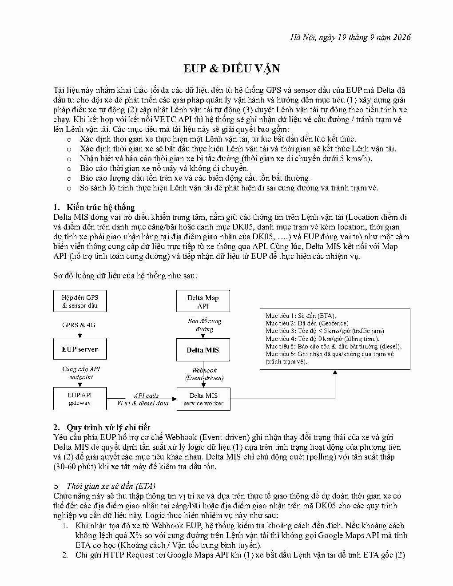
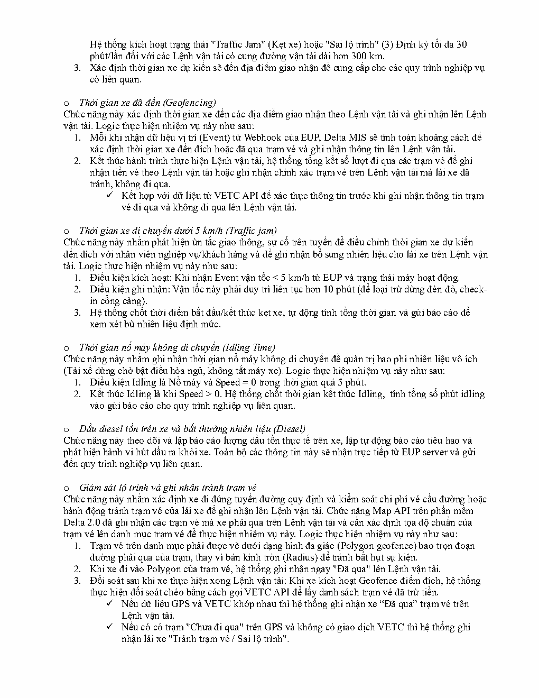

# EUP & Điều vận Delta_Sep 19 2026

> Chuyển từ PDF. Ảnh xem trước từng trang được giữ bên dưới để đối chiếu với bản gốc.

## Trang 1

Hà Nội, ngày 19 tháng 9 năm 2026
EUP & ĐIỀU VẬN
Tài liệu này nhằm khai thác tối đa các dữ liệu đến từ hệ thống GPS và sensor dầu của EUP mà Delta đã
đầu tư cho đội xe để phát triển các giải pháp quản lý vận hành và hướng đến mục tiêu (1) xây dựng giải
pháp điều xe tự động (2) cập nhật Lệnh vận tải tự động (3) duyệt Lệnh vận tải tự động theo tiến trình xe
chạy. Khi kết hợp với kết nối VETC API thì hệ thống sẽ ghi nhận dữ liệu vé cầu đường / tránh trạm vé
lên Lệnh vận tải. Các mục tiêu mà tài liệu này sẽ giải quyết bao gồm:
o Xác định thời gian xe thực hiện một Lệnh vận tải, từ lúc bắt đầu đến lúc kết thúc.
o Xác định thời gian xe sẽ bắt đầu thực hiện Lệnh vận tải và thời gian sẽ kết thúc Lệnh vận tải.
o Nhận biết và báo cáo thời gian xe bị tắc đường (thời gian xe di chuyển dưới 5 kms/h).
o Báo cáo thời gian xe nổ máy và không di chuyển.
o Báo cáo lượng dầu tồn trên xe và các biến động dầu tồn bất thường.
o So sánh lộ trình thực hiện Lệnh vận tải để phát hiện đi sai cung đường và tránh trạm vé.
1. Kiến trúc hệ thống
Delta MIS đóng vai trò điều khiển trung tâm, nắm giữ các thông tin trên Lệnh vận tải (Location điểm đi
và điểm đến trên danh mục cảng/bãi hoặc danh mục DK05, danh mục trạm vé kèm location, thời gian
dự tính xe phải giao nhận hàng tại địa điểm giao nhận của DK05, ….) và EUP đóng vai trò như một cảm
biến viễn thông cung cấp dữ liệu trực tiếp từ xe thông qua API. Cùng lúc, Delta MIS kết nối với Map
API (hỗ trợ tính toán cung đường) và tiếp nhận dữ liệu từ EUP để thực hiện các nhiệm vụ.
Sơ đồ luồng dữ liệu của hệ thống như sau:
Hộp đên GPS Delta Map
& sensor dầu API
Mục tiêu 1: Sẽ đến (ETA).
GPRS & 4G Bản đồ cung Mục tiêu 2: Đã đến (Geofence)
đường Mục tiêu 3: Tốc độ < 5 kms/giờ (traffic jam)
Mục tiêu 4: Tốc độ 0 km/giờ (Idling time).
Mục tiêu 5: Báo cáo tồn & dầu bất thường (diesel).
EUP server Delta MIS
Mục tiêu 6: Ghi nhận đã qua/không qua trạm vé
(tránh trạm vé).
Cung cấp API Webhook
endpoint (Event-driven)
EUP API API calls Delta MIS
gateway Vị trí & diesel data service worker
2. Quy trình xử lý chi tiết
Yêu cầu phía EUP hỗ trợ cơ chế Webhook (Event-driven) ghi nhận thay đổi trạng thái của xe và gửi
Delta MIS để quyết định tần suất xử lý logic dữ liệu (1) dựa trên tình trạng hoạt động của phương tiên
và (2) để giải quyết các mục tiêu khác nhau. Delta MIS chỉ chủ động quét (polling) với tần suất thấp
(30-60 phút) khi xe tắt máy để kiểm tra dầu tồn.
o Thời gian xe sẽ đến (ETA)
Chức năng này sẽ thu thập thông tin vị trí xe và dựa trên thực tế giao thông để dự đoán thời gian xe có
thể đến các địa điểm giao nhận tại cảng/bãi hoặc địa điểm giao nhận trên mã DK05 cho các quy trình
nghiệp vụ cần dữ liệu này. Logic thưc hiện nhiệm vụ này như sau:
1. Khi nhận tọa độ xe từ Webhook EUP, hệ thống kiểm tra khoảng cách đến đích. Nếu khoảng cách
không lệch quá X% so với cung đường trên Lệnh vận tải thì không gọi Google Maps API mà tính
ETA cơ học (Khoảng cách / Vận tốc trung bình tuyến).
2. Chỉ gửi HTTP Request tới Google Maps API khi (1) xe bắt đầu Lệnh vận tải để tính ETA gốc (2)

## Trang 2

Hệ thống kích hoạt trạng thái "Traffic Jam" (Kẹt xe) hoặc "Sai lộ trình" (3) Định kỳ tối đa 30
phút/lần đối với các Lệnh vận tải có cung đường vận tải dài hơn 300 km.
3. Xác định thời gian xe dự kiến sẽ đến địa điểm giao nhận để cung cấp cho các quy trình nghiệp vụ
có liên quan.
o Thời gian xe đã đến (Geofencing)
Chức năng này xác định thời gian xe đến các địa điểm giao nhận theo Lệnh vận tải và ghi nhận lên Lệnh
vận tải. Logic thực hiện nhiệm vụ này như sau:
1. Mỗi khi nhận dữ liệu vị trí (Event) từ Webhook của EUP, Delta MIS sẽ tính toán khoảng cách để
xác định thời gian xe đến đích hoặc đã qua trạm vé và ghi nhận thông tin lên Lệnh vận tải.
2. Kết thúc hành trình thực hiện Lệnh vận tải, hệ thống tổng kết số lượt đi qua các trạm vé để ghi
nhận tiền vé theo Lệnh vận tải hoặc ghi nhận chính xác trạm vé trên Lệnh vận tải mà lái xe đã
tránh, không đi qua.
✓ Kết hợp với dữ liệu từ VETC API để xác thực thông tin trước khi ghi nhận thông tin trạm
vé đi qua và không đi qua lên Lệnh vận tải.
o Thời gian xe di chuyển dưới 5 km/h (Traffic jam)
Chức năng này nhằm phát hiện ùn tắc giao thông, sự cố trên tuyến để điều chỉnh thời gian xe dự kiến
đến đích với nhân viên nghiệp vụ/khách hàng và để ghi nhận bổ sung nhiên liệu cho lái xe trên Lệnh vận
tải. Logic thực hiện nhiệm vụ này như sau:
1. Điều kiện kích hoạt: Khi nhận Event vận tốc < 5 km/h từ EUP và trạng thái máy hoạt động.
2. Điều kiện ghi nhận: Vận tốc này phải duy trì liên tục hơn 10 phút (để loại trừ dừng đèn đỏ, check-
in cổng cảng).
3. Hệ thống chốt thời điểm bắt đầu/kết thúc kẹt xe, tự động tính tổng thời gian và gửi báo cáo để
xem xét bù nhiên liệu định mức.
o Thời gian nổ máy không di chuyển (Idling Time)
Chức năng này nhằm ghi nhận thời gian nổ máy không di chuyển để quản trị hao phí nhiên liệu vô ích
(Tài xế dừng chờ bật điều hòa ngủ, không tắt máy xe). Logic thực hiện nhiệm vụ này như sau:
1. Điều kiện Idling là Nổ máy và Speed = 0 trong thời gian quá 5 phút.
2. Kết thúc Idling là khi Speed > 0. Hệ thống chốt thời gian kết thúc Idling, tính tổng số phút idling
vào gửi báo cáo cho quy trình nghiệp vụ liên quan.
o Dầu diesel tồn trên xe và bất thường nhiên liệu (Diesel)
Chức năng này theo dõi và lập báo cáo lượng dầu tồn thực tế trên xe, lập tự động báo cáo tiêu hao và
phát hiện hành vi hút dầu ra khỏi xe. Toàn bộ các thông tin này sẽ nhận trực tiếp từ EUP server và gửi
đến quy trình nghiệp vụ liên quan.
o Giám sát lộ trình và ghi nhận tránh trạm vé
Chức năng này nhằm xác định xe đi đúng tuyến đường quy định và kiểm soát chi phí vé cầu đường hoặc
hành động tránh trạm vé của lái xe để ghi nhận lên Lệnh vận tải. Chức năng Map API trên phần mềm
Delta 2.0 đã ghi nhận các trạm vé mà xe phải qua trên Lệnh vận tải và cần xác định tọa độ chuẩn của
trạm vé lên danh mục trạm vé để thực hiện nhiệm vụ này. Logic thực hiện nhiệm vụ này như sau:
1. Trạm vé trên danh mục phải được vẽ dưới dạng hình đa giác (Polygon geofence) bao trọn đoạn
đường phải qua của trạm, thay vì bán kính tròn (Radius) để tránh bắt hụt sự kiện.
2. Khi xe đi vào Polygon của trạm vé, hệ thống ghi nhận ngay "Đã qua" lên Lệnh vận tải.
3. Đối soát sau khi xe thực hiện xong Lệnh vận tải: Khi xe kích hoạt Geofence điểm đích, hệ thống
thực hiện đối soát chéo bằng cách gọi VETC API để lấy danh sách trạm vé đã trừ tiền.
✓ Nếu dữ liệu GPS và VETC khớp nhau thì hệ thống ghi nhận xe “Đã qua” trạm vé trên
Lệnh vận tải.
✓ Nếu có có trạm "Chưa đi qua" trên GPS và không có giao dịch VETC thì hệ thống ghi
nhận lái xe "Tránh trạm vé / Sai lộ trình".

