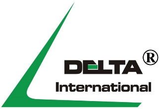
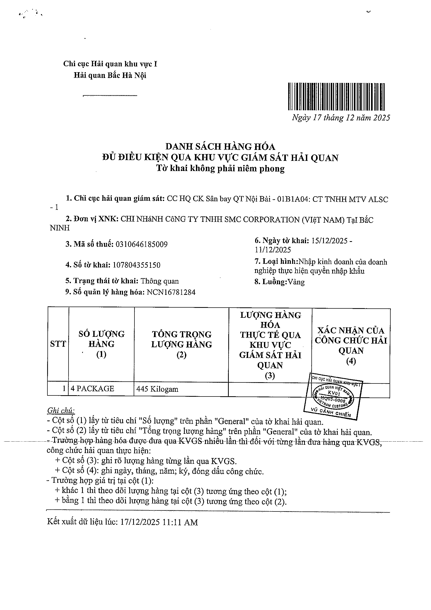
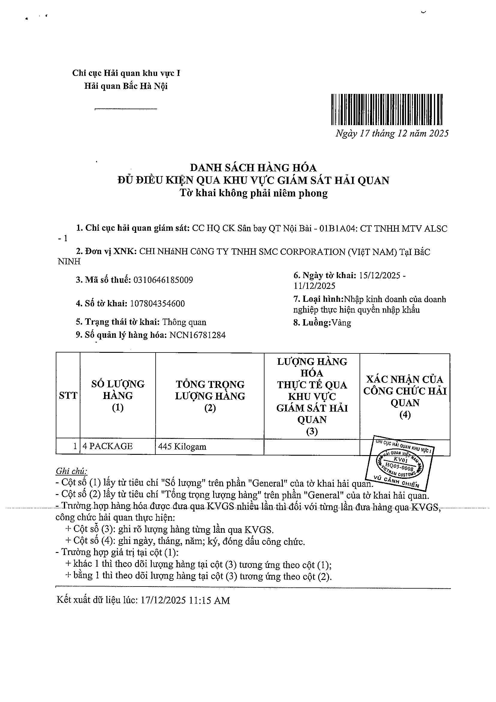
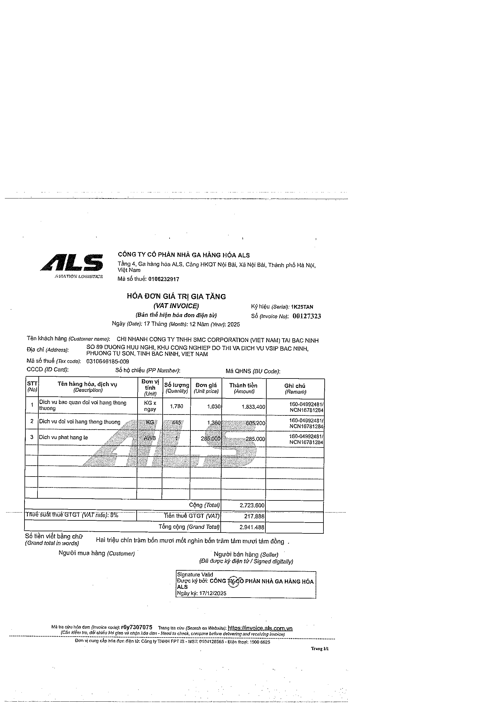
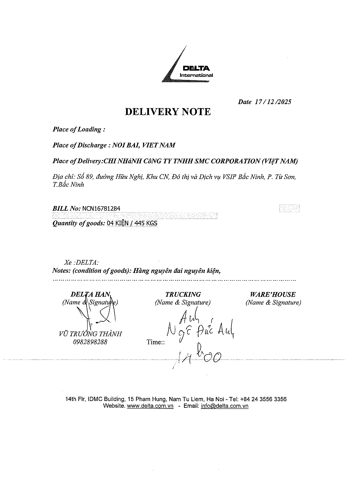
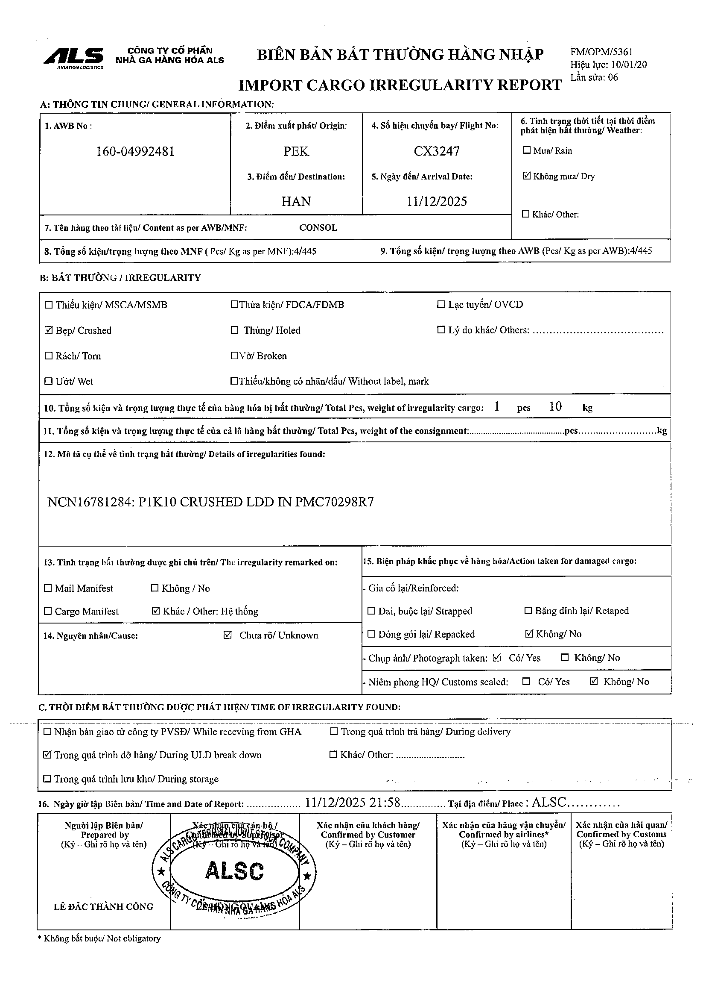
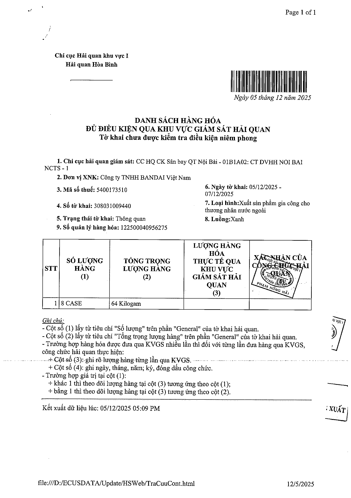
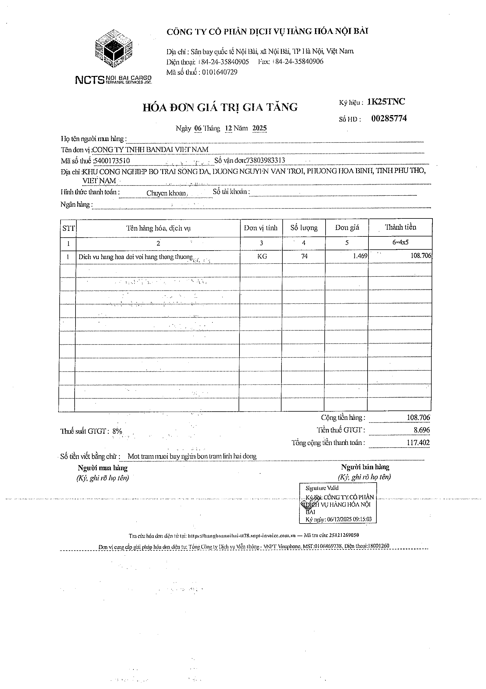
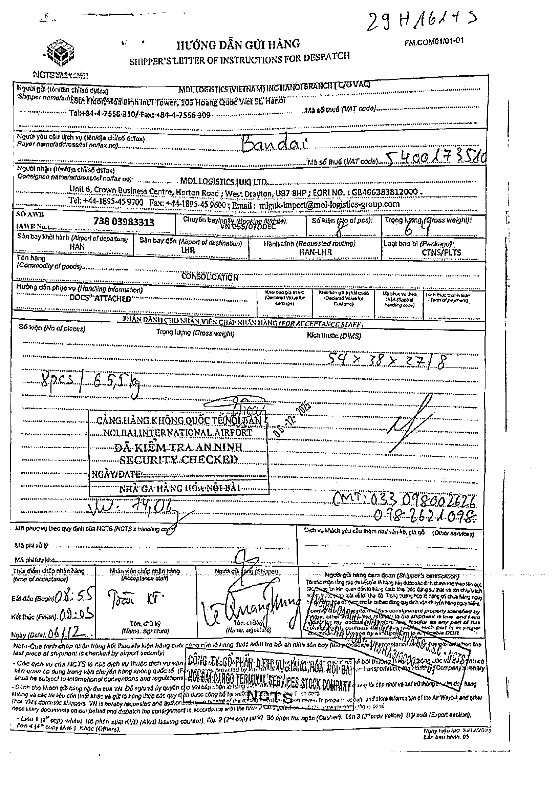
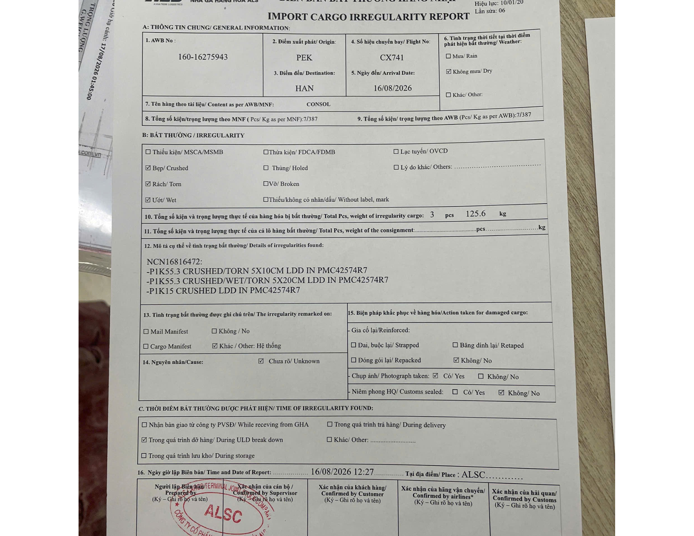

# GIAO NHẬN HÀNG HÓA

> Nguồn: [`Giao nhận hàng hóa_Sep 18 2026.docx`](source/giao-nhan-hang-hoa.docx) (Word) · Nhận: 2026-10-02 · Chuyển sang Markdown bằng `/intake`.
> Phiên bản: 2026-09-18 (nhận 2026-10-02) — thay bản nhận 2026-10-01 (SOP "Giao nhận container" ngày 21/8/2026); xem [thay đổi](../../_changes/2026-10-02-giao-nhan-hang-hoa.md).
> Thông tin trang: chân trang "Giao nhận hàng hóa · Trang: N / 19" (19 trang).

**CÔNG TY CỔ PHẦN QUỐC TẾ DELTA**

**Quy trình vận tải thực tế tại Delta**

**Hà Nội, ngày 18 tháng 9 năm 2026**

**MỤC LỤC**

- **I.** **MỤC TIÊU**
- **II.** **KHÁI NIỆM**
- **2.1.** **Khái niệm chung**
- **2.2.** **Hàng container**
- **2.3.** **Hàng lẻ (CFS/LCL)**
- **2.4.** **Hàng không** *(airfreight)*
- **2.5.** **Hàng CBT**
- **2.6.** **Hàng đường sắt**
- **III.** **QUY TRÌNH GIAO NHẬN**
- **3.1.** **Hàng container**
- **3.2.** **Hàng CFS/LCL**
- ***3.3.*** **Hàng không** *(airfreight)*
- ***3.4.*** **Hàng CBT**
- ***3.5.*** **Hàng đường sắt Ratraco**
- ***3.5.1.*** ***Quy trình giao nhận container hàng ga Đông Anh***
- ***3.5.2.*** ***Quy trình giao nhận tại ga Trảng Bom và ga Sóng Thần***
- ***3.5.3.*** ***Quy trình thanh toán chi phí***
- ***3.5.4.*** ***Quy trình ghi nhận doanh thu***
- **IV.** **DANH MỤC**

## I. MỤC TIÊU

Tài liệu này làm rõ các vấn đề về giao nhận tất cả các loại hàng hóa mà Delta đang vận chuyển trên toàn quốc (1) mô tả quy trình giao nhận hàng hóa thực tế giữa Delta với cảng/bãi, người vận chuyển (hãng tàu, hãng hàng không), khách hàng và các bên liên quan (2) các chứng từ, thủ tục liên quan làm cơ sở để viết quy trình nghiệp vụ.

## II. KHÁI NIỆM

### 2.1. Khái niệm chung

#### 2.1.1. Lệnh giao hàng (D/O - Delivery Order / eDO)

Phương pháp cấp Lệnh giao hàng hàng không và áp dụng quy trình nghiệp vụ theo phân loại Lệnh giao hàng hàng container khiến cho việc hiểu về Lệnh giao hàng là cần thiết để phát triển các quy trình nghiệp vụ thực hiện công việc.

- *Định nghĩa*

Là chứng từ cho phép nhận hàng tại cảng bãi container, kho CFS hoặc kho hàng không, do người vận tải hoặc đại diện của người vận tải phát hành sau khi người nhập khẩu đã nộp đủ các khoản phí local charges (THC, CFS, handling, D/O fee…) và xuất trình vận đơn gốc hoặc điện giao hàng (telex release) chứng minh quyền sở hữu lô hàng.

- *Vận đơn*

Vận đơn là chứng từ gửi hàng quan trọng nhất và được coi là hợp đồng vận tải giữa người gửi hàng và người vận tải.

- MB/L (MAWB) là vận đơn sơ cấp do người vận tải (hãng tàu, hàng không) cấp cho người gửi hàng.
- HB/L (HAWB) là vận đơn thứ cấp được người vận tải không tàu (NVOCC – Non-vessel operating carrier) cấp cho người gửi hàng.
- *Lệnh nối*

Nếu một lô hàng được gửi qua người vận tải đích thực (carrier) thì chỉ cần một Lệnh giao hàng của người vận tải cấp để nhận lô hàng đó. Nhưng nếu một lô hàng được gửi qua người vận tải không tàu (NVOCC) thì cần hai Lệnh giao hàng để nhận hàng trong đó lệnh đầu tiên do carrier cấp cho NVOCC và lệnh thứ hai do NVOCC cấp cho người nhận hàng. Trường hợp này gọi là “lệnh nối”.

- *Lệnh giao hàng air nhập tại sân bay Nội Bài*

Hàng gửi qua đường hàng không thường đi qua người vận tải không tàu (NVOCC) hay còn gọi là đại lý hàng hóa. Lệnh giao hàng nhập đi qua Nội Bài được các đại lý cấp theo ba là (1) dùng Lệnh giao hàng giấy và nhân viên hiện trường vẫn phải đến tận nơi thanh toán tiền và nhận lệnh (2) dùng eDO và có cấp eDO cho khách hàng - Nhân viên CS có thể thanh toán và lấy lệnh online và (3) dùng eDO và nhưng gửi thẳng lên kho hàng mà không cấp eDO cho khách hàng. Trường hợp này thì nhân viên CS có thể thanh toán chi phí lấy lệnh online nhưng không có eDO.

- Cần phát triển quy trình phù hợp với cả ba cách cấp Lệnh giao hàng ở trên.

#### 2.1.2. Thanh toán chi phí

Giao nhận hàng lẻ tại cửa khẩu (cảng biển, sân bay hoặc cửa khẩu đường bộ) luôn gắn liền với việc thanh toán các chi phí liên quan bao gồm (1) local charges nộp cho người vận tải (carrier hoặc NVOCC) để nhận Lệnh giao hàng (2) phí nộp cho cảng, bãi hoặc cửa khẩu khi thực hiện thủ tục giao nhận như xếp dỡ, nâng hạ, lưu kho, phí cơ sở hạ tầng. Căn cứ vào quy trình nghiệp vụ cụ thể, các loại phí này sẽ do nhân viên nghiệp vụ hoặc lái xe thanh toán theo Quy trình quản ký quỹ và thanh toán.

### 2.2. Hàng container

Mục này trình bày những khái niệm và vấn đề có liên quan chặt chẽ đến quy trình giao nhận các loại hàng hóa. Cần phải hiểu rõ các vấn đề này để hiểu được quy trình giao nhận container.

- *Cảng.* Là nơi tàu vào nên là nơi giao nhận container có hàng, cụ thể là nơi nhận hàng nhập và giao hàng xuất. Có thể nhận hoặc trả vỏ container rỗng tại cảng.
- *Bãi hay còn gọi là depot.* Là nơi nhận hoặc trả vỏ container rỗng. Do đây là nơi tàu không vào nên bãi (depot) thường không phải là nơi giao nhận container hàng.
- Một số depot đã ký hợp đồng với hãng tàu nhận container hàng xuất khẩu để chuyển tiếp (shipside) đến các cảng xuất tàu, giúp giảm ùn tắc tại cảng chờ xuất tàu. Theo quy định, thủ tục kiểm hóa hải quan đối với hàng xuất khẩu phải được thực hiện tại cảng xuất tàu nên các depot không tiếp nhận các container phải kiểm hoá hải quan.
- Những container hàng xuất khẩu được hạ tại depot thì phải kê khai mã trung chuyển trên tờ khai hải quan. Các depot phải đăng ký mã trung chuyển với Cục Hải quan để đưa lên hệ thống VNACCS/VCIS thì mới được nhận container hàng xuất.
- *Phiếu EIR (Equipment Interchange Receipt).*

Phiếu EIR là giấy tờ giao nhận container hay còn gọi là phơi (từ lóng). Phiếu này có hai nhiệm vụ chính là (1) ghi nhận tình trạng container làm cơ sở tính phí vệ sinh container khi trả container và đòi bồi thường tổn thất, nếu có (2) ghi nhận thời gian nhận và trả container để xác định thời gian lưu giữ container, làm cơ sở thu phí lưu container, nếu có.

- Khi hạ container rỗng thì phải xuất trình Phiếu EIR nhận container hàng nhập khẩu, làm căn cứ xác định tổn thất, phí vệ sinh container và phí lưu container, nếu có.

Mỗi khi thực hiện giao nhận container với cảng/bãi thì đều được cấp Phiếu EIR và các trường hợp cấp Phiếu EIR được liệt kê dưới đây có liên quan đến công việc của Delta.

- Cấp container rỗng: Nhận vỏ container rỗng tại cảng/depot đưa đến nơi đóng hàng. Phiếu EIR này không thể hiện nơi hạ container hàng.
- Hạ container hàng xuất: Sau khi đóng hàng, trả container hàng về cảng chờ xuất lên tàu. Phiếu EIR ghi nhận thời gian hạ container để xác định container có hạ đúng thời gian yêu cầu xuất hàng (cut-off time hay là closing time) không.
- Lấy container hàng nhập: Nâng container hàng nhập khẩu để chở về kho khách hàng. Phiếu EIR này không thể hiện nơi trả vỏ container rỗng.
- Trả container rỗng sau khi dỡ hàng: Sau khi trả hàng, hạ container rỗng xuống cảng hoặc bãi theo chỉ định của hãng tàu.

Do lái xe là người trực tiếp giao nhận container tại cảng, bãi nên lái xe là người nhận Phiếu EIR. Với những cảng, bãi đã triển khai ePort thì có thể lấy Phiếu EIR trên ePort. Với những cảng chưa triển khai ePort thì lái xe phải chụp ảnh Phiếu EIR để cung cấp cho các bộ phận liên quan, nếu cần.

- *Cấp chì (seal) niêm phong container hàng xuất.*

Thông thường, cảng, bãi nơi cấp vỏ container đóng hàng xuất sẽ cấp chì ngay sau khi chọn vỏ và làm Lệnh nâng container rỗng. Tuy nhiên, việc cấp chì (seal) có thể thực hiện sau khi làm Lệnh nâng container rỗng.

- Cảng, bãi nơi cấp container có thể không cấp chì cho nhân viên hiện trường chọn vỏ và làm Lệnh nâng vỏ container rỗng mà cấp chì cho lái xe khi nhận vỏ container.
- Trong một số trường hợp đặc biệt, nơi cấp vỏ container không cấp chì thì lái xe hoặc nhân viên hiện trường phải đến nơi thứ hai để nhận chì cho container đã chọn.
- *VGM*

Phiếu khai báo tổng khối lượng container, viết tắt là VGM (Verified Gross Mass), là chứng từ do người xuất khẩu kê khai trọng lượng hàng đóng trong container hàng xuất và tự trọng của vỏ container rỗng để nộp cho hãng tàu làm cơ sở cho việc xếp hàng trên tàu. Nếu cảng/bãi có ePort thì nhân viên CS kê khai trọng lượng hàng trên ePort theo VGM để làm lệnh hạ hàng. Nếu cảng/bãi không có ePort thì lái xe tự làm lệnh hạ và xuất trình VGM, nếu được yêu cầu.

- *Lệnh cấp container khống.*

Thông thường, cảng/bãi có ePort sẽ phát hành Lệnh cấp container rỗng thể hiện số container trên lệnh. Trong trường hợp cảng/bãi quy định phải có xe vào mới được chọn container thì họ sẽ phát hành Lệnh cấp container khống và trên lệnh này không thể hiện số container (chi tiết xe file chèn bên dưới) để lái xe tự chọn vỏ và lấy chì (seal) tại bãi.

- *ePort*

Hệ thống cảng điện tử (ePort) là một nền tảng số hóa quy trình và thủ tục giao nhận hàng hóa, cho phép khách hàng thực hiện các thủ tục trực tuyến thông qua website và ứng dụng di động. Các chức năng chính của ePort bao gồm:

- Khai báo và Đăng ký tác nghiệp trực tuyến: Làm thủ tục tự đăng ký lịch nâng container, hạ bãi chờ xuất tàu, đóng rút hàng hóa hoặc kiểm hóa.
- Quản lý Lệnh điện tử (eDO/eBooking): Tiếp nhận và tích hợp dữ liệu lệnh giao nhận điện tử kết nối trực tiếp từ các hãng tàu, đại lý hãng tàu đến cảng.
- Thanh toán trực tuyến: Tích hợp cổng thanh toán điện tử để thu phí nâng hạ, lưu bãi, lưu kho bằng hóa đơn điện tử mà không dùng tiền mặt hay quẹt thẻ.
- Tra cứu và Giám sát dữ liệu: Cung cấp công cụ tra cứu vị trí container, trạng thái thông quan, lịch tàu và quản lý Phiếu EIR theo thời gian thực.

Các tài liệu có thể khai thác từ ePort bao gồm “Cargo Tracking Details” và Phiếu eEIR.

### 2.3. Hàng lẻ (CFS/LCL)

Đây là những khái niệm và vấn đề có liên quan chặt chẽ đến quy trình giao nhận hàng tại kho CFS. Cần phải hiểu rõ các vấn đề này để hiểu được quy trình giao nhận hàng LCL.

- *Kho CFS (Container Freight Station)*

Là địa điểm thu gom hàng lẻ, nơi hàng của nhiều chủ hàng được rút ra khỏi container (hàng nhập) hoặc đóng ghép vào container (hàng xuất). Kho CFS chịu sự giám sát hải quan nên hàng đưa vào, đưa ra kho CFS phải thực hiện thủ tục thanh lý tờ khai hải quan với hải quan giám sát kho.

- *Hàng lẻ (LCL - Less than Container Load):*

Hàng không đủ đóng container nên được ghép chung với hàng của nhiều chủ hàng.

- Hàng lẻ luôn có hai vận đơn gồm MB/L (hãng tàu cấp cho co-loader) và HB/L (co-loader cấp cho người gửi hàng). Delta làm việc với co-loader để giao nhận hàng xuất và nhập.
- Đơn vị tính của hàng lẻ là số kiện, trọng lượng (kgs) và thể tích (CBM). Cước và phí kho tính theo CBM hoặc theo trọng lượng quy đổi (300 kgs hoặc 1000 kgs = 1 cbm), tuỳ điều kiện nào lớn hơn.
- *Lệnh giao hàng (D/O - Delivery Order):*

Là chứng từ cho phép nhận hàng tại kho CFS, do đại lý / co-loader phát hành sau khi khách hàng nộp đủ các khoản phí local charges (THC, CFS, handling, D/O fee…) và xuất trình HB/L gốc hoặc điện giao hàng (telex release).

- Trên D/O thể hiện tên kho CFS nơi lấy hàng, số HB/L, số kiện, trọng lượng và thể tích.
- Phải kiểm tra ngay tên kho trên D/O, vì cùng một hãng tàu nhưng mỗi lô có thể rút ở kho khác nhau. Đi nhầm kho là nguyên nhân phát sinh chi phí và trễ hàng thường gặp nhất.
- *Phiếu xuất kho / Phiếu giao hàng của kho CFS:*

Là chứng từ do kho CFS phát hành cho phép nhận hàng ra khỏi kho. Kho phát hành phiếu này trên cơ sở hoàn tất ba việc:

- Nộp D/O cho kho.
- Tờ khai nhập khẩu đã được thông quan và thanh lý (đối chiếu) với hải quan giám sát kho, được phép đưa hàng qua khu vực giám sát.
- Thanh toán đầy đủ phí lưu kho, phí nâng hạ/xếp dỡ (nếu có) cho kho.

Thông thường, thủ tục đăng ký lấy hàng do nhân viên hiện trường thực hiện tại kho. Với những kho đã triển khai khai báo/đăng ký trực tuyến thì nhân viên CS có thể đăng ký trước, nhân viên hiện trường chỉ đến kiểm đếm và nhận hàng.

- *Phiếu nhập kho (hàng xuất)*

Là chứng từ do kho CFS phát hành khi Delta giao hàng vào kho chờ đóng ghép container. Phiếu ghi nhận ngày giờ nhập kho, số kiện, trọng lượng, thể tích thực đo, làm cơ sở xác định hàng có vào kho trước hạn cut-off hay không và làm cơ sở tính cước/phí theo số liệu thực tế.

- *Biên bản kiểm đếm (Tally sheet):*

Là biên bản ghi nhận số kiện thực nhận và tình trạng bên ngoài của kiện hàng tại thời điểm giao nhận với kho. Đây là căn cứ duy nhất để quy trách nhiệm khi hàng thiếu kiện, rách vỡ, ướt.

- Kiểm đếm hàng nhập khi nhận hàng từ kho. Kiểm đếm hàng xuất khi giao hàng vào kho.

Nhân viên hiện trường là người trực tiếp giao nhận tại kho nên phải kiểm đếm hàng trước khi giao nhận. Sau khi kiểm đếm, nhân viên hiện trường ký xác nhận giao hàng vào kho đối với hàng xuất và ký xác nhận nhận hàng với kho đối với hàng nhập.

- Sau khi ký xác nhận với kho, nhân viên hiện trường bàn giao hàng cho lái xe kèm Biên bản giao hàng do CS lập. Đây là mốc chuyển trách nhiệm về hàng hoá từ nhân viên hiện trường sang lái xe, đồng thời là căn cứ đối chiếu khi giao hàng cho khách.
- *Cut-off kho CFS (closing time):*

Là hạn hàng xuất phải vào kho CFS để kịp đóng ghép container và hạ về cảng xuất tàu. Hạn này thể hiện trên booking note và sớm hơn 1-2 ngày so với thời hạn cut-off CY của hàng FCL để đóng ghép và làm thủ tục hạ container. Vào kho sau hạn này thì lô hàng bị chuyển sang chuyến sau.

- *Phí lưu kho (storage):*

Hàng lẻ không có DEM/DET như hàng container, thay vào đó là phí lưu kho tính theo ngày trên CBM/trọng lượng, sau số ngày miễn phí (free time) do kho quy định, tính từ ngày hàng vào kho. Đây là khoản phát sinh chi phí thường xuyên nhất của hàng lẻ nhập.

### 2.4. Hàng không *(airfreight)*

Đây là những khái niệm và vấn đề có liên quan chặt chẽ đến quy trình giao nhận hàng đường hàng không. Cần phải hiểu rõ các vấn đề này để hiểu được quy trình giao nhận hàng air.

- *Kho hàng không (nhà ga hàng hoá – cargo terminal).* Là nơi tiếp nhận, lưu giữ, soi chiếu và giao nhận hàng hoá vận chuyển bằng đường hàng không. Kho hàng không là nơi giao nhận kiện hàng theo vận đơn hàng không.
- Kho hàng không chịu sự giám sát hải quan. Hàng đưa vào, đưa ra kho đều phải có xác nhận của hải quan giám sát tại chính kho đó.
- Hàng nhập/xuất được làm tại các nhà ga hàng hoá khác nhau như NCTS, ALSC và ACSV (Nội Bài) và TCS, SCSC (Tân Sơn Nhất). Kho làm hàng do hãng hàng không chỉ định, thể hiện trên Giấy báo hàng đến hoặc trên booking note. Các kho hàng có vị trí và cổng ra vào khác nhau nên cần hướng dẫn lái xe. Khi đi nhầm kho thì có thể phải ra khỏi khu vực để đến đúng kho và xếp hàng lại từ đầu, ảnh hưởng trực tiếp đến việc giao nhận hàng.
- Kho hàng không hoạt động 24/7 theo lịch bay, không theo giờ hành chính. Đây là khác biệt lớn so với cảng và kho CFS khi lập kế hoạch điều xe.
- *Kho hàng không tại sân bay Tân Sơn Nhất*

Tại sân bay Tân Sơn Nhất hiện có ba kho hàng không như sau:

- Kho hàng xuất TCS (Công ty Cổ phần Dịch vụ Hàng hóa Tân Sơn Nhất) tại 49-51 Trường Sơn. Khu vực này có 2 kho làm hàng xuất là Airside warehouse (có hải quan giám sát) và Landside warehouse (không có hải quan giám sát).
- Kho hàng nhập TCS tại 46-48 Hậu Giang.
- Kho hàng SCSC (Công ty Cổ phần Dịch vụ Hàng hóa Sài Gòn) tại số 30 Phan Thúc Duyện, khai thác cả hàng xuất và nhập.

Sân bay Long Thành cũng dự kiến tổ chức chia hai loại kho (1) hai kho Airside của ACV và Vietnam Airlines và (2) tám kho Landside để các bên liên quan ghép hàng và các tác nghiệp VAS.

- *Vận đơn hàng không (AWB – Air Waybill).*

Là chứng từ vận chuyển của hàng air, đồng thời là chứng từ nhận hàng tại kho. Vận đơn hàng không không phải là chứng từ sở hữu hàng hoá, hàng có thể được giao khi có Giấy báo hàng đến, lệnh giao hàng và giấy tờ chứng minh là người nhận trên vận đơn.

- Hàng đi qua đại lý gom hàng có hai vận đơn là MAWB (hàng không cấp cho đại lý) và HAWB (đại lý cấp cho khách hàng). Delta lấy Lệnh giao hàng từ đại lý.
- Số MAWB gồm 3 chữ số mã hãng + 8 chữ số, là số duy nhất để tra cứu tình trạng lô hàng trên hệ thống của hãng và của kho. Mọi trao đổi với kho, hải quan, hãng đều theo số này.
- Hàng air thường được chia làm nhiều chuyến bay (split) khi tải không đủ. Phải kiểm tra số kiện thực tế đã về trên Giấy báo hàng đến, không mặc định cả lô về cùng chuyến.
- *Lệnh giao hàng (D/O – Delivery Order).*

Là chứng từ cho phép nhận hàng tại kho hàng không, do đại lý phát hành sau khi người nhận nộp đủ các khoản phí D/O, handling theo thông báo và xuất trình giấy tờ chứng minh là người nhận hàng.

- Trên D/O thể hiện tên kho nơi lấy hàng, số AWB, số lượng kiện, trọng lượng
- Phải kiểm tra tên kho vì cùng một sân bay có nhiều nhà ga hàng hoá; đi nhầm kho là nguyên nhân phát sinh chi phí và trễ hàng thường gặp nhất.
- *Phiếu xuất kho của kho hàng không (hàng nhập).*

Là chứng từ do kho hàng không phát hành cho phép đưa hàng ra khỏi kho. Kho phát hành phiếu này trên cơ sở hoàn tất ba việc:

- Nộp D/O cho kho.
- Tờ khai nhập khẩu đã được thông quan và được hải quan giám sát kho thanh lý.
- Thanh toán đầy đủ phí lưu kho, phí lao vụ/xếp dỡ và các phí khác cho kho.
- *Mã vạch*

Là tên gọi tắt của *Danh sách hàng đủ điều kiện qua khu vực giám sát*. Đối với hàng đường không, hải quan giám sát kho sẽ trả 1 bản mã vạch đã ký đóng dấu khi hoàn thành thủ tục giám sát (ký tên và có thể đóng dấu hoặc không). Mã vạch gốc này nhân viên hiện trường cần chuyển về VP cho CS để bàn giao cho khách hàng. Đối với một số khách hàng, mã vạch gốc này là căn cứ để ghi nhận thanh toán dịch vụ.

- *Phiếu cân (hàng xuất).*

Là chứng từ do kho hàng không phát hành khi Delta giao hàng xuất vào kho để chờ soi chiếu và chất xếp lên chuyến bay. Phiếu ghi nhận ngày giờ nhập kho, số kiện, trọng lượng và kích thước thực đo, làm cơ sở xác định hàng có vào kho trước cut-off hay không và làm cơ sở tính cước theo số liệu thực tế.

- *Cut-off hàng xuất.*

Là hạn chót hàng phải vào kho hàng không để kịp soi chiếu và chất xếp lên chuyến bay. Khác với hàng biển tính theo ngày, cut-off hàng air tính bằng giờ trước giờ khởi hành (thường 4–6 giờ tuỳ hãng và tuỳ loại hàng). Vào kho sau hạn này thì lô hàng bị chuyển sang chuyến bay sau.

- Với hàng phải soi chiếu kỹ, hàng DGR hoặc hàng cần kiểm hoá hải quan thì phải cộng thêm thời gian, đưa hàng vào kho sớm hơn cut-off.
- *Phí lưu kho (storage).*

Kho hàng không cho một số giờ/ngày miễn phí (free time) tính từ thời điểm hàng vào kho, sau đó tính phí lưu kho theo ngày trên trọng lượng. Do free time của hàng air rất ngắn so với hàng biển, đây là khoản phát sinh chi phí thường gặp nhất khi chứng từ về chậm hoặc tờ khai bị phân luồng.

### 2.5. Hàng CBT

Đây là những khái niệm và vấn đề có liên quan chặt chẽ đến quy trình giao nhận hàng CBT. Cần phải hiểu rõ các vấn đề này để hiểu được quy trình giao nhận hàng CBT.

- *Loại hàng hóa*

Phân chia theo loại hàng hóa thì hàng CBT bao gồm ba loại là hàng nóng, hàng lạnh và hàng thương mại điện tử.

- Hàng nóng: Là hàng bách hóa bao gồm điện tử & linh kiện điện tử, may mặc, nguyên phụ liệu, hàng tiêu dùng, máy móc thiết bị và các loại hàng thông thường khác.
- Hàng lạnh: Là hoa quả tươi, thủy hải sản và các mặt hàng thực phẩm đông lạnh.
- Hàng thương mại điện tử. Đây là một trường hợp đặc biệt của hàng nóng.

Phân chia theo đối tượng khách hàng và tuyến vận tải thì hàng CBT bao gồm các loại hàng sau:

- Hàng quá cảnh trong đó có hàng Campuchia. Là những loại hàng chỉ đi qua lãnh thổ Việt Nam, quá trình vận tải hàng hóa không bắt đầu hay kết thúc trên lãnh thổ Việt Nam.
- Hàng xuất nhập khẩu của Việt Nam đi qua đường bộ.
- *Tuyến vận tải*

Hàng CBT được vận tải qua một số tuyến chính liệt kê dưới đây. Delta đã và đang cung cấp dịch vụ trên tất cả các tuyến vận tải CBT này.

- Giữa Campuchia và các cụm cảng khu vực TP HCM.
- Giữa Trung Quốc và các nước Asean đi qua khu vực phía Bắc Việt Nam (Lào, Campuchia).
- Giữa Trung Quốc và Việt Nam.
- Giữa Việt Nam và các nước Asean. Delta chưa từng làm tuyến này.
- Vận tải Bắc-Nam.
- *Hàng đối ứng.*

Vận chuyển CBT thường là các tuyến vận chuyển dài. Mặt khác, do Trung Quốc thường xuất siêu sang Việt Nam và các nước Asean nên khối lượng hàng từ Trung Quốc đi luôn lớn hơn khối lượng hàng vận chuyển theo chiều ngược lại. Vì vậy, các đơn vị vận tải CBT luôn phải giải quyết vấn đề cân bằng tải mà cụ thể là phải tìm kiếm hàng hai chiều trên các tuyến vận tải hàng CBT. Đây chính là lý do mà các đơn vị vận tải hàng CBT luôn phải hoạt động tích cực trên tuyến vận tải nội địa giữa miền Bắc và miền Nam để tìm kiếm nguồn hàng hai chiều đối ứng với hàng CBT và nguồn hàng đối ứng trong CBT gồm có hai nhóm là (1) vận tải nội địa giữa miền Bắc và miền Nam và (2) vận tải hàng nóng để đối ứng cho hàng lạnh.

(1) ***Vận tải nội địa từ miền Nam ra miền Bắc để đối ứng cho hàng CBT từ Bắc vào Nam.***

Hàng nội địa từ trong Nam ra khu vực mìền Trung và miền Bắc để đối ứng cho luồng hàng hóa thì Trung Quốc sang Lào, Campuchia và vào các tỉnh miền Nam hoặc miền Trung Việt Nam. Nguồn hàng này khá nhiều, vì trung tâm sản xuất hàng tiêu dùng thường đặt ở trong khu vực phía Nam.

(2) ***Vận tải hàng nóng để đối ứng cho hàng lạnh.***

Quy trình vận tải hàng đối ứng này khá phức tạp và phải thực hiện mấy bước sau:

1. Vận chuyển hàng CBT từ Trung Quốc vào khu vực miền Trung và miền Nam bằng vỏ container DC cùng lúc gửi vỏ container lạnh từ Hải Phòng vào HCM.

2. Sau khi trả hàng nóng xong thì xe sẽ đưa vỏ container nóng này đến cảng hạ bãi để gửi vỏ container nóng này ngược ra Hải Phòng, nhận lại vỏ container lạnh đã gửi từ Hải Phòng vào.

3. Sử dụng vỏ container lạnh để đóng hàng lạnh (thường là sầu riêng tươi) lên bên giới phía Bắc để xuất sang Trung Quốc.

Quy trình vận tải hàng đối ứng như thế này sẽ tiết kiệm tối đa chi phí vận hành. Tuy nhiên, tùy thuộc vào tình trạng thị trường và đòi hỏi của khách hàng lạnh mới có thể thực hiện quy trình này.

- *Thủ tục hải quan*

Thủ tục hải quan của hàng CBT được thực hiện khác nhau giữa các loại hàng phân chia theo đối tượng khách hàng và tuyến vận tải.

- Hàng quá cảnh. Khai tờ khai vận chuyển độc lập, một trường hợp đặc biệt của tờ khai hải quan trong đó không có thuế nhập khẩu, thuế GTGT hàng nhập khẩu và các thủ tục kiểm tra chuyên ngành.
- Hàng xuất nhập khẩu của Việt Nam. Khai báo hải quan như với hàng xuất nhập khẩu đi đường biển hoặc đường hàng không. Tuy nhiên, tờ khai hải quan có thể được chủ hàng (người xuất khẩu hoặc người nhập khẩu) đăng ký tại cửa khẩu hoặc đăng ký tại hải quan ngoài cửa khẩu. Đặc tính này phản ánh thực tế là một lô hàng CBT của Delta có thể có mã JobID nghiệp vụ là J01, J02, J04 hoặc J05.

Delta đứng tên trên tờ khai vận chuyển quá cảnh hàng hoa quả tươi của Thái Lan (vận chuyển quá cảnh qua Việt Nam để sang Trung Quốc) để xin giấy phép kiểm dịch và mua ngoài dịch vụ khai thuê hải quan tại các cửa khẩu. Nguyên tắc chung là Delta không đứng tên trên tờ khai hải quan các loại hàng quá cảnh khác. Đối với hàng xuất nhập khẩu, Delta cũng mua ngoài dịch vụ khai báo hải quan & giao/nhận hàng hóa tại cửa khẩu để cung cấp dịch vụ này cho khách hàng trực tiếp.

- Khai báo hải quan cho các lô hàng CBT có mã JobID nghiệp vụ là J01, J02, J04 hoặc J05 thì khách hàng đứng tên trên tờ khai hải quan.
- *Container*

Hàng CBT được vận chuyển bằng container của người vận tải bao gồm container thuộc sở hữu của Delta hoặc các khách hàng của Delta. Có hai phương thức giao nhận hàng CBT là (1) Container swap - Đổi container và (2) Trans loading - Sang hàng.

- Container swap: Cẩu đổi container tại địa điểm giao nhận, giao đi một container rỗng/có hàng để nhận lại một container có hàng/rổng. Phương thức giao nhận này dẫn đến việc Delta và khách hàng của Delta luôn phải quản lý container và các chi phí sửa chữa container thuộc sở hữu của mình và của đối tác, đặc biệt là container lạnh.
- Trans loading: Rút hàng hóa từ container của người giao để đóng sang container của người vận tải & dỡ hàng hoặc rút hàng tại địa điểm nhận. để giao hàng hoặc chuyển tải
- *Ảnh định vị*

Là ảnh do lái xe sử dụng app định vị để chụp trong đó thể hiện thông tin vị trí của xe thời gian và địa điểm chụp ảnh. Đây là căn cứ để các bên liên quan kiểm soát hàng hóa trong quá trình vận chuyển và phân chia trách nhiệm.

- *Trucking hub*

Delta xây dựng bãi xe tại Lạng Sơn để lưu giữ container và phương tiện vận tải (xe/mooc) phục vụ hoạt động vận tải CBT. Tuy nhiên, địa điểm này không phải là mốc để tính chi phí vận hành.

- *Khách hàng*

Vì CBT là vận tải đường bộ giữa các quốc gia nên khách hmục tiêu của hàng CBT thường là các công ty logistics thuộc các quốc gia trên tuyến vận tải. Cũng có khách hàng trực tiếp trong nước như công ty thương mại, sản xuất,... nhưng tỷ trọng rất ít.

### 2.6. Hàng đường sắt

Đây là những khái niệm và vấn đề có liên quan chặt chẽ đến quy trình làm hàng đường sắt (Ratraco và các khách hàng khác). Cần hiểu rõ các vấn đề này để hiểu quy trình giao nhận hàng đường sắt

- *Khách hàng:*

Ratraco (Công ty Cổ phần Vận tải và Thương mại Đường sắt) là doanh nghiệp vận tải đường sắt, khai thác mạng lưới nhà ga và đội phương tiện (toa xe, container, đầu kéo) trên nhiều tuyến trong cả nước để tổ chức chạy tàu chở container, trong đó có tuyến Bắc-Nam. Ratraco cung cấp dịch vụ vận chuyển giữa kho và kho cho khách hàng, bao gồm (1) vận tải đường sắt giữa các ga và (2) vận tải đường bộ giữa ga và địa điểm giao nhận hàng của khách, thường là kho hoặc nhà máy. Ratraco tự làm hoàn toàn phần vận chuyển đường sắt và mua ngoài một phần vận chuyển đường bộ, trong đó có mua dịch vụ vận tải của Delta: Ngoài khách hàng Ratraco, Delta còn có một số khách hàng nhỏ của riêng mình có hàng vận chuyển đường sắt qua các ga mà Delta đang hoạt động. Nguồn hàng này chiếm tỷ trọng rất ít, nhưng sẽ tăng dần theo thời gian và có ý nghĩa quan trọng để tăng hiệu quả khai thác xe.

- *Địa điểm các ga mà Delta đang hoạt động:*
- Ga Đông Anh: <https://maps.app.goo.gl/2ezYHZWWgnFQyYZk7>
- Ga Yên Viên: <https://share.google/URHPAwtP5IGpkuQNG>
- Ga Trảng Bom: <https://maps.app.goo.gl/cb1k9zKPjSRMbzR79>
- Ga Sóng Thần: <https://maps.app.goo.gl/PNwcgbpS6zCACoT87>
- *Loại hàng hóa:*

Hàng hóa làm hàng tại các ga chủ yếu được đóng trong container 40ft hoặc container 45ft, với tải trọng trung bình khoảng 30 tấn/container với cả hai chiều là hàng trả và hàng đóng. Hàng hóa vận chuyển trong quy trình này là hàng nội địa nên không có thủ tục hải quan.

- *Container:*

Container được luân chuyển theo chiều: (1) Hàng trả - lái xe nhận container đã có hàng, có chì và có chứng từ kèm theo tại ga để chở đi trả cho khách hàng; (2) Hàng đóng - lái xe nhận vỏ container rỗng, (3) kết hợp trả hàng nhập và đóng hàng xuất tại địa điểm khác. Hàng hóa không kèm chứng từ giao nhận tại ga, chỉ có biên bảng giao nhận hàng tại kho riêng (với hàng trả); khách hàng giao chứng từ và niêm phong (chì) container (đối với hàng đóng). Việc chụp ảnh tình trạng container và chì tại các thời điểm giao/nhận là căn cứ đối chiếu trách nhiệm giữa các bên khi cần thiết. Container hàng đường sắt bao gồm cả container nóng và container lạnh, ở hàng trả và hàng đóng.

- Do tàu hỏa không được trang bị hệ thống tổ hợp máy phát điện như trên tàu biển nên container lạnh dùng trong đường sắt và loại container lạnh có tích hợp cả máy phát điện để đảm bảo duy trì hoạt động liên tục của container trong thời gian vận tải.

## III. QUY TRÌNH GIAO NHẬN

### 3.1. Hàng container

Mục này làm rõ các vấn đề về giao nhận hàng container các cảng bãi khu vực Hải Phòng, HCM và giữa Delta với hãng tàu, cảng bãi và khách hàng, cùng các chứng từ, thủ tục liên quan làm cơ sở để viết quy trình nghiệp vụ.

#### 3.1.1. Giao nhận container với cảng bãi

Khi cung cấp dịch vụ vận tải container thì cần tuân thủ các quy định giao nhận container tại cảng bãi. Vì vậy, các quy định này vừa là căn cứ, vừa là điều kiện để xây dựng các quy trình nghiệp vụ.

- *Lệnh nâng container hàng (nhập khẩu)*

Lệnh nâng container hàng nhập khẩu được cảng phát hành cho phép nhận container hàng nhập, trên cơ sở hoàn tất các việc sau:

- Được hãng tàu cấp Lệnh giao hàng eDO.
- Được hải quan thanh lý tờ khai nhập khẩu (online hoặc offline). Thanh lý được hiểu là cho phép đưa hàng khỏi khu vực giám sát hải quan.
- Thanh toán đầy đủ phí nâng container cho cảng nhận hàng.
- Vược qua đánh giá HSE của cảng (Giấy phép vận chuyển hàng DG, hóa chất, quá khổ quá tải, ....).

Thông thường, Lệnh nâng container hàng nhập khẩu do CS làm một lần cho cả vận đơn trên ePort. Nếu cảng không triển khai ePort thì sẽ do nhân viên hiện trường thực hiện.

- *Lệnh hạ container hàng (xuất khẩu)*

Lệnh này cho phép lái xe Delta hạ container hàng xuất xuống cảng/bãi theo chỉ định của hàng tài trên Booking Note và được cảng/bãi phát hành trên cơ sở các điều kiện sau:

- Booking Note.
- Thanh toán đầy đủ phí hạ container cho cảng giao hàng.
- Kê khai trên ePort trọng lượng hàng ghi nhận trên VGM do khách hàng cung cấp cho lái xe hoặc nhân viên CS sau khi đóng hàng xong.

Việc làm Lệnh hạ container hàng (xuất khẩu) sẽ chia làm hai trường hợp là (1) Nếu cảng sử dụng ePort thì Lệnh hạ container hàng xuất khẩu do CS hoặc nhân viên hiện trường làm cho từng container trên ePort hoặc (2) Nếu cảng nơi giao hàng không triển khai ePort thì nhân viên CS sẽ gửi booking note và/hoặc email của hãng tàu thể hiện cảng hạ hàng cho lái xe tự làm thủ tục hạ hàng. Sau đó, lái xe lấy phiếu thu hoặc hóa đơn hạ hàng về thanh toán với Công ty.

- *Lệnh hạ container rỗng (nhập khẩu)*

Lênh này cho phép lái xe Delta được hạ vỏ container rỗng sau khi trả xong hàng nhập. Nếu cảng/bãi nhận vỏ container rỗng sử dụng ePort thì Lệnh hạ vỏ container rỗng do CS làm một lần cho cả vận đơn trên ePort hoặc làm từng container. Nếu cảng/bãi nhận vỏ không triển khai ePort thì sẽ lái xe sẽ tự thực hiện tại cảng/bãi và thanh toán tiền hạ container rỗng, nhận phiếu thu/hóa đơn rồi thanh toán với Công ty. Các điều kiện để làm Lệnh hạ container rỗng:

- Phiếu EIR nhận khi nhận container hàng.
- Lệnh giao hàng.
- Email thể hiện nơi hạ vỏ của hãng tàu hoặc một văn bản chi định nơi hạ vỏ.

Thông thường, việc làm Lệnh hạ container rỗng thực hiện cho từng container mà không làm một lần cho cả vận đơn vì các lý do sau:

- Hãng tàu có thể yêu cầu địa điểm hạ vỏ trả theo loại container nên một vận đơn có cả ba loại cotnainer 20ft, 40ft và 40ft HC có thể hạ ở ba cảng/bãi khác nhau.
- Khách hàng nhận hàng thuộc một vận đơn trong nhiều ngày nên sẽ không có Phiếu EIR cùng lúc để làm Lệnh hạ vỏ cho cả vận đơn.
- *Lệnh nâng container rỗng (xuất khẩu)*

Về bản chất thì làm Lệnh nâng container rỗng để đóng hàng xuất khẩu là công việc chọn và nhận vỏ container rỗng. Điều kiện để làm Lệnh nâng container rỗng là phải có Booking Note của hãng tàu thể hiện nơi nhận vỏ container. Một số hãng tàu không thể hiện nơi nhận vỏ container trên Booking Note và cần gửi email cho hãng để biết địa điểm nhận vỏ container rỗng cho từng Booking Note và phải xuất trình cảng/bãi email của hãng tàu cùng với booking note để nhận vỏ container rỗng.

Quy trình làm Lệnh nâng container rỗng để đóng hàng xuất khẩu được thực hiện tùy thuộc vào quy định của cảng/bãi cấp vỏ container rỗng:

- Lái xe chọn vỏ: Một số cảng/bãi yêu cầu phải có xe/mooc vào cảng/bãi thì mới được chọn vỏ. Với những nơi có quy định này thì (1) Nhân viên hiện trường hoặc CS phải làm Lệnh cấp container khống và (2) lái xe sử dụng Lệnh cấp container khống này để tự chọn vỏ và nhận chì (seal) tại bãi, thực hiện việc thanh toán tiền nâng vỏ rỗng, nhận hóa đơn/phiếu thu về thanh toán với công ty.
- Nhân viên hiện trường chọn vỏ: Những cảng/bãi không yêu cầu phải có xe/mooc vào cảng/bãi thì mới được chọn vỏ thì nhân viên hiện trường có thể chọn vỏ trước và thanh toán tiền nâng vỏ. Lái xe chỉ đến nhận vỏ container rỗng.

Quy trình chọn vỏ container và bàn giao thông tin/chứng từ cho lái xe nhận container rỗng để đóng hàng xuất còn được phân chia theo cảng/bãi đã triển khai ePort hay chưa.

- Nếu cảng/bãi cấp vỏ container rỗng chưa triển khai ePort. Sau khi chọn vỏ xong thì nhân viên hiện trường đăng ký với cảng/bãi để ghi tất cả số container đã chọn lên Booking Note kèm số chì được cấp và đóng dấu xác nhận của cảng/bãi lên Boking Note có các số container và số chì tương ứng. Nhân viên hiện trường sẽ bàn giao cho điều vận Booking Note có số container/chì và dấu xác nhận của cảng/bãi với số container/chì này.
- Nếu có nhiều hơn một container trên Booking Note thì phải photo Booking Note này thành số bản tương ứng với số lượng container, đóng dấu treo của Delta rồi giao từng bản sao này kèm một viên chì cho lái xe nhận container rỗng.
- Nếu cảng/bãi cấp vỏ container rỗng đã triển khai ePort. Sau khi chọn vỏ xong thì nhân viên hiện trường sẽ làm Lệnh cấp vỏ container trên ePort rồi nhận một file Lệnh cấp container có tên khách hàng & số Booking Note và seal.
- In file này ra để bàn giao cho lái xe cùng với chì (seal) do cảng/bãi cấp.

Nhân viên điều vận sẽ bàn giao chì (seal) cho lái xe (nếu nhân viên hiện trường đã nhận chì từ cảng, bãi nơi cấp vỏ) và một trong các giấy tờ sau để nhận vỏ container đóng hàng xuất tại cảng/bãi.

- Booking note và Giấy giới thiệu của khách hàng hoặc của Delta.
- Booking note có đóng dấu treo của Delta.
- Booking note và email của hãng tàu thể hiện nơi nhận container rỗng.

#### 3.1.2. Giao nhận container với khách hàng

Việc giao nhận hàng hoá giữa lái xe và khách hàng được ghi nhận bằng Biên bản giao hàng, được ký tại nơi giao nhận hàng với khách hàng, thường là nhà máy hoặc kho của khaách hàng. Đây là căn cứ để đối chiếu và thu hồi công nợ với khách hàng.

- Hàng nhập khẩu: Khi giao hàng, lái xe Delta và đại diện khách hàng lập Biên bản giao hàng ghi nhận số container, số chì, tình trạng chì, số lượng và tình trạng hàng hoá. Sau khi trả hàng và đại diện khách hàng ký xác nhận Biên bản giao àng thì lái xe đưa vỏ container rỗng đi hạ theo chỉ định của hãng tàu.
- Hàng xuất khẩu: Trước hoặc sau khi đóng hàng, đại diện khách hàng sẽ phát hành Phiếu xuất kho. Sau khi đóng hàng và kẹp chì cần cân hàng để lấy phiếu cân làm sơ sở lập phiếu VGM. Biên bản giao hàng ghi nhận số container, số chì đã kẹp, số lượng hàng đã đóng. Bộ chứng từ này là cơ sở để làm Lệnh hạ container hàng xuất.
- Nội dung phải có của Biên bản giao hàng bao gồm ngày giờ giao nhận hàng, địa điểm giao nhận, tên khách hàng, số container, số chì, biển số xe và tên lái xe, số lượng hàng, tình trạng hàng hoá, chữ ký của bên giao và bên nhận.
- Biên bản giao hàng lập hai bản, khách hàng giữ một bản, lái xe giữ một bản về nộp cho điều vận. Sau khi ký nhận với khách hàng thì lái xe phải chụp ảnh Biên bản giao hàng và gửi ngay về nhóm Zalo chứng từ để bộ phận theo dõi cập nhật, không chờ đến khi về công ty.
- Ảnh chụp 4 mặt container khi đến và khi rời nhà máy.

Nếu có bất thường như chì không nguyên vẹn khi mở container, hàng thiếu, đổ vỡ, ướt, sai chủng loại, thì phải ghi nhận trên Biên bản giao hàng, chụp ảnh hiện trạng và báo điều vận trước khi rời địa điểm giao nhận hàng hóa với khách. Không ký Biên bản giao hàng khi chưa ghi nhận bất thường vì đây là cơ sở xác định trách nhiệm giữa Delta, khách hàng và hãng tàu.

#### 3.1.3. Giao nhận container với hãng tàu

Việc giao nhận container với hãng tàu được thực hiện thông qua bốn mốc thời gian là SI – CY – DEM – DET được định nghĩa bên dưới. Các mốc thời gian này quyết định lô hàng có kịp tàu theo Booking Note hay không và có phát sinh tiền phạt hay không. Vì vậy, phải chủ động theo dõi và cảnh báo sớm, không để quá hạn mới xử lý.

- SI (Shipping Instruction): Thời hạn nộp chi tiết lô hàng cho hãng tàu để phát hành vận đơn và trách nhiệm của Delta là cung cấp số container và số chì cho khách hàng trước hạn SI ghi trên Booking Note. Nếu nộp muộn sẽ phát sinh phí sửa hoặc phát hành vận đơn muộn, thậm chí phải chuyển Booking Note sang chuyến sau gây ra rất nhiều vấn đề.
- CY (Container yard cut-off, còn gọi là closing time): Thời hạn hạ container hàng xuất về cảng để kịp xếp lên tàu. Thời hạn này có ghi trên Booking Note và được ghi nhận bằng thời gian trên Phiếu EIR hạ hàng. Nếu hạ container hàng xuất sau thời hạn này thì bị rớt tàu, phải chuyển chuyến sau, phát sinh phí lưu bãi và phí đổi Booking Note.
- Container phải kiểm hoá hải quan chỉ được hạ tại cảng xuất tàu, không được hạ tại depot trung chuyển, nên phải cộng thêm thời gian giải quyết thủ tục.
- DEM (Demurrage). Thời hạn lưu container hàng nhập miễn phí là thỏa thuận giữa hãng tàu và khách hàng và thời hạn này được tính từ khi tàu cập cảng, được ghi nhận trên Lệnh giao hàng. Nếu nhận hàng nhập sau thời gian lưu container miễn phí thì sẽ phát sinh chi phí lưu container hàng (Demurrage hay viết tắt là DEM).
- DET (Detention). Số ngày lưu container miễn phí ngoài cảng để đưa về nơi dỡ hàng được ghi nhận trên Lệnh giao hàng hoặc Thỏa thuận mượn container và được tính từ ngày nhận container hàng nhập trên Phiếu EIR đến ngày trả vỏ về nơi hãng tàu chỉ định. Nếu lưu giữ container ngoài cảng quá số ngày lưu container miễn phí thì sẽ phát sinh phí lưu container (Detention hay viết tắt là DET).

Nhân viên CS ghi đủ bốn mốc thời gian trên lên bảng kế hoạch ngay khi nhận được Booking Note hoặc Lệnh giao hàng, không để trống. Nhân viên điều vận rà soát hàng ngày và cảnh báo các mốc thời gian trên theo quy tắc sau:

- SI: Trước 24 giờ.
- CY: Trước 12 giờ.
- DEM và DET: Trước 2 ngày.

Khi container/lô hàng sắp quá hạn một trong bốn mốc trên thì phải báo khách hàng và hãng tàu bằng văn bản (không sử dụng điêện thoại), nêu rõ nguyên nhân. Mọi trường hợp quá hạn phải ghi nhận nguyên nhân gồm (1) do khách hàng giao hàng & chứng từ chậm (2) do Delta điều xe chậm, xe hỏng và (3) do bên thứ ba như cảng, hải quan, hãng tàu. Đây là căn cứ quy trách nhiệm chi trả các chi phí phát sinh.

- Cần lập và duy trì bảng số ngày miễn phí DEM và DET theo từng hãng tàu, vì mỗi hãng quy định khác nhau và đây là nguồn phát sinh chi phí thường xuyên nhất.

Ngoài ra, để hàng xuất được xếp lên tàu thì chủ hàng (người xuất khẩu) phải nộp VGM cho hãng tàu theo quy định của từng hãng tàu. Trách nhiệm của Delta liên quan đến VGM như sau:

- Nếu cảng/bãi hạ hàng xuất có ePort: Nhân viên CS sẽ căn cứ trọng lượng thể hiện trên VGM để kê khai trọng lượng container lên ePort và upload Booking Note, thanh toán phí hạ để làm Lệnh hạ container hàng xuất.
- Nếu cảng/bãi hạ hàng xuất không có ePort: Lái xe sẽ nộp Booking Note, thông báo (email) của hãng tàu về cảng hạ hàng, nếu có, và thanh toán phí để hạ container hàng xuất.
- Nếu cảng/bãi yêu cầu thì lái xe cũng phải xuất trình VGM.

#### 3.1.4. Các vấn đề liên quan

Mục này ghi nhận các tình huống bất thường đã xảy ra và các hướng dẫn giải quyết. Nguyên tắc chung để giải quyết các tình huống bất thường là (1) lái xe phải dừng lại, không tự quyết định (2) cung cấp đầy đủ thông tin và chụp ảnh hiện trạng để thông báo điều vận. Thông thường, các vấn đề bất thường được ghi nhận tại cảng bãi hoặc nơi giao nhận hàng hóa với khách hàng nên việc xác định nguyên nhân ngay tại hiện trường sẽ quy trách nhiệm được cho cảng/bãi hoặc khách hàng. Nếu lái xe đã rời cảng/bãi hoặc rời nơi giao nhận hàng hóa với khách hàng thì không còn cơ sở quy trách nhiệm cho các bên liên quan và Delta và lái xe Delta sẽ chịu trách nhiệm toàn bộ về các bất thường.

- *Container không đủ tiêu chuẩn đóng hàng xuất của khách hàng.*

Khi phát hiện vỏ container đóng hàng xuất bị móp, thủng, rách, sàn hỏng, mùi lạ hoặc còn rác của lô trước, lái xe hoặc nhân viên hiện trường cần yêu cầu cảng/bãi đổi vỏ khác. Không nhận vỏ rồi mới báo vì khi trả vỏ sẽ bị tính phí vệ sinh và sửa chữa cho Delta. Khi nhận những vỏ container kém chất lượng hoặc chất lượng không đáp ứng yêu cầu của khách hàng thì sẽ bị trả về, Delta và lái xe Delta sẽ phải chịu toàn bộ chi phí phát sinh gồm tiền cước vận tải, phí nâng hạ vỏ và phải chịu trách nhiệm về lô hàng nhập bị trễ lịch tàu do không đóng hàng đúng kế hoạch.

- *Cảng từ chối tiếp nhận khi hạ container.*

Nguyên nhân thường gặp là sai số chì, sai Booking Note, quá giờ cut-off, hoặc container phải kiểm hoá nhưng lại hạ ở depot. Trong tình huống này, lái xe phải giữ nguyên container, chụp ảnh thông báo từ chối của cảng, báo điều vận để làm việc với CS và hãng tàu. Phương án giải quyết thường là thay đổi nơi hạ hàng hoặc chuyển Booking Note. Phải ghi nhận nguyên nhân sự cố để quy trách nhiệm chi trả chi phí phát sinh.

- *Chì bị đứt hoặc mất trên đường.*

Lái xe dừng xe tại chỗ an toàn, chụp ảnh vị trí chì và toàn bộ cửa container, báo điều vận ngay. Không tự ý kẹp chì khác. Điều vận báo khách hàng và hãng tàu trước khi xe tiếp tục hành trình, vì chì không khớp sẽ bị từ chối khi hạ hàng.

- *Hàng thiếu hoặc hư hỏng khi giao tại kho khách.*

Ghi rõ số lượng thiếu và tình trạng hư hỏng lên Biên bản giao hàng, chụp ảnh hàng và chụp ảnh chì trước khi mở nếu là hàng nhập. Không ký biên bản khi khách chưa ghi nhận. Điều vận báo CS trong ngày để CS làm việc với khách và hãng tàu.

- *Xe hỏng giữa đường hoặc phải đổi xe.*

Báo điều vận ngay để điều xe thay và tính lại thời gian so với mốc cut-off. Khi đổi xe hoặc đổi tài xế, phải cập nhật biển số và tên lái xe mới lên chứng từ, nếu không thì thông tin trên Phiếu EIR và Biên bản giao hàng sẽ không khớp với kế hoạch, gây khó khi đối soát và thanh toán.

- *Sắp quá hạn DEM hoặc DET.*

Điều vận cảnh báo trước 2 ngày theo mục cảnh báo mốc thời gian ở trên. Nếu chắc chắn trễ, CS làm việc với hãng tàu xin gia hạn hoặc chấp nhận phí, và xác định ngay bên chịu chi phí. Không để đến khi hãng tàu gửi hoá đơn mới xử lý.

- *Hạ vỏ rỗng sai nơi chỉ định.*

Báo điều vận trước khi hạ nếu nghi ngờ. Nếu đã lỡ hạ sai, chụp ảnh Phiếu EIR và báo ngay, vì phải làm thủ tục chuyển vỏ về đúng nơi hạ theo yêu cầu và toàn bộ chi phí phát sinh sẽ do bên gây ra chịu.

- *Trả vỏ container rỗng sau khi đã đặt lên mooc.*

Sau khi xe nâng đưa vỏ container rỗng lên mooc, lái xe kiểm tra lần cuối cùng và phát hiện vỏ container có vấn đề mà các lần kiểm tra trước chưa phát hiện ra nên từ chối nhận vỏ container này. Bình thường, bãi sẽ đổi vỏ cho lái xe hoặc lái xe không nhận container nếu không thể tìm được vỏ đủ tiêu chuẩn mà không phát sinh chi phí gì. Tuy nhiên, có những bãi như THT sẽ thu 120,000 đồng/lần đổi vỏ container.

- Nếu lái xe quyết định từ chối nhận vỏ tại bãi thì nhân viên hiện trường sẽ làm thủ tục hoàn tiền nâng container đã trả với bãi và sẽ được hoàn tiền sau 7 ngày về tài khoản của người làm Lệnh nâng vỏ.
- *Trả lại container hàng sau khi đã đặt lên mooc*

Delta đã gặp tình huống đã đặt container lạnh hàng Coke lên mooc, nhưng phát hiện có vết rách và thủng nên đã từ chối nhận container hàng này.

- Trong tình huống này, có thể phải nộp tiền nâng container hàng và/hoặc hạ container hàng.
- *Cung cấp dịch vụ một phần Booking Note hàng xuất*

Trong thực tế, có thể phát sinh tình huống khách hàng giao một Booking Note có n container, nhưng lại chỉ yêu cầu Delta cũng cấp dịch vụ cho n-1 container mà thôi. Trường hợp này thường xảy ra khi khách hàng chỉ sử dụng dịch vụ vận tải và thanh lý tờ khai xuất khẩu tại cảng.

- *Hãng tàu không có đủ vỏ hàng xuất đáp ứng tiêu chuẩn đóng hàng*

Trong nhiều trường hợp, nhân viên hiện trường hoặc lái xe không thể chọn đủ số container trên Booking Note do chất lượng của những vỏ container có tại thời điểm làm hàng không đủ đáp ứng yêu cầu của khách hàng. Trong một số trường hợp, một hoặc nhiều lái xe Delta phải quay lại bãi/cảng lần hai mới chọn đủ vỏ theo Booking Note và trường hợp này xảy ra khi Delta chưa thanh toán phí nâng vỏ container rỗng hoặc đã thanh toán phí này.

Thông thường, khách hàng sẽ đưa ra một ba giải pháp sau để giải quyết tính huống này.

1. Chấp nhận số lượng container chọn được và đóng sổ với Booking Note đó.

2. Đổi sang một Booking Note khác.

3. Yêu cầu chờ chọn đủ số lượng vỏ cần thiết để thực hiện toàn bộ số lượng hàng trên Booking Note (Thay đổi mức độ ưu tiên của Booking Note, đổi bãi/cảng nơi nhận vỏ rỗng, ...).

**Các nội dung vần bổ sung theo ý kiến của Trasas:**

- Đóng/rút hàng tại cảng từ container sang xe tải nhỏ và ngược lại cho hàng xuất/nhập.
- Quy trình container đảo chuyển vỏ tại các depot tư nhân để tối ưu vận tải.
- Quy trình reused container.
- Quy trình cược container hàng nhập.

#### 3.1.5. Thanh toán chi phí

Hướng dẫn thanh toán các chi phí này như sau:

- Nhân viên CS hoặc hiện trường thanh toán: Nếu trị giá hóa đơn dưới 5 triệu thì thanh toán bằng tạm ứng tiền mặt cá nhân. Nếu trị giá hóa đơn trên 5 triệu đồng thì làm tạm ứng tiền chuyển khoản hoặcthanh toán nợ hóa đơn để kế toán chuyển khoản.
- Lái xe thanh toán: Lái xe sẽ tự thanh toán chi phí và nhận hóa đơn chuyển trả cho điều vận để làm thanh toán và nhận tiền. Nếu lái xe nhận phiếu thu sau khi thanh toán thì chuyển về cho Công ty đổi phiếu thu thành hóa đơn và làm thanh toán, sau đó trả lại tiền cho lái xe.

### 3.2. Hàng CFS/LCL

Mục này làm rõ các vấn đề về giao nhận hàng lẻ LCL giữa Delta với kho CFS, co-loader và khách hàng và các chứng từ, thủ tục liên quan làm cơ sở để viết quy trình nghiệp vụ.

#### 3.2.1. Giao nhận hàng với kho CFS

Khi cung cấp dịch vụ giao nhận hàng lẻ thì cần tuân thủ các quy định giao nhận của kho CFS và của hải quan giám sát kho. Vì vậy, các quy định này vừa là căn cứ, vừa là điều kiện để xây dựng các quy trình nghiệp vụ.

- *Nhận hàng lẻ nhập khẩu tại kho CFS*

Kho CFS chỉ cấp Phiếu xuất kho để giao hàng cho Delta trên cơ sở hoàn tất bốn việc sau:

- Có D/O do co-loader/đại lý phát hành, thể hiện đúng tên và địa chỉ kho CFS giao hàng.
- Kho CFS đã rút hàng xong khỏi container và hàng đã sẵn sàng giao. Phải kiểm tra tình trạng rút hàng trước khi điều xe, không điều xe theo ngày tàu cập.
- Tờ khai nhập khẩu đã thông quan và đã thanh lý với hải quan giám sát kho, được phép đưa hàng qua khu vực giám sát (*Chứng từ, thông điệp điện tử của Hải quan cho phép hàng hóa qua khỏi khu vực giám sát hải quan của kho hàng*).
- Thanh toán đầy đủ phí lưu kho, xếp dỡ & nâng hàng, nếu có.
- *Giao hàng lẻ xuất khẩu vào kho CFS*

Kho CFS tiếp nhận hàng xuất LCL trên cơ sở các điều kiện sau:

- Booking Note của co-loader thể hiện tên và địa chỉ kho nhận hàng và hạn cut-off kho.
- Hàng vào kho trước hạn cut-off kho, được ghi nhận bằng thời gian trên Phiếu nhập kho.
- Packing List để kho đối chiếu số kiện, ký mã hiệu (shipping mark) khi kiểm đếm và cân đo.
- Tờ khai xuất khẩu đã thông quan và đã được thanh lý với hải quan giám sát kho, được phép đưa hàng qua khu vực giám sát (*Chứng từ, thông điệp điện tử của Hải quan cho phép hàng hóa qua khỏi khu vực giám sát hải quan của kho hàng*).
- Các lô hàng phải kiểm hoá phải được đưa vào đúng địa điểm kiểm tra đã đăng ký trên tờ khai và hoàn tất kiểm hoá trước khi kho đóng ghép container.

Sau khi nhập kho, kho CFS sẽ đóng ghép hàng của nhiều chủ hàng vào container và hạ container về cảng xuất tàu. Từ thời điểm này, phần việc container do co-loader thực hiện, Delta chỉ theo dõi tiến độ và mốc thời gian.

- *Thanh lý tờ khai với hải quan giám sát kho*

Hàng ra/vào kho CFS đều chịu giám sát hải quan nên tờ khai hải quan phải được thanh lý với hải quan giám sát kho CFS. Tờ khai hải quan hàng nhập phải được thanh lý trước khi kho phát hành phiếu xuất kho. Với hàng xuất thì thanh lý tờ khai trước khi giao hàng vào kho CFS. Nếu tờ khai bị phân luồng vàng/đỏ thì phải cộng thêm thời gian xử lý hồ sơ, kiểm hoá hải quan vào kế hoạch điều xe, đặc biệt với hàng xuất vì cut-off kho rất sớm.

#### 3.2.2. Giao nhận hàng với khách hàng

Việc giao nhận hàng hoá giữa lái xe và khách hàng được ghi nhận bằng Biên bản giao hàng, được ký tại nơi giao nhận hàng với khách hàng, thường là nhà máy hoặc kho của khách hàng. Đây là căn cứ để đối chiếu và thu hồi công nợ với khách hàng.

- *Hàng nhập khẩu*:

Biên bản giao hàng do nhân viên CS lập trên cơ sở bộ chứng từ của lô hàng, ghi nhận số kiện, ký mã hiệu, tình trạng kiện hàng, số lượng thực tế giao nhận. Nhân viên CS bàn giao Biên bản giao hàng cho nhân viên hiện trường để đưa cho lái xe mang theo khi đi giao hàng. Sau khi giao hàng xong, lái xe yêu cầu đại diện khách hàng ký nhận vào Biên bản giao hàng và mang bản đã ký về Công ty để lưu.

- Do hàng lẻ không có chì niêm phong nên tình trạng bên ngoài của kiện hàng là căn cứ duy nhất để xác định trách nhiệm - Phải đối chiếu với biên bản kiểm đếm đã ký với kho CFS.
- *Hàng xuất khẩu*:

Trước hoặc sau khi nhận hàng tại kho của khách hàng, đại diện khách hàng phát hành Phiếu xuất kho thể hiện số kiện, ký mã hiệu, trọng lượng và thể tích theo Packing List. Phiếu xuất kho và Packing List là cơ sở để giao hàng vào kho CFS và đối chiếu với số liệu cân đo của kho.

- Nếu có bất thường như thiếu kiện, kiện rách vỡ, ướt, sai ký mã hiệu, thì phải ghi nhận trên Biên bản giao hàng, chụp ảnh hiện trạng và báo điều vận trước khi rời địa điểm giao nhận hàng hóa với khách. Không ký Biên bản giao hàng khi chưa ghi nhận bất thường vì đây là cơ sở xác định trách nhiệm giữa Delta, khách hàng, kho CFS và co-loader.
- Với một số khách hàng, sau khi giao hàng lên xe Delta sẽ kẹp chì thù xe. Khi xe đến kho CFS giao hàng, nhân viên hiện trường sẽ quay video cắt chì trước khi giao hàng vào kho CFS, trường hợp này Delta sẽ giao nhận theo xe. Trong quá trình giao hàng vào kho CFS, nếu có bất thường gì sẽ báo về cho khách hàng đợi hướng dẫn giải quyết.

#### 3.2.3. Các vấn đề liên quan

Mục này ghi nhận các tình huống bất thường đã xảy ra và các hướng dẫn giải quyết. Nguyên tắc chung để giải quyết các tình huống bất thường là (1) nhân viên hiện trường và lái xe phải dừng lại, không tự quyết định (2) cung cấp đầy đủ thông tin và chụp ảnh hiện trạng để thông báo cho điều vận hoặc nhân viên CS và đợi hướng dẫn tiếp theo. Thông thường, các vấn đề bất thường được ghi nhận tại kho CFS hoặc nơi giao nhận hàng hóa với khách hàng nên việc xác định nguyên nhân ngay tại hiện trường sẽ quy trách nhiệm được cho kho CFS hoặc khách hàng. Nếu nhân viên hiện trường đã rời kho hoặc lái xe đã rời nơi giao nhận hàng hóa thì không còn cơ sở quy trách nhiệm cho các bên liên quan và Delta và lái xe Delta sẽ chịu trách nhiệm toàn bộ về các bất thường.

- *Thiếu kiện so với Lệnh giao hàng*

Khi kho giao thiếu kiện so với số kiện trên D/O, nhân viên hiện trường không nhận hàng và không ký phiếu xuất kho, phải yêu cầu kho ghi nhận số kiện thực giao lên biên bản kiểm đếm, chụp ảnh để báo cho khách hàng. Không nhận hàng rồi mới báo, vì khi đã ký phiếu xuất kho thì mặc nhiên xác nhận đã nhận đủ và Delta phải chịu trách nhiệm với khách hàng.

- *Kiện hàng rách, vỡ, ướt, có dấu hiệu bị mở*

Yêu cầu kho lập biên bản ghi nhận hiện trạng ngay tại kho, chụp ảnh kiện hàng ở nhiều góc kèm ký mã hiệu nhìn rõ. Với hàng lẻ, tổn thất có thể xảy ra ở khâu đóng ghép hoặc rút hàng của kho nên nếu không ghi nhận tại kho thì không còn căn cứ đòi bồi thường.

- *Xe đến kho CFS khi hàng chưa sẵn sàng giao*

Nguyên nhân thường gặp là container về kho muộn hoặc kho ưu tiên dỡ container đóng ghép khác. Nhân viên hiện trường báo điều vận ngay để cân nhắc điều động xe đi làm việc khác, tránh phát sinh thời gian chờ đợi. Nhân viên hiện trường/CS phải kiểm tra tình trạng rút hàng của kho trước khi điều xe, không điều xe theo ngày tàu cập cảng.

- *Kho từ chối tiếp nhận hàng xuất*

Nguyên nhân thường gặp là quá giờ cut-off kho, sai kho nhận hàng, sai Booking Note, hàng chưa hoàn tất thủ tục hải quan, hoặc quy cách đóng gói không đạt yêu cầu vận chuyển. Giữ nguyên hàng trên xe, nhân viên hiện trường chụp ảnh thông báo từ chối và báo điều vận để làm việc với CS và khách hàng. Phương án thường là đổi kho nhận hàng hoặc chuyển Booking Note sang chuyến sau. Phải ghi nhận nguyên nhân để quy trách nhiệm chi trả chi phí phát sinh.

- *Chênh lệch số liệu cân đo giữa kho và Packing List*

Kho cân đo lại khi nhận hàng xuất và dùng số liệu này để tính cước. Nếu chênh lệch so với Packing List của khách hàng, nhân viên hiện trường chụp ảnh phiếu cân đo và báo CS ngay trong ngày, trước khi co-loader phát hành vận đơn. Sửa số liệu sau khi phát hành vận đơn sẽ phát sinh phí sửa và có thể ảnh hưởng đến thủ tục hải quan xuất khẩu lô hàng.

- *Sai kho lấy hàng*

Trước khi điều xe phải đối chiếu tên và địa chỉ kho CFS trên D/O với kế hoạch điều xe. Nếu xe đã đến sai kho, báo điều vận trước khi di chuyển tiếp; toàn bộ chi phí phát sinh do bên gây ra chịu.

- *Xe hỏng giữa đường hoặc phải đổi xe*

Báo điều vận ngay để xử lý và tính lại thời gian so với mốc cut-off. Khi đổi xe hoặc đổi tài xế, phải cập nhật biển số và tên lái xe mới lên chứng từ, nếu không thì thông tin trên phiếu xuất/nhập kho và Biên bản giao hàng sẽ không khớp với kế hoạch, gây khó khăn khi đối soát và thanh toán cước.

- *Ghép hàng*

Nhân viên điều vận dựa vào kế hoạch giao nhận trong ngày để ghép các lô hàng của các khách hàng/cùng khách hàng của cùng kho CFS hoặc khác kho CFS chung một xe. Cần lập kế hoạch giao nhận hàng theo trình tự nhận và giao với kho CFS để tránh phát sinh muộn giờ cut off, hoặc phát sinh chi phí bốc dỡ hàng.

#### 3.2.4. Thanh toán chi phí

Toàn bộ các khoản phí tại kho do nhân viên hiện trường và CS xử lý, lái xe không phải thanh toán khoản nào. Hướng dẫn thanh toán như sau:

- Nhân viên hiện trường thanh toán các phí tại kho đối với hóa đơn dưới 5 triệu đồng. Nếu hóa đơn trên 5 triệu đồng thì báo về cho CS phụ trách khách hàng đó làm thanh toán và báo kế toán Delta chuyển khoản.

### 3.3. Hàng không *(airfreight)*

Mục này làm rõ các vấn đề về giao nhận hàng lẻ LCL giữa Delta với kho CFS, co-loader và khách hàng và các chứng từ, thủ tục liên quan làm cơ sở để viết quy trình nghiệp vụ.

#### 3.3.1. Giao nhận hàng với kho hàng không

Khi cung cấp dịch vụ giao nhận hàng air thì cần tuân thủ các quy định giao nhận của kho hàng không, của hãng hàng không và của hải quan giám sát kho. Vì vậy, các quy định này vừa là căn cứ, vừa là điều kiện để xây dựng các quy trình nghiệp vụ.

- *Nhận hàng nhập khẩu tại kho hàng không*

Kho hàng không chỉ giao hàng nhập trên cơ sở hoàn tất bốn việc sau:

- Có D/O do đại lý phát hành, thể hiện đúng thông tin của lô hàng (Nếu lô hàng chỉ có MAWB thì không cần D/O).
- Hàng đã về đủ và đã được kho khai thác xong
- Tờ khai nhập khẩu đã thông quan và đã thanh lý với hải quan giám sát kho hàng không (Được phép đưa hàng qua khu vực giám sát hải quan).
- Thanh toán đầy đủ phí lưu kho, phí lao vụ/xếp dỡ (nếu có) và nhận phiếu xuất kho.

Việc giao nhận hàng tại kho hàng không được thực hiện cho cả lô hàng theo vận đơn, không giao nhận từng phần. Nhân viên hiện trường làm thủ tục một lần cho cả vận đơn và nhận toàn bộ lô hàng. Trường hợp hàng về nhiều chuyến bay thì mỗi lần về là một lần làm thủ tục cho số kiện thực tế đã về, theo hướng dẫn của CS.

- *Giao hàng xuất khẩu vào kho hàng không*

Kho hàng không tiếp nhận hàng xuất trên cơ sở các điều kiện sau:

- Booking note
- Tờ khai xuất khẩu đã thông quan và đã thanh lý với hải quan giám sát kho hàng không (Được phép đưa hàng qua khu vực giám sát hải quan).
- Phiếu cân đã hoàn thành thủ tục cân hàng
- Kiện hàng đã được dán tem nhãn theo số vận đơn và đóng gói đạt yêu cầu vận chuyển hàng không; hàng DGR phải có đủ hồ sơ và nhãn theo quy định.
- Đối với lô hàng phải kiểm hoá: Hàng phải được đưa vào đúng địa điểm kiểm tra đã đăng ký trên tờ khai và hoàn tất kiểm hoá trước khi kho đưa hàng đi soi chiếu và chất xếp.

📎 **Đính kèm 01:** [giao-nhan-hang-hoa-dinh-kem-01.pdf](source/giao-nhan-hang-hoa-dinh-kem-01.pdf) — nội dung ở mục *Đính kèm 01* cuối tài liệu

📎 **Đính kèm 02:** [giao-nhan-hang-hoa-dinh-kem-02.pdf](source/giao-nhan-hang-hoa-dinh-kem-02.pdf) — nội dung ở mục *Đính kèm 02* cuối tài liệu

#### 3.3.2. Giao nhận hàng với khách hàng

Việc giao nhận hàng hoá giữa lái xe và khách hàng được ghi nhận bằng Biên bản giao hàng, được ký tại nơi giao nhận hàng với khách hàng, thường là nhà máy hoặc kho của khách hàng. Đây là căn cứ để đối chiếu và thu hồi công nợ với khách hàng.

- Hàng nhập khẩu: Biên bản giao hàng do CS của Delta lập trên cơ sở bộ chứng từ của lô hàng, ghi nhận số vận đơn, số kiện, ký mã hiệu, tình trạng kiện hàng, số lượng thực giao. CS bàn giao Biên bản giao hàng cho Ops, Ops đưa cho lái xe mang theo khi đi giao hàng. Sau khi giao hàng xong, lái xe yêu cầu đại diện khách hàng ký nhận vào Biên bản giao hàng và mang bản đã ký về công ty để lưu.
- Do hàng air không có chì niêm phong nên tình trạng bên ngoài của kiện hàng là căn cứ duy nhất để xác định trách nhiệm - phải đối chiếu với biên bản kiểm đếm/ghi nhận tình trạng đã ký với kho hàng không.
- Lưu ý các hàng hóa đặc biệt, hàng lạnh: Biên bản giao hàng cần có các thông tin thêm về nhiệt độ trước khi xếp, trong khi vận tải và khi giao hàng.
- Hàng xuất khẩu: Trước hoặc sau khi giao hàng, khách hàng phát hành Phiếu xuất kho, Biên bản giao hàng ghi nhận số kiện, ký mã hiệu, trọng lượng và kích thước theo Packing List. Bộ chứng từ này là cơ sở để giao hàng vào kho hàng không và đối chiếu với số liệu cân đo của kho.
- Nội dung phải có của Biên bản giao hàng bao gồm ngày giờ giao nhận, địa điểm giao nhận, tên khách hàng, số vận đơn, số kiện, ký mã hiệu, biển số xe và tên lái xe, số lượng hàng, tình trạng hàng hoá, chữ ký của bên giao và bên nhận.
- Biên bản giao hàng lập hai bản, khách hàng giữ một bản, lái xe giữ một bản mang về công ty nộp cho điều vận. Ngay sau khi khách ký nhận, lái xe phải chụp ảnh Biên bản giao hàng và gửi về nhóm Zalo chứng từ để bộ phận theo dõi cập nhật, không chờ đến khi về công ty.

Nếu có bất thường như thiếu kiện, kiện rách vỡ, ướt, có dấu hiệu bị mở, sai ký mã hiệu, thì phải ghi nhận trên Biên bản giao hàng, chụp ảnh hiện trạng và báo điều vận trước khi rời địa điểm giao nhận hàng hoá với khách. Không ký Biên bản giao hàng khi chưa ghi nhận bất thường vì đây là cơ sở xác định trách nhiệm giữa Delta, khách hàng, kho hàng không và hãng hàng không.

#### 3.3.3. Các vấn đề liên quan

Mục này ghi nhận các tình huống bất thường đã xảy ra và các hướng dẫn giải quyết. Nguyên tắc chung để giải quyết các tình huống bất thường là (1) nhân viên hiện trường và lái xe phải dừng lại, không tự quyết định (2) cung cấp đầy đủ thông tin và chụp ảnh hiện trạng để thông báo cho điều vận hoặc nhân viên CS và đợi hướng dẫn tiếp theo. Thông thường, các vấn đề bất thường được ghi nhận tại kho hàng hoặc nơi giao nhận hàng hoá với khách hàng nên việc xác định nguyên nhân ngay tại hiện trường sẽ quy trách nhiệm được cho kho hoặc khách hàng. Nếu nhân viên hiện trường đã rời kho hoặc lái xe đã rời nơi giao nhận hàng hoá với khách hàng thì không còn cơ sở quy trách nhiệm cho các bên liên quan và Delta và lái xe Delta sẽ chịu trách nhiệm toàn bộ về các bất thường.

- *Thiếu kiện so với Lệnh giao hàng.*

Khi kho giao thiếu kiện so với số kiện trên D/O, nhân viên hiện trường không nhận hàng và không ký phiếu xuất kho, phải yêu cầu kho ghi nhận số kiện thực giao lên biên bản, chụp ảnh và báo điều vận. Không nhận hàng rồi mới báo, vì khi đã ký phiếu xuất kho thì mặc nhiên xác nhận đã nhận đủ và Delta phải chịu trách nhiệm với khách hàng.

- *Hàng về nhiều chuyến bay (split shipment).*

Hàng air thường bị tách chuyến khi tải không đủ. Trước khi làm thủ tục, phải đối chiếu số kiện thực về trên Giấy báo hàng đến với chứng từ lô hàng và báo CS để quyết định khai báo theo số kiện đã về hay chờ đủ hàng. Không điều xe khi chưa xác nhận số kiện thực tế trong kho.

- *Kiện hàng rách, vỡ, ướt, có dấu hiệu bị mở.*

Yêu cầu kho lập biên bản ghi nhận hiện trạng ngay tại kho (Biên bản bất thường), chụp ảnh kiện hàng ở nhiều góc kèm nhãn AWB và ký mã hiệu nhìn rõ. Với hàng air, tổn thất có thể xảy ra ở khâu chất xếp, soi chiếu hoặc lưu kho nên nếu không ghi nhận tại kho thì không còn căn cứ đòi bồi thường.

📎 **Đính kèm 03:** [giao-nhan-hang-hoa-dinh-kem-03.pdf](source/giao-nhan-hang-hoa-dinh-kem-03.pdf) — nội dung ở mục *Đính kèm 03* cuối tài liệu

- *Hàng không qua được soi chiếu an ninh hoặc bị yêu cầu mở kiện.*

Nhân viên hiện trường phải có mặt chứng kiến, chụp ảnh trước và sau khi mở kiện, đóng gói lại theo yêu cầu của kho và báo CS ngay để tính lại thời gian so với cut-off. Nếu hàng thuộc diện cấm hoặc hạn chế vận chuyển đường không mà khách chưa khai báo thì phải giữ nguyên hàng và báo CS làm việc với khách, không tự ý bỏ hàng ra khỏi kiện.

- *Kho từ chối tiếp nhận hàng xuất.*

Nguyên nhân thường gặp là quá giờ cut-off, sai kho nhận hàng, sai booking, hàng chưa hoàn tất thủ tục hải quan, chưa dán nhãn AWB, đóng gói không đạt yêu cầu hoặc hàng DG chưa có đủ hồ sơ. Giữ nguyên hàng trên xe, nhân viên hiện trường chụp ảnh thông báo từ chối và báo điều vận để làm việc với CS và hãng hàng không. Phương án thường là đổi chuyến bay hoặc bổ sung hồ sơ, đóng gói lại. Phải ghi nhận nguyên nhân để quy trách nhiệm chi trả chi phí phát sinh.

- *Chênh lệch trọng lượng (Lệch cân) giữa phiếu cân và tờ khai đã thông quan*

Kho cân và đo lại khi nhận hàng xuất, dùng trọng lượng tính cước theo số lớn hơn giữa trọng lượng thực và trọng lượng thể tích. Nếu lệch cân nhiều so với tờ khai đã thông quan, hải quan có thể không cho hàng qua khu vực giám sát. Nhân viên hiện trường cần báo CS để thông báo khách hàng tại thời điểm cân hàng có sự chênh lệch.

- *Sai kho lấy hàng.*

Trước khi điều xe phải đối chiếu tên kho trên D/O và Giấy báo hàng đến với kế hoạch điều xe. Nếu xe đã đến sai nhà ga hàng hoá, báo điều vận trước khi di chuyển tiếp; toàn bộ chi phí phát sinh do bên gây ra chịu.

- *Hàng bị rớt chuyến bay.*

Khi hàng xuất không kịp làm thủ tục nhập kho hoặc không kịp chất xếp lên chuyến bay đã đặt chỗ, CS phải làm việc với hãng để xác nhận chuyến bay thay thế và thông báo cho khách hàng bằng văn bản, nêu rõ nguyên nhân. Mọi trường hợp rớt chuyến phải ghi nhận nguyên nhân gồm (1) do khách hàng giao hàng và chứng từ chậm (2) do Delta điều xe chậm, xe hỏng (3) do bên thứ ba như kho, hải quan, hãng hàng không và (4) các nguyên nhân khách quan như ngập nước, tai nạn, kẹt xe ….. Đây là căn cứ quy trách nhiệm chi trả các chi phí phát sinh.

- *Xe hỏng giữa đường hoặc phải đổi xe.*

Báo điều vận ngay để điều xe thay và tính lại thời gian so với giờ cut-off. Khi đổi xe hoặc đổi tài xế, phải cập nhật biển số và tên lái xe mới lên chứng từ, nếu không thì thông tin trên phiếu xuất/nhập kho và Biên bản giao hàng sẽ không khớp với kế hoạch, gây khó khi đối soát và thanh toán.

#### 3.3.4. Thanh toán chi phí

Giao nhận hàng air luôn gắn liền với việc thanh toán các chi phí liên quan bao gồm (1) phí lao vụ, xếp dỡ tại kho (2) phí lưu kho quá hạn free time (3) phí soi chiếu, phí mở kiện kiểm tra (nếu có) và (4) các khoản phí do đại lý thu khi phát hành D/O. Toàn bộ các khoản phí tại kho do nhân viên hiện trường và CS xử lý, lái xe không phải thanh toán khoản nào. Quy trình thanh toán như sau:

- Nhân viên hiện trường thanh toán các phí tại kho đối với hoá đơn dưới 5 triệu đồng. Nếu hoá đơn trên 5 triệu đồng thì báo về cho CS phụ trách khách hàng đó làm thanh toán và báo kế toán Delta chuyển khoản.

### 3.4. Hàng CBT

Mục này trình bày các vấn đề về giao nhận hàng CBT (Cross-border trucking - Vận tải xuyên biên giới) và cung cấp dịch vụ giữa Delta với chủ hàng và đối tác cùng các chứng từ, thủ tục và chi phí liên quan làm cơ sở để viết quy trình nghiệp vụ.

#### 3.4.1. Doanh thu, chi phí, hóa đơn, chứng từ và phương thức thanh toán

Mục này liệt kê tất cả các loại hóa đơn, chứng từ phát sinh trong quá trình giao nhận hàng tại cửa khẩu các loại chi phi không hóa đơn chi trả để làm thủ tục và chi phí trả cho lái xe theo Lệnh vận tải (trừ lương chuyến, lương ngày công).

##### 3.4.1.1. Doanh thu

Cước vận tải hàng CBT thay đổi theo tình trạng thị trường và phụ thuộc vào nhiều yếu tố như cân bằng xe Bắc-Nam, mùa vụ sầu riêng và các dịp lễ Tết. Vì vậy, giá cả thường được thỏa thuận trên báo giá cho từng chuyến hàng hoặc theo khoảng thời gian mà không quy định trong hợp đồng.

- Nguyên tắc quan trọng là xuất hóa đơn kê khai nộp thuế đầy đủ. Delta không nhận hàng của những khách hàng yêu cầu không xuất hóa đơn nhằm loại bỏ rủi ro pháp lý.
- Phương thức thanh toán là chuyển khoản bằng VND hoặc USD, không nhận thanh toán phí dịch vụ bằng tiền mặt.
- ***Ghi nhận doanh thu.*** Thông thường, một khách hàng CBT có thể có nhiều pháp nhân (Trung Quốc, Việt Nam, Hong Kong hoặc Thái Lan) và họ có thể ủy quyền cho bên thứ ba thanh toán. Sau khi một lô hàng CBT đã được tạo JobID và thực hiện Lệnh vận tải thì khách hàng có thể thay đổi pháp nhân thanh toán sang một pháp nhân khác trong cùng hệ thống quản lý của khách hàng hoặc sang một bên thứ ba mà Delta chưa từng có Hợp đồng dịch vụ trước đó . Hiện tại, nhân viên CS và điều vận hàng CBT vẫn phải thực hiện thanh toán âm/dương và/hoặc hủy JobID/Lệnh vận tải để làm lại, làm tăng workload cho công việc nghiệp vụ và kế toán, có khả năng sai lệch sổ sách. Tình huống này cần giải quyết như sau:
  - Trên danh mục DK05, thiết lập quan hệ mẹ-con giữa pháp nhân chính của khách hàng CBT và các pháp nhân phụ (Công ty con, công ty được ủy quyền thanh toán).
  - Luôn tạo JobID theo mã DK05 chính cho tất cả các lô hàng của mã DK05 chính đó hoặc của một khách hàng có mã DK05 cấp 2 của mã DK05 chính.
  - Quy định thêm trường thông tin mở rộng cho mã JobID là J07, cho phép chọn xuất hóa đơn cho một mã DK05 cấp 2 của mã DK05 tạo JobID hoặc bên thứ ba được ủy quyền.
  - Khi xuất hóa đơn thu cước phí từ bên thứ ba được ủy quyền thì phát sinh quy trình đăng ký thông tin bên thứ ba này và upload thỏa thuận thanh toán cước ba bên gồm khách hàng yêu cầu dịch vụ, bên thanh toán cước và Delta. Đăng ký thông tin bên thứ 3 bằng cách tạo mã DK05 cấp 2 từ mã DK05 chính và phê duyệt mã này.
  - Cho phép chọn xuất hóa đơn cho mã DK05 cấp hai hoặc bên thứ ba theo ủy quyền sau khi hoàn thành Lệnh vận tải.
- Cách giải quyết vấn đề này đúng về bản chất kinh doanh vì nó luôn ghi nhận doanh thu trên báo cáo quản trị đúng theo khách hàng chính, ví dụ trường hợp của Silkroad và CIMC. Tuy nhiên, cách làm này tạo ra sự sai khác giữa báo cáo quản trị và báo cáo thuế. Cần chấp nhận sự sai lệch về hình thức này để giải quyết vấn đề.

##### 3.4.1.2. Chi phí & Hóa đơn chứng từ đầu vào

Chi phí liên quan đến quá trình giao nhận và vận tải hàng CBT tùy thuộc vào phạm vi dịch vụ mà Delta cung cấp và được chia làm hai nhóm như liệt kê bên dưới. Tất cả các loại phí này đều đã được tính vào cước phí vận tải CBT nên được hạch toán là chi phí hàng bán (COGS), trừ các trường hợp có ghi chú bên dưới.

- Nhóm chi phí có hóa đơn chứng từ.
  - Phí cơ sở hạ tầng nộp cho chính quyền cửa khẩu hàng xuất nhập khẩu hoặc tạm nhập tái xuất. Phí này phải nộp ngay để hoàn thành thủ tục hải quan.
  - Phí kê khai hải quan làm thủ tục xuất khẩu (Sầu riêng Việt) hoặc tạm nhập tái xuất (Sầu riêng Thái). Do Delta thuê ngoài dịch vụ khai báo hải quan nên phí này thanh toán với Nhà cung cấp vào cuối tháng, theo hợp đồng, hóa đơn.
  - Phí bến bãi. Do Delta sử dụng bãi Viettel có ký hợp đồng nên chi phí này sẽ được lập bảng kê thanh toán hàng tháng theo hợp đồng, hóa đơn.
- Nhóm chi phí không có hóa đơn chứng từ.
  - Các chi phí cân hàng, biên phòng, bến bãi để phục vụ hoạt động của xe. Đây là những chi phí phải thanh toán cho lái xe theo chuyến hàng bằng chuyển khoản từ tài khoản của công ty. Đây là chi phí hàng bán COGS và phải hạch toán trên báo cáo là công tác phí.
  - Các chi phí trả hộ cho chủ hàng và các bên liên quan (Bốc xếp hàng, lấy mẫu kiểm , sửa chữa cont (nếu có)...). Đây là những chi phí do lái xe chi trả theo yêu cầu của chủ hàng và sẽ được trả lại bằng cách cộng vào giá cước.
  - Chi tiết như file excel chèn tại đây.

📎 **Đính kèm 04:** [giao-nhan-hang-hoa-dinh-kem-04.xlsx](source/giao-nhan-hang-hoa-dinh-kem-04.xlsx) — nội dung ở mục *Đính kèm 04* cuối tài liệu

#### 3.4.2. Giao nhận hàng CBT

Thông thường, hàng CBT được giao hoặc nhận hoặc cả giao và nhận trên lãnh thổ các quốc gia có chung đường biên giới trên bộ với Việt Nam. Như thế, phương tiện vận tải của Delta sẽ phải làm thủ tục xuất cảnh để sang nước bạn giao hoặc nhận hoặc giao và nhận hàng hóa. Điều này khiến một số tuyến vận tải được coi là vận tải quốc tế có thuế suất thuế GTGT 0%. Tài liệu này trình bày quy trình giao nhận hàng hóa phân chia theo loại hàng và tuyến đường Delta đang cung cấp dịch vụ.

Quy trình cung cấp dịch vụ vận chuyển CBT được mô tả tổng quát bằng sơ đồ bên dưới. Csác bước “Lập bảng kê công nợ” và “Quản lý công nợ” là giống nhau giữa các loại hàng và tuyến đường và sẽ được trình bày tại quy trình nghiệp vụ liên quan.

| **Thông báo** | **=>** | **Vận chuyển** | **=>** | **Lập bảng kê công nợ** | **=>** | **Quản lý công nợ** |
|---|---|---|---|---|---|---|

#### 3.4.3. Sầu riêng tươi từ Thái Lan sang Trung Quốc

Khi vận chuyển sầu riêng tươi xuất khẩu từ Thái Lan sang Trung Quốc, Delta làm việc với các đối tác tại Lào, Trung Quốc và Thái Lan, sử dụng container lạnh của đối tác để vận chuyển và nhận hàng từ cửa khẩu Thakhek, Lào hoặc Chalo, Việt Nam

##### 3.4.3.1. Thông báo.

Khách hàng thông báo về lô hàng và Delta điều động phương tiện vận tải và thời gian xe đến Thakhek, Lào/Chalo để nhận hàng. Thời điểm xe nhận container hàng là thời điểm bắt đầu tính thời gian vận chuyển của lô hàng đó để làm căn cứ tính phí lưu xe.

##### 3.4.3.2. Vận chuyển.

Nội dung này mô tả quy trình thực hiện dịch vụ vận tải và các thủ tục giao nhận và hải quan liên quan đến quá trình vận tải một lô hàng sầu riêng tươi Thái Lan.

- Khi xe đến cửa khẩu nhận hàng (Thakhek, Lào/Chalo), lái xe chụp ảnh định vị kèm biển số xe và gửi vào các nhóm làm việc theo đúng quy định.
- Trước khi nhận container hàng sang xe của mình, lái xe phải kiểm tra container theo quy định và chụp ảnh gửi cho nhân viên điều vận chờ xác nhận nhận hàng. Lái xe không được phép nhận container hàng khi chưa có sự đồng ý của nhân viên điều vận.
- Khi chấp nhận hàng và thực hiện việc cẩu đổi container (Trả container rỗng, nhận container hàng) sang xe của mình, lái xe phải chụp đầy đủ các ảnh sau:
  - Ảnh các mặt container.
  - Nhiệt độ gió cấp (Nhiệt trong).
  - Nhiệt độ gió hồi (Nhiệt ngoài)
  - Các thông số vận hành của container lạnh bao gồm CD01, CD13, CD9; cửa gió.
  - Ảnh seal (chì) xanh và vàng, các ảnh này phải nhìn rõ số chì.
  - Đầu xe thể hiện biển số xe.
  - Phong bì hồ sơ hàng hóa.
  - Biên bản giao nhận có đầy đủ thông tin theo quy định và chữ ký của lái xe Lào.
- Sau khi nhận container hàng lạnh, lái xe phải cập nhật tình trạng hàng hóa bằng cách chụp ảnh định vị gửi lên các nhóm làm việc kèm các thông tin như sau:
  - Nhiệt độ gió cấp (Nhiệt trong).
  - Nhiệt độ gió hồi (Nhiệt ngoài)
  - Các thông số vận hành của container lạnh bao gồm CD01, CD9, CD13, cửa gió.
  - Báo biển số xe và mô tả mùi hương của hàng

Việc cập nhật nhiệt độ được thực hiện ít nhất 3-4 lần/ngày & phía khách hàng thường xuyên yêu cầu thay đổi nhiệt độ tăng/giảm hoặc góc cửa gió trong toàn trình. Việc điều chỉnh nhiệt độ này được thông báo từ khách hàng/đại lý tại TQ thông qua nhân viên điều vận yêu cầu đến lái xe. Mọi yêu cầu điều chỉnh nhiệt độ bắt buộc phải được ghi nhận lại bằng hình ảnh giao dịch cụ thể & được lưu lại làm bằng chứng đối chiếu khi cần thiết.

- Khi xe đến cửa khẩu trả hàng (Cửa khẩu đường bộ ở biên giới phía Bắc) thì lái xe phải thông báo để điều vận phối hợp với các bên liên quan làm thủ tục tái xuất hàng khỏi Việt Nam và nhập khẩu hàng vào Trung Quốc.
- Lái xe không được phép rời khỏi xe trong suốt quá trình làm thủ tục tái xuất.
- Thực hiện xong thủ tục tại phía Việt Nam & chờ lệnh từ phía TQ thì xe mới được di chuyển vào Trung Quốc. Lái xe phải chờ lệnh của điều vận mới được đưa xe và hàng qua cửa khẩu.
- Sau khi hoàn tất các thủ tục xuất và nhập khẩu hàng thì lái xe đưa hàng qua cửa khẩu để sang Trung Quóc giao hàng.
- Khi xe đến bàn cân thứ nhất, lái xe chụp ảnh báo cho điều vận ngay để điều vận phối hợp với đối tác Trung Quốc đón.
- Nếu xe hàng phải kiểm hóa khi làm thủ tục hải quan tại Trung Quốc, lái xe phải chụp hình ảnh báo lên nhóm làm việc để điều vận thông báo cho khách hàng.
- Biên bản giao hàng. Trước khi thực hiện việc cắt chì, mở container để giao hàng cho đối tác thì lái xe phải lập Biên bản giao hàng có chữ ký của người nhận hàng Trung Quốc và trên Biên bản giao hàng phải ghi nhận đầy đủ các thông tin sau:
  - CD13 (áp suất bình nén khí ga).
  - Ngày giờ cắt chì trả hàng.
  - Phương thức dỡ hàng là bốc tay hay đưa xe vào cẩu container.
- Khi kết thúc trả hàng và về lại Việt Nam, lái xe phải điền ngày/giờ xe về đến lãnh thổ Việt Nam lên Biên bản giao hàng, chụp ảnh Biên bản này và gửi lên các nhóm làm việc theo quy định.

##### 3.4.3.3. Các lưu ý trong quá trình vận chuyển sầu riêng tươi Thái Lan.

- Trong quá trình vận chuyển, nếu xuất hiện các vấn đề ảnh hưởng đến thời gian vận chuyển và chất lượng hàng hóa thì lái xe phải báo cáo kịp thời cho điều vận và các bộ phận liên quan để phối hợp với khách hàng giải quyết.
- Lái xe không được phép tự ý điều chỉnh nhiệt độ container, thay đổi góc cửa gió.
- Nghiêm cấm tắt máy phát điện trong suốt quá trình vận chuyển hàng.
- Nếu phải dừng xe để sử dụng điện lưới thì phải báo cáo điều vận khi bắt đầu và kết thúc sử dụng điện lưới để cấp điện cho container.
- Tuân thủ yêu cầu của điều vận về việc điều chỉnh nhiệt độ và thay đổi góc mở cửa gió. Nếu không thực hiện được ngay các yêu cầu này thì lái xe phải thông báo cho điều vận.
- Phải báo cáo và điều vận cho phép thì lái xe mới được phép chi trả các chi phí bất thường ngoài định mức. Nếu không báo cáo và không được chấp nhận trước khi chi thì công ty sẽ không thanh toán cho lái xe các chi phí này. Điều này nhằm đảm báo khách hàng sẽ chi trả lại các chi phí phát sinh bất thường, nếu không thuộc trách nhiệm của Delta.
- Lái xe phải báo trước và được chấp thuận điều vận đồng ý thì mới được phép nghỉ việc riêng. Trong mùa cao điểm của năm, lái xe không được phép nghỉ việc riêng quá 3 ngày để đảm bảo xe được khai thác hiệu quả.

#### 3.4.4. Sầu riêng tươi từ Việt Nam *(Tiền Giang / Dak Lak)* sang Trung Quốc

Khi vận chuyển sầu riêng tươi xuất khẩu từ Việt Nam sang Trung Quốc, Delta làm việc với các đối tác Trung Qu/Việt Nam, sử dụng container lạnh của đối tác/hoặc của Delta để vận chuyển và nhận hàng từ Tiền Giang / Dak Lak đến các cửa khẩu ở khu vực biên giới phía Bắc Việt Nam

##### 3.4.4.1. Thông báo.

Khách hàng thông báo về lô hàng và Delta điều động phương tiện vận tải và thời gian xe đến vựa sầu riêng để nhận hàng. Quy trình thực hiện dịch vụ vận tải với loại hàng này được chia làm ba giai đoạn như sau:

- *Nhận hàng:* Thời gian lưu xe miễn phí để đóng hàng là 72 giờ, tính từ thời điểm xe đến nơi nhận hàng theo quy định. Như thế, sau72 giờ kể từ khi xe đến nới đóng hàng mà vẫn chưa kết thúc việc hàng để xe khởi hành thì bắt đầu tính phí lưu xe.
- Thông thường, sau khi đóng hàng thì xe phải chờ để nhiệt độ hàng xuống đến nhiệt độ cần thiết trước khi xe có thể khởi hành.Tổng thời gian miễn phí đóng hàng & chờ nhiệt độ ổn định là 72 giờ. Trong toàn bộ quá trình đóng hàng thì container sẽ được cắm điện tại địa điểm đóng hàng, trường hợp sử dụng máy phát chạy lạnh thì Delta sẽ thu lại tiền chạy máy phát theo thời gian thực tế.
- *Vận chuyển:* Khách hàng không tính thời gian chạy xe từ nơi nhận đến cửa khẩu xuất hàng.
- *Giao hàng tại cửa khẩu Trung Quốc:* Thời gian miễn phí lưu xe để trả hàng là 72 giờ (bao gồm thời gian chờ đợi tại cửa khẩu Việt Nam và thời gian kiểm hóa/trả hàng tại cửa khẩu Trung Quốc) tính từ thời điểm xe đến cửa khẩu. Quá 72 giờ thì bắt đầu tính phí lưu ca xe.
- Khi xe trả hàng tại cửa khẩu Trung Quốc, thời gian chạy máy phát miễn phí là 24 giờ tính từ khi xe sang đến đất Trung Quốc. Sau 24 giờ này thì phía Trung Quốc có trách nhiệm xếp cắm điện cho container hoặc đổ dầu diesel cho máy phát chạy.

##### 3.4.4.2. Vận chuyển.

Nội dung này mô tả quy trình thực hiện dịch vụ vận tải và các thủ tục giao nhận và hải quan liên quan đến quá trình vận tải một lô hàng sầu riêng tươi Việt Nam.

- Khi xe đến vựa sầu riêng để nhận hàng, lái xe chụp ảnh định vị phía đầu và đuôi xe thể hiện biển số xe và gửi vào các nhóm làm việc theo đúng quy định.
- Khi bắt đầu bốc hàng, lái xe phải thông báo lên nhóm, chụp ảnh bằng app định vị theo hướng dẫn sau và gửi lên nhóm làm việc theo quy định:
  - Nhiệt độ cài đặt (nhiệt trong).
  - Góc mở cửa gió
  - Ảnh đầu xe trước khi đóng hàng.
  - Hình ảnh bốc hàng lần 1, lần 2, lần 3… theo tiến trình đóng hàng
  - Hình ảnh bốc xong hàng (1) mở cả 2 cửa container (2) đóng 1 bên cửa container và (3) đóng cả 2 cửa container).
- Trước khi xuất phát rời khỏi nơi đóng hàng, lái xe phải chụp ảnh bằng app định vị theo hướng dẫn sau và gửi lên nhóm làm việc theo quy định:
  - Nhiệt độ cài đặt (Nhiệt trong)
  - Nhiệt độ gió hồi (Nhiệt ngoài).
  - Góc mở cửa gió.
  - Hợp đồng hai mặt bằng camera định vị và thông báo lên nhóm.
- Sau khi xuất phát, lái xe phải cập nhật nhiệt độ 3-4 giờ/lần, báo rõ số xe, mùi hương (không mùi, thơm nhẹ, thơm nồng), chụp ảnh nhiệt trong, nhiệt ngoài, cửa gió. Lái xe phải tuân thủ theo chỉ đạo của vựa và đơn vị làm thủ tục hải quan tại cửa khẩu; mọi phát sinh về chi phí và cung đường phải báo ngay cho điều vận để xác nhận.
- Xe đến điểm lấy mẫu phải thông báo cho điều vận lấy mẫu bao nhiêu quả, đồng thời chụp ảnh xác nhận nếu được phép. Xe đến điểm bắt sâu phải quay/chụp video bắt sâu, chụp hình quả để khách hàng kiểm tra chất lượng quả. Xe kiểm dịch tại cửa khẩu Việt Nam phải báo lại kiểm dịch lấy bao nhiêu quả và chụp ảnh xác nhận.
- Khi xe đến bàn cân 1 Trung Quốc phải chụp ảnh báo cho điều vận để xác nhận thời gian xe vào đến khu vực cửa khẩu Trung Quốc.
- Khi trả hàng tại Trung Quốc, lái xe phải điền đầy đủ thông tin vào Biên bản giao hàng và lấy chữ ký người nhận Trung Quốc. Thông tin trên Biên bản giao hàng bao gồm:
  - Nhiệt độ trong/ngoài khi mở container
  - Áp suất bình nén khí ga (CD13).
  - Ngày giờ trả hàng.
  - Phương thức là bốc tay hay đưa xe vào cẩu container.
- Khi xe về lại Việt Nam, lái xe phải báo lên nhóm và bổ sung ngày giờ xe về Việt Nam vào Biên bản giao hàng.

##### 3.4.4.3. Các lưu ý khi vận chuyển sầu riêng tươi Việt Nam

Trong quá trình vận chuyển, lái xe có trách nhiệm thông báo cho điều vận và các bộ phận liên quan mọi vấn đề ảnh hưởng tiến độ hoặc chất lượng hàng hóa để làm việc với khách hàng. Trong quá trình giao nhận hàng hóa, chi phí bất thường ngoài định mức phải báo điều vận trước khi chi trả để xác nhận với khách hàng. Nếu lái xe tự ý chi trả khi chưa được phép thì Công ty không thanh toán.

- Tuyệt đối không tự ý điều chỉnh nhiệt độ container và góc mở cửa gió khi không có hướng dẫn của điều vận.
- Tuyệt đối không được phép tắt máy phát điện trong toàn bộ quá trình vận chuyển. Nếu phỉ cắm điện/ngừng cắm điện phải báo điều vận ngay.
- Khi điều vận thông báo chỉnh nhiệt độ/cửa gió, lái xe phải thực hiện ngay. Nếu xe đang không dừng đỗ được thì phải thông báo lại.
- Nếu có việc xin nghỉ, lái xe phải báo trước và được điều vận đồng ý; mùa cao điểm không được xin nghỉ quá 3 ngày.
- Khi xe sang Trung Quốc, việc tiếp nhiên liệu thực hiện theo hướng dẫn/lệnh điều vận và tình hình khai thác thực tế.

#### 3.4.5. Hàng Trung Quốc-Campuchia

Khi vận chuyển hàng từ Trung Quốc sang Camphuchia, Delta không làm thủ tục hải quan và chỉ làm việc với các đối tác Việt Nam hoặc đối tác Trung Quốc có pháp nhân tại Việt Nam, sử dụng container của đối tác (hoặc đổi contaner của Delta) để vận chuyển.

##### 3.4.5.1. Thông báo.

Sau khi được đối tác thông báo về lô hàng cần vận chuyển thì nhân viên điều vận thông báo về lô hàng và điều động phương tiện vận tải và thời gian xe đến nơi nhận hàng.

##### 3.4.5.2. Vận chuyển.

Nội dung này mô tả quy trình thực hiện dịch vụ vận tải và các thủ tục giao nhận liên quan đến quá trình vận tải một lô hàng Trung Quốc-Campuchia.

- Sau khi nhận lệnh từ điều vận, lái xe phải thông báo cho điều vận biết thời gian dự kiến có mặt tại cửa khẩu đóng hàng.
- Khi xe có mặt tại cửa khẩu đóng hàng, phải thông báo lên nhóm “Lái xe CBT\_Delta” bằng hình ảnh và nhắn rõ số xe cho đều vận.
- Sau khi xe đóng/cẩu hàng xong, lái xe chụp lại ảnh chì, đuôi container, tờ khai, đầu xe, Biên bản giao nhận (nếu có) gửi lên nhóm. Sau khi điều vận xác nhận xong thì xe xuất phát; lái xe thông báo thời gian dự kiến có mặt tại cửa khẩu trả hàng.
- Sau khi xe đến cửa khẩu trả hàng, lái xe thông báo lên nhóm bằng hình ảnh và nhắn rõ số xe.
- Sau khi trả xong hàng, lái xe chụp ảnh container, Biên bản giao nhận đã ký (nếu có) gửi lên nhóm kèm số xe, sau đó di chuyển theo lệnh của điều vận.

##### 3.4.5.3. Các lưu ý khi vận chuyển hàng nội địa đối ứng

- Trong quá trình di chuyển nếu phát sinh bất kỳ vấn đề gì làm ảnh hưởng tới tiến độ hoặc hàng hóa, lái xe phải thông báo ngay cho điều vận để xử lý và thông báo tới khách hàng. Nếu không thông báo kịp thời dẫn đến chậm tiến độ/hỏng hàng hóa thì lái xe phải chịu trách nhiệm.
- Trong quá trình giao/nhận hàng hóa, nếu có phát sinh các chi phí bất thường ngoài định mức, lái xe phải thông báo ngay cho điều vận trước khi chi trả để điều vận xác nhận chi phí với khách hàng. Tự ý chi trả khi chưa có đồng ý thì công ty từ chối thanh toán.
- Nếu có việc xin nghỉ, lái xe phải báo trước cho điều vận và phải được đồng ý. Mùa cao điểm lái xe không được phép xin nghỉ quá 3 ngày.

#### 3.4.6. Hàng nội địa Bắc-Nam

Khi vận chuyển hàng CBT thì luôn phải tìm kiếm hàng chạy theo chiều ngược lại (gọi là hàng đối ứng) để đảm bảo doanh thu cho mỗi chuyến xe:

- Nhận hàng từ Trung Quốc sang Campuchia thì phải tìm kiếm hàng đối ứng chạy từ HCM hoặc miền Trung ra Hà Nội hoặc khu vực phía Bắc.
- Trong một số tình huống, khi nhận hàng sầu riêng Việt Nam sang Trung Quốc cũng phải tìm hàng đối ứng từ Hà Nội hoặc khu vực phía Bắc vào HCM hoặc các tỉnh miền Trung, miền Nam.
- Hàng đối ứng có thể chạy bằng container lạnh hoặc bằng container thường. Trong trường hợp hàng đối ứng phải chạy bằng container thường thì việc chuyển đổi vỏ container để một xe chạy cả hai loại hàng sẽ được thực hiện qua đường biển nội địa.

Quy trình giao nhận hàng Bắc Nam đối ứng cho hàng CBT thực hiện như vận tải container nội địa.

### 3.5. Hàng đường sắt Ratraco

Mục này làm rõ các vấn đề về vận tải hàng container đường sắt giữa Delta với khách hàng Ratraco (và các khách hàng khác) và các bên liên quan, cùng các chứng từ, cách thức phối hợp và trình tự công việc liên quan, làm cơ sở để viết quy trình nghiệp vụ.

#### 3.5.1. Quy trình giao nhận container hàng ga Đông Anh

Việc giao nhận container tại ga đường sắt đơn giản hơn nhiều so với hàng cảng. Tại ga, chúng ta không cần quan tâm tới thời gian xe vào lấy container hay thời gian phải trả rỗng hay hạ hàng, trừ trường hợp đặc biệt. Vì vậy, nên xem xét lại thông tin định danh của mã JobID nghiệp vụ này. Quy trình giao nhận hàng đường sắt được thực hiện thông qua các bước sau:

*Bước 1: Lập kế hoạch chạy hàng.*

- Kế hoạch chạy hàng ngày n sẽ được Ratraco thông báo cho Delta ở ngày n-1. Từ kế hoạch chạy hàng này, nhân viên điều vận của Delta sẽ lập Lệnh kế hoạch (*xếp xe và lái xe cho từng lô hàng*) với các địa chỉ giao nhận cụ thể, thông báo rõ là hàng đóng hay hàng trả.
- Kế hoạch xe đồng thời được chia sẻ vào nhóm chat chung có sự tham gia của trưởng trạm Nhờ vậy, khi lấy/trả container trực tiếp tại ga, lái xe không cần xuất trình lệnh giấy - trưởng trạm ga đã nắm được kế hoạch từ trước và chủ động cho xe nâng tác nghiệp.

*Bước 2: Giao nhận hàng tại ga*

Lái xe đến Phòng giao nhận của Ratraco đặt tại ga (Mr Phú - Trưởng ga Đông Anh & Yên Viên: 093 645 1783) để nhận container và thực hiện Lệnh vận tải. Nếu chưa nhận được chứng từ (là bản giao nhận hàng hóa) thì có nghĩa tàu chưa về và lái xe phải chờ tàu về để làm việc tiếp.

- *Nhận container hàng*

Việc nhận container hàng tại ga chỉ được thực khi tàu đã vào ga và Phòng giao nhận của ga đã nhận được Biên bản giao hàng của khách hàng và Phiếu xuất kho của khách, nếu có. Lái xe nhận những chứng từ này và xuất trình cho xe nâng để nhận hàng tại ga.

Nếu hàng đóng trong container lạnh thì vẫn giao nhận bình thường như container hàng khô. Do Ratraco sử dụng loại container treo (có tích hợp máy phát điện để cung cấp nguồn điện cho container hoạt động) nên Ratraco không cung cấp nhiệt độ cài đặt và không yêu cầu cung cấp nguồn điện. Trong quá trình vận chuyển, lái xe có trách nhiệm phải theo dõi hoạt động của container. Việc nhận container lạnh được thực hiện theo hướng dẫn sau.

- Trước khi lấy container lên xe, lái xe kiểm tra container lạnh đang hoạt động bình thường thông qua bảng điện được gắn trên container.
- Trong quá trình chạy hàng, nếu có yêu cầu bổ sung dầu diesel vào bình chứa dầu trên container thì Delta bố trí bơm bổ sung dầu. Chi phí mua dầu này khách hàng trả trực tiếp cho lái xe. Delta không thu thêm phụ phí với Ratraco về việc đổ dầu dọc đường.
- *Lệnh nâng container rỗng*

Lái xe nhận tại ga vỏ container rỗng, không kèm chứng từ. Lái xe liên hệ với xe nâng làm thủ tục nâng container và chì niêm phong. Sau khi đóng hàng xong, khách hàng giao chứng từ và niêm phong (chì) container cho lái xe.

Một số nhóm hàng có cách xử lý chứng từ riêng:

- Giấy Bãi Bằng và sữa Vinamilk: Sau khi lái xe chụp ảnh container & chứng từ gửi lên nhóm làm việc thì khách hàng sẽ đặt toàn bộ chứng từ vào trong container rồi kẹp chì (không giao trực tiếp cho lái xe).
- Ván gỗ: Lái xe phải đi cân hàng.
- Hàng đóng trong container lạnh:
  - Khách hàng gửi thông tin về nhiệt độ cần duy trì khi gửi kế hoạch.
  - Lái xe cắm điện kiểm tra vỏ rỗng có hệ thống lạnh hoạt động tốt trước khi lấy container.
  - Sau khi tới nhà máy đóng hàng, container được kích hoạt hệ thống làm lạnh để đạt ngưỡng nhiệt độ như khách hàng yêu cầu. Việc này được duy trì trong suốt quá trình đóng hàng.

Việc giao nhận container đường sắt không cần lệnh nâng hạ container, lái xe chỉ cần làm việc với xe nâng để thực hiện tác nghiệp và không phải thanh toán tiền nâng hạ vỏ tại ga. Do điều vận Ratraco quản lý xe và lái xe theo từng chuyến hàng nên cũng không có quy định về phí lưu vỏ hay lưu container. Thời gian hạ container rỗng (với hàng trả) và thời gian hạ container hàng (với hàng đóng) đều được ấn định với khách hàng.

*Bước 3: Giao nhận hàng với khách*

Quá trình giao nhận container hàng được ghi nhận trên chứng từ giao nhận được ký giữa lái xe và khách hàng và trả lại cho Phòng giao nhận của Ratraco đặt tại ga, bao gồm các chứng từ sau:

- Biên bản giao nhận hàng hóa (hàng trả).
- Phiếu xuất kho (hàng đóng).
- Phiếu cân (nếu có).

Sau khi thực hiện xong mỗi chuyến hàng thì lái xe phải bàn giao các chứng từ trên cho Phòng giao nhận của Ratraco đặt tại ga để làm căn cứ (1) thanh toán tiền cước giữa Delta và Ratraco và (2) làm căn cứ để Công ty thanh toán lương & chi phí vận hành cho lái xe. Trong khi thực hiện chuyến hàng thì lái xe phải cung cấp các hình ảnh và thông tin sau:

- Ảnh chụp có định vụ chứng từ giao nhận hàng như đã liệt kê ở trên.
- Ảnh chụp có định vị container và chì niêm phong khi giao nhận tại ga và sau khi đóng/trả hàng xong tại nhà máy để làm căn cứ phân chia trách nhiệm khi có sự cố.

Quy trình giao nhận ba bước ở trên được áp dụng chung cho cả Ga Đông Anh & Ga Yên Viên. Trường hợp được điều động chạy cho các khách hàng khác đi qua ga thì lái xe qua phòng giao nhận ga để Trưởng ga báo cho xe nâng, sau đó thực hiện các bước tương tự như trên.

#### 3.5.2. Quy trình giao nhận tại ga Trảng Bom và ga Sóng Thần

Tương tự như tại ga Đông Anh, quy trình giap nhận tại ga Trảng Bom và Sóng Thần cũng được thực hiện theo ba bước với Bước 1 và Bước 3 là giống nhau.

*Bước 1:* Lập kế hoạch - Tương tự như tại ga Đông Anh

*Bước 2:* Giao nhận hàng tại ga

- *Nhận container hàng*
  - Lái xe đến ga, đọc đúng số container theo kế hoạch đã được thông báo; xe nâng sẽ tự gắp container lên xe do trưởng trạm đã được báo kế hoạch từ trước, không cần lái xe xuất trình thêm lệnh hay chứng từ nào để yêu cầu bốc xếp.
  - Sau khi lên hàng, lái xe vào văn phòng ga để nhận chứng từ. Chứng từ chủ yếu là Phiếu giao hàng, trong đó thường tích hợp cả lệnh xuất kho và biên bản giao nhận trong cùng một tờ phiếu; tùy yêu cầu của khách hàng, có thể có thêm các chứng từ khác được gửi riêng để Điều vận in sẵn cho lái xe mang theo.
  - Một số trường hợp thì ga cũng không có chứng từ do khách hàng để chứng từ ngay trong container. Trong trường hợp này, lái xe vẫn nhận container để đua đến nơi trả hàng Nếu không tìm thấy chứng từ hàng trong container khi cắt chì dỡ hàng thì thông báo cho Ratraco xử lý.
  - Seal niêm phong:
    - Với những container hàng có chứng từ giao nhận: Lái xe đối chiếu seal thực tế và số seal trên biên bản khi làm thủ tục nhận container tại ga, và ký xác nhận với khách hàng khi tới nhà máy.
    - Với những container có chứng từ giao nhận ở bên trong container: Việc kiểm soát số seal của các container hàng nhận tại ga do bộ phận ga tự đối chiếu với nơi đóng hàng. Delta chỉ cần xác nhận đúng số container để nhận mà không cần kiểm tra/đối chiếu số seal. Lái xe chỉ kiểm tra số seal khi nhận được yêu cầu của Ratraco.
    - Trường hợp hàng đóng trong container lạnh: Áp dụng tương tự như Ratraco Đông Anh.
- *Hạ container hàng*
  - Việc hạ container hàng tại ga được thực hiện theo kế hoạch hạ do Ratraco gửi; Điều vận nhận kế hoạch rồi báo lại cho lái xe biết hạ tại ga nào.
  - Sau khi đóng hàng xong tại kho, khách hàng/kho giao chứng từ lô hàng cho lái xe mang về gửi tại ga được chỉ định hạ.
- *Lấy container rỗng*

Trước khi nhận kế hoạch gửi hàng, điều vận cần liên hệ trước với ga để biết số lượng container rỗng đạt tiêu chuẩn tại ga Sóng Thần và Trảng Bom để lựa chọn nơi lấy vỏ rỗng. Delta HCM đang đỗ xe tại 2 nơi là (1) bãi xe Bình Thung gần ga Sóng Thần với khoảng 5 xe và (2) trong Ga Trảng Bom với khoảng 11 xe.

- Lựa chọn địa điểm xe đỗ và nơi lấy container rỗng là yếu tố ảnh hưởng đến chi phí vận hành và lợi nhuận.
- Nếu ga này hết container rỗng thì điều vận có thể đề nghị ga kia cấp cho đủ số lượng.

Quy trình nhận vỏ container rõng tại ga được thực hiện theo hai bước như mô tả bên dưới. Tại Trảng Bom và Sóng Thần chưa có kế hoạch cấp container lạnh để đóng hàng.

- Lái xe báo với xe nâng loại container cần lấy (40ft, 45ft...), đóng hàng gì và đi đâu.
- Sau khi nhận vỏ lên xe, lái xe vào văn phòng ga để nhận seal, sau đó vận chuyển container rỗng đến địa điểm đóng hàng theo kế hoạch.
- Thứ tự ưu tiên khi xác định nguồn lấy vỏ là (1) kế hoạch của Ratraco, (2) thực tế tồn vỏ tại ga, (3) vị trí xe đang đậu.

*Trường hợp mượn container rỗng tại depot ngoài.* Nếu ga Trảng Bom và Sóng Thần không đủ container rỗng đáp ứng kế hoạch, thì sẽ mượn vỏ container rỗng tại depot bên ngoài. Có 2 depot đang sử dụng: Nam Khánh Depot (chủ yếu) và Solog Depot Phú Lợi (dự phòng, ít khi phải sử dụng đến). Đây là trường hợp duy nhất cần Lệnh giấy và thực hiện việc lấy vỏ theo quy trình sau:

- Điều vận nhận lệnh do Ratraco gửi, in ra cho lái xe mang theo đến depot.
- Tại depot, lái xe xuất trình lệnh, xếp hàng chờ đến lượt để vào lấy container rỗng.
- Lái xe chi tiền cho xe nâng để lấy container rỗng theo định mức là 150,000 đồng/container tại Nam Khánh depot và 160,000 đồng/container tại Phú Lợi depot (bao gồm chi phí in chứng từ và hỗ trợ lái xe). Chi phí này được ghi nhận ở Lệnh vận tải, được tính là thu nhập chịu thuế của lái xe và trả vào kỳ lương.
- Không phát sinh hóa đơn nâng vỏ rỗng tại 2 depot này.
- Sau khi đóng hàng xong, container vẫn được hạ tại ga Trảng Bom hoặc Sóng Thần theo lịch như hàng bình thường, không hạ container hàng tại depot.
- *Hạ container rỗng*

Sau khi giao hàng xong cho khách, lái xe đưa xe về ga để trả vỏ: tại cổng, bảo vệ kiểm tra xe và đối chiếu đúng container cần trả, sau đó lái xe vào báo xe nâng để hạ container rỗng xuống.

- Nếu trả vỏ tại đúng ga đã lấy container hàng ban đầu thì không cần báo trước. Nếu cần hạ vỏ tại ga khác với ga đã lấy hàng (ví dụ lấy container tại Trảng Bom nhưng cần trả tại Sóng Thần), Điều vận phải liên hệ trước với ga tiếp nhận để họ nắm thông tin và sắp xếp tiếp nhận.
- Ratraco tự kiểm soát số lượng container rỗng/container hàng của mình; nếu cuối ngày còn container hàng chưa hạ (còn trên xe), Điêu vận sẽ báo lại cho ga trong tình huống này..

*Bước 3:* Giao nhận hàng với khách - Tương tự như ga Đông Anh.

#### 3.5.3. Quy trình thanh toán chi phí

Chi phí phát sinh trong quá trình làm hàng đường sắt được phân thành hai nhóm là (1) chi phí trả hộ và (2) chi phí vận hành.

- *Chi phí trả hộ:* Các chi phí nâng, hạ container tại ga đã do khách hàng (Ratraco hoặc khách hàng khác) chi trả trực tiếp, lái xe không phải chi trả các khoản này. Do đó, quy trình làm hàng đường sắt không áp dụng bước thanh toán chi phí trả hộ như đối với vận tải hàng xuất nhập khẩu.
- *Chi phí vận hành:* Chi phí vận hành là các khoản chi phí phục vụ trực tiếp việc vận hành xe bao gồm nhiên liệu (diesel), phí đường bộ (vé ETC), lương lái xe và các loại phụ cấp như lưu ca xe, phụ cấp hàng 2 chiều, phụ cấp đa điểm.... Các chi phí này chi trả theo quy trình ở module vận tải nên không đề cập đến ở đây.
- *Chi phí khác:*

Các khoản chi phí khác phát sinh trong qua trình vận chuyển bao gồm tiền thuê tài 2, bồi dưỡng công nhân bốc xếp, “*chi hộ Ratraco tiền bốc xếp cho người gửi hàng*” và cân xe (nếu có). Tại ga Đông Anh và ga Sóng/Thần/Trảng Bom, các chi phí này được chi trả theo các quy trình khác nhau như sau:

- Tại ga Đông Anh: Các khoản này được xác định là thu nhập chịu thuế của lái xe, được ghi nhận trên Lệnh vận tải và chi trả cùng kỳ với lương lái xe, không chi trả theo quy trình thanh toán chi phí trả hộ.
- Tại ga Đông Anh không có chi phí “*chi hộ Ratraco tiền bốc xếp cho người gửi hàng*”. Nếu phát sinh chi phí này thì cũng phải được thanh toán theo quy trình bên dưới.
- Tại ga Trảng Bom/ Sóng Thần: Tiền thuê tài 2 và bồi dưỡng công nhân bốc xếp được xác định là thu nhập chịu thuế của lái xe, được ghi nhận trên Lệnh vận tải và chi trả cùng kỳ với lương lái xe. Các chi phí khác còn lại được thực hiện như hướng dẫn dưới đây.
- Chi phí “*chi hộ Ratraco tiền bốc xếp cho người gửi hàng*” được chi trả theo quy trình bên dưới.
- Phí cân xe được chi trả theo hai cách (1) khách hàng trực tiếp thanh toán cho lái xe không thông qua Delta hoặc (2) Delta chi trả giống phí bốc xếp theo quy trình sau.

|  | **Bước 1** |  | **Bước 2** |  |  | **Bước 3** |  | **Bước 4** |  | **Bước 5** |
|---|---|---|---|---|---|---|---|---|---|---|
| **Công việc** | Chi trả | => | Lập bảng kê chi phí |  | => | Làm thanh toán trên phần mềm | => | Duyệt thanh toán | => | Chuyển tiền trả lái xe |
| **Người thực hiện:** | Lái xe |  | Điều vận |  |  | CS |  | Cán bộ quản lý |  | Thủ quỹ |

#### 3.5.4. Quy trình ghi nhận doanh thu

Quy trình ghi nhận doanh thu vận tải hàng đường sắt được mô tả theo sơ đồ sau, được áp dụng chung cho hàng của Ratraco và các khách hàng khác của Delta. Bảng kê phí vận tải dùng để ghi nhận doanh thu bao gồm cả cước vận chuyển và chi phí bốc xếp. Chi phí bốc xếp là khoản tiền Delta chi hộ và đang được ghi nhận, đối chiếu và xuất hóa đơn chung với cước vận chuyển theo quy trình dưới đây:

|  | **Bước 1** |  | **Bước 2** |  | **Bước 3** |  | **Bước 4** |  | **Bước 5** |
|---|---|---|---|---|---|---|---|---|---|
| **Công việc** | Lập shipment list | => | Lập bảng kê phí vận tải | => | Duyệt bảng kê phí vận tải | => | Xác nhận bảng kê | => | Xuất hóa đơn GTGT |
| **Người thực hiện:** | Điều vận |  | CS |  | Cán bộ quản lý |  | Cán bộ quản lý & Khách hàng |  | Kế toán |

- Khoản “*chi hộ Ratraco tiền bốc xếp cho người gửi hàng*” như đề cập đến ở mục trên là một khoản chi hộ và được ghi nhận trên bảng kê phí dịch vụ để xuất hóa đơn thu lại từ Ratraco.
- Chi phí trả hộ này mới phát sinh gần đây. Delta không có hóa đơn đầu vào nhưng lại phải xuất hóa đơn đầu ra cho Ratraco. Vì vậy, cần làm việc với Ratraco về thuế thu nhập doanh nghiệp cho khoản này nếu phát sinh nhiều.
- Hàng ngày, bộ phận điều vận/CS ghi nhận đầy đủ các chuyến hàng phát sinh trong ngày và nhập giá vận chuyển tương ứng theo đơn giá đã thoả thuận tại phụ lục hợp đồng. Trường hợp chuyến hàng chưa có đơn giá trong phụ lục, người ghi nhận phải hỏi lại anh Vũ để xác định giá dịch vụ.
- Bảng kê công nợ được đối chiếu và chốt với Ratraco theo hai kỳ mỗi tháng:
  - Kỳ 1: Chốt vào ngày 25 hàng tháng cho các lô hàng thực hiện từ ngày 01 đến hết ngày 25.
  - Kỳ 2: Chốt vào ngày cuối tháng cho các lô hàng thực hiện từ ngày 26 đến ngày cuối cùng.
- Sau khi cán bộ quản lý chốt xong Bảng kê phí dịch vụ thì các Bảng kê được upload lên link driver dùng chung để Ratraco kiểm tra, đối chiếu và phản hồi điều chỉnh nếu có sai lệch.
- Sau khi các Bảng kê phí dịch vụ đã được chốt, cán bộ quản lý thông báo bộ phận kế toán để xuất hoá đơn theo đúng số liệu bảng kê đã chốt và thực hiện nhiệm vụ quản lý công nợ.

## IV. DANH MỤC

📎 **Đính kèm 05:** [giao-nhan-hang-hoa-dinh-kem-05.docx](source/giao-nhan-hang-hoa-dinh-kem-05.docx) — nội dung ở mục *Đính kèm 05* cuối tài liệu

## Đính kèm

### Đính kèm 01 — Mã vạch hàng nhập air: Danh sách hàng đủ điều kiện qua KVGS, hóa đơn kho ALS, Delivery Note, Biên bản bất thường (lô NCN16781284)

> File: [giao-nhan-hang-hoa-dinh-kem-01.pdf](source/giao-nhan-hang-hoa-dinh-kem-01.pdf)
> Trùng với `docs-input/chung-tu-mau/ma-vach-hang-nhap.pdf` (y hệt)

#### Trang 1

Chi cục Hải quan khu vực I
Hải quan Bắc Hà Nội

_[mã vạch]_

*Ngày 17 tháng 12 năm 2025*

**DANH SÁCH HÀNG HÓA**
**ĐỦ ĐIỀU KIỆN QUA KHU VỰC GIÁM SÁT HẢI QUAN**
**Tờ khai không phải niêm phong**

1. **Chi cục hải quan giám sát:** CC HQ CK Sân bay QT Nội Bài - 01B1A04: CT TNHH MTV ALSC - 1
2. **Đơn vị XNK:** CHI NHáNH CôNG TY TNHH SMC CORPORATION (VIệT NAM) TạI BắC NINH
3. **Mã số thuế:** 0310646185009
4. **Số tờ khai:** 107804355150
5. **Trạng thái tờ khai:** Thông quan
6. **Ngày tờ khai:** 15/12/2025 - 11/12/2025
7. **Loại hình:** Nhập kinh doanh của doanh nghiệp thực hiện quyền nhập khẩu
8. **Luồng:** Vàng
9. **Số quản lý hàng hóa:** NCN16781284

| STT | SỐ LƯỢNG HÀNG (1) | TỔNG TRỌNG LƯỢNG HÀNG (2) | LƯỢNG HÀNG HÓA THỰC TẾ QUA KHU VỰC GIÁM SÁT HẢI QUAN (3) | XÁC NHẬN CỦA CÔNG CHỨC HẢI QUAN (4) |
|---|---|---|---|---|
| 1 | 4 PACKAGE | 445 Kilogam |  | _[dấu: CHI CỤC HẢI QUAN KHU VỰC I — HẢI QUAN VIỆT NAM KV01 — HQ05-0008 — VIETNAM CUSTOMS — VŨ CẢNH CHIẾN]_ |

*Ghi chú:*
- Cột số (1) lấy từ tiêu chí "Số lượng" trên phần "General" của tờ khai hải quan.
- Cột số (2) lấy từ tiêu chí "Tổng trọng lượng hàng" trên phần "General" của tờ khai hải quan.
- Trường hợp hàng hóa được đưa qua KVGS nhiều lần thì đối với từng lần đưa hàng qua KVGS, công chức hải quan thực hiện: _[dòng này bị gạch ngang trên bản in]_
  + Cột số (3): ghi rõ lượng hàng từng lần qua KVGS.
  + Cột số (4): ghi ngày, tháng, năm; ký, đóng dấu công chức.
- Trường hợp giá trị tại cột (1):
  + khác 1 thì theo dõi lượng hàng tại cột (3) tương ứng theo cột (1);
  + bằng 1 thì theo dõi lượng hàng tại cột (3) tương ứng theo cột (2).

Kết xuất dữ liệu lúc: 17/12/2025 11:11 AM

#### Trang 2

Chi cục Hải quan khu vực I
Hải quan Bắc Hà Nội

_[mã vạch]_

*Ngày 17 tháng 12 năm 2025*

**DANH SÁCH HÀNG HÓA**
**ĐỦ ĐIỀU KIỆN QUA KHU VỰC GIÁM SÁT HẢI QUAN**
**Tờ khai không phải niêm phong**

1. **Chi cục hải quan giám sát:** CC HQ CK Sân bay QT Nội Bài - 01B1A04: CT TNHH MTV ALSC - 1
2. **Đơn vị XNK:** CHI NHáNH CôNG TY TNHH SMC CORPORATION (VIệT NAM) TạI BắC NINH
3. **Mã số thuế:** 0310646185009
4. **Số tờ khai:** 107804354600
5. **Trạng thái tờ khai:** Thông quan
6. **Ngày tờ khai:** 15/12/2025 - 11/12/2025
7. **Loại hình:** Nhập kinh doanh của doanh nghiệp thực hiện quyền nhập khẩu
8. **Luồng:** Vàng
9. **Số quản lý hàng hóa:** NCN16781284

| STT | SỐ LƯỢNG HÀNG (1) | TỔNG TRỌNG LƯỢNG HÀNG (2) | LƯỢNG HÀNG HÓA THỰC TẾ QUA KHU VỰC GIÁM SÁT HẢI QUAN (3) | XÁC NHẬN CỦA CÔNG CHỨC HẢI QUAN (4) |
|---|---|---|---|---|
| 1 | 4 PACKAGE | 445 Kilogam |  | _[dấu: CHI CỤC HẢI QUAN KHU VỰC I — HẢI QUAN VIỆT NAM KV01 — HQ05-0008 — VIETNAM CUSTOMS — VŨ CẢNH CHIẾN]_ |

*Ghi chú:*
- Cột số (1) lấy từ tiêu chí "Số lượng" trên phần "General" của tờ khai hải quan.
- Cột số (2) lấy từ tiêu chí "Tổng trọng lượng hàng" trên phần "General" của tờ khai hải quan.
- Trường hợp hàng hóa được đưa qua KVGS nhiều lần thì đối với từng lần đưa hàng qua KVGS, công chức hải quan thực hiện: _[dòng này bị gạch ngang trên bản in]_
  + Cột số (3): ghi rõ lượng hàng từng lần qua KVGS.
  + Cột số (4): ghi ngày, tháng, năm; ký, đóng dấu công chức.
- Trường hợp giá trị tại cột (1):
  + khác 1 thì theo dõi lượng hàng tại cột (3) tương ứng theo cột (1);
  + bằng 1 thì theo dõi lượng hàng tại cột (3) tương ứng theo cột (2).

Kết xuất dữ liệu lúc: 17/12/2025 11:15 AM

#### Trang 3

_[logo ALS — AVIATION LOGISTICS]_

**CÔNG TY CỔ PHẦN NHÀ GA HÀNG HÓA ALS**
Tầng 4, Ga hàng hóa ALS, Cảng HKQT Nội Bài, Xã Nội Bài, Thành phố Hà Nội, Việt Nam
Mã số thuế: 0106232917

**HÓA ĐƠN GIÁ TRỊ GIA TĂNG**
*(VAT INVOICE)*
*(Bản thể hiện hóa đơn điện tử)*
Ký hiệu *(Serial)*: 1K25TAN
Số *(Invoice No)*: 00127323
Ngày *(Date)*: 17 Tháng *(Month)*: 12 Năm *(Year)*: 2025

- Tên khách hàng *(Customer name)*: CHI NHANH CONG TY TNHH SMC CORPORATION (VIET NAM) TAI BAC NINH
- Địa chỉ *(Address)*: SO 89 DUONG HUU NGHI, KHU CONG NGHIEP DO THI VA DICH VU VSIP BAC NINH, PHUONG TU SON, TINH BAC NINH, VIET NAM
- Mã số thuế *(Tax code)*: 0310646185-009
- CCCD *(ID Card)*: · Số hộ chiếu *(PP Number)*: · Mã QHNS *(BU Code)*:

| STT *(No)* | Tên hàng hóa, dịch vụ *(Description)* | Đơn vị tính *(Unit)* | Số lượng *(Quantity)* | Đơn giá *(Unit price)* | Thành tiền *(Amount)* | Ghi chú *(Remark)* |
|---|---|---|---|---|---|---|
| 1 | Dich vu bao quan doi voi hang thong thuong | KG x ngay | 1,780 | 1,030 | 1.833.400 | 160-04992481/ NCN16781284 |
| 2 | Dich vu doi voi hang thong thuong | KG | 445 | 1,360 | 605.200 | 160-04992481/ NCN16781284 |
| 3 | Dich vu phat hang le | AWB | 1 | 285.000 | 285.000 | 160-04992481/ NCN16781284 |
|  |  |  |  | Cộng *(Total)* | 2.723.600 |  |
| Thuế suất thuế GTGT *(VAT rate)*: 8% |  |  |  | Tiền thuế GTGT *(VAT)* | 217.888 |  |
|  |  |  |  | Tổng cộng *(Grand Total)* | 2.941.488 |  |

Số tiền viết bằng chữ *(Grand total in words)*: Hai triệu chín trăm bốn mươi mốt nghìn bốn trăm tám mươi tám đồng .

Người mua hàng *(Customer)* · Người bán hàng *(Seller)* *(Đã được ký điện tử / Signed digitally)*

_[ô chữ ký số: Signature Valid — Được ký bởi: CÔNG TY CỔ PHẦN NHÀ GA HÀNG HÓA ALS — Ngày ký: 17/12/2025]_

Mã tra cứu hóa đơn *(Invoice code)*: r6y7307075 · Trang tra cứu *(Search on Website)*: https://invoice.als.com.vn
*(Cần kiểm tra, đối chiếu khi giao và nhận hóa đơn - Need to check, compare before delivering and receiving invoice)*
Đơn vị cung cấp hóa đơn điện tử: Công ty TNHH FPT IS - MST: 0104128565 - Điện thoại: 1900 6625
Trang 1/1

#### Trang 4

_[logo DELTA International]_

*Date 17/12/2025*

**DELIVERY NOTE**

- *Place of Loading :*
- *Place of Discharge :* NOI BAI, VIET NAM
- *Place of Delivery:* CHI NHáNH CôNG TY TNHH SMC CORPORATION (VIệT NAM)
- *Địa chỉ:* Số 89, đường Hữu Nghị, Khu CN, Đô thị và Dịch vụ VSIP Bắc Ninh, P. Từ Sơn, T.Bắc Ninh
- *BILL No:* NCN16781284
- *Quantity of goods:* 04 KIỆN / 445 KGS
- *Xe :* DELTA:
- *Notes: (condition of goods):* Hàng nguyên đai nguyên kiện,

| DELTA HAN *(Name & Signature)* | TRUCKING *(Name & Signature)* | WARE'HOUSE *(Name & Signature)* |
|---|---|---|
| _[chữ ký]_ VŨ TRƯỜNG THÀNH 0982898288 | _[chữ ký tay]_ Anh — Ngô Đức Anh [không đọc rõ]; Time:: 14h00 (viết tay) |  |

14th Flr, IDMC Building, 15 Pham Hung, Nam Tu Liem, Ha Noi - Tel: +84 24 3556 3356
Website. www.delta.com.vn - Email: info@delta.com.vn

#### Trang 5

_[logo ALS]_ **CÔNG TY CỔ PHẦN NHÀ GA HÀNG HÓA ALS**

**BIÊN BẢN BẤT THƯỜNG HÀNG NHẬP — IMPORT CARGO IRREGULARITY REPORT**
FM/OPM/5361 · Hiệu lực: 10/01/20 · Lần sửa: 06

**A: THÔNG TIN CHUNG/ GENERAL INFORMATION:**

| Nhãn | Giá trị |
|---|---|
| 1. AWB No | 160-04992481 |
| 2. Điểm xuất phát/ Origin | PEK |
| 3. Điểm đến/ Destination | HAN |
| 4. Số hiệu chuyến bay/ Flight No | CX3247 |
| 5. Ngày đến/ Arrival Date | 11/12/2025 |
| 6. Tình trạng thời tiết tại thời điểm phát hiện bất thường/ Weather | ☐ Mưa/ Rain · ☑ Không mưa/ Dry · ☐ Khác/ Other: |
| 7. Tên hàng theo tài liệu/ Content as per AWB/MNF | CONSOL |
| 8. Tổng số kiện/trọng lượng theo MNF ( Pcs/ Kg as per MNF) | 4/445 |
| 9. Tổng số kiện/ trọng lượng theo AWB (Pcs/ Kg as per AWB) | 4/445 |

**B: BẤT THƯỜNG / IRREGULARITY**

☐ Thiếu kiện/ MSCA/MSMB · ☐ Thừa kiện/ FDCA/FDMB · ☐ Lạc tuyến/ OVCD · ☑ Bẹp/ Crushed · ☐ Thủng/ Holed · ☐ Lý do khác/ Others: …… · ☐ Rách/ Torn · ☐ Vỡ/ Broken · ☐ Ướt/ Wet · ☐ Thiếu/không có nhãn/dấu/ Without label, mark

- 10. Tổng số kiện và trọng lượng thực tế của hàng hóa bị bất thường/ Total Pcs, weight of irregularity cargo: 1 pcs 10 kg
- 11. Tổng số kiện và trọng lượng thực tế của cả lô hàng bất thường/ Total Pcs, weight of the consignment: …… pcs …… kg
- 12. Mô tả cụ thể về tình trạng bất thường/ Details of irregularities found: NCN16781284: P1K10 CRUSHED LDD IN PMC70298R7
- 13. Tình trạng bất thường được ghi chú trên/ The irregularity remarked on: ☐ Mail Manifest · ☐ Cargo Manifest · ☐ Không / No · ☑ Khác / Other: Hệ thống
- 14. Nguyên nhân/Cause: ☑ Chưa rõ/ Unknown
- 15. Biện pháp khắc phục về hàng hóa/Action taken for damaged cargo:
  - Gia cố lại/Reinforced: ☐ Đai, buộc lại/ Strapped · ☐ Băng dính lại/ Retaped · ☐ Đóng gói lại/ Repacked · ☑ Không/ No
  - Chụp ảnh/ Photograph taken: ☑ Có/ Yes · ☐ Không/ No
  - Niêm phong HQ/ Customs sealed: ☐ Có/ Yes · ☑ Không/ No

**C. THỜI ĐIỂM BẤT THƯỜNG ĐƯỢC PHÁT HIỆN/ TIME OF IRREGULARITY FOUND:**

☐ Nhận bàn giao từ công ty PVSĐ/ While receving from GHA · ☐ Trong quá trình trả hàng/ During delivery · ☑ Trong quá trình dỡ hàng/ During ULD break down · ☐ Khác/ Other: …… · ☐ Trong quá trình lưu kho/ During storage

16. Ngày giờ lập Biên bản/ Time and Date of Report: 11/12/2025 21:58 · Tại địa điểm/ Place : ALSC

| Người lập Biên bản/ Prepared by (Ký – Ghi rõ họ và tên) | Xác nhận của cán bộ / Confirmed by Supervisor (Ký – Ghi rõ họ và tên) | Xác nhận của khách hàng/ Confirmed by Customer (Ký – Ghi rõ họ và tên) | Xác nhận của hãng vận chuyển/ Confirmed by airlines* (Ký – Ghi rõ họ và tên) | Xác nhận của hải quan/ Confirmed by Customs (Ký – Ghi rõ họ và tên) |
|---|---|---|---|---|
| LÊ ĐẮC THÀNH CÔNG | _[dấu ALSC — ALS CARGO TERMINAL JOINT STOCK COMPANY — CÔNG TY CỔ PHẦN NHÀ GA HÀNG HÓA ALS]_ |  |  |  |

\* Không bắt buộc/ Not obligatory

### Đính kèm 02 — Mã vạch hàng xuất air: Danh sách hàng đủ điều kiện qua KVGS, hóa đơn kho NCTS, Hướng dẫn gửi hàng (lô AWB 738-03983313)

> File: [giao-nhan-hang-hoa-dinh-kem-02.pdf](source/giao-nhan-hang-hoa-dinh-kem-02.pdf)
> Trùng với `docs-input/chung-tu-mau/ma-vach-hang-xuat.pdf` (y hệt)

#### Trang 1

Page 1 of 1

Chi cục Hải quan khu vực I
Hải quan Hòa Bình

_[mã vạch]_

*Ngày 05 tháng 12 năm 2025*

**DANH SÁCH HÀNG HÓA**
**ĐỦ ĐIỀU KIỆN QUA KHU VỰC GIÁM SÁT HẢI QUAN**
**Tờ khai chưa được kiểm tra điều kiện niêm phong**

1. **Chi cục hải quan giám sát:** CC HQ CK Sân bay QT Nội Bài - 01B1A02: CT DVHH NOI BAI NCTS - 1
2. **Đơn vị XNK:** Công ty TNHH BANDAI Việt Nam
3. **Mã số thuế:** 5400173510
4. **Số tờ khai:** 308031009440
5. **Trạng thái tờ khai:** Thông quan
6. **Ngày tờ khai:** 05/12/2025 - 07/12/2025
7. **Loại hình:** Xuất sản phẩm gia công cho thương nhân nước ngoài
8. **Luồng:** Xanh
9. **Số quản lý hàng hóa:** 122500040956275

| STT | SỐ LƯỢNG HÀNG (1) | TỔNG TRỌNG LƯỢNG HÀNG (2) | LƯỢNG HÀNG HÓA THỰC TẾ QUA KHU VỰC GIÁM SÁT HẢI QUAN (3) | XÁC NHẬN CỦA CÔNG CHỨC HẢI QUAN (4) |
|---|---|---|---|---|
| 1 | 8 CASE | 64 Kilogam |  | _[dấu: CHI CỤC HẢI QUAN KHU VỰC I — HẢI QUAN VIỆT NAM — HQ02-0[không đọc rõ] — VIETNAM CUSTOMS — PHẠM HỒNG HẢI]_ |

*Ghi chú:*
- Cột số (1) lấy từ tiêu chí "Số lượng" trên phần "General" của tờ khai hải quan.
- Cột số (2) lấy từ tiêu chí "Tổng trọng lượng hàng" trên phần "General" của tờ khai hải quan.
- Trường hợp hàng hóa được đưa qua KVGS nhiều lần thì đối với từng lần đưa hàng qua KVGS, công chức hải quan thực hiện:
  + Cột số (3): ghi rõ lượng hàng từng lần qua KVGS. _[dòng này bị gạch ngang trên bản in]_
  + Cột số (4): ghi ngày, tháng, năm; ký, đóng dấu công chức.
- Trường hợp giá trị tại cột (1):
  + khác 1 thì theo dõi lượng hàng tại cột (3) tương ứng theo cột (1);
  + bằng 1 thì theo dõi lượng hàng tại cột (3) tương ứng theo cột (2).

Kết xuất dữ liệu lúc: 05/12/2025 05:09 PM

_[mép phải: dấu bị cắt "…U VỰC I" và khung chữ "XUẤT"]_

file:///D:/ECUSDATA/Update/HSWeb/TraCuuCont.html · 12/5/2025

#### Trang 2

_[logo NCTS NOI BAI CARGO TERMINAL SERVICES JSC.]_

**CÔNG TY CỔ PHẦN DỊCH VỤ HÀNG HÓA NỘI BÀI**
Địa chỉ : Sân bay quốc tế Nội Bài, xã Nội Bài, TP Hà Nội, Việt Nam
Điện thoại: +84-24-35840905 · Fax: +84-24-35840906
Mã số thuế : 0101640729

**HÓA ĐƠN GIÁ TRỊ GIA TĂNG** · Ký hiệu : 1K25TNC · Số HĐ : 00285774
Ngày 06 Tháng 12 Năm 2025

- Họ tên người mua hàng :
- Tên đơn vị :CONG TY TNHH BANDAI VIET NAM
- Mã số thuế :5400173510 · Số vận đơn:73803983313
- Địa chỉ :KHU CONG NGHIEP BO TRAI SONG DA, DUONG NGUYEN VAN TROI, PHUONG HOA BINH, TINH PHU THO, VIET NAM
- Hình thức thanh toán : Chuyen khoan · Số tài khoản :
- Ngân hàng :

| STT | Tên hàng hóa, dịch vụ | Đơn vị tính | Số lượng | Đơn giá | Thành tiền |
|---|---|---|---|---|---|
| 1 | 2 | 3 | 4 | 5 | 6=4x5 |
| 1 | Dich vu hang hoa doi voi hang thong thuong | KG | 74 | 1.469 | 108.706 |

- Cộng tiền hàng : 108.706
- Thuế suất GTGT : 8% · Tiền thuế GTGT : 8.696
- Tổng cộng tiền thanh toán : 117.402
- Số tiền viết bằng chữ : Mot tram muoi bay nghin bon tram linh hai dong

Người mua hàng *(Ký, ghi rõ họ tên)* · Người bán hàng *(Ký, ghi rõ họ tên)*

_[ô chữ ký số: Signature Valid — Ký bởi: CÔNG TY CỔ PHẦN DỊCH VỤ HÀNG HÓA NỘI BÀI — Ký ngày: 06/12/2025 09:15:03]_

Tra cứu hóa đơn điện tử tại: https://hanghoanoibai-tt78.vnpt-invoice.com.vn — Mã tra cứu: 25121269050
Đơn vị cung cấp giải pháp hóa đơn điện tử: Tổng Công ty Dịch vụ Viễn thông - VNPT Vinaphone, MST:0106869738, Điện thoại:18001260

#### Trang 3

_[viết tay góc trên: 29H 161[không đọc rõ]]_ _[logo NCTS]_

**HƯỚNG DẪN GỬI HÀNG — SHIPPER'S LETTER OF INSTRUCTIONS FOR DESPATCH** · FM.COM01/01-01

| Nhãn | Giá trị |
|---|---|
| Người gửi (tên/địa chỉ/số đt/fax) / Shipper name/address/tel no/fax no | MOL LOGISTICS (VIETNAM) INC HANOI BRANCH (C/O VAC) — 18th Floor, Hoa Binh Int'l Tower, 106 Hoang Quoc Viet St, Hanoi — Tel:+84-4-7556 310/ Fax:+84-4-7556 309 · Mã số thuế (VAT code): |
| Người yêu cầu dịch vụ (tên/địa chỉ/số đt/fax) / Payer name/address/tel no/fax no | Bandai (viết tay) · Mã số thuế (VAT code): 5400173510 (viết tay) |
| Người nhận (tên/địa chỉ/số đt/fax) / Consignee name/address/tel no/fax no | MOL LOGISTICS (UK) LTD. — Unit 6, Crown Business Centre, Horton Road ; West Drayton, UB7 8HP ; EORI NO. : GB466383812000 . — Tel: +44-1895-45 9700 Fax: +44-1895-45 9600 ; Email : mlguk-import@mol-logistics-group.com |
| Số AWB (AWB No.) | 738 03983313 |
| Chuyến bay/ngày (Booking flt/date) | VN 055/07DEC |
| Số kiện (No of pcs) | 8 (viết tay) |
| Trọng lượng (Gross weight) | 64 (viết tay) |
| Sân bay khởi hành (Airport of departure) | HAN |
| Sân bay đến (Airport of destination) | LHR |
| Hành trình (Requested routing) | HAN-LHR |
| Loại bao bì (Package) | CTNS/PLTS |
| Tên hàng (Commodity of goods) | CONSOLIDATION |
| Hướng dẫn phục vụ (Handling information) | DOCS ATTACHED |
| Khai báo giá trị vận chuyển (Declared Value for carriage) · Khai báo giá trị hải quan (Declared Value for Customs) · Mã phục vụ theo IATA (Special handling code) · Hình thức thanh toán (Term of payment) | (trống) |

**PHẦN DÀNH CHO NHÂN VIÊN CHẤP NHẬN HÀNG (FOR ACCEPTANCE STAFF)** — Số kiện (No of pieces) · Trọng lượng (Gross weight) · Kích thước (DIMS) — viết tay:
- 54 x 38 x 27/8
- 8pcs / 65,5kg
- VW: 74,04
- CMT: 033 098002626 · 0982621098 [không đọc rõ chữ số cuối]
- _[dấu: CẢNG HÀNG KHÔNG QUỐC TẾ NỘI BÀI — NOI BAI INTERNATIONAL AIRPORT — ĐÃ KIỂM TRA AN NINH — SECURITY CHECKED — NGÀY/DATE: 06-12-2025 — NHÀ GA HÀNG HÓA NỘI BÀI; chữ ký]_

- Mã phục vụ theo quy định của NCTS (NCTS's handling code) · Mã phí xử lý · Mã phí lưu kho: (trống)
- Dịch vụ khách yêu cầu thêm như vấn kê, giá gỗ (Other services): (trống)

| Thời điểm chấp nhận hàng (time of acceptance) | Nhân viên chấp nhận hàng (Acceptance staff) | Người gửi hàng (Shipper) | Người gửi hàng cam đoan (Shipper's certification) |
|---|---|---|---|
| Bắt đầu (Begin): 08:55 · Kết thúc (Finish): 09:05 · Ngày (Date): 06/12 (viết tay) | _[chữ ký]_ Toàn KT [không đọc rõ] — Tên, chữ ký (Name, signature) | _[chữ ký]_ Lê Quang Hưng [không đọc rõ] — Tên, chữ ký (Name, signature) | Tôi xác nhận rằng các chi tiết của lô hàng này được xác định chính xác theo tên gọi… [không đọc rõ phần còn lại] / I certify that the contents of this consignment properly identified by name, other information relating to the shipment is true and I am… [không đọc rõ] _[dấu: NCTS — NOI BAI CARGO TERMINAL SERVICES J.S.C. [không đọc rõ]]_ |

_[dấu: CÔNG TY CỔ PHẦN DỊCH VỤ HÀNG HÓA NỘI BÀI — NOI BAI CARGO TERMINAL SERVICES STOCK COMPANY — NCTS]_

- Note-Quá trình chấp nhận hàng kết thúc khi kiện hàng cuối cùng của lô hàng được kiểm tra bởi an ninh sân bay / Acceptance procedure is completed when the last piece of shipment is checked by airport security
- Các dịch vụ của NCTS là các dịch vụ thuộc dịch vụ vận [không đọc rõ] … liên quan áp dụng trong vận chuyển hàng không quốc tế / Services provided by NCTS shall be subject to international conventions and regulations … [không đọc rõ]
- Dành cho khách gửi hàng nội địa của VN: Đề nghị và ủy quyền cho VN tiếp nhận … [không đọc rõ] … (For VN's domestic shippers, VN is hereby requested and authorized … to prepare, update and store information of the Air Waybill and other necessary documents on our behalf and dispatch the consignment in accordance with the rules …) [không đọc rõ]
- Liên 1 (1st copy white) Bộ phận xuất KVĐ (AWB issuing counter); liên 2 (2nd copy pink) Bộ phận thu ngân (Cashier); liên 3 (3rd copy yellow) Dịch xuất (Export section); liên 4 (4th copy blue) Khác (Others).

Ngày hiệu lực: [không đọc rõ] · Lần ban hành: 05

### Đính kèm 03 — Biên bản bất thường hàng nhập air (ALS, AWB 160-16275943)

> File: [giao-nhan-hang-hoa-dinh-kem-03.pdf](source/giao-nhan-hang-hoa-dinh-kem-03.pdf)
> Trùng với `docs-input/chung-tu-mau/bien-ban-bat-thuong-hang-nhap.pdf` (y hệt)

#### Trang 1

_[ảnh chụp biên bản giấy, mép trên bị cắt; bên trái có tờ khác ghi "TRỌNG LƯỢNG / G.WEIGHT" và "Giờ hạ cánh: 17/08/2026 01:45:00"]_

**[BIÊN BẢN BẤT THƯỜNG HÀNG NHẬP — mép trên bị cắt] — IMPORT CARGO IRREGULARITY REPORT** · Hiệu lực: 10/01/20 · Lần sửa: 06
_[logo ALS — NHÀ GA HÀNG HÓA ALS, mép trên bị cắt]_

**A: THÔNG TIN CHUNG/ GENERAL INFORMATION:**

| Nhãn | Giá trị |
|---|---|
| 1. AWB No | 160-16275943 |
| 2. Điểm xuất phát/ Origin | PEK |
| 3. Điểm đến/ Destination | HAN |
| 4. Số hiệu chuyến bay/ Flight No | CX741 |
| 5. Ngày đến/ Arrival Date | 16/08/2026 |
| 6. Tình trạng thời tiết tại thời điểm phát hiện bất thường/ Weather | ☐ Mưa/ Rain · ☑ Không mưa/ Dry · ☐ Khác/ Other: |
| 7. Tên hàng theo tài liệu/ Content as per AWB/MNF | CONSOL |
| 8. Tổng số kiện/trọng lượng theo MNF ( Pcs/ Kg as per MNF) | 7/387 |
| 9. Tổng số kiện/ trọng lượng theo AWB (Pcs/ Kg as per AWB) | 7/387 |

**B: BẤT THƯỜNG / IRREGULARITY**

☐ Thiếu kiện/ MSCA/MSMB · ☐ Thừa kiện/ FDCA/FDMB · ☐ Lạc tuyến/ OVCD · ☑ Bẹp/ Crushed · ☐ Thủng/ Holed · ☐ Lý do khác/ Others: …… · ☑ Rách/ Torn · ☐ Vỡ/ Broken · ☑ Ướt/ Wet · ☐ Thiếu/không có nhãn/dấu/ Without label, mark

- 10. Tổng số kiện và trọng lượng thực tế của hàng hóa bị bất thường/ Total Pcs, weight of irregularity cargo: 3 pcs 125.6 kg
- 11. Tổng số kiện và trọng lượng thực tế của cả lô hàng bất thường/ Total Pcs, weight of the consignment: …… pcs …… kg
- 12. Mô tả cụ thể về tình trạng bất thường/ Details of irregularities found:
  NCN16816472:
  -P1K55.3 CRUSHED/TORN 5X10CM LDD IN PMC42574R7
  -P1K55.3 CRUSHED/WET/TORN 5X20CM LDD IN PMC42574R7
  -P1K15 CRUSHED LDD IN PMC42574R7
- 13. Tình trạng bất thường được ghi chú trên/ The irregularity remarked on: ☐ Mail Manifest · ☐ Cargo Manifest · ☐ Không / No · ☑ Khác / Other: Hệ thống
- 14. Nguyên nhân/Cause: ☑ Chưa rõ/ Unknown
- 15. Biện pháp khắc phục về hàng hóa/Action taken for damaged cargo:
  - Gia cố lại/Reinforced: ☐ Đai, buộc lại/ Strapped · ☐ Băng dính lại/ Retaped · ☐ Đóng gói lại/ Repacked · ☑ Không/ No
  - Chụp ảnh/ Photograph taken: ☑ Có/ Yes · ☐ Không/ No
  - Niêm phong HQ/ Customs sealed: ☐ Có/ Yes · ☑ Không/ No

**C. THỜI ĐIỂM BẤT THƯỜNG ĐƯỢC PHÁT HIỆN/ TIME OF IRREGULARITY FOUND:**

☐ Nhận bàn giao từ công ty PVSĐ/ While receving from GHA · ☐ Trong quá trình trả hàng/ During delivery · ☑ Trong quá trình dỡ hàng/ During ULD break down · ☐ Khác/ Other: …… · ☐ Trong quá trình lưu kho/ During storage

16. Ngày giờ lập Biên bản/ Time and Date of Report: 16/08/2026 12:27 · Tại địa điểm/ Place : ALSC

| Người lập Biên bản/ Prepared by (Ký – Ghi rõ họ và tên) | Xác nhận của cán bộ / Confirmed by Supervisor (Ký – Ghi rõ họ và tên) | Xác nhận của khách hàng/ Confirmed by Customer (Ký – Ghi rõ họ và tên) | Xác nhận của hãng vận chuyển/ Confirmed by airlines* (Ký – Ghi rõ họ và tên) | Xác nhận của hải quan/ Confirmed by Customs (Ký – Ghi rõ họ và tên) |
|---|---|---|---|---|
| _[dấu đỏ ALSC — ALS CARGO TERMINAL JOINT STOCK COMPANY; phần dưới ảnh bị cắt, không thấy tên người ký]_ |  |  |  |  |

### Đính kèm 04 — Thống kê chi phí & chứng từ thanh toán hàng CBT (sheet Sep 3 2026)

> File: [giao-nhan-hang-hoa-dinh-kem-04.xlsx](source/giao-nhan-hang-hoa-dinh-kem-04.xlsx)
> Trùng với `docs-input/du-lieu-mau/thong-ke-chi-phi-chung-tu-cbt.md` (gần như trùng 98% — mọi dòng số liệu giống hệt, khác cách chuyển: bản đính kèm thêm 2 dòng trống đầu bảng)

#### Sheet: Sep 3 2026

| CHI PHÍ & CHỨNG TỪ THANH TOÁN |  |  |  |  |  |  |  |
|---|---|---|---|---|---|---|---|
| Hàng CBT - 2026 |  |  |  |  |  |  |  |
|  |  |  |  |  |  |  |  |
|  |  |  |  |  |  |  |  |
| TT | Khoản mục | Sầu riêng Thái Lan | Sầu riêng Việt Nam | Hàng nóng Campuchia | Hóa đơn VAT | Phiếu thu | Ghi chú |
| I | Chi phí trả cho nhà cung cấp  (Delta làm thủ tục hải quan cho hàng sầu riêng Thái Lan, không phát sinh các phí này với hàng sầu riêng VN và hàng Campuchia) |  |  |  |  |  |  |
| 1 | Phí cơ sở hạ tầng tại cửa khảu (Chalo) | 1100000 |  |  | v |  | Kế toán Delta chuyển trả thẳng cho Ban quản lý cửa khẩu |
| 2 | Phí cơ sở hạ tầng tại cửa khảu (Hữu Nghị) | 4000000 |  |  | v |  | Kế toán Delta chuyển trả thẳng cho Ban quản lý cửa khẩu |
| 3 | Phí dịch vụ khai báo thủ tục tại Chalo | 6200000 |  |  | v |  | Thanh toán sau cho NCC bằng hợp đồng, hóa đơn |
| 4 | Phí dịch vụ khai báo thủ tục tại Hữu Nghị | 2668000 |  |  | v |  | Thanh toán sau cho NCC bằng hợp đồng, hóa đơn |
| 5 | Phí bãi xe Viettel | 340000 |  |  | v |  | Đơn giá phí bãi 1 ngày, có thể kéo dài nhiều hơn 1 ngày. Thanh toán sau theo hợp đồng và hóa đơn của Viettel |
| 6 | Phí cân xe Viettel | 70000 |  |  | v |  | Thanh toán sau theo hợp đồng và hóa đơn của Viettel |
|  | Tổng | 14378000 | 0 | 0 |  |  |  |
| II | Chi phí ghi nhận trên Lệnh vận tải trả cho lái xe |  |  |  |  |  |  |
| a. | Chi phí tại cửa khẩu Việt Nam, ghi nhận trên Lệnh vận tải và trả cho lái xe |  |  |  |  |  |  |
| 1 | Bồi dưỡng bốc xếp tại vựa nhận hàng |  | 300000 |  | x | x |  |
| 2 | Bốc xếp kiểm dịch cửa khẩu |  | 200000 | 340000 | v |  | Đơn giá phí bãi 1 ngày, có thể kéo dài nhiều hơn 1 ngày |
| 3 | Bãi bắt sâu |  | 250000 | 50000 | x | x |  |
| 4 | Phí bãi xe Viettel |  | 340000 | 340000 | v |  | Đơn giá phí bãi 1 ngày, có thể kéo dài nhiều hơn 1 ngày. Thanh toán sau theo hợp đồng và hóa đơn của Viettel |
| 5 | Biên phòng Việt Nam | 50000 | 50000 | 50000 | x | x |  |
| 6 | Cân xe tại Việt Nam |  | 100000 | 100000 | x | x |  |
| 7 | Phí kiểm dịch Việt Nam |  | 250000 |  | x | x |  |
| 8 | Giấy phép vận tải hạng C | 300000 | 300000 |  | x | x |  |
| 9 | Taxi đi lại giữa hai cửa khẩu | 250000 | 250000 |  | x | x | Đơn giá 1 lần đi, nếu có. Chi phí này có thể lặp lại nhiều lần/chuyến hàng. |
| 10 | Gửi xe tại điểm đóng hàng |  | 100000 |  | x | x | Đơn giá 1 đêm, nếu có |
| 11 | Nhà nghỉ | 250000 | 250000 |  | x | x | Đơn giá 1 đêm, nếu có |
| 12 | Bãi chờ tại cửa khẩu giáp Campuchia |  |  | 60000 | x | x |  |
| 13 | Giấy tờ cửa khẩu |  |  | 500000 | x | x |  |
| 14 | Kiểm dịch VN |  |  | 100000 | x | x |  |
| 15 | Phí bốc xếp tại vựa |  | 3000000 |  | x | x | Nếu có phát sinh, tùy vựa đóng hàng, số tiền sẽ khác nhau |
| 16 | Phí lấy mẫu |  | 1000000 |  | x | x | Nếu có phát sinh, tùy điểm lấy mẫu số tiền khác nhau |
|  | Tổng | 850000 | 6390000 | 1540000 |  |  |  |
| b. | Chi phí tại cửa khẩu Trung Quốc / Cửa khẩu Campuchia, ghi nhận trên Lệnh vận tải và trả cho lái xe |  |  |  |  |  |  |
| 1 | Bàn cân 1 và 2 tại cửa khẩu Trung Quốc | 200000 | 400000 |  | x | x |  |
| 2 | Bãi kiểm hóa tại cửa khẩu Trung Quốc | 200000 | 200000 |  | x | x | Đơn giá 1 ngày và có thể kéo dài nhiều hơn 1 ngày. Đơn giá khác nhau giữa các bãi. |
| 3 | Bãi cắm điện tại cửa khẩu Trung Quốc | 200000 | 200000 |  | x | x | Đơn giá 1 ngày và có thể kéo dài nhiều hơn 1 ngày. Đơn giá khác nhau giữa các bãi. |
| 4 | Bãi trả hàng tại cửa khẩu Trung Quốc | 200000 | 200000 |  | x | x | Đơn giá 1 ngày và có thể kéo dài nhiều hơn 1 ngày. Đơn giá khác nhau giữa các bãi. |
| 5 | Phí cân xe tại cửa khẩu Trung Quốc | 100000 | 100000 |  | x | x |  |
| 6 | Bổi dưỡng bốc xếp tại cửa khẩu Trung Quốc | 200000 | 200000 |  | x | x |  |
| 7 | Dẫn xe Trung Quốc | 200000 | 200000 |  | x | x |  |
| 8 | Taxi đi lại giữa hai cửa khẩu | 250000 | 250000 |  | x | x | Đơn giá 1 lần đi, nếu có. Chi phí này có thể lặp lại nhiều lần/chuyến hàng. |
| 9 | Sim điện thoại Trung Quốc | 200000 | 200000 |  | x | x | Đơn giá 1 lần, nếu có. |
| 10 | Công an Campuchia |  |  | 200000 | x | x |  |
| 11 | Phí kiểm hóa/Soi chiếu container tại Campuchia |  |  | 200000 | x | x |  |
| 12 | Kiểm dịch Campuchia |  |  | 100000 | x | x |  |
| 13 | Bải trả hàng Campuchia |  |  | 300000 | x |  |  |
| 14 | Cẩu đổi container tại Campuchia |  |  | 100000 | x | x |  |
| 15 | Trung Quốc trông lạnh |  | 400000 |  | x | x | nếu có phát sinh |
| 16 | Tài bo đánh xe vào bãi |  | 200000 |  | x | x | nếu có phát sinh, tùy khoảng cách đánh xe có thể chi phí sẽ khác nhau |
| 17 | Phí bốc xếp tại Trung Quốc |  | 3.000.000 |  | x | x | nếu có phát sinh |
| 18 | Phí kiểm dịch tại Trung Quốc |  | 1.100.000 |  | x | x | nếu có phát sinh |
| 19 | Phí bảo hiểm tại Trung Quốc |  | 900000 |  | x | x | nếu có phát sinh |
|  | Tổng | 1750000 | 3450000 | 900000 |  |  |  |

> Sheet có 9 ô công thức — bảng trên là giá trị đã tính.

### Đính kèm 05 — Danh mục cảng, bãi container, kho CFS/air & hãng tàu (ngày 15/9/2026)

> File: [giao-nhan-hang-hoa-dinh-kem-05.docx](source/giao-nhan-hang-hoa-dinh-kem-05.docx)
> Trùng với `docs-input/danh-muc/danh-muc-dia-diem-hang-tau.md` (gần như trùng 92% — cùng ngày 15/9/2026, cùng các dòng cảng/depot/kho/hãng tàu; khác cách chuyển: bản cũ để bảng hãng tàu dạng HTML và còn đánh dấu tô màu, bản này bảng Markdown)

*Hà Nội, ngày 15 tháng 9 năm 2026*

**DANH MỤC**

**Cảng, bãi container, khi CFS/air & hãng tàu trên toàn quốc**

##### 1. Danh mục cảng

| **TT** | **Tên đơn vị** | **Mã số thuế** | **Có xe chon vỏ** | **ePort** | **Tỉnh / TP** | **Địa chỉ giao nhận** | **Google Maps** |
| --- | --- | --- | --- | --- | --- | --- | --- |
| 1 | Cảng Hải An | 0201126468 |  | x | Hải Phòng | Cảng Đình Vũ, Đông Hải 2, Hải An, Hải Phòng | https://maps.app.goo.gl/hqxbHUYcyY3JsPX38 |
| 2 | Công ty TNHH MTV 189 | 0200134794 |  | x | Hải Phòng | KCN Đình Vũ, Hải An, Hai Phong | https://maps.app.goo.gl/aPt64Uopbt6tWi1E6 |
| 3 | Cảng Đình Vũ | 0200511481 |  | x | Hải Phòng | RQR9+7C5, Đông Hải 2, Hải An, Hải Phòng, Vietnam | https://maps.app.goo.gl/oD4xRVzzMcXiGGAh7 |
| 4 | Cảng PTSC Đình Vũ | 0200754420 |  |  | Hải Phòng | Số 8, KCN DEEP, Đông Hải 2, Hải An, Hải Phòng | https://maps.app.goo.gl/ySELT8zpQzJQ83yU8 |
| 5 | Cảng Tân Cảng 128 | 0200870931 | ZIM |  | Hải Phòng | Đường Hạ Đoạn, Đông Hải 2, Hải An, Hải Phòng | https://maps.app.goo.gl/ocyqNiid9aQAwnfa7 |
| 6 | Cảng Chùa Vẽ | 0200236845-002 |  | x | Hải Phòng | VP6F+4V9, Lê Thánh Tông, Đông Hải 1, Hải An, Hải Phòng | https://maps.app.goo.gl/dx6BYjz5DBXJ3sNq6 |
| 7 | Cảng Greenport | 0201990244 |  | x | Hải Phòng | 1 P Lê Thánh Tông, Đông Hải 1, Hải An, Hải Phòng | https://maps.app.goo.gl/zAj4fN2eiUKW7JFV8 |
| 8 | Cảng Hải Phòng – Chi Nhánh Tân Vũ | 0200236845-014 | ZIM, Maersk | x | Hải Phòng | ĐT356, KCN Đình Vũ, Hải An, Hải Phòng | https://maps.app.goo.gl/eCcfmFYvucNZYdjP6 |
| 9 | Nam Hải ICD | 0201816694 |  | x | Hải Phòng | Lô CN3, KCN MP Đình Vũ, Đông Hải 2, Hải An, Hải Phòng | https://maps.app.goo.gl/8eBStaedFKEuzZ5T6 |
| 10 | Cảng Nam Hải | 0200748730 |  | x | Hải Phòng | 201 Ngô Quyền, Má Chai, Ngô Quyền, Hải Phòng, Vietnam | https://maps.app.goo.gl/odsp4i1rm6DqUyAK7 |
| 11 | Cảng VIP Greenport | 0201579242 |  | x | Hải Phòng | Khu kinh tế Đình Vũ – Cát Hải, P. Đông Hải 2, Q. Hải An, Tp. Hải Phòng | https://maps.app.goo.gl/pX7e6SfMRp26LPrF9 |
| 12 | Cảng Nam Hải Đình Vũ | 0201254276 |  | x | Hải Phòng | RQHP+37W, Đình Vũ, Đông Hải 2, Hải An, Hải Phòng | https://maps.app.goo.gl/VtMrHztKdDTbFXkA7 |
| 13 | Công ty Cổ phần cảng Mipec | 0201641148 |  | x | Hải Phòng | Bán đảo Đình Vu, Khu KT Đình Vũ - Cát Hải, Hải Phòng | https://maps.app.goo.gl/eWWVeCTBGiTu9TGx7 |
| 14 | Cảng Nam Đình Vũ | 0201741248 |  | x | Hải Phòng | RRC9+V79, Đông Hải 2, Hải An, Hải Phòng | https://maps.app.goo.gl/VdbYJeCvi71WLLwRA |
| 15 | Cảng Lạch Huyện Hải Phòng (HITC) | 0201222436 | Hãng nào yêu cầu | x | Hải Phòng | Khu Đôn Lương, Đặc khu Cát Hải, TP. Hải Phòng, Việt Nam | https://maps.app.goo.gl/LE8uuSfhExcuHRXX7 |
| 16 | Công ty Cổ phần Cảng Container Quốc tế Hateco Hải Phòng | 0202150103 |  | x | Hải Phòng | Bến số 5 & 6 Khu Bến Cảng Lạch Huyện, Đặc khu Cát Hải, TP. Hải Phòng | https://maps.app.goo.gl/ng9WL8PZiHjHisf78 |
| 17 | Công ty TNHH Cảng Quốc tế TIL Cảng Hải Phòng | 0202283142 |  | x | Hải Phòng | Bến số 3 & 4 Cảng nước sâu Lạch Huyện, khu phố Đôn Lương, Đặc khu Cát Hải, TP. Hải Phòng | https://maps.app.goo.gl/vAhpnCYVBTLrrZrJ8 |
| 18 | Tổng Công ty Tân Cảng Sài Gòn – SNP (Cảng Tân Cảng Cát Lái) | 0300514849 |  | x | HCM | 1295B Nguyễn Thị Định, P. Cát Lái, TP.HCM | <https://maps.app.goo.gl/ttFKhbvLbAMz3WkU7> |
| 19 | Công ty Cổ phần Cảng Tân Cảng Hiệp Phước (Cảng Tân Cảng Hiệp Phước) | 0309924984 |  | x | HCM | Lô A9 Khu A, KCN Hiệp Phước, xã Long Thới, Nhà Bè, TP.HCM | <https://maps.app.goo.gl/nbTw8JNCE8LCkUqT9> |
| 20 | Công ty Cổ phần Vận tải và Thương mại Quốc tế – ITC (Cảng Container Quốc tế SP-ITC) | 0302345459 |  | x | HCM | Đường Đặng Thanh Hiếu, P. Long Trường, TP.HCM | <https://maps.app.goo.gl/zNoz6nrPLYPMwq7U7> |
| 21 | Công ty Cổ phần Tân Cảng – Phú Hữu (Cảng Tân Cảng Phú Hữu – TCPH) | 0309444635 |  | x | HCM | KP4, P. Phú Hữu, TP. Thủ Đức, TP.HCM | <https://maps.app.goo.gl/bjNiE9RityaaLcUE7> |
| 22 | Công ty Cảng Container Trung tâm Sài Gòn (Cảng SPCT) | 0304544837 |  |  | HCM | KCN Hiệp Phước, xã Hiệp Phước, Nhà Bè, TP.HCM | <https://maps.app.goo.gl/Cx39pXkxYjsjunnA9> |
| 23 | Cty Liên doanh Phát triển Tiếp vận số 1 (Cảng VICT) | 0300602277 |  |  | HCM | 13 Đường Bến Nghé, P. Tân Thuận, TP.HCM | <https://maps.app.goo.gl/biCCUnWzYrLvW33aA> |
| 24 | Công ty TNHH MTV Cảng Bến Nghé (Cảng Bến Nghé) | 0300484873 |  |  | HCM | 9 Đường Bến Nghé, P. Tân Thuận, TP.HCM | <https://maps.app.goo.gl/nDrJcvNHHDgGat5y6> |
| 25 | Công ty Cổ phần Cảng Sài Gòn (Cảng Tân Thuận) | 0300437898 |  |  | HCM | Đường Nguyễn Văn Quỳ, P. Tân Thuận, TP.HCM | <https://maps.app.goo.gl/8Xp2gkbCmBHQgh5t6> |
| 26 | Công ty Liên doanh Bông Sen (Cảng Lotus) | 0301240051 |  |  | HCM | 1A Nguyễn Văn Quỳ, KP1, P. Phú Thuận, TP.HCM | <https://maps.app.goo.gl/oSpGRfYqfwbhmFMB8> |
| 27 | Tổng Công ty Cổ phần Đường Sông Miền Nam – SOWATCO (Cảng Sowatco Long Bình) | 0300447173 |  | x | HCM | 1352/36 Nguyễn Xiển, P. Long Bình, TP.HCM | <https://maps.app.goo.gl/Yz87UcigqCCmuRXJ8> |
| 28 | Công ty Cổ phần Cảng Bình Dương (Cảng Bình Dương) | 3700546488 |  |  | Bình Dương | QL1A, P. Đông Hòa, TP.HCM (Bình Dương cũ) | <https://maps.app.goo.gl/BggjVg63yGnkarhJ9> |
| 29 | Công ty Cổ phần Cảng Đồng Nai (Cảng Đồng Nai – Long Bình Tân) | 3600334112 |  | x | Đồng Nai | 1B Đường D3, P. Long Hưng (Long Bình Tân), Đồng Nai | <https://maps.app.goo.gl/J9Co99pu3EUvuHYF6> |
| 30 | Công ty Cổ phần Dầu khí Đầu tư Khai thác Cảng Phước An (Cảng Phước An) | 3601010336 |  |  | Đồng Nai | Ấp Bà Trường, xã Phước An, Đồng Nai | <https://maps.app.goo.gl/7pcieEPW5fn8cbyn7> |
| 31 | Công ty Cổ phần Cảng Đồng Nai (Cảng Gò Dầu) | 3600334112 |  |  | Đồng Nai | KCN Gò Dầu, xã Phước Thái, Đồng Nai | <https://maps.app.goo.gl/mSRo37gkfnu63eu68> |
| 32 | Công ty TNHH Cảng Quốc tế Tân Cảng Cái Mép (TCIT) | 3501473524 |  | x | BRVT | Khu Cái Mép, P. Tân Phước (Phú Mỹ) | <https://maps.app.goo.gl/CgCRr3VmRnHeDNfF7> |
| 33 | Công ty TNHH MTV Cảng Tân Cảng – Cái Mép Thị Vải (TCTT) | 3502294165 |  | x | BRVT | KP Tân Lộc, P. Tân Phước (Phú Mỹ) | <https://maps.app.goo.gl/JVsNFfAU7QDAPJS26> |
| 34 | Công ty TNHH Cảng Quốc tế Cái Mép (CMIT) | 3500779608 |  | x | BRVT | KP Tân Lộc, P. Tân Phước (Phú Mỹ) | <https://maps.app.goo.gl/NCtjVCmjAtEMZc5d7> |
| 35 | Công ty Cổ phần Cảng Cái Mép Gemadept – Terminal Link (Gemalink) | 3500859860 |  | x | BRVT | KP Tân Lộc, P. Tân Phước (Phú Mỹ) | <https://maps.app.goo.gl/15H1tE9uVXQ6EFXm6> |
| 36 | Công ty TNHH Liên doanh DV Container Quốc tế Cảng Sài Gòn – SSA (SSIT) | 0304763927 |  |  | BRVT | KP Phước Lộc, P. Tân Phước (Phú Mỹ) | <https://maps.app.goo.gl/QKZXrH6fJvxQA5ks6> |

##### 2. Danh mục deport / Bãi container (CY - Container Yard)

| **TT** | **Tên đơn vị** | **Mã số thuế** | **Có xe chọn vỏ** | **ePort** | Tỉnh / TP | **Địa chỉ giao nhận** | **Google Maps** |
| --- | --- | --- | --- | --- | --- | --- | --- |
| 1 | Công Ty TNHH Container Minh Thành | 0200667880 | Hapag Loyd |  | Hải Phòng | 189, Đường Đình Vũ, Phường Đông Hải 2, Quận Hải An, Đông Hải 1, Hải An, Hải Phòng, Vietnam | https://maps.app.goo.gl/Gs7D5NCVAZhwYp6S9 |
| 2 | Công ty TNHH Hà Hưng Hải | 0200903802 |  |  | Hải Phòng | RPRX+VC8, AH14, Đông Hải 2, Hải An, Hải Phòng | https://maps.app.goo.gl/EaR5GvKRiRraXc9j6 |
| 3 | Công ty Cổ phần Matran | 0201197606 | Maersk |  | Hải Phòng | Số 189 Đ. Đình Vũ, Đông Hải 2, Hải An, Hải Phòng | https://maps.app.goo.gl/ka2sqgdNB8oDYevE7 |
| 4 | Công ty TNHH vận tải Duyên Hải | 0200183294 |  |  | Hải Phòng | KM 200 2, 104 Nguyễn Bỉnh Khiêm, 1328 Nguyễn Bỉnh Khiêm, Đông Hải 1, Hải An, Hải Phòng, Vietnam | https://maps.app.goo.gl/3eGQCFWGXj2YLdCs8 |
| 5 | Công ty TNHH MTV trung tâm Logistics xanh (GLC) | 0201263312 |  |  | Hải Phòng | Lô đất CN3.2G, KCN Đình Vũ, Đông Hải 2, Hải An, Hải Phòng | https://maps.app.goo.gl/QJWTveEjXoer323k7 |
| 6 | Công ty Cổ phần Sao Á DC | 0201147203 | Hãng tàu: CMA, Maersk | x | Hải Phòng | Lô đất KB2.3 & KB3.3 KCN Đình Vũ, P, Hải An, Hải Phòng | https://maps.app.goo.gl/LvG23ihcLadpBpUp6 |
| 7 | Công ty TNHH He Chun Logistics | 0201906059 |  |  | Hải Phòng | RQMF+QXX, ĐT356, Đông Hải 2, Hải An, Hải Phòng | https://maps.app.goo.gl/m78pQj6jzNYRUSAWA |
| 8 | HPH Depot | 0201743894 |  | Thử nghiệm | Hải Phòng | Phường Đông Hải 2, Hải An, Hải Phòng | https://maps.app.goo.gl/v5pXgCaZw1e7yYuh7 |
| 9 | KMCS Depot | 0202136652 |  |  | Hải Phòng | Đường Đình Vũ, Hải An, Hải Phòng | https://maps.app.goo.gl/7ezqLWxwPmXSsCy88 |
| 10 | Kho CFS, Bãi Container VINABRIDGE | 0200107511 |  |  | Hải Phòng | KCN Đình Vũ, Đông Hải 2, Hải An, Hải Phòng | https://maps.app.goo.gl/QWDeWbbrsFGunUVL8 |
| 11 | Công ty TNHH MTV Logistics đối tác Chân Thật | 0313621238 | Tất cả các hãng tàu | x | Hải Phòng | RQJF+R24, KCN Đình Vũ, Hải An, Hải Phòng | https://maps.app.goo.gl/VdH4rtqXbT7pR43J9 |
| 12 | GIC Logistics | 0201768923 | Maersk, Hapag Loyd |  | Hải Phòng | Lô CC2, Đông Hải 2, Hải An, Hải Phòng, Vietnam | https://maps.app.goo.gl/so3M4D36E21VJwAT9 |
| 13 | SITC-DINHVU Logistics 2 | 0201145622 | ZIM, CMA Hapag Loyd, Maersk | x | Hải Phòng | Đ. Đình Vũ, Đông Hải 2, Hải An, Hải Phòng | https://maps.app.goo.gl/AU3zs7egDYbu6YNSA |
| 14 | Công ty TNHH Yusen logistics | 0201303491 |  |  | Hải Phòng | Lot CN3.3C, KCN Đình Vũ, Đông Hải 2, Hải An, Hải Phòng | https://maps.app.goo.gl/gZKnnJyin2wHC9F89 |
| 15 | SITC-ĐÌNH VŨ DEPOT 3 | 0201145622 | ZIM, CMA Hapag Loyd, Maersk | x | Hải Phòng | RQJF+6X2, Đông Hải 2, Hải An, Hải Phòng, Vietnam | https://maps.app.goo.gl/jFmNeKkJRsqU8Hf56 |
| 16 | SITC-ĐÌNH VŨ DEPOT 5 | 0201145622 | ZIM, CMA Hapag Loyd, Maersk | x | Hải Phòng | KCN DeepC, Hải An, Hai Phong 02253, Vietnam | https://maps.app.goo.gl/1XtpAJm5dhMgKGuA6 |
| 17 | CÔNG TY CP GREATING FORTUNE CONTAINER VIỆT NAM | 0201209259 | ZIM, CMA Hapag Loyd, Maersk | Bãi 1 & 4 | Hải Phòng | Cát Vũ, Đông Hải 2, Hải An, Hải Phòng, Vietnam | https://maps.app.goo.gl/VqasHqGiFHqL4eNK7 |
| 18 | Cảng cạn Quảng Bình- Đình Vũ | 0201973263 |  |  | Hải Phòng | Lô CN4.4F \+ Lô CN4.4G \+ Lô CN4.4H, khu công nghiệp Đình Vũ, Đông Hải 2, Quận Hải An, Hải Phòng | https://maps.app.goo.gl/hmiiTfYA7ooMERABA |
| 19 | Tân Cảng HMM | 0314916883-001 |  |  | Hải Phòng | RQCF+MH6, Unnamed Road, Đông Hải 2, Hải An, Hải Phòng, Vietnam | https://maps.app.goo.gl/ptjtfU55rzxke7yx8 |
| 20 | Công ty TNHH MTV Tâm Cảng Hải Phòng | 0201964519 |  |  | Hải Phòng | Lô KB4-01, KCN Nam, Đ. Đình Vũ, Đông Hải 2, Hải An, Hải Phòng | https://maps.app.goo.gl/cuquLXLK1dWDdUhh8 |
| 21 | Sinokor Tâm Cảng | 0314705804-001 |  |  | Hải Phòng | RQCF+MH6, Unnamed Road, Đông Hải 2, Hải An, Hải Phòng, Vietnam | https://maps.app.goo.gl/ptjtfU55rzxke7yx8 |
| 22 | Sao Á Nam Đình Vũ | 0201147203 | CMA, Maersk | x | Hải Phòng | Km9, đường, Đình Vũ - Cát Bà, Đông Hải 2, Hải An, Hải Phòng, Vietnam | https://maps.app.goo.gl/EfBJgTJ1oxKLDXAa7 |
| 23 | Sinovitrans | 0310429649-001 |  |  | Hải Phòng | KCN Nam Đình Vũ, Hải An, Hải Phòng | https://maps.app.goo.gl/KvxWJNaHDPF1hfSR9 |
| 24 | Công ty TNHH Ngôi Sao Xanh tương lai | 0201446179 |  |  | Hải Phòng | Lô KB4-01, KCN Nam Đình Vũ, Đông Hải 2, Hải An, Hải Phòng | https://maps.app.goo.gl/yR9h4ydf6uBqzbXB9 |
| 25 | Công ty TNHH Pan Hải An | 0201815115 | Hapag Loyd, Maersk | x | Hải Phòng | Đình Vũ, Đông Hải 2, Hải An, Hải Phòng | https://maps.app.goo.gl/HCiynbAhsmofQfqx7 |
| 26 | Cty TNHH Dịch vụ Vận tải Anh Phong (AP-622 Depot) | 0303533783 |  |  | HCM | Thủ Đức, Hồ Chí Minh 70000, Việt Nam | <https://maps.app.goo.gl/6ugLV1m4Wqcv3mNK8> |
| 27 | CTCP Tân Cảng Hiệp Lực (Công ty CP Tân Cảng Hiệp Lực) | 0310959597 |  |  | HCM | 938A13 Nguyễn Thị Định, Cát Lái, Hồ Chí Minh, Việt Nam | <https://maps.app.goo.gl/JLJs79a4WHKvPATP8> |
| 28 | Cty TNHH Dịch vụ Hàng hóa KM Saigon (KMCS Saigon) (Depot 5C) | 0318795284 |  |  | HCM | QQ5G+MJ Cát Lái, Hồ Chí Minh, Việt Nam | <https://maps.app.goo.gl/MmBbp9ySXXpSdorR6> |
| 29 | Cty TNHH TM-DV A Chuẩn (Depot A Chuẩn) | 0303436268 |  |  | HCM | 16 Đường Số 2, Khu phố Giản Dân, Long Bình, Hồ Chí Minh 700000, Việt Nam | <https://maps.app.goo.gl/HVreVSEbthHMgzXU8> |
| 30 | Cty TNHH MTV Transimex Hi Tech Park Logistics (Depot Transimex Hitech Park) | 0312967522 |  |  | HCM | Lo BT, Đường D2, KCNC,, Tăng Nhơn Phú, Hồ Chí Minh, Việt Nam | <https://maps.app.goo.gl/imZBth3LwjeWHJBo8> |
| 31 | CTCP Tâm Cảng (Depot Tâm Cảng Thủ Đức) | 0304418649 |  |  | HCM | 51 Đường 406, Cát Lái, Hồ Chí Minh, Việt Nam | <https://maps.app.goo.gl/fFbL9F6JG6pMjSXMA> |
| 32 | Tân Cảng Logistics (Depot Tân Cảng Mỹ Thủy 2) | 0304875444 |  | x | Bình Dương | Nguyễn Thị Định, KP3, Cát Lái, Hồ Chí Minh 71114, Việt Nam | <https://maps.app.goo.gl/3ajVZyEpy779yRtCA> |
| 33 | CTCP Kho Vận Tân Cảng (Depot Tân Cảng Suối Tiên) | 0309532497 |  | x | Bình Dương | 2 Hoàng Hữu Nam, Long Bình, Hồ Chí Minh, Việt Nam | <https://maps.app.goo.gl/fwMbHhbjejR9PUL47> |
| 34 | Cty TNHH Tiếp vận Tân Cảng HMM (Depot container Tân cảng HMM) | 0314916883 |  |  | Bình Dương | 938A13 Nguyễn Thị Định, Cát Lái, Hồ Chí Minh, Việt Nam | <https://maps.app.goo.gl/s44RLA58ii7mBCiaA> |
| 35 | CTCP Greating Fortune Logistics (G-Fortune Thủ Đức) | 0312714296 |  |  | Bình Dương | 27B QL1A, Linh Xuân, Hồ Chí Minh, Việt Nam | <https://maps.app.goo.gl/Pg61bGfBKcfo94Bt5> |
| 36 | CTCP Tiếp Vận Xanh (Green Linh Trung Depot) | 0305013204 |  |  | Bình Dương | 920a QL1A, Linh Xuân, Hồ Chí Minh, Việt Nam | <https://maps.app.goo.gl/DKsiwNF7B8qtjeY26> |
| 37 | Tổng Cty CP Đường Sông Miền Nam (SOWATCO) | 0300447173 |  |  | Bình Dương | Thủ Đức, Hồ Chí Minh, Việt Nam | <https://maps.app.goo.gl/MTztuBZHgnc48cWH7> |
| 38 | Cty TNHH ICD Phúc Long (ICD Phúc Long) | 0316991861 |  |  | Bình Dương | 32 Đ. Số 1, Thủ Đức, Hồ Chí Minh, Việt Nam | <https://maps.app.goo.gl/A8EHcLW4ZCmNqqDP6> |
| 39 | Cty TNHH Cảng Phước Long (Gemadept) (ICD Phước Long 1) | 0304791385 |  |  | Bình Dương | Km7 Võ Nguyên Giáp, Phước Long, Hồ Chí Minh, Việt Nam | <https://maps.app.goo.gl/GvhDV3TmvdUe1fzv9> |
| 40 | Cty TNHH Cảng Phước Long (Gemadept) (ICD Phước Long 3) | 0304791385 |  |  | Bình Dương | RQG3+VGC, Thủ Đức, Hồ Chí Minh, Việt Nam | <https://maps.app.goo.gl/qDv7owJGCjvCmFgM9> |
| 41 | (trùng ICD Tây Nam) (ICD Tanamexco) | 0313524097 |  |  | Bình Dương | Thủ Đức, Hồ Chí Minh, Việt Nam | <https://maps.app.goo.gl/FiXR6JSXb5qek19x7> |
| 42 | CTCP Cảng Transimex (ICD Transimex) | 0317656055 |  |  | Bình Dương | 7/1 Ấp Bình Thọ Số 1, Thủ Đức, Hồ Chí Minh, Việt Nam | <https://maps.app.goo.gl/UXKBaj3MokSqR6ps9> |
| 43 | Cty TNHH MTV SX TM XNK Tây Nam (Tanamexco) (ICD Tây Nam) | 0313524097 |  |  | Bình Dương | 10 Võ Nguyên Giáp, P. Phú Thuận, Thủ Đức, Hồ Chí Minh, Việt Nam | <https://maps.app.goo.gl/Uk6gDhMSvaHP5LgU9> |
| 44 | CTCP Vận tải SBS (MTM Depot / SBS (Linh Xuân)) | 0316724369 |  |  | Bình Dương | 61/6 Đường số 10, P. Linh Xuân, TP.HCM | <https://maps.app.goo.gl/1GKi7ns6Y4UBKQLp6> |
| 45 | Cty TNHH DV Hàng Hải Phú Hưng (Phú Hưng Depot) | 0317165184 |  |  | Bình Dương | QQ9V+985, Đ. 57 - CL, Cát Lái, Hồ Chí Minh, Việt Nam | <https://maps.app.goo.gl/YXmmvqrn1Y4uitzA6> |
| 46 | Cty TNHH Tiếp vận Sinokor Tâm Cảng (SINOKOR TÂM CẢNG) | 0314705804 |  |  | Bình Dương | Lô a1 C2, KCN, Cát Lái, Hồ Chí Minh, Việt Nam | <https://maps.app.goo.gl/RKJhGVLqSptyfLmk8> |
| 47 | Cty TNHH SINOVNL (SINOVNL Cát Lái) | 0314618728 |  |  | Bình Dương | 365 Đ. Võ Chí Công, P, Bình Trưng, Hồ Chí Minh, Việt Nam | <https://maps.app.goo.gl/BW7x3r6qCg2BWfLV6> |
| 48 | Cty TNHH SITC Giang Nam Logistics (SITC Giang Nam) | 0316669781 |  |  | Bình Dương | QQFX+65G, Đ. 57 - CL, Cát Lái, Hồ Chí Minh 714032, Việt Nam | <https://maps.app.goo.gl/AWjM4jeamzTB815d7> |
| 49 | CTCP Đối Tác Chân Thật (Suối Tiên Long Thạnh Mỹ Depot) | 0308365684 |  |  | Bình Dương | Đ. Số 7, Long Bình, Hồ Chí Minh 70000, Việt Nam | <https://maps.app.goo.gl/eeGe7qXUwAd3y2ueA> |
| 50 | CTCP Đầu tư DV Sài Gòn Logistics (Terminal Cát Lái Giang Nam) | 0318825475 |  |  | Bình Dương | Cát Lái, Hồ Chí Minh, Việt Nam | <https://maps.app.goo.gl/mraWSfRPnjfnFCrv7> |
| 51 | CTCP Tiếp vận Tâm Cảng Cát Lái (Tâm Cảng Cát Lái –Depot 5A) | 0313611455 |  |  | Bình Dương | 938a13 Đường B, Cát Lái, Hồ Chí Minh, Việt Nam | <https://maps.app.goo.gl/HfKZHEr36dafBqNdA> |
| 52 | CTCP Tiếp vận Tâm Cảng Cát Lái (TC) (Tân Cảng Rạch Chiếc) | 0313611455 |  |  | Bình Dương | 365 Đ. Võ Chí Công, P, Bình Trưng, Hồ Chí Minh, Việt Nam | <https://maps.app.goo.gl/eZcDTV3xGVAo5bcf9> |
| 53 | CTCP Đối Tác Chân Thật (Tân Cảng Smart Cát Lái Depot) | 0308365684 |  | x | Bình Dương | Đường B, Cụm II, KCN Cát Lái, Phường Thạnh Mỹ Lợi, Thành phố Thủ Đức, TP. Hồ Chí Minh, Cát Lái, Hồ Chí Minh 71300, Việt Nam | <https://maps.app.goo.gl/ehVyzr6jNJ8pUvsJ6> |
| 54 | CTCP Đại lý GNVT Xếp dỡ Tân Cảng (Tân cảng Mỹ Thủy) | 0304875444 |  | x | Bình Dương | K1, Cát Lái, Hồ Chí Minh, Việt Nam | <https://maps.app.goo.gl/xWYZ2RMwnKRtUDwA8> |
| 55 | Cty TNHH MTV Vietfracht Hồ Chí Minh (Vietfracht Depot) | 0319183485 |  |  | Bình Dương | 920a QL1A, Linh Xuân, Hồ Chí Minh, Việt Nam | <https://maps.app.goo.gl/YuqgnR41peShgKv87> |
| 56 | CTCP Logistics Vinalink (Vinalink Transport Depot) | 0301776205 |  |  | Bình Dương | 920 Cầu Bến Cát 1, Linh Xuân, Hồ Chí Minh, Việt Nam | <https://maps.app.goo.gl/8oj8qcG8cLAiCNVJ6> |
| 57 | Cty TNHH CIMC Logistics (Vietnam) (CIMC Depot) | 0316304332 |  |  | HCM | 1354 Nguyễn Xiển, Long Bình, Hồ Chí Minh 700000, Việt Nam | <https://maps.app.goo.gl/LqdAvD974b4Yc7nT9> |
| 58 | CTCP Đối Tác Chân Thật (Chân Thật Sóng Thần Depot Container) | 0308365684 |  |  | Bình Dương | 75000 ĐT743, Bình Hòa, Hồ Chí Minh 842000, Việt Nam | <https://maps.app.goo.gl/9i3NyFNFzH4Ke7FW7> |
| 59 | CTCP Tiếp vận Rồng Đại Châu Á (Depot Asia Grand Dragon) | 0318212870 |  |  | HCM | VRV7+RH9, 73 Đường 30 Tháng 4, Đông Hòa, Hồ Chí Minh, Việt Nam | <https://maps.app.goo.gl/FK2SoBDh2yDa7sZJ6> |
| 60 | CTCP Cảng Bình Dương (cùng hệ thống Cảng Bình Dương) (Depot Bình Dương) | 3700546488 |  |  | Đồng Nai | WR65+V53, Đông Hòa, Hồ Chí Minh, Việt Nam | <https://maps.app.goo.gl/7gTg3jJdHKG69VG96> |
| 61 | Cty TNHH Hải Đông (HAIDONG) (Depot Miền Đông) | 0301756463 |  |  | Đồng Nai | WP8M+5WR, Bình Hòa, Hồ Chí Minh, Việt Nam | <https://maps.app.goo.gl/wyvVAGtuejpMjTVEA> |
| 62 | CN CTCP Phát triển Hàng hải tại TP.HCM (VIMADECO) (Depot Nam Hòa 2) | 0200580975-002 |  |  | Đồng Nai | VRM7+GM Đông Hòa, Bình Dương, Việt Nam | <https://maps.app.goo.gl/3Yj1AXcfMTNvxKnb9> |
| 63 | CTCP Đối Tác Chân Thật (E-Depot Tân Bình (ETD) | 0308365684 |  |  | HCM | 303 Đ. Mỹ Phước - Tân Vạn, Tân Phú, Tân Đông Hiệp, Hồ Chí Minh 820000, Việt Nam | <https://maps.app.goo.gl/EbchcuRDJF41kbVQA> |
| 64 | CTCP Greating Fortune Logistics (G-Fortune (Dĩ An)) | 0312714296 |  |  | HCM | WR2M+CW7, Binh Thung 2, Đông Hòa, Hồ Chí Minh, Việt Nam | <https://maps.app.goo.gl/mS71SybwASGwPbni8> |
| 65 | CTCP Greating Fortune Logistics (G-Fortune Tân Vạn 1) | 0312714296 |  |  | HCM | VRXG+JJJ, Đông Hòa, Hồ Chí Minh, Việt Nam | <https://maps.app.goo.gl/5EuT2RvuFVcg6bhV9> |
| 66 | CTCP Greating Fortune Logistics (G-Fortune Tân Vạn 2) | 0312714296 |  |  | TP HCM | VRXG+7FC, Đông Hòa, Hồ Chí Minh, Việt Nam | <https://maps.app.goo.gl/h1ieYkJ5LHJ8tZR47> |
| 67 | CTCP Greating Fortune Logistics (G-Fortune Tân Vạn 3) | 0312714296 |  |  | TP HCM | WR48+C3M, Đ. Mỹ Phước - Tân Vạn, Bình Thắng, Dĩ An, Bình Dương, Việt Nam | <https://maps.app.goo.gl/FbjAqWWAuV8wAoHb7> |
| 68 | CTCP Greating Fortune Saigon (G-Fortune Tân Đông Hiệp) | 3703442705 |  |  | TP HCM | WQCX+9VM, Đ. Suối Sệp, Tân Đông Hiệp, Hồ Chí Minh, Việt Nam | <https://maps.app.goo.gl/kpYoC2KDG8ELfinA8> |
| 69 | CTCP Greating Fortune Logistics (G-Fortune Đồng An) | 0312714296 |  |  | Bình Dương | VPXP+FFG, Unnamed, Road, Bình Hòa, Hồ Chí Minh, Việt Nam | <https://maps.app.goo.gl/TmDKyahTbzy9E1WcA> |
| 70 | CTCP Tiếp Vận Hoàng Gia (Hoàng Gia Depot) | 0313334385 |  |  | Bình Dương | IP, ĐT743 Đồng An, Bình Hòa, Hồ Chí Minh, Việt Nam | <https://maps.app.goo.gl/uPSPtNLTqpU7BPsM8> |
| 71 | Cty TNHH TM DV Vận tải Hữu Hùng Dũng (Hùng Dũng Depot Dĩ An) | 3703234536 |  |  | Bình Dương | 32 Đường số 4A, Khu nhà ở Tân Đông Hiệp, KP Chiêu Liêu, P. Dĩ An, TP.HCM (Bình Dương cũ) | <https://maps.app.goo.gl/t5ZZm8vNCam6vWBh9> |
| 72 | Cty TNHH An Sơn Bình Dương Logistics (ICD An Sơn) | 3702395178 |  |  | Bình Dương | Thửa đất số 289, tờ bản đồ số DC9(C2, Thuận An, Hồ Chí Minh, Việt Nam | <https://maps.app.goo.gl/8iph3bqFfiJ3fJnM9> |
| 73 | CTCP ICD Tân Cảng Sóng Thần (ICDST) (ICD Tân cảng Sóng Thần) | 3700785006 |  | x | Bình Dương | ĐT743, Khu phố Bình Đáng, Bình Hòa, Hồ Chí Minh, Việt Nam | <https://maps.app.goo.gl/3e7XRZSJQ7jkfjjg7> |
| 74 | Cty TNHH MTV TM DV Long Giang Việt Nam (Long Giang Depot Đông Hòa) | 3702446760 |  |  | Bình Dương | 160/9/19 Trần Hưng Đạo, KP Đông B, P. Đông Hòa | <https://maps.app.goo.gl/yDh1gr97sbp4pmak8> |
| 75 | CTCP Macstar Hồ Chí Minh (Macstar Tân Vạn Depot) | 0317732806 |  |  | Bình Dương | 985 Đ. Mỹ Phước - Tân Vạn, Khu phố Bình Thung 2, Đông Hòa, Hồ Chí Minh, Việt Nam | <https://maps.app.goo.gl/fs1NBsiEwre6y7dD8> |
| 76 | Cty TNHH MEDLOG Vietnam Depots (Medlog Depot Sóng Thần 3) | 0201272677 |  |  | Bình Dương | 2P83+4VJ, Sóng Thần 3, Bình Dương, Hồ Chí Minh, Việt Nam | <https://maps.app.goo.gl/ohr2M6pCX8BKeeHz5> |
| 77 | Cty TNHH Logistics Nam Khánh (Nam Khánh Depot Sóng Thần) | 0315817733 |  |  | Bình Dương | 6 Đường số 29, KCN ST2, KP. Chiêu, Dĩ An, Hồ Chí Minh, Việt Nam | <https://maps.app.goo.gl/zAuhn12dcTyck1f5A> |
| 78 | Cty TNHH DV Hàng Hải Phúc Xuân (Phúc Xuân Tân Vạn Depot) | 0315752701 |  |  | Bình Dương | D3 KP. Ngãi Thắng, P, Đông Hòa, Hồ Chí Minh, Việt Nam | <https://maps.app.goo.gl/PXTf3dmTstUiRrVp8> |
| 79 | Cty TNHH SINOVNL (SINOVNL Tân Vạn) | 0314618728 |  |  | Bình Dương | Đ. Mỹ Phước - Tân Vạn, Bình Thắng, Dĩ An, Bình Dương, Việt Nam | <https://maps.app.goo.gl/KWV35vqrh5nSPnFA7> |
| 80 | CTCP Tiếp Vận Miền Nam (Solog) (SOLOG Sóng Thần Depot) | 0309788756 |  |  | Bình Dương | Cross-road 550, Bình Hòa, Hồ Chí Minh, Việt Nam | <https://maps.app.goo.gl/NRzWqwz8B7EHtVfy8> |
| 81 | Cty TNHH Dịch vụ Kho bãi Tân Cảng Shipping (TCS Depot) | 0315993048 |  |  | Bình Dương | Thuận Giao, Thuận An, Bình Dương (10.979, 106.708) | <https://maps.app.goo.gl/HnThrJz6zPaBYifh7> |
| 82 | Cty TNHH Dịch vụ Quốc tế Minh Thịnh – Chi nhánh Bình Dương (TP-MT Depot) | 0310066667-002 |  |  | Bình Dương | VQH4+V8W, Dĩ An, Hồ Chí Minh, Việt Nam | <https://maps.app.goo.gl/sFsRX5nPRVwSXhyJA> |
| 83 | Tân Cảng Logistics – Depot Mỹ Thủy Tân Vạn | 0304875444 |  | x | Bình Dương | KM 15, Đông Hòa, Hồ Chí Minh, Việt Nam | <https://maps.app.goo.gl/z16pNr8jm1EFuHPs8> |
| 84 | Cty TNHH Tiếp vận SITC Tân Cảng – Chi nhánh Bình Dương (Tân Vạn Smart Depot) | 0312397671-001 |  |  | Bình Dương | KM 15, Đông Hòa, Hồ Chí Minh, Việt Nam | <https://maps.app.goo.gl/Q2h574Rc8gXE5CoF6> |
| 85 | Chi nhánh Cty TNHH MTV Cảng ICD Tây Nam – Depot Tây Nam Bình Dương | 0313524097-001 |  |  | Bình Dương | 231 Đ. Xa Lộ Hà Nội, Binh Thung 2, Đông Hòa, Hồ Chí Minh, Việt Nam | <https://maps.app.goo.gl/nLrBBJW22mk9WUXP7> |
| 86 | Cty TNHH Eng Kong Việt Nam | 3502341778 |  |  | Bình Dương | 85 QL1A, Long Hưng, Đồng Nai, Việt Nam | <https://maps.app.goo.gl/eDj9s5EEQqKvgZeo6> |
| 87 | CTCP ICD Tân Cảng – Long Bình (ICD Tân Cảng Long Bình) | 3601033213 |  | x | Bình Dương | 10 Phan Đăng Lưu, Long Bình, Đồng Nai 810000, Việt Nam | <https://maps.app.goo.gl/jMKXCr28pNCQXUKPA> |
| 88 | Cty TNHH Logistics Nam Khánh (Việt Nam) (Nam Khánh Depot (Đồng Nai)) | 0315817733 |  |  | Bình Dương | 85 QL1A, Long Hưng, Đồng Nai 76129, Việt Nam | <https://maps.app.goo.gl/b5bi9sa2pZWNdyPA8> |

##### 3. Danh mục kho CFS

| **TT** | **Tên đơn vị** | **Mã số thuế** | **ePort** | **Tỉnh / TP** | **Địa chỉ giao nhận** | **Google Maps** |
| --- | --- | --- | --- | --- | --- | --- |
| 1 | Kho CFS MACS Hải Phòng | 0302326311-005 |  | Hải Phòng | RPVX+5Q2, Đông Hải 1, Hải An, Hải Phòng | https://maps.app.goo.gl/8MijpSWj1uSznEM4A |
| 2 | Kho CFS Tân Tiên Phong | 0100229509-002 |  | Hải Phòng | 2 Đường K9, Đông Hải 1, Hải An, Hải Phòng | https://maps.app.goo.gl/6xdmyzTgd3893yoe7 |
| 3 | Công ty CP đầu tư Vidifi Duyên Hải (Trung tâm Kho vận) | 0201086857 |  | Hải Phòng | RQW3+947, Đông Hải 2, Hải An, Hải Phòng | https://maps.app.goo.gl/dngE6czpWHP7g3MF9 |
| 4 | Kho CFS VietFracht | 0201865444 |  | Hải Phòng | VP3M+63C, Đông Hải 1, Hải An, Hải Phòng | https://maps.app.goo.gl/8FuJYK1XUUeWrMRE7 |
| 5 | Kho Nam Phát | 0200822416 |  | Hải Phòng | Km105 ĐB Nguyễn Bỉnh Khiêm, Phường Đông Hải 2, Quận Hải An, Tp. Hải Phòng | https://maps.app.goo.gl/2eYBVTEt81CSjjbd6 |
| 6 | Kho CFS NorthFreight | 0300437898-004 |  | Hải Phòng | Km 105+200 đường bao Nguyễn Bỉnh Khiêm, Đông Hải 2, Hải An, Hải Phòng. | https://maps.app.goo.gl/MeHUGgP9xV1Jzahf6 |
| 7 | Kho CFS PTSC Đình Vũ | 0200754420 |  | Hải Phòng | Số 8, KCN DEEP, Đông Hải 2, Hải An, Hải Phòng | https://maps.app.goo.gl/ySELT8zpQzJQ83yU8 |
| 8 | Kho CFS Tân Cảng 128 | 0200870931 |  | Hải Phòng | Đường Hạ Đoạn, Đông Hải 2, Hải An, Hải Phòng | https://maps.app.goo.gl/ocyqNiid9aQAwnfa7 |
| 9 | Công ty TNHH vận tải Duyên Hải | 0200183294 |  | Hải Phòng | KM 200 2, 104 Nguyễn Bỉnh Khiêm, 1328 Nguyễn Bỉnh Khiêm, Đông Hải 1, Hải An, Hải Phòng, Vietnam | https://maps.app.goo.gl/3eGQCFWGXj2YLdCs8 |
| 10 | Công ty TNHH MTV trung tâm Logistics xanh (GLC) | 0201263312 |  | Hải Phòng | Lô đất CN3.2G, KCN Đình Vũ, Đông Hải 2, Hải An, Hải Phòng | https://maps.app.goo.gl/QJWTveEjXoer323k7 |
| 11 | Kho CFS VINABRIDGE | 0200107511 |  | Hải Phòng | KCN Đình Vũ, Đông Hải 2, Hải An, Hải Phòng | https://maps.app.goo.gl/QWDeWbbrsFGunUVL8 |
| 12 | Kho Viconship | 0200453688 | x | Hải Phòng | Ngõ 613 P Lê Thánh Tông, Vạn Mỹ, Ngô Quyền, Hải Phòng | https://maps.app.goo.gl/Bk4qmQ7ZfZfLiKDY8 |
| 13 | GIC Logistics | 0201768923 |  | Hải Phòng | Lô CC2, Đông Hải 2, Hải An, Hải Phòng, Vietnam | https://maps.app.goo.gl/so3M4D36E21VJwAT9 |
| 14 | Kho CFS Liên Việt | 0201640458 |  | Hải Phòng | Lô CN 2.4 và K B4.3 – KCN Minh Phương, Đình Vũ, Hải An, Hải Phòng | https://maps.app.goo.gl/7Ms5H8R6ErcNTxhA6 |
| 15 | CN Công ty TNHH NIPPON Express Việt Nam | 0201380111 |  | Hải Phòng | Lô CN5, 6B, KCN Đình Vũ, Hải An, Hải Phòng | https://maps.app.goo.gl/c46uhMbz7S7ei1G26 |
| 16 | Công ty TNHH Pan Hải An (kho CFS) | 0201815115 |  | Hải Phòng | Đình Vũ, Đông Hải 2, Hải An, Hải Phòng | https://maps.app.goo.gl/HCiynbAhsmofQfqx7 |
| 17 | Kho CFS Phú Hữu (Tân Cảng Phú Hữu) | 0309444635 |  | HCM | Đường Nguyễn Thị Tư, phường Long Trường, TP. HCM. | https://maps.app.goo.gl/odEyKGWU88UP7ZZ4A |
| 18 | Kho CFS SPITC (Cảng SP-ITC) | 0302345459 |  | HCM | Số 990 Nguyễn Duy Trinh / khu vực SP-ITC, phường Long Trường, TP. HCMh | <https://maps.app.goo.gl/3Qn7c7EySx2qP1Jy8> |
| 19 | Kho CFS Ngọc Khanh | 03800823985 |  | HCM | Lô E2, đường K1, KCN Cát Lái 2, phường Thạnh Mỹ Lợi, TP. HCM. | <https://maps.app.goo.gl/xbCe2PGknSN1nDyW8> |
| 20 | Kho CFS Tân Cảng Cát Lái (Kho vận Tân Cảng) | 0309532497 | x | HCM | 1295B Nguyễn Thị Định, phường Cát Lái, TP. HCM | https://maps.app.goo.gl/a34WaGmvssjKmCZ3A |
| 21 | Kho CFS Phước Long 3 (ICD Phước Long) | 0304791385 |  | HCM | Km 7, Đường Võ Nguyên Giáp, Phường Phước Long, Thành phố Thủ Đức, TP. HCM. | <https://maps.app.goo.gl/Tr8D2nYGawNJeYEu5> |
| 22 | Kho CFS Transimex (ICD Transimex) | 0301874259 |  | HCM | 7/1 Ấp Bình Thọ (đường Song Hành Hà Nội), phường Trường Thọ, thành phố Thủ Đức, TP. Hồ Chí Minh. | <https://maps.app.goo.gl/1rLv5dFKpbotMxK49> |
| 23 | Kho CFS Tây Nam (ICD Tanamexco) | 0313524097 |  | HCM | Km 9, Xa lộ Hà Nội Phường Trường Thọ, Thủ Đức, TP. HCM | https://maps.app.goo.gl/wvyDs2mNRrbHb9T1A |
| 24 | Kho CFS SG SAGAWA | 0313166148 |  | HCM | Lô 117, Khu công nghiệp trong Khu chế xuất Sài Gòn – Linh Trung, Phường Linh Xuân, Thành phố Thủ Đức, TP. HCM. | https://maps.app.goo.gl/jg4cyNX4ctd8mFTcA |
| 25 | Kho CFS Tân Cảng Sóng Thần (ICD Tân Cảng Sóng Thần) | 3700785006 | x | Bình Dương | Số 7/20 Đường ĐT 743, Khu phố Bình Đáng, Phường Bình Hòa, TP. HCM, Việt Nam | https://maps.app.goo.gl/VFp5ufKQPBcrC3gB6 |
| 26 | Kho CFS TBS Tân Vạn (TBS Logistics) | 3700144838 |  | Bình Dương | Số 9, Đường ĐT 743, Phường Bình Thắng, Thành phố Dĩ An, Tỉnh Bình | https://maps.app.goo.gl/uiiLKxeL7eDA8bgF6 |
| 27 | Kho CFS ITL Bình Dương | 370265007 |  | Bình Dương | Đường ĐT 743, Phường Bình Thắng, Thành phố Dĩ An, Tỉnh BìnhDương | https://maps.app.goo.gl/nrXMrqcYQMERgD718 |
| 28 | Kho CFS Sóng Thần (Gemadept) | 3700882169 |  | Bình Dương | Lô J1, đường số 8, KCN Sóng Thần 1, Dĩ An, Bình Dương | https://maps.app.goo.gl/VWuDfYcWJNLay62E7 |
| 29 | Kho CFS Yusen | 0101936701 |  | Bình Dương | Đường số 6, đại lộ Tự Do, KCN Việt Nam - Singapore, phường Bình Hòa, thị xã Thuận An, tỉnh Bình Dương | <https://maps.app.goo.gl/wN6dbFcmZ4imHtbD8> |
| 30 | Kho CFS Tân Cảng Long Bình (ICD Tân Cảng Long Bình) | 3601033213 |  | Đồng Nai | G243 đường Bùi Văn Hòa, phường Long Bình, tỉnh Đồng Nai | https://maps.app.goo.gl/cyJp5Cqaca3X5CTy9 |
| 31 | Kho CFS Sagawa Đồng Nai | 0313166148-003 |  | Đồng Nai | Khu công nghiệp Nhơn Trạch 3 - giai đoạn 2, Xã Long Thọ, Huyện Nhơn Trạch, Tỉnh Đồng Nai | https://maps.app.goo.gl/xTRDDGWXMDzZ4Muj7 |
| 32 | Kho CFS Thanh Bình Phú Mỹ | 0305012909 |  | Bà Rịa Vũng Tàu | Kho 1, Lô LW9, đường D4, KCN chuyên sâu Phú Mỹ 3, phường Phước Hòa, thị xã Phú Mỹ, tỉnh Bà Rịa - Vũng Tàu | https://maps.app.goo.gl/kk2kVHmyqEbLiE2e7 |

##### 4. Danh mục kho hàng không

| **TT** | **Tên đơn vị** | **Mã số thuế** | **ePort** | **Sân bay** | **Địa chỉ giao nhận** | **Google Maps** |
| --- | --- | --- | --- | --- | --- | --- |
| 1 | Kho NCTS - Công Ty Cổ Phần Dịch Vụ Hàng Hóa Nội Bài | 0101640729 |  | Nội Bài | 6R64+PC Nội Bài, Hà Nội, Việt Nam | https://maps.app.goo.gl/BJnueGmvN5gJWEGG7 |
| 2 | Kho ALSC - Công ty Cổ phần Nhà ga hàng hoá ALS | 0106232917 |  | Nội Bài | 6R65+XJ Noi Bai, Ha Noi, Vietnam | https://maps.app.goo.gl/1eEsYzpjViDdRSLo9 |
| 3 | Kho ACSV - Công ty Cổ Phần dịch vụ hàng hóa hàng không Việt Nam | 0106825508 |  | Nội Bài | 6R74+4W Noi Bai, Ha Noi, Vietnam | https://maps.app.goo.gl/qd9P3jdQ6GByGfCm6 |
| 4 | Kho ASG - Công ty Cổ phần Logistics ASG (kho hàng gom) | 0104960269 |  | Nội Bài | 6R66+28 Noi Bai, Ha Noi, Vietnam | https://maps.app.goo.gl/NEhQL3ou4eBwstSV9 |
| 5 | Kho ALSW - Công ty TNHH Dịch vụ kho vận ALS (kho hàng gom) | 0106512255 |  | Nội Bài | 6R58+6P2, Nội Bài, Hà Nội, Vietnam | https://maps.app.goo.gl/s68qzexQQubLzeRs9 |
| 6 | Kho TECS Chuyển phát nhanh – Công ty TNHH Dịch vụ Giao nhận Hàng hóa Tân Sơn Nhất | 0304312360 |  | Tân Sơn Nhất | Số 6 Thăng Long, phường Tân Sơn Nhất, TP. Hồ Chí Minh | https://maps.app.goo.gl/QXgSPeJeR1gi27DQA |
| 7 | Kho hàng không TCS – Công ty Cổ phần Dịch vụ hàng hóa Tân Sơn Nhất | 0301215249 |  | Tân Sơn Nhất | 46-48 Hậu Giang, P. Tân Sơn Nhất | <https://maps.app.goo.gl/8frHFu7AYeN7nbzX8> |
| 8 | Kho hàng không SCSC - Công ty Cổ phần Dịch vụ hàng hóa Sài Gòn | 0305654014 |  | Tân Sơn Nhất | 30 Phan Thúc Duyện, P. Tân Sơn Nhất | <https://maps.app.goo.gl/XyZZCBTnSVZZQ3K16> |

##### 5. Danh mục hãng tàu

| **TT** | **Tên hãng tàu** | **MST** | **Tỉnh / TP** | **Địa chỉ thuế** | **Tên tài khoản nhận cược** | **Số tài khoản (VND)** | **Ngân hàng** |
| --- | --- | --- | --- | --- | --- | --- | --- |
| 1 | Công ty TNHH tuyến Container T.S. Hà Nội | 0201747264 | Hải Phòng | Phòng 520, Tầng 5 Tòa nhà TD Business Center, Lô 20A đường Lê Hồng Phong, Phường Gia Viên, TP Hải Phòng, Việt Nam | Công ty TNHH tuyến Container T.S. Hà Nội | 009704061166666 | TMCP Quốc tế Việt Nam-Chi Nhánh HP (VIB) |
| 2 | Chi nhanh tại thành phố Hải Phòng - Công ty Cổ phần CMA-CGM Việt Nam | 0304207743-001 | Hải Phòng | Tầng 20, Cát Bi Plaza, Số 1 Lê Hồng Phong, Phường Ngô Quyền, TP. Hải Phòng | Công ty Cổ phần CMA-CGM Việt Nam | 001-109966-001 | Ngân hàng TNHH một thành viên HSBC (Việt Nam) |
| 3 | Chi nhánh Công ty TNHH Heung A Line Việt Nam tại thành phố Hải Phòng | 0305418225-001 | Hải Phòng | Phòng 613+ 614+615+616 tầng 6, Tòa nhà Thành Đạt 3, Số 4 đường Lê Thánh Tông, phường Ngô Quyền, TP Hải Phòng, Việt Nam | Chi nhánh Công ty TNHH Heung A Line Việt Nam tại thành phố Hải Phòng | 0031000139181 | Ngân hàng TMCP Vietcombank - Chi nhánh Hải Phòng |
| 4 | Công ty TNHH Ocean Network Express (Việt Nam) chi nhánh Hải Phòng | 0314689260-002 | Hải Phòng | Tầng 7, tòa nhà TD Business Center, Lô 20A đường Lê Hồng Phong, Phường Gia Viên, Quận Ngô Quyền, TP. Hải Phòng, Việt Nam | ONE HAIPHONG | 36686888 | Ngân hàng TMCP ACB - Chi nhánh Hải Phòng |
| 5 | Công ty TNHH Wan Hai Lines (Việt Nam) - Chi nhánh Hải Phòng | 0302546216-003 | Hải Phòng | Tầng 6, TD Business Centre, số 20A Lê Hồng Phong, phường Đằng Giang, quận Ngô Quyền, TP. Hải Phòng, Việt Nam | Công ty TNHH Wanhai Việt Nam | 35768688 | Ngân hàng TMCP ACB - Chi nhánh Hải Phòng |
| 6 | Công ty TNHH COSCO Shipping Lines (Việt Nam) tại Hải Phòng | 0301471348-001 | Hải Phòng | Phòng 601-611, Tầng 6 Tòa nhà Thành Đạt 3, số 4 đường Lê Thánh Tông, TP Hải Phòng, Việt Nam | Công ty TNHH Cosco Shipping Lines (Việt Nam) tại Hải Phòng | 2299686868 | Ngân hàng TMCP Vietcombank - Chi nhánh Nam Hải Phòng |
| 7 | Chi nhánh Công ty TNHH Sinokor Việt Nam tại Thành phố Hải Phòng | 0303976520-002 | Hải Phòng | Phòng 613+614+615+616, tầng 6, tòa nhà Thành Đạt 3, số 4 Lê Thánh Tông, Phường Gia Viên, Thành phố Hải Phòng, Việt Nam | Chi nhánh Công ty TNHH Sinokor Việt Nam tại Thành phố Hải Phòng | 1045091513 | Ngân hàng TMCP Vietcombank - Chi nhánh Hải Phòng |
| 8 | Công ty TNHH Ocean Network Express (Việt Nam) – ONE | 0314689260 | HCM | Tầng 3, mPlaza Saigon, 39 Lê Duẩn, P. Bến Nghé (Sài Gòn), Q.1, TP.HCM |  |  |  |
| 9 | Công ty TNHH Wan Hai Lines (Việt Nam) | 0302546216 | HCM | Tầng Mezz & 9, MB Sunny Tower, 259 Trần Hưng Đạo, P. Cô Giang, Q.1, TP.HCM |  |  |  |
| 10 | Công ty TNHH COSCO Shipping Lines (Việt Nam) | 0301471348 | HCM | Số 5 Hồ Biểu Chánh, Phường Phú Nhuận, Thành phố Hồ Chí Minh, Việt Nam |  |  |  |
| 11 | Công ty TNHH Sinokor Việt Nam | 0303976520 | HCM | 2A-4A Tôn Đức Thắng, P. Sài Gòn, TP.HCM |  |  |  |
| 12 | Công ty TNHH HMM Shipping Việt Nam | 0305064424 | HCM | 9-11 Tôn Đức Thắng, P. Sài Gòn, TP.HCM |  |  |  |
| 13 | Công ty TNHH New SITC Container Lines Việt Nam | 0315904351 | HCM | Tầng 21, Tòa nhà LIM Tower 3, số 29A Đường Nguyễn Đình Chiểu, Phường Đa Kao, Quận 1, TP. Hồ Chí Minh |  |  |  |
| 14 | Công ty TNHH Sinotrans Container Lines (Việt Nam) | 0319166218 | HCM | P.701 Tầng 7 toà CJ, 6 Lê Thánh Tôn, P. Sài Gòn, TP.HCM |  |  |  |
| 15 | Công ty Cổ phần CMA-CGM Việt Nam | 0304207743 | HCM | Số 81-85, Đường Hàm Nghi, , Thành phố Hồ Chí Minh, Việt Nam |  |  |  |
| 16 | Công ty TNHH Heung A Line Việt Nam | 0305418225 | HCM | 2A-4A Tôn Đức Thắng, Phường Sài Gòn, Thành phố Hồ Chí Minh, Việt Nam |  |  |  |
| 17 | Công ty TNHH Maersk Việt Nam | 0303728327 | HCM | Tầng 15, Sofic Tower, 10 Mai Chí Thọ, P. An Khánh, TP.HCM |  |  |  |
| 18 | Công ty TNHH Hapag-Lloyd (Việt Nam) | 0303851867 | HCM | 72 Lê Thánh Tôn, P. Bến Nghé, Q.1, TP.HCM |  |  |  |
| 19 | Công ty TNHH MSC Việt Nam | 0303137370 | HCM | Tầng 14, The METT, 15 Trần Bạch Đằng, P. An Khánh, TP.HCM |  |  |  |
| 20 | Công ty TNHH Đại lý Vận tải Evergreen (Việt Nam) – Evergreen Shipping Agency | 0302986886 | HCM | Tầng 30, Pearl Plaza, 561A Điện Biên Phủ, P.25, Bình Thạnh, TP.HCM |  |  |  |
| 21 | Công ty TNHH OOCL Việt Nam | 0303195358 | HCM | P.501 Tầng 5, mPlaza Saigon, 39 Lê Duẩn, P. Sài Gòn, TP.HCM |  |  |  |
| 22 | Công ty TNHH Dịch vụ ZIM Integrated Shipping (Việt Nam) | 0305024573 | HCM | Tầng 17, Riverfront Financial Center, 3A-3B Tôn Đức Thắng, P. Sài Gòn, TP.HCM |  |  |  |
| 23 | Công ty TNHH Yang Ming Shipping (Việt Nam) | 0313316562 | HCM | Tầng 19, Ree Tower, 9 Đoàn Văn Bơ, P. Xóm Chiếu (Q.4), TP.HCM |  |  |  |
| 24 | Cty TNHH Tuyến Con-ten-nơ T.S. Việt Nam (T.S. Lines HCM) | 0312798507 | HCM | Lầu 3, 119 Điện Biên Phủ, P. Đa Kao, Q.1, TP.HCM |  |  |  |
