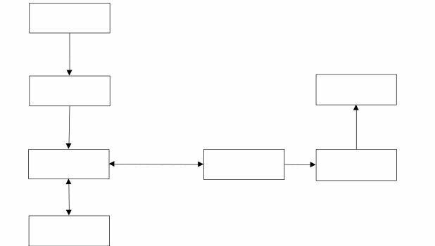
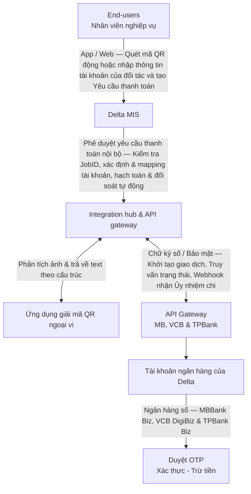

*Hà Nội, ngày 01 tháng 10 năm 2026*

# HÓA ĐƠN TRẢ HỘ

## Thanh toán bằng mã QR động, tĩnh và thông tin tài khoản qua API banking

Sử dụng mã QR động để nhận thanh toán tiền bán hàng hóa dịch vụ là xu hướng sẽ dẫn dắt phương thức thanh toán trong tương lai gần vì sự tiện lợi của nó. Không chỉ gạch nợ tự động cho từng khoản tiền phải thu, sử dụng mã QR động trong thanh toán còn cho phép thực hiện bút toán kế toán tự động, loại bỏ việc hạch toán chi tiết thủ công giúp tăng tính chính xác của báo cáo kế toán. Delta cũng sẽ không thể đứng ngoài xu hướng chung. Vì vậy, phát triển giải pháp để số hóa toàn diện quy trình thanh toán***khoảng 7,000 hóa đơn trả hộ/tháng***(phí local charges trả hãng tàu, phí facility, nâng hạ lưu kho tại các kho CFS và kho hàng không, phí nâng hạ container, vệ sinh, lưu bãi...) là yêu cầu bắt buộc. Hệ thống này được phát triển thông qua kết hợp giải pháp trích xuất dữ liệu mã QR động & tĩnh hoặc sử dụng tài khoản nhận tiền của đối tác để nhân viên nghiệp vụ tạo và phê duyệt Yêu cầu thanh toán trên Delta MIS, sau đó chuyển qua luồng API Banking để thanh toán từ tài khoản của Delta tại ba ngân hàng là MB Bank, Vietcombank và TPBank. Mục tiêu của giải pháp là (1) loại bỏ quỹ tiền mặt tạm ứng (2) giảm dẫn đến loại bỏ sai sót do nhập liệu thủ công (3) giảm workload tối đa cho nhân viên nghiệp vụ và (4) tuân thủ quy định về việc sử dụng tiền mặt.

1. **Kiến trúc hệ thống**

1. ***Sơ đồ mô tả thành phần hệ thống***

> Ảnh trên là bản chuyển từ docx, mất chữ trong ô. Nội dung sơ đồ dựng lại từ docx gốc (vị trí ô + hướng mũi tên):

1. ***Các thành phần hệ thống và kết nối ngoại vi***

- Lớp người dùng (End-users): Giao diện dành cho nhân viên CS & nhân viên hiện trường khởi tạo Yêu cầu thanh toán từ JobID, lái xe khởi tạo Yêu cầu thanh toán từ Lệnh vận tải. Sau khi khởi tạo Yêu cầu thanh toán thì chụp và tải ảnh QR động & tĩnh lên Yêu cầu thanh toán.

- Khi lái xe khởi tạo Yêu cầu thanh toán trên Lệnh vận tải để thanh toán chi phí trả hộ, các chi phí này sẽ được chuyển tiếp từ Lệnh vận tải lên JobID.

- Nhân viên CS hoặc hiện trường có trách nhiệm thu thập hóa đơn GTGT (nếu có) của khoản thanh toán này để upload lên JobID. Phần mềm sẽ giao nhiệm vụ này cho nhân viên CS hoặc hiện trường theo nguyên tắc giao cho người gần lái xe nhất theo luồng phân công công việc của Lệnh vận tải đó. Quy định chi tiết tại quy trình nghiệp vụ.

- Lớp nghiệp vụ: Delta MIS có các nhiệm vụ sau.

- Phê duyệt Yêu cầu thanh toán: Tiếp nhận yêu cầu từ lớp người dùng, thực hiện kiểm tra kiểm soát nội bộ để duyệt thanh toán. Ngay sau khi Yêu cầu thanh toán được phê duyệt thì Delta MIS bắt đầu quá trình thực hiện thanh toán qua luồng API Banking.

- Định tuyến & Hạch toán: Xác định pháp nhân thực hiện yêu cầu thanh toán (Delta HN, Delta HCM, Delta Hải Phòng) và chọn tài khoản ngân hàng tương ứng và tự động hạch toán chi tiết cho khoản chi.

- Sử dụng giao thức REST API (HTTPS) để kết nối sang Ứng dụng giải mã QR ngoại vi:. Khi nhận ảnh chụp mã QR từ Delta MIS, ứng dụng ngoại vi thực hiện bóc tách chuỗi ký tự được mã hóa (String) và trả về dữ liệu cấu trúc JSON (gồm số tài khoản cảng, tên ngân hàng hưởng, số tiền, nội dung) với thời gian phản hồi < 1 giây.

- Kết nối ngoại vi sang Hệ thống ngân hàng. Kết nối này đòi hỏi tiêu chuẩn an ninh nghiêm ngặt - Sử dụng giao thức mã hóa đường truyền mTLS (Mutual TLS) kết hợp mã hóa dữ liệu đầu cuối bằng thuật toán AES-256 và chữ ký số RSA. Kết nối bao gồm:

- Outbound API: Delta MIS đẩy lệnh chi sang hệ thống ngân hàng.

- Inbound Webhook: Ngân hàng tự động bắn tín hiệu biến động số dư (Sổ phụ điện tử & Ủy nhiệm chi) về Delta MIS ngay khi giao dịch thành công.

- Môi trường ngân hàng số (xác thực tối cao) là nơi tiếp nhận lệnh từ luồng API. Chủ tài khoản hoặc Đồng chủ tài khoản kiểm tra, kiểm soát rủi ro độc lập với phần mềm nội bộ, xác thực OTP để phê duyệt dòng tiền đi ra khỏi tài khoản công ty.

1. **Kiến trúc luồng dữ liệu**

Quy trình nghiệp vụ và luồng dữ liệu trao đổi giữa các hệ thống được chia làm 5 giai đoạn khép kín, bắt đầu từ bước tạo Yêu cầu thanh toán tại hiện trường cho đến khi hoàn tất hạch toán kế toán.

-***Bước 1: Khởi tạo Yêu cầu thanh toán***

Nhân viên nghiệp vụ (CS hoặc hiện trường) đăng nhập vào Delta MIS trên web hoặc App để tạo Yêu cầu thanh toán phí trả hộ từ JobID nghiệp vụ (hoặc Lệnh vận tải, nếu là lái xe), sau đó tải ảnh mã QR của khoản thanh toán lên Yêu cầu thanh toán và chuyển duyệt.

- Nếu không sử dụng mã QR động hoặc QR tĩnh thì bắt buộc phải chọn người nhận tiền từ danh mục cảng bãi, đại lý, hãng tàu hoặc kho hàng không, kho hàng CFS. Quy định này nhằm loại bỏ sai sót lập lệnh chuyển tiền sai hoặc chuyển tiền nhầm người nhận.

- Tại quy trình nghiệp vụ, thiết lập cơ chế để kiểm tra hai vòng với những Yêu cầu thanh toán chọn người nhận tiền từ danh mục để loại bỏ sai sót.

-***Bước 2: Tự động trích xuất thông tin mã QR qua API giải mã***

Delta MIS chuyển tiếp dữ liệu hình ảnh mã QR qua API ngoại vi cho ứng dụng giải mã (VietQR.io hoặc thư viện decoder nội bộ) để trích xuất dữ liệu và trả về Delta MIS các trường dữ liệu sau:

- Tài khoản nhận tiền.

- Chủ tài khoản nhận (Mã BIN ngân hàng cảng).

- Số tiền thanh toán.

- Nội dung thanh toán mặc định.

Nếu dữ liệu đầu vào của Yêu cầu thanh toán là thông tin tài khoản của đối tác hoặc mã QR tĩnh thì luồng công việc sẽ bỏ qua bước này và đến thẳng Bước 4.

- Về việc kê khai nội dung chuyển tiền tại bước này, cần thiết lập quy tắc để Delta MIS lấy thông tin từ JobID và kê khai tự động với các thông tin bao gồm (1) số JobID (2) số vận đơn hoặc booking note (3) tên chi phí trả hộ (4) tên khách hàng.

-***Bước 3: Phê duyệt Yêu cầu thanh toán***

Delta MIS kiểm tra thời gian hiệu lực còn lại của mã QR được trích xuất từ Bước 2.

- Nếu thời gian hiệu lực còn lại của mã QR ngắn hơn 3 phút thì Delta MIS chuyển trả Yêu cầu thanh toán lại Bước 1 cho nhân viên nghiệp vụ hoặc lái xe kèm yêu cầu tạo mã QR động mới để thực hiện thanh toán lại.

- Nếu thời gian hiệu lực của mã QR bằng hoặc dài hơn 3 phút thì Delta MIS chuyển Yêu cầu thanh toán cho cán bộ quản lý phê duyệt Yêu cầu thanh toán theo phân quyền.

- Phê duyệt: Delta MIS kích hoạt luồng xử lý dữ liệu tiếp theo ở Bước 4.

- Từ chối: Chuyển trả Yêu cầu thanh toán lại cho nhân viên nghiệp vụ ở Bước 1.

-***Bước 4: Lập Ủy nhiệm chi (UNC) và đẩy lệnh qua API Banking***

Delta MIS sử dụng thông tin trích xuất từ mã QR lập UNC và tự động chèn thêm thông tin định danh của khoản chi (Số JobID, Vận đơn/Booking, tên chi phí, khách hàng) vào nội dung thanh toán để phục vụ đối soát. Hệ thống gọi Transfer API sang hệ thống ngân hàng liên kết theo đúng tài khoản nguồn của pháp nhân chịu trách nhiệm chi trả.

- Nội dung thanh toán trên UNC thanh toán bằng mã QR động không cho phép chèn thêm thông tin để phục vụ nhu cầu hạch toán tự động ở phía người nhận tiền. Vì vậy, khi triển khai luồng API Banking với từng ngân hàng thì thiết kế cơ chế lưu vết và đối chiếu song song (mapping) giữa Mã giao dịch tham chiếu của ngân hàng (Mã FT...) với JobID để phục vụ mục đích hạch toán chi tiết tự động trên Delta MIS.

-***Bước 5: Phê duyệt trên môi trường ngân hàng & Trả kết quả***

Để phương thức thanh toán qua luồng API Banking không tạo ra rủi ro mới, Delta MIS không giữ quyền trích tiền trực tiếp. Chủ tài khoản hoặc đồng chủ tài khoản phải đăng nhập vào App/Web doanh nghiệp của ngân hàng (MBBank Biz, VCB DigiBiz & TPBank Biz) để kiểm tra nội dung và thực hiện xác thực bằng OTP và phê duyệt khoản chi. Sau khi chuyển tiền thành công, ngân hàng tự động trả dữ liệu Ủy nhiệm chi điện tử (kèm mã giao dịch tham chiếu FT...) về Delta MIS qua luồng API/Webhook. Module Kế toán của Delta MIS tự động ghi sổ hạch toán và kết thúc quy trình.

1. **Xử lý rủi ro kỹ thuật & nghiệp vụ**

1. ***Mã QR động hết hạn bị động***

Đây là tình huống mà khi ngân hàng đã cắt tiền khỏi tài khoản của Delta nhưng khoản thanh toán chưa đến được tài khoản nhận thì mã QR động hết hạn hiệu lực. Trong trường hợp này, không thanh toán lại mà xử lý theo các bước sau:

- Bước 1: Thu thập Ủy nhiệm chi chuyển tiền từ luồng API Banking.

- Bước 2: Liên lạc với đối tác, cung cấp Ủy nhiệm chi của khoản thanh toán và yêu cầu thực hiện hạch toán thủ công để tiếp tục giải quyết công việc. Thực hiện việc này theo quy trình hướng dẫn của từng đối tác.

1. ***Mã QR động hết hạn chủ động***

Nếu thời hạn hiệu lực gốc của một mã QR động quá ngắn (<15 phút) thì toàn bộ quy trình thanh toán sẽ không thể thực hiện trọn vẹn trong thời hạn hiệu lực gốc của mã QR này. Trong trường hợp này, khoản thanh toán có thể thực hiện qua một trong ba luồng sau:

- Yêu cầu đối tác cung cấp giải pháp thanh toán thủ công (mã QR tĩnh hoặc số tài khoản) để tránh rủi ro khoản thanh toán bị treo trên hệ thống khi chuyển tiền bằng một mã QR động đã hết hạn.

- Đề nghị cán bộ quản lý phối hợp việc phê duyệt để có thể hoàn tất thanh toán bằng giải pháp trình bày trong tài liệu này trong thời hạn hiệu lực của mã QR động.

- Mở rộng phân quyền phê duyệt lệnh chi bằng cách đăng ký đồng chủ tài khoản ngân hàng có điều kiện. Lệnh chi do đồng chủ tài khoản phê duyệt sẽ được thông báo cho chủ tài khoản chính bằng tin nhắn sau khi thực hiện và lập báo cáo định kỳ hàng tháng để kiểm soát. Giải pháp này cũng giúp phân bổ công việc và trách nhiệm hợp lý hơn giữa các cán bộ quản lý.

- Cán bộ quản lý nghiệp vụ: Hạn mức 50 triệu/ngày với giới hạn 15 triệu/lệnh chi.

- Cán bộ quản lý hiện trường: Hạn mức 30 triệu/ngày với giới hạn 10 triệu/lệnh chi.
