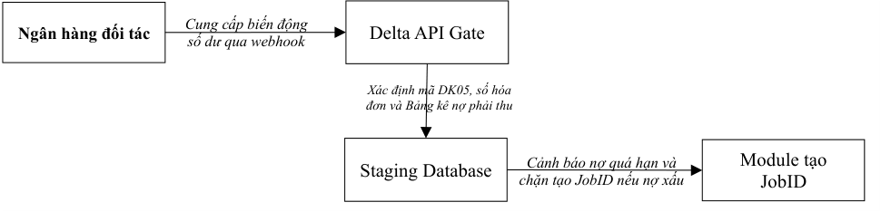
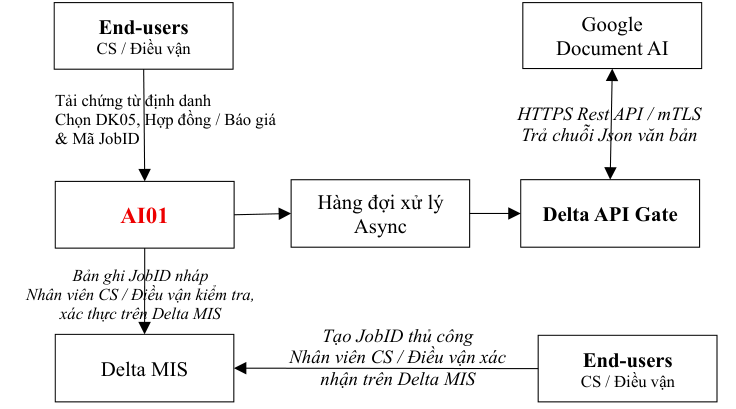
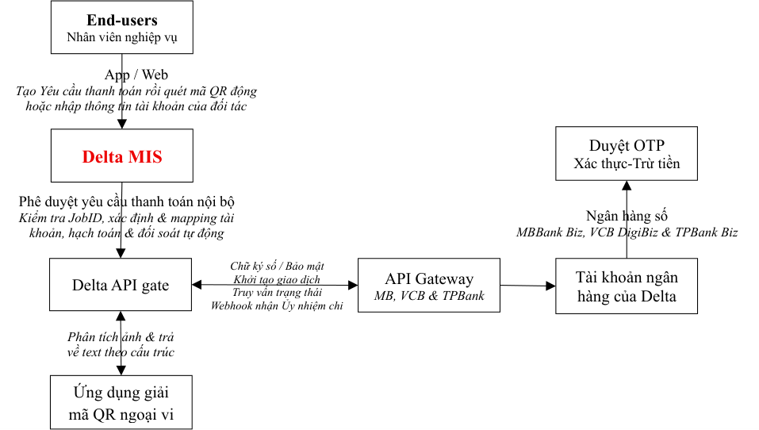
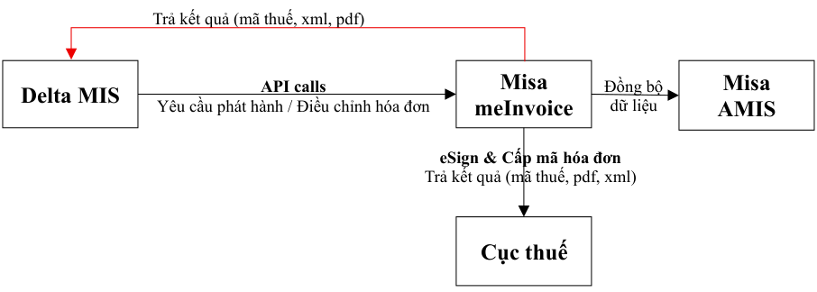
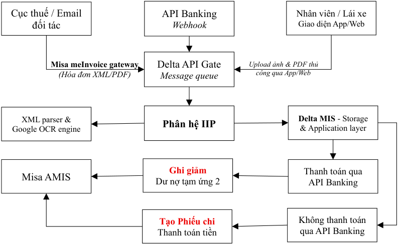

# SOLUTIONS FOR INVOICE MANAGEMENT (SIM)

> Nguồn: [`SIM_Oct 12 2026.pdf`](source/quan-ly-hoa-don-sim.pdf) (PDF 16 trang) · Nhận: 2026-10-12 · Chuyển sang Markdown bằng `/intake`.
> Phiên bản: 12/10/2026 (nhận 2026-10-12) — thay bản 11/10/2026 (nhận 2026-10-11); xem [thay đổi](../../_changes/2026-10-12-quan-ly-hoa-don-sim-ban-12-10.md).
> Phiên bản: 11/10/2026 (nhận 2026-10-11) — thay bản 10/10/2026 (nhận 2026-10-11); xem [thay đổi](../../_changes/2026-10-11-quan-ly-hoa-don-sim-ban-11-10.md).
> Phiên bản: 10/10/2026 (nhận 2026-10-11) — thay bản "Hóa đơn trả hộ" 01/10/2026 (nhận 2026-10-02), nay là mục 3.1; xem [thay đổi](../../_changes/2026-10-11-quan-ly-hoa-don-sim.md).
> Thông tin trang: CÔNG TY CỔ PHẦN QUỐC TẾ DELTA · chân trang "SIM_October 12, 2026 — Trang: N/16"

**CÔNG TY CỔ PHẦN QUỐC TẾ DELTA**

**SOLUTIONS FOR INVOICE MANAGEMENT (SIM)**

**Giải pháp số hóa toàn diện quy trình quản lý hóa đơn**

=================

**Hà Nội, ngày 12 tháng 10 năm 2026**

## MỤC LỤC

- **I. ĐẶT VẤN ĐỀ**
- **II. GIẢI PHÁP KỸ THUẬT**
  - **2.1. Luồng thanh toán tự động qua API Banking**
  - **2.2. Tạo JobID nghiệp vụ (AI01)**
  - **2.3. Công tác chuẩn bị**
- **III. GIẢI PHÁP NGHIỆP VỤ**
  - **3.1. Trích xuất mã QR động & tĩnh để thanh toán**
    - _3.1.1. Sơ đồ kiến trúc hệ thống_
    - _3.1.2. Các thành phần hệ thống và kết nối ngoại vi_
    - _3.1.3. Kiến trúc luồng dữ liệu_
    - _3.1.4. Xử lý rủi ro kỹ thuật & nghiệp vụ_
  - **3.2. Phát hành và điều chỉnh hóa đơn tự động (Misa meInvoice)**
    - _3.2.1. Các vấn đề có liên quan_
    - _3.2.2. Sơ đồ kiến trúc luồng dữ liệu (Data Flow)_
    - _3.2.3. Luồng xử lý nghiệp vụ tự động qua API_
  - **3.3. Thu thập & định danh hóa đơn đầu vào và làm thanh toán tự động (IIP)**
    - _3.3.1. Nguyên lý vận hành_
    - _3.3.2. Sơ đồ kiến trúc hệ thống_
    - _3.3.3. Sơ đồ luồng dữ liệu_
    - _3.3.4. Quy trình nghiệp vụ & Logic xử lý chi tiết_
    - _3.3.5. Hóa đơn vô chủ_
- **IV. RỦI RO VẬN HÀNH**
- **V. PHỤ LỤC**
  - 5.1. Hướng dẫn phân loại hóa đơn
  - 5.2. Chi phí thực hiện kết nối API Banking

## I. ĐẶT VẤN ĐỀ

Là một công ty logistics có dịch vụ cốt lõi là vận tải nội địa, thủ tục hải quan và các thủ tục chuyên ngành, Delta phải xử lý các giao dịch có trị giá nhỏ nhưng khối lượng lớn, vượt quá khả năng xử lý dữ liệu và thực hiện hạch toán chi tiết bằng phương pháp thủ công.

Vì vậy, Delta phát triển giải pháp số hóa toàn diện quy trình quản lý hóa đơn đầu vào, đầu ra (gọi tắt là SIM) từ khâu phát hành (hóa đơn đầu ra) và từ khi thực hiện thanh toán (hóa đơn đầu vào) để làm cơ sở cho việc quản trị dòng tiền trên tài khoản ngân hàng và quỹ tiền mặt của Công ty. Mục tiêu của các giải pháp này:

- Thực hiện phát hành hóa đơn tự động nhằm mapping giữa bảng kê nợ phải thu (doanh thu dịch vụ, doanh thu trả hộ & chi phí trả hộ) với dòng tiền vào tài khoản ngân hàng của Công ty để quản lý nợ phải thu.
- Thực hiện thanh toán tự động qua tài khoản ngân hàng (API Banking) để tích hợp với quy trình nghiệp vụ nhằm giảm workload và cung cấp dữ liệu để quản lý nợ phải thu, nợ phải trả.
- Tự động thu thập hóa đơn đầu vào và mapping từng hóa đơn đầu vào với khoản chi qua luồng API Banking để thực hiện thanh toán và hạch toán chi tiết tự động.

## II. GIẢI PHÁP KỸ THUẬT

### 2.1. Luồng thanh toán tự động qua API Banking

Hiện tại, việc quản lý dòng tiền và đối soát công nợ tại Delta đang gặp các nút thắt lớn (1) Kế toán phải lập lệnh thanh toán chi phí trả hộ và chi phí nhà cung cấp bằng tay trên ngân hàng điện tử (2) Việc quản lý công nợ phải thu và phải trả làm hoàn toàn bằng phương pháp thủ công, dễ gây sai sót và chậm trễ. Vì vậy, phân hệ API Banking được phát triển nhằm tích hợp trực tiếp luồng tiền từ các tài khoản ngân hàng (MB Bank, Vietcombank, TPBank) vào Hệ thống SIM, làm cơ sở dữ liệu thời gian thực để Trợ lý AI01 đối chiếu chéo, định danh hóa đơn và tự động hóa quy trình đóng/mở công nợ.

#### 2.1.1. Luồng thực hiện Ủy nhiệm chi (UNC) tự động

Mở rộng quy trình duyệt chi nội bộ trên Delta MIS sang môi trường ngân hàng liên kết, khép kín luồng dữ liệu từ lúc tạo yêu cầu đến khi nhận UNC điện tử.

| Bước | Hành động | Diễn giải luồng dữ liệu & Nghiệp vụ | Hệ thống/Người thực hiện |
|---|---|---|---|
| 1 | Gửi Yêu cầu thanh toán | Kích hoạt khi Yêu cầu thanh toán (phí trả hộ, phí NCC...) được duyệt nội bộ trên Delta MIS. Hệ thống tự động đóng gói dữ liệu theo chuẩn định dạng API của ngân hàng. | Delta MIS (Tự động) |
| 2 | Xác thực Lệnh chi | Cấp quản lý nhận thông báo trên ứng dụng Ngân hàng số. Thực hiện kiểm tra chéo thông tin định danh (JobID, Khách hàng) và xác thực bằng OTP. | Chủ tài khoản / Đồng chủ tài khoản |
| 3 | Thực hiện trích tiền | Hệ thống Core Banking của Ngân hàng kiểm tra số dư và thực hiện chuyển khoản theo lệnh đã xác thực ở Bước 2. | Ngân hàng liên kết |
| 4 | Trả Ủy nhiệm chi điện tử | Ngân hàng tự động gửi Webhook trả kết quả kèm file UNC điện tử và **Mã giao dịch tham chiếu (Mã FT...)** về Delta MIS để làm cơ sở cho AI01 đối soát hóa đơn. | Ngân hàng → Delta MIS |

#### 2.1.2. Luồng số hóa Sổ phụ ngân hàng để quản lý công nợ

Cung cấp dữ liệu đầu vào theo thời gian thực để hệ thống tự động gạch nợ phải thu và đưa ra cảnh báo rủi ro khi khởi tạo JobID mới.

Chữ trong sơ đồ (theo thứ tự đọc):

- Ngân hàng đối tác — Cung cấp biến động số dư qua webhook — Delta API Gate
- Staging Database — Xác định mã DK05, số hóa đơn và Bảng kê nợ phải thu
- Cảnh báo nợ quá hạn và chặn tạo JobID nếu nợ xấu — Module tạo JobID

#### 2.1.3. Quy trình thanh toán qua API Banking

Quy trình này áp dụng cho luồng thanh toán chi phí trả hộ theo JobID, chi phí nhà cung cấp và tiến tới áp dụng cho toàn bộ các trách nhiệm tài chính của Delta. Các bước thực hiện luồng nghiệp vụ:

- **Bước 1 - Yêu cầu thanh toán:** Nhân viên lập Yêu cầu thanh toán trên Delta MIS từ JobID nghiệp vụ hoặc Lệnh vận tải. Bắt buộc phải chọn tài khoản đích từ danh mục đối tác đã chuẩn hóa hoặc quét mã QR động hoặc tĩnh để loại bỏ lỗi nhập liệu nhầm.
- **Bước 2 - Ghi chép đối ứng:** Delta MIS tự động trích xuất dữ liệu, kiểm tra tính hợp lệ của mã QR (đảm bảo thời gian hiệu lực ≥ 3 phút) và tự động tạo nội dung chuyển tiền chứa: Mã nhân viên - Số JobID - Số vận đơn/Booking - Tên chi phí - Tên khách hàng.
  - ✓ Nếu sử dụng mã QR động thì không được chèn vào nội dung chuyển tiền trên UNC mà phải mapping số tham chiếu FT của UNC với Yêu cầu thanh toán.
- **Bước 3 - Định tuyến & Lập UNC:** Hệ thống tự động xác định pháp nhân chi trả (Delta HN, Delta HCM, Delta Vận tải) để chọn tài khoản nguồn tương ứng và đẩy lệnh chi qua Transfer API sang ngân hàng.
- **Bước 4 - Phê duyệt tối cao:** Chủ tài khoản hoặc Đồng chủ tài khoản kiểm tra thông tin và thực hiện duyệt OTP trên môi trường App/Web doanh nghiệp của Ngân hàng (MBBank Biz, VCB DigiBiz, TPBank Biz).
- **Bước 5 - Đồng bộ & Lưu vết:** Sau khi ngân hàng trừ tiền thành công, Webhook của ngân hàng bắn dữ liệu về Delta MIS. Hệ thống lưu vết mã giao dịch tham chiếu trên UNC (Mã FT) vào Cơ sở dữ liệu tạm thời (Staging Database/Table) để phục vụ Phân hệ IIP đối chiếu với hóa đơn đầu vào sẽ thu thập về sau.

#### 2.1.4. Rủi ro vận hành

- Xác thực tối cao: Delta MIS không có quyền kiểm soát tài khoản và không được can thiệp dòng tiền đi. Quyền kiểm soát tài khoản tối cao thuộc về môi trường ngân hàng. Delta MIS chỉ có vai trò khởi tạo và lập UNC, dòng tiền chỉ được giải ngân khi có OTP từ Chủ tài khoản/Đồng chủ tài khoản.
- Để chia sẻ workload cho cán bộ quản lý mà vẫn kiểm soát được rủi ro, Delta áp dụng cơ chế đăng ký đồng chủ tài khoản ngân hàng có điều kiện:
  - ✓ Cán bộ quản lý nghiệp vụ: Phê duyệt lệnh chi ≤ 15 triệu/lệnh; tổng hạn mức ≤ 50 triệu/ngày.
  - ✓ Cán bộ quản lý hiện trường: Phê duyệt lệnh chi ≤ 10 triệu/lệnh; tổng hạn mức ≤ 30 triệu/ngày.
  - ✓ _Lưu ý:_ Toàn bộ các lệnh chi do đồng chủ tài khoản duyệt đều được gửi tin nhắn thông báo về Chủ tài khoản chính và tổng hợp báo cáo kiểm soát định kỳ hàng tháng.
- Giải pháp khi mã QR động hết hạn hiệu lực
  - ✓ Trường hợp chủ động: Khi thời gian hiệu lực gốc của mã QR quá ngắn (<15 phút), Delta MIS sẽ chặn đẩy lệnh và yêu cầu nhân viên chuyển sang phương thức thanh toán thủ công (mã QR tĩnh/số tài khoản) hoặc yêu cầu cấp quản lý phối hợp duyệt nhanh.
  - ✓ Trường hợp bị động (Tiền đã cắt nhưng QR hết hạn): Hệ thống không thực hiện lệnh chi lại. Delta MIS sẽ tự động thu thập UNC điện tử từ Webhook ngân hàng, nhân viên nghiệp vụ cung cấp UNC này cho đối tác để xử lý hạch toán thủ công ngoài hệ thống.
- Đồng bộ trạng thái giữa Delta MIS và MISA AMIS
  - ✓ Rủi ro: Giao dịch API Banking thành công trên Delta MIS nhưng hệ thống kế toán độc lập (MISA AMIS) không ghi nhận, dẫn đến lệch sổ phụ thực tế và sổ sách thuế.
  - ✓ Giải pháp (Luồng đồng bộ ngược): Ngay khi nhận được Webhook báo giao dịch thành công (kèm mã FT), Delta MIS tự động kích hoạt một tiến trình ngầm (Background Job) gọi API sang MISA AMIS để tự động lập chứng từ chi tiền, khớp nối hóa đơn đầu vào tương ứng và ghi nhận mã FT vào trường "Số chứng từ gốc".

### 2.2. Tạo JobID nghiệp vụ (AI01)

Giải pháp đọc chứng từ định danh của lô hàng để lấy các thông tin định danh và tạo JobID cho lô hàng trên phần mềm Delta gọi tắt là Trợ lý AI01. Giải pháp này có mục tiêu giảm công việc nhập liệu thủ công và tối ưu hóa chi phí vận hành, Trợ lý AI01 sử dụng hạ tầng Google Document AI (bộ xử lý Document OCR) phối hợp với bộ lọc lập trình nội bộ. Mô hình vận hành quy định rõ: AI01 chỉ đóng vai trò trích xuất và khởi tạo bản ghi JobID Draft (Nháp), nhân viên nghiệp vụ (CS/Điều vận) bắt buộc phải thực hiện bước kiểm tra, xác thực nội dung và chủ động nhấn nút duyệt để phát hành JobID chính thức.

#### 2.2.1. Kiến trúc tích hợp Google Document AI

Để đảm bảo an ninh bảo mật và kế thừa hạ tầng công nghệ sẵn có của hệ thống, mọi yêu cầu giao tiếp giữa hệ thống nội bộ và Google API đều được điều phối tập trung qua Delta API Gateway.

Chữ trong sơ đồ (theo thứ tự đọc):

- End-users: CS / Điều vận — Tải chứng từ định danh, Chọn DK05, Hợp đồng / Báo giá & Mã JobID — AI01
- AI01 — Hàng đợi xử lý Async — Delta API Gate — HTTPS Rest API / mTLS, Trả chuỗi Json văn bản — Google Document AI
- AI01 — Bản ghi JobID nháp, Nhân viên CS / Điều vận kiểm tra, xác thực trên Delta MIS — Delta MIS
- End-users: CS / Điều vận — Tạo JobID thủ công, Nhân viên CS / Điều vận xác nhận trên Delta MIS — Delta MIS

#### 2.2.2. Quy trình xử lý kỹ thuật qua API

1. Gửi yêu cầu (Outbound Request): Khi bộ chứng từ đi vào hàng đợi (Message Queue), Delta MIS đóng gói tệp tin và thực hiện lệnh gọi thông qua Delta API Gateway (HTTPS REST API bảo mật, xác thực bằng mã Token mTLS) để truyền sang Google Document AI.
2. Số hóa văn bản (Processing): Bộ xử lý Document OCR của Google quét bề mặt hình ảnh/tệp tin, thực hiện nhận diện ký tự và trả về chuỗi văn bản (Text) thô có cấu trúc dạng JSON cho Delta API Gateway để tiết kiệm tối đa chi phí API.
3. Bóc tách nghiệp vụ (Parsing): Hệ thống sử dụng code truyền thống nội bộ (Regex/Query) để lọc dữ liệu thô, tiến hành so khớp danh mục cảng bãi, áp dụng thuật toán kiểm tra toán học chuỗi ký tự Container No (Validate Checksum ISO 6346). Dữ liệu bóc tách được đóng gói thành chuẩn JSON đầu ra của hệ thống SIM bao gồm 3 trường thuộc tính: value (giá trị trích xuất), confidence (độ tin cậy) và evidence (bằng chứng định vị: số trang, tọa độ boundingBox, đoạn text gốc).

#### 2.2.3. Quy trình nghiệp vụ

- Bước 1 (Tiền xử lý): Nhân viên CS/Điều vận gán trước các thông tin bối cảnh kinh doanh bắt buộc gồm: Mã khách hàng (DK05), Số báo giá hoặc hợp đồng để kiểm soát dòng doanh thu dịch vụ, chọn loại JobID và thực hiện upload bộ chứng từ định danh lên hệ thống.
- Bước 2 (Phân luồng gọi dịch vụ): Hệ thống kiểm tra dung lượng và số trang tệp tin để tự động điều phối lệnh gọi sang Google Document AI:
  - ✓ _Tài liệu nhỏ (1-3 trang, < 5MB):_ Chạy chế độ đồng bộ (Interactive Mode), nhân viên chờ kết quả hiển thị trực tiếp trên màn hình, cam kết thời gian phản hồi chỉ số P95 ≤ 10 giây.
  - ✓ _Tài liệu lớn (> 3 trang hoặc > 5MB):_ Chạy chế độ bất đồng bộ (Async Mode), hệ thống trả ngay trạng thái tiếp nhận queued trong ≤ 1 giây, tiến trình chạy nền hoàn tất xử lý chỉ số P95 ≤ 60 giây.
- Bước 3 (Kiểm soát trùng lặp): Trước khi hiển thị dữ liệu ra giao diện, hệ thống thực thi thuật toán kiểm tra tính bất biến (Idempotency) dựa trên quy tắc khóa: jobType + dk05 + fileHash để loại bỏ hoàn toàn các yêu cầu xử lý rác hoặc click lặp từ người dùng.
- Bước 4 (Nhân viên xác thực & Duyệt chính thức): Dữ liệu hợp lệ được đổ vào bản ghi JobID Draft (Nháp).
  - ✓ Áp dụng nghiêm ngặt nguyên tắc Fail-safe (An toàn hệ thống): AI không tự ý suy đoán bừa bãi. Các trường dữ liệu có độ tin cậy thấp hoặc không thể bóc tách sẽ hiển thị giá trị null (để trống).
  - ✓ Nhân viên CS/Điều vận thực hiện rà soát trực quan, bổ sung các trường thông tin còn thiếu, hiệu chỉnh dữ liệu sai lệch (nếu có) và nhấn nút xác nhận duyệt để phát hành JobID chính thức.
  - ✓ Hệ thống tự động ghi nhận dữ liệu chênh lệch (diff) giữa giá trị AI đề xuất ban đầu và giá trị con người sửa đổi, lưu trữ độc lập để phục vụ công tác tái huấn luyện offline nhằm tối ưu hóa bộ luật Regex.

#### 2.2.4. Luồng tạo JobID thủ công

Trong quá trình vận hành thực tế, đối với các loại mã JobID nghiệp vụ không có chứng từ định danh, phần mềm Delta MIS vẫn duy trì phân hệ tạo JobID thủ công để giải quyết các loại mã JobID này. Nhân viên nghiệp vụ tự điền các thông tin định danh và bấm xác nhận trực tiếp trên giao diện Delta MIS để tạo JobID.

### 2.3. Công tác chuẩn bị

#### 2.3.1. Các công việc cần chuẩn bị

Để chuẩn bị cho đối tác outsourcing tích hợp Trợ lý AI01, cần thực hiện các bước sau:

1. Khởi tạo Google Cloud Project: Đăng ký tài khoản doanh nghiệp trên Google Cloud Platform Kích hoạt dịch vụ: Truy cập Google Cloud Platform (GCP) của Delta, kích hoạt quyền sử dụng các bộ xử lý (Processors) trong gói Google Document AI.
2. Cấu hình Bộ xử lý (Processor):
   - Sử dụng bộ xử lý chuyên dụng Lending DocAI / Procurement DocAI (nếu cần nhận diện sâu các loại chứng từ vận tải như Bill of Lading, Packing List).
   - Hoặc sử dụng bộ xử lý Document OCR nền tảng để lấy text thô, sau đó dùng bộ lọc Regex của Delta để bóc tách thông tin nhằm tiết kiệm chi phí API.
3. Quản lý mã truy cập (Credentials): Cấp thêm quyền Document AI API User, xuất file Key dạng JSON bảo mật để nhúng vào Trục tích hợp Gateway của Delta.
4. Tối ưu hóa & Quản trị chi phí: Thiết lập hạn mức gọi API (Quota limits) theo ngày cho Trợ lý AI01 nhằm kiểm soát chi phí trả theo lượng sử dụng (Pay-as-you-go) của Google, tránh rủi ro bùng nổ chi phí khi nhân viên upload tệp tin rác hoặc tệp trùng lặp.

## III. GIẢI PHÁP NGHIỆP VỤ

### 3.1. Trích xuất mã QR động & tĩnh để thanh toán

Sử dụng mã QR động để nhận thanh toán tiền bán hàng hóa dịch vụ là xu hướng sẽ dẫn dắt phương thức thanh toán trong tương lai gần vì sự tiện lợi của nó. Không chỉ gạch nợ tự động cho từng khoản tiền phải thu, sử dụng mã QR động trong thanh toán còn cho phép thực hiện bút toán kế toán tự động, loại bỏ việc hạch toán chi tiết thủ công giúp tăng tính chính xác của báo cáo kế toán. Vì vậy, phát triển giải pháp để số hóa toàn diện quy trình thanh toán **_khoảng 7,000 hóa đơn trả hộ/tháng_** (phí local charges trả hãng tàu, phí facility, nâng hạ lưu kho tại các kho CFS và kho hàng không, phí nâng hạ container, vệ sinh, lưu bãi...) là yêu cầu bắt buộc. Hệ thống này được phát triển thông qua kết hợp giải pháp trích xuất dữ liệu mã QR động & tĩnh hoặc sử dụng tài khoản nhận tiền của đối tác để nhân viên nghiệp vụ tạo và phê duyệt Yêu cầu thanh toán trên Delta MIS, sau đó chuyển qua luồng API Banking để thanh toán từ tài khoản của Delta tại ba ngân hàng là MB Bank, Vietcombank và TPBank. Mục tiêu của giải pháp là (1) loại bỏ quỹ tiền mặt tạm ứng (2) giảm dẫn đến loại bỏ sai sót do nhập liệu thủ công (3) giảm workload tối đa cho nhân viên nghiệp vụ và (4) tuân thủ quy định về việc sử dụng tiền mặt.

#### 3.1.1. Sơ đồ kiến trúc hệ thống

Chữ trong sơ đồ (theo thứ tự đọc):

- End-users: Nhân viên nghiệp vụ — App / Web — Tạo Yêu cầu thanh toán rồi quét mã QR động hoặc nhập thông tin tài khoản của đối tác
- Delta MIS — Phê duyệt yêu cầu thanh toán nội bộ — Kiểm tra JobID, xác định & mapping tài khoản, hạch toán & đối soát tự động
- Ngân hàng số: MBBank Biz, VCB DigiBiz & TPBank Biz — Duyệt OTP — Xác thực-Trừ tiền
- Delta API gate — Chữ ký số / Bảo mật, Khởi tạo giao dịch, Truy vấn trạng thái, Webhook nhận Ủy nhiệm chi — API Gateway MB, VCB & TPBank — Tài khoản ngân hàng của Delta
- Ứng dụng giải mã QR ngoại vi — Phân tích ảnh & trả về text theo cấu trúc

#### 3.1.2. Các thành phần hệ thống và kết nối ngoại vi

- Lớp người dùng (End-users): Giao diện dành cho nhân viên CS & nhân viên hiện trường khởi tạo Yêu cầu thanh toán từ JobID, lái xe khởi tạo Yêu cầu thanh toán từ Lệnh vận tải. Sau khi khởi tạo Yêu cầu thanh toán thì chụp và tải ảnh QR động & tĩnh lên Yêu cầu thanh toán.
  - ✓ Khi lái xe khởi tạo Yêu cầu thanh toán trên Lệnh vận tải để thanh toán chi phí trả hộ, các chi phí này sẽ được chuyển tiếp từ Lệnh vận tải lên JobID.
  - ✓ Nhân viên CS hoặc hiện trường có trách nhiệm thu thập hóa đơn GTGT (nếu có) của khoản thanh toán này để upload lên JobID. Phần mềm sẽ giao nhiệm vụ này cho nhân viên CS hoặc hiện trường theo nguyên tắc giao cho người gần lái xe nhất theo luồng phân công công việc của Lệnh vận tải đó. Quy định chi tiết tại quy trình nghiệp vụ.
- Lớp nghiệp vụ: Delta MIS có các nhiệm vụ sau.
  - ✓ Phê duyệt Yêu cầu thanh toán: Tiếp nhận yêu cầu từ lớp người dùng, thực hiện kiểm tra kiểm soát nội bộ để duyệt thanh toán. Ngay sau khi Yêu cầu thanh toán được phê duyệt thì Delta MIS bắt đầu quá trình thực hiện thanh toán qua luồng API Banking.
  - ✓ Định tuyến & Hạch toán: Xác định pháp nhân thực hiện yêu cầu thanh toán (Delta HN, Delta HCM, Delta Vận tải) và chọn tài khoản ngân hàng tương ứng và tự động hạch toán chi tiết cho khoản chi.
- Sử dụng giao thức REST API (HTTPS) để kết nối sang Ứng dụng giải mã QR ngoại vi:. Khi nhận ảnh chụp mã QR từ Delta MIS, ứng dụng ngoại vi thực hiện bóc tách chuỗi ký tự được mã hóa (String) và trả về dữ liệu cấu trúc JSON (gồm số tài khoản đối tác, tên ngân hàng hưởng, số tiền, nội dung) với thời gian phản hồi < 1 giây.
- Kết nối ngoại vi sang Hệ thống ngân hàng. Kết nối này đòi hỏi tiêu chuẩn an ninh nghiêm ngặt - Sử dụng giao thức mã hóa đường truyền mTLS (Mutual TLS) kết hợp mã hóa dữ liệu đầu cuối bằng thuật toán AES-256 và chữ ký số RSA. Kết nối bao gồm:
  - ✓ Outbound API: Delta MIS đẩy lệnh chi sang hệ thống ngân hàng.
  - ✓ Inbound Webhook: Ngân hàng tự động bắn tín hiệu biến động số dư (Sổ phụ điện tử & Ủy nhiệm chi) về Delta MIS ngay khi giao dịch thành công.
- Môi trường ngân hàng số (xác thực tối cao) là nơi tiếp nhận lệnh từ luồng API. Chủ tài khoản hoặc Đồng chủ tài khoản kiểm tra, kiểm soát rủi ro độc lập với phần mềm nội bộ, xác thực OTP để phê duyệt dòng tiền đi ra khỏi tài khoản công ty.

#### 3.1.3. Kiến trúc luồng dữ liệu

Quy trình nghiệp vụ và luồng dữ liệu trao đổi giữa các hệ thống được chia làm 5 giai đoạn khép kín, bắt đầu từ bước tạo Yêu cầu thanh toán tại hiện trường cho đến khi hoàn tất hạch toán kế toán.

##### Bước 1: Khởi tạo Yêu cầu thanh toán

Nhân viên nghiệp vụ (CS hoặc hiện trường) đăng nhập vào Delta MIS trên web hoặc App để tạo Yêu cầu thanh toán phí trả hộ từ JobID nghiệp vụ (hoặc Lệnh vận tải, nếu là lái xe), sau đó tải ảnh mã QR của khoản thanh toán lên Yêu cầu thanh toán và chuyển duyệt.

- ✓ Nếu không sử dụng mã QR động hoặc QR tĩnh thì bắt buộc phải chọn người nhận tiền từ danh mục cảng bãi, đại lý, hãng tàu hoặc kho hàng không, kho hàng CFS. Quy định này nhằm loại bỏ sai sót lập lệnh chuyển tiền sai hoặc chuyển tiền nhầm người nhận.
- ✓ Tại quy trình nghiệp vụ, thiết lập cơ chế để kiểm tra hai vòng với những Yêu cầu thanh toán chọn người nhận tiền từ danh mục để loại bỏ sai sót.

##### Bước 2: Tự động trích xuất thông tin mã QR qua API giải mã

Delta MIS chuyển tiếp dữ liệu hình ảnh mã QR qua API ngoại vi cho ứng dụng giải mã (VietQR.io hoặc thư viện decoder nội bộ) để trích xuất dữ liệu và trả về Delta MIS các trường dữ liệu sau:

- ✓ Tài khoản nhận tiền.
- ✓ Chủ tài khoản nhận (Mã BIN ngân hàng cảng).
- ✓ Số tiền thanh toán.
- ✓ Nội dung thanh toán mặc định.

Nếu dữ liệu đầu vào của Yêu cầu thanh toán là thông tin tài khoản của đối tác hoặc mã QR tĩnh thì luồng công việc sẽ bỏ qua bước này và đến thẳng Bước 4.

- ✓ Về việc kê khai nội dung chuyển tiền tại bước này, cần thiết lập quy tắc để Delta MIS lấy thông tin từ JobID và kê khai tự động với các thông tin bao gồm (1) số JobID (2) số vận đơn hoặc booking note (3) tên chi phí trả hộ (4) tên khách hàng.

##### Bước 3: Phê duyệt Yêu cầu thanh toán

Delta MIS kiểm tra thời gian hiệu lực còn lại của mã QR được trích xuất từ Bước 2.

- ✓ Nếu thời gian hiệu lực còn lại của mã QR ngắn hơn 3 phút, Delta MIS sẽ chặn và chuyển trả Yêu cầu thanh toán lại Bước 1 để nhân viên nghiệp vụ hoặc lái xe chủ động tạo mã QR động mới nhằm đảm bảo an toàn cho luồng API Banking.
- ✓ Nếu thời gian hiệu lực của mã QR từ 3 phút trở lên (đủ thời gian tối thiểu để hệ thống trích xuất thông tin và thực hiện thanh toán qua API Banking), Delta MIS chuyển Yêu cầu thanh toán cho cán bộ quản lý phê duyệt theo phân quyền.

##### Bước 4: Lập Ủy nhiệm chi (UNC) và đẩy lệnh qua API Banking

Delta MIS sử dụng thông tin trích xuất từ mã QR lập UNC và tự động chèn thêm thông tin định danh của khoản chi (Số JobID, Vận đơn/Booking, tên chi phí, khách hàng) vào nội dung thanh toán để phục vụ đối soát. Hệ thống gọi Transfer API sang hệ thống ngân hàng liên kết theo đúng tài khoản nguồn của pháp nhân chịu trách nhiệm chi trả.

- ✓ Nội dung thanh toán trên UNC thanh toán bằng mã QR động không cho phép chèn thêm thông tin để phục vụ nhu cầu hạch toán tự động ở phía người nhận tiền. Vì vậy, khi triển khai luồng API Banking với từng ngân hàng thì thiết kế cơ chế lưu vết và đối chiếu song song (mapping) giữa Mã giao dịch tham chiếu của ngân hàng (Mã FT...) với JobID để phục vụ mục đích hạch toán chi tiết tự động trên Delta MIS.

##### Bước 5: Phê duyệt trên môi trường ngân hàng & Trả kết quả

Để phương thức thanh toán qua luồng API Banking không tạo ra rủi ro mới, Delta MIS không giữ quyền trích tiền trực tiếp. Chủ tài khoản hoặc đồng chủ tài khoản phải đăng nhập vào App/Web doanh nghiệp của ngân hàng (MBBank Biz, VCB DigiBiz & TPBank Biz) để kiểm tra nội dung và thực hiện xác thực bằng OTP và phê duyệt khoản chi. Sau khi chuyển tiền thành công, ngân hàng tự động trả dữ liệu Ủy nhiệm chi điện tử (kèm mã giao dịch tham chiếu FT...) về Delta MIS qua luồng API/Webhook. Module Kế toán của Delta MIS tự động ghi sổ hạch toán và kết thúc quy trình.

#### 3.1.4. Xử lý rủi ro kỹ thuật & nghiệp vụ

##### Mã QR động hết hạn bị động

Đây là tình huống mà khi ngân hàng đã cắt tiền khỏi tài khoản của Delta nhưng khoản thanh toán chưa đến được tài khoản nhận thì mã QR động hết hạn hiệu lực. Trong trường hợp này, không thanh toán lại mà xử lý theo các bước sau:

- Bước 1: Thu thập Ủy nhiệm chi chuyển tiền từ luồng API Banking.
- Bước 2: Liên lạc với đối tác tạo mã QR động (thường là cảng, bãi, kho hàng), cung cấp Ủy nhiệm chi của khoản thanh toán và yêu cầu thực hiện hạch toán thủ công để tiếp tục giải quyết công việc. Thực hiện việc này theo quy trình hướng dẫn của từng đối tác.

##### Mã QR động hết hạn chủ động

Nếu thời hạn hiệu lực gốc của một mã QR động quá ngắn (<15 phút) thì toàn bộ quy trình thanh toán sẽ không thể thực hiện trọn vẹn trong thời hạn hiệu lực gốc của mã QR này. Trong trường hợp này, khoản thanh toán có thể thực hiện qua một trong ba luồng sau:

- Yêu cầu đối tác cung cấp giải pháp thanh toán thủ công (mã QR tĩnh hoặc số tài khoản) để tránh rủi ro khoản thanh toán bị treo trên hệ thống khi chuyển tiền bằng một mã QR động đã hết hạn.
- Đề nghị cán bộ quản lý phối hợp việc phê duyệt để có thể hoàn tất thanh toán bằng giải pháp trình bày trong tài liệu này trong thời hạn hiệu lực của mã QR động.
- Mở rộng phân quyền phê duyệt lệnh chi bằng cách đăng ký đồng chủ tài khoản ngân hàng có điều kiện. Lệnh chi do đồng chủ tài khoản phê duyệt sẽ được thông báo cho chủ tài khoản chính bằng tin nhắn sau khi thực hiện và lập báo cáo định kỳ hàng tháng để kiểm soát. Giải pháp này cũng giúp phân bổ công việc và trách nhiệm hợp lý hơn giữa các cán bộ quản lý.
  - ✓ Cán bộ quản lý nghiệp vụ: Hạn mức 50 triệu/ngày với giới hạn 15 triệu/lệnh chi.
  - ✓ Cán bộ quản lý hiện trường: Hạn mức 30 triệu/ngày với giới hạn 10 triệu/lệnh chi.

### 3.2. Phát hành và điều chỉnh hóa đơn tự động (Misa meInvoice)

Trong quá trình phát triển quy trình nghiệp vụ để xây dựng Module Nghiệp vụ, Delta cần phát triển một giải pháp phát hành và điều chỉnh hóa đơn điện tử đơn giản để tích hợp vào Quy trình 5.2 (Quy trình cung cấp dịch vụ tổng quát). Tài liệu này (1) trình bày các vấn đề liên quan đến việc phát hành hóa đơn điện tử mới và (2) điều chỉnh hóa đơn điện tử đã phát hành và tìm giải pháp thực hiện hai công việc này để tích hợp vào Quy trình 5.2.

#### 3.2.1. Các vấn đề có liên quan

##### 3.2.1.1. Quy trình chuẩn

Quy trình này đang được thực hiện tại doanh nghiệp sử dụng hóa đơn điện tử có mã của cơ quan thuế. Quy trình bắt đầu bằng việc đăng nhập trực tiếp qua trang web hoặc app của nhà cung ứng (như MISA, Bkav, Viettel...) để thực hiện 5 bước dưới đây để xuất hóa đơn thủ công.

- _Xác định thời điểm xuất hóa đơn._

Căn cứ vào thỏa thuận với khách hàng về kỳ xuất hóa đơn để tiến hành xuất hóa đơn, không phụ thuộc vào việc đã thu được tiền hay chưa.

- _Khởi tạo dữ liệu trên phần mềm._

Kế toán đăng nhập vào hệ thống phần mềm HĐĐT của doanh nghiệp. Chọn chức năng "Lập hóa đơn", nhập đầy đủ thông tin bắt buộc: Thông tin người mua (Mã số thuế, tên đơn vị), danh mục hàng hóa/dịch vụ, số lượng, đơn giá, thuế suất và tổng tiền.

- _Ký số điện tử._

Sau khi kiểm tra dữ liệu chính xác, kế toán cắm USB Token chữ ký số hoặc sử dụng chữ ký số từ xa (Cloud HSM) để ký số lên hóa đơn. Bước này thay thế hoàn toàn cho việc ký tên và đóng dấu đỏ trước đây.

- _Gửi dữ liệu cấp mã đến cơ quan thuế._

Đối với doanh nghiệp dùng hóa đơn có mã, sau khi ký số, phần mềm sẽ tự động gửi dữ liệu hóa đơn lên hệ thống của Cục thuế. Hệ thống thuế tự động kiểm tra cấu trúc dữ liệu và cấp một chuỗi mã cơ quan thuế duy nhất (gồm chuỗi số và mã QR) trả về phần mềm.

- _Gửi hóa đơn cho khách hàng & Lưu trữ._

Hóa đơn sau khi có mã hợp lệ sẽ được gửi trực tiếp cho người mua qua Email, SMS hoặc gửi link tra cứu dưới dạng file định dạng XML (giá trị pháp lý) và PDF (bản thể hiện trực quan). Dữ liệu tự động đồng bộ lên Cục thuế và lưu trữ an toàn trên hệ thống đám mây tối thiểu 10 năm.

##### 3.2.1.2. Quy trình tích hợp

Việc vận hành phần mềm hóa đơn hiện nay diễn ra rất linh hoạt nhờ hạ tầng công nghệ phát triển, cho phép tích hợp phần mềm xuất hóa đơn vào phần mềm quản trị của doanh nghiệp với mô hình tổng quát như sau:

- Phần mềm hóa đơn điện tử được kết nối API với phần mềm quản lý. Khi phát hành hóa đơn, phần mềm quản lý sẽ cung cấp dữ liệu gồm (1) người mua hàng hóa dịch vụ (2) nội dung hàng hóa dịch vụ và giá cả sang phần mềm hóa đơn để ký số và phát hành mà không cần nhập tay.

##### 3.2.1.3. Quy trình phù hợp với Delta

Giải pháp phát hành và điều chỉnh hóa đơn tự động để tích hợp vào quy trình nghiệp vụ của Delta là kết nối trực tiếp qua cổng Open API của MISA meInvoice trong đó Delta MIS đóng vai trò điều phối (cung cấp dữ liệu, duyệt phát hành và nhận hóa đơn với mã của cơ quan thuế), phần mềm kế toán MISA đóng vai trò lưu trữ hóa đơn và dịch vụ [MISA meInvoice](https://www.meinvoice.vn/) đóng vai trò là cổng phát hành hóa đơn điện tử trực tiếp với Cục thuế.

#### 3.2.2. Sơ đồ kiến trúc luồng dữ liệu (Data Flow)

Sơ đồ kiến trúc mô hình phát hành và điều chỉnh hóa đơn tự động, kết nối giữa Delta MIS, MISA meInvoice và MISA AMIS, sử dụng giải pháp chữ ký số từ xa MISA eSign (Gói Doanh nghiệp kết nối API) để đạt mức độ tự động hóa cao nhất (100% không con người can thiệp).

Chữ trong sơ đồ (theo thứ tự đọc):

- Delta MIS — API calls: Yêu cầu phát hành / Điều chỉnh hóa đơn — Misa meInvoice
- Misa meInvoice — Trả kết quả (mã thuế, xml, pdf) — Delta MIS
- Misa meInvoice — Đồng bộ dữ liệu — Misa AMIS
- Misa meInvoice — eSign & Cấp mã hóa đơn, Trả kết quả (mã thuế, pdf, xml) — Cục thuế

#### 3.2.3. Luồng xử lý nghiệp vụ tự động qua API

##### Phát hành hóa đơn điện tử mới

1. Khởi tạo yêu cầu. Nhân viên khởi tạo yêu cầu lập hóa đơn từ Bảng kê doanh thu dịch vụ hoặc Doanh thu trả hộ trên Delta MIS. Hệ thống tự động thu thập dữ liệu và gọi API tạo hóa đơn của MISA meInvoice.
   - ✓ Delta MIS gửi thông tin xuất hóa đơn theo mã DK05 và Bảng kê cần xuất hóa đơn.
2. Phát hành hóa đơn
   - ✓ Misa meInvoice tạo hóa đơn từ dữ liệu nhận được, tự động gọi API của Misa eSign Cloud để ký hóa đơn.
   - ✓ Misa meInvoice gửi hóa đơn đã ký lên Cục thuế để lấy mã số thuế.
3. Misa meInvoice trả kết quả, bao gồm mã cơ quan thuế, link PDF và link XML.
   - ✓ Delta MIS: Lưu trữ và gửi cho khách hàng.
   - ✓ Misa AMIS. Lưu trữ và hạch toán.

##### Thay thế / Điều chỉnh hóa đơn đã phát hành

1. Khởi tạo yêu cầu. Nhân viên khởi tạo yêu cầu từ hóa đơn bị sai và chọn "Điều chỉnh" hoặc "Thay thế", nhập lý do và chọn Bảng kê doanh thu dịch vụ hoặc Doanh thu trả hộ mới. Hệ thống tự động thu thập dữ liệu và gọi API tạo hóa đơn của MISA meInvoice.
   - ✓ Delta MIS gửi (1) thông tin định danh của hóa đơn sai bao gồm số hóa đơn, ký hiệu, ngày phát hành và (2) thông tin xuất hóa đơn mới theo mã DK05 và Bảng kê mới.
2. Phát hành hóa đơn
   - ✓ Misa meInvoice tạo hóa đơn từ dữ liệu nhận được, tự động gọi API của Misa eSign Cloud để ký hóa đơn.
   - ✓ Misa meInvoice gửi hóa đơn đã ký lên Cục thuế để lấy mã số thuế.
3. Misa meInvoice trả kết quả, bao gồm mã cơ quan thuế, link PDF và link XML cập nhật trạng thái hóa đơn gốc thành "Bị thay thế" hoặc "Bị điều chỉnh".
   - ✓ Delta MIS: Cập nhật trạng thái hóa đơn cũ, lưu trữ và gửi hóa đơn mới.
   - ✓ Misa AMIS. Cập nhật trạng thái hóa đơn cũ, lưu trữ và hạch toán hóa đơn mới.

### 3.3. Thu thập & định danh hóa đơn đầu vào và làm thanh toán tự động (IIP)

Tài liệu này mô tả giải pháp tự động hóa toàn diện luồng xử lý hóa đơn đầu vào của Delta, loại bỏ hoàn toàn việc nhập liệu thủ công, chọn phân loại chi phí, và rà soát hóa đơn bằng tay. Giải pháp này có các mục tiêu sau:

- Định danh tự động: Sử dụng dữ liệu API Banking kết hợp dữ liệu hóa đơn để tự động gán Mã nhân viên và Số JobID nghiệp vụ cho hóa đơn.
- Triệt tiêu rủi ro trùng lặp: Loại bỏ 100% rủi ro chi trả nhiều lần hoặc thanh toán âm thông qua thuật toán kiểm soát trùng lặp lịch sử và va chạm thời gian thực.
- Quyết toán & Hoàn trả tự động: Phân tách luồng xử lý để tự động ghi giảm dư nợ tạm ứng cho nhân viên chi qua bank công ty, hoặc thực hiện lệnh chi hoàn trả tiền túi cho nhân viên chi bằng tiền mặt/thẻ cá nhân.

#### 3.3.1. Nguyên lý vận hành

Bản chất nghiệp vụ thanh toán & thu thập hóa đơn của Delta là thực hiện chi tiền trước cho đối tác (phí trả hộ, local charges, vé cầu đường...) qua luồng API Banking hoặc nhân viên chủ động ứng trước tiền cá nhân tại hiện trường. Hóa đơn điện tử sẽ được thu thập về sau. Vì vậy, nhiệm vụ của **Phân hệ IIP** (Incoming Invoice Processing) là hoạt động như một cấu phần xử lý dữ liệu bất đồng bộ để tiếp nhận hóa đơn từ các nguồn, trích xuất dữ liệu, kiểm tra trùng lặp và điều phối luồng thanh toán & hoàn ứng dựa trên phương thức chi ban đầu của nhân viên.

#### 3.3.2. Sơ đồ kiến trúc hệ thống

Chữ trong sơ đồ (theo thứ tự đọc):

- Cục thuế / Email đối tác — Misa meInvoice gateway (Hóa đơn XML/PDF) — Delta API Gate, Message queue
- API Banking Webhook — Delta API Gate, Message queue
- Nhân viên / Lái xe, Giao diện App/Web — Upload ảnh & PDF thủ công qua App/Web — Delta API Gate, Message queue
- Delta API Gate — Phân hệ IIP — XML parser & Google OCR engine
- Phân hệ IIP — Delta MIS - Storage & Application layer
- Delta MIS — Thanh toán qua API Banking — **Ghi giảm** Dư nợ tạm ứng 2 — Misa AMIS
- Delta MIS — Không thanh toán qua API Banking — **Tạo Phiếu chi** Thanh toán tiền — Misa AMIS

#### 3.3.3. Sơ đồ luồng dữ liệu

- **Bước 1 - Ghi nhận chi phí**
  - ✓ Nhân viên quét QR/chuyển khoản từ tài khoản công ty. Core Banking bắn webhook biến động số dư về Delta API Gateway.
  - ✓ Nhân viên dùng tiền mặt/thẻ cá nhân trả trước tại hiện trường. Không có dữ liệu qua luồng API Banking.
- **Bước 2 - Thu thập hóa đơn:** Hóa đơn được gom tự động từ Misa meInvoice hoặc do nhân viên upload thủ công lên hệ thống.
- **Bước 3 - Đưa vào hàng đợi:** Toàn bộ dữ liệu được đẩy vào Message Queue của Phân hệ IIP.
- **Bước 4 - Xử lý tại Phân hệ IIP:** Hệ thống thực hiện Parsing/OCR => Đối chiếu chéo (Cross-matching) => Kiểm tra trùng lặp => Phân phối luồng thanh toán phù hợp.

#### 3.3.4. Quy trình nghiệp vụ & Logic xử lý chi tiết

Hệ thống phân tách luồng xử lý theo định dạng đầu vào để tối ưu hóa chi phí vận hành.

##### Bước 1: Tiếp nhận và Trích xuất thông tin hóa đơn (Parsing & OCR Engine)

- Đối với hóa đơn XML (nhận tự động từ Misa meInvoice): Hệ thống sử dụng bộ phân tích XML Parser truyền thống để đọc trực tiếp các thẻ cấu trúc dữ liệu. Độ chính xác đạt 100% và không gọi sang dịch vụ của Google, giúp tiết kiệm chi phí API. Các trường bóc tách: _Mã số thuế người bán, Ký hiệu hóa đơn, Số hóa đơn, Ngày lập, Tổng tiền trước thuế, Tiền thuế, Tổng tiền thanh toán_.
- Đối với hóa đơn PDF/Ảnh (nguồn upload thủ công từ nhân viên nghiệp vụ & lái xe): Delta MIS đóng gói tệp tin và thực hiện lệnh gọi HTTPS REST API sang Google Document AI / Cloud Vision API. Dịch vụ của Google số hóa văn bản thô dưới dạng JSON. Hệ thống Delta sử dụng code truyền thống (Regex/Query) để bóc tách thông tin tại mục _"Ghi chú/Nội dung"_, số hóa số tiền và thông tin người bán.

##### Bước 2: Đối chiếu chéo tự động (Rule-based Cross-Matching) để định danh

Ngay sau khi dữ liệu hóa đơn được cấu trúc hóa, hệ thống tiến hành so khớp với dữ liệu giao dịch thu về từ luồng API Banking đang lưu trữ tại cơ sở dữ liệu tạm thời (Staging Database/Table) để phục vụ Phân hệ IIP đối chiếu.

**Điều kiện khớp cấu trúc (Khớp 1-1):**

Hệ thống sẽ tự động xác định tờ hóa đơn và giao dịch ngân hàng là trùng khớp tuyệt đối (khớp 1-1) khi và chỉ khi thỏa mãn đồng thời cả 3 tiêu chí sau:

- **Khớp số tiền:** Tổng số tiền trên hóa đơn phải bằng chính xác số tiền thực tế đã chi qua ngân hàng.
- **Khớp đối tác:** Mã số thuế hoặc Tên nhà cung cấp trên hóa đơn phải trùng (hoặc gần đúng) với thông tin tài khoản nhận tiền của ngân hàng.
- **Khớp thời gian:** Ngày lập hóa đơn và Ngày giao dịch ngân hàng không được lệch nhau quá 3 ngày.

Trong quá trình BA, phát triển giải pháp để giải quyết các trường hợp (1) 1-N trong đó một UNC được đối tác tách thành nhiều hóa đơn và (2) N-1 trong đó nhiều UNC được đối tác gộp thành một hóa đơn, dựa trên các quy tắc sau:

- **Quy tắc xử lý luồng gộp N-1 (Nhiều giao dịch ngân hàng - 1 Hóa đơn):** Hệ thống tại màn hình đối soát cho phép Kế toán viên tick chọn thủ công nhiều giao dịch (Mã FT) đang ở trạng thái "Chờ đối soát" trên Staging Table để liên kết gộp với 01 hóa đơn đầu vào. Điều kiện khớp: Σ Số tiền của N giao dịch = Tổng tiền thanh toán trên hóa đơn.
- **Quy tắc xử lý luồng tách 1-N (1 Giao dịch ngân hàng - Nhiều Hóa đơn):** Khi một giao dịch ngân hàng có giá trị lớn hơn hóa đơn đầu vào thu thập về, hệ thống cho phép khớp một phần và chuyển trạng thái giao dịch ngân hàng đó thành "Khớp một phần (Số tiền còn lại: [Số tiền])". Giao dịch ngân hàng này sẽ tiếp tục nằm trong danh sách đối soát cho đến khi tổng giá trị các hóa đơn đầu vào liên kết bằng chính xác số tiền thực chi trên lệnh gộp.

##### Bước 3: Kiểm soát trùng lặp lịch sử

Hệ thống sử dụng bộ ba thông tin định danh pháp lý: **Mã số thuế người bán + Ký hiệu + Số hóa đơn** để truy vấn đối chiếu với toàn bộ cơ sở dữ liệu lịch sử (Database).

- Trường hợp TRÙNG LẶP: Nếu hóa đơn đã tồn tại trong lịch sử hoặc đang trong tiến trình chờ duyệt thanh toán khác, hệ thống lập tức từ chối và đẩy vào _Danh mục hóa đơn từ chối thanh toán_. Nếu là nguồn upload thủ công, hệ thống hiển thị cảnh báo lỗi trực tiếp trên màn hình của người dùng.
- Trường hợp KHÔNG TRÙNG LẶP: Hóa đơn hợp lệ về mặt lịch sử, chuyển tiếp sang Bước 4.

##### Bước 4: Điều phối trạng thái danh mục và Xử lý thanh toán phân nhánh

Hệ thống sử dụng các quy tắc lập trình để giám sát và tự động xử lý thanh toán đóng công nợ theo phương thức chi ban đầu của nhân viên. Chi tiết như bảng sau:

| Phân loại luồng chi | Logic xử lý nghiệp vụ | Hành động kế toán trên Delta MIS & MISA AMIS |
|---|---|---|
| **Trường hợp 1:** Nhân viên thanh toán qua luồng API Banking | - Hệ thống so khớp thành công hóa đơn với giao dịch ngân hàng theo điều kiện tại Bước 2. - Tự động gán Mã nhân viên và Số JobID nghiệp vụ cho hóa đơn từ giao dịch gốc. | **Tự động làm thanh toán giảm nợ:** - Hệ thống tự động chuyển hóa đơn sang trạng thái đóng, khóa tính năng sử dụng lại và đưa lên JobID. - Delta MIS gọi Background Job API sang MISA AMIS tự động **ghi giảm "Dư nợ tạm ứng 2"** của nhân viên đã thực hiện giao dịch chi tiền trước đó. |
| **Trường hợp 2:** Nhân viên KHÔNG thanh toán qua luồng API Banking _(Chi tiền mặt/thẻ cá nhân)_ | Hệ thống không tìm thấy giao dịch đối ứng phù hợp trên cổng API Banking. Hệ thống tự động đưa hóa đơn này vào danh mục **"Hóa đơn vô chủ"** kèm mã nhân viên thực hiện upload thủ công để cách ly và xử lý an toàn. | **Tự động làm thanh toán hoàn trả tiền:** - Tại màn hình "Hóa đơn vô chủ", Cán bộ quản lý duyệt bước một và Kế toán tổng hợp duyệt bước 2 để kiểm tra thông tin định danh của hóa đơn 2 lần. - Ngay khi kế toán bấm duyệt, Delta MIS gọi API sang MISA AMIS **tự động tạo Phiếu chi** và gửi đến Quy trình 5.8 thuộc bộ quy trình Quản lý quỹ & thanh toán để **hoàn trả** số tiền tương ứng trị giá hóa đơn trực tiếp vào tài khoản của nhân viên upload hóa đơn. |

#### 3.3.5. Hóa đơn vô chủ

Danh mục "Hóa đơn vô chủ" được dùng để quản lý toàn bộ các hóa đơn thuộc **Trường hợp 2** (nhân viên không thanh toán qua luồng API Banking hoặc các lỗi đối chiếu gộp.

1. **Hỗ trợ gợi ý đối chiếu:** Hệ thống tự động quét và hiển thị thông tin định danh hóa đơn kèm theo danh sách các giao dịch API Banking có số tiền tương đương hoặc phát sinh từ cùng một nhân viên trong thời gian gần nhất để kế toán kiểm tra chéo (đề phòng nhân viên quên không nhập JobID khi chuyển khoản).
2. **Quy trình phê duyệt hoàn tiền:** Khi Kế toán tổng hợp xác nhận hóa đơn hoàn toàn là chi phí nhân viên tự chi tiền cá nhân, bước duyệt này sẽ là chốt chặn cuối cùng kích hoạt lệnh chuyển khoản hoàn trả tiền và gán hóa đơn vào đúng JobID nghiệp vụ để tập hợp chi phí.

## IV. RỦI RO VẬN HÀNH

### 4.1. Rủi ro xử lý mã QR động

Rủi ro này liên quan đến thời gian hiệu lực của mã QR động.

### 4.2. Rủi ro nghẽn chữ ký số (MISA eSign Cloud HSM) & Cục thuế từ chối cấp mã

Việc gọi API liên tục vào hệ thống eSign để ký số trong thời gian cuối tháng có thể gặp tình trạng phản hồi chậm từ nhà mạng, hoặc hệ thống của Cục thuế bị quá tải dẫn đến từ chối cấp mã định danh thời gian thực (Real-time). Phát triển các giải pháp sau để giải quyết vấn đề.

- Delta MIS không thực hiện gọi API trực tiếp theo cơ chế đồng bộ (Synchronous). Toàn bộ các yêu cầu xuất/điều chỉnh hóa đơn từ Bảng kê sẽ được đẩy vào một Hàng đợi ký số (Signing Queue) riêng biệt.
- Thiết lập cơ chế Tự động thử lại (Retry Mechanism) với cấu hình lũy tiến (Exponential Backoff): Nếu API báo lỗi kết nối hoặc timeout, hệ thống sẽ tự động gửi lại yêu cầu sau 1 phút, 5 phút, 15 phút.
- Nếu sau 5 lần thử lại vẫn thất bại, hóa đơn sẽ được chuyển sang trạng thái Ký số lỗi và thông báo cho Kế toán qua hệ thống Alert Center để kiểm tra thủ công tình trạng hạ tầng của MISA/Cục Thuế.

### 4.3. Rủi ro mất đồng bộ trạng thái thanh toán giữa Delta MIS và MISA AMIS

Khi Delta MIS kết hợp với API Banking thực hiện trích tiền thanh toán thành công cho một hóa đơn đầu vào, nếu luồng dữ liệu dừng lại ở Delta MIS thì hệ thống kế toán thuế độc lập (MISA AMIS) sẽ không ghi nhận được trạng thái Đã thanh toán. Điều này dẫn đến sai lệch nghiêm trọng giữa Sổ phụ ngân hàng thực tế và Sổ sách kế toán Thuế. Phát triển các giải pháp kỹ thuật (Luồng đồng bộ ngược - Reverse sync API) để giải quyết vấn đề.

- Ngay khi nhận được Webhook báo kết quả giao dịch thành công (kèm mã FT của ngân hàng) từ tầng Core Banking, Delta MIS sẽ kích hoạt một tiến trình ngầm (Background Job).
- Tiến trình này gọi API đối ứng sang MISA AMIS để thực hiện: (1) Tự động lập chứng từ chi tiền/ủy nhiệm chi trên AMIS, (2) Khớp nối hóa đơn đầu vào tương ứng với chứng từ chi này, và (3) Chuyển trạng thái công nợ của nhà cung cấp đó trên hệ thống kế toán thành Đã thanh toán.
- Mã giao dịch ngân hàng (Mã FT...) bắt buộc phải được ghi nhận vào trường Số chứng từ gốc trên MISA AMIS để phục vụ công tác kiểm toán đối soát cuối kỳ.

## V. PHỤ LỤC

### 5.1. Hướng dẫn phân loại hóa đơn

| TT | Nhóm phí _(Phân loại hóa đơn lần 1 theo nhóm phí)_ | Mã nhóm phí | Phân nhóm cấp 1 | Phân loại hóa đơn lần 2 |
|---|---|---|---|---|
| 1 | Chi phí trả hộ | 03 | Tất cả các hóa đơn trả hộ thu tiền lại từ khách hàng | Phân loại theo JobID |
| 2 | Chi phí hàng bán | 02 | Chi phí trả hộ xuất lại hóa đơn cho khách | Phân loại theo JobID |
| 2 | Chi phí hàng bán | 02 | Tất cả các hóa đơn chi phí hàng bán khác | Không cần phân loại bước 2 |
| 3 | Chi phí quản lý chung | 01 | Tất cả các hóa đơn thanh toán chi phí quản lý chung | Không cần phân loại bước 2 |
| 4 | Chi phí đầu tư | 04 | Tất các các hóa đơn thuộc chi phí đầu tư | Không cần phân loại bước 2 |
| 5 | Chi phí khác | 05 | Tất các các hóa đơn thuộc chi phí khác | Không cần phân loại bước 2 |

_Bảng gốc gộp ô: dòng 2 "Chi phí hàng bán" gồm 2 phân nhóm cấp 1; ô "Phân loại theo JobID" gộp cho dòng 1 và phân nhóm "Chi phí trả hộ xuất lại hóa đơn cho khách"; ô "Không cần phân loại bước 2" gộp cho các dòng còn lại. Cột "Phân loại hóa đơn lần 2" in màu đỏ trong bản gốc._

### 5.2. Chi phí thực hiện kết nối API Banking

| TT | NGÂN HÀNG | Phí kết nối trả một lần (VND/tài khoản) | Phí duy trì hàng tháng | Phí truy vấn lịch sử giao dịch (VND/tài khoản/tháng) | Phí giao dịch | Casa | Trị giá (số lượng) giao dịch chi hộ / tháng |
|---|---|---|---|---|---|---|---|
| 1 | MB Bank | Miễn phí | 7 triệu/tài khoản nếu không đạt trị giá thanh toán phí trả hộ 3 tỷ/tháng cho cả 3 tài khoản. | 3,000,000 | Trong MB: 1,000 đồng / giao dịch. Ngoài MB (1) 1,500 đồng / giao dịch < 500 triệu (2) 0,025%*Giá trị giao dịch, phí tối đa 300,000 đồng / giao dịch > = 500 triệu. | Không yêu cầu cam kết nhưng đề nghị Delta hỗ trợ mỗi tháng một thời điểm duy trì mức 10-15 tỷ. | 3 tỷ đồng cho 3 tài khoản thì được miễn phí phí duy trì hàng tháng. |
| 2 | TP Bank | 50 triệu | 20 triệu/3 tài khoản (Miễn phí cho Delta). | Miễn phí | 3,000 – 5,000 đồng / Giao dịch (Tùy vào Casa mỗi tháng). | 6 tháng đầu: 10 tỷ/tháng. Sau 6 tháng: 15 tỷ/tháng | Không đề cập. |
| 3 | Vietcombank _(Đồng ý cung cấp API Banking, chờ báo giá chi phí)_ | | | | | | |

_Bảng gốc có 2 nhóm cột: "CHI PHÍ API" (4 cột phí) và "Các yêu cầu của ngân hàng" (Casa, Trị giá giao dịch chi hộ)._
