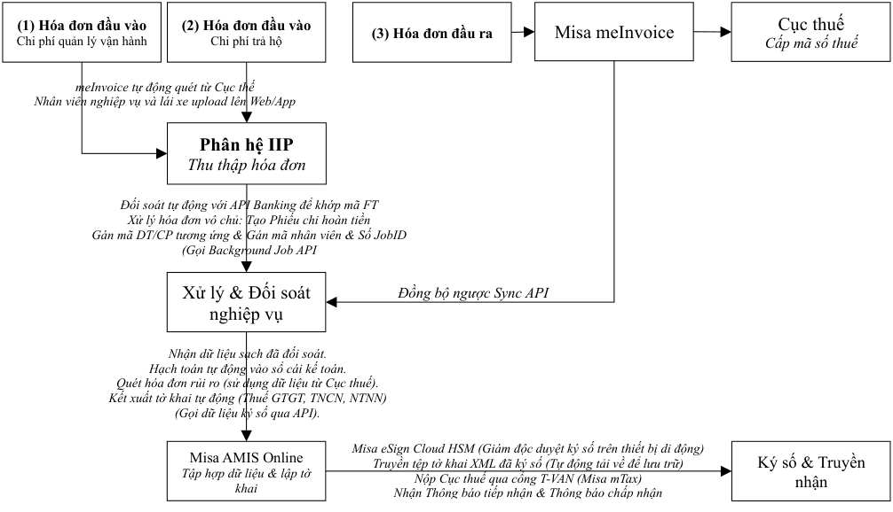

# Tự động kê khai & nộp báo cáo thuế hàng tháng qua Misa AMIS Online

> Nguồn: [`SIM_Lập và nộp báo cáo thuế tự động_Oct 12 2026.pdf`](source/sim-ke-khai-thue-tu-dong.pdf) (PDF 3 trang) · Nhận: 2026-10-14 · Chuyển sang Markdown bằng `/intake`.
> Thông tin trang: đầu trang "Lập tờ khai thuế tự động_October 12, 2026 — Trang: N/3".

_Hà Nội, ngày 12 tháng 10 năm 2026_

**GIẢI PHÁP**

Delta sẽ phát triển phần mềm quản lý, viết tắt là Delta MIS, trong đó triển khai cấu trúc kết nối quy trình nghiệp vụ với tài khoản ngân hàng để thực hiện thanh toán tự động qua luồng API Banking. Đây là cơ sở nền tảng để Delta vận hành giải pháp IIP, sử dụng Delta MIS để mapping dữ liệu thanh toán qua tài khoản ngân hàng nhằm định danh hai lớp cho từng hóa đơn nhận được qua meInvoice:

- Định danh lớp 1 (Thông tin pháp lý): Số hóa đơn, ngày phát hành, mã số thuế của đối tác, số tiền trên hóa đơn.
- Định danh lớp 2 (Thông tin quản trị nội bộ): Mã nhân viên, Số JobID.

Mặt khác, khi có dữ liệu từ luồng thanh toán qua API Banking, Delta MIS sẽ thực hiện đồng bộ ngược về MISA để tự động tạo chứng từ thanh toán và gạch nợ cho từng hóa đơn. Để quản trị rủi ro vận hành, hệ thống thiết lập cơ chế xử lý dòng tiền nghiêm ngặt:

- Đối với giao dịch khớp mã FT: Hệ thống lập tức tự động gạch nợ và đồng bộ kế toán.
- Đối với giao dịch lỗi đối soát (Sai cú pháp, thiếu JobID, chuyển khoản gộp): Hệ thống tự động đẩy toàn bộ dữ liệu vào Hàng đợi chờ tra soát (Pending Queue) trong vòng 24 giờ để kế toán xử lý map thủ công. Sau 24 giờ, nếu giao dịch không được định danh, Delta MIS mới kích hoạt tiến trình ngầm tạo phiếu chi hoàn tiền tự động để đảm bảo an toàn dòng tiền.

Với các giải pháp và kết nối ngoại vi đồng bộ này, việc kê khai và nộp báo cáo thuế tự động qua Misa AMIS Online là bước đi tất yếu để hoàn tất quá trình chuyển đổi số toàn diện. Tài liệu này outline các vấn đề cơ bản nhất về giải pháp "Tự động kê khai & nộp báo cáo thuế hàng tháng" để bắt đầu làm việc với đối tác MISA chuẩn bị triển khai dự án.

## 1. Luồng dữ liệu đối soát & Kết nối thuế toàn diện

Chữ trong sơ đồ (theo thứ tự đọc):

- Cục thuế — Cấp mã số thuế; meInvoice tự động quét từ Cục thuế — Misa meInvoice
- (1) Hóa đơn đầu vào — Chi phí quản lý vận hành · (2) Hóa đơn đầu vào — Chi phí trả hộ · (3) Hóa đơn đầu ra — Misa meInvoice
- Nhân viên nghiệp vụ và lái xe upload lên Web/App — Phân hệ IIP
- Phân hệ IIP — Thu thập hóa đơn: Đối soát tự động với API Banking để khớp mã FT · Xử lý hóa đơn vô chủ: Tạo Phiếu chi hoàn tiền · Gán mã DT/CP tương ứng & Gán mã nhân viên & Số JobID
- Phân hệ IIP — Xử lý & Đối soát nghiệp vụ — (Gọi Background Job API) — Misa AMIS Online; Misa AMIS Online — Đồng bộ ngược Sync API — Phân hệ IIP
- Misa AMIS Online — Tập hợp dữ liệu & lập tờ khai: Nhận dữ liệu sạch đã đối soát · Hạch toán tự động vào sổ cái kế toán · Quét hóa đơn rủi ro (sử dụng dữ liệu từ Cục thuế) · Kết xuất tờ khai tự động (Thuế GTGT, TNCN, NTNN) · (Gọi dữ liệu ký số qua API)
- Misa eSign Cloud HSM (Giám đốc duyệt ký số trên thiết bị di động) — Ký số & Truyền nhận
- Misa AMIS Online — Truyền tệp tờ khai XML đã ký số (Tự động tải về để lưu trữ) — Nộp Cục thuế qua cổng T-VAN (Misa mTax) — Nhận Thông báo tiếp nhận & Thông báo chấp nhận — Cục thuế

## 2. Quy trình tự động hóa & Kê khai các loại thuế hàng tháng

### 2.1. Thuế GTGT - Tờ khai mẫu 01/GTGT

Phân hệ Thuế trên MISA AMIS Online tự động tổng hợp dữ liệu từ 5 nhóm hóa đơn cốt lõi được Phân hệ IIP định danh và chuyển sang:

- Hóa đơn Doanh thu đầu ra (Mã nhóm DT02 - Doanh thu dịch vụ & Doanh thu xuất lại từ phí trả hộ): Tự động điền dữ liệu vào các chỉ tiêu hàng hóa, dịch vụ bán ra tương ứng với từng dải thuế suất (0%, 5%, 10% hoặc không chịu thuế).
- Hóa đơn Chi phí vận hành đầu vào (Mã nhóm CP01 - Quản lý chung; Mã nhóm CP02 - Chi phí hàng bán): Tự động tập hợp vào chỉ tiêu hàng hóa dịch vụ mua vào và số thuế GTGT đầu vào được khấu trừ.
- Hóa đơn Trả hộ đầu vào (Mã nhóm CP03): Hệ thống tách biệt để theo dõi riêng và đưa vào phụ lục bảng kê mua vào phục vụ đối soát hoàn ứng công nợ theo JobID.
- Hóa đơn Tài sản cố định & Đầu tư (Mã nhóm CP04): Tự động ghi nhận thuế đầu vào giá trị lớn của xe đầu kéo, container, kho bãi. Hệ thống tự động phân tách luồng: nếu phục vụ dự án đầu tư mới sẽ được hướng dẫn lập Tờ khai mẫu 02/GTGT riêng biệt.
- Hóa đơn Điều chỉnh, Thay thế & Chiết khấu thương mại: Khi MISA meInvoice cập nhật trạng thái hóa đơn gốc thành "Bị thay thế" hoặc "Bị điều chỉnh", MISA AMIS Online tự động điều chỉnh tăng/giảm chỉ tiêu thuế hoặc lập tờ khai bổ sung nếu phát sinh sai sót thuộc về kỳ trước.
  - ✓ Hệ thống chỉ tự động lập sẵn tờ khai bổ sung dạng dự thảo và gửi Alert (Cảnh báo). Việc bấm nút nộp chính thức phải do Kế toán trưởng phê duyệt bằng tay sau khi đã kiểm tra nguyên nhân.

### 2.2. Thuế TNCN - Tờ khai mẫu 05/KK-TNCN

Hệ thống xử lý tự động thông qua việc kết nối Phân hệ Nhân sự tiền lương (Delta HR) với Phân hệ Thuế trên MISA AMIS Online:

- Lao động chính thức: MISA AMIS Online tự động đồng bộ Bảng tổng hợp lương hàng tháng, tự động tính thuế TNCN theo biểu thuế lũy tiến từng phần, xác định tổng thu nhập chịu thuế, tổng các khoản giảm trừ (bản thân, gia cảnh, bảo hiểm) để điền vào tờ khai.
- Lao động thuê ngoài & Nhà thầu cung cấp dịch vụ cá nhân: Khi kế toán thực hiện lập phiếu chi tiền thù lao hoặc mua dịch vụ cho cá nhân không ký hợp đồng lao động, hệ thống tự động kiểm tra nếu mức chi từ 2.000.000 đồng/lần trở lên sẽ tự động khấu trừ 10% thuế TNCN.
- Chứng từ điện tử khấu trừ thuế TNCN: MISA AMIS Online tự động liên kết dữ liệu để phát hành và gửi chứng từ khấu trừ thuế TNCN điện tử cho cá nhân qua Email/SMS, đồng thời tổng hợp số lượng chứng từ đã sử dụng lên tờ khai.

### 2.3. Thuế FCT - Tờ khai mẫu 01/NTNN

Delta thường phát sinh chi phí trả cho các đại lý vận tải nước ngoài (Overseas Agent) không có cơ sở thường trú tại Việt Nam và hoa hồng bán hàng cho đại lý nước ngoài.

- Nhận diện chứng từ (Mã nhóm CP05 - Chi phí khác): Khi nhân viên nghiệp vụ đưa hóa đơn thương mại (Commercial Invoice) từ đại lý nước ngoài lên hệ thống, Delta MIS dựa vào cấu hình quốc gia của MIS để gắn cờ theo dõi thuế nhà thầu trước khi đồng bộ sang MISA AMIS Online.
- Tự động tính thuế: Phần mềm tự động bóc tách và tính toán số thuế nhà thầu phải nộp bao gồm: Thuế TNDN nhà thầu (thường là 2% trên doanh thu dịch vụ logistics) và Thuế GTGT nhà thầu (thường là 5% hoặc được miễn nếu là dịch vụ vận tải quốc tế).
  - ✓ Thanh toán cho đại lý nước ngoài vẫn thực hiện qua luồng API Banking nên sẽ được ghi nhận và xử lý trực tiếp tại phân hệ quản lý dịch vụ forwarding.
- Lập tờ khai: Toàn bộ danh sách các đại lý nước ngoài phát sinh chi trả trong tháng được tự động tổng hợp vào bảng kê chi tiết và đẩy số liệu lên Tờ khai mẫu 01/NTNN.

## 3. Quy trình nộp tờ khai thuế tự động lên Cục thuế

Quy trình nộp tất cả các loại tờ khai thuế (GTGT, TNCN, NTNN) sau khi kết xuất được thực hiện tập trung theo 3 bước chuẩn hóa:

- Bước 1: Kiểm tra chéo hệ thống (Ngày 15 - 18 hàng tháng): Kế toán chọn phân hệ Thuế, phần mềm tự động chạy tính năng "Đối chiếu chứng từ và tờ khai". Hệ thống so khớp 100% số liệu giữa Sổ cái tài khoản kế toán (TK 133, TK 3331, TK 3335, TK 3338) với các chỉ tiêu trên tờ khai thuế nhằm phát hiện chênh lệch trước khi ký.
- Bước 2: Ký số tập trung từ xa qua MISA eSign Cloud HSM (Ngày 18 - 19 hàng tháng): Toàn bộ tệp tờ khai thuế XML hoàn tất đối chiếu được chuyển thẳng lên hàng đợi ký số Cloud. Giám đốc hoặc người giữ quyền ký số mở ứng dụng MISA eSign trên thiết bị di động, kiểm tra bảng tổng hợp nghĩa vụ thuế và bấm "Phê duyệt ký số". Hệ thống tự động ký đồng loạt lên tất cả các tờ khai.
- Bước 3: Truyền nhận dữ liệu qua cổng T-VAN MISA mTax (Trước ngày 20 hàng tháng): Tệp tờ khai đã ký số được truyền trực tiếp đến hệ thống cổng tiếp nhận của Cục Thuế quản lý. Tiến trình ngầm (Background Job) tự động tải và lưu vết kết quả trực tiếp trên phần mềm:
  - ✓ _Thông báo bước 1:_ Tiếp nhận hồ sơ khai thuế điện tử (Có sau 15 phút).
  - ✓ _Thông báo bước 2:_ Chấp nhận hồ sơ khai thuế điện tử hợp lệ (Có sau 1-2 ngày làm việc).

## 4. Kế hoạch triển khai

Để triển khai giải pháp này thì Delta cần làm các công việc chuẩn bị sau:

- Làm việc với Misa để tư vấn chuyên sâu về việc triển khai giải pháp, đặc biệt là xác định các luồng dữ liệu sẽ triển khai qua Open API giữa Delta MIS và Misa AMIS Online.
- Tư vấn các vấn đề tiềm tàng có thể xảy ra khi chuyển đổi từ nộp tờ khai thủ công sang giải pháp tự động hóa.
- Chuẩn hóa dữ liệu đầu vào: Ban hành quy định bắt buộc cho toàn bộ nhân viên, lái xe hoàn tất upload hóa đơn chi phí (vận hành, trả hộ) lên Phân hệ IIP và hoàn tất chốt bảng lương trên Delta HR trước ngày 12 hàng tháng. Phân hệ IIP thực hiện đẩy toàn bộ dữ liệu sạch sang MISA AMIS Online trước ngày 15 hàng tháng.
- Đăng ký dịch vụ: Làm việc với MISA để đồng bộ nâng cấp hệ thống bao gồm Phân hệ AMIS Kế toán Online mở cổng Open API, Cổng truyền nhận dữ liệu T-VAN (MISA mTax), và tài khoản ký số liên kết MISA eSign Cloud HSM gói Doanh nghiệp.
