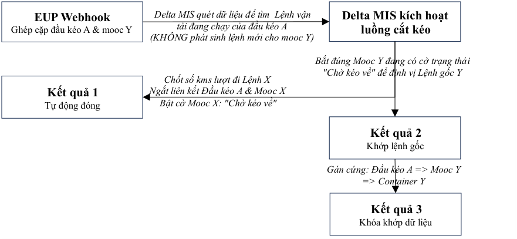

# Giải pháp D&H — Tự động hóa Lệnh vận tải phụ cho mô hình cắt kéo container

> Nguồn: [`VIS_Giải pháp D&H_Oct 15 2026.pdf`](source/vis-dh-cat-keo.pdf) (PDF 2 trang) · Nhận: 2026-10-15 · Chuyển sang Markdown bằng `/intake`.
> Phiên bản: 15/10/2026

_Hà Nội, ngày 15 tháng 10 năm 2026_

## 1. Đặt vấn đề

Có một số khách hàng của Delta thực hiện mô hình vận hành gọi tắt là D&H (Cắt kéo - Drop & Hook) để giảm thời gian chờ đợi của lái xe và đầu kéo, tăng hiệu quả hoạt động. Quy trình vận hành thực tế diễn ra như sau:

1. Lượt đi (Lệnh vận tải X): Lái xe sử dụng Đầu kéo A kéo Mooc X và container (hàng hoặc rỗng) từ cảng bãi lên Nhà máy khách hàng.

2. Tại Nhà máy: Lái xe tiến hành ngắt kết nối cơ học, để lại Mooc X tại nhà máy để khách hàng chủ động đóng/dỡ hàng.

3. Lượt về (Lệnh phụ của Lệnh vận tải Y): Ngay sau đó, Đầu kéo A kết nối với Mooc Y cùng container (hàng hoặc rỗng) đang có sẵn tại bãi (do một đầu kéo khác đã cắt lại trước đó theo Lệnh vận tải Y) để kéo về cảng bãi.

Giải pháp PUR lõi chỉ nhận diện biến cố tách/ghép dựa trên chuyển động tịnh tiến ra xa ≥ 100 mét của đầu kéo cũ. Trong mô hình cắt kéo, việc cố gắng bắt biến cố tách mooc X tại chỗ rất dễ bị nhiễu dữ liệu do các phương tiện đỗ gần nhau. Ngoài ra, khi Đầu kéo A kéo Mooc Y đi về, hệ thống không tìm thấy Lệnh vận tải mới của đầu kéo này, dẫn đến rỗng dữ liệu hoặc ghi nhận sai thành hành trình phụ "đi tìm vỏ rỗng" của Lệnh X. Vì vậy, giải pháp này, gọi tắt là “ **Giải pháp D&H** ” được xây dựng trên nền tảng giải pháp PUR tập trung vào logic nhận diện biến cố ghép cặp với Mooc Y mới bên trong Geofence Nhà máy. Sử dụng nguyên lý "Tách cặp bằng cách ghi đè dữ liệu mới" để tự động đóng lệnh cũ của đầu kéo A, khởi tạo Lệnh vận tải phụ (Sub-order) và gán liên thông dữ liệu lượt về cho đầu kéo này để ghi nhận chi phí.

Để triển khai giải pháp này thì cần quy định trạng thái của mooc như sau:

- 0 - Đang nằm bãi Delta (Sẵn sàng)

- 1 - Đang trên đường (Theo Lệnh vận tải chính)

- 2 - **Chờ kéo về (Treo tại Geofence Nhà máy)**

- 3 - Đang kéo về Cảng (Theo Lệnh vận tải phụ)

## 2. Nguyên lý kích hoạt biến cố ghép cặp cắt kéo (Hook event)

Hệ thống dồn toàn bộ bộ lọc logic vào thời điểm Đầu kéo A thiết lập hành trình mới với Mooc Y bên trong vùng Geofence Nhà máy khách hàng (đã được định nghĩa sẵn trên danh mục Delta MIS). Một Biến cố ghép cặp cắt kéo (Hook Event) được xác lập và bắn tín hiệu Webhook về Delta MIS khi thỏa mãn đồng thời 3 điều kiện cứng sau:

- Điều kiện khoảng cách (Proximity): Tọa độ GPS của Đầu kéo A và GPS Mooc Y trùng khớp hoặc nằm trong bán kính sai số hình học cho phép (Cấu hình: ≤ 10 mét) bên trong vùng Geofence Nhà máy khách hàng.

- Điều kiện vận tốc (Speed): Cả Đầu kéo A và Mooc Y cùng ghi nhận vận tốc di chuyển ≥ 5 km/h (Bắt đầu phát sinh hành trình rời nhà máy).

- Điều kiện thời gian (Duration): Trạng thái đồng điệu về khoảng cách và vận tốc phải duy trì liên tục trong thời gian tích lũy vượt quá 3 phút.

## 3. Quy trình xử lý dữ liệu

Ngay khi nhận được Webhook từ EUP báo về biến cố ghép cặp cắt kéo (Đầu kéo A + Mooc Y) rời Nhà máy, Delta MIS tự động kích hoạt luồng xử lý "1 hành động - 3 kết quả" với tốc độ truy vấn tối ưu nhờ cờ trạng thái của mooc:

_Chữ trong sơ đồ:_

- **EUP Webhook** — Ghép cặp đầu kéo A & mooc Y — _Delta MIS quét dữ liệu để tìm Lệnh vận tải đang chạy của đầu kéo A (KHÔNG phát sinh lệnh mới cho mooc Y)_ →
- **Delta MIS kích hoạt luồng cắt kéo**
  - → **Kết quả 1** — Tự động đóng: _Chốt số kms lượt đi Lệnh X · Ngắt liên kết Đầu kéo A & Mooc X · Bật cờ Mooc X: "Chờ kéo về"_
  - → _Bắt đúng Mooc Y đang có cờ trạng thái "Chờ kéo về" để định vị Lệnh gốc Y_ → **Kết quả 2** — Khớp lệnh gốc
  - → _Gán cứng: Đầu kéo A => Mooc Y => Container Y_ → **Kết quả 3** — Khóa khớp dữ liệu

**Chi tiết các bước xử lý dữ liệu của Delta MIS:**

- Kết quả 1 - Đóng hành trình cũ & Gắn cờ Mooc X: Hệ thống kiểm tra Lệnh vận tải X đang chạy của Đầu kéo A. Delta MIS lập tức chốt số Kilomet (kms) lượt đi của Lệnh X, ngắt mối liên kết giữa Đầu kéo A và Mooc X cũ. Lúc này, hệ thống tự động cập nhật trạng thái của Mooc X thành Mooc_Status: "Chờ kéo về" (gắn chặt vào tọa độ nhà máy này).

- Kết quả 2 - Khớp lệnh gốc tức thời qua trạng thái Mooc Y: Hệ thống kiểm tra thông tin Mooc Y mới nhận. Vì trước đó Mooc Y đã được đầu kéo cũ hạ lại và bật sẵn cờ trạng thái "Chờ kéo về", Delta MIS chỉ truy vấn các mooc có flag này để định vị chính xác Lệnh vận tải gốc (Lệnh Y) trong chưa đầy 0.1 giây, bỏ qua bước quét toàn bộ database lệnh.

- Kết quả 3 - Tự động tạo Lệnh phụ & Khóa khớp liên thông cứng:

   - ✓ Delta MIS tự động khởi tạo một Lệnh vận tải phụ (Sub-order) nằm trong cấu trúc của Lệnh Y gốc, chỉ định Đầu kéo A thực hiện lượt về.

   - ✓ Cập nhật trạng thái Mooc Y từ "Chờ kéo về" sang _"Đang kéo về Cảng”_ theo Lệnh vận tải phụ.

   - ✓ Thực hiện lệnh gán cứng (Hard-mapping), khép kín chuỗi dữ liệu vận hành: Đầu kéo A => Biển số Mooc Y => Số container Y.

## 4. Hạch toán nhiên liệu phát sinh

Việc định vị Lệnh gốc Y ngay lập tức qua cờ trạng thái giúp Phân hệ VIS trích xuất chính xác các thông số hạch toán nhiên liệu một cách minh bạch, loại trừ hoàn toàn việc nhầm lẫn với luồng chạy rỗng đi tìm vỏ (Mã JobID: J01):

1. Xác định tải trọng từ Lệnh gốc: Nhờ ánh xạ thành công Lệnh gốc Y, Phân hệ VIS đọc được ngay thông tin thùng hàng của Lệnh Y là Container rỗng hay Container có hàng.

2. Xác định cung đường theo quy định để Delta MIS tính chi phí cầu đường, cấp dầu diesel và các chi phí vận hành khác.

3. Hiển thị quản trị: Toàn bộ dữ liệu kilomet và chi phí nhiên liệu được hạch toán độc lập dưới cấu trúc Lệnh phụ, hiển thị trực quan trên màn hình đối soát để quản lý duyệt trực tuyến, ngăn chặn hành vi tài xế chạy sai lộ trình hoặc gian lận dầu.

## 5. Hiệu quả quản trị

- Tự động hóa tác vụ điều vận: Giải phóng nhân sự điều vận khỏi tác vụ nhập tay, sửa đổi thông tin biển số mooc/số container hoặc tạo lệnh phụ thủ công khi tài xế đổi mooc cắt kéo.

- Kiểm soát chi phí chặt chẽ: Tạo cơ sở dữ liệu minh bạch để phân hệ VIS hạch toán chính xác chi phí nhiên liệu lượt về theo đúng tải trọng thực tế của container được hoán đổi.

