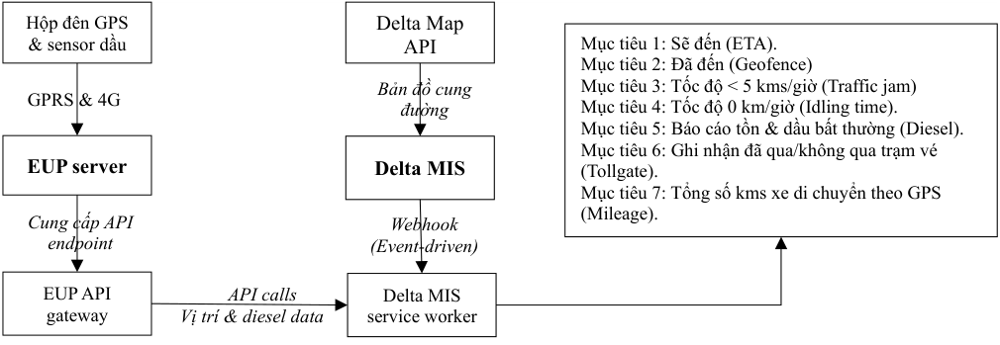
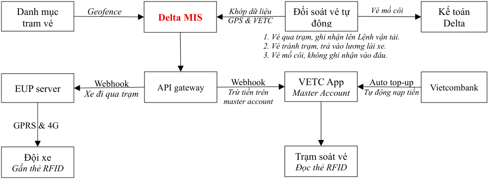

# VEHICLE INTELLIGENT SERVICE (VIS)

> Nguồn: [`VIS_Oct 8 2026_Update.pdf`](source/vis-du-lieu-van-hanh-xe.pdf) (PDF, 9 trang) · Nhận: 2026-10-11 · Chuyển sang Markdown bằng `/intake`.
> Phiên bản: 08/10/2026 (nhận 2026-10-11) — thay bản "Dữ liệu vận hành xe" 30/09/2026 nhận 2026-10-02; xem [thay đổi](../../_changes/2026-10-11-vis-du-lieu-van-hanh-xe.md).
> Thông tin trang: chân trang "VIS_Oct 2026 — Trang: N/9".

**CÔNG TY CỔ PHẦN QUỐC TẾ DELTA**

**Giải pháp số hóa toàn diện dữ liệu vận hành đội xe Delta**

**Hà Nội, ngày 08 tháng 10 năm 2026**

## MỤC LỤC

- I. ĐẶT VẤN ĐỀ
- II. GIẢI PHÁP KỸ THUẬT
  - 2.1. Kiến trúc hệ thống
  - 2.2. Quy trình xử lý chi tiết
    - 2.2.1. Thời gian xe sẽ đến (ETA)
    - 2.2.2. Thời gian xe đã đến (Geofencing)
    - 2.2.3. Thời gian xe di chuyển dưới 5 km/h (Traffic jam)
    - 2.2.4. Thời gian nổ máy không di chuyển (Idling Time)
    - 2.2.5. Dầu diesel tồn trên xe và bất thường nhiên liệu (Diesel)
    - 2.2.6. Giám sát lộ trình và ghi nhận tránh trạm vé
    - 2.2.7. Tổng số kms xe đã di chuyển (Mileage)
- III. GIẢI PHÁP NGHIỆP VỤ
  - 3.1. Hệ thống quản lý tự động vé cầu đường
    - 3.1.1. Sơ đồ kiến trúc và luồng dữ liệu
    - 3.1.2. Quản lý chi phí tập trung
    - 3.1.3. Quy trình đối soát và quản lý chi phí trên Delta MIS
  - 3.2. Quy trình xác định lượng dầu hao phí do tắc đường (Traffic jam)
  - 3.3. Quy trình xác định lượng dầu hao phí khi chọn container rỗng (Geofence)
  - 3.4. Quy trình xác định lượng dầu hao phí do “Nổ máy ngủ” (Idling)
  - 3.5. Quy trình giám sát dầu tồn và lập báo cáo hút dầu bất thường (Diesel)

## I. ĐẶT VẤN ĐỀ

Delta phát triển giải pháp số hóa dữ liệu vận hành của đội xe (gọi tắt là VIS) để khai thác các dữ liệu từ hệ thống GPS & sensor dầu của EUP và kết nối API với VETC để thu thập, xử lý dữ liệu nhằm (1) cập nhật và duyệt Lệnh vận tải tự động theo thời gian thực (2) ghi nhận chi phí vé cầu đường lên Lệnh vận tải hoặc lập báo cáo tránh trạm vé lên Lệnh vận tải (3) xây dựng giải pháp điều xe tự động. Các mục tiêu cụ thể của giải pháp này bao gồm:

- Xác định thời gian xe đã thực hiện một Lệnh vận tải, từ lúc bắt đầu đến lúc kết thúc.
- Ước tính thời gian xe sẽ bắt đầu và kết thúc Lệnh vận tải.
- Nhận biết và báo cáo thời gian xe bị tắc đường (thời gian xe di chuyển dưới 5 kms/h) để tính ra lượng dầu hao phí vì biến cố này của từng Lệnh vận tải và của cả kỳ báo cáo.
- Báo cáo thời gian xe nổ máy và không di chuyển (nổ máy ngủ) để tính ra lượng dầu hao phí vì biến cố này của từng Lệnh vận tải và của cả kỳ báo cáo.
- Báo cáo lượng dầu tồn trên xe và các biến động dầu tồn bất thường.
  - ✓ Lập báo cáo lượng dầu bị hút khỏi bình dầu trong kỳ báo cáo.
  - ✓ Lập báo cáo lượng dầu thực đổ để so sánh với lượng dầu được cấp.
  - ✓ Lập báo cáo tổng số kms di chuyển theo GPS và số dầu tiêu hao để tính ra mức tiêu hao nhiên liệu bình quân trong kỳ báo cáo.
- So sánh lộ trình thực hiện Lệnh vận tải để phát hiện đi sai cung đường và tránh trạm vé.
- Báo cáo số kms vận hành theo EUP để so sánh với số kms trên Lệnh vận tải.

## II. GIẢI PHÁP KỸ THUẬT

### 2.1. Kiến trúc hệ thống

Delta MIS đóng vai trò điều khiển trung tâm, nắm giữ các thông tin trên Lệnh vận tải (Location điểm đi và điểm đến trên danh mục cảng/bãi hoặc danh mục DK05, danh mục trạm vé kèm location, thời gian dự tính xe phải giao nhận hàng tại địa điểm giao nhận của DK05, ….) và EUP đóng vai trò như một cảm biến viễn thông cung cấp dữ liệu trực tiếp từ xe thông qua API. Cùng lúc, Delta MIS kết nối với Map API (hỗ trợ tính toán cung đường) và tiếp nhận dữ liệu từ EUP để thực hiện các nhiệm vụ.

Sơ đồ luồng dữ liệu của hệ thống như sau:

Chữ trong sơ đồ (ô — nhãn mũi tên):

- Hộp đên GPS & sensor dầu — *GPRS & 4G* → EUP server — *Cung cấp API endpoint* → EUP API gateway
- EUP API gateway — *API calls / Vị trí & diesel data* → Delta MIS service worker
- Delta Map API — *Bản đồ cung đường* → Delta MIS — *Webhook (Event-driven)* → Delta MIS service worker
- Delta MIS service worker → ô mục tiêu:
  - Mục tiêu 1: Sẽ đến (ETA).
  - Mục tiêu 2: Đã đến (Geofence)
  - Mục tiêu 3: Tốc độ < 5 kms/giờ (Traffic jam)
  - Mục tiêu 4: Tốc độ 0 km/giờ (Idling time).
  - Mục tiêu 5: Báo cáo tồn & dầu bất thường (Diesel).
  - Mục tiêu 6: Ghi nhận đã qua/không qua trạm vé (Tollgate).
  - Mục tiêu 7: Tổng số kms xe di chuyển theo GPS (Mileage).

### 2.2. Quy trình xử lý chi tiết

Yêu cầu phía EUP hỗ trợ cơ chế Webhook (Event-driven) ghi nhận thay đổi trạng thái của xe và gửi Delta MIS để quyết định tần suất xử lý logic dữ liệu (1) dựa trên tình trạng hoạt động của phương tiên và (2) để giải quyết các mục tiêu khác nhau. Delta MIS chỉ chủ động quét (polling) với tần suất thấp (30-60 phút) khi xe tắt máy để kiểm tra dầu tồn.

#### 2.2.1. Thời gian xe sẽ đến (ETA)

Chức năng này sẽ thu thập thông tin vị trí xe và dựa trên thực tế giao thông để dự đoán thời gian xe có thể đến các địa điểm giao nhận tại cảng/bãi hoặc địa điểm giao nhận trên mã DK05 cho các quy trình nghiệp vụ cần dữ liệu này. Logic thưc hiện nhiệm vụ này như sau:

1. Khi nhận tọa độ xe từ Webhook EUP, hệ thống kiểm tra khoảng cách đến đích. Nếu khoảng cách không lệch quá x% so với cung đường trên Lệnh vận tải thì không gọi Google Maps API mà tính ETA cơ học (Khoảng cách / Vận tốc trung bình tuyến).
2. Chỉ gửi HTTP Request tới Google Maps API khi (1) xe bắt đầu Lệnh vận tải để tính ETA gốc (2) Hệ thống kích hoạt trạng thái "Traffic Jam" (Kẹt xe) hoặc "Sai lộ trình" (3) Định kỳ tối đa 30 phút/lần đối với các Lệnh vận tải có cung đường vận tải dài hơn 300 km.
3. Xác định thời gian xe dự kiến sẽ đến địa điểm giao nhận để cung cấp cho các quy trình nghiệp vụ có liên quan.

#### 2.2.2. Thời gian xe đã đến (Geofencing)

Chức năng này xác định thời gian xe đến các địa điểm giao nhận theo Lệnh vận tải và ghi nhận lên Lệnh vận tải. Logic thực hiện nhiệm vụ này như sau:

1. Mỗi khi nhận dữ liệu vị trí (Event) từ Webhook của EUP, Delta MIS sẽ tính toán khoảng cách để xác định thời gian xe đến đích hoặc đã qua trạm vé và ghi nhận thông tin lên Lệnh vận tải.
2. Kết thúc hành trình thực hiện Lệnh vận tải, hệ thống tổng kết số lượt đi qua các trạm vé để ghi nhận tiền vé theo Lệnh vận tải hoặc ghi nhận chính xác trạm vé trên Lệnh vận tải mà lái xe đã tránh, không đi qua.
   - ✓ Kết hợp với dữ liệu từ VETC API để xác thực thông tin trước khi ghi nhận thông tin trạm vé đi qua và không đi qua lên Lệnh vận tải.

#### 2.2.3. Thời gian xe di chuyển dưới 5 km/h (Traffic jam)

Chức năng này nhằm phát hiện ùn tắc giao thông, sự cố trên tuyến để điều chỉnh thời gian xe dự kiến đến đích với nhân viên nghiệp vụ/khách hàng và để ghi nhận bổ sung nhiên liệu cho lái xe trên Lệnh vận tải. Logic thực hiện nhiệm vụ này như sau:

1. Điều kiện kích hoạt: Khi nhận Event vận tốc < 5 km/h từ EUP và trạng thái máy hoạt động.
2. Điều kiện ghi nhận: Vận tốc này phải duy trì liên tục hơn 10 phút (để loại trừ dừng đèn đỏ, check-in cổng cảng).
3. Hệ thống chốt thời điểm bắt đầu/kết thúc kẹt xe, tự động tính tổng thời gian và gửi báo cáo để xem xét bù nhiên liệu định mức.

#### 2.2.4. Thời gian nổ máy không di chuyển (Idling Time)

Chức năng này nhằm ghi nhận thời gian nổ máy không di chuyển để quản trị hao phí nhiên liệu vô ích (Tài xế dừng chờ bật điều hòa ngủ, không tắt máy xe). Logic thực hiện nhiệm vụ này như sau:

1. Điều kiện Idling là Nổ máy và Speed = 0 trong thời gian quá 10 phút.
2. Kết thúc Idling là khi Speed > 0. Hệ thống chốt thời gian kết thúc Idling, tính tổng số phút idling vào gửi báo cáo cho quy trình nghiệp vụ liên quan.

#### 2.2.5. Dầu diesel tồn trên xe và bất thường nhiên liệu (Diesel)

Chức năng này theo dõi và lập báo cáo lượng dầu tồn thực tế trên xe, lập tự động báo cáo tiêu hao và phát hiện hành vi hút dầu ra khỏi xe. Toàn bộ các thông tin này sẽ nhận trực tiếp từ EUP server và gửi đến quy trình nghiệp vụ liên quan.

#### 2.2.6. Giám sát lộ trình và ghi nhận tránh trạm vé

Chức năng này nhằm xác định xe đi đúng tuyến đường quy định và kiểm soát chi phí vé cầu đường hoặc hành động tránh trạm vé của lái xe để ghi nhận lên Lệnh vận tải. Chức năng Map API trên phần mềm Delta 2.0 đã ghi nhận các trạm vé mà xe phải qua trên Lệnh vận tải và cần xác định tọa độ chuẩn của trạm vé lên danh mục trạm vé để thực hiện nhiệm vụ này. Logic thực hiện nhiệm vụ này như sau:

1. Trạm vé trên danh mục phải được vẽ dưới dạng hình đa giác (Polygon geofence) bao trọn đoạn đường phải qua của trạm, thay vì bán kính tròn (Radius) để tránh bắt hụt sự kiện.
2. Khi xe đi vào Polygon của trạm vé, hệ thống ghi nhận ngay "Đã qua" lên Lệnh vận tải.
3. Đối soát sau khi xe thực hiện xong Lệnh vận tải: Khi xe kích hoạt Geofence điểm đích, hệ thống thực hiện đối soát chéo bằng cách gọi VETC API để lấy danh sách trạm vé đã trừ tiền.
   - ✓ Nếu dữ liệu GPS và VETC khớp nhau thì hệ thống ghi nhận xe “Đã qua” trạm vé trên Lệnh vận tải.
   - ✓ Nếu có có trạm "Chưa đi qua" trên GPS và không có giao dịch VETC thì hệ thống ghi nhận lái xe "Tránh trạm vé / Sai lộ trình".

#### 2.2.7. Tổng số kms xe đã di chuyển (Mileage)

Chức năng này ghi nhận và lập báo cáo số kms xe đã di chuyển trong một khoảng thời gian tùy chọn. Báo cáo này sẽ nhận trực tiếp từ EUP server và gửi đến quy trình nghiệp vụ liên quan.

## III. GIẢI PHÁP NGHIỆP VỤ

Mục này trình bày các quy trình phối hợp dữ liệu giữa Delta MIS và các giải pháp kỹ thuật trình bày ở Phần I để thực hiện các quy trình quản lý chi phí, đối soát tài chính và quản lý vận hành của từng phương tiện và cả đội xe.

### 3.1. Hệ thống quản lý tự động vé cầu đường

Nhằm tăng cường hiệu quả hoạt động vận tải đường bộ, Delta xây dựng một giải pháp số hóa toàn bộ quy trình thanh toán phí đường bộ từ bước hạch toán chi phí vé vào từng Lệnh vận tải, đối soát với hóa đơn hàng tháng và thanh toán tiền cho VETC. Giải pháp này được xây dựng dựa trên việc trao đổi dữ liệu qua kết nối API giữa Delta MIS, VETC và EUP và tính năng auto-toup của tài khoản Delta tại Vietcombank.

#### 3.1.1. Sơ đồ kiến trúc và luồng dữ liệu

Sơ đồ dưới đây mô tả chi tiết cách thức phối hợp dữ liệu 4 bên (Delta MIS, EUP, VETC và Vietcombank để tự động hóa toàn bộ quy trình từ thanh toán tập trung đến đối soát phí cầu đường.

Chữ trong sơ đồ (ô — nhãn mũi tên):

- Danh mục trạm vé — *Geofence* → Delta MIS
- Đối soát vé tự động — *Khớp dữ liệu GPS & VETC* → Delta MIS
- Đối soát vé tự động — *Vé mồ côi* → Kế toán Delta
- Ghi chú dưới ô Đối soát vé tự động:
  1. Vé qua trạm, ghi nhận lên Lệnh vận tải.
  2. Vé tránh trạm, trả vào lương lái xe.
  3. Vé mồ côi, không ghi nhận vào đâu.
- Delta MIS → API gateway
- API gateway — *Webhook / Xe đi qua trạm* → EUP server
- VETC App (Master Account) — *Webhook / Trừ tiền trên master account* → API gateway
- Vietcombank — *Auto top-up / Tự động nạp tiền* → VETC App (Master Account)
- VETC App (Master Account) → Trạm soát vé (Đọc thẻ RFID)
- EUP server — *GPRS & 4G* — Đội xe (Gắn thẻ RFID)

#### 3.1.2. Quản lý chi phí tập trung

Triển khai master account với VETC và sử dụng tính năng auto top-up của Vietcombank để thanh toán liên thông nhằm đảm bảo khả năng vận hành liên tục của toàn bộ đội xe.

##### Master Account

Delta MIS quản lý chi phí theo cấu trúc "Một tài khoản mẹ - Nhiều tài khoản con". Toàn bộ đội xe Delta sẽ được cấu hình liên kết trực thuộc mã định danh của Tài khoản doanh nghiệp tập trung (Master Account) do Delta VT và Delta HCM đăng ký. Khi xe đi qua trạm soát vé, hệ thống thu phí của VETC sẽ quét thẻ chip RFID trên xe và trừ trực tiếp vào quỹ tiền chung của master account.

##### Trích nợ tự động (Vietcombank Auto-topup)

Để tránh gián đoạn dòng tiền và không chịu phí quản lý hạn mức 3% như hình thức ví trả sau thông thường, Delta cấu hình tính năng Auto-topup trên hệ thống Vietcombank Corporate Internet Banking với ngưỡng kích hoạt tối thiểu. Khi số dư tài khoản trên master account giảm xuống dưới 15 triệu (Delta VT) và 5 triệu (Delta HCM) thì Vietcombank dựa trên lệnh ủy quyền sẽ trích tiền từ tài khoản thanh toán của Delta để nạp tự động vào tài khoản VETC, đảm bảo tài khoản trên master account luôn có số dư là 150 triệu với Delta VT và 50 triệu với Delta HCM.

#### 3.1.3. Quy trình đối soát và quản lý chi phí trên Delta MIS

Quy trình đối soát chi phí cầu đường hướng đến 3 mục tiêu bao gồm (1) Tự động ghi nhận chi phí vé cầu đường vào từng Lệnh vận tải, (2) Phát hiện và lập bảng kê các trạm vé thể hiện trên Lệnh vận tải mà lái xe đã tránh, và (3) Lập báo cáo các vé phát sinh ngoài lộ trình, hệ thống không ghi nhận vào đâu, để chuyển cho kế toán xử lý.

##### Bước 1 - Ghi nhận hành trình và dữ liệu qua trạm thực tế

Delta MIS nhận tín hiệu từ Webhook của EUP server để ghi nhận song song theo thời gian thực:

- ✓ Khung thời gian thực hiện Lệnh vận tải dựa trên vùng Geofence của các địa điểm giao nhận.
- ✓ Lộ trình qua trạm vé: Hệ thống ghi nhận trạng thái "Đã qua trạm" ngay khi tọa độ xe trùng với hình đa giác (Polygon geofence) bao trọn đoạn đường phải qua của trạm trên Danh mục trạm vé.

##### Bước 2 - Tự động gọi API VETC đối soát chéo

Tại thời điểm xe kết thúc Lệnh vận tải, Delta MIS tự động gọi API sang hệ thống VETC để thu thập toàn bộ danh sách giao dịch trừ tiền phát sinh của phương tiện đó trong đúng khung thời gian thực hiện Lệnh vận tải đã chốt ở Bước 1.

##### Bước 3 - Phân loại dữ liệu và lập Bảng kê "Lái xe tránh trạm vé"

Hệ thống thực hiện đối soát tự động (Matrix Matching) giữa dữ liệu GPS (Bước 1) và dữ liệu giao dịch VETC (Bước 2) để phân loại:

- ✓ Trường hợp Khớp dữ liệu: GPS báo "Đã qua" và VETC báo "Đã trừ tiền" => Hệ thống tự động phê duyệt và ghi nhận chính xác chi phí vé vào Lệnh vận tải tương ứng.
- ✓ Trường hợp Lệch dữ liệu (Tránh trạm/Trốn vé): Danh mục tuyến đường trên Lệnh vận tải quy định phải qua trạm X, nhưng dữ liệu GPS báo "Không qua" và VETC "Không phát sinh giao dịch" => Hệ thống tự động ghi nhận lái xe "Tránh trạm vé / Sai lộ trình", đồng thời đẩy thông tin vào Bảng kê tránh trạm vé.
- ✓ Xử lý độ trễ hệ thống: Thiết lập cơ chế tự động quét lại sau 120 phút đối với các trường hợp GPS báo "Đã qua" nhưng VETC chưa trả về dữ liệu giao dịch để loại trừ độ trễ đồng bộ của bên thứ ba.

##### Bước 4 - Đối soát hóa đơn cuối kỳ

Vào cuối kỳ báo cáo, khi tiếp nhận hóa đơn tổng từ VETC, Delta MIS chạy một lệnh quét tự động (Batch-job) để đối soát chéo:

- ✓ Các giao dịch VETC tồn tại trên hóa đơn tổng nhưng chưa được ghi nhận vào Lệnh vận tải nào, hệ thống tự động quét ngược lại lịch sử tọa độ GPS của EUP tại thời điểm phát sinh.
- ✓ Hệ thống tự động đưa ra gợi ý xử lý cho kế toán xác định chính xác giao dịch đó thuộc xe nào, phát sinh ngoài lệnh trong khung giờ nào, tại trạm nào để phê duyệt chi phí hợp lý hoặc xử lý sai phạm của lái xe (chạy xe ngoài lịch trình, việc riêng).

### 3.2. Quy trình xác định lượng dầu hao phí do tắc đường (Traffic jam)

Quy trình này sẽ cung cấp dữ liệu tắc đường và tính toán lượng dầu phát sinh do biến cố tắc đường lên Lệnh vận tải để nhân viên điều vận và cán bộ quản lý quyết định mức bù dầu và phê duyệt cùng với phê duyệt Lệnh vận tải. Mục tiêu là tự động bóc tách thời gian kẹt xe thực tế của từng Lệnh vận tải và quy đổi ra số lít dầu hao phí tương ứng để làm căn cứ cấp bù dầu định mức.

##### Bước 1 - Ghi nhận sự kiện kích hoạt trạng thái "Traffic jam"

Delta MIS liên tục quét dữ liệu Webhook từ EUP. Trạng thái "Traffic pam" được kích hoạt khi đồng thời thỏa mãn 2 điều kiện: Vận tốc xe < 5 km/h và Trạng thái máy hoạt động (Engine ON).

- ✓ Điều kiện ghi nhận biến cố: Trạng thái này phải duy trì liên tục trên 10 phút để hệ thống tự động loại trừ các biến cố dừng đèn đỏ hoặc dừng check-in tại cổng cảng.

##### Bước 2 - Chốt thời gian và tính toán thời lượng biến cố

Khi vận tốc xe lên ≥ 5 km/h, hệ thống chốt thời điểm kết thúc biến cố, tự động tính tổng số phút bị tắc đường. Dữ liệu này được ghi nhận trực tiếp theo thời gian thực vào Lệnh vận tải đang chạy.

##### Bước 3 - Tự động tính toán lượng dầu hao phí phát sinh

Delta MIS gọi bảng Định mức tiêu hao khi nổ máy chờ của loại xe đó trong danh mục để tính ra số lít dầu và hiển thị trên mục riêng: "Đề xuất bù dầu do kẹt xe: ... lít" ngay trên Lệnh vận tải.

### 3.3. Quy trình xác định lượng dầu hao phí khi chọn container rỗng (Geofence)

Quy trình này sẽ cung cấp dữ liệu số kms phát sinh trong trường hợp xe phải di chuyển đến nhiều cảng bãi để chọn container rỗng đáp ứng tiêu chuẩn đóng hàng. Cụ thể, quy trình sẽ ghi nhận thời điểm xe đến điểm nhận container rỗng ghi nhận trên Lệnh vận tải và xác định thời điểm xe bắt đầu thực hiện Lệnh vận tải và tính toán số kms phát sinh do đi nhiều bãi chọn vỏ và xác định lượng dầu phát sinh tương ứng để nhân viên điều vận và cán bộ quản lý quyết định mức bù dầu và phê duyệt cùng với phê duyệt Lệnh vận tải. Mục tiêu là kiểm soát và bù chi phí nhiên liệu phát sinh khi tài xế phải di chuyển qua nhiều bãi khác nhau (ngoài lộ trình chuẩn đã được xác định ban đầu trên Lệnh vận tải) để tìm được vỏ container đạt tiêu chuẩn đóng hàng. Quy trình này chỉ áp dụng với Lệnh vận tải được tạo để vận chuyển hàng hóa thuộc JobID nghiệp vụ có mã là J01.

##### Bước 1 - Xác định tọa độ bãi nhận vỏ gốc ban đầu

Khi xe kích hoạt Geofence của cảng bãi nhận vỏ được ghi trên Lệnh vận tải, hệ thống chốt thời mốc thời gian đến. Nếu tài xế lấy được vỏ ngay thì quy trình kết thúc, áp định mức chuẩn.

##### Bước 2 - Ghi nhận sự kiện "Đi tìm vỏ"

Nếu xe đến bãi đầu tiên không chọn được container rỗng đạt chuẩn, lái xe phải di chuyển sang bãi thứ 2, thứ 3…. Delta MIS sẽ dựa vào tọa độ GPS (EUP) để nhận diện xe đã rời Geofence bãi 1 nhưng chưa đi đến điểm giao nhận hàng (DK05), mà lại đi vào Geofence của các cảng bãi khác có trên danh mục của hệ thống. Delta MIS tự động chốt tổng quãng đường di chuyển phát sinh giữa các bãi rỗng này qua dữ liệu mileage (GPS kms) của EUP.

- ✓ Bãi cảng 2, 3 …. chỉ được ghi nhận thuộc hành trình đi tìm container rỗng đủ tiêu chuẩn đóng hàng xuất để tính số kms phát sinh nếu xe có di chuyển trong vùng tọa độ của bãi cảng đó trong khoảng thời gian trên 10 phút nhằm loại bỏ các biến cố khác.

##### Bước 3 - Tự động tính toán số kms phát sinh và lượng dầu bù

Số kms phát sinh chọn container rỗng = Tổng kms thực tế di chuyển từ bãi nhận container rỗng ghi nhận trên Lệnh vận tải đến địa điểm đóng hàng – Số kms của cung vận tải ghi nhận ban đầu trên Lệnh vận tải giữa hai địa điểm giao nhận. Căn cứ vào số kms phát sinh và định mức tiêu hao nhiên liệu của xe ở tải trọng 0 kg, Delta MIS xác định số dầu cấp bù và hiển thị trên mục “Đề nghị cấp bù dầu do chọn container rỗng ở nhiều bãi. Hệ thống tự động lập bảng kê lịch trình phụ mô tả các thông tin sau:

- ✓ Xe di chuyển từ Bãi A (bãi gốc) => Bãi B => Bãi C …. trước khi thực hiện Lệnh vận tải.
- ✓ Kms phát sinh.
- ✓ Số lít dầu bù đề xuất.

### 3.4. Quy trình xác định lượng dầu hao phí do “Nổ máy ngủ” (Idling)

Mục tiêu của quy trình này là bóc tách và định lượng chính xác lượng dầu hao phí vô ích do tài xế nổ máy xe nhưng không di chuyển (ví dụ: dừng chờ quá lâu không tắt máy, hoặc nổ máy để bật điều hòa ngủ), từ đó phục vụ công tác quản lý.

##### Bước 1 - Nhận diện sự kiện "Nổ máy ngủ"

Delta MIS giám sát dữ liệu trạng thái từ Webhook EUP. Biến cố "Idling Time" được kích hoạt khi đồng thời thỏa mãn 2 điều kiện là (1) vận tốc xe = 0 km/h và (2) trạng thái máy hoạt động. Trạng thái này phải duy trì liên tục vượt quá 10 phút thì hệ thống mới ghi nhận biến cố “Nổ máy ngủ” để loại trừ các khoảng dừng ngắn hợp lý như dừng đèn đỏ, nhường đường, …

##### Bước 2 - Chốt thời gian và tính toán tổng số phút Idling

Biến cố Idling kết thúc ngay khi nhận được tín hiệu vận tốc xe > 0 km/h từ Webhook của EUP. Delta MIS tự động chốt thời điểm bắt đầu/kết thúc, tính tổng số phút Idling vô ích và gắn trực tiếp dữ liệu này vào Lệnh vận tải đang thực hiện.

##### Bước 3 - Quy đổi lượng dầu tiêu hao vô ích và lập báo cáo quản trị

Delta MIS gọi Định mức tiêu hao dầu Idling (lít/giờ) tương ứng với từng loại xe trong danh mục hệ thống và tự động tính lượng dầu hao phí Idling (Tổng số phút Idling * Định mức Idling).

- ✓ *Cơ chế phân loại báo cáo:* Dữ liệu được tổng hợp vào bảng tổng hợp Idling cuối kỳ theo từng lái xe.

### 3.5. Quy trình giám sát dầu tồn và lập báo cáo hút dầu bất thường (Diesel)

Mục tiêu của quy trình này là phát hiện, cảnh báo theo thời gian thực và lập bằng chứng đối với hành vi rút/hút dầu trái phép từ bình nhiên liệu của xe. Nếu EUP có thể cung cấp đầy đủ dữ liệu để Delta MIS cảnh báo hành vi hút dầu và lập báo cáo lượng dầu bị hút khỏi bình trong kỳ, hiển thị trực quan vị trí hút dầu như mô tả ở Bước 3 thì dùng trực tiếp dữ liệu của EUP.

##### Bước 1- Giám sát biến động thể tích bình dầu liên tục

Delta MIS tiếp nhận dữ liệu từ sensor dầu của EUP gửi về để cập nhật liên tục theo thời gian thực khi xe đang nổ máy. Khi xe tắt máy, hệ thống tự động chuyển sang chế độ quét định kỳ tần suất thấp (30 phút/lần) để giám sát lượng dầu tồn khi xe nằm bãi.

##### Bước 2 - Kích hoạt thuật toán phát hiện hút dầu bất thường

Tín hiệu "Hút dầu bất thường" được kích hoạt tự động khi sensor báo nhận diện Thể tích dầu trong bình sụt giảm đột ngột vượt quá ngưỡng cấu hình (ví dụ: giảm quá 5 lít trong khoảng thời gian dưới 3 phút, cụ thể cần làm việc với EUP để dùng chung ngưỡng cấu hình của họ). Khi bắt được biến cố, Delta MIS lập tức tự động chốt các thông số tại thời điểm xảy ra biến cố bao gồm (1) Mốc thời gian (2) Tọa độ vị trí xảy ra (3) Thể tích dầu trước khi giảm và Thể tích dầu sau khi giảm..

##### Bước 3 - Tự động cảnh báo theo thời gian thực và lập Bảng kê vi phạm

Delta MIS tự động gửi thông báo cảnh báo và đối soát tự động để loại trừ trường hợp lỗi sensor. Cuối kỳ báo cáo, hệ thống tổng hợp toàn bộ các biến cố sụt giảm này và lập báo cáo lượng dầu bị hút khỏi bình trong kỳ, hiển thị trực quan vị trí hút dầu trên bản đồ để làm bằng chứng làm việc với lái xe.

### 3.6. Quy trình đối soát lượng dầu thực đổ (Diesel)

Mục tiêu của quy trình này là tự động so khớp chéo giữa lượng dầu cấp cho xe bằng phiếu cấp dầu với lượng dầu thực tế đổ vào bình do sensor dầu EUP ghi nhận, từ đó phát hiện các sai lệch do đổ thiếu, gian lận hóa đơn hoặc thất thoát trong quá trình bơm dầu.

##### Bước 1 - Tự động ghi nhận sự kiện nạp nhiên liệu

Delta MIS liên tục ghi nhận dữ liệu từ sensor dầu của EUP gửi về. Sự kiện "Đổ dầu" được kích hoạt tự động khi hệ thống phát hiện thể tích dầu trong bình tăng liên tục vượt ngưỡng cấu hình, ví dụ: tăng trên 20 lít trong một khoảng 10 phút (làm việc với EUP để dùng chung ngưỡng cấu hình của họ), đi kèm trạng thái vận tốc xe bằng 0 km/h. Hệ thống tự động chốt các thông số thực tế của biến cố (2) mốc thời gian đổ dầu (2) tọa độ GPS của cây dầu (3) thể tích dầu trước khi đổ và lượng dầu thực tế nạp vào bình được ghi nhận tự động.

##### Bước 2 - Thu thập dữ liệu cấp dầu từ hệ thống

Delta MIS lấy dữ liệu từ phiếu cấp dầu điện tử hoặc dữ liệu cấp dầu của module xưởng bao gồm (1) số lít dầu được cấp theo định mức/kế hoạch (2) thời gian cấp và tên cây dầu cấp.

##### Bước 3 - Đối soát chéo tự động và phân loại sai lệch

Ngay khi sự kiện đổ dầu kết thúc, Delta MIS thực hiện lệnh so khớp tự động giữa dữ liệu cấp dầu hệ thống (Bước 2) và dữ liệu thực đổ từ sensor (Bước 1)

- ✓ Trường hợp Khớp dữ liệu: => Hệ thống tự động phê duyệt "Khớp định mức".
- ✓ Trường hợp Lệch dữ liệu (Thất thoát/Gian lận) => Hệ thống tự động phân loại và đẩy vào Bảng kê nghi vấn lệch dầu thực đổ.
  - Nếu dầu thực đổ (Sensor) < Dầu được cấp: Cảnh báo lái xe đổ thiếu, cây xăng gian lận xung lực bơm, hoặc có hành vi gian lận thông đồng lấy tiền mặt.
  - Nếu dầu thực đổ (Sensor) > Dầu được cấp: Cảnh báo lái xe không dùng phiếu dầu để đổ hoặc có sự cố gian lận hóa đơn cấp dầu ngoài luồng.

##### Bước 4 - Xuất bản báo cáo đối soát nhiên liệu kỳ báo cáo

Delta MIS tự động tổng hợp dữ liệu thành Báo cáo lượng dầu thực đổ đối so sánh với lượng dầu được cấp theo từng Lệnh vận tải, từng đầu xe và tổng hợp toàn đội xe trong kỳ báo cáo. Báo cáo hiển thị trực quan các biểu đồ cột sai lệch, gắn kèm vị trí GPS của cây dầu xảy ra chênh lệch để làm căn cứ làm việc với nhà cung cấp xăng dầu hoặc chế tài lái xe.
