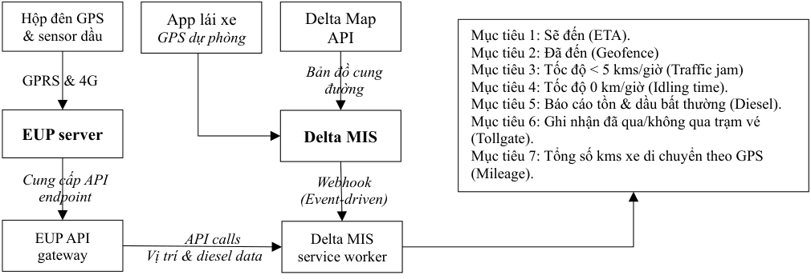
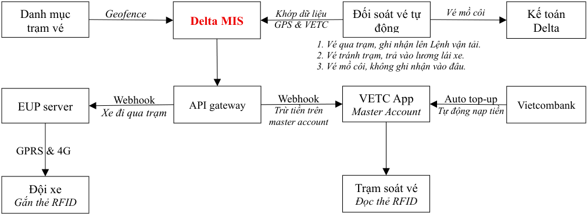
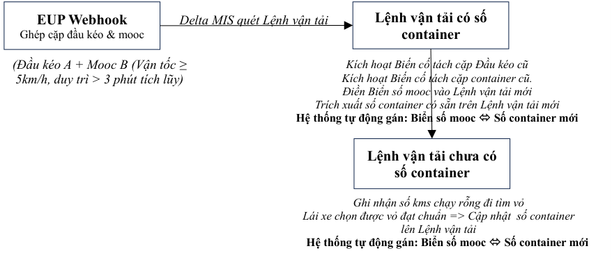
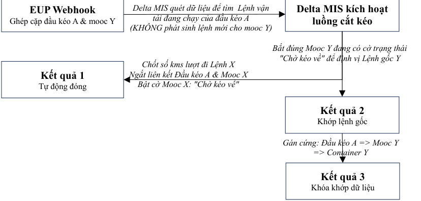
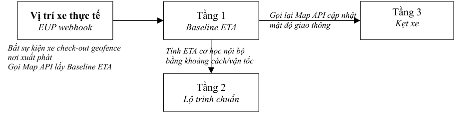
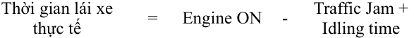

# PHÂN HỆ VIS — Hệ thống giám sát phương tiện & Quản trị đội xe

> Nguồn: [`Phân hệ VIS_October 18 2026.pdf`](source/vis-giam-sat-doi-xe.pdf) (PDF, 34 trang) · Nhận: 2026-10-19 · Chuyển sang Markdown bằng `/intake`.
> Phiên bản: 18/10/2026 (nhận 2026-10-19) — thay bản "Vehicle Intelligent Service (VIS)" 08/10/2026 (nhận 2026-10-11); xem [thay đổi](../../_changes/2026-10-19-vis-giam-sat-doi-xe.md).
> Phiên bản: 08/10/2026 (nhận 2026-10-11) — thay bản "Dữ liệu vận hành xe" 30/09/2026 nhận 2026-10-02; xem [thay đổi](../../_changes/2026-10-11-vis-du-lieu-van-hanh-xe.md).
> Thông tin trang: chân trang "VIS_October 18, 2026 — Trang: N/34".

**CÔNG TY CỔ PHẦN QUỐC TẾ DELTA**

**PHÂN HỆ VIS**

**Hệ thống giám sát phương tiện & Quản trị đội xe**

=================

**Hà Nội, ngày 18 tháng 10 năm 2026**

## MỤC LỤC

- I. ĐẶT VẤN ĐỀ
- II. HẠ TẦNG XỬ LÝ DỮ LIỆU & CÔNG NGHỆ LÕI (CORE DATA ENGINES)
  - 2.1. Kiến trúc hệ thống và Luồng thu thập dữ liệu (Data Ingestion)
  - 2.2. Thuật toán và Công nghệ xử lý dữ liệu thô (Core Data Engines)
    - _2.2.1. Dự báo thời gian phân tầng (Hybrid ETA Engine)_
    - _2.2.2. Địa giới ảo & Phân luồng cấu hình xe (Geofencing Polygon Engine)_
    - _2.2.3. Làm sạch & Ghép dữ liệu hành trình (Mileage & Data Stitching Engine)_
    - _2.2.4. Phân tích biến cố chuyển động và trạng thái máy (Vibration & Idling Engine)_
    - _2.2.5. Giám sát nhiên liệu và Điện áp xung lực (Fuel Sensor Engine)_
    - _2.2.6. Giám sát lộ trình và ghi nhận tránh trạm vé_
- III. QUẢN LÝ CHI PHÍ VẬN HÀNH
  - 3.1. Quản lý tự động vé cầu đường (Toll fee)
  - 3.2. Quản lý cấp đổ và đối soát dầu thực tế (Diesel)
  - 3.3. Cấp bù nhiên liệu do biến cố ngoại lộ trình
  - 3.4. Quy trình xác định lượng dầu hao phí do “Nổ máy ngủ” (Idling)
  - 3.5. Quy trình giám sát dầu tồn và lập báo cáo hút dầu bất thường (Diesel)
- IV. QUẢN LÝ VẬN HÀNH & HIỆU SUẤT TÀI XẾ (Fleet & Driver Management)
  - 4.1. Tự động ghép/tách cặp giữa mooc và đầu kéo/số container (PUR)
  - 4.2. Tự động hóa Lệnh vận tải phụ cho mô hình cắt kéo container (D&H)
  - 4.3. Quản lý giám sát ETA hành trình và lưu bãi
    - _4.3.1. Tính toán ETA của xe và phát thông báo_
    - _4.3.2. Quản lý thời gian lưu xe_
- V. THANH TRA VẬN TẢI (Transportation Inspection Dashboard)
  - 5.1. Đối soát kms hàng tháng theo chu kỳ vận hành động (MATG)
  - 5.2. Quản lý thời gian làm việc của lái xe và Lệnh vận tải đã thực hiện
  - 5.3. Giám sát hoạt động của thiết bị & chống gian lận (HDS)
  - 5.4. Quy trình kiểm soát và cảnh báo vi phạm điểm đỗ quy định (VPS)
  - 5.5. Quy trình kiểm soát và cảnh báo rơ mooc mồ côi sai quy định (TAMS)
- VI. KẾT NỐI VỚI EUP
  - 6.1. Yêu cầu kết nối & luồng dữ liệu đẩy (Webhook)
  - 6.2. Yêu cầu cung cấp thông số cấu hình mặc định
  - 6.3. Tiêu chuẩn an ninh & đường truyền bảo mật

Thực tế vận hành đội xe tại Delta đối mặt với nhiều đặc thù của ngành vận tải container và hàng rời. Việc lái xe hoán đổi rơ mooc liên tục, hành trình chạy rỗng đi tìm vỏ qua nhiều bãi cảng phụ, hay các biến cố tắc đường, nổ máy ngủ bật điều hòa đã tạo ra những khoảng tối dữ liệu. Sự lệch pha thông tin giữa Lệnh vận tải và hành trình thực tế không chỉ gây quá tải cho bộ phận điều vận mà còn làm phát sinh rủi ro thất thoát nhiên liệu và giảm vòng quay phương tiện của Delta.

Để giải quyết các vấn đề trên, Phân hệ VIS sẽ số hóa toàn diện dữ liệu vận hành theo thời gian thực. VIS được thiết kế theo mô hình hướng sự kiện, kết nối Open API giữa Delta MIS với máy chủ hộp đen EUP, hệ thống VETC và cổng thanh toán ngân hàng. Hệ thống chuyển đổi dữ liệu viễn thông thô thành dữ liệu sạch nhờ thuật toán hợp nhất và cơ chế dự phòng App Delta chống giả lập tọa độ. VIS không thực hiện các nhiệm vụ hành chính mà đóng vai trò trung tâm cung cấp dữ liệu và tự động đồng bộ dữ liệu sang các phân hệ nghiệp vụ để xử lý.

Phân hệ VIS được cấu trúc đồng bộ thành ba khối chức năng nghiệp vụ lớn bao gồm:

- **Quản lý chi phí vận hành:** Tự động hóa đối soát phí cầu đường tập trung qua tài khoản ngân hàng. So khớp phiếu cấp dầu điện tử với lượng nạp thực tế từ cảm biến, tự động tính toán cấp bù định mức chính xác cho tài xế khi gặp kẹt xe hoặc chạy rỗng đi tìm vỏ.

- **Quản lý vận hành và Hiệu suất tài xế:** Tự động hóa tác vụ điều vận nhờ Thuật toán PUR gán liên thông đầu kéo, mooc, container và Giải pháp cắt kéo D&H tự động tạo lệnh phụ lượt về. Vận hành mô hình dự báo ETA phân tầng và đếm giờ lưu bãi để kết xuất báo cáo gửi khách hàng đúng 24:00.

- **Trung tâm dữ liệu thanh tra vận tải:** Cung cấp màn hình quản trị toàn diện cho Thanh tra. Giải pháp MATG tự động đối soát tổng kilomet Lệnh vận tải và GPS theo khung thời gian động. Hệ thống giám sát giới hạn bốn giờ lái xe liên tục qua thẻ RFID và vận hành Giải pháp HDS để chẩn đoán sức khỏe phần cứng, phát hiện hành vi phá hoại thiết bị và các giải pháp khác để quản trị rủi ro về hàng hóa vận tải và tài sản.

## I. ĐẶT VẤN ĐỀ

Delta phát triển giải pháp số hóa dữ liệu vận hành của đội xe (gọi tắt là VIS) để khai thác các dữ liệu từ hệ thống GPS & sensor dầu của EUP và kết nối API với VETC để thu thập, xử lý dữ liệu nhằm (1) cập nhật và duyệt Lệnh vận tải tự động theo thời gian thực (2) ghi nhận chi phí vé cầu đường lên Lệnh vận tải hoặc lập báo cáo tránh trạm vé lên Lệnh vận tải (3) xây dựng giải pháp điều xe tự động. Các mục tiêu cụ thể của giải pháp này bao gồm:

- Xác định thời gian xe đã thực hiện một Lệnh vận tải, từ lúc bắt đầu đến lúc kết thúc.

- Ước tính thời gian xe sẽ bắt đầu và kết thúc Lệnh vận tải.

- Nhận biết và báo cáo thời gian xe bị tắc đường (thời gian xe di chuyển dưới 5 kms/h) để tính ra lượng dầu hao phí vì biến cố này của từng Lệnh vận tải và của cả kỳ báo cáo.

- Báo cáo thời gian xe nổ máy và không di chuyển (nổ máy ngủ) để tính ra lượng dầu hao phí vì biến cố này của từng Lệnh vận tải và của cả kỳ báo cáo.

- Báo cáo lượng dầu tồn trên xe và các biến động dầu tồn bất thường.

   - ✓ Lập báo cáo lượng dầu bị hút khỏi bình dầu trong kỳ báo cáo.

   - ✓ Lập báo cáo lượng dầu thực đổ để so sánh với lượng dầu được cấp.

   - ✓ Lập báo cáo tổng số kms di chuyển theo GPS và số dầu tiêu hao để tính ra mức tiêu hao nhiên liệu bình quân trong kỳ báo cáo.

- So sánh lộ trình thực hiện Lệnh vận tải để phát hiện đi sai cung đường và tránh trạm vé.

- Báo cáo số kms vận hành theo EUP để so sánh với số kms trên Lệnh vận tải.

## II. HẠ TẦNG XỬ LÝ DỮ LIỆU & CÔNG NGHỆ LÕI (CORE DATA ENGINES)

### 2.1. Kiến trúc hệ thống và Luồng thu thập dữ liệu (Data Ingestion)

Delta MIS đóng vai trò điều khiển trung tâm, nắm giữ các thông tin trên Lệnh vận tải (Location điểm đi và điểm đến trên danh mục cảng/bãi hoặc danh mục DK05, danh mục trạm vé kèm location, thời gian dự tính xe phải giao nhận hàng tại địa điểm giao nhận của DK05, ….) và EUP đóng vai trò như một cảm biến viễn thông cung cấp dữ liệu trực tiếp từ xe thông qua API. Cùng lúc, Delta MIS kết nối với Map API (hỗ trợ tính toán cung đường) và tiếp nhận dữ liệu từ EUP để thực hiện các nhiệm vụ.

Sơ đồ luồng dữ liệu của hệ thống như sau:

Chữ trong sơ đồ:

- Hộp đên GPS & sensor dầu — *GPRS & 4G* → EUP server — *Cung cấp API endpoint* → EUP API gateway — *API calls / Vị trí & diesel data* → Delta MIS service worker
- App lái xe GPS dự phòng
- Delta Map API — *Bản đồ cung đường* → Delta MIS — *Webhook (Event-driven)* → Delta MIS service worker
- Mục tiêu 1: Sẽ đến (ETA). · Mục tiêu 2: Đã đến (Geofence) · Mục tiêu 3: Tốc độ < 5 kms/giờ (Traffic jam) · Mục tiêu 4: Tốc độ 0 km/giờ (Idling time). · Mục tiêu 5: Báo cáo tồn & dầu bất thường (Diesel). · Mục tiêu 6: Ghi nhận đã qua/không qua trạm vé (Tollgate). · Mục tiêu 7: Tổng số kms xe di chuyển theo GPS (Mileage).

App Delta (Điện thoại lái xe) đóng vai trò là cảm biến viễn thông dự phòng, liên tục cấu hình chạy ngầm (Background Service) để truyền dữ liệu tọa độ (GPS) và vận tốc thời gian thực về API Gateway của Delta MIS qua giao thức Webhook, phục vụ cho kịch bản chuyển đổi dữ liệu khi phần cứng EUP mất tín hiệu.

### 2.2. Thuật toán và Công nghệ xử lý dữ liệu thô (Core Data Engines)

Đây là nơi phần mềm xử lý, làm sạch và tính toán dữ liệu thô từ phần cứng thành các "Biến số sạch" để cung cấp cho các chức năng quản trị. Yêu cầu EUP cung cấp cơ chế Webhook (Event-driven) ghi nhận thay đổi trạng thái của xe và gửi Delta MIS để quyết định tần suất xử lý logic dữ liệu (1) dựa trên tình trạng hoạt động của phương tiên và (2) để giải quyết các mục tiêu khác nhau. Delta MIS chỉ chủ động quét (polling) với tần suất thấp (30-60 phút) khi xe tắt máy để kiểm tra dầu tồn.

#### 2.2.1. Dự báo thời gian phân tầng (Hybrid ETA Engine)

Định nghĩa cơ chế tính ETA cơ học nội bộ để tiết kiệm chi phí và khi nào kích hoạt Google Maps API. Chức năng này sẽ thu thập thông tin vị trí xe và dựa trên thực tế giao thông để dự đoán thời gian xe có thể đến các địa điểm giao nhận tại cảng/bãi hoặc địa điểm giao nhận trên mã DK05, cung cấp cho chức năng tính toán ETA và gửi thông báo cho khách hàng. Logic thưc hiện nhiệm vụ này như sau:

1. Khi nhận tọa độ xe từ Webhook EUP, hệ thống kiểm tra khoảng cách đến đích. Nếu khoảng cách không lệch quá x% so với cung đường trên Lệnh vận tải thì không gọi Google Maps API mà tính ETA cơ học (Khoảng cách / Vận tốc trung bình tuyến).

2. Chỉ gửi HTTP Request tới Google Maps API khi (1) xe bắt đầu Lệnh vận tải để tính ETA gốc (2) Hệ thống kích hoạt trạng thái "Traffic Jam" (Kẹt xe) hoặc "Sai lộ trình" (3) Định kỳ tối đa 30 phút/lần đối với các Lệnh vận tải có cung đường vận tải dài hơn 300 km.

3. Xác định thời gian xe dự kiến sẽ đến địa điểm giao nhận để cung cấp cho các quy trình nghiệp vụ có liên quan.

#### 2.2.2. Địa giới ảo & Phân luồng cấu hình xe (Geofencing Polygon Engine)

Vẽ trạm vé dạng đa giác, thuật toán chốt mốc ra vào kho và bộ lọc tự động ẩn trường mooc/container đối với xe tải liền thân để xác định thời gian xe đến các địa điểm giao nhận theo Lệnh vận tải và ghi nhận lên Lệnh vận tải. Logic thực hiện nhiệm vụ này như sau:

- Mỗi khi nhận dữ liệu vị trí (Event) từ Webhook của EUP, Delta MIS sẽ tính toán khoảng cách để xác định thời gian xe đến đích hoặc đã qua trạm vé và ghi nhận thông tin lên Lệnh vận tải.

- Kết thúc hành trình thực hiện Lệnh vận tải, hệ thống tổng kết số lượt đi qua các trạm vé để ghi nhận tiền vé theo Lệnh vận tải hoặc ghi nhận chính xác trạm vé trên Lệnh vận tải mà lái xe đã tránh, không đi qua.

   - ✓ Kết hợp với dữ liệu từ VETC API để xác thực thông tin trước khi ghi nhận thông tin trạm vé đi qua và không đi qua lên Lệnh vận tải.

_Logic phân nhánh theo xe:_ Ngay khi kích hoạt mốc Geofence, hệ thống check danh mục xưởng để phân luồng:

- Nếu là xe đầu kéo: Hệ thống gọi tiếp thuật toán PUR (kiểm tra điều kiện di chuyển \(\ge \) 5km/h trong 3 phút tích lũy cùng mooc) để gán liên thông chuỗi dữ liệu: Đầu kéo + Lái xe + Biển số mooc + Số container.

- Nếu là xe tải thùng: Hệ thống kích hoạt bộ lọc ẩn toàn bộ trường Mooc/Container trên giao diện và trả về giá trị "Không áp dụng".

#### 2.2.3. Làm sạch & Ghép dữ liệu hành trình (Mileage & Data Stitching Engine)

Thuật toán tự động bù đắp kilomet bằng GPS của App Delta khi EUP mất kết nối liên tục trên 15 phút, bộ lọc chống Fake GPS nhằm ghi nhận và lập báo cáo số kms xe đã di chuyển trong một khoảng thời gian tùy chọn. Báo cáo này sẽ nhận trực tiếp từ EUP server và gửi đến quy trình nghiệp vụ liên quan.

- Chức năng này ghi nhận và lập báo cáo số kms xe đã di chuyển trong một khoảng thời gian tùy chọn. Số kilomet thực tế của phương tiện sẽ được tính toán bằng phương pháp Hợp nhất dữ liệu (Data Stitching):

    `Tổng Kms Thực tế = Kms từ EUP (lúc có sóng) + Kms từ App Delta (bù đắp trong các khoảng EUP mất sóng)`

Bộ lọc an toàn (Anti-Fraud Filter) trên App Delta sẽ tự động kiểm tra và loại bỏ các dữ liệu có dấu hiệu giả lập tọa độ (Fake GPS) hoặc tài xế cố tình tắt quyền định vị.

#### 2.2.4. Phân tích biến cố chuyển động và trạng thái máy (Vibration & Idling Engine)

Định nghĩa các điều kiện biên của trạng thái kẹt xe (Traffic Jam: vận tốc dưới 5 km/h kéo dài trên 10 phút) và nổ máy ngủ (Idling: vận tốc bằng 0 km/h quá 10 phút.

##### Thời gian xe di chuyển dưới 5 km/h (Traffic jam)

Chức năng này nhằm phát hiện ùn tắc giao thông, sự cố trên tuyến để điều chỉnh thời gian xe dự kiến đến đích với nhân viên nghiệp vụ/khách hàng và để ghi nhận bổ sung nhiên liệu cho lái xe trên Lệnh vận tải. Logic thực hiện nhiệm vụ này như sau:

1. Điều kiện kích hoạt: Khi nhận Event vận tốc < 5 km/h từ EUP và trạng thái máy hoạt động.

2. Điều kiện ghi nhận: Vận tốc này phải duy trì liên tục hơn 10 phút (để loại trừ dừng đèn đỏ, check-in cổng cảng).

3. Hệ thống chốt thời điểm bắt đầu/kết thúc kẹt xe, tự động tính tổng thời gian và gửi báo cáo để xem xét bù nhiên liệu định mức.

##### Thời gian nổ máy không di chuyển (Idling Time)

Chức năng này nhằm ghi nhận thời gian nổ máy không di chuyển để quản trị hao phí nhiên liệu vô ích (Tài xế dừng chờ bật điều hòa ngủ, không tắt máy xe). Logic thực hiện nhiệm vụ này như sau:

1. Điều kiện Idling là Nổ máy và Speed = 0 trong thời gian quá 10 phút.

2. Kết thúc Idling là khi Speed > 0. Hệ thống chốt thời gian kết thúc Idling,  tính tổng số phút idling vào gửi báo cáo cho quy trình nghiệp vụ liên quan.

#### 2.2.5. Giám sát nhiên liệu và Điện áp xung lực (Fuel Sensor Engine)

Cơ chế quét sensor dầu tần suất cao khi nổ máy, tần suất thấp (30 phút/lần) khi tắt máy, thuật toán bắt biến cố sụt giảm/gia tăng thể tích đột ngột nhằm theo dõi và lập báo cáo lượng dầu tồn thực tế trên xe, lập tự động báo cáo tiêu hao và phát hiện hành vi hút dầu ra khỏi xe. Toàn bộ các thông tin này sẽ nhận trực tiếp từ EUP server và gửi đến quy trình quản lý chi phí vận hành.

#### 2.2.6. Giám sát lộ trình và ghi nhận tránh trạm vé

Chức năng này nhằm xác định xe đi đúng tuyến đường quy định và kiểm soát chi phí vé cầu đường hoặc hành động tránh trạm vé của lái xe để ghi nhận lên Lệnh vận tải. Chức năng Map API trên phần mềm Delta 2.0 đã ghi nhận các trạm vé mà xe phải qua trên Lệnh vận tải và cần xác định tọa độ chuẩn của trạm vé lên danh mục trạm vé để thực hiện nhiệm vụ này. Logic thực hiện nhiệm vụ này như sau:

1. Trạm vé trên danh mục phải được vẽ dưới dạng hình đa giác (Polygon geofence) bao trọn đoạn đường phải qua của trạm, thay vì bán kính tròn (Radius) để tránh bắt hụt sự kiện.

2. Khi xe đi vào Polygon của trạm vé, hệ thống ghi nhận ngay "Đã qua" lên Lệnh vận tải.

3. Đối soát sau khi xe thực hiện xong Lệnh vận tải: Khi xe kích hoạt Geofence điểm đích, hệ thống thực hiện đối soát chéo bằng cách gọi VETC API để lấy danh sách trạm vé đã trừ tiền.

   - ✓ Nếu dữ liệu GPS và VETC khớp nhau thì hệ thống ghi nhận xe “Đã qua” trạm vé trên Lệnh vận tải.

   - ✓ Nếu có có trạm "Chưa đi qua" trên GPS và không có giao dịch VETC thì hệ thống ghi nhận lái xe "Tránh trạm vé / Sai lộ trình".

## III. QUẢN LÝ CHI PHÍ VẬN HÀNH

Mục này trình bày các quy trình phối hợp dữ liệu giữa Delta MIS và các giải pháp kỹ thuật trình bày ở Phần I để cung cấp dữ liệu cho Kế toán và Điều vận kiểm soát dòng tiền, nhiên liệu.

### 3.1. Quản lý tự động vé cầu đường (Toll fee)

Quy trình thanh toán tập trung Master Account qua Vietcombank Auto-topup và đối soát chéo hóa đơn VETC cuối kỳ. Mục đích của quy trình này là xây dựng một giải pháp số hóa toàn bộ quy trình thanh toán phí đường bộ từ bước hạch toán chi phí vé vào từng Lệnh vận tải, đối soát với hóa đơn hàng tháng và thanh toán tiền cho VETC. Giải pháp này được xây dựng dựa trên việc trao đổi dữ liệu qua kết nối API giữa Delta MIS, VETC và EUP và liên kết với tài khoản ngân hàng của Delta tại Vietcombank.

#### 3.1.1. Sơ đồ kiến trúc và luồng dữ liệu

Sơ đồ dưới đây mô tả chi tiết cách thức phối hợp dữ liệu 4 bên (Delta MIS, EUP, VETC và Vietcombank để tự động hóa toàn bộ quy trình từ thanh toán tập trung đến đối soát phí cầu đường.

Chữ trong sơ đồ:

- Đội xe Gắn thẻ RFID — Trạm soát vé Đọc thẻ RFID — *Xe đi qua trạm* → VETC App API gateway — *Trừ tiền trên master account* → Master Account ← *Tự động nạp tiền / Auto top-up* — Vietcombank
- Đội xe — *GPRS & 4G* → EUP server — *Webhook* → Delta MIS ← Danh mục trạm vé · Geofence
- VETC — *Webhook* → Delta MIS → Khớp dữ liệu GPS & VETC → Đối soát vé tự động → Vé mồ côi → Kế toán Delta
- 1. Vé qua trạm, ghi nhận lên Lệnh vận tải. 2. Vé tránh trạm, trả vào lương lái xe. 3. Vé mồ côi, không ghi nhận vào đâu.

#### 3.1.2. Quản lý chi phí tập trung

Triển khai master account với VETC và sử dụng tính năng auto top-up của Vietcombank để thanh toán liên thông nhằm đảm bảo khả năng vận hành liên tục của toàn bộ đội xe.

##### Master Account

Delta MIS quản lý chi phí theo cấu trúc "Một tài khoản mẹ - Nhiều tài khoản con". Toàn bộ đội xe Delta sẽ được cấu hình liên kết trực thuộc mã định danh của Tài khoản doanh nghiệp tập trung (Master Account) do Delta VT và Delta HCM đăng ký. Khi xe đi qua trạm soát vé, hệ thống thu phí của VETC sẽ quét thẻ chip RFID trên xe và trừ trực tiếp vào quỹ tiền chung của master account.

##### Trích nợ tự động (Vietcombank Auto-topup)

Để tránh gián đoạn dòng tiền và không chịu phí quản lý hạn mức 3% như hình thức ví trả sau thông thường, Delta cấu hình tính năng Auto-topup trên hệ thống Vietcombank Corporate Internet Banking với ngưỡng kích hoạt tối thiểu. Khi số dư tài khoản trên master account giảm xuống dưới 15 triệu (Delta VT) và 5 triệu (Delta HCM) thì Vietcombank dựa trên lệnh ủy quyền sẽ trích tiền từ tài khoản thanh toán của Delta để nạp tự động vào tài khoản VETC, đảm bảo tài khoản trên master account luôn có số dư là 150 triệu với Delta VT và 50 triệu với Delta HCM.

#### 3.1.3. Quy trình đối soát và quản lý chi phí trên Delta MIS

Quy trình đối soát chi phí cầu đường hướng đến 3 mục tiêu bao gồm (1) Tự động ghi nhận chi phí vé cầu đường vào từng Lệnh vận tải, (2) Phát hiện và lập bảng kê các trạm vé thể hiện trên Lệnh vận tải mà lái xe đã tránh, và (3) Lập báo cáo các vé phát sinh ngoài lộ trình, hệ thống không ghi nhận vào đâu, để chuyển cho kế toán xử lý.

##### Bước 1 - Ghi nhận hành trình và dữ liệu qua trạm thực tế

Delta MIS nhận tín hiệu từ Webhook của EUP server để ghi nhận song song theo thời gian thực:

   - ✓ Khung thời gian thực hiện Lệnh vận tải dựa trên vùng Geofence của các địa điểm giao nhận.

   - ✓ Lộ trình qua trạm vé: Hệ thống ghi nhận trạng thái "Đã qua trạm" ngay khi tọa độ xe trùng với hình đa giác (Polygon geofence) bao trọn đoạn đường phải qua của trạm trên Danh mục trạm vé.

##### Bước 2 - Tự động gọi API VETC đối soát chéo

Tại thời điểm xe kết thúc Lệnh vận tải, Delta MIS tự động gọi API sang hệ thống VETC để thu thập toàn bộ danh sách giao dịch trừ tiền phát sinh của phương tiện đó trong đúng khung thời gian thực hiện Lệnh vận tải đã chốt ở Bước 1.

##### Bước 3 - Phân loại dữ liệu và lập Bảng kê "Lái xe tránh trạm vé"

Hệ thống thực hiện đối soát tự động (Matrix Matching) giữa dữ liệu GPS (Bước 1) và dữ liệu giao dịch VETC (Bước 2) để phân loại:

- ✓ Trường hợp Khớp dữ liệu: GPS báo "Đã qua" và VETC báo "Đã trừ tiền" => Hệ thống tự động phê duyệt và ghi nhận chính xác chi phí vé vào Lệnh vận tải tương ứng.

- ✓ Trường hợp Lệch dữ liệu (Tránh trạm/Trốn vé): Danh mục tuyến đường trên Lệnh vận tải quy định phải qua trạm X, nhưng dữ liệu GPS báo "Không qua" và VETC "Không phát sinh giao dịch" => Hệ thống tự động ghi nhận lái xe "Tránh trạm vé / Sai lộ trình", đồng thời đẩy thông tin vào Bảng kê tránh trạm vé.

- ✓ Xử lý độ trễ hệ thống: Thiết lập cơ chế tự động quét lại sau 120 phút đối với các trường hợp GPS báo "Đã qua" nhưng VETC chưa trả về dữ liệu giao dịch để loại trừ độ trễ đồng bộ của bên thứ ba.

##### Bước 4 - Đối soát hóa đơn cuối kỳ

Vào cuối kỳ báo cáo, khi tiếp nhận hóa đơn tổng từ VETC, Delta MIS chạy một lệnh quét tự động (Batch-job) để đối soát chéo:

- ✓ Các giao dịch VETC tồn tại trên hóa đơn tổng nhưng chưa được ghi nhận vào Lệnh vận tải nào, hệ thống tự động quét ngược lại lịch sử tọa độ GPS của EUP tại thời điểm phát sinh.

- ✓ Hệ thống tự động đưa ra gợi ý xử lý cho kế toán xác định chính xác giao dịch đó thuộc xe nào, phát sinh ngoài lệnh trong khung giờ nào, tại trạm nào để phê duyệt chi phí hợp lý hoặc xử lý sai phạm của lái xe (chạy xe ngoài lịch trình, việc riêng).

### 3.2. Quản lý cấp đổ và đối soát dầu thực tế (Diesel)

So khớp phiếu cấp dầu điện tử với lượng nạp thực tế từ sensor EUP tại cây dầu để phát hiện đổ thiếu hoặc gian lận hóa đơn.

##### Bước 1 - Tự động ghi nhận sự kiện nạp nhiên liệu

Delta MIS liên tục ghi nhận dữ liệu từ sensor dầu của EUP gửi về. Sự kiện "Đổ dầu" được kích hoạt tự động khi hệ thống phát hiện thể tích dầu trong bình tăng liên tục vượt ngưỡng cấu hình, ví dụ: tăng trên 20 lít trong một khoảng 10 phút (làm việc với EUP để dùng chung ngưỡng cấu hình của họ), đi kèm trạng thái vận tốc xe bằng 0 km/h. Hệ thống tự động chốt các thông số thực tế của biến cố (2) mốc thời gian đổ dầu (2) tọa độ GPS của cây dầu (3) thể tích dầu trước khi đổ và lượng dầu thực tế nạp vào bình được ghi nhận tự động.

##### Bước 2 - Thu thập dữ liệu cấp dầu từ hệ thống

Delta MIS lấy dữ liệu từ phiếu cấp dầu điện tử hoặc dữ liệu cấp dầu của module xưởng bao gồm (1) số lít dầu được cấp theo định mức/kế hoạch (2) thời gian cấp và tên cây dầu cấp.

##### Bước 3 - Đối soát chéo tự động và phân loại sai lệch

Ngay khi sự kiện đổ dầu kết thúc, Delta MIS thực hiện lệnh so khớp tự động giữa dữ liệu cấp dầu hệ thống (Bước 2) và dữ liệu thực đổ từ sensor (Bước 1)

- ✓ Trường hợp Khớp dữ liệu: => Hệ thống tự động phê duyệt "Khớp định mức".

- ✓ Trường hợp Lệch dữ liệu (Thất thoát/Gian lận) => Hệ thống tự động phân loại và đẩy vào Bảng kê nghi vấn lệch dầu thực đổ.

   - Nếu dầu thực đổ (Sensor) < Dầu được cấp: Cảnh báo lái xe đổ thiếu, cây xăng gian lận xung lực bơm, hoặc có hành vi gian lận thông đồng lấy tiền mặt.

   - Nếu dầu thực đổ (Sensor) > Dầu được cấp: Cảnh báo lái xe không dùng phiếu dầu để đổ hoặc có sự cố gian lận hóa đơn cấp dầu ngoài luồng.

##### Bước 4 - Xuất bản báo cáo đối soát nhiên liệu kỳ báo cáo

Delta MIS tự động tổng hợp dữ liệu thành Báo cáo lượng dầu thực đổ đối so sánh với lượng dầu được cấp theo từng Lệnh vận tải, từng đầu xe và tổng hợp toàn đội xe trong kỳ báo cáo. Báo cáo hiển thị trực quan các biểu đồ cột sai lệch, gắn kèm vị trí GPS của cây dầu xảy ra chênh lệch để làm căn cứ làm việc với nhà cung cấp xăng dầu hoặc chế tài lái xe.

### 3.3. Cấp bù nhiên liệu do biến cố ngoại lộ trình

Tự động tính toán lượng dầu cần cấp bù cho lái xe khi gặp kẹt xe hoặc khi kéo mooc rỗng đi tìm vỏ container qua nhiều bãi cảng (JobID: J01).

#### 3.3.1. Quy trình xác định lượng dầu hao phí do tắc đường (Traffic jam)

Quy trình này sẽ cung cấp dữ liệu tắc đường và tính toán lượng dầu phát sinh do biến cố tắc đường lên Lệnh vận tải để nhân viên điều vận và cán bộ quản lý quyết định mức bù dầu và phê duyệt cùng với phê duyệt Lệnh vận tải. Mục tiêu là tự động bóc tách thời gian kẹt xe thực tế của từng Lệnh vận tải và quy đổi ra số lít dầu hao phí tương ứng để làm căn cứ cấp bù dầu định mức.

##### Bước 1 - Ghi nhận sự kiện kích hoạt trạng thái "Traffic jam"

Delta MIS liên tục quét dữ liệu Webhook từ EUP. Trạng thái "Traffic pam" được kích hoạt khi đồng thời thỏa mãn 2 điều kiện: Vận tốc xe < 5 km/h và Trạng thái máy hoạt động (Engine ON).

- ✓ Điều kiện ghi nhận biến cố: Trạng thái này phải duy trì liên tục trên 10 phút để hệ thống tự động loại trừ các biến cố dừng đèn đỏ hoặc dừng check-in tại cổng cảng.

##### Bước 2 - Chốt thời gian và tính toán thời lượng biến cố

Khi vận tốc xe lên ≥ 5 km/h, hệ thống chốt thời điểm kết thúc biến cố, tự động tính tổng số phút bị tắc đường. Dữ liệu này được ghi nhận trực tiếp theo thời gian thực vào Lệnh vận tải đang chạy.

##### Bước 3 - Tự động tính toán lượng dầu hao phí phát sinh

Delta MIS gọi bảng Định mức tiêu hao khi nổ máy chờ của loại xe đó trong danh mục để tính ra số lít dầu và hiển thị trên mục riêng: "Đề xuất bù dầu do kẹt xe: ... lít" ngay trên Lệnh vận tải.

#### 3.3.2. Quy trình xác định lượng dầu hao phí khi chọn container rỗng

Quy trình này sẽ cung cấp dữ liệu số kms phát sinh trong trường hợp xe phải di chuyển đến nhiều cảng bãi để chọn container rỗng đáp ứng tiêu chuẩn đóng hàng. Cụ thể, quy trình sẽ ghi nhận thời điểm xe đến điểm nhận container rỗng ghi nhận trên Lệnh vận tải và xác định thời điểm xe bắt đầu thực hiện Lệnh vận tải và tính toán số kms phát sinh do đi nhiều bãi chọn vỏ và xác định lượng dầu phát sinh tương ứng để nhân viên điều vận và cán bộ quản lý quyết định mức bù dầu và phê duyệt cùng với phê duyệt Lệnh vận tải. Mục tiêu là kiểm soát và bù chi phí nhiên liệu phát sinh khi tài xế phải di chuyển qua nhiều bãi khác nhau (ngoài lộ trình chuẩn đã được xác định ban đầu trên Lệnh vận tải) để tìm được vỏ container đạt tiêu chuẩn đóng hàng. Quy trình này chỉ áp dụng với Lệnh vận tải được tạo để vận chuyển hàng hóa thuộc JobID nghiệp vụ có mã là J01.

##### Bước 1 - Xác định tọa độ bãi nhận vỏ gốc ban đầu

Khi xe kích hoạt Geofence của cảng bãi nhận vỏ được ghi trên Lệnh vận tải, hệ thống chốt thời mốc thời gian đến. Nếu tài xế lấy được vỏ ngay thì quy trình kết thúc, áp định mức chuẩn.

##### Bước 2 - Ghi nhận sự kiện "Đi tìm vỏ"

Nếu xe đến bãi đầu tiên không chọn được container rỗng đạt chuẩn, lái xe phải di chuyển sang bãi thứ 2, thứ 3…. Delta MIS sẽ dựa vào tọa độ GPS (EUP) để nhận diện xe đã rời Geofence bãi 1 nhưng chưa đi đến điểm giao nhận hàng (DK05), mà lại đi vào Geofence của các cảng bãi khác có trên danh mục của hệ thống. Delta MIS tự động chốt tổng quãng đường di chuyển phát sinh giữa các bãi rỗng này qua dữ liệu mileage (GPS kms) của EUP.

- ✓ Bãi cảng 2, 3 …. chỉ được ghi nhận thuộc hành trình đi tìm container rỗng đủ tiêu chuẩn đóng hàng xuất để tính số kms phát sinh nếu xe có di chuyển trong vùng tọa độ của bãi cảng đó trong khoảng thời gian trên 10 phút nhằm loại bỏ các biến cố khác.

##### Bước 3 - Tự động tính toán số kms phát sinh và lượng dầu bù

Số kms phát sinh chọn container rỗng = Tổng kms thực tế di chuyển từ bãi nhận container rỗng ghi nhận trên Lệnh vận tải đến địa điểm đóng hàng – Số kms của cung vận tải ghi nhận ban đầu trên Lệnh vận tải giữa hai địa điểm giao nhận. Căn cứ vào số kms phát sinh và định mức tiêu hao nhiên liệu của xe ở tải trọng 0 kg, Delta MIS xác định số dầu cấp bù và hiển thị trên mục “Đề nghị cấp bù dầu do chọn container rỗng ở nhiều bãi. Hệ thống tự động lập bảng kê lịch trình phụ mô tả các thông tin sau:

- ✓ Xe di chuyển từ Bãi A (bãi gốc) => Bãi B => Bãi C …. trước khi thực hiện Lệnh vận tải.

- ✓ Kms phát sinh.

- ✓ Số lít dầu bù đề xuất.

### 3.4. Quy trình xác định lượng dầu hao phí do “Nổ máy ngủ” (Idling)

Mục tiêu của quy trình này là bóc tách và định lượng chính xác lượng dầu hao phí vô ích do tài xế nổ máy xe nhưng không di chuyển (ví dụ: dừng chờ quá lâu không tắt máy, hoặc nổ máy để bật điều hòa ngủ), từ đó phục vụ công tác quản lý.

##### Bước 1 - Nhận diện sự kiện "Nổ máy ngủ"

Delta MIS giám sát dữ liệu trạng thái từ Webhook EUP. Biến cố "Idling Time" được kích hoạt khi đồng thời thỏa mãn 2 điều kiện là (1) vận tốc xe = 0 km/h và (2) trạng thái máy hoạt động. Trạng thái này phải duy trì liên tục vượt quá 10 phút thì hệ thống mới ghi nhận biến cố “Nổ máy ngủ” để loại trừ các khoảng dừng ngắn hợp lý như dừng đèn đỏ, nhường đường, …

##### Bước 2 - Chốt thời gian và tính toán tổng số phút Idling

Biến cố Idling kết thúc ngay khi nhận được tín hiệu vận tốc xe > 0 km/h từ Webhook của EUP. Delta MIS tự động chốt thời điểm bắt đầu/kết thúc, tính tổng số phút Idling vô ích và gắn trực tiếp dữ liệu này vào Lệnh vận tải đang thực hiện.

##### Bước 3 - Quy đổi lượng dầu tiêu hao vô ích và lập báo cáo quản trị

Delta MIS gọi Định mức tiêu hao dầu Idling (lít/giờ) tương ứng với từng loại xe trong danh mục hệ thống và tự động tính lượng dầu hao phí Idling (Tổng số phút Idling * Định mức Idling).

- ✓ _Cơ chế phân loại báo cáo:_ Dữ liệu được tổng hợp vào bảng tổng hợp Idling cuối kỳ theo từng lái xe.

### 3.5. Quy trình giám sát dầu tồn và lập báo cáo hút dầu bất thường (Diesel)

Mục tiêu của quy trình này là phát hiện, cảnh báo theo thời gian thực và lập bằng chứng đối với hành vi rút/hút dầu trái phép từ bình nhiên liệu của xe. Nếu EUP có thể cung cấp đầy đủ dữ liệu để Delta MIS cảnh báo hành vi hút dầu và lập báo cáo lượng dầu bị hút khỏi bình trong kỳ, hiển thị trực quan vị trí hút dầu như mô tả ở Bước 3 thì dùng trực tiếp dữ liệu của EUP.

##### Bước 1- Giám sát biến động thể tích bình dầu liên tục

Delta MIS tiếp nhận dữ liệu từ sensor dầu của EUP gửi về để cập nhật liên tục theo thời gian thực khi xe đang nổ máy. Khi xe tắt máy, hệ thống tự động chuyển sang chế độ quét định kỳ tần suất thấp (30 phút/lần) để giám sát lượng dầu tồn khi xe nằm bãi.

##### Bước 2 - Kích hoạt thuật toán phát hiện hút dầu bất thường

Tín hiệu "Hút dầu bất thường" được kích hoạt tự động khi sensor báo nhận diện Thể tích dầu trong bình sụt giảm đột ngột vượt quá ngưỡng cấu hình (ví dụ: giảm quá 5 lít trong khoảng thời gian dưới 3 phút, cụ thể cần làm việc với EUP để dùng chung ngưỡng cấu hình của họ). Khi bắt được biến cố, Delta MIS lập tức tự động chốt các thông số tại thời điểm xảy ra biến cố bao gồm (1) Mốc thời gian (2) Tọa độ vị trí xảy ra (3) Thể tích dầu trước khi giảm và Thể tích dầu sau khi giảm..

##### Bước 3 - Tự động cảnh báo theo thời gian thực và lập Bảng kê vi phạm

Delta MIS tự động gửi thông báo cảnh báo và đối soát tự động để loại trừ trường hợp lỗi sensor. Cuối kỳ báo cáo, hệ thống tổng hợp toàn bộ các biến cố sụt giảm này và lập báo cáo lượng dầu bị hút khỏi bình trong kỳ, hiển thị trực quan vị trí hút dầu trên bản đồ để làm bằng chứng làm việc với lái xe.

## IV. QUẢN LÝ VẬN HÀNH & HIỆU SUẤT TÀI XẾ (Fleet & Driver Management)

Mục này trình bày các giải pháp cung cấp dữ liệu cho bộ phận Điều vận nhằm tối ưu hóa vòng quay phương tiện và số hóa tác vụ.

### 4.1. Tự động ghép/tách cặp giữa mooc và đầu kéo/số container (PUR)

Trong thực tế vận hành của Delta, mooc được hoán đổi liên tục giữa các đầu kéo. Lái xe thường chủ động nhận mooc có sẵn tại bãi xe hoặc đổi mooc cho nhau tại cảng bãi. Việc nhập liệu thủ công biển số mooc lên từng Lệnh vận tải gây ra quá tải và không thực hiện được trên thực tế. Điều này gây rất nhiều vấn đề về quản lý mooc như mất giấy tờ mooc hoặc mooc bị phạt nguội mà không truy vết được những lái xe nào đã dùng mooc để quy trách nhiệm cá nhân. Để giải quyết triệt để bài toán này, Delta triển khai “ _Giải pháp tự động ghép cặp, tách cặp và gán liên thông mooc với đầu kéo và số container theo thời gian thực_ ”. Bằng việc lắp đặt thiết bị GPS trên mooc (không cần hợp chuẩn) và sử dụng thuật toán nhận diện biến cố kết hợp cơ chế Webhook (Event-driven) của EUP server, Delta MIS sẽ tự động nhận diện, cập nhật vòng đời hoạt động của Mooc và gán chính xác biển số mooc và số container vào Lệnh vận tải.

#### 4.1.1. Nguyên lý kích hoạt biến cố ghép cặp (pairing event)

EUP server đóng vai trò tính toán không gian và vận tốc của các thiết bị viễn thông. Một Biến cố ghép cặp (Pairing Event) giữa Đầu kéo A và Mooc B được xác lập và bắn tín hiệu Webhook về Delta MIS khi thỏa mãn đồng thời 3 điều kiện cứng sau:

- Điều kiện khoảng cách (Proximity): Tọa độ GPS của Đầu kéo A và GPS Mooc trùng khớp hoặc nằm trong bán kính sai số hình học cho phép (Cấu hình: ≤ 10 mét).

- Điều kiện vận tốc (Speed): Cả đầu kéo A và mooc đều ghi nhận vận tốc di chuyển ≥ 5 km/h.

- Điều kiện thời gian (Duration): Trạng thái đồng điệu về khoảng cách và vận tốc phải duy trì trong thời gian tích lũy vượt quá 3 phút.

_Ý nghĩa:_ Mốc tổng thời gian tích lũy 3 phút giúp hệ thống loại bỏ các biến cố nhiễu như Đầu kéo di chuyển ngang qua mooc, dừng đỗ cạnh mooc khác trong bãi, hoặc kéo mooc dịch chuyển nội bộ quãng ngắn dưới 5 km/h để ghép nối thử, hoặc chạy được 2 phút thì tắc đường nên tốc độ xuống dưới 5 kms/h.

#### 4.1.2. Nguyên lý kích hoạt biến cố tách cặp (unpairing event)

Để đảm bảo tính liên tục và chính xác của dữ liệu vòng đời ghép cặp của mooc, Delta MIS cấu hình tự động nhận diện các biến cố tách cặp dựa trên hành động thực tế của phương tiện và logic ghi nhận trên phần mềm như sau:

#### 4.1.3. Biến cố tách cặp giữa Mooc và Đầu kéo (Trailer Unpairing)

- Định nghĩa: Là biến cố ghi nhận một mooc đã chính thức ngắt kết nối vật lý, rời khỏi Đầu kéo cũ để kết thúc một chu kỳ vận hành hoặc chuyển sang đồng hành cùng một Đầu kéo mới.

- Logic kích hoạt theo Luồng chuẩn (Thiết lập cặp đôi mới): Biến cố này được kích hoạt tự động ngay khi Mooc thiết lập được một Biến cố ghép cặp mới thành công với một Đầu kéo mới (thỏa mãn đồng thời 3 điều kiện cứng về khoảng cách, vận tốc và thời gian với Đầu kéo mới). Ngay khi có tín hiệu này, Delta MIS tự động hiểu Mooc đã ngắt kết nối với Đầu kéo cũ, hệ thống sẽ thực hiện đóng trạng thái hành trình của mooc với Đầu kéo cũ lại để tránh trùng lặp dữ liệu.

- Logic kích hoạt theo Luồng ngoại lệ (Cắt mooc nằm bãi - mooc mồ côi): Do đặc thù thiết bị GPS Mooc sử dụng chung nguồn điện từ đầu kéo (sẽ mất tín hiệu hoàn toàn khi ngắt kết nối vật lý hoặc khi đầu kéo tắt khóa điện), hệ thống cấu hình bộ lọc logic để nhận diện chính xác hành động cắt mooc lại bãi dựa trên sự lệch pha chuyển động:

   - ✓ Điều kiện 1: GPS mooc rơi vào trạng thái mất tín hiệu truyền dữ liệu (offline).

   - ✓ Điều kiện 2: Đầu kéo cũ (đang liên kết với mooc trước đó) vẫn nổ máy và phát sinh di chuyển tịnh tiến (Vận tốc ≥ 5 km/h).

   - ✓ Điều kiện 3: Khoảng cách của Đầu kéo cũ so với tọa độ cuối cùng trước khi mất tín hiệu của mooc vượt quá 100 mét.

_Ý nghĩa:_ Khi thỏa mãn đồng thời cả 3 điều kiện trên, Delta MIS sẽ lập tức kích hoạt biến cố tách cặp (Trailer Unpairing) để giải phóng cho cả Đầu kéo cũ và mooc. Biến cố này giúp hệ thống xác định chính xác mooc đã bị bỏ lại bãi và khóa vị trí của mooc tại tọa độ mất tín hiệu đó. Logic này giúp hệ thống phân biệt tuyệt đối với trường hợp lái xe chỉ tắt máy xe để ngủ dọc đường (khi đó cả GPS đầu kéo và GPS mooc đều đứng yên tại một chỗ, hệ thống sẽ giữ nguyên trạng thái ghép cặp).

#### 4.1.4. Biến cố tách cặp giữa mooc và số container (Container Unpairing)

- Định nghĩa: Là biến cố giải phóng (Unmap) số container của Lệnh vận tải cũ ra khỏi biển số Mooc, đưa Mooc về trạng thái "Sẵn sàng" cho chu kỳ đóng/kéo container mới.

- Logic kích hoạt tự động (Luồng chuẩn): Biến cố này được kích hoạt tự động ngay tại thời điểm biển số mooc được gán vào một Lệnh vận tải mới (thông qua biến cố ghép cặp thành công với đầu kéo thực hiện lệnh mới đó). Hệ thống Delta MIS tự động cắt đứt mối liên kết giữa biển số mooc và số container của Lệnh vận tải cũ gần nhất trước đó để tránh xung đột dữ liệu hành trình.

- Logic kích hoạt bổ sung (Xử lý kịch bản mất nguồn/ngắt mooc cơ học): Do thiết bị GPS Mooc sử dụng nguồn điện từ đầu kéo (mất tín hiệu khi ngắt kết nối vật lý), hệ thống cấu hình thêm điều kiện kích hoạt biến cố tách cặp chủ động nhằm xử lý trường hợp Mooc bị bỏ lại bãi (Mooc mồ côi):

   - ✓ Điều kiện 1: GPS Mooc bị mất tín hiệu truyền dữ liệu (Offline).

   - ✓ Điều kiện 2: Đầu kéo cũ đang liên kết với Mooc đó phát sinh di chuyển (Vận tốc ≥ 5 km/h) ra khỏi bán kính 100 mét tính từ tọa độ cuối cùng trước khi mất tín hiệu của Mooc.

_Ý nghĩa:_ Khi thỏa mãn đồng thời 2 điều kiện này, hệ thống xác định mooc đã bị ngắt cơ học để đầu kéo đi làm việc khác. Delta MIS sẽ tự động kích hoạt biến cố tách cặp (Unpairing), giải phóng số container cũ và khóa vị trí cuối cùng của Mooc trên bản đồ để phục vụ công tác quản trị, đồng thời loại trừ được trường hợp lái xe chỉ tắt máy ngủ dọc đường (cả xe và mooc cùng đứng yên).

#### 4.1.5. Quy trình gán dữ liệu tự động theo Lệnh vận tải

Khi nhận được Webhook từ EUP báo về biến cố ghép cặp thành công của **Đầu kéo A** , Delta MIS tự động quét hệ thống để tìm Lệnh vận tải đang chạy tương ứng của đầu kéo này. Tùy thuộc vào loại hình hàng hóa (Mã nghiệp vụ JobID), hệ thống sẽ áp dụng logic gán và tách số container:

Chữ trong sơ đồ:

- EUP Webhook: Ghép cặp đầu kéo & mooc (Đầu kéo A + Mooc B (Vận tốc ≥ 5km/h, duy trì > 3 phút tích lũy) → Delta MIS quét Lệnh vận tải
- Lệnh vận tải có số container:
  - Kích hoạt Biến cố tách cặp Đầu kéo cũ
  - Kích hoạt Biến cố tách cặp container cũ.
  - Điền Biển số mooc vào Lệnh vận tải mới
  - Trích xuất số container có sẵn trên Lệnh vận tải mới
  - Hệ thống tự động gán: Biển số mooc ↔ Số container mới
- Lệnh vận tải chưa có số container:
  - Ghi nhận số kms chạy rỗng đi tìm vỏ
  - Lái xe chọn được vỏ đạt chuẩn => Cập nhật số container lên Lệnh vận tải
  - Hệ thống tự động gán: Biển số mooc ↔ Số container mới

#### 4.1.6. Quy trình áp dụng cho Lệnh vận tải có số container

Lệnh vận tải của hàng nhập FCL, hàng trả hàng đường sắt và hàng CBT luôn có số container khi lập Lệnh vận tải. Sau khi ghép cặp giữa biển số đầu kéo với biển số mooc thì Delta MIS sẽ thực hiện quét Lệnh vận tải để xem biển số đầu kéo A được giao thực hiện Lệnh vận tải nào để thực hiện việc ghép cặp đồng bộ “Đầu kéo  Biển số mooc  Số conrainer”. Logic xử lý dữ liệu như sau:

- Kích hoạt các biến cố tách cặp: Hệ thống tự động kích hoạt biến cố tách mooc khỏi đầu kéo theo Lệnh vận tải cũ gần nhất, đồng thời tách biển số mooc khỏi số container của lệnh cũ gần nhất.

- Ghi nhận biển số mooc mới: Delta MIS điền biển số mooc vừa nhận diện vào Lệnh vận tải mới của Đầu kéo A.

- Khóa khớp liên thông: Ngay tại thời điểm điền biển số mooc, hệ thống tự động trích xuất dữ liệu số Container mới đang có sẵn trên Lệnh vận tải mới đó để gán trực tiếp với biển số mooc vừa được nhận diện, khép kín chuỗi dữ liệu mới: Đầu kéo A  Biển số mooc  Số container mới.

#### 4.1.7. Quy trình áp dụng cho Lệnh vận tải chưa có số container

Lệnh vận tải này chưa có số container tại thời điểm lập lệnh và gửi cho lái xe. Lái xe phải kéo mooc chạy rỗng qua một hoặc nhiều bãi cảng để tìm, lựa chọn vỏ container rỗng đạt tiêu chuẩn đóng hàng. Quy trình xử lý dữ liệu tự động trên Delta MIS như sau:

##### Bước 1: Kích hoạt các biến cố tách cặp và ghi nhận Mooc mới

Ngay khi nhận được Webhook từ EUP báo về biến cố ghép cặp thành công (Đầu kéo A + Mooc B đạt vận tốc ≥ 5 km/h trong thời gian tích lũy là 3 phút:

- Hệ thống tự động kích hoạt biến cố tách mooc và giải phóng số container theo Lệnh vận tải cũ gần nhất của cả Đầu kéo A và Mooc B (áp dụng luồng xử lý tại Mục 3.1).

- Delta MIS tự động điền biển số Mooc B vào Lệnh vận tải mới của Đầu kéo A.

##### Bước 2: Ghi nhận lộ trình phụ "Đi tìm vỏ"

- Hệ thống sử dụng dữ liệu Mileage (GPS kms) và trạng thái Geofence để tự động ghi nhận toàn bộ quãng đường xe kéo Mooc chạy rỗng di chuyển qua các bãi cảng.

- Điều kiện ghi nhận bãi cảng phụ: Các bãi cảng thứ 1, thứ 2... chỉ được tính vào hành trình đi tìm vỏ container rỗng nếu xe phát sinh đỗ trong vùng Geofence của bãi cảng đó với thời gian duy trì liên tục trên 10 phút [cite: 2]. Điều kiện này giúp hệ thống tự động loại bỏ các biến cố nhiễu như dừng đèn đỏ, tắc đường trước cổng hoặc dừng chờ thông thường.

##### Bước 3: Gán liên thông Container mới (Hard-mapping)

- Sau khi lái xe chọn được vỏ container đạt tiêu chuẩn, tiến hành cập nhật số container này lên ứng dụng (App lái xe) hoặc hệ thống điều vận cập nhật trực tiếp lên Lệnh vận tải.

- Ngay tại thời điểm ghi nhận số container mới, Delta MIS thực hiện lệnh gán cứng: Biển số đầu kéo A => Biển số Mooc B => Số container mới, chính thức khép kín chuỗi dữ liệu vận hành.

##### Bước 4: Hạch toán nhiên liệu phát sinh thực tế

- Tính số kms phát sinh đi tìm vỏ: Ngay khi xe đi vào vùng Geofence của địa điểm chọn vỏ thể hiện trên Lệnh vận tải thì Delta MIS bắt đầu ghi nhận số kilomet (kms) xe chạy. Khi lái xe nhập số container lênh Lệnh vận tải thì hệ thống sẽ chốt luôn số kilomet vừa chạy được và ghi nhận vị trí xe tại thời điểm đó.

- Cấp bù nhiên liệu: Delta MIS tự động gọi bảng Định mức nhiên liệu của loại xe đó ở tải trọng 0 kg (chạy rỗng kéo mooc) để quy đổi ra số lít dầu cấp bù. Thông tin này được hiển thị trực quan tại mục: _“Đề nghị cấp bù dầu do chọn container rỗng ở nhiều bãi: ... lít”_ trên Lệnh vận tải để cấp quản lý phê duyệt.

   - ✓ Sử dụng Geofence và tọa đọ các bãi cảng trên danh mục bãi cảng để lập danh mục các bãi cảng mà xe đã đi qua để chọn vỏ giúp điều vận kiểm tra trước khi duyệt lệnh.

   - ✓ Tất cả các Lệnh có bù dầu do chọn vỏ đều phải qua hai bước duyệt thủ công của điều vận và cán bộ quản lý để loại trừ gian lận.

Việc cấu hình đồng thời hai biến cố ghép cặp và tách cặp tạo ra một vòng đời dữ liệu khép kín, đem lại những giá trị quản trị sau:

1. Dữ liệu lịch sử chuẩn xác 100%: Nhờ cơ chế tự động tách cặp khi phát sinh lệnh mới, hệ thống không bao giờ bị hiện tượng "chồng chéo dữ liệu hành trình" (một mooc hiển thị ở hai lệnh hoặc một container gắn chặt với mooc mãi mãi). Dữ liệu thời gian sử dụng phương tiện được bóc tách rạch ròi đến từng phút.

2. Báo cáo Vòng quay khai thác mooc: Xuất lịch sử chi tiết: _"Biển số mooc này từ ngày... đến ngày... đã tách/ghép qua những đầu kéo nào, chịu trách nhiệm vận chuyển những số container nào?"_ , phục vụ đắc lực cho công tác tính khấu hao và lên lịch bảo dưỡng mooc.

3. Tự động hóa hoàn toàn cho bộ phận điều vận: Giải phóng hoàn toàn nhân sự khỏi công việc nhập liệu, sửa đổi thông tin bằng tay mỗi khi tài xế đổi mooc.

### 4.2. Tự động hóa Lệnh vận tải phụ cho mô hình cắt kéo container (D&H)

Có một số khách hàng của Delta thực hiện mô hình vận hành gọi tắt là D&H (Cắt kéo - Drop & Hook) để giảm thời gian chờ đợi của lái xe và đầu kéo, tăng hiệu quả hoạt động. Quy trình vận hành thực tế diễn ra như sau:

1. Lượt đi (Lệnh vận tải X): Lái xe sử dụng Đầu kéo A kéo Mooc X và container (hàng hoặc rỗng) từ cảng bãi lên Nhà máy khách hàng.

2. Tại Nhà máy: Lái xe tiến hành ngắt kết nối cơ học, để lại Mooc X tại nhà máy để khách hàng chủ động đóng/dỡ hàng.

3. Lượt về (Lệnh phụ của Lệnh vận tải Y): Ngay sau đó, Đầu kéo A kết nối với Mooc Y cùng container (hàng hoặc rỗng) đang có sẵn tại bãi (do một đầu kéo khác đã cắt lại trước đó theo Lệnh vận tải Y) để kéo về cảng bãi.

Giải pháp PUR lõi chỉ nhận diện biến cố tách/ghép dựa trên chuyển động tịnh tiến ra xa ≥ 100 mét của đầu kéo cũ. Trong mô hình cắt kéo, việc cố gắng bắt biến cố tách mooc X tại chỗ rất dễ bị nhiễu dữ liệu do các phương tiện đỗ gần nhau. Ngoài ra, khi Đầu kéo A kéo Mooc Y đi về, hệ thống không tìm thấy Lệnh vận tải mới của đầu kéo này, dẫn đến rỗng dữ liệu hoặc ghi nhận sai thành hành trình phụ "đi tìm vỏ rỗng" của Lệnh X. Vì vậy, giải pháp này, gọi tắt là “ **Giải pháp D&H** ” được xây dựng trên nền tảng giải pháp PUR tập trung vào logic nhận diện biến cố ghép cặp với Mooc Y mới bên trong Geofence Nhà máy. Sử dụng nguyên lý "Tách cặp bằng cách ghi đè dữ liệu mới" để tự động đóng lệnh cũ của đầu kéo A, khởi tạo Lệnh vận tải phụ (Sub-order) và gán liên thông dữ liệu lượt về cho đầu kéo này để ghi nhận chi phí.

Để triển khai giải pháp này thì cần quy định trạng thái của mooc như sau:

- 0 - Đang nằm bãi Delta (Sẵn sàng)

- 1 - Đang trên đường (Theo Lệnh vận tải chính)

- 2 - **Chờ kéo về (Treo tại Geofence Nhà máy)**

- 3 - Đang kéo về Cảng (Theo Lệnh vận tải phụ)

#### 4.2.1. Nguyên lý kích hoạt biến cố ghép cặp cắt kéo (Hook event)

Hệ thống dồn toàn bộ bộ lọc logic vào thời điểm Đầu kéo A thiết lập hành trình mới với Mooc Y bên trong vùng Geofence Nhà máy khách hàng (đã được định nghĩa sẵn trên danh mục Delta MIS). Một Biến cố ghép cặp cắt kéo (Hook Event) được xác lập và bắn tín hiệu Webhook về Delta MIS khi thỏa mãn đồng thời 3 điều kiện cứng sau:

- Điều kiện khoảng cách (Proximity): Tọa độ GPS của Đầu kéo A và GPS Mooc Y trùng khớp hoặc nằm trong bán kính sai số hình học cho phép (Cấu hình: ≤ 10 mét) bên trong vùng Geofence Nhà máy khách hàng.

- Điều kiện vận tốc (Speed): Cả Đầu kéo A và Mooc Y cùng ghi nhận vận tốc di chuyển ≥ 5 km/h (Bắt đầu phát sinh hành trình rời nhà máy).

- Điều kiện thời gian (Duration): Trạng thái đồng điệu về khoảng cách và vận tốc phải duy trì liên tục trong thời gian tích lũy vượt quá 3 phút.

#### 4.2.2. Quy trình xử lý dữ liệu

Ngay khi nhận được Webhook từ EUP báo về biến cố ghép cặp cắt kéo (Đầu kéo A + Mooc Y) rời Nhà máy, Delta MIS tự động kích hoạt luồng xử lý "1 hành động - 3 kết quả" với tốc độ truy vấn tối ưu nhờ cờ trạng thái của mooc:

Chữ trong sơ đồ:

- EUP Webhook: Ghép cặp đầu kéo A & mooc Y → Delta MIS quét dữ liệu để tìm Lệnh vận tải đang chạy của đầu kéo A (KHÔNG phát sinh lệnh mới cho mooc Y) → Delta MIS kích hoạt luồng cắt kéo
- Kết quả 1 — Tự động đóng: Chốt số kms lượt đi Lệnh X · Ngắt liên kết Đầu kéo A & Mooc X · Bật cờ Mooc X: "Chờ kéo về"
- Kết quả 2 — Khớp lệnh gốc: Bắt đúng Mooc Y đang có cờ trạng thái "Chờ kéo về" để định vị Lệnh gốc Y
- Kết quả 3 — Khóa khớp dữ liệu: Gán cứng: Đầu kéo A => Mooc Y => Container Y

**Chi tiết các bước xử lý dữ liệu của Delta MIS:**

- Kết quả 1 - Đóng hành trình cũ & Gắn cờ Mooc X: Hệ thống kiểm tra Lệnh vận tải X đang chạy của Đầu kéo A. Delta MIS lập tức chốt số kms và các chi phí vận hành cho lượt đi của Lệnh X (trừ lương lái xe), ngắt mối liên kết giữa Đầu kéo A và Mooc X cũ. Lúc này, hệ thống tự động cập nhật trạng thái của Mooc X thành "Chờ kéo về" (gắn chặt vào tọa độ nhà máy này).

- Kết quả 2 - Khớp lệnh gốc tức thời qua trạng thái Mooc Y: Hệ thống kiểm tra thông tin Mooc Y mới nhận. Vì trước đó Mooc Y đã được đầu kéo cũ hạ lại và bật sẵn cờ trạng thái "Chờ kéo về", Delta MIS chỉ truy vấn các mooc có flag này để định vị chính xác Lệnh vận tải gốc (Lệnh Y) trong chưa đầy 0.1 giây, bỏ qua bước quét toàn bộ database lệnh.

- Kết quả 3 - Tự động tạo Lệnh phụ & Khóa khớp liên thông cứng:

   - ✓ Delta MIS tự động khởi tạo một Lệnh vận tải phụ (Sub-order) nằm trong cấu trúc của Lệnh Y gốc, chỉ định Đầu kéo A thực hiện lượt về.

   - ✓ Cập nhật trạng thái Mooc Y từ "Chờ kéo về" sang _"Đang kéo về Cảng”_ theo Lệnh vận tải phụ.

   - ✓ Thực hiện lệnh gán cứng (Hard-mapping), khép kín chuỗi dữ liệu vận hành: Đầu kéo A => Biển số Mooc Y => Số container Y.

#### 4.2.3. Hạch toán nhiên liệu phát sinh

Việc định vị Lệnh gốc Y ngay lập tức qua cờ trạng thái giúp Phân hệ VIS trích xuất chính xác các thông số hạch toán nhiên liệu một cách minh bạch, loại trừ hoàn toàn việc nhầm lẫn với luồng chạy rỗng đi tìm vỏ (Mã JobID: J01):

1. Xác định tải trọng từ Lệnh gốc: Nhờ ánh xạ thành công Lệnh gốc Y, Phân hệ VIS đọc được ngay thông tin thùng hàng của Lệnh Y là Container rỗng hay Container có hàng.

2. Xác định cung đường theo quy định để Delta MIS tính chi phí cầu đường, cấp dầu diesel và các chi phí vận hành khác.

3. Hiển thị quản trị: Toàn bộ dữ liệu kilomet và chi phí nhiên liệu được hạch toán độc lập dưới cấu trúc Lệnh phụ, hiển thị trực quan trên màn hình đối soát để quản lý duyệt trực tuyến, ngăn chặn hành vi tài xế chạy sai lộ trình hoặc gian lận dầu.

#### 4.2.4. Hiệu quả quản trị

- Tự động hóa tác vụ điều vận: Giải phóng nhân sự điều vận khỏi tác vụ nhập tay, sửa đổi thông tin biển số mooc/số container hoặc tạo lệnh phụ thủ công khi tài xế đổi mooc cắt kéo.

- Kiểm soát chi phí chặt chẽ: Tạo cơ sở dữ liệu minh bạch để phân hệ VIS hạch toán chính xác chi phí nhiên liệu lượt về theo đúng tải trọng thực tế của container được hoán đổi.

### 4.3. Quản lý giám sát ETA hành trình và lưu bãi

Hệ thống VETS dự báo thời gian xe đến kho đích và quy trình đếm giờ lưu bãi (Detention), tự động kết xuất báo cáo Excel gửi khách hàng lúc 24:00.

#### 4.3.1. Tính toán ETA của xe và phát thông báo

Giải pháp VETS ( _Vehicle ETA Tracking & Signaling System_ ) dựa trên công nghệ giám sát hành trình và dự báo thời gian xe đến đích tự động của Delta. Vận hành theo cơ chế hướng sự kiện, hệ thống tự động tính toán thời gian dự kiến đến đích (ETA gốc) và gửi email thông báo cho khách hàng ngay khi phương tiện thực tế rời khỏi địa giới ảo (Geofence) của địa điểm xuất phát trên Lệnh vận tải, giúp loại bỏ hoàn toàn sai số từ các cung đường rỗng nội bộ trước đó. Hệ thống sử dụng mô hình phân tầng thông minh để tối ưu hóa chi phí API bản đồ. Trong điều kiện bình thường, VETS tự động tính ETA cơ học nội bộ dựa trên khoảng cách và vận tốc tuyến. Hệ thống chỉ gọi lại các API ngoại vi để cập nhật mật độ giao thông thời gian thực khi xảy ra biến cố kẹt xe, xe đi sai lộ trình, hoặc định kỳ trên tuyến đường dài. Bằng việc tự động gửi cảnh báo sớm, VETS giúp khách hàng chủ động nhân lực giải phóng xe, nâng cao năng suất vận tải tối đa.

##### 4.3.1.1. Quy trình tính toán ETA tự động (Core engine)

Hệ thống tính toán thời gian xe sẽ đến địa điểm giao nhận đích (ghi nhận trên mã danh mục DK05) dựa trên mô hình kết hợp tính toán 2 lớp (Hybrid ETA Calculation) nhằm tối ưu hóa chi phí gọi Map API và tăng độ chính xác.

Chữ trong sơ đồ:

- Vị trí xe thực tế — EUP webhook
- Tầng 1 — Baseline ETA: Bắt sự kiện xe check-out geofence nơi xuất phát · Gọi Map API lấy Baseline ETA
- Tầng 2 — Lộ trình chuẩn: Tính ETA cơ học nội bộ bằng khoảng cách/vận tốc
- Tầng 3 — Kẹt xe: Gọi lại Map API cập nhật mật độ giao thông

##### 4.3.1.2. Cơ chế tính toán ETA phân tầng theo logic hiệu chỉnh

##### Tầng 1 - Xác định ETA gốc tại điểm xuất phát (Mốc kích hoạt mới):

Hệ thống sẽ giám sát vùng địa giới ảo (Geofence) của **Địa điểm giao nhận nơi xuất phát** (Ví dụ: Cảng cấp vỏ, Kho hàng xuất phát, Cảng hạ cont nhập) được chỉ định trên Lệnh vận tải.

- Ngay khi xe quẹt thẻ RFID, đi vào Geofence nơi xuất phát để hoàn hàng/lấy vỏ, rồi phát sinh sự kiện **Check-out (Rời khỏi Geofence nơi xuất phát)** để tiến về điểm đích, Delta MIS mới chính thức công nhận chuyến xe bắt đầu thực hiện Lệnh vận tải.

- Tại giây Check-out này, hệ thống gửi một HTTP Request tới Google Maps API / Việt MAP API dựa trên tọa độ điểm xuất phát và tọa độ kho đích (DK05 đích) để lấy thời gian di chuyển dự kiến gốc (Baseline ETA) và **kích hoạt Email Mốc 1** .

##### Tầng 2 - Tính ETA Cơ học (Tiết kiệm Token/Chi phí API)

Trong suốt hành trình, cứ mỗi 5 phút khi EUP bắn vị trí xe về qua Webhook, Delta MIS tự động tính khoảng cách cơ học đường chim bay đến đích. Nếu khoảng cách không lệch quá **10%** so với cung đường chuẩn quy định trên Lệnh vận tải, hệ thống tự động tính ETA cơ học:

    `ETA thực tế = Thời điểm hiện tại + (Khoảng cách còn lại / Vận tốc trung bình tuyến)`

##### Tầng 3 - Kích hoạt Map API thời gian thực khi có biến cố

Hệ thống sẽ chủ động gọi lại Map API ngoại vi để cập nhật ETA chính xác (có tính mật độ giao thông thực tế tại thời điểm đó) khi thỏa mãn 1 trong 3 điều kiện:

1. Hệ thống VIS kích hoạt trạng thái "Traffic Jam" (Kẹt xe) (Vận tốc < 5 km/h liên tục trên 10 phút).

2. Hệ thống phát hiện xe đi "Sai lộ trình / Tránh trạm vé" (Khoảng cách định vị lệch quá 10% cung đường chuẩn).

3. Định kỳ 30 phút/lần đối với các Lệnh vận tải đường dài có tổng quãng đường vận chuyển vượt quá 300 km.

##### 4.3.1.3. Cơ chế kích hoạt và định tuyến email thông báo

Để tránh email spam), Delta MIS thiết lập bộ quy tắc kích hoạt thông báo (Event-Driven Notification Rules) tại 3 mốc thời gian quan trọng:

**Các mốc kích hoạt gửi email**

- Mốc 1 - Khi xe rời Điểm xuất phát (Thông báo khởi hành thực tế): Gửi ngay khi xe vừa ra khỏi Geofence của địa điểm xuất phát trên Lệnh vận tải. Nội dung cung cấp thời gian ETA dự kiến gốc để kho khách hàng tại điểm đích nắm lịch trình tổng quan.

- Mốc 2 - Khi xe cách đích 30 phút (Thông báo sẵn sàng): Khi giá trị ETA tính toán lũy kế chỉ còn cách thời điểm hiện tại 30 phút di chuyển. Email này kích hoạt để đội hiện trường của khách hàng chuẩn bị sẵn sàng nhân lực, xe nâng, cầu dỡ hàng hóa.

- Mốc 3 - Cảnh báo rủi ro chậm trễ (Chỉ gửi nội bộ cho CS và Điều độ): Hệ thống tự động so sánh giá trị ETA cập nhật với Giờ hẹn giao hàng (Appointment Time) hoặc Giờ cắt máng (Closing Time) lưu trên JobID nghiệp vụ. Nếu `ETA > Giờ Closing Time − 2 tiếng`, hệ thống gửi email cảnh báo khẩn cấp cho nhân viên CS phụ trách để chủ động xử lý rủi ro với hãng tàu/khách hàng.

**Định tuyến danh sách người nhận (Email Routing)**

- Khách hàng: Email tự động gửi đến địa chỉ hòm thư của Trưởng bộ phận kho/Điều độ bãi nhận được cấu hình trong danh mục khách hàng DK05 đích.

- Nội bộ Delta: Hệ thống tự động truy vấn mã nhân viên CS tạo JobID nghiệp vụ đó và email của Đội trưởng đội xe điều vận phụ trách phương tiện để đồng gửi (CC).

##### 4.3.1.4. Mẫu email thông báo

**Tiêu đề email:** Thông báo phương tiện đã khởi hành từ [Tên Điểm Xuất Phát] - LVT: LVT-202610-0450

**Nội dung email:**

Kính gửi Quý khách hàng,

Hệ thống của Công ty Cổ phần Quốc tế Delta xin thông báo: Phương tiện vận tải thực hiện Lệnh vận tải **LVT-2026-10-0450** đã hoàn thành thủ tục giao nhận đầu bến và chính thức check-out rời khỏi **[Tên Điểm Xuất Phát, ví dụ: Cảng Đình Vũ]** lúc **13:02** ngày **17/10/2026** để di chuyển về kho đích của Quý khách.

Dưới đây là thông tin hành trình và thời gian dự kiến đến đích (ETA) cập nhật mới nhất:

- Biển số xe: 15C-123.45

- Thông tin lái xe: Nguyễn Văn A _(Số điện thoại: )_

- Cấu hình phương tiện: Xe đầu kéo + Mooc 15R-999.99 _(Số Container: INBU4123456)_

- Địa điểm đích đến: [Tên Kho Đích Của Khách Hàng - Mã DK05]

- Thời gian dự kiến đến đích (ETA gốc): 14:15 ngày 17/10/2026

Hệ thống của chúng tôi sẽ tiếp tục tự động cập nhật thời gian di chuyển thực tế dựa trên mật độ giao thông trên tuyến đường. Một email thông báo nhắc lịch "Sẵn sàng giải phóng xe" sẽ tự động gửi tới Quý khách trước khi xe đến kho **30 phút** . Trân trọng cảm ơn Quý khách!

#### 4.3.2. Quản lý thời gian lưu xe

Giải pháp DMS (Detention Management System / Hệ thống quản lý thời gian lưu xe) sử dụng danh mục địa điểm giao nhận hàng trên Mã danh mục DK05 để thiết lập các vùng địa giới ảo dạng hình đa giác (Polygon Geofence) bao trọn tọa độ của nhà máy, kho hàng, hoặc cảng bãi đóng/dỡ hàng của khách hàng. Hệ thống vận hành hoàn toàn tự động theo cơ chế hướng sự kiện (Event-driven Webhook), liên tục tiếp nhận dữ liệu thay đổi vị trí và trạng thái hoạt động của động vơ để xác định thời gian xe lưu tại kho.

##### 4.3.2.1. Cơ chế xác định các mốc sự kiện hành trình

- Mốc Check-in (Thời điểm xe vào bãi): Kích hoạt ngay vào khoảnh khắc tọa độ GPS của phương tiện giao cắt và đi vào bên trong ranh giới đa giác Geofence của địa chỉ DK05. Hệ thống ghi nhận mốc thời gian bắt đầu lưu xe.

- Mốc Check-out (Thời điểm xe ra khỏi bãi): Kích hoạt vào khoảnh khắc tọa độ GPS của phương tiện dịch chuyển ra ngoài và cách xa ranh giới Geofence DK05 quá 100 mét, đồng thời duy trì vận tốc ≥5 km/h. Hệ thống chốt mốc kết thúc hành trình lưu xe.

- Thời gian Chờ đợi thực tế: Hệ thống chạy hàm trừ cơ học dựa trên mã lập trình cổ điển tại tầng nghiệp vụ:

   - ✓ _Đối với chuyến xe đã giải phóng:_ `Thời gian Chờ đợi = Mốc Checkout − Mốc Checkin`.

   - ✓ _Đối với chuyến xe chưa giải phóng (Đang lưu bãi):_ `Thời gian Chờ đợi tính đến thời điểm báo cáo = Thời điểm chốt số liệu (24:00) − Mốc Checkin`.

##### 4.3.2.2. Logic phân tách thuật toán gộp dữ liệu đa nguồn theo loại phương tiện

Để tối ưu hóa giao diện hiển thị và đảm bảo tính chính xác tuyệt đối của dữ liệu, hệ thống tự động nhận diện cấu hình xe từ phân hệ Xưởng để phân nhánh xử lý:

- Đối với xe đầu kéo kéo theo mooc: Hệ thống bắt sự kiện quẹt thẻ RFID để định danh tài xế, đồng thời gọi Thuật toán ghép cặp PUR (Xe chạy ≥5 km/h trong 3 phút tích lũy cùng mooc) để gán cứng: [Biển số xe đầu kéo] + [Tên lái xe] + [Biển số mooc] + [Số container] lấy từ Lệnh vận tải (LVT) đang chạy.

- Đối với xe tải thùng (Xe tải liền thân): Hệ thống nhận diện đây là dòng xe không phát sinh biến cố hoán đổi mooc hay đóng container rời. VIS sẽ tự động kích hoạt bộ lọc giao diện để ẩn hoàn toàn các trường thông tin về Mooc và Container, trả về giá trị Không áp dụng để tập trung ghi nhận dữ liệu vận hành lõi của phương tiện.

##### 4.3.2.3. Logic phân tích sâu trạng thái quản trị nhiên liệu

Khi xe nằm trong ranh giới Geofence DK05, hệ thống liên tục rà soát trạng thái máy để định lượng bản chất hành vi của lái xe:

- Thời gian nổ máy chờ (Idling Time): Vận tốc xe = 0 km/h nhưng trạng thái máy bật (Engine ON) liên tục trên 10 phút (lái xe dừng chờ bật điều hòa ngủ, không tắt máy). VIS bóc tách riêng số phút này để tính lượng dầu hao phí vô ích.

- Thời gian tắt máy chờ: Trạng thái máy tắt hoàn toàn (Engine OFF) trong suốt quá trình đóng/dỡ hàng, được hệ thống đánh giá cao về điểm chuyên cần và tiết kiệm nhiên liệu.

##### 4.3.2.4. Báo cáo nhật ký vận hành và lưu bãi

Dữ liệu lưu bãi được hệ thống tổng hợp tự động và hiển thị tập trung trên cùng một biểu mẫu duy nhất, hỗ trợ quản lý đồng thời cả cấu hình xe đầu kéo kéo mooc và xe tải thùng, phân tách rõ ràng luồng xe đã giải phóng và xe đang còn lưu bãi tính đến cuối ngày.

- Ngày báo cáo: 17/10/2026

- Địa điểm giám sát: LG Tràng Duệ

|**Tiêu chí dữ liệu**|**Chuyến xe số 01 (Xe đầu kéo kéo mooc)**|**Chuyến xe số 02 (Xe tải thùng liền thân)**|
|---|---|---|
|Mã Lệnh vận tải|LVT-2026-10-0450|LVT-2026-10-0890|
|Mã danh mục điểm đến|DK05-LG01 _(Nhà máy LG Tràng Duệ)_|DK05-DV02 _(Kho CFS Đình Vũ)_|
|Biển số xe (Đầu kéo/Tải)|15C-123.45|29H-567.89 _(Xe tải thùng 8 tấn)_|
|Tên lái xe|Nguyễn Văn A _(Mã NV: ĐV-0931)_|Trần Văn B _(Mã NV: ĐV-1102)_|
|Biển số mooc|15R-999.99|_Không áp dụng (Xe tải liền thân)_|
|Số container|INBU4123456|_Không áp dụng (Hàng rời/CFS)_|
|Thời gian Check-in|08:15:22|19:30:15|
|Thời gian Check-out|13:45:10|--:--:-- _(Chưa giải phóng)_|
|Tổng thời gian chờ đợi|5 giờ 29 phút 48 giây|4 giờ 29 phút 45 giây _(Tính đến mốc 24:00)_|
|Bóc tách quản trị (Idling)|_1 giờ 15 phút nổ máy ngủ / 4 giờ 14 phút tắt máy_|_0 giờ 20 phút nổ máy chờ / 4 giờ 09 phút tắt máy_|
|Trạng thái chuyến xe|Đã giải phóng (CLOSED)|Đang lưu bãi (OPEN)|

- **Ghi chú dữ liệu:** Trường hợp số liệu kms hoặc thời gian vận hành có sự tham gia bù đắp dữ liệu từ nguồn GPS dự phòng (App lái xe), hệ thống sẽ tự động gắn ký hiệu dấu sao * bên cạnh số liệu kết xuất để Điều vận và Thanh tra nắm được ngữ cảnh xử lý.

##### 4.3.2.5. Thông báo email

Nhằm minh bạch hóa dữ liệu đối soát cước lưu ca/lưu đêm phát sinh, hệ thống Delta MIS thiết lập tiến trình gửi email báo cáo tổng hợp ngày (End-of-Day Automated Email) theo quy trình và biểu mẫu quy chuẩn.

**Quy trình vận hành của tiến trình ngầm (Batch-job Email 24:00)**

- Thời gian kích hoạt: Đúng 24:00 (00:00 của ngày kế tiếp) hàng ngày, hệ thống tự động kích hoạt tiến trình ngầm quét và chốt toàn bộ cơ sở dữ liệu hành trình phát sinh trọn vẹn trong ngày.

- Gom nhóm theo đối tượng khách hàng: Hệ thống dựa vào trường thông tin _Mã khách hàng (DK05)_ gắn với địa điểm Geofence để lọc và gom tất cả các chuyến xe phát sinh giao dịch tại kho của khách hàng đó.

- Cơ chế xử lý luồng xe chưa giải phóng (Đang lưu bãi):

   - ✓ Đối với những phương tiện đang có trạng thái "Đang lưu bãi" tại thời điểm 24:00, hệ thống sẽ chốt thời gian chờ lũy kế tính đến 24:00 để đưa vào báo cáo ngày hôm nay, giúp khách hàng nắm được danh sách xe đang nằm bãi qua đêm.

   - ✓ Ngày hôm sau, khi xe thực hiện Check-out thành công, hệ thống sẽ tính toán phần thời gian chờ còn lại (từ 00:00 đến lúc Check-out) và hạch toán tiếp vào báo cáo của ngày kế tiếp, đảm bảo không bị thất thoát giờ lưu bãi thực tế.

- Hình thức gửi: Hệ thống đính kèm một file dữ liệu chi tiết định dạng Excel (.xlsx) đã được ký số doanh nghiệp của Delta, gửi trực tiếp đến danh sách hòm thư điện tử đại diện của khách hàng.

**Mẫu email thông báo tự động kết xuất từ Delta MIS**

**Tiêu đề email:** [DELTA] Báo cáo Nhật ký Lưu bãi và Vận hành Đội xe Ngày 17/10/2026 Kính gửi [Tên Khách Hàng]

**Nội dung email:**

Kính gửi Quý khách hàng,

Công ty Cổ phần Quốc tế Delta xin gửi tới Quý khách bảng tổng hợp nhật ký vận hành và thời gian lưu bãi của đội xe Delta thực hiện giao nhận hàng hóa tại hệ thống kho/nhá máy của Quý khách trong ngày **17/10/2026** (Dữ liệu được chốt từ 00:00 đến 24:00).

Dưới đây là dữ liệu trích xuất tự động từ hệ thống Giám sát hành trình thông minh (VIS) của chúng tôi:

**Bảng tổng hợp chuyến xe trong ngày:**

|TT|Biển số xe|Cấu hình phương tiện|Tên lái xe|Check-in|Check-out|Tổng thời gian chờ đợi trong ngày|Trạng thái chuyến xe|Trạng thái cước lưu bãi|
|---|---|---|---|---|---|---|---|---|
|1|15C-123.45|Đầu kéo + Mooc 15R-999.99 (Cont: INBU4123456)|Nguyễn Văn A|08:15:22|13:45:10|05 giờ 29 phút|Đã giải phóng|Vượt ngưỡng (Tính phí phạt)|
|2|29H-567.89|Xe tải thùng (8 Tấn)|Trần Văn B|19:30:15|-- : -- : --|04 giờ 29 phút _(Lũy kế)_|**Đang lưu bãi**|Vượt ngưỡng (Lưu bãi qua đêm)|

## V. THANH TRA VẬN TẢI (Transportation Inspection Dashboard)

Mục này trình bày các giải pháp cung cấp dữ liệu cho Thanh tra vận tải, VIS chỉ đóng vai trò cung cấp phôi dữ liệu vi phạm làm bằng chứng sạch.

### 5.1. Đối soát kms hàng tháng theo chu kỳ vận hành động (MATG)

Giải pháp đối soát tổng số kms trên Lệnh vận tải và GPS (MATG - Mileage Audit between trucking orders and GPS) chạy ngầm Batch-job ngày 01 hàng tháng để đối soát giữa tổng số kms ghi nhận trên Lệnh vận tải và tổng số kms xe vận hành do GPS ghi nhận. Hệ thống xác định mốc thời gian động theo chu kỳ vận hành thực tế của từng phương tiện (từ lúc bắt đầu Lệnh đầu tiên đến lúc kết thúc Lệnh cuối cùng trong tháng) để khóa khớp một vòng đời dữ liệu hoàn chỉnh, triệt tiêu hoàn toàn sai số vắt dòng giữa các kỳ báo cáo. Giải pháp này nhằm tăng cường hiệu quả của công tác điều vận và loại bỏ gian lận trong hoạt động vận tải đường bộ của Delta.

- Nếu lệch hut (Δ Kms < -2%): VIS đẩy phôi dữ liệu kèm danh sách "Vé mồ côi" của VETC sang Module Nhân sự phạt lỗi Chạy xe việc riêng.

- Nếu lệch thừa (Δ Kms > 2%):  VIS đẩy phôi dữ liệu kèm lịch sử bỏ điểm Geofence sang Thanh tra vận tải phạt lỗi Bỏ điểm/Chạy tắt.

#### 5.1.1. Khung thời gian động (Dynamic Window) để chốt số kms lũy kế hàng tháng

Delta MIS không áp dụng giờ chốt cứng, mà tự động tính toán khung thời gian đối soát cho từng phương tiện dựa trên mốc bắt đầu và kết thúc của các Lệnh vận tải phát sinh trong tháng:

- **Mốc kích hoạt đầu kỳ báo cáo (T_START):**

   - ✓ Hệ thống quét danh sách tất cả các LVT của xe trong tháng để tìm ra Lệnh có thời gian khởi hành sớm nhất.

   - ✓ T_START được xác định chính xác bằng mốc thời gian Check-out ra khỏi Geofence của địa điểm xuất phát của Lệnh vận tải đầu tiên đó.

   - ✓ Hệ thống trích xuất và ghi nhận số kilomet lũy kế trục bánh xe tại giây này: Mileage_Bắt đầu kỳ.

- **Mốc chốt cuối kỳ báo cáo (T_END):**

   - ✓ Hệ thống quét danh sách để tìm ra Lệnh vận tải có thời gian hoàn thành muộn nhất trong tháng.

   - ✓ T_END được xác định chính xác bằng mốc thời gian Check-in vào Geofence của địa điểm giao nhận đích để giải phóng xe (CLOSED) của Lệnh vận tải cuối cùng đó.

   - ✓ Hệ thống trích xuất và ghi nhận số kilomet lũy kế tại giây này: Mileage_Kết thúc kỳ.

- **Công thức tính toán kms vận hành thực tế động (Dynamic GPS Mileage):**

    `Tổng Kms Thực tế = Mileage_Kết thúc kỳ − Mileage_Bắt đầu kỳ`

Nhằm triệt tiêu sai số nếu thiết bị phần cứng EUP mất kết nối (khoảng trống dữ liệu), hệ thống áp dụng thuật toán Hợp nhất dữ liệu (Data Stitching) để tính toán tổng quãng đường thực tế vận hành:

**Tổng kms thực tế = (Mileage Kết thúc kỳ - Mileage Bắt đầu kỳ) + Kms AppDelta** .

- Kms AppDelta (Quãng đường bù đắp): Là tổng số kilomet trích xuất từ dữ liệu định vị chạy ngầm (Background Service) của App Delta trên điện thoại lái xe. Số liệu này được hệ thống tự động kích hoạt tính toán riêng cho các phân đoạn thời gian thiết bị phần cứng EUP rơi vào trạng thái mất tín hiệu (Offline) liên tục trên 15 phút, hoặc mất tín hiệu tại chính xác các giây chốt mốc TSTART hoặc TEND.

- Bộ lọc an toàn (Anti-Fraud Filter): Hệ thống tự động chạy hàm kiểm tra độc quyền isMockProvider trên hệ điều hành Android và isProducedByMockProvider trên hệ điều hành iOS đối với dữ liệu từ App Delta. Mọi dữ liệu phát hiện có dấu hiệu sử dụng phần mềm giả lập tọa độ (Fake GPS) sẽ bị hệ thống loại bỏ ngay lập tức để giữ nguyên số liệu EUP tại tọa độ mất sóng gần nhất và phát cờ cảnh báo gian lận.

#### 5.1.2. Quy trình đối soát số kms hàng tháng theo chu kỳ vận hành động

Quy trình trích xuất và phân loại dữ liệu sai lệch kms trên Delta MIS vào ngày 01 hàng tháng được thực thi tự động qua các bước sau:

##### Bước 1 - Tự động định vị Khung thời gian động và tính toán sai lệch (ΔKms)

- Đúng ngày 01 hàng tháng, tiến trình ngầm (Batch-job) của Delta MIS tự động truy vấn Database để xác định cặp thời gian [T_START; T_END] riêng biệt của từng đầu xe.

- Hệ thống tính tổng số kilomet cung đường tiêu chuẩn của các LVT phát sinh nằm trọn vẹn trong khung thời gian động này (Tổng Kms trên LVT).

   - ✓ Chạy hàm so khớp để xác định mức chênh lệch tài chính:

    `ΔKms_tháng = Tổng Kms trên LVT − Tổng Kms Thực tế`

- Quy định về ngưỡng sai số cho phép (±α): Hệ thống áp dụng biên độ sai số kỹ thuật thông thường là ±2% trên tổng kms trên Lệnh vận tải để bù trừ cho sai số định vị GPS qua hầm/vùng mất sóng hoặc hao mòn lốp xe.

   - ✓ Nếu ΔKms nằm trong khoảng [−α; +α]: Hệ thống tự động phân loại Hợp lệ (An toàn).

##### Bước 2 - Lập bảng kê nghi vấn và chuyển Thanh tra vận tải điều tra

- Nếu Δ Kms < -2% (Cảnh báo Chạy ngoài lệnh): Hệ thống tự động gọi API sang hệ thống VETC để quét tìm các "Vé mồ côi" (giao dịch phát sinh trong các khoảng trống giữa hai Lệnh vận tải liên tiếp) để đính kèm làm bằng chứng.

- Nếu Δ Kms > 2% (Cảnh báo Nghi vấn chạy tắt): Hệ thống tự động trích xuất lịch sử Geofence của các địa điểm giao nhận để kiểm tra việc tài xế có bỏ điểm hoặc đi sai tuyến quy định hay không.

##### Bước 3 - Hiển thị quản trị trực quan trên Delta MIS

- Hệ thống ghi nhận rõ ràng khung giờ động của báo cáo ngay trên tiêu đề bảng kê để Điều vận và Thanh tra nắm được ngữ cảnh dữ liệu.

#### 5.1.3. Báo cáo kết xuất tự động

Biểu mẫu báo cáo đối soát tháng trên giao diện Delta MIS sẽ tự động cập nhật mốc thời gian động theo từng phương tiện. Logic chốt số liệu theo khung thời gian động này giúp Phân hệ VIS loại bỏ hoàn toàn các lỗi "lệch pha dữ liệu" giữa tháng cũ và tháng mới, cung cấp một bức tranh đối soát tài chính chính xác.

**BÁO CÁO ĐỐI SOÁT SỐ KMS**

- Tháng báo cáo: 10/2026

|**Biển kiểm soát**|**Lái xe**|**Khung thời gian vận hành động (**[T_START; T_END]**)**|**Tổng kms trên LVT**|**Tổng kms theo GPS**|**Chênh lệch lũy kế (**ΔKms)**|**Cảnh báo hệ thống**|
|---|---|---|---|---|---|---|
|15C-123.45|Nguyễn Văn A|Từ: 06:15 ngày 01/10 (Check-out LVT đầu) Đến: 16:30 ngày 31/10 (Check-in LVT cuối)|4,200|4,030|+170|Nghi vấn chạy tắt|
|29H-567.89|Trần Văn B|Từ: 08:20 ngày 02/10 (Check-out LVT đầu) Đến: 21:45 ngày 30/10 (Check-in LVT cuối)|3,500|3,740|-240|Chạy ngoài lệnh|
|15C-789.10|Phạm Văn C|Từ: 05:00 ngày 01/10 (Check-out LVT đầu) Đến: 23:10 ngày 31/10 (Check-in LVT cuối)|5,000|4,982|+18|Hợp lệ (An toàn)|

### 5.2. Quản lý thời gian làm việc của lái xe và Lệnh vận tải đã thực hiện

Giải pháp quản lý lái xe DMS (Driver Management Solutions) sử dụng nền tảng số hóa dữ liệu vận hành VIS để tự động lập các báo cáo quản lý lái xe sau:

1. Thời gian bắt đầu và kết thúc ngày làm việc.

2. Tổng thời gian lái xe thực tế điều khiển phương tiện trong ngày.

3. Báo cáo vi phạm lái xe liên tục trên 4 giờ.

4. Danh sách các Lệnh vận tải đã thực hiện trong ngày.

Đây là các thông tin quan trọng để cung cấp trực tiếp cho module nhân sự, thanh tra vận tải và chức năng quản lý an toàn vận hành của Delta MIS. Giải pháp vận hành hoàn toàn tự động theo cơ chế event-driven (webhook). Delta MIS liên tục tiếp nhận dữ liệu thay đổi trạng thái máy, vị trí tọa độ, vận tốc phương tiện và mã số thẻ RFID của lái xe từ EUP Server gửi về theo thời gian thực để tích lũy, phân loại và bóc tách dữ liệu báo cáo, không phụ thuộc vào việc chấm công thủ công để tính lương ngày công cho lái xe.

#### 5.2.1. Quy trình xử lý chi tiết

##### 5.2.1.1. Thời gian bắt đầu và kết thúc ngày làm việc

Hệ thống xác định khung thời gian làm việc trong ngày của tài xế bằng cách đối chiếu sự kiện bật/tắt máy với vùng địa giới ảo (Geofence) của Bãi xe Delta hoặc điểm đỗ qua đêm hợp lệ:

- Thời gian bắt đầu ngày làm việc: Được ghi nhận vào khoảnh khắc hệ thống bắt được sự kiện Engine ON đầu tiên trong ngày phát sinh bên trong vùng Geofence của Bãi xe.

- Thời gian kết thúc ngày làm việc: Được ghi nhận vào khoảnh khắc hệ thống bắt được sự kiện Engine OFF cuối cùng trong ngày phát sinh bên trong vùng Geofence Bãi xe.

Lưu ý: Hệ thống áp dụng tiến trình quét polling sau 60 phút để xác nhận xe đã nằm bãi hẳn qua đêm mới chính thức chốt mốc thời gian này.

##### 5.2.1.2. Tổng thời gian lái xe thực tế điều khiển phương tiện trong ngày

Để phản ánh chính xác thời gian tài xế thực sự làm việc trên đường, Delta MIS chạy thuật toán tự động bóc tách thời gian lái xe thực tế (Driving Time) bằng cách loại trừ các khoảng thời gian nổ máy vô ích dựa trên 3 trạng thái:

- Trạng thái lái xe thực tế: Tích lũy thời gian khi thỏa mãn đồng thời: Máy bật (Engine ON) và Vận tốc xe ≥ 5 km/h.

- Hệ thống tự động khấu trừ 2 biến cố dừng chờ:

   1. _Thời gian kẹt xe (Traffic Jam):_ Vận tốc < 5 km/h duy trì liên tục trên 10 phút (Thời gian này bóc tách riêng để tính toán định mức cấp bù dầu kẹt xe).

   2. _Thời gian nổ máy chờ (Idling Time):_ Vận tốc = 0 km/h duy trì liên tục trên 10 phút (Tài xế dừng chờ đóng hàng, bật điều hòa ngủ nhưng không tắt máy).

**Công thức tính toán:**

`Thời gian lái xe thực tế = Engine ON − (Traffic Jam + Idling time)`

##### 5.2.1.3. Thời gian lái xe liên tục trên 4 giờ

Nhằm đảm bảo an toàn hành trình và tuân thủ quy định pháp luật, hệ thống thiết lập bộ đếm thời gian điều khiển phương tiện liên tục không nghỉ:

- Bộ đếm tích lũy (Driving Session): Tự động đếm tổng số phút lái xe liên tục khi xe giữ trạng thái Engine ON và vận tốc ≥ 5 km/h.

- Điều kiện ngắt mạch (Reset Trigger): Bộ đếm chỉ được thiết lập lại về 0 (Reset) khi tài xế thực hiện dừng nghỉ hợp lý, thỏa mãn 1 trong 2 điều kiện:

   1. Tắt máy xe (Engine OFF) liên tục từ 15 phút trở lên.

   2. Xe đứng yên nổ máy (Idling Time) liên tục từ 15 phút trở lên (loại trừ các khoảng dừng ngắn dưới 15 phút do chờ đèn đỏ hoặc kẹt xe cục bộ).

- Cơ chế cảnh báo và chốt vi phạm:

   - ✓ _Cảnh báo sớm:_ Khi bộ đếm tích lũy đạt ngưỡng 210 phút (3 giờ 30 phút), hệ thống tự động gửi thông báo đến App lái xe để nhắc tài xế tìm bãi dừng nghỉ.

   - ✓ _Chốt vi phạm:_ Nếu bộ đếm vượt quá 240 phút (4 giờ) mà chưa bắt được sự kiện dừng nghỉ (Reset Trigger), hệ thống tự động gắn cờ biến cố "Vi phạm lái xe quá giờ", chụp lại snapshot dữ liệu (mốc giờ, vị trí tọa độ GPS bắt đầu vi phạm) để chuyển cho bộ phận Thanh tra vận tải xử lý.

##### 5.2.1.4. Các Lệnh vận tải đã thực hiện trong ngày

Nhờ giải pháp PUR (Tự động ghép/tách cặp mooc và gán liên thông) của nền tảng VIS, hệ thống tự động gom toàn bộ hành trình chạy thực tế của phương tiện vào đúng Lệnh vận tải (LVT) của chính xác tài xế đang điều khiển. Logic quét và liên thông dữ liệu không còn dựa vào số hiệu đầu kéo cơ học đơn thuần, mà bắt buộc phải khóa khớp theo cặp điều kiện cứng: [Số hiệu đầu kéo] + [Mã số tài xế định danh qua thẻ RFID đang hoạt động]. Quy trình xử lý tự động diễn ra như sau:

- Đối với LVT chuẩn: Khi thuật toán PUR nhận diện biến cố ghép cặp thành công (Đầu kéo + Mooc di chuyển ≥ 5 km/h trong 3 phút tích lũy), Delta MIS sẽ quét hệ thống để tìm Lệnh vận tải đang ở trạng thái "Chờ chạy" thỏa mãn đồng thời cả số hiệu đầu kéo và mã thẻ RFID định danh của tài xế đó. Hệ thống lập tức kích hoạt trạng thái "Đang chạy" và điền chính xác biển số Mooc, số Container vào bảng kê báo cáo của riêng tài xế này.

- Đối với LVT cắt kéo (Drop & Hook): Nếu tài xế thực hiện đổi mooc tại nhà máy khách hàng, hệ thống dựa vào biến cố _Hook Event_ tại Geofence nhà máy để tự động đóng lệnh cũ. Ngay lập tức, Delta MIS tự động khởi tạo một Lệnh vận tải phụ (Sub-order) lượt về nằm trong cấu trúc của lệnh gốc, đồng thời gán liên thông cứng dữ liệu Đầu kéo - Biển số Mooc mới - Số container mới trực tiếp vào tài khoản nhân viên của tài xế đang giữ phiên đăng nhập thẻ RFID chặng về đó.

- Toàn bộ danh sách các LVT chính và phụ phát sinh trong ngày sẽ được hệ thống tự động gom theo ID tài xế định danh qua RFID và kết xuất mạch lạc vào bảng báo cáo doanh thu, chi phí vận hành cuối ngày.

#### 5.2.2. Logic đếm thời gian lái xe liên tục

Đây là cơ chế giám sát tự động chạy ngầm, liên tục đặt câu hỏi và đưa ra quyết định dựa trên dữ liệu hộp đen của xe để kiểm soát giới hạn 4 giờ lái xe liên tục của tài xế. Luồng xử lý logic được chia làm 4 tầng quyết định sau.

##### Tầng 1: Kiểm tra điều kiện đầu vào bằng thông tin EUP Server qua webhook

Hệ thống VIS bắt đầu xử lý ngay khi nhận được tín hiệu Webhook (dữ liệu bắn về theo thời gian thực từ thiết bị trên xe). Câu hỏi đầu tiên hệ thống đặt ra tại tầng core lõi là: "Mã số thẻ tài xế (Driver_RFID_ID) có thay đổi hay không và máy xe đang bật hay tắt?"

- **Trường hợp thay đổi trạng thái thẻ RFID (Đổi thẻ/Rút thẻ đổi ca):** Đây là điều kiện ngắt mạch tối cao (Reset Trigger chủ quan). Ngay tại phút hệ thống nhận tín hiệu rút thẻ hoặc quẹt đè thẻ RFID mới:

   1. Hệ thống lập tức đóng Phiên làm việc (Driver Session) của tài xế cũ, chốt và lưu kho toàn bộ dữ liệu báo cáo chặng trước của tài xế này (Khung giờ làm việc, tổng thời gian lái thực tế, danh sách LVT đã chạy).

2. Hệ thống thực hiện lệnh RESET bộ đếm thời gian lái xe liên tục về mốc 0 phút, sẵn sàng tích lũy cho phiên làm việc mới của tài xế ca sau.

- Trường hợp Máy tắt (Engine OFF) nhưng mã thẻ RFID giữ nguyên: Hệ thống lập tức kiểm tra xem trạng thái tắt máy này có kéo dài liên tục ≥ 15 phút hay không để phân biệt giữa dừng nghỉ và dừng tạm thời:

   - ✓ _Nếu CÓ:_ Hệ thống ghi nhận tài xế đã dừng nghỉ chuẩn quy định => Kích hoạt lệnh RESET bộ đếm thời gian lái xe liên tục về mốc 0 phút.

   - ✓ _Nếu KHÔNG:_ (Ví dụ tài xế chỉ tắt máy 5 phút để đi vệ sinh rồi chạy tiếp): Hệ thống xác định đây là ngắt quãng ngắn, Bộ đếm được Giữ nguyên số phút đã tích lũy trước đó, không bị reset.

- Trường hợp Máy bật (Engine ON) và mã thẻ RFID giữ nguyên: Hệ thống chuyển tiếp dữ liệu xuống Tầng 2 để tiến hành kiểm tra vận tốc xe (Speed).

- Trường hợp thiết bị EUP mất tín hiệu đột ngột nhưng xe không có sự kiện tắt máy (Engine OFF) hoặc đổi thẻ RFID, Delta MIS sẽ tự động lấy dữ liệu vận tốc từ nguồn GPS dự phòng (App lái xe) để duy trì tích lũy chuỗi giờ lái xe liên tục cho tài xế.

##### Tầng 2: Phân loại trạng thái di chuyển theo vận tốc xe.

Hệ thống kiểm tra: "Vận tốc xe (Speed) đang là bao nhiêu?"

- Nhánh 1 - Vận tốc ≥ 5 km/h: Xe đang di chuyển thực tế → Hệ thống kích hoạt Bắt đầu tích lũy thời gian, cứ mỗi phút trôi qua sẽ Tăng bộ đếm thêm 1 phút.

- Nhánh 2 - Vận tốc < 5 km/h (Xe đứng yên hoặc nhích từng chút một): Đây là trạng thái nghi vấn kẹt xe hoặc dừng chờ. Hệ thống đặt câu hỏi: "Trạng thái này có duy trì liên tục quá 15 phút không?"

   - ✓ _Nếu KHÔNG (Dưới 15 phút):_ Hệ thống xác định đây chỉ là dừng ngắn do đèn đỏ hoặc ùn ứ nhẹ. Hệ thống giữ nguyên bộ đếm, thời gian dừng ngắn này vẫn bị tính gộp vào chuỗi lái xe liên tục.

   - ✓ _Nếu CÓ (≥ 15 phút):_ Hệ thống ghi nhận đây là Dừng nghỉ hợp lệ (hoặc nổ máy ngủ - Idling). Tương tự như việc tắt máy, bộ đếm lái xe liên tục sẽ được RESET VỀ 0 PHÚT.

##### Tầng 3: Theo dõi và cảnh báo sớm

Khi bộ đếm phút tích lũy tăng dần, hệ thống liên tục kiểm tra tổng số phút:

- Nếu dưới 210 phút (Dưới 3 tiếng 30 phút): Hệ thống ở trạng thái an toàn, tiếp tục âm thầm theo dõi.

- Nếu đạt từ 210 phút (3 tiếng 30 phút) trở lên: Hệ thống chuyển sang trạng thái cảnh giác và tự động thực hiện hành động: Phát cảnh báo sớm (Pre-alert) xuống App lái xe để tài xế chủ động tìm trạm dừng nghỉ trước khi phạm luật.

##### Tầng 4: Ghi nhận vi phạm & Xử lý tại mốc 240 phút / 4 giờ

Đây là ranh giới cuối cùng. Hệ thống đặt câu hỏi: "Bộ đếm đã vượt quá 240 phút (4 giờ) chưa?"

- Nếu KHÔNG: Tiếp tục cho xe chạy và theo dõi.

- Nếu CÓ (Chạm mốc 4 giờ 01 phút lái xe liên tục không nghỉ): Hệ thống thực hiện luồng xử lý:

   1. Ghi nhận biến cố vi phạm: Hệ thống tự động Bôi đỏ mã nhân viên của tài xế và chuyến xe trên màn hình điều hành Delta MIS.

   2. Chụp Snapshot dữ liệu: Khóa cứng thông tin mốc giờ vi phạm và tọa độ vị trí GPS lúc đó làm bằng chứng.

   3. Đẩy vào Bảng kê chờ xử lý: Dữ liệu được chuyển trực tiếp đến màn hình của bộ phận Thanh tra vận tải để kiểm duyệt cuối ngày (loại trừ các yếu tố kẹt xe bất khả kháng bằng Map API trước khi chuyển sang phân hệ Nhân sự để trừ lương/thưởng).

#### 5.2.3. Phân tích các tình huống xử lý dữ liệu thực tế

Hệ thống được lập trình để xử lý tự động 6 kịch bản thực tế như sau:

##### Trường hợp 1: Tài xế dừng đèn đỏ hoặc kẹt xe cục bộ ngắn dưới 15 phút

- Diễn biến hành vi: Xe di chuyển liên tục 3 tiếng, sau đó gặp đèn đỏ hoặc ùn ứ trước cổng cảng nên dừng hẳn (Speed = 0 km/h, Engine ON) trong vòng 7 phút, sau đó lại tiếp tục di chuyển.

- Logic xử lý dữ liệu: Vì thời gian dừng (7 phút) chưa đạt ngưỡng nghỉ hợp lệ tối thiểu (≥ 15 phút), hệ thống xác định đây là khoảng thời gian dừng tạm thời trong quá trình vận hành. Bộ đếm thời gian không bị reset, hệ thống tiếp tục cộng dồn thời gian lái xe trước và sau khi dừng đèn đỏ vào chung một chuỗi hành trình lái xe liên tục.

##### Trường hợp 2: Tài xế kẹt xe trên đường

- Diễn biến hành vi: Xe chạy được 3 tiếng 50 phút, sau đó gặp kẹt xe lớn trên tuyến Quốc lộ 5, phương tiện nhích từng chút một với vận tốc dưới 5 km/h liên tục trong 30 phút trước khi thoát ra chạy tiếp.

- Logic xử lý dữ liệu:

   1. Tổng thời gian máy bật di chuyển liên tục chạm mốc 4 tiếng 20 phút. Hệ thống lập tức kích hoạt biến cố vi phạm (bôi đỏ) chính xác ở phút thứ 241 và khóa cứng snapshot tọa độ GPS.

   2. Tại bước xử lý hậu kỳ (Batch-job), hệ thống quét dữ liệu và phát hiện có 30 phút xe thỏa mãn trạng thái Traffic Jam (vận tốc < 5 km/h liên tục trên 10 phút). Hệ thống sẽ tự động gắn cờ ngoại lệ: "Quá giờ do kẹt xe bất khả kháng" giúp tài xế không bị phạt lỗi chủ quan khi Thanh tra vận tải phê duyệt.

##### Trường hợp 3: Tài xế chủ động dừng nghỉ đúng quy định

- Diễn biến hành vi: Tài xế chạy xe liên tục được 3 tiếng 45 phút (Ứng dụng đã phát cảnh báo sớm ở phút thứ 210). Tài xế chủ động tấp xe vào trạm dừng nghỉ, thực hiện tắt máy (Engine OFF) hoặc để nổ máy chờ (Idling Time) và nghỉ ngơi trong 20 phút.

- Logic xử lý dữ liệu: Hệ thống bắt được sự kiện dừng di chuyển kéo dài 20 phút (thỏa mãn điều kiện ngắt mạch ≥ 15 phút). Nhánh RESET BỘ ĐẾM được kích hoạt: Bộ đếm thời gian lái xe liên tục của tài xế lập tức quay trở về mốc 0 phút. Khi tài xế khởi hành chặng kế tiếp, một chu kỳ giám sát mới hoàn toàn được thiết lập từ đầu.

##### Trường hợp 4: Đổi tài xế/Đổi ca giữa ngày trên cùng một phương tiện

- Diễn biến hành vi: Tài xế A điều khiển xe 15C-123.45 từ 06:15. Đến 12:00, tài xế A dừng xe nghỉ ca, thực hiện rút thẻ RFID của mình ra khỏi đầu đọc để bàn giao xe cho tài xế B. Tài xế B cắm thẻ RFID của mình vào và tiếp tục lái xe thực hiện lệnh chặng chiều đến 18:30.

- Logic xử lý dữ liệu:

   - ✓ Tại mốc 12:00: Hệ thống nhận tín hiệu rút thẻ RFID của tài xế A. Lập tức chốt dữ liệu, đóng khung giờ kết thúc ca làm việc của tài xế A là 12:00, tổng hợp toàn bộ số phút lái thực tế và danh sách LVT anh A đã chạy buổi sáng. Bộ đếm thời gian lái xe liên tục của đầu xe được reset ngay lập tức về mốc 0.

   - ✓ Tại mốc 12:01: Hệ thống nhận tín hiệu cắm thẻ RFID của tài xế B. Delta MIS mở một Phiên làm việc (Driver Session) mới hoàn toàn cho tài xế B. Bộ đếm thời gian lái liên tục bắt đầu tích lũy từ mốc 0 phút. Toàn bộ dữ liệu kilomet vận hành, trạng thái kẹt xe hay lỗi vi phạm phát sinh chặng chiều được hạch toán độc lập 100% cho tài xế B, tách biệt hoàn toàn với tài xế A.

##### Trường hợp 5: Lái xe quên quẹt thẻ định danh RFID khi bắt đầu làm việc

- Diễn biến hành vi: Tài xế A lên xe 15C-123.45 lúc 06:15, nổ máy xe chạy ra khỏi Bãi Hải Phòng để thực hiện Lệnh vận tải nhưng quên không quẹt thẻ RFID vào đầu đọc của EUP.

- Logic xử lý dữ liệu & Ghi nhận ngoại lệ:

1. Kích hoạt trạng thái "Xe mồ côi": Ngay khi nhận webhook báo hiệu sự kiện Engine ON và xe di chuyển vận tốc ≥ 5 km/h ra khỏi Geofence bãi xe nhưng trường dữ liệu Driver_RFID_ID bị bỏ trống (Null), Delta MIS lập tức đưa phương tiện này vào danh sách "Xe chưa định danh tài xế".

2. Cảnh báo đẩy (Push Notification): Hệ thống tự động gửi cảnh báo khẩn cấp đến Điều vận và App của lái xe: _"Xe 15C-123.45 đang di chuyển nhưng chưa quẹt thẻ RFID định danh. Vui lòng quẹt thẻ ngay để ghi nhận giờ làm việc."_

3. Cơ chế ghi đè thủ công (Manual Override): Nếu tài xế vẫn không quẹt thẻ (do để quên thẻ ở nhà), nhân viên Điều vận dựa trên phân công lịch trình thực tế sẽ sử dụng chức năng "Gán tài xế thủ công" trên màn hình Delta MIS để điền ID của tài xế A vào phiên làm việc đang chạy đó.

4. Hạch toán hồi tố (Retroactive Logging): Ngay khi Điều vận xác nhận, hệ thống tự động hồi tố, tính toán ngược lại toàn bộ số phút lái xe thực tế và gán Lệnh vận tải tương ứng cho tài xế A kể từ mốc Engine ON lúc 06:15. Hệ thống đồng thời gắn cờ cảnh báo _"Gán thủ công - Quên thẻ"_ để bộ phận Thanh tra giám sát điểm chuyên cần cuối kỳ.

##### Trường hợp 6: Thẻ định danh RFID hoặc đầu đọc của EUP bị hỏng dọc đường

- Diễn biến hành vi: Tài xế A đã quẹt thẻ làm việc từ sáng. Đến 14:00, khi đang di chuyển trên đường, thiết bị đầu đọc RFID bị lỗi kỹ thuật hoặc thẻ bị hỏng, khiến tín hiệu Driver_RFID_ID đột ngột bị ngắt khỏi luồng Webhook trong khi xe vẫn đang nổ máy di chuyển (Engine ON, Speed ≥ 5 km/h).

- Logic xử lý dữ liệu & Bảo vệ dữ liệu:

   1. Thuật toán giữ nguyên ngữ cảnh (Context Retention): Để tránh việc hệ thống hiểu nhầm đây là sự kiện rút thẻ đổi ca (Tầng 1) và tự động reset bộ đếm lái xe liên tục về 0, Delta MIS sẽ kích hoạt bộ lọc kiểm tra chéo: Nếu mất tín hiệu thẻ đột ngột nhưng xe không tắt máy (Engine OFF) và không có thẻ mới quẹt đè lên, hệ thống lập tức đóng băng (Freeze) trạng thái đăng nhập của tài xế A.

   2. Duy trì tích lũy chuỗi giờ: Hệ thống tiếp tục tính cộng dồn thời gian lái xe thực tế và thời gian lái xe liên tục cho tài xế A thêm tối đa 60 phút dưới dạng trạng thái _"Nghi vấn sự cố thiết bị RFID"_ để đảm bảo quyền lợi thời gian làm việc cho tài xế, đồng thời gửi cảnh báo kỹ thuật cho phòng IT/EUP.

   3. Xử lý hậu kỳ của Thanh tra: Tài xế có trách nhiệm báo cáo sự cố ngay cho Điều vận để chốt chặn ca làm việc bằng tay nếu lỗi kéo dài. Cuối ngày, bộ phận Thanh tra vận tải sẽ căn cứ vào log sự cố thiết bị để phê duyệt chấp thuận toàn bộ thời gian lái chặng sau của tài xế A trên hệ thống.

#### 5.2.4. Mẫu báo cáo

Ngày báo cáo: 16/10/2026
Tài xế: A / Mã số nhân viên: ĐV-0931
Số hiệu đầu kéo: 15C-123.45

**Báo cáo nhật ký vận hành xe**

|**Tiêu chí**|**Thời gian / Thông số vận hành**|**Dữ liệu từ VIS**|
|---|---|---|
|Khung giờ làm việc|Bắt đầu: 06:15 (Engine ON tại Bãi Hải Phòng) Kết thúc: 18:30 (Engine OFF tại bãi Hải Dương)|Tổng thời gian bật máy (Engine ON): 12 giờ 15 phút|
|Thời gian lái xe thực tế|8 giờ 20 phút (Vận tốc ≥ 5 km/h)|Đã loại trừ: 45 phút kẹt xe (QL5) & 3 giờ 10 phút dừng chờ tại cảng/nhà máy.|
|Vi phạm lái quá 4h|1 lần vi phạm chủ quan (Hệ thống bôi đỏ) Thời gian lái liên tục: 4 giờ 15 phút|Di chuyển liên tục từ 06:30 đến 10:45 trên QL5 không thực hiện dừng nghỉ ≥ 15 phút.|
|Các Lệnh vận tải đã thực hiện|1. LVT-2026-10-0450 (Cảng Đình Vũ => LG Tràng Duệ) 2. Sub-order-05 (Lệnh cắt kéo lượt về bãi rỗng)|Tự động gán biển số Mooc và Số container bằng thuật toán PUR thời gian thực.|

Dữ liệu vi phạm lái xe liên tục quá 4 giờ sẽ được Thanh tra vận tải xử lý trên Delta MIS để loại trừ các yếu tố ngoại lệ bất khả kháng rồi đồng bộ tự động sang Phân hệ Nhân sự – Tiền lương. Hệ thống sẽ tự động tính điểm trừ chuyên cần, hạ điểm thi đua hoặc áp mức phạt chế tài trực tiếp vào kỳ tính lương của tài xế nhằm quản trị rủi ro tai nạn do tài xế làm việc quá sức.

**Báo cáo điều chỉnh dữ liệu định danh tài xế**

|**Tiêu chí**|**Thờigian / Thông số vận hành**|**Dữ liệu từ VIS**|**Hình thức định danh**|
|---|---|---|---|
|Khung giờ làm việc|Bắt đầu: 06:15 (Engine ON tại Bãi HP) Kết thúc: 18:30 (Engine OFF tại Bãi HD)|Tổng thời gian bật máy: 12 giờ 15 phút|Gán thủ công (Tài xế quên thẻ lúc 06:15, Điều vận gán tay lúc 07:00)|
|Sự cố thiết bị|Phát sinh lỗi lúc 14:00 tại Tuyến QL5|Mất tín hiệu RFID: 14:00 - 18:30 (4 giờ 30 phút)|Đóng băng bảo lưu (Hệ thống tự động bảo lưu ca làm việc cho tài xế)|

### 5.3. Giám sát hoạt động của thiết bị & chống gian lận (HDS)

Phân hệ VIS sử dụng dữ liệu từ một nguồn duy nhất là thiết bị của EUP, điều này tạo ra sự phụ thuộc lớn của hệ thống giám sát và quản lý đội xe của Delta. Tuy VIS đã phát triển phương án dự phòng bằng việc sử dụng tín hiệu GPS từ điện thoại của lái xe thông qua App Delta, Giải pháp giám sát hoạt động của thiết bị viễn thông (HDS-Hardware Health Diagnostic Solutions) sẽ đảm bảo an toàn dữ liệu đầu vào. HDS sẽ thiết lập một màn hình quản trị (Dashboard) chuyên dụng cho Thanh tra vận tải, tự động bắt các sự kiện bất thường của phần cứng EUP dựa trên phân tích dòng dữ liệu truyền về thời gian thực, cho phép Thanh tra vận tải ddieeuf tra sự cố và thực hiện các hành động khắc phục, phòng ngừa kịp thời.

#### 5.3.1. Quy trình giám sát

Mục tiêu của quy trình này là xây dựng một công cụ giám sát trực quan chạy ngầm trên Delta MIS, liên tục phân tích tính liên tục và độ ổn định của dòng dữ liệu truyền về từ hộp đen và cảm biến dầu EUP. Hệ thống tự động bóc tách các hành vi nghi vấn can thiệp vật lý vào thiết bị (rút nguồn, bọc giấy bạc phá sóng, làm nhiễu sensor nhiên liệu) để lập bảng kê cảnh báo thời gian thực, phục vụ trực tiếp cho công tác kiểm tra của bộ phận Thanh tra vận tải.

#### 5.3.2. Cơ chế tiếp nhận và phân tích dữ liệu cảnh báo tự động

Delta MIS tiếp nhận các gói tin cấu trúc JSON từ EUP Server qua cổng Webhook với tần suất 30 giây một lần khi xe nổ máy và 30 phút một lần khi xe tắt máy. Hệ thống sử dụng ba thuật toán lõi để tự động phát hiện lỗi phần cứng:

- **Thuật toán phát hiện mất kết nối chủ quan (Hộp đen ngoại tuyến)**

Tiến trình ngầm thiết lập bộ đếm thời gian từ tin nhắn cuối cùng nhận được của thiết bị. Nếu một xe đang trong trạng thái thực hiện Lệnh vận tải nhưng hệ thống không nhận được bất kỳ gói tin nào từ EUP quá 15 phút, hệ thống sẽ kích hoạt trạng thái Ngoại tuyến. Hệ thống thực hiện kiểm tra chéo ngay với nguồn GPS dự phòng từ App Delta trên điện thoại lái xe:

- ✓ Nếu App Delta vẫn truyền tọa độ đều đặn và vận tốc xe lớn hơn 5 km/h, hệ thống kết luận hộp đen EUP đã bị ngắt nguồn cơ học hoặc bị can thiệp phá sóng chủ quan - Tự động chốt vị trí cuối cùng của EUP và gắn cờ cảnh báo mất tín hiệu phần cứng.

- **Thuật toán phát hiện lỗi nhảy cóc tọa độ (Nhiễu tín hiệu GPS)**

Hệ thống liên tục so sánh tọa độ của gói tin hiện tại với gói tin cách đó 30 giây. Nếu khoảng cách hình học giữa hai tọa độ thay đổi đột ngột vượt quá vận tốc tối đa cho phép của phương tiện (quy đổi tương đương xe di chuyển vượt quá 80 km/h) trong điều kiện không mất sóng hầm, hệ thống xác định thiết bị GPS bị lỗi trôi điểm tọa độ hoặc xung đột phần cứng di động.

- **Thuật toán phát hiện lỗi xung lực điện áp (Sensor dầu mất kết nối)**

Bình thường, cảm biến nhiên liệu sẽ trả về giá trị thể tích liên tục từ 0 đến 100% dung tích bình.

Nếu gói dữ liệu trả về từ EUP đột ngột hụt giá trị về mức trống hoặc trả về các mã lỗi kỹ thuật tiêu chuẩn của nhà sản xuất (như giá trị âm hoặc giá trị bằng không liên tục) trong khi xe vẫn di chuyển, hệ thống xác định đường dây tín hiệu của sensor dầu đã bị đứt, bị tuột jack nối hoặc bị tài xế chủ động rút dây nguồn socket.

#### 5.3.3. Quy trình xử lý nghiệp vụ của Thanh tra vận tải

Dữ liệu làm sạch từ các thuật toán trên sẽ được phân luồng tự động về màn hình giám sát trung tâm của Thanh tra vận tải theo ba bước:

##### Bước 1 - Phân loại mức độ rủi ro phần cứng

Hệ thống tự động quét toàn đội xe và phân loại trạng thái thiết bị theo ba màu sắc trực quan:

- ✓ _Màu Xanh (An toàn):_ Thiết bị EUP và sensor dầu hoạt động đồng bộ, truyền tin đúng tần suất quy định.

- ✓ _Màu Vàng (Cảnh báo kỹ thuật):_ Thiết bị mất sóng do đi vào vùng địa hình hiểm trở, hầm sâu (hệ thống tự đối chiếu với bản đồ số để loại trừ) hoặc thiết bị có độ trễ truyền tin dưới 30 phút. Luồng này chuyển cho IT phối hợp với EUP cấu hình lại từ xa.

- ✓ _Màu Đỏ (Nghi vấn gian lận/Hỏng hóc nặng):_ Thiết bị mất kết nối trên 15 phút trong khi App Delta vẫn chạy, hoặc sensor dầu báo lỗi xung lực liên tục. Luồng này lập tức kích hoạt Bảng kê xử lý khẩn cấp của Thanh tra vận tải.

##### Bước 2 - Thu thập chứng cứ và lập biên bản điện tử

Khi Thanh tra click vào một phương tiện báo động đỏ, Delta MIS tự động kết xuất một Hồ sơ chẩn đoán phần cứng gồm: Thời điểm bắt đầu mất tín hiệu, Tọa độ vị trí cuối cùng trước khi mất sóng, Lệnh vận tải đang thực hiện, và Biểu đồ tuyến đường dự phòng thay thế trích xuất từ App Delta để làm bằng chứng làm việc với lái xe khi về bãi.

##### Bước 3 - Phối hợp liên thông xử lý xưởng

Ngay khi Thanh tra xác nhận lỗi phần cứng (do thiết bị hỏng khách quan hoặc tài xế cố tình phá hoại), hệ thống tự động bắn một lệnh sửa chữa số hóa sang Module Xưởng, tự động xếp lịch ưu tiên kiểm tra, thay thế thiết bị cho phương tiện đó ngay khi xe kết thúc Lệnh vận tải và quay trở về bãi xe Delta gần nhất.

#### 5.3.4. Biểu mẫu màn hình giám sát hoạt động của thiết bị (Giao diện Delta MIS)

Cập nhật dữ liệu hệ thống thei thời gian thực (Real-time).

|**Biển kiểm soát**|**Lái xe hiện tại**|**Lệnh vận tải**|**Trạng thái hộp đen GPS**|**Trạng thái Sensor dầu**|**Nguồn dự phòng thay thế**|
|---|---|---|---|---|---|
|15C-123.45|Nguyễn Văn A|LVT-0450|Mất kết nối 45 phút|Bình thường|App Delta hoạt động tốt|
|29H-567.89|Trần Văn B|LVT-0890|Hoạt động tốt|Lỗi tín hiệu socket|Không áp dụng|
|15C-789.10|Phạm Văn C|LVT-0912|Hoạt động tốt|Hoạt động tốt|Không áp dụng|

#### 5.3.5. Widget giám sát thiết bị (HDS Dashboard) cho Thanh tra vận tải

Thiết kế một màn hình giám sát và chẩn đoán lỗi thiết bị viễn thông. Tiến trình mô phỏng này cho phép Thanh tra vận tải lọc danh sách xe theo mức độ cảnh báo (Màu Đỏ/Vàng/Xanh), giả lập các sự cố ngắt nguồn hoặc đứt dây cảm biến, đồng thời theo dõi cách phần mềm tự động kích hoạt cơ chế chuyển đổi dự phòng sang App Delta và trích xuất hồ sơ chứng cứ vi phạm.

### 5.4. Quy trình kiểm soát và cảnh báo vi phạm điểm đỗ quy định (VPS)

Mục tiêu của quy trình này (VPS - Vehicle Parking Security) là tự động hóa công tác giám sát, phát hiện và lập bằng chứng kỹ thuật đối với các trường hợp lái xe tự ý dừng đỗ phương tiện, hạ rơ mooc, hoặc lưu bãi qua đêm sai địa điểm quy định. Giải pháp áp dụng đồng bộ cho cả cấu hình xe đầu kéo kéo mooc và xe tải liền thân nhằm triệt tiêu hoàn toàn rủi ro mất mát hàng hóa, tổn thất tài sản doanh nghiệp, phục vụ công tác cung cấp dữ liệu vi phạm sạch lên màn hình của bộ phận Thanh tra vận tải để xử lý.

#### 5.4.1. Thiết lập danh mục địa giới ảo động theo trạng thái hành trình và tải trọng hàng hóa

Delta MIS tự động thay đổi danh mục vùng đỗ hợp lệ (White-list Geofence) dựa trên việc khóa khớp song song giữa Trạng thái Lệnh vận tải (Trip Status), Cấu hình phương tiện, và Trạng thái tải trọng thực tế của chuyến xe (Cargo Context) được trích xuất từ mã JobID lưu trên Lệnh vận tải:

- Quy tắc định danh Chặng có hàng (High-Risk Cargo Phase): Hệ thống tự động xác lập phương tiện đang nằm trong chặng chở hàng nguy cơ cao khi xảy ra sự kiện máy tắt (Engine OFF) quá 30 phút thuộc một trong hai trường hợp sau:

   - ✓ Đối với luồng Hàng xuất khẩu (Mã JobID là J01, J02 và J03): Chặng có hàng được tính từ khoảnh khắc xe (xe đầu kéo hoặc xe tải liền thân) phát sinh sự kiện Check-out rời khỏi địa điểm giao nhận hàng trên danh mục DK05 (sau khi đã đóng xong hàng lên thùng xe hoặc container) cho đến khi Check-in vào Geofence cảng bãi đích để hạ hàng hoặc hạ container.

   - ✓ Đối với luồng Hàng nhập khẩu (Mã JobID là J04, J05 và J06): Chặng có hàng được tính từ khoảnh khắc xe phát sinh sự kiện Check-out rời khỏi Geofence cảng bãi (sau khi đã nhận container hàng nhập hoặc bốc hàng rời lên thùng xe tải) cho đến khi Check-in vào địa điểm giao hàng trên danh mục DK05 của nhà máy khách hàng.

- Trạng thái hành trình di chuyển (Trip Status bằng In Transit):

   - ✓ _Trường hợp Xe đang chở hàng (Thỏa mãn Quy tắc chặng có hàng từ mã J01 đến J06):_ Ma trận vùng đỗ an toàn hợp lệ bị thắt chặt tối đa. Hệ thống tuyệt đối không chấp nhận bất kỳ điểm đỗ vãng lai nào ngoài ranh giới đa giác hình học bao trọn tọa độ vật lý của Bãi xe trung tâm Delta hoặc các bãi xe chi nhánh của công ty. Mọi hành vi tắt máy tại các cảng bãi đối tác tự do hoặc lề đường quốc lộ quá thời gian quy định đều bị hệ thống bẫy lỗi và xử lý vi phạm ở cấp độ khẩn cấp.

   - ✓ _Trường hợp Xe không chở hàng (Chạy rỗng kéo mooc không hàng hoặc xe tải thùng rỗng đi lấy hàng):_ Hệ thống mở rộng ma trận vùng đỗ hợp lệ sang cả hệ thống các cảng bãi đối tác có tên trên danh mục chuẩn của Delta MIS để tạo sự linh hoạt trong vận hành cho tài xế.

- Trạng thái tác vụ điểm đích (Trip Status bằng At Destination): Áp dụng ngay khi phương tiện Check-in thành công vào địa giới ảo của kho khách hàng để chờ đóng hàng hoặc dỡ hàng. Trong trạng thái này, vùng đa giác địa giới ảo của địa điểm đóng trả hàng trên mã DK05 đích chính là nơi dừng đỗ hợp lệ duy nhất. Hệ thống chiết khấu thời gian và bảo lưu trạng thái đỗ an toàn cho xe tại đây cho đến khi phát sinh sự kiện Check-out chính thức ra khỏi kho khách hàng.

#### 5.4.2. Các tình huống xử lý dữ liệu điều kiện biên

Để loại bỏ các cảnh báo rác và bảo vệ quyền lợi chính đáng của lái xe trước các biến cố khách quan, hệ thống áp dụng bộ lọc logic để phân tách chi tiết bốn tình huống dừng đỗ thực tế ngoài đường:

##### Tình huống 1 - Dừng đỗ tác vụ ngắn dọc đường và Bộ lọc phân loại rủi ro theo khung giờ

Khi phương tiện phát sinh sự kiện máy tắt (Engine OFF) tại các vị trí dọc tuyến đường di chuyển nằm ngoài danh mục bãi hợp lệ, hệ thống Delta MIS tự động bóc tách mốc thời gian thực tế để áp dụng điều kiện biên xử lý theo hai khung giờ độc lập:

- ✓ _Khung giờ Ban ngày (Từ 06:00 đến 18:00):_ Hệ thống xác định rủi ro an ninh ở mức thấp. Lái xe được phép dừng đỗ tắt máy phục vụ các tác vụ ngắn với thời lượng dưới 60 phút. Nếu thời gian Engine OFF nằm trong giới hạn này, hệ thống tự động phân loại Hợp lệ và bảo lưu trạng thái an toàn. Nếu vượt quá 60 phút, hệ thống bắt đầu kích hoạt bộ đếm thời gian lỗi và đẩy vào danh sách kiểm tra của Thanh tra.

- ✓ _Khung giờ Ban đêm (Từ 18:00 đến 06:00 sáng hôm sau):_ Hệ thống lập tức kích hoạt bộ lọc kiểm soát an ninh nâng cao do rủi ro mất mát hàng hóa, trộm cắp nhiên liệu và mất an toàn giao thông chặng đêm tăng cao. Thời gian dừng đỗ dọc đường bị thắt chặt tối đa, không được vượt quá 200 phút. Nếu Engine OFF kéo dài từ 21 phút đến dưới 60 phút vào ban đêm, hệ thống tự động gửi thông báo đẩy khẩn cấp đến App lái xe yêu cầu nổ máy di chuyển. Nếu Engine OFF vượt quá 60 phút vào ban đêm, hệ thống tự động chuyển đổi sang biến cố Vi phạm giới nghiêm, khóa cứng bằng chứng và xuất bản phôi dữ liệu lỗi lên màn hình trung tâm của Thanh tra vận tải.

##### Tình huống 2 - Dừng chờ xếp hàng vào kho bãi (Loại trừ bằng Geofence đệm)

Tài xế tắt máy dừng chờ ngoài cổng nhà máy hoặc cảng bãi do ùn tắc giao thông hoặc chưa đến giờ hẹn giải phóng xe. Hệ thống tự động quét một vùng đa giác đệm (Buffer Zone) có bán kính 500 mét tính từ tâm Geofence của bãi kho gốc. Nếu tọa độ tắt máy nằm trong vùng đệm này, hệ thống ghi nhận trạng thái Dừng chờ tác vụ hợp lệ và tự động loại trừ khỏi danh mục vi phạm.

##### Tình huống 3 - Dừng đỗ bất khả kháng do sự cố kỹ thuật (Cơ chế hoãn thủ công)

Phương tiện hỏng hóc, nổ lốp, tai nạn giữa đường bắt buộc phải dừng đỗ tắt máy ngoài vùng quy định quá 30 phút. Lái xe sử dụng chức năng Báo cáo sự cố trên <u>App Delta để tải lên hình ảnh hiện</u> trường. Ngay khi nhân viên điều vận bấm xác nhận thông tin, hệ thống mở lệnh Tạm hoãn kiểm soát (Manual Override), đóng băng trạng thái bảo lưu của xe và ghi nhận lý do Ngoại lệ kỹ thuật, không đẩy phôi lỗi về trung tâm.

##### Tình huống 4 - Lưu bãi qua đêm sai quy định & Phân loại mức độ nghiêm trọng tài sản

Xác lập khi phương tiện tắt máy (Engine OFF) kéo dài liên tục vượt quá 60 phút (hoặc 30 phút trong khung giờ giới nghiêm từ 22:00 đêm hôm trước đến 04:00 sáng hôm sau) tại vị trí nằm ngoài danh mục bãi đỗ hợp lệ. VIS thực hiện phân luồng và đẩy phôi dữ liệu lỗi lên màn hình trung tâm Dashboard của Thanh tra vận tải để xử lý theo hai mức độ rủi ro:

- ✓ _Cảnh báo vi phạm mức độ Đỏ nguy hiểm cao (Xe đang chở hàng):_ Áp dụng khi hệ thống đối chiếu Lệnh vận tải và xác nhận xe đang nằm trong chặng chở hàng có hàng của các mã JobID từ J01 đến J06. Hệ thống lập tức tự động ký số đóng gói hồ sơ bằng chứng khẩn cấp, đẩy phôi lỗi lên màn hình của Thanh tra vận tải để phát lệnh xử lý kỷ luật kịch khung đối với hành vi Vi phạm an ninh hàng hóa nghiêm trọng, đồng thời gửi thông báo SOS đến điện thoại của Trưởng phòng Thanh tra. Đối với xe đầu kéo, hồ sơ đính kèm biển số mooc và số container (từ thuật toán PUR).

- ✓ _Cảnh báo vi phạm mức độ Cam nguy hiểm trung bình (Xe không chở hàng):_ Áp dụng khi xe tắt máy sai bãi đỗ quy định nhưng Lệnh vận tải xác nhận phương tiện đang chạy rỗng (chỉ kéo mooc rỗng hoặc thùng xe tải không có hàng). Rủi ro lúc này giới hạn ở phạm vi an toàn phần cứng phương tiện (lốp xe, ắc quy, hút trộm dầu). Hồ sơ vi phạm sẽ được VIS tổng hợp và đẩy về danh sách chờ duyệt của Thanh tra vận tải để kiểm tra định kỳ hàng ngày.

#### 5.4.3. Quy trình tiếp nhận và trích xuất chứng từ thời gian thực của Thanh tra vận tải

Dữ liệu làm sạch từ các thuật toán trên sẽ được phân luồng xử lý linh hoạt theo tính chất nghiêm trọng của tải trọng hàng hóa nhằm tối ưu hóa công tác giám sát:

##### Bước 1 - Trích xuất chứng từ gốc và đẩy dữ liệu khẩn cấp

- _Đối với các vi phạm mức độ Đỏ (Xe đang chở hàng thuộc mã JobID J01 đến J06):_ Hệ thống lập tức kích hoạt luồng Đẩy dữ liệu thời gian thực (Real-time Event Ingestion) tại phút thứ 31 của sự kiện Engine OFF. Hệ thống ngầm tự động truy cập vào JobID nghiệp vụ của lô hàng để trích xuất file chứng từ gốc đã được số hóa từ hạ tầng DIS:

   - ✓ Đối với luồng Hàng xuất khẩu (J01, J02, J03): Trích xuất file Booking Note hoặc Booking Confirmation để lấy thông tin Giờ cắt máng (Closing Time), tên hãng tàu và vị trí bãi hạ hàng.

   - ✓ Đối với luồng Hàng nhập khẩu (J04, J05, J06): Trích xuất file Vận đơn (Bill of Lading) hoặc Thông báo hàng đến (Arrival Notice) để lấy thông tin chi tiết mặt hàng, số lượng và thông tin chủ hàng.

Hệ thống tự động đính kèm file chứng từ gốc này vào hồ sơ bằng chứng định vị (GPS hộp đen kết hợp App lái xe) và đẩy thẳng lên vị trí ưu tiên khẩn cấp trên màn hình Dashboard của Thanh tra vận tải.

- _Đối với các vi phạm mức độ Cam (Xe không chở hàng/Chạy rỗng):_ Hệ thống duy trì tiến trình ngầm (Batch-job) tự động quét và tập hợp hồ sơ lỗi vào lúc 24:00 hàng ngày để hiển thị vào danh sách kiểm tra định kỳ của ca làm việc ngày hôm sau.

##### Bước 2 - Tra soát và Ra lệnh xử lý hành chính

Nhân viên Thanh tra vận tải truy cập màn hình giám sát, click mở hồ sơ vi phạm khẩn cấp. Giao diện sẽ hiển thị song song bản đồ định vị thực tế và file chứng từ gốc (Booking/Vận đơn) để Thanh tra nắm trọn vẹn ngữ cảnh rủi ro giao hàng để xử lý theo quy trình riêng.

#### 5.4.4. Biểu mẫu màn hình giám sát điểm đỗ (Giao diện dành cho Thanh tra vận tải)

Dữ liệu cập nhật tự động theo thời gian thực (Real-time).

|**Biển kiểm soát**|**Lái xe**|**Cấu hình phương tiện**|**Lệnh vận tải**|**Vị trí tắt máy thực tế**|**Mã JobID**|**Chứng từ gốc**|**Thời gian đỗ lũy kế**|**Cảnh báo**|
|---|---|---|---|---|---|---|---|---|
|15C-123.45|Nguyễn Văn A|Đầu kéo + Mooc 15R-999.99|LVT-0450|Ngoài rìa Quốc lộ 5|J01 (Hàng xuất)|Booking_Note.pdf (Mở xem)|00 giờ 31 phút|Mức độ Đỏ (Real-time)|
|29H-567.89|Trần Văn B|Xe tải thùng 8 tấn|LVT-0890|Vùng Geofence Bãi HP|J04 (Hàng nhập)|Bill_of_Lading.pdf (Mở xem)|08 giờ 12 phút|Màu Xanh / An toàn bãi đỗ|
|15C-789.10|Phạm Văn C|Đầu kéo + Mooc 15R-888.88|LVT-0912|Cửa quán ăn (Tỉnh lộ)|Chạy rỗng (Không hàng)|Không áp dụng|02 giờ 45 phút|Mức độ Cam (Batch-job)|

### 5.5. Quy trình kiểm soát và cảnh báo rơ mooc mồ côi sai quy định (TAMS)

Mục tiêu của quy trình này (TÁM - Trailer Asset Management and Security) là tự động hóa công tác giám sát, phát hiện và lập bằng chứng số hóa đối với các trường hợp rơ mooc bị tài xế ngắt kết nối vật lý và bỏ lại tại các địa điểm không nằm trong danh mục bãi xe được phép của công ty (mooc mồ côi sai quy định). Giải pháp sử dụng dữ liệu truyền về từ thiết bị GPS lắp trên mooc và thuật toán nhận diện biến cố lệch pha chuyển động để cung cấp phôi vi phạm thời gian thực lên màn hình của bộ phận Thanh tra vận tải nhằm bảo vệ an toàn tài sản.

#### 5.5.1. Định nghĩa và điều kiện kích hoạt biến cố mooc mồ côi

Hệ thống Delta MIS thiết lập danh mục Vùng cắt mooc hợp lệ (White-list Trailer Yards) bao gồm: Ranh giới đa giác địa giới ảo (Geofencing Polygon) của Bãi xe trung tâm Delta, các bãi xe chi nhánh, và Geofence vùng nhà máy của khách hàng được định nghĩa sẵn trong các Lệnh vận tải cắt kéo (Mô hình D&H).

Biến cố Mooc mồ côi sai quy định được hệ thống xác lập tự động theo thời gian thực ngay khi thỏa mãn đồng thời luồng điều kiện biên sau:

- **Điều kiện 1:** Thiết bị GPS lắp trên mooc rơi vào trạng thái mất tín hiệu truyền dữ liệu (Offline) do bị ngắt kết nối nguồn vật lý khỏi đầu kéo.

- **Điều kiện 2:** Xe đầu kéo cũ (đang liên kết với mooc trước đó theo dữ liệu của thuật toán PUR) vẫn nổ máy và phát sinh di chuyển tịnh tiến với vận tốc lớn hơn hoặc bằng 5 km/h.

- **Điều kiện 3:** Khoảng cách của xe đầu kéo cũ dịch chuyển ra xa quá 100 mét tính từ tọa độ cuối cùng trước khi mất tín hiệu của mooc.

- **Điều kiện 4 (Điều kiện chốt lỗi):** Tọa độ cuối cùng được ghi nhận trước khi ngắt kết nối của mooc nằm ngoài toàn bộ ranh giới đa giác của danh mục Vùng cắt mooc hợp lệ.

#### 5.5.2. Luồng xử lý dữ liệu thời gian thực và vai trò của Thanh tra vận tải

Do tính chất nghiêm trọng của việc bỏ rơi tài sản giá trị cao ngoài đường tự do, hệ thống VPS và TAMS sẽ bỏ qua cơ chế chạy Batch-job cuối ngày, thực thi lệnh xử lý khẩn cấp:

##### Bước 1 - Đẩy dữ liệu báo động đỏ và trích xuất lịch sử

Ngay khi thỏa mãn bốn điều kiện tại mục 5.5.1, Delta MIS lập tức xác lập cờ vi phạm mức độ Nguy hiểm cao (Màu Đỏ). Hệ thống tự động truy vết ngược lịch sử Lệnh vận tải gần nhất của mooc để bóc tách thông tin: Mã số mooc, số container đang trên mooc (nếu có), ID tài xế điều khiển chặng trước (qua thẻ RFID) và gọi API tạo một phôi bằng chứng vi phạm số hóa đẩy thẳng lên vị trí ưu tiên khẩn cấp trên màn hình trung tâm Dashboard của Thanh tra vận tải.

##### Bước 2 - Tra soát và Ra lệnh điều động/Chế tài

Nhân viên Thanh tra vận tải tiếp nhận cảnh báo thời gian thực, kiểm tra trực quan tọa độ "mooc mồ côi" bị bỏ lại trên bản đồ số. Thanh tra thực hiện cuộc gọi yêu cầu tài xế giải trình ngữ cảnh, sau đó ra quyết định xử lý trực tiếp trên giao diện phần mềm Delta MIS:

- ✓ _Lệnh điều động khẩn cấp:_ Nếu tài xế báo cáo cắt mooc do sự cố thủ công dọc đường (thỏa mãn kịch bản ngoại lệ kỹ thuật), Thanh tra duyệt chuyển phôi tin sang Điều vận để lập tức điều động một xe đầu kéo gần nhất đến ứng cứu, kéo mooc về bãi an toàn.

- ✓ _Lệnh chuyển Module Nhân sự:_ Nếu xác định tài xế tự ý hạ mooc sai quy định vì lý do chủ quan (về nhà riêng, việc riêng), Thanh tra bấm duyệt chuyển hồ sơ sang Phân hệ Nhân sự – Tiền lương để áp mức phạt chế tài kịch khung lỗi Vi phạm an toàn tài sản doanh nghiệp và trực tiếp trừ điểm chuyên cần.

#### 5.5.3. Biểu mẫu màn hình giám sát mooc mồ côi (Giao diện dành cho Thanh tra vận tải)

<u>Dữ liệu cập nhật tự động theo thời gian thực (Real-time) ngay khi có biến cố ngắt kết nối vật lý.</u>

|**Biển số mooc**|**Số container trên mooc nếu có**|**Tài xế chịu trách nhiệm chặng trước**|**Số hiệu đầu kéo cũ**|**Tọa độ vị trí bị bỏ lại**|**Lệnh vận tải gần nhất**|**Thời gian nằm đường**|**Cảnh báo**|
|---|---|---|---|---|---|---|---|
|15R-999.99|INBU4123456 (Có hàng)|Nguyễn Văn A (Mã: ĐV-0931)|15C-123.45|Lề đường Quốc lộ 5 (Cách cảng 7km)|LVT-0450|00 giờ 45 phút|Mức độ Đỏ (Khẩn cấp)|
|15R-888.88|Mooc không|Trần Văn B (Mã: ĐV-1102)|29H-567.89|Bãi đất trống cạnh quán ăn|Sub-order-05|02 giờ 15 phút|Mức độ Đỏ (Khẩn cấp)|
|15R-777.77|EISU5123457 (Không hàng)|Phạm Văn C (Mã: ĐV-0912)|15C-789.10|Geofence Nhà máy LG Tràng Duệ|LVT-0912|05 giờ 10 phút|Màu Xanh / Hợp lệ (Cắt mooc theo mô hình D&H)|

## VI. KẾT NỐI VỚI EUP

Để triển khai Phân hệ VIS (Vehicle Intelligent Surveillance & Fleet Management System), Delta cần chuẩn hóa toàn bộ luồng dữ liệu viễn thông từ thiết bị phần cứng trên xe về lõi xử lý trung tâm Delta MIS theo cơ chế hướng sự kiện (Event-driven). Trên tinh thần tôn trọng kiến trúc hệ thống sẵn có của EUP, Delta không yêu cầu Quý công ty phải thay đổi hay tùy biến server. Thay vào đó, Delta sẽ yêu cầu EUP hỗ trợ mở cổng kết nối dữ liệu và cung cấp thông số cấu hình mặc định theo các chi tiết dưới đây:

### 6.1. Yêu cầu kết nối & luồng dữ liệu đẩy (Webhook)

EUP cấu hình máy chủ tự động đẩy dữ liệu (HTTPS POST Webhook Payload) về hệ thống Gateway của Delta tại Endpoint: https://delta.com.vn ngay khi phát sinh các sự kiện thay đổi trạng thái sau:

- Sự kiện động cơ (Engine Status): Đẩy gói tin ngay khi xe phát sinh sự kiện Bật máy (Engine ON) hoặc Tắt máy (Engine OFF).

- Sự kiện định danh tài xế (Driver Context): Đẩy thông tin ngay khi đầu đọc thẻ RFID ghi nhận hành động Quẹt thẻ đăng nhập (Sign-in) hoặc Rút thẻ đăng xuất (Sign-out) của lái xe.

- Sự kiện di chuyển và vị trí (Telemetry Data): Để tối ưu hóa tài nguyên hệ thống, luồng dữ liệu cần được phân phân luồng xử lý linh hoạt:

   - ✓ _Chặng chạy đều (Baseline streaming):_ Định kỳ 05 phút/lần khi xe đang di chuyển bình thường trên tuyến đường thẳng (Engine ON và Speed ≥ 5 km/h). Gói tin yêu cầu chứa đầy đủ thông tin: _Tọa độ (Latitude/Longitude), Vận tốc thực thời (Speed), và Số Kilomet lũy kế trục bánh xe (Mileage/Odometer)_ .

   - ✓ _Biến cố bước ngoặt (Instant Event Trigger):_ Thiết bị trên xe bắt buộc phải bắn gói tin chứa tọa độ và Mileage ngay lập tức (Độ trễ < 1 giây) về Delta MIS khi phát sinh sự kiện bẽ lái thay đổi hướng di chuyển đột ngột (Góc lái thay đổi ≥30∘ so với trục thẳng của chặng chạy trước đó) hoặc xe thay đổi vận tốc đột ngột từ di chuyển sang dừng hẳn và ngược lại (Speed giảm về dưới 5 km/h hoặc tăng từ 0 km/h lên trên 5 km/h).

- Sự kiện cảm biến nhiên liệu (Fuel Sensors): Đẩy gói tin thời gian thực chứa giá trị thể tích bình dầu thô (Raw Value tính theo Lít) khi xe đang di chuyển. Riêng trường hợp xe Engine OFF, tự động chuyển sang cơ chế quét định kỳ (Polling) tần suất 30 phút/lần để giám sát biến động bình dầu khi xe nằm bãi qua đêm.

### 6.2. Yêu cầu cung cấp thông số cấu hình mặc định

Để Delta MIS có cơ sở lập trình, đồng bộ thuật toán lọc nhiễu sóng và định nghĩa chính xác các biến cố nhiên liệu dựa trên nền tảng phần cứng của EUP, kính đề nghị Quý công ty cung cấp tài liệu kỹ thuật đặc tả các thông số mặc định sau:

1. Ngưỡng nhận diện Đổ dầu (Refuel Detection): Thuật toán hiện tại trên server EUP đang cấu hình điều kiện biên thế nào để công nhận một sự kiện nạp nhiên liệu thành công? (Ví dụ: Thể tích tăng tối thiểu bao nhiêu lít trong khoảng thời gian bao lâu).

2. Ngưỡng nhận diện Hút dầu (Theft Detection): Thông số cấu hình mặc định của EUP để kích hoạt cảnh báo sụt giảm dầu bất thường (Ví dụ: Thể tích giảm đột ngột vượt quá bao nhiêu lít trong vòng bao nhiêu phút).

3. Tài liệu hướng dẫn Open API: Cung cấp tài liệu cấu hình (API Documentation) đối với Endpoint truy vấn số kilomet lũy kế trục bánh xe theo dòng thời gian động (Get Vehicle Mileage by Timeline) phục vụ công tác kiểm toán cuối kỳ của Delta.

### 6.3. Tiêu chuẩn an ninh & đường truyền bảo mật

Nhằm chuẩn bị cho Quy trình kiểm toán bảo mật dữ liệu khách hàng ( _Vendor Security Review_ ) của các tập đoàn đối tác lớn, mọi giao tiếp API/Webhook giữa hai hệ thống bắt buộc phải tuân thủ:

1. Sử dụng giao thức mã hóa đường truyền bảo mật HTTPS (TLS 1.3).

2. Mỗi gói tin Webhook đẩy về phải đi kèm mã chữ ký xác thực X-EUP-Signature trong Header (sử dụng thuật toán HMAC-SHA256 với Secret Key chung do hai bên cấu hình) để Delta MIS xác thực nguồn gốc gói tin, phòng chống tấn công giả mạo dữ liệu hành trình.

