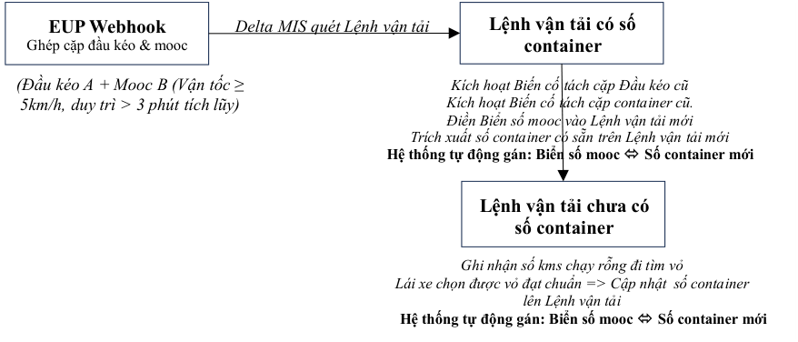

# Giải pháp PUR — Tự động ghép/tách cặp giữa mooc và đầu kéo/số container

> Nguồn: [`VIS_Giải pháp PUR_Oct 14 2026.pdf`](source/vis-pur-ghep-tach-mooc.pdf) (PDF 4 trang) · Nhận: 2026-10-15 · Chuyển sang Markdown bằng `/intake`.
> Phiên bản: 14/10/2026

_Hà Nội, ngày 14 tháng 10 năm 2026_

## 1. Vấn đề

Trong thực tế vận hành của Delta, mooc được hoán đổi liên tục giữa các đầu kéo. Lái xe thường chủ động nhận mooc có sẵn tại bãi xe hoặc đổi mooc cho nhau tại cảng bãi. Việc nhập liệu thủ công biển số mooc lên từng Lệnh vận tải gây ra quá tải và không thực hiện được trên thực tế. Điều này gây rất nhiều vấn đề về quản lý mooc như mất giấy tờ mooc hoặc mooc bị phạt nguội mà không truy vết được những lái xe nào đã dùng mooc để quy trách nhiệm cá nhân. Để giải quyết triệt để bài toán này, Delta triển khai “ _Giải pháp tự động ghép cặp, tách cặp và gán liên thông mooc với đầu kéo và số container theo thời gian thực_ ”. Bằng việc lắp đặt thiết bị GPS trên mooc (không cần hợp chuẩn) và sử dụng thuật toán nhận diện biến cố kết hợp cơ chế Webhook (Event-driven) của EUP server, Delta MIS sẽ tự động nhận diện, cập nhật vòng đời hoạt động của Mooc và gán chính xác biển số mooc và số container vào Lệnh vận tải.

## 2. Nguyên lý kích hoạt biến cố ghép cặp (pairing event)

EUP server đóng vai trò tính toán không gian và vận tốc của các thiết bị viễn thông. Một Biến cố ghép cặp (Pairing Event) giữa Đầu kéo A và Mooc B được xác lập và bắn tín hiệu Webhook về Delta MIS khi thỏa mãn đồng thời 3 điều kiện cứng sau:

- Điều kiện khoảng cách (Proximity): Tọa độ GPS của Đầu kéo A và GPS Mooc trùng khớp hoặc nằm trong bán kính sai số hình học cho phép (Cấu hình: ≤ 10 mét).

- Điều kiện vận tốc (Speed): Cả đầu kéo A và mooc đều ghi nhận vận tốc di chuyển ≥ 5 km/h.

- Điều kiện thời gian (Duration): Trạng thái đồng điệu về khoảng cách và vận tốc phải duy trì trong thời gian tích lũy vượt quá 3 phút.

_Ý nghĩa:_ Mốc tổng thời gian tích lũy 3 phút giúp hệ thống loại bỏ các biến cố nhiễu như Đầu kéo di chuyển ngang qua mooc, dừng đỗ cạnh mooc khác trong bãi, hoặc kéo mooc dịch chuyển nội bộ quãng ngắn dưới 5 km/h để ghép nối thử, hoặc chạy được 2 phút thì tắc đường nên tốc độ xuống dưới 5 kms/h.

## 3. Nguyên lý kích hoạt biến cố tách cặp (unpairing event)

Để đảm bảo tính liên tục và chính xác của dữ liệu vòng đời ghép cặp của mooc, Delta MIS cấu hình tự động nhận diện các biến cố tách cặp dựa trên hành động thực tế của phương tiện và logic ghi nhận trên phần mềm như sau:

### 3.1. Biến cố tách cặp giữa Mooc và Đầu kéo (Trailer Unpairing)
- Định nghĩa: Là biến cố ghi nhận một mooc đã chính thức ngắt kết nối vật lý, rời khỏi Đầu kéo cũ để kết thúc một chu kỳ vận hành hoặc chuyển sang đồng hành cùng một Đầu kéo mới.

- Logic kích hoạt theo Luồng chuẩn (Thiết lập cặp đôi mới): Biến cố này được kích hoạt tự động ngay khi Mooc thiết lập được một Biến cố ghép cặp mới thành công với một Đầu kéo mới (thỏa mãn đồng thời 3 điều kiện cứng về khoảng cách, vận tốc và thời gian với Đầu kéo mới). Ngay khi có tín hiệu này, Delta MIS tự động hiểu Mooc đã ngắt kết nối với Đầu kéo cũ, hệ thống sẽ thực hiện đóng trạng thái hành trình của mooc với Đầu kéo cũ lại để tránh trùng lặp dữ liệu.

- Logic kích hoạt theo Luồng ngoại lệ (Cắt mooc nằm bãi - mooc mồ côi): Do đặc thù thiết bị GPS Mooc sử dụng chung nguồn điện từ đầu kéo (sẽ mất tín hiệu hoàn toàn khi ngắt kết nối vật lý hoặc khi đầu kéo tắt khóa điện), hệ thống cấu hình bộ lọc logic để nhận diện chính xác hành động cắt mooc lại bãi dựa trên sự lệch pha chuyển động:

   - ✓ Điều kiện 1: GPS mooc rơi vào trạng thái mất tín hiệu truyền dữ liệu (offline).

- ✓ Điều kiện 2: Đầu kéo cũ (đang liên kết với mooc trước đó) vẫn nổ máy và phát sinh di chuyển tịnh tiến (Vận tốc ≥ 5 km/h).

- ✓ Điều kiện 3: Khoảng cách của Đầu kéo cũ so với tọa độ cuối cùng trước khi mất tín hiệu của mooc vượt quá 100 mét.

_Ý nghĩa:_ Khi thỏa mãn đồng thời cả 3 điều kiện trên, Delta MIS sẽ lập tức kích hoạt biến cố tách cặp (Trailer Unpairing) để giải phóng cho cả Đầu kéo cũ và mooc. Biến cố này giúp hệ thống xác định chính xác mooc đã bị bỏ lại bãi và khóa vị trí của mooc tại tọa độ mất tín hiệu đó. Logic này giúp hệ thống phân biệt tuyệt đối với trường hợp lái xe chỉ tắt máy xe để ngủ dọc đường (khi đó cả GPS đầu kéo và GPS mooc đều đứng yên tại một chỗ, hệ thống sẽ giữ nguyên trạng thái ghép cặp).

### 3.2. Biến cố tách cặp giữa mooc và số container (Container Unpairing)
- Định nghĩa: Là biến cố giải phóng (Unmap) số container của Lệnh vận tải cũ ra khỏi biển số Mooc, đưa Mooc về trạng thái "Sẵn sàng" cho chu kỳ đóng/kéo container mới.

- Logic kích hoạt tự động (Luồng chuẩn): Biến cố này được kích hoạt tự động ngay tại thời điểm biển số mooc được gán vào một Lệnh vận tải mới (thông qua biến cố ghép cặp thành công với đầu kéo thực hiện lệnh mới đó). Hệ thống Delta MIS tự động cắt đứt mối liên kết giữa biển số mooc và số container của Lệnh vận tải cũ gần nhất trước đó để tránh xung đột dữ liệu hành trình.

- Logic kích hoạt bổ sung (Xử lý kịch bản mất nguồn/ngắt mooc cơ học): Do thiết bị GPS Mooc sử dụng nguồn điện từ đầu kéo (mất tín hiệu khi ngắt kết nối vật lý), hệ thống cấu hình thêm điều kiện kích hoạt biến cố tách cặp chủ động nhằm xử lý trường hợp Mooc bị bỏ lại bãi (Mooc mồ côi):

   - ✓ Điều kiện 1: GPS Mooc bị mất tín hiệu truyền dữ liệu (Offline).

   - ✓ Điều kiện 2: Đầu kéo cũ đang liên kết với Mooc đó phát sinh di chuyển (Vận tốc ≥ 5 km/h) ra khỏi bán kính 100 mét tính từ tọa độ cuối cùng trước khi mất tín hiệu của Mooc.

_Ý nghĩa:_ Khi thỏa mãn đồng thời 2 điều kiện này, hệ thống xác định mooc đã bị ngắt cơ học để đầu kéo đi làm việc khác. Delta MIS sẽ tự động kích hoạt biến cố tách cặp (Unpairing), giải phóng số container cũ và khóa vị trí cuối cùng của Mooc trên bản đồ để phục vụ công tác quản trị, đồng thời loại trừ được trường hợp lái xe chỉ tắt máy ngủ dọc đường (cả xe và mooc cùng đứng yên).

## 4. Quy trình gán dữ liệu tự động theo Lệnh vận tải

Khi nhận được Webhook từ EUP báo về biến cố ghép cặp thành công của **Đầu kéo A** , Delta MIS tự động quét hệ thống để tìm Lệnh vận tải đang chạy tương ứng của đầu kéo này. Tùy thuộc vào loại hình hàng hóa (Mã nghiệp vụ JobID), hệ thống sẽ áp dụng logic gán và tách số container:

_Chữ trong sơ đồ:_

- **EUP Webhook** — Ghép cặp đầu kéo & mooc _(Đầu kéo A + Mooc B (Vận tốc ≥ 5km/h, duy trì > 3 phút tích lũy))_ — _Delta MIS quét Lệnh vận tải_ →
- **Lệnh vận tải có số container**
  - _Kích hoạt Biến cố tách cặp Đầu kéo cũ_
  - _Kích hoạt Biến cố tách cặp container cũ._
  - _Điền Biển số mooc vào Lệnh vận tải mới_
  - _Trích xuất số container có sẵn trên Lệnh vận tải mới_
  - **Hệ thống tự động gán: Biển số mooc ⇔ Số container mới**
- **Lệnh vận tải chưa có số container**
  - _Ghi nhận số kms chạy rỗng đi tìm vỏ_
  - _Lái xe chọn được vỏ đạt chuẩn => Cập nhật số container lên Lệnh vận tải_
  - **Hệ thống tự động gán: Biển số mooc ⇔ Số container mới**

## 5. Quy trình áp dụng cho Lệnh vận tải có số container

Lệnh vận tải của hàng nhập FCL, hàng trả hàng đường sắt và hàng CBT luôn có số container khi lập Lệnh vận tải. Sau khi ghép cặp giữa biển số đầu kéo với biển số mooc thì Delta MIS sẽ thực hiện quét Lệnh vận tải để xem biển số đầu kéo A được giao thực hiện Lệnh vận tải nào để thực hiện việc ghép cặp đồng bộ “Đầu kéo  Biển số mooc  Số conrainer”. Logic xử lý dữ liệu như sau:

- Kích hoạt các biến cố tách cặp: Hệ thống tự động kích hoạt biến cố tách mooc khỏi đầu kéo theo Lệnh vận tải cũ gần nhất, đồng thời tách biển số mooc khỏi số container của lệnh cũ gần nhất.

- Ghi nhận biển số mooc mới: Delta MIS điền biển số mooc vừa nhận diện vào Lệnh vận tải mới của Đầu kéo A.

- Khóa khớp liên thông: Ngay tại thời điểm điền biển số mooc, hệ thống tự động trích xuất dữ liệu số Container mới đang có sẵn trên Lệnh vận tải mới đó để gán trực tiếp với biển số mooc vừa được nhận diện, khép kín chuỗi dữ liệu mới: Đầu kéo A  Biển số mooc  Số container mới.

## 6. Quy trình áp dụng cho Lệnh vận tải chưa có số container

Lệnh vận tải này chưa có số container tại thời điểm lập lệnh và gửi cho lái xe. Lái xe phải kéo mooc chạy rỗng qua một hoặc nhiều bãi cảng để tìm, lựa chọn vỏ container rỗng đạt tiêu chuẩn đóng hàng. Quy trình xử lý dữ liệu tự động trên Delta MIS như sau:

### Bước 1: Kích hoạt các biến cố tách cặp và ghi nhận Mooc mới

Ngay khi nhận được Webhook từ EUP báo về biến cố ghép cặp thành công (Đầu kéo A + Mooc B đạt vận tốc ≥ 5 km/h trong thời gian tích lũy là 3 phút:

- Hệ thống tự động kích hoạt biến cố tách mooc và giải phóng số container theo Lệnh vận tải cũ gần nhất của cả Đầu kéo A và Mooc B (áp dụng luồng xử lý tại Mục 3.1).

- Delta MIS tự động điền biển số Mooc B vào Lệnh vận tải mới của Đầu kéo A.

### Bước 2: Ghi nhận lộ trình phụ "Đi tìm vỏ"

- Hệ thống sử dụng dữ liệu Mileage (GPS kms) và trạng thái Geofence để tự động ghi nhận toàn bộ quãng đường xe kéo Mooc chạy rỗng di chuyển qua các bãi cảng.

- Điều kiện ghi nhận bãi cảng phụ: Các bãi cảng thứ 1, thứ 2... chỉ được tính vào hành trình đi tìm vỏ container rỗng nếu xe phát sinh đỗ trong vùng Geofence của bãi cảng đó với thời gian duy trì liên tục trên 10 phút [cite: 2]. Điều kiện này giúp hệ thống tự động loại bỏ các biến cố nhiễu như dừng đèn đỏ, tắc đường trước cổng hoặc dừng chờ thông thường.

### Bước 3: Gán liên thông Container mới (Hard-mapping)

- Sau khi lái xe chọn được vỏ container đạt tiêu chuẩn, tiến hành cập nhật số container này lên ứng dụng (App lái xe) hoặc hệ thống điều vận cập nhật trực tiếp lên Lệnh vận tải.

- Ngay tại thời điểm ghi nhận số container mới, Delta MIS thực hiện lệnh gán cứng: Biển số đầu kéo A => Biển số Mooc B => Số container mới, chính thức khép kín chuỗi dữ liệu vận hành.

### Bước 4: Hạch toán nhiên liệu phát sinh thực tế

- Tính số kms phát sinh đi tìm vỏ: Ngay khi xe đi vào vùng Geofence của địa điểm chọn vỏ thể hiện trên Lệnh vận tải thì Delta MIS bắt đầu ghi nhận số kilomet (kms) xe chạy. Khi lái xe nhập số container lênh Lệnh vận tải thì hệ thống sẽ chốt luôn số kilomet vừa chạy được và ghi nhận vị trí xe tại thời điểm đó.

- Cấp bù nhiên liệu: Delta MIS tự động gọi bảng Định mức nhiên liệu của loại xe đó ở tải trọng 0 kg (chạy rỗng kéo mooc) để quy đổi ra số lít dầu cấp bù. Thông tin này được hiển thị trực quan tại mục: _“Đề nghị cấp bù dầu do chọn container rỗng ở nhiều bãi: ... lít”_ trên Lệnh vận tải để cấp quản lý phê duyệt.

   - ✓ Sử dụng Geofence và tọa đọ các bãi cảng trên danh mục bãi cảng để lập danh mục các bãi cảng mà xe đã đi qua để chọn vỏ giúp điều vận kiểm tra trước khi duyệt lệnh.

   - ✓ Tất cả các Lệnh có bù dầu do chọn vỏ đều phải qua hai bước duyệt thủ công của điều vận và cán bộ quản lý để loại trừ gian lận.

Việc cấu hình đồng thời hai biến cố ghép cặp và tách cặp tạo ra một vòng đời dữ liệu khép kín, đem lại những giá trị quản trị sau:

1. Dữ liệu lịch sử chuẩn xác 100%: Nhờ cơ chế tự động tách cặp khi phát sinh lệnh mới, hệ thống không bao giờ bị hiện tượng "chồng chéo dữ liệu hành trình" (một mooc hiển thị ở hai lệnh hoặc một container gắn chặt với mooc mãi mãi). Dữ liệu thời gian sử dụng phương tiện được bóc tách rạch ròi đến từng phút.

2. Báo cáo Vòng quay khai thác mooc: Xuất lịch sử chi tiết: _"Biển số mooc này từ ngày... đến ngày... đã tách/ghép qua những đầu kéo nào, chịu trách nhiệm vận chuyển những số container nào?"_ , phục vụ đắc lực cho công tác tính khấu hao và lên lịch bảo dưỡng mooc.

3. Tự động hóa hoàn toàn cho bộ phận điều vận: Giải phóng hoàn toàn nhân sự khỏi công việc nhập liệu, sửa đổi thông tin bằng tay mỗi khi tài xế đổi mooc.
