# Tài liệu SRS - ERP Delta 3.0 (Mobile)

> Nguồn: [`ndlxd-export.pdf`](source/srs-mobile.pdf) (PDF) · Nhận: 2026-10-05 · Chuyển sang Markdown bằng `/intake`.
> Tên ứng dụng: thống nhất gọi **Delta Super App** (chốt 2026-10-05). Bản gốc còn gọi "ứng dụng Lái xe Delta" / "app Lái xe" ở 46 chỗ — giữ nguyên chữ gốc bên dưới.

<!-- Trang 1 -->

## Mục lục

- [v1.0] Quy tắc chung xử lý giao diện (Common rules)
- [v2.0] Quy tắc chung xử lý giao diện trên Application (Application common rules & shared components)
- UC00.01.01 - Xem trang chủ - Tài khoản nội bộ
- UC00.01.03 - Xem trang chủ - Tài khoản cây dầu
- UC00.01.02 - Xem thanh tiến trình liên quy trình
- Epic 01 - Quản lý tài khoản
   - UC01.01.01 - Đăng nhập
   - UC01.01.02 - Quên mật khẩu
   - UC01.01.03 - Đăng xuất
   - UC01.01.04 - Đổi mật khẩu
   - UC01.01.05 - Tạo mật khẩu mới
   - UC01.01.06 - Xem thông tin cá nhân - Tài khoản nội bộ
   - UC01.01.07 - Xem thông tin tài khoản - Tài khoản cây dầu
- Epic 02 - Đơn mua dịch vụ sửa chữa ngoài
   - 02 - Thông báo & Lịch sử hoạt động
   - 02 - Lưu đồ trạng thái cho đơn mua HHDV
   - UC02.01.01 - Xem danh sách đơn mua DVSC ngoài
   - UC02.01.02 - Xem thông tin chi tiết đơn mua dịch vụ ngoài
   - UC02.01.03 - Nghiệm thu/Từ chối nghiệm thu dịch vụ sửa chữa ngoài
- Epic 03 - Lệnh sửa chữa
   - 03 - Thông báo & Lịch sử hoạt động
   - 03 - Lưu đồ trạng thái cho lệnh sửa chữa
   - UC03.01.01 - Xem danh sách lệnh sửa chữa
   - UC03.01.02 - Xem thông tin chi tiết lệnh sửa chữa
   - UC03.01.03 - Nghiệm thu/Từ chối nghiệm thu lệnh sửa chữa nội bộ
- Epic 04 - Báo cáo sự cố & Thanh toán chi phí lái xe
   - 04 - Thông báo & Lịch sử hoạt động
   - 04 - Lưu đồ trạng thái cho báo cáo sự cố
   - UC04.01.01 - Xem danh sách báo cáo sự cố
   - UC04.01.02 - Xem chi tiết báo cáo sự cố
   - UC04.01.03 - Tạo báo cáo sự cố
   - UC04.01.04 - Thu hồi báo cáo sự cố
- Epic 05 - Lịch nhắc
   - UC05.01.01 - Xem lịch nhắc
- Epic 06 - Phiếu cấp dầu
   - 06.00 - Lưu đồ trạng thái của phiếu cấp dầu
   - 06.00 - Thông báo & Lịch sử hoạt động
   - UC06.00.01 - Xem danh sách phiếu cấp dầu
   - UC06.00.02 - Xem chi tiết phiếu cấp dầu
   - UC06.00.03 - Tạo mới phiếu dGas1 (Cấp dầu quản lý)
   - UC06.00.04 - Tạo mới phiếu dGas2 (Cấp dầu xưởng)
   - UC06.00.05 - Tạo mới phiếu dGas3 (Cấp dầu vận tải)
   - UC06.00.06 - Tạo mới phiếu dGas4 (Đổ đầy bình)
   - UC06.00.07 - Tạo mới phiếu dGas5 (Chốt dầu)
   - UC06.00.08 - Tạo mới phiếu cấp bù dầu
   - UC06.00.09 - Phê duyệt/Từ chối phiếu cấp dầu (tất cả vòng)
   - UC06.00.10 - Nhận mã Igas & bơm dầu - Cây nội bộ
   - UC06.00.11 - Ghi nhận bơm dầu - Cây mua ngoài & Mua hoá đơn lẻ
   - UC06.00.12 - Xuất hoá đơn - Cây mua ngoài & Mua hoá đơn lẻ
   - UC06.00.13 - Chốt phiếu - Cây mua ngoài

<!-- Trang 2 -->

<!-- Trang 3 -->

Tài liệu SRS - ERP Delta 3.0 (Mobile)

<!-- Trang 4 -->

|1|||||
|---|---|---|---|---|
|||Loại control|Item|Ràng buộc trên Mobile|
||1|Button|Validate dữ liệu|Validate khi người dùng nhấn nút. Hiển thị lỗi bằng toast|
|||||hoặc popup message (ngay dưới input) tùy theo context.|
||2|Textbox|Validate dữ liệu|Validate khi người dùng rời khỏi input field (blur) hoặc sau khi nhấn Submit. Lỗi hiển thị ngay dưới field.|
||3||Max length|Không cho nhập quá max length. Nếu dán (paste), hệ thống tự động cắt theo max length. Short textbox: ≤255 ký tự Long textbox: ≤4000 ký tự|
||4||Bắt buộc nhập (Required)|Label có dấu * đỏ hoặc placeholder có dấu hiệu bắt buộc. Nếu bỏ trống, hiển thị lỗi: "Vui lòng nhập thông tin này!" ngay dưới input.|
||5||Ràng buộc format dữ liệu|Áp dụng theo quy định SRS hoặc mặc định từng loại dữ liệu: số, tiền, thời gian, email, v.v.|
||6|Combobox|Nhập dữ liệu|Hỗ trợ single/multi select tùy loại. Có chức năng search với dữ liệu từ API. Hỗ trợ input + gợi ý gần đúng.|
||7|Format ngày tháng|Kiểu nhập liệu|Có thể nhập hoặc chọn từ date picker (dùng native date/time picker).|
||8||Format hiển thị ngày|Không có giờ: dd/mm/yyyy Có giờ: dd/mm/yyyy hh:mm|
||9|Format số tiền|Đơn vị tiền tệ|Combobox chọn đơn vị tiền tệ. Mặc định là VND. Danh sách đơn vị từ DB.|
||1||ề|ố ề ế|
||1 0||Format nhập tiền|Nhập số tiền + đơn vị + tỉ giá (nếu không phải VND).|

## [v1.0] Quy tắc chung xử lý giao diện (Common rules)

### 1. Các thành phần chung

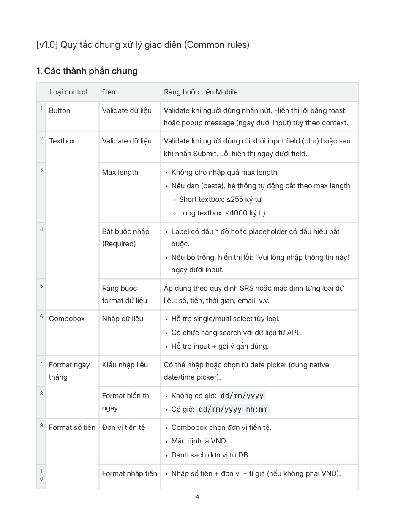

<!-- Trang 5 -->

Tự động định dạng hàng nghìn bằng dấu phẩy.

Ví dụ: 50 USD → 50 USD 25,000 VND

|1 1|Format số|Format nhập|Chỉ cho phép nhập số và dấu . (dấu thập phân). Tự động phân cách hàng nghìn bằng dấu phẩy.|
|---|---|---|---|
|1 2||Format hiển thị số|Hàng nghìn: dấu , Thập phân: dấu .|
|1 3|Email|Format|Kiểm tra đúng format (phải có @ ). Lỗi: “Email không đúng định dạng.”|
|1 4|SĐT|Format nhập|Chỉ cho phép số. Bắt đầu bằng 0 hoặc 84 , tối đa 11 ký tự. Format: 0xxx xxx xxx hoặc 84 xxx xxx xxx Sai: “SĐT không đúng định dạng.”|
|1 5|Popup Message|Thông báo|Thành công: Popup màu xanh. Thất bại: Popup màu đỏ. Cảnh báo: Màu cam/vàng. Nội dung theo đặc tả.|
|1 6|Thanh tìm kiếm|Tìm kiếm|Nhập và nhấn "Tìm" hoặc "Enter" trên bàn phím. Cho phép tìm gần đúng trong toàn bộ bảng.|
|1 7|Tên màn hình|Vị trí|Tên hiển thị ở đầu màn hình, cùng với icon quay lại hoặc icon menu tùy theo thiết kế.|

### 2. Thông báo

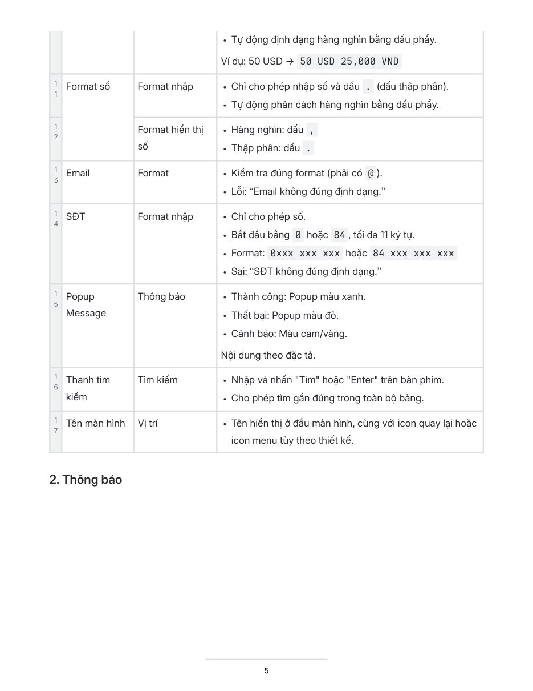

<!-- Trang 6 -->

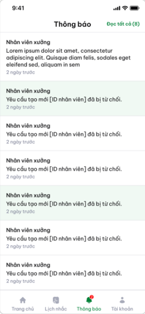

Nhấn vào icon quả chuông ở màn Trang chủ hoặc tab Thông báo trên Navigation bar để mở

ra danh sách thông báo.

Có 2 trường hợp:

Không có thông báo mới: Không hiển thị badge

|Có ≥ 1 thông báo chưa đọc: Hiển thị|badge đỏ|với số lượng thông báo chưa đọc (tối đa hiển|
|---|---|---|

thị “9+”)

Nội dung 1 thông báo bao gồm:

Tên epic/module

Nội dung thông báo

Thời gian thông báo:

Nếu thông báo của ngày hôm nay:

hiển thị dưới dạng hh:mm (nếu cách thời điểm hiện tại > 5 phút)

hiển thị “Bây giờ” (nếu cách thời điểm hiện tại <= 5 phút)

Nếu thông báo của ngày hôm qua trở về trước: hiển thị dưới dạng 1 ngày trước, 2 ngày

trước,…

Các thông báo chưa đọc được hiển thị với màu nền xanh. Nhấn vào dòng thông báo đó để

chuyển sang trạng thái “Đã đọc” & điều hướng đến màn xem chi tiết của đối tượng được thông

báo (sẽ được đĩnh nghĩa chi tiết ở từng usecase)

<!-- Trang 7 -->

→ Reload lại số lượng ở badge trên icon thông báo (-1)

Các thông báo đã đọc được hiển thị với màu nền trắng.

Nhấn Đọc tất cả để chuyển tất cả các thông báo sang trạng thái Đã đọc + reload lại số lượng ở

badge trên icon thông báo (về 0).

### 3. Lịch sử hoạt động

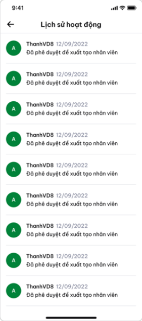

Cho phép người dùng xem lại được lịch sử hoạt động của người dùng đối với các bản ghi trên hệ

thống.

Mỗi bản ghi hoạt động sẽ bao gồm các thông tin sau:

Tên tài khoản thực hiện hành động

Thời gian người dùng thực hiện hành động

Tên hành động người dùng thực hiện

### 4. Thanh điều hướng

Thanh điều hướng bao gồm:

<!-- Trang 8 -->

Trang chủ

Lịch nhắc

Thông báo

Tải khoản

### 5. Danh sách

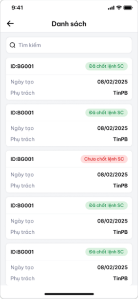

|Loại control|Item|Ràng buộc|
|---|---|---|
|Trình bày danh sách|Card/List Item|Mỗi bản ghi hiển thị dưới dạng card. Sắp xếp dọc theo chiều cuộn (vertical scroll).|
|Căn lề dữ liệu|Căn lề trong card|Title căn lề trái Nội dung căn lể phải|
|Trạng thái|Hiển thị trạng thái theo màu|Trạng thái hiển thị rõ ràng bằng màu sắc. Trạng thái đặt bên phải hàng đầu tiên của card.|

<!-- Trang 9 -->

|Tìm kiếm|Box tìm kiếm|Thanh tìm kiếm nằm trên cùng danh sách. Hỗ trợ tìm kiếm gần đúng. Kích hoạt sau khi nhấn “Tìm” hoặc “Enter” trên bàn phím mobile.|
|---|---|---|
|Phân trang|Infinity Load|Trên mobile, ưu tiên infinity scroll (cuộn để tải thêm). Mỗi lần tải thêm khoảng 10 bản ghi.|
|Hiển thị mặc định|Số bản ghi ban đầu|Mặc định hiển thị 10 bản ghi đầu tiên.|

5.1. Lọc

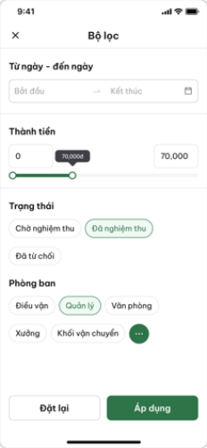

Ở mỗi màn danh sách, hệ thống hiển thị icon Filter để người dùng có thể filter.

Hệ thống hiển thị 1 popup hiển thị các trường cho phép filter.

Cho phép người dùng lọc các giá trị của các cột trong bảng (Các cột được phép lọc sẽ được

quy định rõ trong từng Usecase).

Khi đang thực hiện lọc thì button Bộ lọc phía bên trên của bảng hiện số lượng cột đang filter.

Các loại filter:

<!-- Trang 10 -->

Chọn giá trị: Người dùng có thể chọn giá trị để filter data.

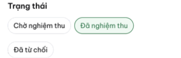

Date time range picker: Người dùng có thể chọn ngày bắt đầu - ngày kết thúc để filter data

theo thời gian.

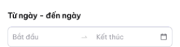

Slider: Cho phép người dùng nhập hoặc kéo giá trị trong khoảng min-max.

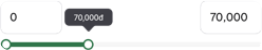

Hiển thị các tab là các cột (được phép lọc) theo thứ tự từ trên xuống dưới là thứ tự cột từ trái qua

phải của bảng (kể cả các cột đã ẩn).

Trong mỗi tab, hiển thị các giá trị của cột đó & 1 giá trị “Không có” cho các dữ liệu null.

Nhấn chọn 1 hoặc nhiều giá trị để áp dụng bộ lọc cho cột đó hoặc chọn “Xoá tất cả” để bỏ lọc.

### 6. Lịch nhắc

<!-- Trang 11 -->

## [v2.0] Quy tắc chung xử lý giao diện trên Application (Application common rules & shared components)

### PHẦN 1 — SHARED COMPONENTS

Các component dùng chung toàn hệ thống. Các UC chỉ cần gọi theo mã: (Xem MSC-XX — Tên

component).

|Mã|Tên|Dùng khi|
|---|---|---|
|MSC-01|In-app Notification|Mọi hành động nghiệp vụ cần gửi thông báo đến người liên quan trong luồng|
|MSC-02|Confirm Bottom Sheet|Trước hành động quan trọng hoặc không thể hoàn tác|
|MSC-03|Filter Bottom Sheet|Bộ lọc nâng cao cho màn hình danh sách|
|MSC-04|Action Sheet|Danh sách hành động tuỳ chọn từ 1 item|
|MSC-05|Activity Log|Icon 🕐 trên màn hình chi tiết|
|MSC-06|Stepper Header|Màn hình có luồng nghiệp vụ nhiều bước|
|MSC-07|File Upload|Khi upload file lên hệ thống|
|MSC-08|Bottom Navigation|Điều hướng chính giữa các module|
|MSC-09|Empty State|Màn hình danh sách hoặc section không có dữ liệu|
|MSC-10|Skeleton Loader|Khi đang tải dữ liệu|

#### MSC-01 — In-app Notification

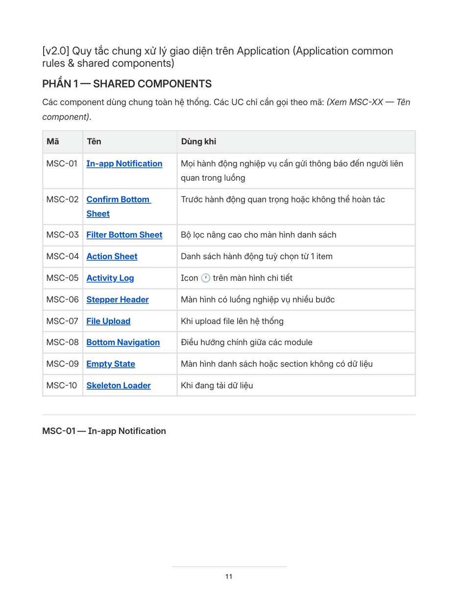

<!-- Trang 12 -->

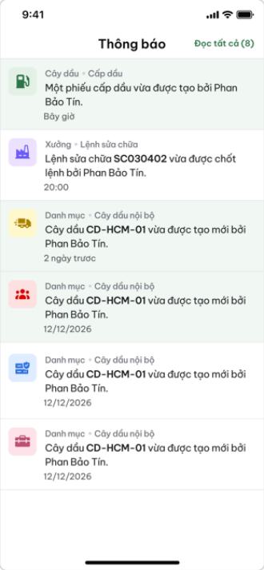

Notification hiển thị trong notification center của app.

**Badge số đếm trên icon chuông.**

|Thành phần|Control|Mô tả|
|---|---|---|
|Badge đếm|Badge|Số thông báo chưa đọc trên icon chuông.|
|Thông báo chưa đọc|—|Nền xanh nhạt.|
|Thông báo đã đọc|—|Nền trắng.|
|Click vào thông báo|—|Chuyển trạng thái → Đã đọc + badge −1 + navigate đến màn chi tiết bản ghi liên quan.|

Pattern nội dung thông báo: (Xem SC-02 Website common rules — Pattern

thông báo chung)

#### MSC-02 — Confirm Popup

<!-- Trang 13 -->

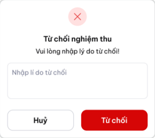

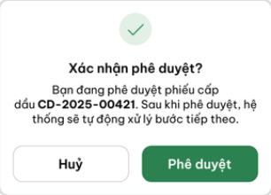

Popup xác nhận trước khi thực hiện hành động quan trọng hoặc không thể hoàn tác.

|Thành phần|Control|Mô tả|
|---|---|---|

<!-- Trang 14 -->

|Icon hành động|Icon|Icon đại diện hành động, nền màu theo loại (đỏ = destructive · xanh lá = xác nhận · vàng = cảnh báo).|
|---|---|---|
|Tiêu đề|Label|Font bold, căn giữa. VD: "Thu hồi bản ghi?"|
|Nội dung mô tả|Label|Mô tả hậu quả hành động. Có thể highlight tên bản ghi bằng bold.|
|Button chính|Button|Full width, màu theo loại hành động. Destructive: đỏ. Xác nhận: xanh lá.|
|Button phụ|Button|Full width, outlined/text. VD: "Huỷ bỏ".|
|Backdrop|—|Nền tối mờ phía sau. Tap ra ngoài = đóng (tương đương button Huỷ), trừ các hành động không thể hoàn tác.|

Các hành động bắt buộc dùng MSC-03: Xoá · Thu hồi · Phê duyệt · Từ chối · Huỷ form (khi có

dữ liệu chưa lưu).

|Action|Tiêu đề|Nội dung|
|---|---|---|
|Xoá|Xoá [tên feature]?|Bạn đang xoá [tên feature] [tên/mã]. Hành động này không thể hoàn tác.|
|Thu hồi|Thu hồi yêu cầu?|Bạn đang thu hồi [tên feature] [tên/mã]. Yêu cầu sẽ trở về trạng thái Bản nháp.|
|Phê duyệt|Xác nhận phê duyệt?|Bạn đang phê duyệt [tên feature] [tên/mã].|
|Từ chối|Từ chối yêu cầu?|Bạn đang từ chối [tên feature] [tên/mã].|
|Huỷ form|Huỷ bản ghi?|Bạn có dữ liệu chưa được lưu. Nếu rời khỏi trang, toàn bộ thông tin sẽ bị mất.|

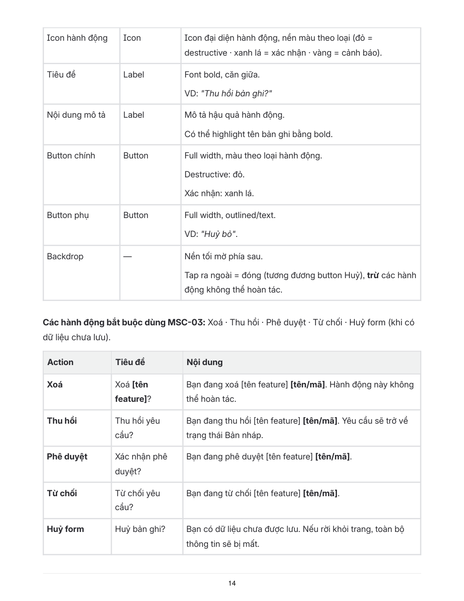

<!-- Trang 15 -->

#### MSC-03 — Filter Bottom Sheet

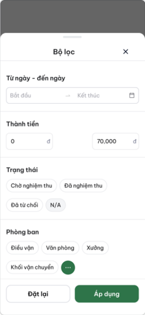

**Bottom Sheet bộ lọc nâng cao.**

|Thành phần|Control|Mô tả|
|---|---|---|
|Trigger|Button|Button Bộ lọc trên toolbar màn hình danh sách. Badge số lượng filter đang active.|
|Bottom Sheet|—|Slide up từ dưới. Chiều cao tối đa 85% màn hình. Có thể scroll nội dung bên trong.|
|Header|Label|Tiêu đề "Bộ lọc" + button Đặt lại (text, xanh lá) góc phải.|
|Các trường lọc|—|Tuỳ từng UC. Dạng: Select · DatePicker · Checkbox list.|
|Button Áp dụng|Button|Full width, filled xanh lá, sticky bottom. Click → đóng sheet + áp dụng bộ lọc.|

<!-- Trang 16 -->

|Active filters|Badge|Hiển thị chips bộ lọc đang active ngay dưới search bar màn hình danh sách. Tap vào chip → xoá filter đó.|
|---|---|---|

#### MSC-04 — Action Sheet

**Bottom Sheet danh sách action từ 1 item. Tương ứng với Action Matrix (SC-07) trên web.**

|Thành phần|Control|Mô tả|
|---|---|---|
|Trigger|—|Long press vào item hoặc tap icon ⋯ trên item.|
|Bottom Sheet|—|Slide up. Danh sách action dạng list.|
|Action item|Button|Mỗi action 1 dòng: Icon trái + Label. Destructive action: màu đỏ, luôn ở cuối danh sách.|
|Button Huỷ|Button|Full width, phân cách với danh sách action. Label "Huỷ".|
|Backdrop|—|Tap ra ngoài = đóng.|

<!-- Trang 17 -->

#### MSC-05 — Activity Log

|Thành phần|Control|Mô tả|
|---|---|---|
|Trigger|Icon / Button|Icon 🕐 trên header màn hình chi tiết.|
|Hiển thị|—|Hiển thị màn hình riêng.|
|Nội dung|—|Timeline dọc. Mỗi mốc: Avatar + Tên + Ngày + Icon hành động + Nội dung. Sắp xếp mới nhất lên trên.|

#### MSC-06 — Stepper Header

Header thanh tiến trình cho màn hình có luồng nghiệp vụ nhiều bước.

Xem thêm ở của website.

UC00.00.02

<!-- Trang 18 -->

|Thành phần|Control|Mô tả|
|---|---|---|
|Vị trí|—|Header cố định phía trên màn hình, dưới navigation bar.|
|Step indicator|—|Dạng icon. Step hiện tại: màu xanh lá, bold. Step đã qua: icon ✓ xanh lá. Step chưa đến: xám.|
|Tên bước|Label|Hiển thị dưới step indicator.|
|Navigation|—|Tap trực tiếp vào step để chuyển.|

#### MSC-07 — File Upload

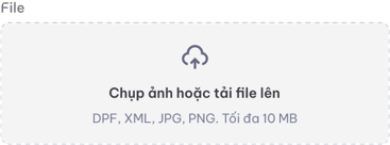

|Thành phần|Control|Mô tả|
|---|---|---|
|Trigger|Button|Vùng tap.|
|Nguồn file|—|Mở bottom sheet chọn nguồn: Thư viện ảnh · Chụp ảnh · Files (file manager).|
|File đang upload|Card|Icon loại file + Tên file + Progress bar + Nút huỷ.|
|File upload thành công|Card|Icon loại file + Tên file + Icon ✓ xanh lá + Icon xoá 🗑️.|
|File upload thất bại|Card|Icon loại file + Tên file + Icon ✕ đỏ + Icon thử lại 🔄 + Icon xoá 🗑️.|

<!-- Trang 19 -->

|Định dạng cho phép|Label|Hiển thị dưới vùng upload. Định nghĩa theo từng UC.|
|---|---|---|
|Dung lượng tối đa|Label|Hiển thị dưới vùng upload.|

#### MSC-08 — Bottom Navigation

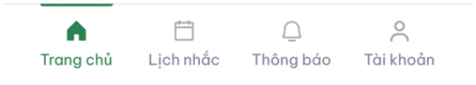

**Thanh điều hướng chính cố định phía dưới màn hình.**

|Thành phần|Control|Mô tả|
|---|---|---|
|Vị trí|—|Sticky bottom, phía trên safe area (iPhone notch).|
|Tab items|—|4 tab. Mỗi tab: Icon + Label ngắn. Trang chủ Lịch nhắc Thông báo Tài khoản|
|Tab active|—|Icon + Label màu xanh lá.|
|Tab inactive|—|Icon + Label màu xám.|
|Badge|Badge|Số đếm thông báo trên tab tương ứng. Tối đa hiển thị "99+".|

#### MSC-09 — Empty State

<!-- Trang 20 -->

|Thành phần|Control|Mô tả|
|---|---|---|
|Illustration|Image|Ảnh minh hoạ căn giữa.|
|Tiêu đề|Label|Font bold, căn giữa. VD: "Chưa có dữ liệu".|
|Mô tả|Label|Text phụ xám, căn giữa. Hướng dẫn hoặc giải thích.|
|CTA button|Button|Tuỳ UC. VD: "+ Tạo mới". Chỉ hiển thị nếu user có quyền tạo.|

#### MSC-10 — Skeleton Loader

|Thành phần|Control|Mô tả|
|---|---|---|
|Trigger|—|Hiển thị khi màn hình đang tải dữ liệu lần đầu.|
|Layout|—|Skeleton có hình dạng gần giống layout thực tế của màn hình. Shimmer animation từ trái sang phải.|
|Thay thế|—|Sau khi load xong → skeleton fade out, dữ liệu thực fade in.|

#### MSC-11 — Popcon Thành công (Success Bottom Sheet)

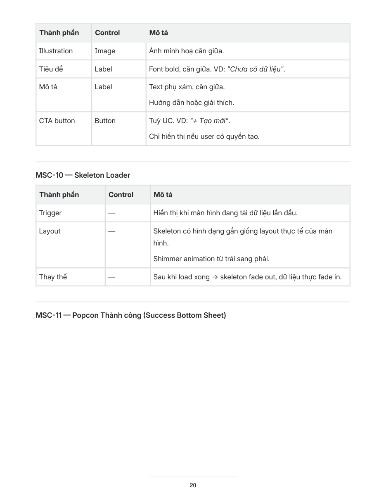

<!-- Trang 21 -->

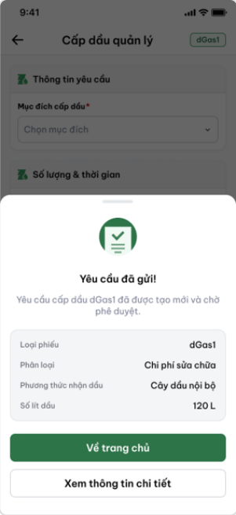

Bottom Sheet chặn toàn bộ flow, yêu cầu người dùng hiện tại chủ động chọn bước tiếp theo sau

khi hoàn tất một hành động quan trọng.

|Thành phần|Control|Mô tả|
|---|---|---|
|Backdrop|—|Nền tối mờ. Tap không đóng được — bắt buộc chọn button.|
|Container|Bottom Sheet|Slide-up 300ms ease-out. Bo góc trên 20px. C ao tự động, tối đa 85% màn hình.|
|Handle bar|—|40×4px, căn giữa. Swipe down không đóng (khác Bottom Sheet thông thường).|
|Icon|Icon|Tròn nền xanh lá đậm 64px, checkmark + document trắng bên trong.|
|Tiêu đề|Label|Bold 18px, căn giữa. Định nghĩa theo UC.|

<!-- Trang 22 -->

|Mô tả|Label|Regular 14px, xám, căn giữa, tối đa 2 dòng. Định nghĩa theo UC.|
|---|---|---|
|Card tóm tắt|Card|Nền #F5F5F5 , border-radius 12px. Các dòng key–value: label xám trái + giá trị semi-bold phải, divider 1px giữa các dòng. Số dòng và nội dung định nghĩa theo UC.|
|Button chính|Button|Full-width, filled xanh lá đậm. Label + navigation định nghĩa theo UC.|
|Button phụ|Button|Full-width, outlined xám nhạt. Label + navigation định nghĩa theo UC. Back gesture (Android/iOS) xử lý như tap button phụ.|

Cách dùng trong UC: Ghi (Xem MSC-11) và khai báo thêm: nội dung card tóm tắt +

label/navigation của 2 button.

### PHẦN 2 — QUY TẮC CHUNG GIAO DIỆN

#### 2.1 Button

|Quy tắc|Mô tả|
|---|---|
|Validate khi tap|Validate toàn bộ trường bắt buộc khi user tap button Submit / Lưu / Tạo mới.|
|Hiển thị lỗi|Lỗi hiển thị inline ngay dưới trường tương ứng. Scroll đến lỗi đầu tiên nếu cần.|
|Loading state|Button hiển thị spinner + disable trong khi đang xử lý request. Tránh double-tap.|
|Full width|Button chính (CTA) trong form hoặc Bottom Sheet luôn full width.|
|Destructive|Button xoá/huỷ màu đỏ. Không dùng làm CTA chính. Luôn là button phụ hoặc ở vị trí thứ yếu.|

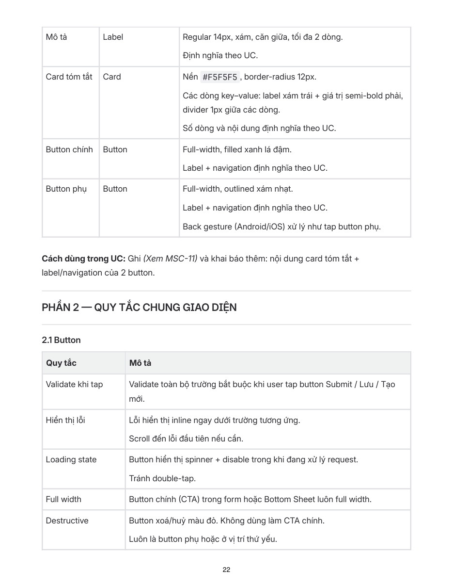

<!-- Trang 23 -->

#### 2.2 Input / Textbox

|Quy tắc|Mô tả|
|---|---|
|Validate On Blur|Validate và hiển thị lỗi ngay dưới field sau khi user blur (rời khỏi field).|
|Validate On Submit|Validate toàn bộ khi tap Submit. Scroll đến field lỗi đầu tiên.|
|Max length — Short|≤ 255 ký tự. Không cho nhập quá. Nếu paste: tự động cắt theo max length.|
|Max length — Long|≤ 4000 ký tự. Counter "X/4000" hiển thị khi còn ≤ 200 ký tự.|
|Keyboard type|Tự động mở đúng loại keyboard: Text · Number · Email · Phone · Decimal.|
|Clear button|Hiển thị icon ✕ trong field khi có nội dung. Tap → xoá toàn bộ.|

#### 2.3 Select / Dropdown

|Quy tắc|Mô tả|
|---|---|
|Hiển thị|Mở Bottom Sheet thay vì dropdown xuống như web.|
|Tìm kiếm|Bottom Sheet có ô tìm kiếm nếu danh sách > 10 item.|
|Single select|Radio button bên phải mỗi item. Tap → chọn ngay, đóng Bottom Sheet.|
|Multi select|Checkbox bên phải mỗi item. Button Xong sticky bottom để xác nhận.|

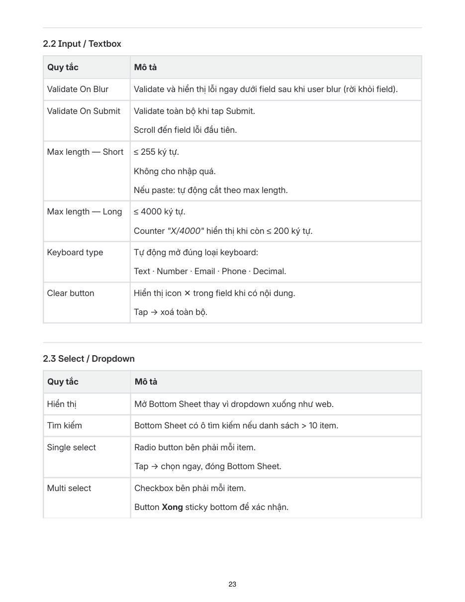

<!-- Trang 24 -->

|User select|Avatar + Tên (bold) + Mã · Chức vụ (dòng 2, xám). Filled: Avatar nhỏ + Mã - Tên trong field. (Xem Common Rules 2.2 Web)|
|---|---|

#### 2.4 Format số tiền

(Dùng chung với Web — Xem Common Rules 2.4 Website)

|Loại|Quy tắc|Ví dụ|
|---|---|---|
|Phân tách hàng nghìn|Tự động thêm dấu , khi nhập|100,000|
|Hiển thị VND|100,000 đ hoặc 100,000 VND tuỳ context|—|
|Làm tròn VND|Không có thập phân. Round Up|123,456.10 → 123,457|
|Làm tròn số học|2 chữ số thập phân, Round Half Up|12.345 → 12.35|

#### 2.5 Format số

(Dùng chung với Web — Xem Common Rules 2.5 Website)

#### 2.6 Format ngày giờ

|Quy tắc|Mô tả|
|---|---|
|Không có giờ|dd/mm/yyyy|
|Có giờ|dd/mm/yyyy HH:mm|
|DatePicker|Mở native date picker của OS hoặc custom wheel picker tuỳ context.|
|Validate|"Hãy nhập ngày tháng theo định dạng: dd/mm/yyyy"|

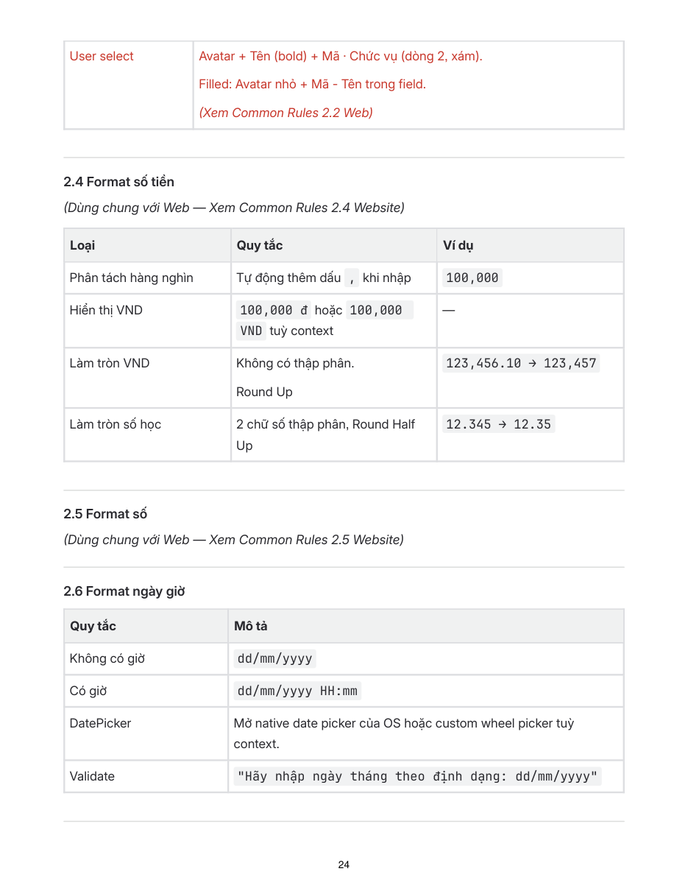

<!-- Trang 25 -->

#### 2.7 Input Email

|Quy tắc|Mô tả|
|---|---|
|Keyboard type|Tự động mở keyboard email.|
|Format hợp lệ|Phải có @ . VD: example@mail.com .|
|Lỗi|"Email không đúng định dạng."|

#### 2.8 Input Số điện thoại

|Quy tắc|Mô tả|
|---|---|
|Keyboard type|Tự động mở keyboard số (numpad).|
|Ký tự cho phép|Chỉ số. Chặn ký tự khác.|
|Đầu số|0 hoặc 84 . Tối đa 11 ký tự.|
|Format|0xxx xxx xxx hoặc 84 xxx xxx xxx .|
|Lỗi|"SĐT không đúng định dạng."|

#### 2.9 Tìm kiếm

|Quy tắc|Mô tả|
|---|---|
|Kiểu tìm kiếm|Gần đúng (fuzzy) trong toàn bộ dữ liệu danh sách.|
|Kích hoạt|Realtime debounce 300ms sau khi ngừng nhập.|
|Không tìm kiếm được|Các trường fix cứng (trạng thái, phân loại...) → dùng bộ lọc (MSC- 05). Các trường không tìm kiếm được định nghĩa trong từng UC.|

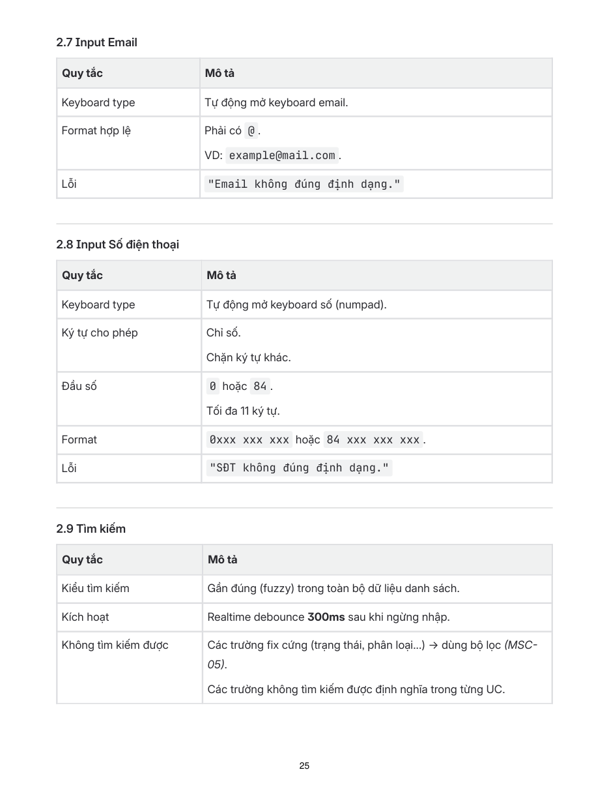

<!-- Trang 26 -->

|Empty state khi search|(MSC-10) Tiêu đề: "Không tìm thấy kết quả". Subtext: "Thử tìm với từ khoá khác."|
|---|---|

#### 2.10 Trường không có thông tin

|Loại trường|Hiển thị|
|---|---|
|Ghi chú|Ẩn hoàn toàn nếu không có giá trị.|
|ID / Mã|Hiển thị "N/A" .|
|Các trường còn lại|Hiển thị "--" .|

#### 2.11 Generate ID / Mã bản ghi

(Dùng chung với Web — Xem Common Rules 2.11 Website)

#### 2.12 Xử lý lỗi

BE vs FE check trả lỗi

|Loại lỗi|Hiển thị|
|---|---|
|Lỗi inline|Ngay dưới field tương ứng. Text đỏ + icon ⚠️. Tự ẩn khi user sửa field.|
|Lỗi toast|(MSC-01) Nền đỏ. Dùng cho lỗi không gắn với field cụ thể (VD: lỗi server, lỗi network).|
|Lỗi màn hình|Màn hình lỗi riêng khi không load được dữ liệu: (MSC-10) illustration + mô tả lỗi + button Thử lại.|

#### 2.13 Unsaved Changes

|Quy tắc|Mô tả|
|---|---|

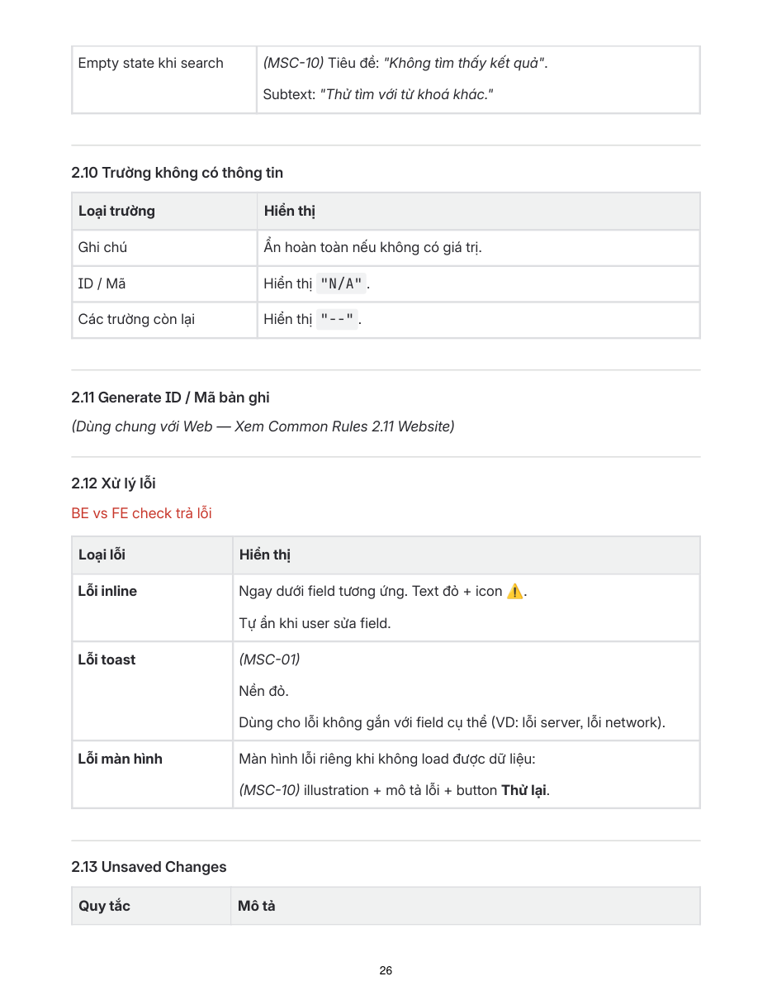

<!-- Trang 27 -->

|Trigger|User tap Back hoặc swipe back khi đang có dữ liệu chưa lưu trong form.|
|---|---|
|Hiển thị|(MSC-03): "Bạn có chắc muốn thoát? Dữ liệu đã nhập sẽ bị mất." + Button Thoát (đỏ) + Button Ở lại (outlined).|
|Không trigger|Khi form chưa có bất kỳ thay đổi nào so với dữ liệu ban đầu.|

#### 2.14 Pull to Refresh

|Quy tắc|Mô tả|
|---|---|
|Trigger|Kéo xuống từ đầu màn hình khi scroll position = 0.|
|Áp dụng|Tất cả màn hình danh sách và màn hình chi tiết.|
|Kết quả|Reload dữ liệu, reset về đầu danh sách.|

#### 2.15 Scroll behavior

|Quy tắc|Mô tả|
|---|---|
|Infinite scroll|Tự động load thêm 20 item khi scroll đến 80% cuối danh sách. Spinner nhỏ ở cuối khi đang tải thêm. Label "Đã hiển thị tất cả kết quả" khi hết dữ liệu.|
|Scroll to top|Tap vào title bar / header → scroll về đầu danh sách.|
|Sticky section header|Section header trong danh sách nhóm dính lại khi scroll qua.|

#### 2.16 Navigation

|Quy tắc|Mô tả|
|---|---|
|Back|Tap nút Back hoặc swipe từ trái sang phải (iOS) / gesture back (Android) → về màn hình trước.|
|Deep link|App hỗ trợ deep link để navigate thẳng vào màn chi tiết từ thông báo (MSC-02).|

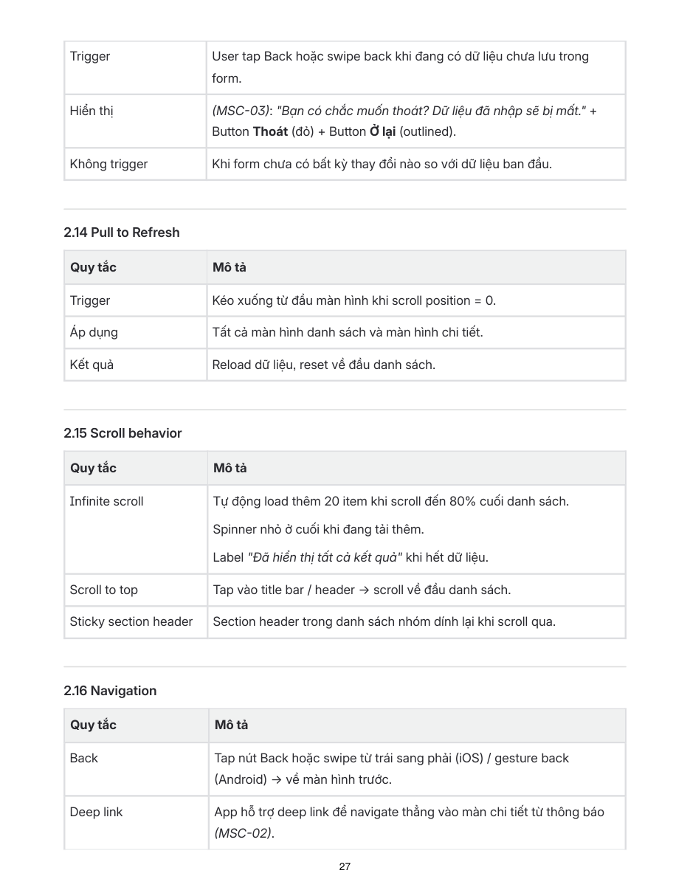

<!-- Trang 28 -->

|Bottom Sheet / Modal|Swipe down hoặc tap backdrop → đóng. Ngoại lệ: Bottom Sheet bắt buộc không đóng khi tap backdrop (Xem MSC-03).|
|---|---|

#### 2.17 Trạng thái kết nối mạng

BE vs FE check trả thế nào

|Trạng thái|Hiển thị|
|---|---|
|Mất kết nối|Banner xám phía trên màn hình: "Không có kết nối internet". Sticky cho đến khi kết nối lại.|
|Kết nối lại|Banner xanh lá: "Đã kết nối lại". Tự ẩn sau 2 giây. Tự động retry request đang pending.|
|Request thất bại do mạng|(MSC-01) đỏ: "Không thể kết nối. Vui lòng kiểm tra mạng và thử lại."|

#### 2.18 Popup messages đặc biệt

<!-- Trang 29 -->

**Các Bottom Sheet bắt buộc dùng (MSC-03) với backdrop không dismiss.**

|Loại|Trigger|Nội dung|Button|
|---|---|---|---|
|Token hết hạn|Session hết hạn|"Phiên đăng nhập hết hạn. Vui lòng đăng nhập lại để tiếp tục."|Đăng nhập lại (bắt buộc)|
|Không có quyền|Navigate đến màn không có quyền|"Bạn không có quyền xem thông tin này. Vui lòng liên hệ quản trị viên."|Quay lại|
|Phân quyền thay đổi|Flag session được set|"Tài khoản của bạn vừa được thay đổi phân quyền. Vui lòng tải lại để áp dụng thay đổi mới."|Tải lại ngay (bắt buộc)|
|Xác nhận chuyển site|Tap vào item thuộc site khác|"Bạn đang chuyển sang [Tên site]. Trang sẽ được tải lại theo site mới."|Huỷ bỏ + Chuyển site|

<!-- Trang 30 -->

<!-- Trang 31 -->

## UC00.01.01 - Xem trang chủ - Tài khoản nội bộ

#### 1. Thông tin chung

|Mã UC - Tên UC|UC00.01.01 - Xem trang chủ - Tài khoản nội bộ|
|---|---|
|Tác nhân|Người dùng ứng dụng Delta Super App|
|Đường dẫn|Màn hình Đăng nhập >> Màn hình Trang chủ Chọn tới mục Trang chủ trên Navigation bar >> Màn hình Trang chủ|
|Điều kiện trước|Người dùng đã được cấp tài khoản trên ứng dụng Lái xe Delta Trạng thái tài khoản là: Đang hoạt động Tài khoản có quyền truy cập vào ứng dụng Lái xe Delta|
|Điều kiện sau|Hệ thống hiển thị màn hình Trang chủ thành công.|

#### 2. Lưu đồ hoạt động

#### 3. Mô tả màn hình:

##### 3.1 Màn hình Đăng nhập

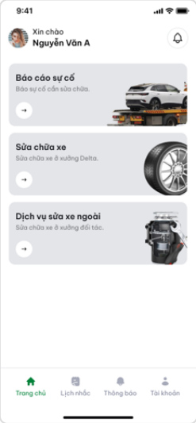

<!-- Trang 32 -->

||Control|Loại|Trườ ng bắt buộ c|Giá trị mặc định|Mô tả|Validate|
|---|---|---|---|---|---|---|
|1|Thông báo|Icon|||Mở tới màn hình Thông báo của app Lái xe||
|2|Báo cáo sự cố|Card|||Mở tới màn hình Danh sách báo cáo sự cố của app Lái xe||
|3|Sửa chữa xe|Card|||Mở tới màn hình Danh sách lệnh sửa chữa của app Lái xe||
|4|Dịch vụ sửa xe ngoài|Card|||Mở tới màn hình Danh sách đơn mua dịch vụ SC ngoài của app Lái xe||

1 Thông báo Icon Mở tới màn hình Thông báo

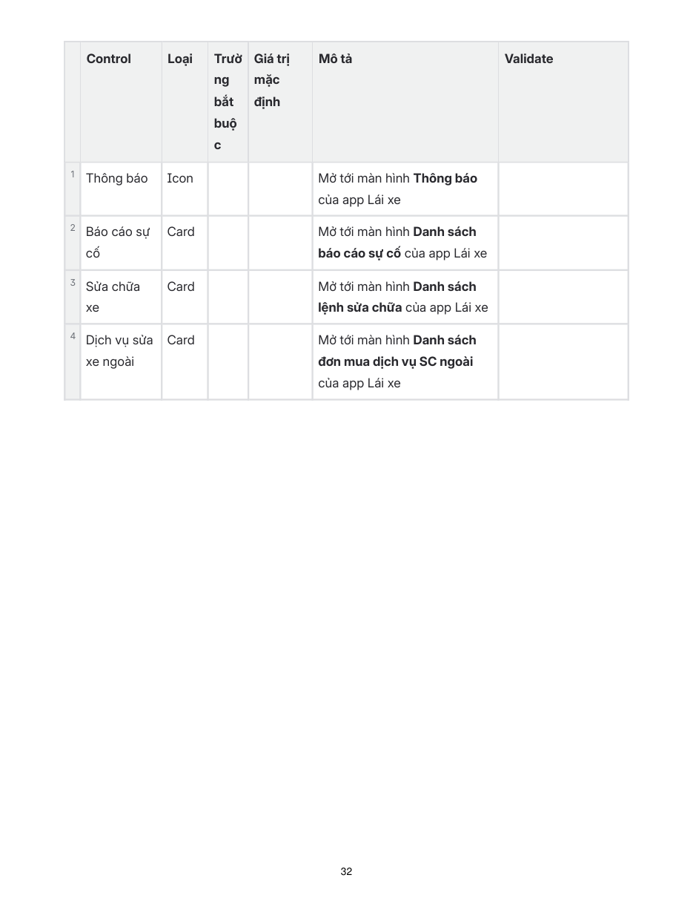

<!-- Trang 33 -->

## UC00.01.03 - Xem trang chủ - Tài khoản cây dầu

#### 1. Thông tin chung

|Mã UC|UC00.01.03|
|---|---|
|Tên UC|Trang chủ — Tài khoản Cây dầu|
|Tác nhân|Nhân viên cây dầu mua ngoài đã đăng nhập (loại tài khoản = Cây dầu)|
|Đường dẫn|Bottom Navigation → Tab Trang chủ (tab đầu tiên)|
|Điều kiện trước|Đã đăng nhập. Loại tài khoản = Cây dầu.|
|Điều kiện sau|Hiển thị dashboard tổng quan + danh sách phiếu cấp dầu hôm nay của cây.|

Thiết kế đa loại tài khoản: Màn Trang chủ được render theo loại tài khoản. Tài

khoản loại Cây dầu hiển thị layout này. Các loại tài khoản khác (VD: HĐ lẻ, Đối

tác vận tải...) sẽ có layout Trang chủ riêng biệt — định nghĩa trong UC tương

ứng.

#### 2. Lưu đồ hoạt động

1. Người dùng mở app → navigate đến tab Trang chủ.

2. Hệ thống load dữ liệu: tổng phiếu hôm nay + danh sách phiếu.

3. Skeleton loader trong khi tải (App Common — MSC-10).

4. Người dùng có thể:

Tap avatar góc trên trái → navigate UC-PP.02 (Tài khoản).

Tap icon chuông → navigate màn Thông báo.

Tap card phiếu "Chờ bơm" → mở màn chi tiết + Button "Bơm ngay" (UC06.00.11).

Tap "Bơm ngay ›" trực tiếp → shortcut mở Bottom Sheet Ghi nhận bơm dầu (UC06.00.11).

Tap card phiếu "Hoàn thành" → tap "Xem chi tiết ›" → màn chi tiết phiếu.

Pull-to-refresh để tải lại (App Common 2.14).

#### 3. Mô tả màn hình

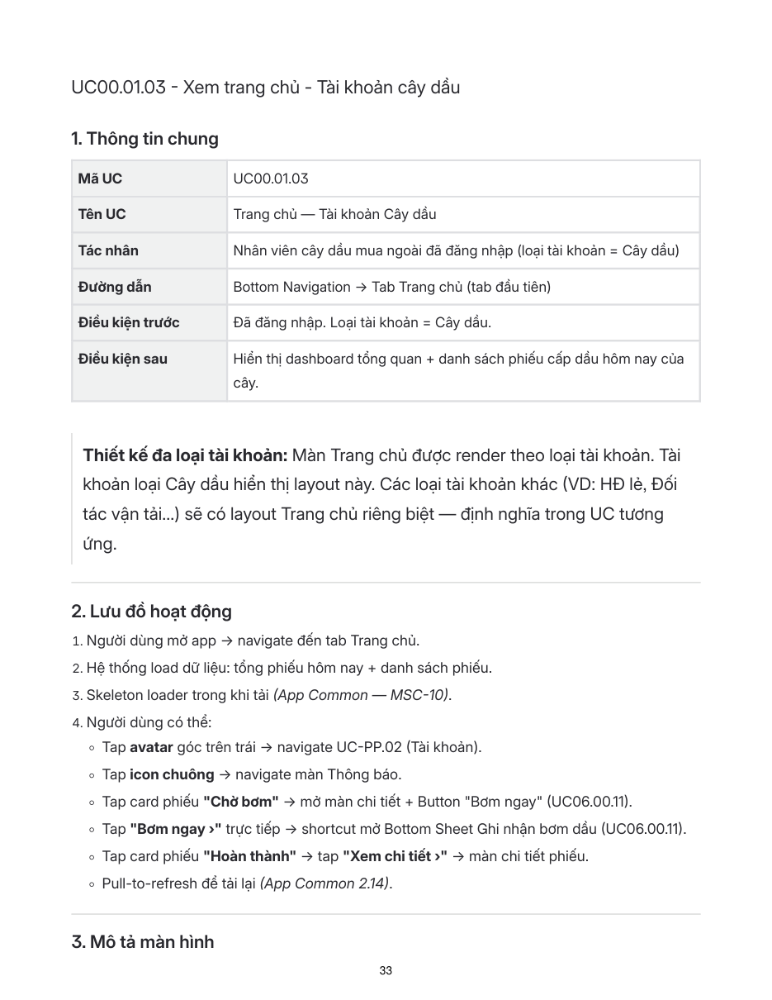

<!-- Trang 34 -->

##### 3.1 Màn hình Trang chủ

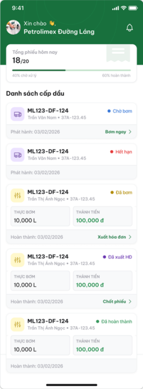

Hiển thị tất cả các phiếu, sắp xếp theo thứ tự thời gian tạo gần nhất → lâu nhất,

||Tên thành phần|Control|Loại|Bắt buộc|Giá trị mặc định|Mô tả|Validate|
|---|---|---|---|---|---|---|---|
|1|Header|—|—|—|—|Nền xanh lá đậm (màu brand). Không có navigation bar tiêu đề.|—|

<!-- Trang 35 -->

|2|Avatar cây dầu|Image/ Button|—|—|—|Góc trên trái. Hình tròn, ảnh đại diện cây dầu. Tap → UC01.01.07 Xem thông tin tài khoản.|—|
|---|---|---|---|---|---|---|---|
|3|Greeting|Label|Text|—|—|Dòng trên: "Xin chào 👋," — font regular, trắng nhỏ. Dòng dưới: Tên cây dầu — font bold, trắng lớn. VD: "Petrolimex Đường Láng".|—|
|4|Icon chuông|Icon/Bu tton|—|—|—|Góc trên phải. Badge đỏ số nếu có thông báo chưa đọc. Tap → màn Thông báo.|—|
|5|Card Tổng phiếu hôm nay|Card|—|—|—|Nền trắng, bo góc 16px, shadow nhẹ. Nằm đè lên header (overlap ~50%). Xem cấu trúc chi tiết STT 6–9.|—|
|6|Label tổng|Label|Text|—|—|"Tổng phiếu hôm nay" — font regular, xám nhỏ.|—|
|7|Số phiếu|Label|Number|—|—|Format: X/Y — X = chờ xử lý (trạng thái Chờ bơm) trong hôm nay, Y = tổng các phiếu có trạng thái Hoàn thành trong hôm nay).|—|

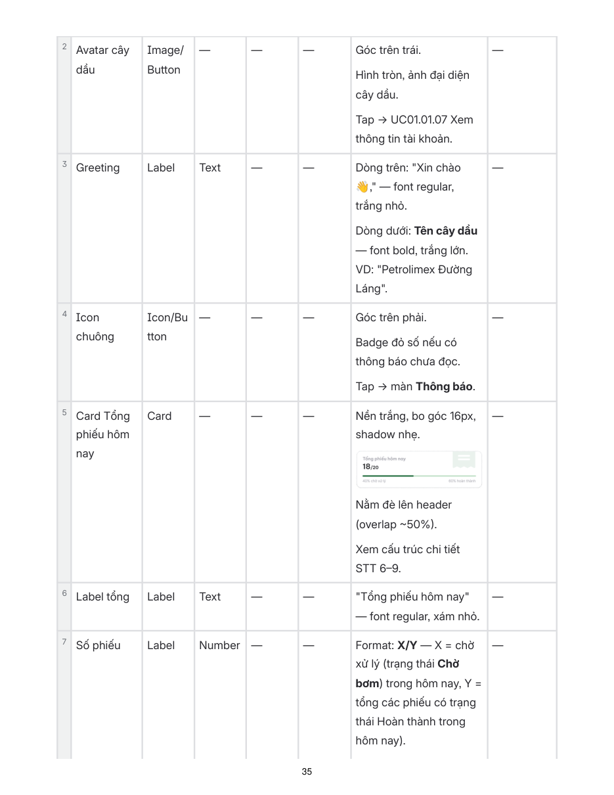

<!-- Trang 36 -->

|||||||Font bold 28px, đen.||
|---|---|---|---|---|---|---|---|
|8|Progress bar|—|—|—|—|Thanh ngang 2 màu: xanh lá = đã hoàn thành (60%), xanh nhạt = chờ xử lý (40%).|—|
|9|Label progress|Label|Text|—|—|Trái: "X% chờ xử lý" (xám). Phải: "Y% hoàn thành" (xám).|—|
|1 0|Icon illustration|Image|—|—|—|Góc phải card: illustration nhỏ màu xanh nhạt (icon phiếu/danh sách).|—|
|1 1|Label "Danh sách cấp dầu"|Label|Text|—|—|Font bold 18px, đen. Padding trên cùng của list section.|—|
|1 2|Danh sách card phiếu|List|—|—|—|Infinite scroll. Pull-to-refresh. MSC-10 Skeleton khi loading. Empty state khi không có phiếu hôm nay: "Chưa có phiếu cấp dầu nào hôm nay." Xem cấu trúc card theo trạng thái bên dưới.|—|

##### 3.2 Cấu trúc card chung

Mỗi card phiếu có 2 vùng:

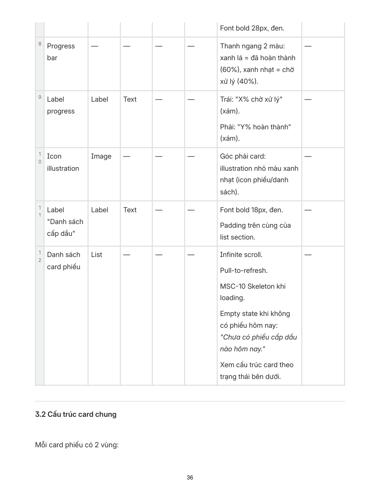

<!-- Trang 37 -->

Vùng trên: Icon loại dGas (44px vuông bo góc) + Mã phiếu (bold) + Dot trạng thái + Nhãn

trạng thái (góc phải) + Tên lái xe • Biển số xe (xám nhỏ).

Vùng dưới (divider ngăn cách): Ngày + CTA (nếu có). Một số trạng thái thêm 2 card THỰC

BƠM / THÀNH TIỀN ở giữa.

##### 3.3 Card theo từng trạng thái

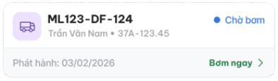

|Trạng thái|Dot|Nhãn|Card data|Ngày|CTA|
|---|---|---|---|---|---|
|waiting|Xanh dương|Chờ bơm|Không có|"Phát hành: dd/mm/yyyy" Lấy theo ngày tạo phiếu dầu|"Bơm ngay ›" (xanh lá bold)|
|po_expir ed|Đỏ|Hết hạn|Không có|"Phát hành: dd/mm/yyyy" Lấy theo ngày tạo phiếu dầu|Không có CTA|
|fuel_don e|Cam/vàng|Đã bơm|✅ THỰC BƠM + THÀNH TIỀN|"Hoàn thành: dd/mm/yyyy" Lấy theo ngày ghi nhận bơm dầu|"Xuất hóa đơn ›" (xanh lá bold)|
|invoice_ done|Tím|Đã xuất HĐ|✅ THỰC BƠM + THÀNH TIỀN|"Hoàn thành: dd/mm/yyyy" Lấy theo ngày ghi nhận bơm dầu|"Chốt phiếu ›" (xanh lá bold)|

<!-- Trang 38 -->

|done|Xanh lá|Đã hoàn thành|✅ THỰC BƠM + THÀNH TIỀN|"Hoàn thành: dd/mm/yyyy" Lấy theo ngày ghi nhận bơm dầu|Không có CTA|
|---|---|---|---|---|---|

Card data THỰC BƠM / THÀNH TIỀN (hiển thị ở trạng thái fuel_done , invoice_done ,

done ):

2 card nằm ngang, nền xám nhạt, bo góc nhẹ.

THỰC BƠM: Label chữ hoa xám + giá trị "X,XXX L" (bold, đen).

THÀNH TIỀN: Label chữ hoa xám + giá trị "X,XXX,XXX đ" (bold, xanh lá).

<!-- Trang 39 -->

## UC00.01.02 - Xem thanh tiến trình liên quy trình

**Mô tả chung thanh tiến trình**

Thanh tiến trình bao gồm:

Bước (tên + ID đi kèm)

Thanh nối

Tên feature/nghiệp vụ

Thanh tiến trình (mobile) hiển thị no data như sau:

Hiển thị hint text để miêu tả nếu chưa hiển thị luôn thanh tiến trình.

||Control|Loại|Giá trị mặc định|Mô tả|
|---|---|---|---|---|
|1|Bước/step|Icon + Label||Icon: Icon tương ứng với từng feature (fixed theo UI) Tên: hiển thị tên của bước/step tương ứng theo từng feature (tên feature - tên step) Các bước/thứ tự bước của từng quy trình lớn sẽ được mô tả ở . Bước: thể hiện trạng thái theo UI được mô tả ở . ID: Hiển thị lên thanh tiến trình khi feature/bản ghi đó sinh ra ID, tuỳ thuộc vào từng feature/bản ghi đó sinh ra ID khi nào. Chưa có: để là “ID: N/A” Đã có ID: để là “ID: xxxxx” dưới dưới|

|Icon|: Icon tương ứng với từng feature|
|---|---|

<!-- Trang 40 -->

||||Cho phép ấn vào để mở màn hình chi tiết của feature đó (nếu bản ghi của feature đó đã được tạo) Do app Lái xe đang chỉ có thể hiển thị các bản ghi của feature Đơn mua HHDV, Lệnh sửa chữa, Báo cáo sự cố nên chỉ những step này mới mở được màn chi tiết, còn lại khi ấn vào sẽ không hiển thị thông tin, chỉ báo message: “Bạn không có quyền xem thông tin này.”|Cho phép ấn vào để mở màn hình chi tiết của|
|---|---|---|---|---|
|2|Thanh nối|Line|Là thanh nối giữa các step với nhau, thể hiện trạng thái theo UI được mô tả ở . dưới||
|3|Tên feature/nghiệp vụ của popup|Label|Là tên feature/nghiệp vụ đang hiển thị của popup. Hiển thị tên của feature/nghiệp vụ. Đơn mua HHDV → Mua HHDV Báo giá chuẩn đoán → Báo giá (nếu bên SC = khách hàng hoặc loại báo giá = bán phụ tùng), Chuẩn đoán (nếu bên SC = Delta) Lệnh sửa chữa → Sửa chữa Xuất kho → Xuất kho Nhập kho → Nhập kho Đề nghị bồi thường → Bồi thường Thanh toán bán HHDV trả trước → Thanh toán Thanh toán bán HHDV trả sau → Thanh toán||

|bản ghi của feature|Đơn mua HHDV, Lệnh|
|---|---|

|sửa chữa, Báo cáo sự cố|nên chỉ những step|
|---|---|

|message: “|Bạn không có quyền xem thông|
|---|---|

2 Thanh nối Line Là thanh nối giữa các step với nhau, thể hiện

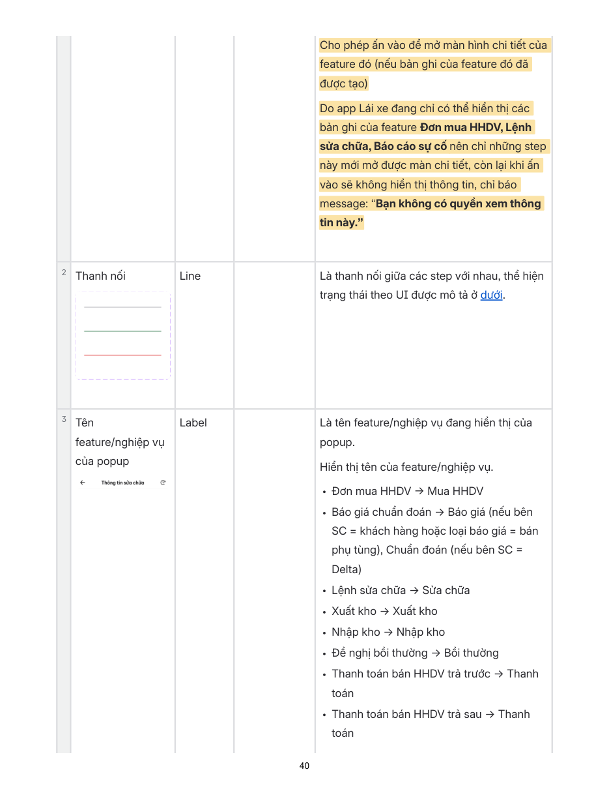

<!-- Trang 41 -->

Thanh toán chi phí trả trước → Thanh toán
Thanh toán chi phí trả sau → Thanh toán
Báo cáo sự cố → Sự cố

**Các step theo từng quy trình**

Lấy theo tài liệu của website.

UC00.00.02

Lưu ý: các step/feature bị phát sinh xảy ra liền kề sau step/feature gây phát sinh trên thanh tiến

trình, trừ feature Lệnh sửa chữa - xuất kho (do 2 feature này xảy ra đồng thời) nên các feature

phát sinh sẽ xảy ra phía sau feautre xuất kho.

**Trạng thái của step trên thanh tiến trình**

Bước trên thanh tiến trình nói chung sẽ có 4 trạng thái như sau:

|Trạng thái|Thanh nối|Bước|Trigger|
|---|---|---|---|
|Chưa triển khai: Nghiệp vụ chưa được, chưa tới bước triển khai.|||Trạng thái mặc định ban đầu của nghiệp vụ/feature Hiển thị khi nghiệp vụ/feature chưa được tạo mới.|
|Đang triển khai: Nghiệp vụ đang được triển khai.|||Hiển thị khi bắt đầu tạo mới nghiệp vụ/feature|
|Đã thu hồi/từ chối: Nghiệp vụ bị thu hồi hoặc bị từ chối thực hiện.|||Hiển thị khi thu hồi/từ chối nghiệp vụ/feature|
|Đã hoàn thành: Nghiệp vụ được hoàn tất hoặc được phê duyệt (nếu phê duyệt là hành động cuối của nghiệp vụ)|||Hiển thị khi hoàn thành (kết thúc toàn bộ luồng) của nghiệp vụ/feature|

<!-- Trang 42 -->

## Epic 01 - Quản lý tài khoản

<!-- Trang 43 -->

### UC01.01.01 - Đăng nhập

#### 1. Thông tin chung

|Mã UC - Tên UC|UC01.01.01 - Đăng nhập|
|---|---|
|Tác nhân|Người dùng ứng dụng Delta Super App/Delta Partner Portal (mọi role)|
|Đường dẫn|Khởi động ứng dụng → Màn Splash → Onboarding (lần đầu) → Màn Đăng nhập|
|Điều kiện trước|Người dùng đã được cấp tài khoản. Trạng thái tài khoản: Đang hoạt động/Hoạt động. Tài khoản có quyền truy cập ứng dụng.|
|Điều kiện sau|Tài khoản nội bộ: Đăng nhập thành công + chọn tổ chức/chi nhánh (nếu có ≥2) → navigate Home nội bộ. Nếu dùng mật khẩu mặc định → navigate Tạo mật khẩu mới (UC01.01.05). Tài khoản đối tác: Đăng nhập thành công → navigate thẳng Home theo loại tài khoản, không qua màn chọn tổ chức.|

#### 2. Lưu đồ hoạt động

1. Người dùng khởi động app → Màn Splash hiển thị 3 giây (hoặc cho đến khi tài nguyên tải

xong) → tự động chuyển tiếp.

2. Kiểm tra session:

Có session hợp lệ → bỏ qua Onboarding + Đăng nhập → kiểm tra tổ chức (bước 6).

Không có session → chuyển sang bước 3.

3. Màn Onboarding (chỉ hiển thị lần đầu cài app hoặc sau khi xoá dữ liệu): Giới thiệu ngắn gọn

về ứng dụng. Button "Đăng nhập" → navigate màn Đăng nhập.

4. Người dùng nhập Tên tài khoản và Mật khẩu → tap "Đăng nhập".

5. Hệ thống xác thực:

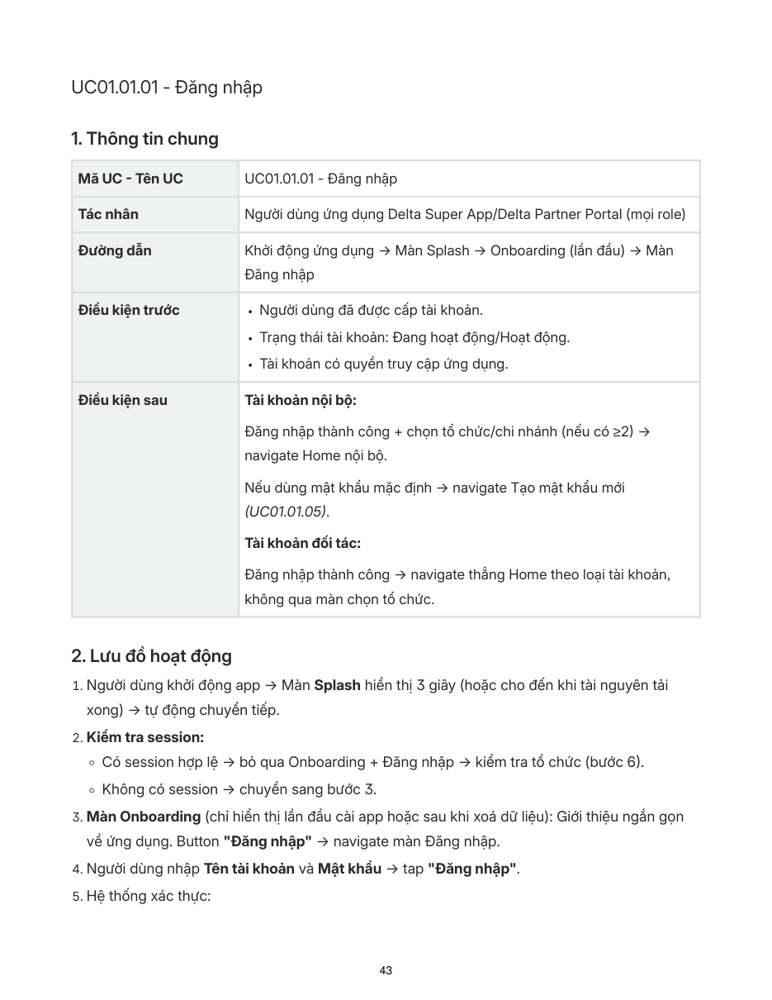

<!-- Trang 44 -->

Sai thông tin: Hiển thị inline error. Trừ 1 lần thử. Thông báo: "Tên tài khoản hoặc mật khẩu

không đúng. Bạn còn [X] lần thử."

Sai ≥ 10 lần: Khoá tài khoản → thông báo lỗi: "Tài khoản đã bị khoá. Vui lòng liên hệ Admin

để được hỗ trợ." Không thể đăng nhập tiếp.

Đúng + mật khẩu mặc định: Navigate màn Tạo mật khẩu mới (UC01.01.05).

Đúng + mật khẩu đã thay đổi: Chuyển sang bước 6.

6. Hệ thống xác định loại tài khoản vừa đăng nhập:

Nhánh A — Tài khoản nội bộ:

Hệ thống kiểm tra số tổ chức/chi nhánh có quyền truy cập:

= 1 chi nhánh: Tự động chọn → navigate Home nội bộ. Bỏ qua bước 7.

≥ 2 chi nhánh hoặc ≥ 2 tổ chức: Hiển thị Bottom Sheet Chọn tổ chức (bước 7).

Nhánh B — Tài khoản đối tác:

Không hiển thị màn Chọn tổ chức. Hệ thống tự động xác định loại tài khoản đối tác →

navigate thẳng vào màn Home tương ứng.

Hiện tại hỗ trợ loại: Cây dầu → Home Partner Portal (UC-PP.01).

Các loại đối tác khác sẽ được bổ sung theo từng UC tương ứng.

7. (Chỉ Nhánh A — ≥2 tổ chức/chi nhánh)

Người dùng chọn tổ chức hoặc chi nhánh → tap "Xác nhận" → navigate Home nội bộ.

Tap "Huỷ" → đăng xuất, quay về màn Đăng nhập.

#### 3. Mô tả màn hình

##### 3.1. Màn hình Splash

<!-- Trang 45 -->

Hệ thống hiển thị màn hình Splash khi người dùng truy cập vào ứng dụng

Thời gian hiển thị: 3 giây (hoặc cho đến khi các tài nguyên chính được tải xong). Sau đó, hệ

thống chuyển sang màn hình Onboarding.

Không có hành động tương tác từ người dùng.

##### 3.2. Màn hình Onboarding

<!-- Trang 46 -->

**Màn hình Onboarding:**

Hiển thị nội dung giới thiệu ngắn gọn về ứng dụng.

Có nút CTA Đăng nhập: Khi người dùng nhấn vào, hệ thống chuyển sang màn hình đăng

nhập.

##### 3.3. Màn hình Đăng nhập

||Control|Loại|Trườ ng bắt buộ c|Giá trị mặc định|Mô tả|Validate|
|---|---|---|---|---|---|---|
|1|Tên tài khoản|Textb ox (short )|||Cho phép người dùng nhập tên tài khoản để đăng nhập vào hệ thống.|Tên tài khoản phải tồn tại trong danh sách tài khoản đang hoạt động của ứng dụng lái xe Delta.|

<!-- Trang 47 -->

|2|Mật khẩu|Textb ox (short )||Cho phép người dùng nhập mật khẩu của tài khoản đó.|Mật khẩu phải khớp với tên tài khoản đã nhập. Không được phép nhập sai mật khẩu quá 10 lần. => Nếu sai quá 10 lần, hệ thống lock tài khoản. Nếu người dùng đăng nhập lại tài khoản bị lock, thông báo lỗi: “Tài khoản này đã bị khoá.”|
|---|---|---|---|---|---|
|3|Eye icon|Icon|Enable button và ẩn passwor ds|Cho phép người dùng bật/tắt hiển thị mật khẩu. Khi người dùng nhấn vào eye icon, mật khẩu sẽ hiển thị dưới dạng văn bản (plain text) Khi nhấn lại vào eye icon, mật khẩu sẽ được ẩn trở lại.||
|4|Ghi nhớ đăng nhập|Chec kbox|Enable|Cho phép người dùng chọn để hệ thống ghi nhớ đăng nhập. Khi checked: session không hết hạn khi đóng app. Khi unchecked: session hết hạn khi đóng app.||
|5|Quên mật khẩu|Butto n|Enable|Cho phép người dùng yêu cầu khôi phục mật khẩu nếu quên. Khi nhấn vào button, người dùng sẽ được chuyển đến popup Quên mật khẩu, thực hiện UC Quên mật khẩu||

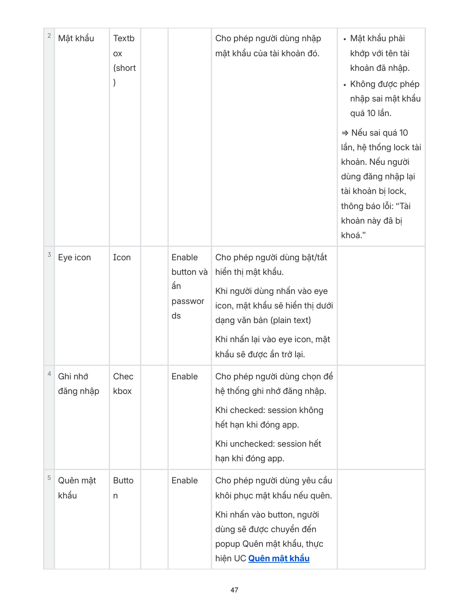

<!-- Trang 48 -->

|6|Đăng nhập|Butto n|Enable|Cho phép người dùng gửi thông tin tài khoản và mật khẩu để đăng nhập.|Hệ thống phải kiểm tra tính hợp lệ của tên tài khoản và mật khẩu trước khi đăng nhập. Nếu thông tin đăng nhập sai, hệ thống phải thông báo lỗi và yêu cầu người dùng thử lại: "Tên tài khoản hoặc mật khẩu không đúng. Bạn chỉ còn [?] lần thử". Nếu thông tin đăng nhập đúng: cho phép người dùng vào trang chủ (nếu tài khoản không dùng mật khẩu mặc định) hoặc vào trang Tạo mật khẩu mới, thực hiện UC nếu tài khoản đang dùng tài khoản mặc định. Nếu tài khoản không có quyền Tạo mật khẩu mới|
|---|---|---|---|---|---|

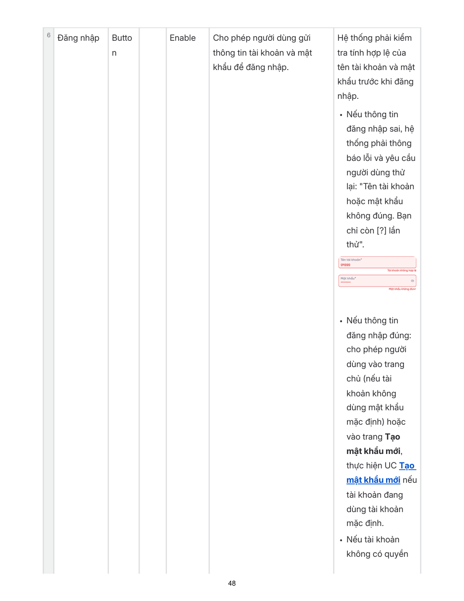

<!-- Trang 49 -->

truy cập vào ứng
dụng Delta, hiển
thị thông báo lỗi:

##### 3.4 Bottom Sheet Chọn tổ chức

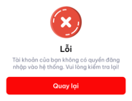

Slide-up từ dưới, duration 300ms, bo góc trên 20px.

Chiều cao tự động, tối đa 85% màn hình.

Swipe down không đóng được — bắt buộc chọn trước khi vào app.

|Tên thành phần|Contr ol|Loại|Bắt buộc|Giá trị mặc định|Mô tả|Validate|
|---|---|---|---|---|---|---|
|Handle bar|—|—|—|—|40×4px, căn giữa trên cùng.|—|

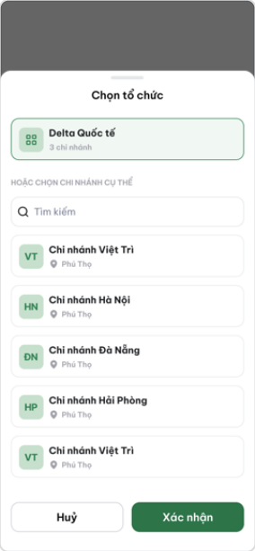

<!-- Trang 50 -->

||||||Swipe down không đóng.||
|---|---|---|---|---|---|---|
|Tiêu đề|Label|Text|—|—|"Chọn tổ chức". Font bold 18px, căn giữa.|—|
|Card Tổ chức|Radio Card|—|Khôn g|—|Chỉ hiển thị nếu tài khoản có quyền truy cập toàn tổ chức. Icon vuông bo góc xanh nhạt (grid icon) + Tên tổ chức (bold) + "X chi nhánh" (xám nhỏ). Selected: border xanh lá + nền xanh rất nhạt.|—|
|Separator|Label|Text|—|—|"HOẶC CHỌN CHI NHÁNH CỤ THỂ" — chữ hoa, xám nhỏ, căn trái. Chỉ hiện khi có cả option tổ chức lẫn danh sách chi nhánh.|—|
|Ô tìm kiếm|Input|Text|Khôn g|—|Icon kính lúp trái. Placeholder "Tìm kiếm". Fuzzy search realtime theo tên chi nhánh.|—|
|Danh sách chi nhánh|Radio List|—|Khôn g|—|Danh sách dọc, scroll nếu nhiều. Hiển thị theo thứ tự truy cập gần nhất → xa nhất (thêm thứ tự A-Z nếu cần) Mỗi card: Avatar chữ tắt 2 ký tự (nền xanh nhạt, bo góc) + Tên chi nhánh (bold) + Icon 📍 + Tên tỉnh (xám nhỏ). Tap card → selected. Selected: border xanh lá + nền xanh rất nhạt.|—|

<!-- Trang 51 -->

|Empty state tìm kiếm|Label|—|—|—|"Không tìm thấy chi nhánh phù hợp." (MSC-09)|—|
|---|---|---|---|---|---|---|
|Button Huỷ|Butto n|—|—|—|~40% width, secondary outlined. Tap → đăng xuất, quay về màn Đăng nhập.|—|
|Button Xác nhận|Butto n|—|—|Disabl ed|~60% width, primary xanh lá. Disabled cho đến khi chọn ≥1 option. Tap → navigate Home của tổ chức/chi nhánh đã chọn. Session lưu lựa chọn — lần sau tự động bỏ qua màn này nếu vẫn còn quyền.|(Disabled nếu chưa chọn)|

**Ghi chú:**

Tap "Huỷ" = đăng xuất hoàn toàn — không thể vào app nếu chưa chọn.

Session lưu lựa chọn: lần đăng nhập tiếp theo nếu vẫn còn quyền → tự động

bỏ qua Bottom Sheet này.

Bottom Sheet này chỉ áp dụng cho Tài khoản nội bộ. Tài khoản đối tác

không qua bước này.

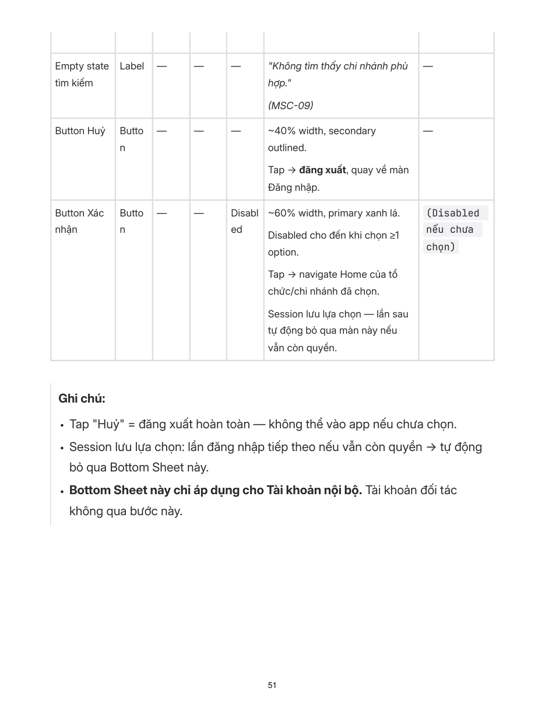

<!-- Trang 52 -->

### UC01.01.02 - Quên mật khẩu

#### 1. Thông tin chung

|Mã UC - Tên UC|UC01.01.02 - Quên mật khẩu|
|---|---|
|Tác nhân|Người dùng ứng dụng lái xe Delta|
|Đường dẫn|Màn hình Đăng nhập > Chọn Quên mật khẩu|
|Điều kiện trước|Người dùng đã được cấp tài khoản trên ứng dụng lái xe Delta Trạng thái tài khoản là: Đang hoạt động Tài khoản có quyền truy cập vào ứng dụng lái xe Delta|
|Điều kiện sau|Nếu người dùng chọn Liên hệ IT, thông báo reset mật khẩu được gửi tới bộ phận IT phần mềm ERP Delta và hiển thị màn hình Gửi tài khoản thành công Nếu người dùng chọn Reset mật khẩu bằng email, gửi OTP qua email công ty của người dùng và hiển thị màn hình Kiểm tra hòm thư|

#### 2. Lưu đồ hoạt động:

#### 3. Mô tả màn hình:

##### 3.1. Màn hình Chọn cách lấy lại mật khẩu

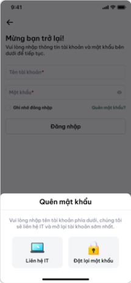

<!-- Trang 53 -->

||Control|Loại|Trư ờng bắt buộ c|Giá trị mặc định|Mô tả|Validate|
|---|---|---|---|---|---|---|
|1|Liên hệ IT|Butto n||Enable|Cho phép người dùng liên hệ với bộ phận IT để được hỗ trợ khôi phục mật khẩu. Khi nhấn vào button, hệ thống sẽ chuyển hướng người dùng đến màn hình Nhập tên tài khoản - Liên hệ IT. ERP call API cho PMX để update mật khẩu mới mà IT đã reset >> Khi đó, trạng thái tài khoản chuyển sang: Cấp mới||
|2|Reset mật khẩu|Butto n||Enable|Cho phép người dùng yêu cầu reset lại mật khẩu thông qua hệ thống tự động. Khi nhấn vào button, hệ thống sẽ chuyển hướng người dùng đến màn hình Nhập tên tài khoản - Reset bằng email.||

##### 3.2. Màn hình Nhập tên tài khoản

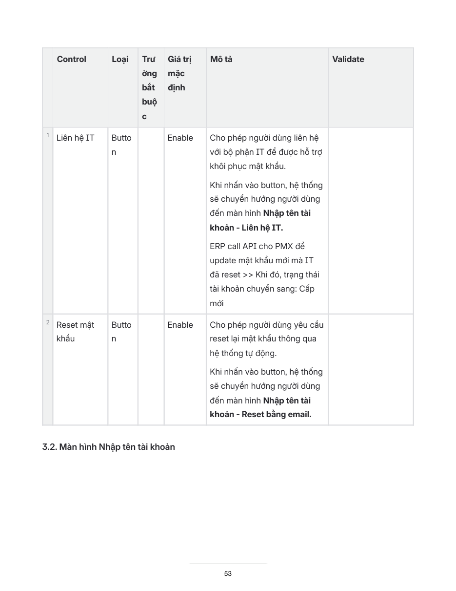

<!-- Trang 54 -->

||Control|Loại|Trư ờng bắt buộ c|Giá trị mặc định|Mô tả|Validate|
|---|---|---|---|---|---|---|
|1|Tên tài khoản|Textb ox (short )|Có||Cho phép người dùng nhập tên tài khoản để khôi phục hoặc reset mật khẩu.|Hệ thống kiểm tra tài khoản được nhập với các tài khoản đang có sau khi người dùng ấn button Kết thúc nhập Nếu tên tài khoản nhập đúng, hệ thống hiển thị Họ và tên và Tên tài khoản tương ứng Nếu tên tài khoản sai, hệ thống hiển thị thông báo lỗi:|

<!-- Trang 55 -->

||||||"Tên tài khoản không chính xác."|
|---|---|---|---|---|---|
|2|Tài khoản|Label|No data|Hiển thị họ và tên & tên tài khoản tương ứng nếu người dùng nhập đúng tên tài khoản. Hiển thị giao diện no data:|Chỉ tài khoản có trạng thái tài khoản là Đang hoạt động thì mới được đổi mật khẩu. Nếu tên tài khoản sai, hệ thống hiển thị thông báo lỗi: "Tên tài khoản không chính xác."|
|3|Xác nhận|Butto n|Enable|Cho phép người dùng xác nhận và chuyển tiếp đến bước tiếp theo nếu nhập đúng tài khoản: Liên hệ IT: hiển thị màn hình thông báo Gửi tài khoản thành công và gửi email tự động tới email IT Delta: Tiêu đề email: Yêu cầu hỗ trợ đặt lại mật khẩu tài khoản Delta Nội dung email: Xin chào đội IT, Hệ thống vừa ghi nhận một yêu cầu đặt lại mật khẩu từ người dùng. Dưới đây là thông tin chi tiết: Tên tài khoản: [Tên tài khoản]|Chỉ cho phép người dùng gửi email quên mật khẩu 1 lần mỗi phút. Nếu vi phạm, khi người dùng ấn button Xác nhận và báo popup message lỗi như sau:|

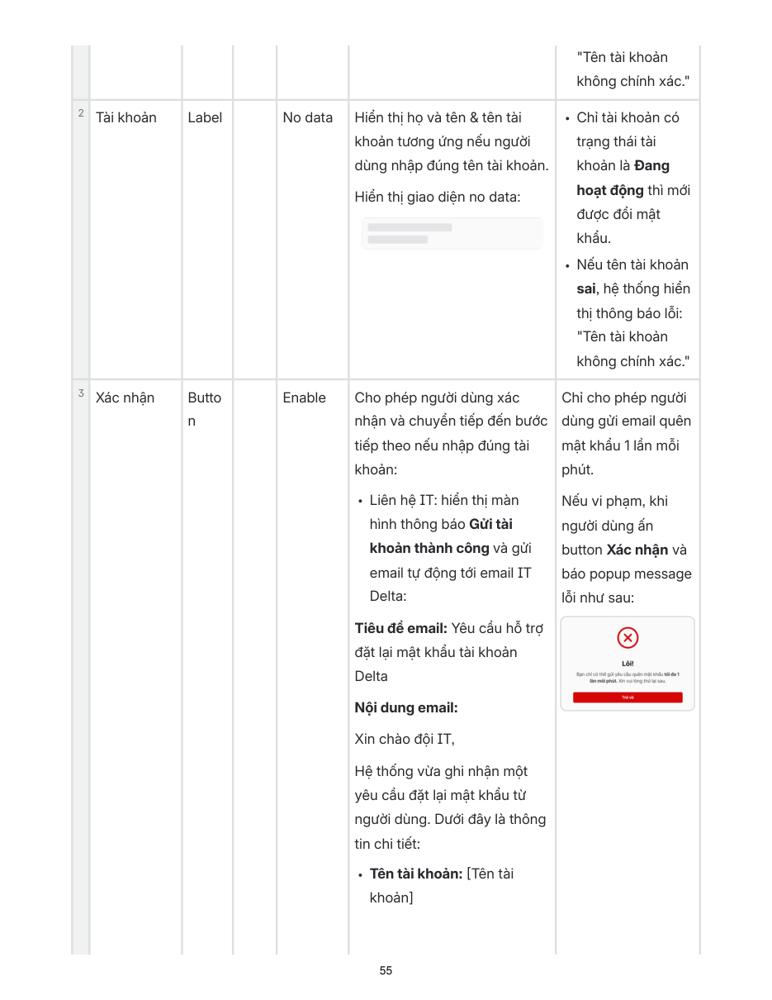

<!-- Trang 56 -->

Tên người dùng: [Tên người
dùng]
Thời gian yêu cầu: [Thời
gian gửi yêu cầu]
Vui lòng kiểm tra và hỗ trợ đặt
lại mật khẩu theo quy trình.
Nếu cần thêm thông tin, vui
lòng liên hệ bộ phận hỗ trợ.
Trân trọng,
Đội ngũ hỗ trợ Delta.
Reset mật khẩu bằng email:
Hiển thị màn hình Nhập
OTP
Hệ thống sẽ tự động tạo
& gửi một email với OTP
để người dùng nhập. Nội
dung email gửi từ hệ
thống như sau:
Tiêu đề email:
Yêu cầu reset mật khẩu cho
tài khoản Delta
Nội dung email:
Chào bạn,
Chúng tôi nhận được yêu
cầu reset mật khẩu cho tài
khoản của bạn.
Mã OTP của bạn là: [Mã
OTP]
(Có hiệu lực trong 5 phút)
Nếu bạn không yêu cầu
thay đổi mật khẩu này, vui
lòng bỏ qua email này.
Trân trọng,
Đội ngũ hỗ trợ Delta.

|Mã OTP của bạn là: [|[Mã|
|---|---|

<!-- Trang 57 -->

Mã OTP được định nghĩa
như sau:
OTP có độ dài 6 ký tự,
được sinh ngẫu nhiên.
Thời hạn OTP: 5 phút.

##### 3.3. Màn hình Gửi tài khoản thành công

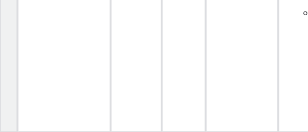

||Control|Loại|Trư ờng bắt buộ c|Giá trị mặc định|Mô tả|Validate|
|---|---|---|---|---|---|---|
|1|Quay lại|Butto n||Enable|Cho phép người dùng nhập quay trở về màn hình Đăng nhập||

##### 3.3. Màn hình Nhập OTP

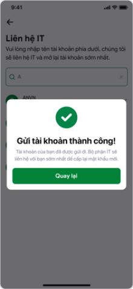

<!-- Trang 58 -->

||Control|Loại|Trư ờng bắt buộ c|Giá trị mặc định|Mô tả|Validate|
|---|---|---|---|---|---|---|
|1|Nhập OTP|Numb erbox|Có||Cho phép người dùng nhập mã OTP được gửi về qua email. Bao gồm 6 ô numberbox tương ứng với OTP 6 chữ số. Mỗi numberbox chỉ được nhập 1 chữ số. → Sau khi người dùng nhập đủ 6 chữ số, hệ thống tự động check validation của dãy số với OTP được gửi. Nếu thành công, chuyển sang màn hình Tạo mật khẩu mới, thực hiện UC Tạo mật khẩu mới|Giới hạn số lần nhập OTP sai (tối đa 5 lần) → Hệ thống báo popup message “Bạn đã nhập sai mã OTP 5 lần. Vui lòng gửi lại mã OTP mới.” OTP không hợp lệ hoặc hết hạn. → Hệ thống báo popup message “OTP không hợp lệ hoặc hết hạn. Vui lòng thử lại.”|
|2|Gửi lại mã [x]|Butto n||Disable|Cho phép người dùng gửi lại mã OTP qua email Hệ thống sẽ tự động tạo & gửi một email với OTP để người dùng nhập. Nội dung email gửi từ hệ thống như sau: Tiêu đề email: Yêu cầu reset mật khẩu cho tài khoản Delta Nội dung email: Chào bạn, Chúng tôi nhận được yêu cầu reset mật khẩu cho tài khoản của bạn.||

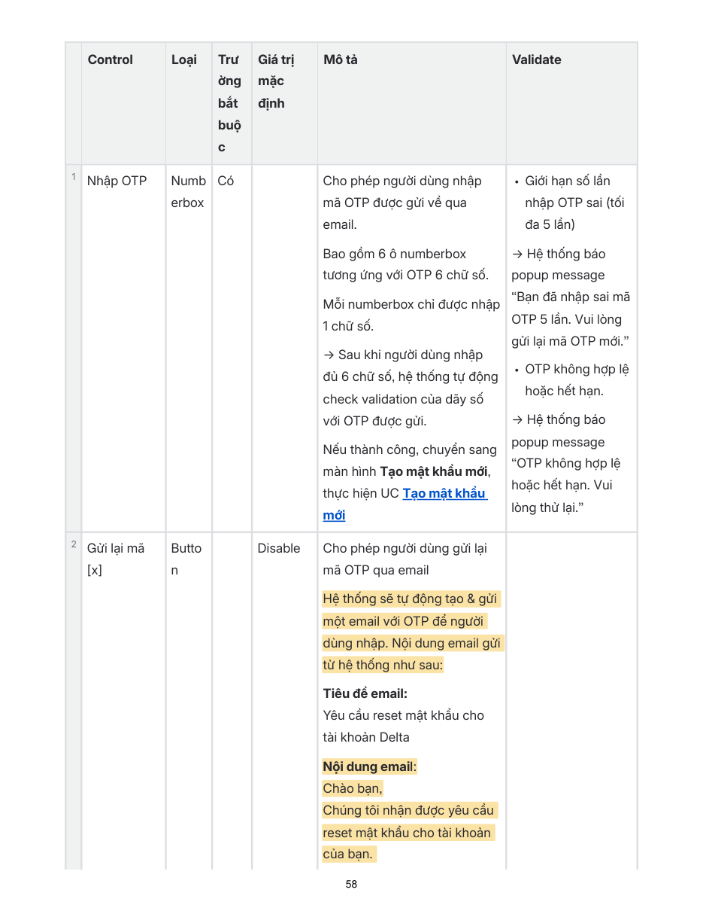

<!-- Trang 59 -->

||||Mã OTP của bạn là: [Mã OTP] (Có hiệu lực trong 5 phút) Nếu bạn không yêu cầu thay đổi mật khẩu này, vui lòng bỏ qua email này. Trân trọng, Đội ngũ hỗ trợ Delta. Mã OTP được định nghĩa như sau: OTP có độ dài 6 ký tự, được sinh ngẫu nhiên. Thời hạn OTP: 5 phút. Email được gửi phải là email reply email OTP cũ, tránh spam email công ty. Enable button lên sau thời gian expire OTP (5ph), thể hiện số giây đếm ngược còn lại trên UI button.|
|---|---|---|---|
|3|Back|Butto n|Cho phép người dùng nhập quay trở về màn hình Đăng nhập|

|Mã OTP của bạn là: [|[Mã OTP]|
|---|---|

<!-- Trang 60 -->

### UC01.01.03 - Đăng xuất

#### 1. Thông tin chung

|Mã UC - Tên UC|UC01.01.03 - Đăng xuất|
|---|---|
|Tác nhân|Người dùng ứng dụng Lái xe Delta|
|Đường dẫn|Chọn icon Avatar (góc trên bên phải màn hình) > Button Đăng xuất|
|Điều kiện trước|Người dùng đã đăng nhập vào ứng dụng Lái xe Delta|
|Điều kiện sau|Tài khoản đã đăng xuất khỏi ứng dụng Lái xe Delta Hiển thị màn hình Đăng nhập|

#### 2. Lưu đồ quy trình

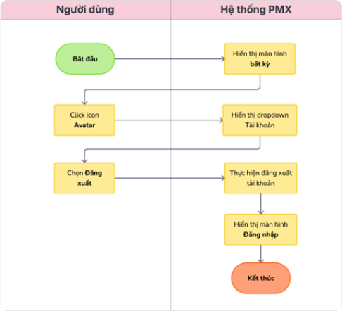

#### 3. Mô tả màn hình

##### 3.1 Màn hình Đăng xuất

<!-- Trang 61 -->

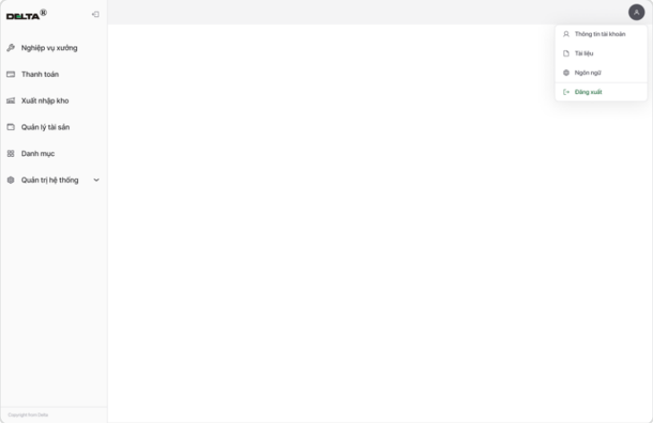

Người dụng chọn icon Avatar (góc trên bên phải màn hình) để hiển thị dropdown:

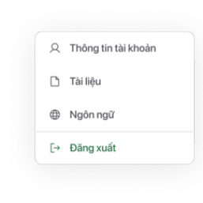

||Control|Loại|Trư ờng bắt buộ c|Giá trị mặc định|Mô tả|Validate|
|---|---|---|---|---|---|---|
|1|Đăng xuất|Butto n|||Cho phép người dùng đăng xuất khỏi hệ thống. Khi nhấn vào button Đăng xuất, hệ thống sẽ đăng xuất người dùng khỏi hệ thống và chuyển hướng người dùng về màn hình Đăng nhập.||

<!-- Trang 62 -->

### UC01.01.04 - Đổi mật khẩu

#### 1. Thông tin chung

|Mã UC - Tên UC|UC01.01.04 - Đổi mật khẩu|
|---|---|
|Tác nhân|Người dùng ứng dụng Lái xe Delta|
|Đường dẫn|Màn hình Thông tin cá nhân > Button Đổi mật khẩu|
|Điều kiện trước|Người dùng đã đăng nhập vào ứng dụng Lái xe Delta|
|Điều kiện sau|Người dùng cập nhật được mật khẩu mới cho tài khoản của mình Hiển thị popup message Thành công Hiển thị trở lại màn hình Thông tin tài khoản|

#### 2. Lưu đồ hoạt động

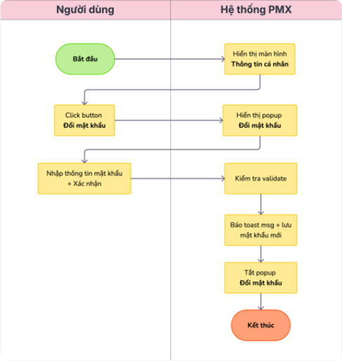

#### 3. Mô tả màn hình

<!-- Trang 63 -->

||Control|Loại|Trườ ng bắt buộ c|Giá trị mặc định|Mô tả|Validate|
|---|---|---|---|---|---|---|
|1|Tài khoản|Label|||Hiển thị Họ và tên & Tên tài khoản của người dùng hiện tại.||
|2|Mật khẩu cũ|Textb ox (short )|Có||Cho phép người dùng nhập mật khẩu cũ để xác nhận quyền truy cập.|Mật khẩu cũ phải được nhập chính xác để xác nhận quyền thay đổi mật khẩu. => Thông báo lỗi: "Mật khẩu cũ không chính xác."|
|3|Eye icon|Icon||Enable + ẩn/mã hoá pass|Cho phép người dùng bật/tắt hiển thị mật khẩu cũ.||

1 Tài khoản Label Hiển thị Họ và tên & Tên tài

<!-- Trang 64 -->

||||||Khi người dùng nhấn vào eye icon, mật khẩu sẽ hiển thị dưới dạng văn bản (plain text) Khi nhấn lại vào eye icon, mật khẩu sẽ được ẩn trở lại.||
|---|---|---|---|---|---|---|
|4|Mật khẩu mới|Textb ox (short )|Có||Cho phép người dùng nhập mật khẩu mới.|Mật khẩu mới phải có ít nhất 8 ký tự, bao gồm chữ cái, số, chữ cái viết hoa và ký tự đặc biệt. => Thông báo lỗi: “Mật khẩu phải có ít nhất 8 ký tự, bao gồm chữ cái, số, chữ cái viết hoa và ký tự đặc biệt.” Mật khẩu mới không được trùng với mật khẩu hiện tại. => Thông báo lỗi: “Mật khẩu trùng với mật khẩu cũ”|
|5|Xác nhận mật khẩu mới|Textb ox (short )|Có||Cho phép người dùng nhập lại mật khẩu mới để xác nhận.|Mật khẩu xác nhận phải trùng với mật khẩu mới. => Thông báo lỗi: "Mật khẩu xác nhận không khớp."|
|6|Xác nhận|Butto n||Enable|Cho phép người dùng xác nhận thay đổi mật khẩu. Khi nhấn vào button Xác nhận, hệ thống sẽ kiểm tra tính hợp||

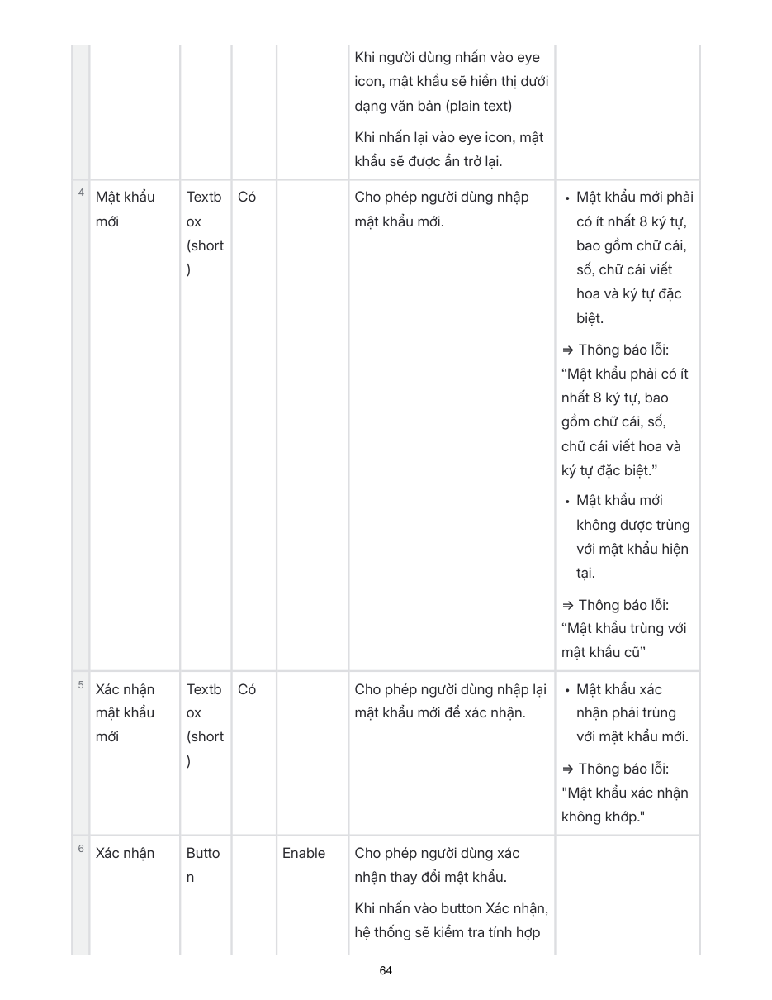

<!-- Trang 65 -->

lệ của các trường thông tin
(mật khẩu cũ, mật khẩu mới
và xác nhận mật khẩu mới).
Nếu thành công, thực hiện
cập nhật mật khẩu mới cho
tài khoản này & hiển thị
popup message Đổi mật
khẩu thành công & tắt
popup Đổi mật khẩu
(Cập nhật mật khẩu mới cả
qua hệ thống ERP Delta)
Nếu có lỗi, hệ thống sẽ hiển
thị thông báo lỗi cụ thể nêu
trên.

<!-- Trang 66 -->

### UC01.01.05 - Tạo mật khẩu mới

#### 1. Thông tin chung

|Mã UC - Tên UC|UC01.01.05 - Tạo mật khẩu mới|
|---|---|
|Tác nhân|Người dùng ứng dụng lái xe Delta|
|Đường dẫn|TH1: Màn hình Đăng nhập (đăng nhập lần đầu tiên) > Màn hình Tạo mật khẩu mới TH2: Màn hình Đăng nhập (sau khi IT ERP Delta reset thành mật khẩu mặc định) > Màn hình Tạo mật khẩu mới TH3: Link đường dẫn reset mật khẩu ở email (đi từ luồng - Reset mật khẩu bằng email) > Màn hình Tạo mật khẩu mới Quên mật khẩu|
|Điều kiện trước|TH1 & TH2: Tài khoản người dùng đang dùng mật khẩu mặc định TH3: Email tài khoản nhận được link reset mật khẩu đã gửi từ luồng - Reset mật khẩu bằng email Quên mật khẩu|
|Điều kiện sau|Người dùng cập nhật được mật khẩu mới cho tài khoản của mình Hiển thị popup message thành công Hiển thị màn hình Đăng nhập, cho phép người dùng đăng nhập với mật khẩu mới|

#### 2. Lưu đồ hoạt động

<!-- Trang 67 -->

#### 3. Mô tả màn hình

##### 3.1 Màn hình Tạo mật khẩu mới

<!-- Trang 68 -->

||Control|Loại|Trư ờng bắt buộ c|Giá trị mặc định|Mô tả|Validate|
|---|---|---|---|---|---|---|
|1|Tài khoản|Label|||Hiển thị họ và tên & tên tài khoản tương ứng sau khi nhập đúng tên tài khoản.||
|2|Mật khẩu mới|Textb ox (short )|Có||Cho phép người dùng nhập mật khẩu mới.|Mật khẩu mới phải có ít nhất 8 ký tự, bao gồm chữ cái, số, chữ cái viết hoa và ký tự đặc biệt. → Thông báo lỗi: “Mật khẩu phải có ít nhất 8 ký tự, bao gồm chữ cái, số, chữ cái viết hoa và ký tự đặc biệt.” Mật khẩu mới không được trùng với mật khẩu mặc định. → Thông báo lỗi: “Mật khẩu trùng với mật khẩu mặc định”|
|3|Eye icon|Icon||Enable + ẩn/mã hoá pass|Cho phép người dùng bật/tắt hiển thị mật khẩu cũ. Khi người dùng nhấn vào eye icon, mật khẩu sẽ hiển thị dưới dạng văn bản (plain text) Khi nhấn lại vào eye icon, mật khẩu sẽ được ẩn trở lại.||

1 Tài khoản Label Hiển thị họ và tên & tên tài

<!-- Trang 69 -->

|4|Nhập lại mật khẩu mới|Textb ox (short )|Có||Cho phép người dùng nhập lại mật khẩu mới để xác nhận.|Mật khẩu xác nhận phải trùng với mật khẩu mới. → Thông báo lỗi: "Mật khẩu xác nhận không khớp."|
|---|---|---|---|---|---|---|
|5|Đổi mật khẩu|Butto n|||Cho phép người dùng xác nhận thay đổi mật khẩu.|Sau khi nhấn, hệ thống sẽ kiểm tra tính hợp lệ của mật khẩu, Nếu thành công, hiển thị toast message "Đổi mật khẩu thành công" và tự động đăng nhập người dùng vào trang chủ Delta. Nếu thất bại, hiển thị thông báo lỗi “Đã có lỗi xảy ra, vui lòng thử lại.”|
|6|Xác nhận|Butto n||Enable|Cho phép người dùng xác nhận tạo mật khẩu mới. Khi nhấn vào button Xác nhận, hệ thống sẽ kiểm tra tính hợp lệ của các trường thông tin (mật khẩu cũ, mật khẩu mới và xác nhận mật khẩu mới). Nếu thành công, thực hiện cập nhật mật khẩu mới cho tài khoản này & hiển thị toast message Đổi mật khẩu thành công & hiển thị màn hình Đăng nhập, thực||

<!-- Trang 70 -->

hiện chức năng UC
(Cập nhật mật khẩu mới cả
qua hệ thống ERP Delta)
Nếu có lỗi, hệ thống sẽ hiển
thị thông báo lỗi cụ thể nêu
trên.
Đăng
nhập

<!-- Trang 71 -->

### UC01.01.06 - Xem thông tin cá nhân - Tài khoản nội bộ

#### 1. Thông tin chung

|Mã UC - Tên UC|UC01.01.06 - Xem thông tin cá nhân - Tài khoản nội bộ|
|---|---|
|Tác nhân|Người dùng ứng dụng Delta Super App|
|Đường dẫn|Màn hình bất kỳ > icon Avatar > Màn hình Thông tin tài khoản Màn hình bất kỳ > Icon Tài khoản trên Navigation Bar|
|Điều kiện trước|Người dùng đã đăng nhập vào ứng dụng lái xe Delta|
|Điều kiện sau|Người dùng xem được thông tin tài khoản của mình đang đăng nhập|

#### 2. Lưu đồ hoạt động

#### 3. Mô tả màn hình

##### 3.1. Màn hình Xem thông tin tài khoản

<!-- Trang 72 -->

||Control|Loại|Trư ờng bắt buộ c|Giá trị mặc định|Mô tả|Validate|
|---|---|---|---|---|---|---|
|1|Họ và tên & Tên tài khoản|Label|||Hiển thị thông tin Họ và tên của người dùng đang đăng nhập.||
|2|Trạng thái|Label|||Hiển thị trạng thái tài khoản||
|3|ID nhân viên|Label|||Hiển thị ID nhân viên||
|4|Chức vụ|Label|||Hiển thị Chức vụ, để trống nếu không có.||

2 Trạng thái Label Hiển thị trạng thái tài khoản

Label Hiển thị ID nhân viên

4 Chức vụ Label Hiển thị Chức vụ, để trống nếu

<!-- Trang 73 -->

|5|Phòng ban|Label|Hiển thị tên Phòng ban, để trống nếu không có.|
|---|---|---|---|
|6|Xưởng|Label|Hiển thị tên Xưởng, để trống nếu không có.|
|7|Ngày sinh|Label|Hiển thị Ngày sinh, để trống nếu không có.|
|8|Giới tính|Label|Hiển thị Giới tính, để trống nếu không có.|
|9|Email|Label|Hiển thị Email, để trống nếu không có.|
|1 0|Số điện thoại|Label|Hiển thị SĐT, để trống nếu không có.|
|1 1|Mã số thuế|Label|Hiển thị MST, để trống nếu không có.|
|1 2|Địa chỉ|Label|Hiển thị Địa chỉ, để trống nếu không có.|
|1 3|Ghi chú|Label|Hiển thị Ghi chú, để trống nếu không có.|
|1 4|Hành động|Butto n|Chọn để hiển thị các hoạt động người dùng có thể làm đối với tài khoản: Đổi mật khẩu => Chọn để mở popup Đổi mật khẩu, thực hiện UC Lịch sử hoạt động: Cho phép người dùng xem được lịch sử hoạt động của nhân viên -> Chọn để hiển thị popup Lịch sử hoạt động của Đổi mật khẩu|

5 Phòng ban Label Hiển thị tên Phòng ban, để

6 Xưởng Label Hiển thị tên Xưởng, để trống

7 Ngày sinh Label Hiển thị Ngày sinh, để trống

8 Giới tính Label Hiển thị Giới tính, để trống nếu

9 Email Label Hiển thị Email, để trống nếu

1 Mã số thuế Label Hiển thị MST, để trống nếu

1 2 Địa chỉ Label Hiển thị Địa chỉ, để trống nếu

1 3 Ghi chú Label Hiển thị Ghi chú, để trống nếu

<!-- Trang 74 -->

nhân viên đó
Đăng xuất: Thực hiện UC
Đăng xuất

<!-- Trang 75 -->

### UC01.01.07 - Xem thông tin tài khoản - Tài khoản cây dầu

#### 1. Thông tin chung

|Mã UC|UC01.01.07|
|---|---|
|Tên UC|Xem thông tin tài khoản — Cây dầu|
|Tác nhân|Nhân viên cây dầu mua ngoài đã đăng nhập|
|Đường dẫn|App Delta Partner Portal: Bottom Navigation → Tab Tài khoản (tab cuối) hoặc tap Avatar trên Trang chủ|
|Điều kiện trước|Đã đăng nhập. Loại tài khoản = Cây dầu.|
|Điều kiện sau|Hiển thị thông tin đầy đủ của cây dầu. Đăng xuất nếu người dùng chọn.|

Tham chiếu: Nội dung màn này tương đương UC12.04.05 (Xem chi tiết cây

dầu mua ngoài) trên web/ERP, nhưng render trên app Portal theo góc nhìn của

chính cây dầu đó (chỉ xem thông tin của mình, không có action phê duyệt/từ

chối).

#### 2. Lưu đồ hoạt động

1. Người dùng tap Tab Tài khoản hoặc Avatar trên Trang chủ.

2. Hệ thống load thông tin tài khoản cây dầu. Skeleton loader khi tải.

3. Người dùng xem thông tin (read-only). Không có action chỉnh sửa trực tiếp trên màn này.

4. Người dùng tap "Đăng xuất" → MSC-02 Confirm → Đăng xuất, redirect về màn đăng nhập.

#### 3. Mô tả màn hình

##### 3.1 Màn hình Tài khoản

<!-- Trang 76 -->

|Tên thành phần|Contr ol|Loại|Bắt buộc|Giá trị mặc định|Mô tả|Validate|
|---|---|---|---|---|---|---|
|Avatar cây dầu|Image|—|—|—|Hình tròn lớn (~80px), căn giữa. Ảnh đại diện cây dầu. Không có ảnh → fallback icon no data.|—|
|Tên cây dầu|Label|Text|—|—|Font bold 20px, căn giữa. VD: "Petrolimex Đường Láng".|—|
|Mã đối tác|Label|Text|—|—|"Mã đối tác: XXXXXXXX" — font regular, xám, căn giữa.|—|

Section: Thông tin cây dầu

<!-- Trang 77 -->

|Thuộc nhà cung cấp HHDV|Card|—|—|—|Label nhỏ xám "Thuộc nhà cung cấp HHDV". Card: Avatar chữ cái (nền màu theo tên) + Tên NCC (bold) + Mã NCC · Mô tả ngắn (xám nhỏ). (Xem UC12.04.05 STT 11)|—|
|---|---|---|---|---|---|---|
|Người đại diện|Card|—|—|—|Label nhỏ xám "Người đại diện". Card: Avatar chữ cái (nền xanh lá) + Tên người đại diện (bold) + Mã NV · Chức vụ (xám nhỏ). (Xem UC12.04.05 STT 13)|—|
|Địa chỉ|Label|Text|—|—|Label nhỏ xám "Địa chỉ". Giá trị: địa chỉ đầy đủ (bold, đen).|—|
|Ghi chú|Textar ea|Text|—|—|Label nhỏ xám "Ghi chú". Giá trị trong box nền xám nhạt, font italic. Ẩn hoàn toàn nếu không có giá trị(App Common 2.10).|—|

**Section: Hạn mức**

<!-- Trang 78 -->

Icon chart tròn + label "Hạn mức".

Dữ liệu theo tháng hiện tại, reset đầu tháng mới.

(Xem UC12.04.05 STT 15–19)

|Đã cấp|Label|Numb er|—|—|Dot cam + label "Đã cấp" (trái). Giá trị: X,XXX,XXX L (font lớn, cam).|—|
|---|---|---|---|---|---|---|
|Còn lại|Label|Numb er|—|—|Dot xanh lá + label "Còn lại" (phải). Giá trị: X,XXX,XXX L (font lớn, xanh lá).|—|
|Progress bar hạn mức|—|—|—|—|Thanh ngang 2 màu: cam = đã cấp, xanh = còn lại. Bên dưới: "X% tổng hạn mức" (cam, trái) + "Y%" (xanh, phải). (Xem UC12.04.05 STT 19)|—|
|Loại hợp đồng|Label|Text|—|—|Label nhỏ xám "Loại hợp đồng" (trái) + giá trị "Đặt cọc" / "Tín chấp" (bold, phải).|—|
|Số tiền đặt cọc|Label|Numb er|Hidden|—|Chỉ hiển thị khi Loại hợp đồng = "Đặt cọc". Label "Số tiền đặt cọc" (trái) + giá trị "X,XXX,XXX đ" (bold, phải).|—|

Section: Hợp đồng

Icon tài liệu + label "Hợp đồng".

(Xem UC12.04.05 STT 20–22)

<!-- Trang 79 -->

||||||Ẩn hoàn toàn khi Tín chấp (App Common 2.10).||
|---|---|---|---|---|---|---|
|Button Đăng xuất|Button|—|—|—|Full-width, text màu đỏ nhạt, icon [→ ra ngoài bên trái. Không có border/background. Tap → MSC-02 Confirm: "Bạn có chắc muốn đăng xuất?" → Button "Ở lại" + Button "Đăng xuất" (đỏ) → Đăng xuất, redirect về màn đăng nhập.|—|
|Bottom Navigation|—|—|—|—|3 tab: Trang chủ · Thông báo · Tài khoản (active).|—|

Ghi chú màn hình: Màn này chỉ đọc — không có action chỉnh sửa. Mọi thay

đổi thông tin cây dầu phải thực hiện qua CBQL trên Delta ERP (UC12.04.06).

Hạn mức hiển thị theo tháng hiện tại và tự động reset về 0 vào đầu tháng mới.

<!-- Trang 80 -->

## Epic 02 - Đơn mua dịch vụ sửa chữa ngoài

<!-- Trang 81 -->

### 02 - Thông báo & Lịch sử hoạt động

Danh sách các thông báo và lịch sử hoạt động (chức năng xem thêm ở ) của

Common rules

phần Mua hàng hoá dịch vụ như sau:

|Đối tượ|Hệ thống|Thời điểm|Nội dung thông báo|Đối tượng nhận thông báo|Nội dung lịch sử hoạt động|
|---|---|---|---|---|---|
|ng|trigge r|||||
|Tạo mới|PM Xưởng|Sau khi người dùng tạo thành công yêu cầu tạo.|PO - Mua HHDV Yêu cầu mua HHDV - [Loại đơn] đang chờ phê duyệt.|Hệ thống PM Xưởng: Hiển thị đối với người dùng có quyền phê duyệt/từ chối yêu cầu tạo mới lần 1.|[Tên tài khoản thực hiện hành động] hh:mm dd/mm/yyyy Đã tạo yêu cầu tạo mới|
||PM Xưởng|Sau khi người dùng huỷ thành công yêu cầu tạo.|PO - Mua HHDV Yêu cầu mua HHDV - [Loại đơn] đã bị huỷ.|Hệ thống PM Xưởng: Hiển thị đối với người dùng có quyền phê duyệt/từ chối yêu cầu tạo mới lần 1.|[Tên tài khoản thực hiện hành động] hh:mm dd/mm/yyyy Đã huỷ yêu cầu tạo mới|
||PM Xưởng|Sau khi người dùng phê duyệt lần 1 thành công yêu cầu tạo.|PO - Mua HHDV Yêu cầu mua HHDV - [Loại đơn] đã được phê duyệt lần 1.|Hệ thống PM Xưởng: Hiển thị đối với người dùng đã tạo yêu cầu tạo mới.|[Tên tài khoản thực hiện hành động] hh:mm dd/mm/yyyy Đã phê duyệt yêu cầu tạo mới lần 1|
||PM Xưởng|Sau khi người dùng từchối|PO - Mua HHDV|Hệ thống PM Xưởng:|[Tên tài khoản thực hiện hành động]|
||ưởg|dù g từc ố thành công yêu||ưởg|ệ à độg] hh:mm dd/mm/yyyy|

<!-- Trang 82 -->

||cầu tạo ở lần phê duyệt 1.|Yêu cầu mua HHDV - [Loại đơn] đã bị từ chối ở lần phê duyệt 1.|Hiển thị đối với người dùng đã tạo yêu cầu tạo mới và người dùng có quyền phê duyệt/từ chối yêu cầu tạo mới lần 2.|Đã từ chối yêu cầu tạo mới ở lần phê duyệt 1. Lý do: [Lý do người dùng nhập khi thực hiện hành động]|
|---|---|---|---|---|
|PM Xưởng|Sau khi người dùng phê duyệt lần 2 thành công yêu cầu tạo.|PO - Mua HHDV Yêu cầu mua HHDV - [Loại đơn] đã được phê duyệt lần 2.|Hệ thống PM Xưởng: Hiển thị đối với người dùng đã tạo yêu cầu tạo mới/phê duyệt lần 1.|[Tên tài khoản thực hiện hành động] hh:mm dd/mm/yyyy Đã phê duyệt yêu cầu tạo mới lần 2|
|PM Xưởng|Sau khi người dùng từ chối thành công yêu cầu tạo ở lần phê duyệt 2. Loại đơn không phải là đơn mua dịch vụ SC ngoài hay đơn mua dịch vụ SC PT hỏng ở xưởng ngoài.|PO - Mua HHDV Yêu cầu mua HHDV - [Loại đơn] đã bị từ chối ở lần phê duyệt 2.|Hệ thống PM Xưởng: Hiển thị đối với người dùng đã tạo yêu cầu tạo mới/phê duyệt lần 1.|[Tên tài khoản thực hiện hành động] hh:mm dd/mm/yyyy Đã từ chối yêu cầu tạo mới ở lần phê duyệt 2. Lý do: [Lý do người dùng nhập khi thực hiện hành động]|
|PM Xưởng|Sau khi người dùng từ chối thành công yêu cầu tạo ở lần phê duyệt 2.|PO - Mua HHDV Yêu cầu mua HHDV - [Loại đơn] đã bị từ chối ở lần phê duyệt 2.|Hệ thống PM Xưởng: Hiển thị đối với người dùng đã tạo yêu cầu tạo||

|Hệ thống|PM|
|---|---|

|-|[Loại đơn]|đã bị từ|
|---|---|---|

<!-- Trang 83 -->

|||Loại đơn là đơn mua dịch vụ SC ngoài hay đơn mua dịch vụ SC PT hỏng ở xưởng ngoài.||mới/phê duyệt lần 1. Hệ thống App Lái xe: Hiển thị đối với người dùng là lái xe của phương tiện được chọn tới.||
|---|---|---|---|---|---|
|Ngh iệm thu|App Lái xe|Sau khi người dùng từ app Lái xe nghiệm thu thành công lệnh sửa chữa.|PO - Nghiệm thu Yêu cầu mua HHDV - [Loại đơn] đã được nghiệm thu thành công.|Hệ thống PM Xưởng: Hiển thị đối với người dùng đã tạo yêu cầu tạo mới/phê duyệt lần 1 và lần 2.|[Tên tài khoản thực hiện hành động] hh:mm dd/mm/yyyy Đã nghiệm thu|
||APP Lái xe|Sau khi người dùng từ app Lái xe từ chối nghiệm thu thành công lệnh sửa chữa.|PO - Nghiệm thu Yêu cầu mua HHDV - [Loại đơn] đã bị từ chối nghiệm thu.|Hệ thống PM Xưởng: Hiển thị đối với người dùng đã tạo yêu cầu tạo mới/phê duyệt lần 1 và lần 2.|[Tên tài khoản thực hiện hành động] hh:mm dd/mm/yyyy Đã từ chối nghiệm thu Lý do: [Lý do người dùng nhập khi thực hiện hành động]|

|Loại đơn|là|
|---|---|

**Các loại đơn HHDV bao gồm:**

Mua hàng hoá

Mua dịch vụ

Mua dịch vụ có phương tiện

Mua dịch vụ sửa chữa xe ngoài

Mua dịch vụ sửa phụ tùng hỏng ở xưởng ngoài

Điều hướng sau khi nhấn vào thông báo: Dẫn đến màn hình Thông tin đơn mua HHDV

<!-- Trang 84 -->

### 02 - Lưu đồ trạng thái cho đơn mua HHDV

|Trạng thái|Hệ thốn g trigg er|Thời điểm (Trigger)|Hành động ở PM Xưởng (chưa tính phân quyền)|Hành động ở APP Lái xe (chưa tính phân quyền)|
|---|---|---|---|---|
|Chờ phê duyệt|PM Xưởn g|Sau khi người dùng tạo yêu cầu tạo mới|Phê duyệt yêu cầu tạo mới ở lần phê duyệt 1 Từ chối yêu cầu tạo mới ở lần phê duyệt 1 Huỷ yêu cầu tạo mới||
|Đã huỷ|PM Xưởn g|Sau khi người dùng huỷ yêu cầu tạo mới|Xoá yêu cầu Tạo mới yêu cầu||
|Đã từ chối|PM Xưởn g|Sau khi người dùng từ chối yêu cầu tạo mới ở lần phê duyệt 1,2|Xoá yêu cầu Tạo mới yêu cầu||

<!-- Trang 85 -->

|Đã phê duyệt - lần 1|PM Xưởn g|Sau khi người dùng phê duyệt yêu cầu tạo mới ở lần phê duyệt 1|Phê duyệt yêu cầu tạo mới ở lần phê duyệt 2 Từ chối yêu cầu tạo mới ở lần phê duyệt 2 Huỷ yêu cầu tạo mới||
|---|---|---|---|---|
|Đã phê duyệt - lần 2|PM Xưởn g|Sau khi người dùng phê duyệt yêu cầu tạo mới ở lần phê duyệt 2 Trường hợp loại đơn không phải là đơn mua DVSC ngoài hoặc sửa chữa PT hỏng ở xưởng ngoài|Tạo phiếu nhập kho Tạo phiếu đề nghị thanh toán||
|Chờ nghiệm thu|PM Xưởn g|Sau khi người dùng phê duyệt yêu cầu tạo mới ở lần phê duyệt 2 Trường hợp loại đơn là đơn mua DVSC ngoài hoặc sửa chữa PT hỏng ở xưởng ngoài|Tạo phiếu nhập kho Tạo phiếu đề nghị thanh toán Hai nghiệp vụ trên sẽ xử lý sau ở giai đoạn tiếp theo.|Nghiệm thu Từ chối nghiệm thu|
|Đã nghiệm thu|APP Lái xe|Sau khi người dùng nghiệm thu đơn mua HHDV.|||
|Từ chối nghiệm thu|APP Lái xe|Sau khi người dùng từ chối nghiệm thu đơn mua HHDV.|Tạo mới yêu cầu||

|Sau khi người dùng|phê|
|---|---|

|nghiệm thu|đơn mua|
|---|---|

|Sau khi người dùng|từ chối|
|---|---|

|nghiệm thu|đơn mua|
|---|---|

<!-- Trang 86 -->

### UC02.01.01 - Xem danh sách đơn mua DVSC ngoài

#### 1. Thông tin chung

|Mã UC - Tên UC|UC02.01.01 - Xem lịch sử mua hàng hoá dịch vụ|
|---|---|
|Tác nhân|Người dùng ứng dụng Lái xe|
|Đường dẫn|Màn hình Trang chủ >> chọn card Dịch vụ sửa chữa ngoài|
|Điều kiện trước|Người dùng đã được cấp tài khoản trên ứng dụng Lái xe Delta Trạng thái tài khoản là: Đang hoạt động Tài khoản có quyền truy cập vào ứng dụng Lái xe Delta|
|Điều kiện sau|Hệ thống hiển thị lịch sử mua dịch vụ thành công.|

#### 2. Lưu đồ hoạt động

#### 3. Mô tả màn hình

##### 3.1. Màn hình Lịch sử mua dịch vụ sửa chữa ngoài

<!-- Trang 87 -->

Hiển thị đơn mua hàng theo các điều kiện sau:

Là đơn mua hàng loại mua DVSC ngoài

PT mua dịch vụ là PT của người dùng hiện tại

Trạng thái Chờ nghiệm thu thì mới hiển thị, sau đó nếu có từ chối thì vẫn keep hiện bản ghi

đấy

||Control|Loại|Trườ ng bắt buộ c|Giá trị mặc định|Mô tả|Validate|
|---|---|---|---|---|---|---|
|1|Thanh tìm kiếm|Searc h box|||Cho phép tìm kiếm gần đúng các dữ liệu trong toàn bộ bảng (trừ trạng thái)||
|2|Bộ lọc|Sideb ar|||Xem mô tả phần Cho phép lọc các cột sau: Thời gian tạo đơn Thời gian đặt hàng Loại đơn dịch vụ (SC xe, SC phụ tùng hỏng) Nhà cung cấp Người phụ trách Trạng thái Common Rules||
|3|Thời gian tạo đơn|Label|||Hiển thị thời gian tạo đơn mua HHDV||
|4|Mã đơn hàng|Label|||Hiển thị mã đơn hàng (chỉ có khi ở trạng thái đã phê duyệt 2 lần)||
|5|Người phụ trách|Label|||Hiển thị người phụ trách của đơn mua dịch vụ||
|6|Tổng GTTT|Colu mn|||Hiển thị tổng giá trị thanh toán của đơn mua HHDV||

<!-- Trang 88 -->

|7|Trạng thái|Colu mn|Hiển thị trạng thái hiện tại của bản ghi (xem thêm ở ) Lưu đồ trạng thái|
|---|---|---|---|

<!-- Trang 89 -->

### UC02.01.02 - Xem thông tin chi tiết đơn mua dịch vụ ngoài

#### 1. Thông tin chung

|Mã UC - Tên UC|UC02.01.02 - Xem thông tin chi tiết đơn mua dịch vụ ngoài|
|---|---|
|Tác nhân|Người dùng ứng dụng Lái xe Delta|
|Đường dẫn|Màn hình Danh sách đơn mua dịch vụ ngoài > Nhấn vào 1 bản ghi trong bảng: Hiển thị màn hình thông tin đơn mua dịch vụ|
|Điều kiện trước|Người dùng đã được cấp tài khoản trên ứng dụng Lái xe Delta Trạng thái tài khoản là: Đang hoạt động Tài khoản có quyền truy cập vào ứng dụng Lái xe Delta|
|Điều kiện sau|Hiển thị thông tin chi tiết đơn mua dịch vụ ngoài thành công.|

#### 2. Lưu đồ hoạt động

#### 3. Mô tả màn hình

##### 3.1 Màn hình Thông tin đơn mua HHDV

<!-- Trang 90 -->

<!-- Trang 91 -->

<!-- Trang 92 -->

||Control|Loại|Trườ ng bắt buộ c|Giá trị mặc định|Mô tả|Validate|
|---|---|---|---|---|---|---|
|1|Collapse/Ex pand|Icon||Collapse d.|Cho phép người dùng đóng mở xem thanh tiến trình của nghiệp vụ Trạng thái expanded: Trạng thái collpased:||
|2|Thanh tiến trình|Proce ss bar|||Hiển thị trạng thái hiện tại của quy trình. Các trạng thái của tiến trình đã được định nghĩa trong . Hiển thị tiến trình theo trường hợp Mua dịch vụ sửa chữa ngoài - Có báo cáo sự cố từ lái xe: Có 4 bước nghiệp vụ: Báo cáo SC Chuẩn đoán Mua HHDV Thanh toán Common Rules||

Icon Collapse

<!-- Trang 93 -->

||||Hiển thị tiến trình theo trường hợp Mua dịch vụ sửa chữa ngoài - Không có báo cáo sự cố từ lái xe: Có 3 bước nghiệp vụ: Chuẩn đoán Mua HHDV Thanh toán All steps disable trừ Báo cáo SC và Mua HHDV để cho phép người dùng ấn vào để xem thông tin bản ghi chi tiết. State của từng step phải được lưu dưới BE để cập nhật đúng trạng thái của từng step. Thanh tiến trình trên chỉ mô tả tiến trình ban đầu, có thể thay đổi tùy theo trường hợp thực tế, chi tiết sẽ được mô tả thêm ở tài liệu tổng hợp các trường hợp thanh tiến trình.|
|---|---|---|---|
|3|Tab|Tab|Hiển thị tab: Thông tin Chi tiết SC|
|4|Thông tin|||
|5|[TT] Thông tin chung|||
|6|Mã đơn hàng|Label|Hiển thị mã đơn HHDV (nếu có)|
|7|Trạng thái|Label|Hiển thị trạng thái hiện tại của đơn mua HHDV|

3 Tab Tab Hiển thị tab:

7 Trạng thái Label Hiển thị trạng thái hiện tại của

<!-- Trang 94 -->

|8|Phân luồng|Label|Hiển thị phân luồng theo từng trường hợp: Sửa chữa xe Sửa chữa phụ tùng|
|---|---|---|---|
|9|Nhà cung cấp|Hyper link|Hiển thị nhà cung cấp HHDV của đơn mua hàng.|
|1 0|Số điện thoại|Label|Hiển thị số điện thoại của nhà cung cấp HHDV|
|1 1|Địa chỉ|Label|Hiển thị địa chỉ của nhà cung cấp HHDV|
|1 2|Phương thức thanh toán|Label|Hiển thị phương thức thanh toán của đơn mua hàng|
|1 3|Biển số xe|Label|Hiển thị tên phương tiện sử dụng dịch vụ|
|1 4|[TT] Thông tin khác|||
|1 5|Tên tài khoản - Tên người phụ trách||Hiển thị tên tài khoản - tên phụ trách của đơn mua HHDV|
|1 6|Thời gian sửa chữa||Hiển thị thời gian sửa chữa|
|1 7|Ghi chú|Text|Hiển thị ghi chú của đơn mua HHDV|
|1 8|Chi tiết đơn|||
|1 9|Tab|Tab|Hiển thị tab: Hàng hoá Dịch vụ Hiển thị tổng số item trong từng tab.|

8 Phân luồng Label Hiển thị phân luồng theo từng

1 Địa chỉ Label Hiển thị địa chỉ của nhà cung

1 3 Biển số xe Label Hiển thị tên phương tiện sử

7 Ghi chú Text Hiển thị ghi chú của đơn mua

9 Tab Tab Hiển thị tab:

<!-- Trang 95 -->

|2 0|[CTĐ] Chi tiết hàng hoá: Hiển thị chi tiết danh sách hàng hoá mua từ nhà cung cấp HHDV||||
|---|---|---|---|---|
|2 1|Expand/Coll apse|Icon|Expande d|Cho phép người dùng mở rông/thu gọn thông tin của card hàng hoá Collapsed: Expanded:|
|2 2|Hàng hoá|Card||Hiển thị mã - tên hàng hoá của hàng hoá|
|2 3|Icon hàng hoá|Icon||Sử dụng icon để hiển thị theo từng loại hàng hoá như sau: : Công cụ dụng cụ : Phụ tùng vật tư : Lốp : Ắc quy|
|2 4|Số lượng|Colu mn|Expande d|Hiển thị số lượng của hàng hoá|
|2 5|Thành tiền|Colu mn|Expande d|Hiển thị tổng giá của hàng hoá|
|2 6|[CTĐ] Chi tiết dịch vụ: Hiển thị chi tiết danh sách dịch vụ từ nhà cung cấp HHDV||||

Icon Expande

2 2 Hàng hoá Card Hiển thị mã - tên hàng hoá

<!-- Trang 96 -->

|2 7|Expand/Coll apse|Icon|Expande d|Cho phép người dùng mở rông/thu gọn thông tin của card hàng hoá Collapsed: Expanded:|
|---|---|---|---|---|
|2 8|Dịch vụ|Colu mn||Hiển thị mã dịch vụ của dịch vụ|
|2 9|Icon dịch vụ|Icon||Sử dụng icon sau:|
|3 0|Số lượng|Colu mn|Expande d|Hiển thị số lượng của dịch vụ|
|3 1|Thành tiền|Colu mn|Expande d|Hiển thị tổng giá của dịch vụ|
|3 2|Tổng cộng||||
|3 3|Expand/Coll apse||Collapse d|Cho phép người dùng mở rộng xem thêm các thông tin về giá tiền tổng. Collapsed: Expanded:|

Icon Expande

Icon Sử dụng icon sau:

<!-- Trang 97 -->

|3 4|Tổng giá trị đơn hàng trước thuế||Collapse d|Hiển thị tổng giá trị đơn hàng trước thuế|
|---|---|---|---|---|
|3 5|Tiền thuế||Collapse d|Hiển thị tiền thuế của đơn hàng|
|3 6|Tổng giá trị đơn hàng sau thuế||Collapse d|Hiển thị tổng giá trị đơn hàng sau thuế|
|3 7|Chiết khấu||Collapse d|Hiển thị chiết khấu của đơn hàng|
|3 8|Tổng giá trị thanh toán|||Hiển thị tổng giá trị thanh toán của đơn hàng|
|3 9|Nghiệm/Từ chối|Butto n|Enable|Cho phép người dùng được phân quyền thực hiện hành động tương ứng. Hiển thị tương ứng theo phân quyền người dùng và trạng thái của đối tượng (xem thêm ở Lưu đồ trạng thái) Người dùng chọn tới hành động để thực hiện UC: Nghiệm thu/từ chối nghiệm thu đơn mua dịch vụ|

3 5 Tiền thuế Collapse

3 7 Chiết khấu Collapse

<!-- Trang 98 -->

|4 0|Lịch sử hoạt động|Butto n|Enable|Chọn để hiển thị popup Lịch sử hoạt động, xem thêm ở Thông báo & Lịch sử hoạt động|
|---|---|---|---|---|
|4 1||Icon|Enable|Click icon để đóng màn hình, quay lại màn hình Lịch sử đơn mua HHDV|

##### 3.5 Màn hình Thông tin hàng hoá/dịch vụ

||Control|Loại|Trư ờng bắt buộ c|Giá trị mặc định|Mô tả|Validate|
|---|---|---|---|---|---|---|
|1|Tên hàng hoá/dịch vụ|Label|||Hiển thị tên hàng hoá hoặc dịch vụ thêm vào||

<!-- Trang 99 -->

||||Hàng hoá hay dịch vụ tuỳ theo loại đơn mua hàng|
|---|---|---|---|
|2|Mã hàng hoá/dịch vụ|Label|Hiển thị mã hàng hoá hoặc dịch vụ thêm vào Hàng hoá hay dịch vụ tuỳ theo loại đơn mua hàng|
|3|Số lượng|Label|Hiển thị số lượng|
|4|Đơn giá|Label|Hiển thị đơn giá|
|5|Đơn vị tiền tệ|Label|Hiển thị đơn vị tiền tệ|
|6|Tỷ giá|Label|Hiển thị tỷ giá|
|7|Tương đương|Label|Hiển thị tương đương|
|8|Chiết khấu|Label|Hiển thị chiết khấu|
|9|Giá trị chiết khấu|Label|Hiển thị giá trị chiết khấu|
|1 0|Giá sau chiết khấu|Label|Hiển thị giá sau chiết khấu|
|1 1|Thuế suất|Label|Hiển thị thuế suất|
|1 2|Giá trị thuế|Label|Hiển thị giá trị thuế|
|1 3|Thành tiền sau thuế|Label|Hiển thị thành tiền sau thuế|
|1 4|Tổng giá trị đơn hàng|Label|Hiển thị tổng giá trị đơn hàng|
|1 5|Thông tin danh mục của hàng hoá/dịch vụ: Hiển thị thông tin danh mục theo loại hàng hoá/dịch vụ như sau: Hàng hoá Công cụ dụng cụ Loại công cụ dụng cụ|||

3 Số lượng Label Hiển thị số lượng

4 Đơn giá Label Hiển thị đơn giá

Label Hiển thị đơn vị tiền tệ

6 Tỷ giá Label Hiển thị tỷ giá

Label Hiển thị tương đương

8 Chiết khấu Label Hiển thị chiết khấu

1 1 Thuế suất Label Hiển thị thuế suất

1 2 Giá trị thuế Label Hiển thị giá trị thuế

<!-- Trang 100 -->

Đơn vị tính

Phụ tùng vật tư/Lốp/Ắc quy

Loại phương tiện

Mã PT - Tên PT

Hệ thống tổng thành

Đơn vị tính

Dịch vụ:

Dịch vụ kỹ thuật

Loại phương tiện

Mã PT - Tên PT

Hệ thống tổng thành

Đơn vị tính

<!-- Trang 101 -->

### UC02.01.03 - Nghiệm thu/Từ chối nghiệm thu dịch vụ sửa chữa ngoài

#### 1. Thông tin chung

|Mã UC - Tên UC|UC02.01.03 - Nghiệm thu/Từ chối nghiệm thu dịch vụ sửa chữa ngoài|
|---|---|
|Tác nhân|Người dùng ứng dựng lái xe|
|Đường dẫn|Màn hình Thông tin đơn mua dịch vụ (xem): chọn button Nghiệm thu/Từ chối|
|Điều kiện trước|Người dùng đã được cấp tài khoản trên ứng dụng Lái xe Delta Trạng thái tài khoản là: Đang hoạt động Tài khoản có quyền truy cập vào ứng dụng Lái xe Delta Trạng thái bản ghi là Chờ nghiệm thu|
|Điều kiện sau|Trạng thái của bản ghi thay đổi từ Chờ nghiệm thu → Đã nghiệm thu/Từ chối nghiệm thu Tắt popup Xác nhận nghiệm thu/từ chối và hiển thị màn hình Thông tin đơn mua dịch vụ|

#### 2. Lưu đồ hoạt động

#### 3. Mô tả màn hình

##### 3.1 Màn hình Xác nhận từ chối nghiệm thu

<!-- Trang 102 -->

||Control|Loại|Trườ ng bắt buộ c|Giá trị mặc định|Mô tả|Validate|
|---|---|---|---|---|---|---|
|1|Lý do từ chối|Textb ox (Short )|Khô ng||Cho phép người dùng nhập lý do từ chối đơn mua dịch vụ.||
|2|Xác nhận|Butto n||Enable|Cho phép người dùng xác nhận từ chối đơn mua dịch vụ. Sau khi xác nhận, Trạng thái của bản ghi thay đổi từ Chờ nghiệm thu → Đã từ chối Trạng thái của tiến trình chuyển từ Đang triển khai → Đã hủy/từ chối Gửi thông báo tới người dùng đã tạo/phê duyệt đơn mua dịch vụ này với nội dung: PO - Mua HHDV Đơn mua HHDV - [Loại đơn] đã bị từ chối nghiệm thu. Lưu 1 bản ghi hoạt động mới ở Lịch sử hoạt động: [Tên tài khoản thực hiện hành động] hh:mm dd/mm/yyyy Đã từ chối nghiệm thu.||

<!-- Trang 103 -->

|||||Lý do: [Lý do người dùng nhập]|
|---|---|---|---|---|
|3|Huỷ bỏ|Butto n|Enable|Cho phép người dùng huỷ bỏ việc xác nhận từ chối đơn mua dịch vụ. Sau khi huỷ bỏ, Trạng thái bản ghi giữ nguyên: Chờ nghiệm thu Đóng popup và trở về màn hình Thông tin đơn mua dịch vụ.|

##### 3.2 Màn hình Thông tin đơn mua dịch vụ (Xem) - Trạng thái Từ chối nghiệm thu

Các trường thông tin đã được mô tả ở UC ở đây không có thêm hành

Xem thông tin chi tiết

động ở trạng thái Từ chối nghiệm thu (xem đầy đủ các hành động theo từng trạng thái ở

Lưu đồ

trạng thái

).

##### 3.3 Màn hình Xác nhận nghiệm thu

<!-- Trang 104 -->

||Control|Loại|Trườ ng bắt buộ c|Giá trị mặc định|Mô tả|Validate|
|---|---|---|---|---|---|---|
|1|Xác nhận|Butto n||Enable|Cho phép người dùng xác nhận nghiệm thu cấp mới. Sau khi xác nhận, Trạng thái của bản ghi thay đổi từ Chờ nghiệm thu → Đã nghiệm thu Trạng thái của tiến trình chuyển từ Đang triển khai → Đã hoàn thành Đóng popup Xác nhận nghiệm thu và hiển thị màn hình Thông tin đơn mua dịch vụ. Gửi thông báo tới người dùng đã tạo/phê duyệt đơn mua dịch vụ này với nội dung: PO - Mua HHDV Đơn mua HHDV - [Loại đơn] đã được nghiệm thu.||

<!-- Trang 105 -->

|||||Lưu 1 bản ghi hoạt động mới ở Lịch sử hoạt động: [Tên tài khoản thực hiện hành động] hh:mm dd/mm/yyyy Đã nghiệm thu.|
|---|---|---|---|---|
|2|Huỷ|Butto n|Enable|Cho phép người dùng huỷ bỏ việc xác nhận nghiệm thu đơn mua dịch vụ. Sau khi huỷ bỏ, Trạng thái bản ghi giữ nguyên: Chờ nghiệm thu Đóng popup và trở về màn hình Thông tin đơn mua dịch vụ|

##### 3.4 Màn hình Thông tin đơn mua dịch vụ (Xem) - Trạng thái Đã nghiệm thu

Các trường thông tin đã được mô tả ở UC ở đây không có thêm hành

Xem thông tin chi tiết

động ở trạng thái Đã nghiệm thu (xem đầy đủ các hành động theo từng trạng thái ở

Lưu đồ

trạng thái

).

<!-- Trang 106 -->

## Epic 03 - Lệnh sửa chữa

<!-- Trang 107 -->

### 03 - Thông báo & Lịch sử hoạt động

Danh sách các thông báo và lịch sử hoạt động (chức năng xem thêm ở ) của

Common rules

phần Lệnh sửa chữa như sau:

|Đối tượ|Hệ thống|Thời điểm/ Điều kiện|Nội dung thông báo|Đối tượng nhận thông báo|Nội dung lịch sử hoạt động|
|---|---|---|---|---|---|
|ng|trigge r|||||
|Tạo mới|PM Xưởng|Sau khi người dùng tạo thành công lệnh sửa chữa. Loại lệnh SC = sửa chữa xe/thay lốp/thay ắc quy|Lệnh sửa chữa - Tạo mới Lệnh sửa chữa đối với xe [Biển số xe] được bắt đầu triển khai.|Hệ thống PM Xưởng: Hiển thị đối với người dùng có quyền chốt lệnh sửa chữa và lái xe của phương tiện Delta được đưa vào sửa chữa (trên app Lái xe)|[Tên tài khoản thực hiện hành động] hh:mm dd/mm/yyyy Đã tạo lệnh sửa chữa|
||PM Xưởng|Sau khi người dùng tạo thành công lệnh sửa chữa. Loại lệnh SC = phục hồi phụ tùng hỏng|Lệnh sửa chữa - Tạo mới Lệnh sửa chữa - Phục hồi phụ tùng hỏng được bắt đầu triển khai.|Hệ thống PM Xưởng: Hiển thị đối với người dùng có quyền chốt lệnh sửa chữa.||
|Chốt lệnh|PM Xưởng|Sau khi người dùng chốt|Lệnh sửa chữa - Chốt lệnh Lệnh sửa chữa đối với|Hệ thống PM Xưởng: Hiển thịđối với|[Tên tài khoản thực hiện hành động] hh:mm dd/mm/yyyy|
|||thành|Lệnh sửa chữa đối với xe [Biển số xe] đã|Hiển thị đối với người dùng tạo||

|Hệ thống|PM|
|---|---|

|Hệ thống|PM|
|---|---|

|Hệ thống|PM|
|---|---|

<!-- Trang 108 -->

||công lệnh sửa chữa. Loại lệnh SC = sửa chữa xe/thay lốp/thay ắc quy|được chốt lệnh và sẵn sàng nghiệm thu.|chốt lệnh sửa chữa và lái xe của phương tiện Delta được đưa vào sửa chữa (trên app Lái xe)|Đã chốt lệnh sửa chữa|
|---|---|---|---|---|
|PM Xưởng|Sau khi người dùng cập nhật chốt thành công lệnh sửa chữa. Loại lệnh SC = sửa chữa xe/thay lốp/thay ắc quy|Lệnh sửa chữa - Chốt lệnh Lệnh sửa chữa đối với xe [Biển số xe] đã được cập nhật chốt lệnh và sẵn sàng nghiệm thu.|Hệ thống PM Xưởng: Hiển thị đối với người dùng tạo lệnh sửa chữa. Hệ thống APP Lái xe: Hiển thị đối với người dùng lái xe của phương tiện Delta được đưa vào sửa chữa.|[Tên tài khoản thực hiện hành động] hh:mm dd/mm/yyyy Đã cập nhật chốt lệnh sửa chữa|
|PM Xưởng|Sau khi người dùng chốt thành công lệnh sửa chữa. Loại lệnh SC = phục hồi phụ tùng hỏng|Lệnh sửa chữa - Chốt lệnh Lệnh sửa chữa - Phục hồi phụ tùng hỏng đã được chốt lệnh.|Hệ thống PM Xưởng: Hiển thị đối với người dùng tạo chốt lệnh sửa chữa|[Tên tài khoản thực hiện hành động] hh:mm dd/mm/yyyy Đã chốt lệnh sửa chữa|
|PM Xưởng|Sau khi người dùng cập nhật chốt|Lệnh sửa chữa - Chốt lệnh Lệnh sửa chữa - Phục hồi phụ tùng|Hệ thống PM Xưởng: Hiển thị đối với người dùng tạo|[Tên tài khoản thực hiện hành động] hh:mm dd/mm/yyyy|

|Hệ thống|APP Lái|
|---|---|

<!-- Trang 109 -->

|||thành công lệnh sửa chữa. Loại lệnh SC = phục hồi phụ tùng hỏng|hỏng đã được cập nhật chốt lệnh.|chốt lệnh sửa chữa|Đã cập nhật chốt lệnh sửa chữa|
|---|---|---|---|---|---|
|Nghi ệm thu|App Lái xe|Sau khi người dùng từ app Lái xe nghiệm thu thành công lệnh sửa chữa.|Lệnh sửa chữa - Nghiệm thu Lệnh sửa chữa đối với xe [Biển số xe] đã được nghiệm thu thành công.|Hệ thống PM Xưởng: Hiển thị đối với người dùng tạo chốt lệnh sửa chữa và người có quyền chốt lệnh sửa chữa.|[Tên tài khoản thực hiện hành động] hh:mm dd/mm/yyyy Đã nghiệm thu lệnh sửa chữa|
||App Lái xe|Sau khi người dùng từ app Lái xe từ chối nghiệm thu thành công lệnh sửa chữa.|Lệnh sửa chữa - Nghiệm thu Lệnh sửa chữa đối với xe [Biển số xe] đã bị từ chối nghiệm thu.|Hệ thống PM Xưởng: Hiển thị đối với người dùng tạo chốt lệnh sửa chữa và người có quyền chốt lệnh sửa chữa.|[Tên tài khoản thực hiện hành động] hh:mm dd/mm/yyyy Đã từ chối nghiệm thu lệnh sửa chữa Lý do: [Lý do người dùng nhập khi thực hiện hành động]|

|Hệ thống|PM|
|---|---|

|Hệ thống|PM|
|---|---|

**Các loại lệnh sửa chữa bao gồm:**

Sửa chữa xe Delta/khách hàng

Thay lốp xe Delta/khách hàng

Thay ắc quy xe Delta/khách hàng

Phục hồi phụ tùng hỏng

Điều hướng sau khi nhấn vào thông báo: Dẫn đến màn hình Thông tin lệnh SC

<!-- Trang 110 -->

### 03 - Lưu đồ trạng thái cho lệnh sửa chữa

|Trạng thái|Hệ thống trigger|Thời điểm (Trigger)|Hành động ở PM Xưởng (chưa tính phân quyền)|Hành động ở APP Lái xe|
|---|---|---|---|---|
|Đang sửa chữa|PM Xưởng|Sau khi người dùng hoàn thành tạo lệnh sửa chữa.|Xuất kho (đối với trường hợp sửa chữa xe/thay lốp/thay ắc quy) Chốt lệnh||
|Đã chốt lệnh|PM Xưởng|Sau khi người dùng chốt lệnh sửa chữa.|Cập nhật chốt lệnh|Nghiệm thu Từ chối nghiệm thu|
|Đã nghiệm thu|APP Lái xe|Sau khi người dùng (từ app Lái xe) nghiệm thu lệnh sửa chữa.|Thanh toán (đối với trường hợp trả trước) Nhập kho (nếu có phát sinh khối lượng dư không sử dụng)||
|Từ chối nghiệm thu|APP Lái xe|Sau khi người dùng (từ app Lái xe) từ chối nghiệm thu lệnh sửa chữa.|Cập nhật chốt lệnh||

<!-- Trang 111 -->

<!-- Trang 112 -->

### UC03.01.01 - Xem danh sách lệnh sửa chữa

#### 1. Thông tin chung

|Mã UC - Tên UC|UC03.01.01 - Xem lịch sử sửa chữa|
|---|---|
|Tác nhân|Người dùng ứng dụng Lái xe|
|Đường dẫn|Màn hình Trang chủ >> chọn card Sửa chữa xe|
|Điều kiện trước|Người dùng đã được cấp tài khoản trên ứng dụng Lái xe Delta Trạng thái tài khoản là: Đang hoạt động Tài khoản có quyền truy cập vào ứng dụng Lái xe Delta|
|Điều kiện sau|Hệ thống hiển thị lịch sử sửa chữa thành công.|

#### 2. Lưu đồ hoạt động

#### 3. Mô tả màn hình

##### 3.1. Màn hình Lịch sử sửa chữa

<!-- Trang 113 -->

**Hiển thị lệnh sửa chữa theo các điều kiện sau:**

Là lệnh sửa chữa mà khách hàng = Delta

Phương tiện được sửa chữa là phương tiện của người dùng hiện tại

Trạng thái Đã chốt lệnh SC thì mới hiển thị, sau đó nếu có từ chối thì vẫn keep hiện bản ghi

đấy

||Control|Loại|Trườ ng bắt buộ c|Giá trị mặc định|Mô tả|Validate|
|---|---|---|---|---|---|---|
|1|Thanh tìm kiếm|Searc h box|||Cho phép tìm kiếm gần đúng các dữ liệu trong toàn bộ bảng (trừ trạng thái)||
|2|Bộ lọc|Sideb ar|||Xem mô tả phần Common Rules.||

<!-- Trang 114 -->

||||Cho phép lọc các cột sau: Thời gian tạo Người phụ trách Trạng thái|
|---|---|---|---|
|3|Thời gian tạo|Colu mn|Hiển thị thời gian tạo lệnh sửa chữa|
|4|Mã lệnh|Colu mn|Hiển thị mã lệnh sửa chữa|
|5|Người phụ trách|Colu mn|Hiển thị người phụ trách của lệnh sửa chữa|
|6|Trạng thái|Colu mn|Hiển thị trạng thái hiện tại của bản ghi (xem thêm ở ) Lưu đồ trạng thái|

<!-- Trang 115 -->

### UC03.01.02 - Xem thông tin chi tiết lệnh sửa chữa

#### 1. Thông tin chung

|Mã UC - Tên UC|UC05.06.02 - Xem thông tin lệnh sửa chữa|
|---|---|
|Tác nhân|Người dùng ứng dụng Lái xe Delta|
|Đường dẫn|Màn hình Danh sách lệnh sửa chữa > Nhấn vào 1 bản ghi trong bảng: Hiển thị màn hình thông tin lệnh sửa chữa|
|Điều kiện trước|Người dùng đã được cấp tài khoản trên ứng dụng Lái xe Delta Trạng thái tài khoản là: Đang hoạt động Tài khoản có quyền truy cập vào ứng dụng Lái xe Delta|
|Điều kiện sau|Hiển thị thông tin chi tiết lệnh sửa chữa thành công.|

#### 2. Lưu đồ hoạt động

#### 3. Mô tả màn hình

##### 3.1 Màn hình Thông tin Lệnh sửa chữa

<!-- Trang 116 -->

<!-- Trang 117 -->

**Thông tin Lệnh sửa chữa bao gồm:**

Thông tin chung

Thông tin phương tiện

Chi tiết hàng hoá/dịch vụ

Thông tin khác

Tổng cộng

||Control|Loại|Trườ ng bắt buộ c|Giá trị mặc định|Mô tả|Validate|
|---|---|---|---|---|---|---|
|1|Collapse/Ex pand|Icon||Collapse d.|Cho phép người dùng đóng mở xem thanh tiến trình của nghiệp vụ Trạng thái expanded: Trạng thái collpased:||

Icon Collapse

<!-- Trang 118 -->

|2|Thanh tiến trình|Proce ss bar|Hiển thị trạng thái hiện tại của quy trình. Các trạng thái của tiến trình đã được định nghĩa trong . Hiển thị tiến trình theo từng trường hợp: Hiển thị tiến trình theo trường hợp Không có báo cáo sự cố: Có 3 bước nghiệp vụ: Chuẩn đoán Sửa chữa Xuất kho Hiển thị tiến trình theo trường hợp Có báo cáo sự cố: Có 4 bước nghiệp vụ: Báo cáo sự cố Chuẩn đoán Sửa chữa Xuất kho All steps disable trừ Báo cáo SC và Lệnh SC để cho phép người dùng ấn vào để xem thông tin bản ghi chi tiết. Common Rules|
|---|---|---|---|

<!-- Trang 119 -->

|||||State của từng step phải được lưu dưới BE để cập nhật đúng trạng thái của từng step. Thanh tiến trình trên chỉ mô tả tiến trình ban đầu, có thể thay đổi tùy theo trường hợp thực tế, chi tiết sẽ được mô tả thêm ở tài liệu tổng hợp các trường hợp thanh tiến trình.|
|---|---|---|---|---|
|3|Tab|Tab|Chung|Chia tab: Chung Chi tiết SC|
|4|[Chung] Thông tin chung||||
|5|Trạng thái|Label||Hiển thị trạng thái hiện tại của lệnh sửa chữa|
|6|Mã sửa chữa|Label||Hiển thị mã lệnh sửa chữa|
|7|Phân luồng|Label||Hiển thị trường hợp phân luồng hiện tại của Lệnh sửa chữa, bao gồm: Sửa xe Thay lốp Thay ắc quy → Tuỳ thuộc vào trường hợp người dùng chọn khi tạo Lệnh sửa chữa.|
|8|Biển số xe|Hyper link||Hiển thị biển số xe của phương tiện sử dụng dịch vụ.|
|9|Số kms|Label||Hiển thị số kms hiện tại của xe khi đưa vào sửa chữa|
|1 0|Mô tả sự cố|Label||Hiển thị mô tả sự cố theo báo cáo sự cố/yêu cầu sửa chữa|

3 Tab Tab Chung Chia tab:

5 Trạng thái Label Hiển thị trạng thái hiện tại của

7 Phân luồng Label Hiển thị trường hợp phân

9 Số kms Label Hiển thị số kms hiện tại của xe

1 0 Mô tả sự cố Label Hiển thị mô tả sự cố theo báo

<!-- Trang 120 -->

|||||từ app Lái xe.|
|---|---|---|---|---|
|1 1|[Chung] Thông tin khác||||
|1 2|Người phụ trách|||Hiển thị mã NV - tên người phụ trách của Lệnh sửa chữa|
|1 3|Thời gian sửa chữa|||Hiển thị thời gian sửa chữa|
|1 4|Ghi chú|Text||Hiển thị ghi chú của Lệnh sửa chữa|
|1 5|Chi tiết sửa chữa: Bao gồm 2 tab: Hàng hoá, dịch vụ.||||
|1 6|Tab|Tab||Hiển thị tab đang được hiển thị tương ứng Hàng hoá Dịch vụ Thể hiện số lượng hàng hoá/dịch vụ/số lần xuất kho ở cuối tên tab. Ví dụ: Phụ tùng vật tư (3)|
|1 7|[CTSC] Chi tiết hàng hoá: Hiển thị chi tiết danh sách hàng hoá tổng hợp sau khi chốt lệnh sửa chữa mà cung cấp/sửa chữa cho phương tiện.||||
|1 8|Sub-tab|Tab|Thay ra|Hiển thị tab của hàng hoá Thay ra Lắp vào|
|1 9|Xem sơ đồ lốp|Butto n||Hiển thị màn hình Sơ đồ lốp của phương tiện (sơ đồ hiện tại - sau khi đã chốt lệnh SC) Chỉ trong trường hợp loại sửa chữa = thay lốp.|
|2 0|[CTSC] [HH] Thay ra: Hiển thị danh sách các hàng hoá được thay ra khỏi phương tiện Delta.||||

1 4 Ghi chú Text Hiển thị ghi chú của Lệnh sửa

1 6 Tab Tab Hiển thị tab đang được hiển thị

<!-- Trang 121 -->

**UI mỗi bản ghi:**

|2 1|Phụ tùng vật tự/lốp/ ắc quy|Colu mn||Hiển thị mã-tên hàng hoá của hàng hoá được ghi nhận thay ra khỏi phương tiện khi chốt lệnh SC|
|---|---|---|---|---|
|2 2|ĐVT|Colu mn||Hiển thị đơn vị tính của hàng hoá được ghi nhận thay ra khỏi phương tiện khi chốt lệnh SC|
|2 3|Số lượng|Colu mn||Hiển thị số lượng của hàng hoá được ghi nhận thay ra khỏi phương tiện khi chốt lệnh SC|
|2 4|Collapse/Ex pand|Icon|Collapse d|Cho phép người dùng ẩn hiện các thông tin serial của hàng hoá|
|2 5|Serial|Colu mn||Hiển thị serial của từng sản phẩm|
|2 6|Nhà sản xuất|Colu mn||Hiển thị nhà sản xuất của từng sản phẩm|
|2 7|Lưu ý|Colu mn||Hiển thị lưu ý của từng sản phẩm|
|2 8|[CTSC] [HH] Lắp vào: Hiển thị danh sách các hàng hoá được lắp vào phương tiện. Hàng hoá sẽ được tổng hợp từ số lượng sử dụng (=số lượng xuất - số lượng thừa - số lượng hỏng) của hàng xuất kho + số lượng sử dụng của hàng xuất từ xưởng. UI mỗi bản ghi:||||

Icon Collapse

<!-- Trang 122 -->

|2 9|Phụ tùng vật tư/lốp/ ắc quy|Label||Hiển thị mã-tên hàng hoá của hàng hoá|
|---|---|---|---|---|
|3 0|ĐVT|Label||Hiển thị đơn vị tính của hàng hoá|
|3 1|Số lượng|Label||Hiển thị tổng số lượng lắp vào của hàng hoá|
|3 2|Thành tiền|Label||Hiển thị thành tiền của hàng hoá. Lấy theo giá trị = số lượng * đơn giá của hàng hoá đó.|
|3 3|Collapse/Ex pand|Icon|Collapse d|Cho phép người dùng ẩn hiện các thông tin của hàng hóa (Đơn vị tính/số lượng)|
|3 4|Chi tiết dịch vụ: Hiển thị chi tiết danh sách dịch vụ mà xưởng hiện tại cung cấp cho lệnh sửa chữa.||||
|3 5|Dịch vụ|Colu mn||Hiển thị mã-tên dịch vụ của dịch vụ|
|3 6|Số lượng|Colu mn||Hiển thị số lượng của dịch vụ|
|3 7|Thành tiền|Colu mn||Hiển thị tổng giá của dịch vụ|
|3 8|Tổng cộng||||

3 0 ĐVT Label Hiển thị đơn vị tính của hàng

3 1 Số lượng Label Hiển thị tổng số lượng lắp vào

2 Thành tiền Label Hiển thị thành tiền của hàng

Icon Collapse

<!-- Trang 123 -->

|3 9|Tổng giá trị sửa chữa|||Hiển thị tổng giá trị sửa chữa của Lệnh sửa chữa Lấy giá trị bằng = tổng thành tiền của các hàng hoá lắp vào từ kho và danh mục xưởng + tổng thành tiền của dịch vụ.|
|---|---|---|---|---|
|4 0|Từ chối/Nghiệ m thu|Butto n|Enable|Cho phép người dùng được phân quyền thực hiện hành động tương ứng. Hiển thị tương ứng theo phân quyền người dùng và trạng thái của đối tượng (xem thêm ở Người dùng chọn tới hành động để thực hiện 1 trong các UC: Lưu đồ trạng thái của Danh mục) Nghiệm thu/từ chối nghiệm thu lệnh sửa chữa|
|4 1|Lịch sử hoạt động|Butto n|Enable|Chọn để hiển thị popup Lịch sử hoạt động, xem thêm ở Thông báo & Lịch sử hoạt động|
|4 2||Icon|Enable|Click icon để đóng màn hình, quay lại màn hình Lịch sử sửa chữa|

##### 3.2 Màn hình Sơ đồ lốp

<!-- Trang 124 -->

Cho phép người dùng ấn vào từng lốp để xem thông tin chi tiết của quả lốp đó.

<!-- Trang 125 -->

||Control|Loại|Trườ ng bắt buộ c|Giá trị mặc định|Mô tả|Validate|
|---|---|---|---|---|---|---|
|1||Icon|||Cho phép người dùng xem chú thích cho sơ đồ lốp. Hệ thống hiển thị popup Chú thích||
|2||Icon||Enable|Click icon để đóng màn hình, quay lại màn hình Thông tin sửa chữa||
|3|Thông tin serial → Lấy các thông tin trên từ lệnh sửa chữa lốp mới nhất (nếu có) hoặc thông tin của PT (cập nhật).||||||
|4|Icon lốp|Icon|||Hiển thị icon theo lốp được chọn||
|5|Serial lốp|Label|||Hiển thị serial của lốp tương ứng được chọn||
|6|Lốp|Label|||Hiển thị tên - mã lốp tương ứng được chọn||
|7|Vị trí|Label|||Hiển thị vị trí lốp trên sơ đồ lốp của phương tiện||
|8|Ngày lắp lên phương tiện|Label|||Hiển thị ngày lắp lốp lên PT - lấy theo ngày chốt lệnh SC||

1 Icon Cho phép người dùng xem

4 Icon lốp Icon Hiển thị icon theo lốp được

5 Serial lốp Label Hiển thị serial của lốp tương

6 Lốp Label Hiển thị tên - mã lốp tương

7 Vị trí Label Hiển thị vị trí lốp trên sơ đồ lốp

<!-- Trang 126 -->

|9|Vị trí tráo đổi|Label|Hiển thị vị trí trao đổi trước đó của lốp Hiện trường này nếu tráo đổi vị trí|
|---|---|---|---|

##### 3.3 Màn hình Chú thích

##### 3.4 Màn hình Serial

<!-- Trang 127 -->

**Hiển thị mỗi bản ghi serial thành 1 card con.**

||Control|Loại|Trườ ng bắt buộ c|Giá trị mặc định|Mô tả|Validate|
|---|---|---|---|---|---|---|
|1|Tên popup||||Hiển thị tên popup theo tên hàng hóa được chọn xem serial con Format: Mã - tên hàng hóa||
|2|Serial|Colu mn|||Hiển thị serial của từng sản phẩm||
|3|Nhà sản xuất|Colu mn|||Hiển thị nhà sản xuất của từng sản phẩm||
|4|Lưu ý|Colu mn|||Hiển thị lưu ý của từng sản phẩm||

1 Tên popup Hiển thị tên popup theo tên

<!-- Trang 128 -->

### UC03.01.03 - Nghiệm thu/Từ chối nghiệm thu lệnh sửa chữa nội bộ

#### 1. Thông tin chung

|Mã UC - Tên UC|UC03.01.03 - Nghiệm thu/Từ chối nghiệm thu lệnh sửa chữa nội bộ|
|---|---|
|Tác nhân|Người dùng ứng dụng lái xe|
|Đường dẫn|Màn hình Thông tin lệnh sửa chữa nội bộ (xem): chọn button Nghiệm thu/Từ chối|
|Điều kiện trước|Người dùng đã được cấp tài khoản trên ứng dụng Lái xe Delta Trạng thái tài khoản là: Đang hoạt động Tài khoản có quyền truy cập vào ứng dụng Lái xe Delta Trạng thái bản ghi là Chờ nghiệm thu|
|Điều kiện sau|Trạng thái của bản ghi thay đổi từ Chờ nghiệm thu → Đã nghiệm thu/Từ chối nghiệm thu Tắt popup Xác nhận nghiệm thu/từ chối và hiển thị màn hình Thông tin lệnh sửa chữa nội bộ|

#### 2. Lưu đồ hoạt động

#### 3. Mô tả màn hình

##### 3.1 Màn hình Xác nhận từ chối nghiệm thu

<!-- Trang 129 -->

||Control|Loại|Trườ ng bắt buộ c|Giá trị mặc định|Mô tả|Validate|
|---|---|---|---|---|---|---|
|1|Lý do từ chối|Textb ox (Short )|Khô ng||Cho phép người dùng nhập lý do từ chối lệnh sửa chữa nội bộ.||
|2|Từ chối|Butto n||Enable|Cho phép người dùng xác nhận từ chối lệnh sửa chữa nội bộ. Sau khi xác nhận, Trạng thái của bản ghi thay đổi từ Chờ nghiệm thu → Đã từ chối Trạng thái của tiến trình chuyển từ Đang triển khai → Đã huỷ/từ chối||

<!-- Trang 130 -->

|||||Gửi thông báo tới người dùng đã tạo/chốt lệnh sửa chữa nội bộ này với nội dung: Lệnh sửa chữa - Nghiệm thu Lệnh sửa chữa đối với xe [Biển số xe] đã bị từ chối nghiệm thu. Lưu 1 bản ghi hoạt động mới ở Lịch sử hoạt động: [Tên tài khoản thực hiện hành động] hh:mm dd/mm/yyyy Đã từ chối nghiệm thu. Lý do: [Lý do người dùng nhập]|
|---|---|---|---|---|
|3|Huỷ bỏ|Butto n|Enable|Cho phép người dùng huỷ bỏ việc xác nhận từ chối lệnh sửa chữa nội bộ. Sau khi huỷ bỏ, Trạng thái bản ghi giữ nguyên: Chờ nghiệm thu Đóng popup và trở về màn hình Thông tin lệnh sửa chữa nội bộ.|

##### 3.2 Màn hình Thông tin lệnh sửa chữa nội bộ (Xem) - Trạng thái Từ chối nghiệm thu

<!-- Trang 131 -->

Các trường thông tin đã được mô tả ở UC ở đây không có thêm hành

Xem thông tin chi tiết

động ở trạng thái Từ chối nghiệm thu (xem đầy đủ các hành động theo từng trạng thái ở

Lưu đồ

trạng thái

).

##### 3.3 Màn hình Xác nhận nghiệm thu

<!-- Trang 132 -->

||Control|Loại|Trườ ng bắt buộ c|Giá trị mặc định|Mô tả|Validate|
|---|---|---|---|---|---|---|
|1|Xác nhận|Butto n||Enable|Cho phép người dùng xác nhận nghiệm thu cấp mới. Sau khi xác nhận, Trạng thái của bản ghi thay đổi từ Chờ nghiệm thu → Đã nghiệm thu Trạng thái của tiến trình chuyển từ Đang triển khai → Đã hoàn thành Đóng popup Xác nhận nghiệm thu và hiển thị màn hình Thông tin lệnh sửa chữa nội bộ. Gửi thông báo tới người dùng đã tạo/chốt lệnh sửa chữa nội bộ này với nội dung: Lệnh sửa chữa - Nghiệm thu Lệnh sửa chữa đối với xe [Biển số xe] đã được nghiệm thu thành công. Lưu 1 bản ghi hoạt động mới ở Lịch sử hoạt động: [Tên tài khoản thực hiện hành động] hh:mm dd/mm/yyyy Đã nghiệm thu.||

<!-- Trang 133 -->

|2|Huỷ bỏ|Butto n|Enable|Cho phép người dùng huỷ bỏ việc xác nhận nghiệm thu lệnh sửa chữa nội bộ. Sau khi huỷ bỏ, Trạng thái bản ghi giữ nguyên: Chờ nghiệm thu Đóng popup và trở về màn hình Thông tin lệnh sửa chữa nội bộ|
|---|---|---|---|---|

##### 3.4 Màn hình Thông tin lệnh sửa chữa nội bộ (Xem) - Trạng thái Đã nghiệm thu

Các trường thông tin đã được mô tả ở UC ở đây không có thêm hành

Xem thông tin chi tiết

động ở trạng thái Đã nghiệm thu (xem đầy đủ các hành động theo từng trạng thái ở

Lưu đồ

trạng thái

).

<!-- Trang 134 -->

## Epic 04 - Báo cáo sự cố & Thanh toán chi phí lái xe

<!-- Trang 135 -->

### 04 - Thông báo & Lịch sử hoạt động

Danh sách các thông báo và lịch sử hoạt động (chức năng xem thêm ở ) của

Common rules

phần Báo cáo sự cố như sau:

|Đối tượ|Hệ thống|Thời điểm/Điều kiện|Nội dung thông báo|Đối tượng nhận thông báo|Nội dung lịch sử hoạt động|
|---|---|---|---|---|---|
|ng|trigge r|||||
|Tạo mới|App Lái xe|Sau khi người dùng tạo thành công bản ghi.|Báo cáo sự cố Báo cáo sự cố cho phương tiện [Biển số xe] đang chờ phê duyệt.|Hệ thống PM Xưởng: Hiển thị đối với người dùng có quyền xác nhận/chuẩn đoán/từ chối bản ghi.|[Tên tài khoản thực hiện hành động] hh:mm dd/mm/yyyy Đã tạo mới báo cáo sự cố.|
||App Lái xe|Sau khi người dùng thu hồi thành công bản ghi.|Báo cáo sự cố Báo cáo sự cố cho phương tiện [Biển số xe] đã bị thu hồi.|Hệ thống PM Xưởng: Hiển thị đối với người dùng có quyền xác nhận/chuẩn đoán/từ chối bản ghi.|[Tên tài khoản thực hiện hành động] hh:mm dd/mm/yyyy Đã thu hồi báo cáo sự cố.|
||PM Xưởn g|Sau khi người dùng xác nhận thành công bản ghi. Báo cáo sự cố có cách giải quyết = lái xe|Báo cáo sự cố Báo cáo sự cố cho phương tiện [Biển số xe] đã bị từ chối.|Hệ thống App Lái xe: Hiển thị đối với người dùng đã tạo yêu cầu tạo mới.|[Tên tài khoản thực hiện hành động] hh:mm dd/mm/yyyy Đã xác nhận báo cáo sự cố.|
||PM|Sau khi người|Báo cáo sựcố|Hệthống App|[Tên tài khoản thực|
||Xưởn|Sau gườ dùng từ chối|áo cáo sựcố|ệt ốg pp Lái xe:|[ ê tà oả t ực hiện hành động]|

<!-- Trang 136 -->

||g|thành công yêu cầu tạo.|Báo cáo sự cố cho phương tiện [Biển số xe] đã được xác nhận.|Hiển thị đối với người dùng đã tạo yêu cầu tạo mới.|hh:mm dd/mm/yyyy Đã từ chối báo cáo sự cố. Lý do: [Lý do người dùng nhập khi thực hiện hành động]|
|---|---|---|---|---|---|
|Chu ẩn đoá n|PM Xưởn g|Sau khi người dùng phê duyệt thành công bản ghi báo giá tương ứng. Báo cáo sự cố có cách giải quyết = xưởng|Báo cáo sự cố Báo cáo sự cố cho phương tiện [Biển số xe] đã được chuẩn đoán.|Hệ thống App Lái xe: Hiển thị đối với người dùng đã tạo yêu cầu tạo mới.|[Tên tài khoản thực hiện hành động] hh:mm dd/mm/yyyy Đã chuẩn đoán sự cố.|

**Điều hướng sau khi nhấn vào thông báo: Dẫn đến màn hình Thông tin báo cáo sự cố.**

<!-- Trang 137 -->

### 04 - Lưu đồ trạng thái cho báo cáo sự cố

|Trạng thái|Nơi xuất phát hành động|Thời điểm (Trigger)|Hành động ở PM Xưởng (chưa tính phân quyền)|Hành động ở APP Lái xe|
|---|---|---|---|---|
|Đang chờ xử lý|App Lái xe|Sau khi người dùng hoàn thành tạo mới báo cáo sự cố.|Xác nhận (PMX) nếu cách giải quyết = lái xe Chuẩn đoán (PMX) nếu cách giải quyết = xưởng Từ chối (PMX)|Thu hồi (ALX)|
|Đang xử lý|PM Xưởng|Sau khi người dùng hoàn thành tạo mới báo giá chuẩn đoán.|||
|Đã thu hồi|App Lái xe|Sau khi người dùng thu hồi báo cáo sự cố.||Tạo lại (ALX) Xoá (ALX)|

<!-- Trang 138 -->

|Đã chuẩn đoán|PM Xưởng|Sau khi người dùng phê duyệt báo giá tương ứng với báo cáo sự cố.||
|---|---|---|---|
|Đã xác nhận|PM Xưởng|Sau khi người dùng xác nhận báo cáo sự cố.||
|Đã từ chối|PM Xưởng|Sau khi người dùng từ chối báo cáo sự cố.|Tạo lại (ALX) Xoá (ALX)|

<!-- Trang 139 -->

### UC04.01.01 - Xem danh sách báo cáo sự cố

#### 1. Thông tin chung

|Mã UC - Tên UC|UC05.07.01 - Xem danh sách báo cáo sự cố|
|---|---|
|Tác nhân|Người dùng app Lái xe|
|Đường dẫn|Dashboards > Tab Báo cáo sự cố|
|Điều kiện trước|Người dùng đã được cấp tài khoản trên ứng dụng Lái xe Delta Trạng thái tài khoản là: Đang hoạt động Tài khoản có quyền truy cập vào ứng dụng Lái xe Delta|
|Điều kiện sau|Hệ thống hiển thị lịch sử báo cáo sự cố thành công.|

#### 2. Lưu đồ hoạt động

#### 3. Mô tả màn hình

##### 3.1. Màn hình Lịch sử báo cáo sự cố

<!-- Trang 140 -->

||Control|Loại|Trườ ng bắt buộ c|Giá trị mặc định|Mô tả|Validate|
|---|---|---|---|---|---|---|
|1|Thanh tìm kiếm|Searc h box|||Cho phép tìm kiếm gần đúng các dữ liệu trong toàn bộ bảng (trừ trạng thái)||
|2|Bộ lọc|Sideb ar|||Xem mô tả phần Cho phép lọc các cột sau: Thời gian phát hiện sự cố Hệ thống tổng thành Phân loại chi phí Cách giải quyết Common Rules||

<!-- Trang 141 -->

||||Số tiền Sửa tại Địa điểm SC Trạng thái||
|---|---|---|---|---|
|3|Thời gian phát hiện sự cố|Label|Hiển thị thời gian phát hiện sự cố||
|4|Mã báo cáo sự cố|Label|Hiển thị mã báo cáo sự cố||
|5|Cách giải quyết|Label|Hiển thị cách giải quyết||
|6|Số tiền|Label|Hiển thị số tiền||
|7|Trạng thái|Label|Hiển thị trạng thái hiện tại của bản ghi (xem thêm ở ) Lưu đồ trạng thái||
|8|Tạo mới|Butto n|Cho phép người dụng tạo 1 báo cáo sự cố mới gửi về PMX. Hệ thống thực hiện UC . Tạo mới báo cáo sự cố|Validate xe không có ID xe hoặc có ID xe nhưng không lấy được biển số xe thì hệ thống báo lỗi:|

Label Hiển thị cách giải quyết

6 Số tiền Label Hiển thị số tiền

7 Trạng thái Label Hiển thị trạng thái hiện tại của

<!-- Trang 142 -->

### UC04.01.02 - Xem chi tiết báo cáo sự cố

#### 1. Thông tin chung

|Mã UC - Tên UC|UC04.01.02 - Xem chi tiết báo cáo sự cố|
|---|---|
|Tác nhân|Người dùng phần mềm xưởng|
|Đường dẫn|Màn hình Lịch sử báo cáo sự cố > Nhấn vào 1 bản ghi trong bảng: Hiển thị màn hình thông tin báo cáo sự cố|
|Điều kiện trước|Người dùng đã được cấp tài khoản trên ứng dụng Lái xe Delta Trạng thái tài khoản là: Đang hoạt động Tài khoản có quyền truy cập vào ứng dụng Lái xe Delta|
|Điều kiện sau|Hiển thị thông tin chi tiết báo cáo sự cố.|

#### 2. Lưu đồ hoạt động

#### 3. Mô tả màn hình

##### 3.1 Màn hình Thông tin báo cáo sự cố

<!-- Trang 143 -->

<!-- Trang 144 -->

Thông tin báo cáo sự cố bao gồm:

Thông tin sự cố

Giải quyết sự cố

Thông tin khác

||Control|Loại|Trườ ng bắt buộ c|Giá trị mặc định|Mô tả|Validate|
|---|---|---|---|---|---|---|
|1|Collapse/Ex pand|Icon||Collapse d.|Cho phép người dùng đóng mở xem thanh tiến trình của nghiệp vụ Trạng thái expanded: Trạng thái collpased:||

Icon Collapse

<!-- Trang 145 -->

|2|Thanh tiến trình|Proce ss bar|Hiển thị trạng thái hiện tại của quy trình. Các trạng thái của tiến trình đã được định nghĩa trong . Hiển thị tiến trình theo từng trường hợp: Hiển thị tiến trình theo trường hợp Cách giải quyết = Xưởng: Có 3 bước nghiệp vụ (ban đầu): Báo sự cố Báo giá chuẩn đoán N/A Trường hợp Cách giải quyết = Lái xe không hiển thị thanh tiến trình. All steps disable trừ Báo cáo SC và Mua HHDV để cho phép người dùng ấn vào để xem thông tin bản ghi chi tiết. State của từng step phải được lưu dưới BE để cập nhật đúng trạng thái của từng step. Thanh tiến trình trên chỉ mô tả tiến trình ban đầu, có thể thay đổi tùy theo trường hợp thực tế, chi tiết sẽ được mô tả thêm Common Rules|
|---|---|---|---|

<!-- Trang 146 -->

||||ở tài liệu tổng hợp các trường hợp thanh tiến trình.|
|---|---|---|---|
|3|Thông tin sự cố|||
|4|Trạng thái|Label|Hiển thị trạng thái hiện tại của báo cáo sự cố|
|5|Mã sự cố|Label|Hiển thị mã báo cáo sự cố (nếu có)|
|6|Biển số xe|Label|Hiển thị tên phương tiện báo cáo sự cố|
|7|Hoạt động thực hiện|Label|Hiển thị tên hoạt động nhắc lịch tương ứng được làm đầu vào để tạo báo cáo sự cố. Chỉ hiển thị khi tạo báo cáo sự cố từ 1 lịch nhắc.|
|8|Hệ thống tồng thành|Label|Hiển thị hệ thống tổng thành được chọn khi tạo báo cáo sự cố.|
|9|Mô tả sự cố|Label|Hiển thị mô tả sự cố được điền khi tạo báo cáo sự cố.|
|1 0|Vị trí hiện tại|Label|Hiển thị vị trí hiện tại khi tạo báo cáo sự cố.|
|1 1|Hình ảnh sự cố và chứng từ thanh toán|Imag e|Hiển thị các hình ảnh và chứng từ sự cố tại thời điểm bàn giao ở dạng preview. Cho phép người dùng điều hướng trước sau bằng cách scroll ngang. Hiển thị ảnh 1 dòng, nếu nhiều hơn 3 bản ghi thì cho scroll ngang.|

4 Trạng thái Label Hiển thị trạng thái hiện tại của

5 Mã sự cố Label Hiển thị mã báo cáo sự cố

6 Biển số xe Label Hiển thị tên phương tiện báo

9 Mô tả sự cố Label Hiển thị mô tả sự cố được điền

<!-- Trang 147 -->

||||Cho phép người dùng ấn vào ảnh hoặc ấn vào icon Phóng to để xem ảnh lớn hơn.|
|---|---|---|---|
|1 2|Giải quyết sự cố: Nếu cách giải quyết = lái xe, hiển thị UI như sau: Nếu cách giải quyết = xưởng, hiển thị UI no data ban đầu: Khi ở trạng thái Đã chuẩn đoán, hiển thị UI như sau:|||
|1 3|Cách giải quyết|Label|Hiển thị cách giải quyết lái xe chọn khi tạo báo cáo sự cố Giá trị: Lái xe Xưởng|
|1 4|Sửa tại|Label|Hiển thị nơi sửa chung được quyết định sau khi xưởng chuẩn đoán (hoàn thành báo giá). Giá trị: Xưởng Delta Xưởng đối tác|

4 Sửa tại Label Hiển thị nơi sửa chung được

<!-- Trang 148 -->

||||Hiển thị khi ở trạng thái Đã chuẩn đoán và cách giải quyết = xưởng.|
|---|---|---|---|
|1 5|Địa điểm sửa chữa|Label|Hiển thị địa điểm sửa chữa cho phương tiện báo cáo sự cố. Hiển thị tên nhà cung cấp HHDV nếu sửa tại = xưởng đối tác. Hiển thị tên xưởng Delta được chọn nếu sửa tại xưởng Delta. Hiển thị khi ở trạng thái Đã chuẩn đoán và cách giải quyết = xưởng.|
|1 6|Số tiền|Label|Hiển thị số tiền của báo cáo sự cố. Hiển thị nếu cách giải quyết = lái xe.|
|1 7|Phân loại chi phí|Label|Hiển thị phân loại chi phí được chọn khi tạo báo cáo sự cố. Hiển thị nếu cách giải quyết = lái xe.|
|1 8|Thông tin khác|||
|1 9|Lái xe|Label|Hiển thị tên lái xe|
|2 0|Thời gian phát hiện sự cố|Label|Hiển thị thời gian phát hiện sự cố của báo cáo sự cố.|
|2 1|Ghi chú|Label|Hiển thị ghi chú của báo cáo sự cố. Nếu không có thì không hiển thị lên giao diện.|

6 Số tiền Label Hiển thị số tiền của báo cáo

1 9 Lái xe Label Hiển thị tên lái xe

1 Ghi chú Label Hiển thị ghi chú của báo cáo

<!-- Trang 149 -->

|2 2|Thu hồi|Butto n|Enable|Cho phép người dùng được phân quyền thực hiện hành động tương ứng. Hiển thị tương ứng theo phân quyền người dùng và trạng thái của đối tượng (xem thêm ở Người dùng chọn tới hành động để thực hiện 1 trong các UC: Lưu đồ trạng thái của Danh mục) Thu hồi báo cáo sự cố|
|---|---|---|---|---|
|2 3|Lịch sử hoạt động|Butto n|Enable|Chọn để hiển thị popup Lịch sử hoạt động, xem thêm ở Thông báo & Lịch sử hoạt động|
|2 4|Đóng|Icon|Enable|Click icon để đóng màn hình, quay lại màn hình Lịch sử báo cáo sự cố|

<!-- Trang 150 -->

### UC04.01.03 - Tạo báo cáo sự cố

#### 1. Thông tin chung

|Mã UC - Tên UC|UC04.01.03 - Tạo báo cáo sự cố|
|---|---|
|Tác nhân|Người dùng ứng dụng dành cho lái xe Delta|
|Đường dẫn|Màn hình Danh sách báo cáo sự cố > Button Tạo mới > Màn hình Tạo mới báo cáo sự cố Chọn tới button Tạo báo cáo sự cố của lịch nhắc > Màn hình Tạo mới báo cáo sự cố|
|Điều kiện trước|Người dùng đã được cấp tài khoản trên ứng dụng Lái xe Delta Trạng thái tài khoản là: Đang hoạt động Tài khoản có quyền truy cập vào ứng dụng Lái xe Delta|
|Điều kiện sau|Hệ thống tạo 1 bản ghi với trạng thái Đang chờ xử lý Hiển thị popup message tạo thành công Hiển thị màn hình Thông tin báo cáo sự cố (Xem)|

#### 2. Lưu đồ hoạt động

#### 3. Mô tả màn hình

##### 3.1 Màn hình Tạo mới báo cáo sự cố

<!-- Trang 151 -->

<!-- Trang 152 -->

||Control|Loại|Trườ ng bắt buộ c|Giá trị mặc định|Mô tả|Validate|
|---|---|---|---|---|---|---|
|1|Biển số xe|Label|||Hiển thị biển số của lái xe/người hiện tại đang đăng nhập.||
|2|Hệ thống tổng thành xe|Dropd own list|Có||Cho phép chọn hệ thống tổng thành xe trong danh sách có sẵn.||

1 Biển số xe Label Hiển thị biển số của lái

<!-- Trang 153 -->

|||||Danh sách gồm: 0 - Không xác định. 1 - Động cơ – làm mát 2 - Hệ thống truyền lực. 3 - Hệ thống gầm. 4 - Hệ thống điện. 5 - Hệ thống cung cấp nhiên liệu – khí nạp. 6 - Hệ thống phụ và cabin Chỉ cho phép chọn 1 giá trị.||
|---|---|---|---|---|---|
|3|Mô tả sự cố|Long textb ox|Có|Cho phép người dùng nhập mô tả sự cố.||
|4|Hình ảnh và chứng từ thanh toán|Imag e Uploa d|Có|Cho phép người chụp hình ảnh và chứng từ thanh toán lên (real-time). File upload cho phép: file ảnh đuôi .JPG / .JPEG/ .PNG Hiển thị ban đầu (no data): Sau khi có file đã được upload, phần mềm hiển thêm thị giao diện: Người dùng có thể chọn icon X để loại bỏ file đã upload. Hình ảnh chụp realtime phải hiển thị thông tin:|Dung lượng tối đa được upload: 250MB. → Nếu vi phạm, hệ thống hiển thị message lỗi: “Dung lượng các file tải lên không quá 250MB.” ngay sau khi file được upload Các định dạng cho phép: .JPG / .JPEG/ .PNG → Nếu người dùng upload các định dạng không đúng quy định lên, hệ thống không ghi nhận file upload và báo lỗi: “File upload|

<!-- Trang 154 -->

||||||Thời gian tại thời điểm chụp Format: dd/mm/yyyy hh:mm Địa điểm chụp|lên không đúng định dạng.”|
|---|---|---|---|---|---|---|
|5|Ghi chú|Textb ox (Long )|||Cho phép người dùng nhập ghi chú.||
|6|Thời gian phát hiện sự cố|Label|||Hiển thị thời gian hiện tại khi tạo báo cáo sự cố (lấy thời gian ấn button Tạo) Format hiển thị: dd/mm/yyyy hh:mm||
|7|Vị trí hiện tại|Label|||Hiển thị địa chỉ hiện tại của lái xe. Lấy vị trí hiện tại GPS của người dùng và dùng service bên thứ 3 để trả về địa chỉ (reverse geocoding).||
|8|Cách giải quyết|Dropd own list|Có||Cho phép người dùng chọn cách giải quyết cho sự cố. Danh sách giá trị: Xưởng: xưởng hướng dẫn giải quyết Lái xe: lái xe tự giải quyết Chỉ cho phép chọn 1. → ảnh hưởng tới luồng tiếp theo sau khi tạo.||
|9|Số tiền|Numb erbox|Có|Hidden|Cho phép người dùng nhập số tiền khắc phục sự cố. Nhập tiền, số dương.|Số tiền nhập <= 2 triệu đồng. → Nếu vi phạm, hệ thống báo lỗi inline:|

<!-- Trang 155 -->

||||||Chỉ hiển thị khi cách giải quyết = lái xe.|“Số tiền >= 2 triệu phải ghi nhận qua đơn mua dịch vụ ngoài của xưởng.”|
|---|---|---|---|---|---|---|
|1 0|Phân loại chi phí|Dropd own list|Có|Hidden|Cho phép người dùng chọn tới phân loại chi phí của sự cố được báo. Danh sách giá trị bao gồm: Rửa xe Bơm mỡ Sửa xe Thay thế phụ tùng Chi phí khác Chỉ cho phép chọn 1 Chỉ hiển thị khi cách giải quyết = lái xe.||
|1 1|Tạo mới|Butto n||Enable|Cho phép người dùng hoàn tất việc tạo yêu cầu tạo mới 1 bản ghi báo cáo sự cố. Hệ thống thực hiện kiểm tra validate các trường thông tin tạo mới. Nếu tất cả hợp lệ: Hiển thị màn hình Xem chi tiết báo cáo sự cố với hành động (tuỳ theo phân quyền): Thu hồi Tạo 1 bản ghi báo cáo sự cố với trạng thái Đang chờ xử lý Gửi thông báo tới người dùng có quyền xác nhận/chuẩn đoán báo||

<!-- Trang 156 -->

cáo sự cố ở PM Xưởng
với nội dung:
Báo cáo sự cố
Báo cáo sự cố cho
phương tiện [Biển số xe]
đang chờ phê duyệt.
Lưu 1 bản ghi hoạt động
mới ở Lịch sử hoạt động:
[Tên tài khoản thực hiện
hành động] hh:mm
dd/mm/yyyy
Đã tạo mới báo cáo sự
cố.
Generate ID mới cho
phiếu báo cáo sự cố với
quy tắc như sau:
Format: [Biển
số]/BCSC[xx]
[ddmmyyyy]
Biển số: lấy biển số
phương tiện báo cáo
sự cố
xx: Mã báo cáo sự
cố chạy từ 01 đến
99, đánh số thứ tự
tăng dần nếu mà có
cùng [Biển số] và
ddmmyyyy
ddmmyyyy: lấy ngày
báo cáo sự cố của
phương tiện
Nếu có trường không hợp
lệ, thông báo lỗi (in-line
error msg) dưới trường
không hợp lệ đó.

<!-- Trang 157 -->

|1 2|Huỷ|Butto n|Enable|Cho phép người dùng huỷ bỏ tạo mới báo cáo sự cố Hệ thống hiển thị hộp thoại xác nhận huỷ tạo mới báo cáo sự cố trước khi huỷ. Xác nhận: không tạo ra bản ghi mới nào & trở về màn hình Danh sách báo cáo sự cố Hủy: trở về màn Tạo mới báo cáo sự cố với các dữ liệu đã chọn/nhập.|
|---|---|---|---|---|
|1 3||Icon||Cho phép người dùng huỷ bỏ tạo mới báo cáo sự cố Hệ thống hiển thị hộp thoại xác nhận huỷ tạo mới báo cáo sự cố trước khi huỷ. Xác nhận: không tạo ra bản ghi mới nào & trở về màn hình Danh sách báo cáo sự cố Hủy: trở về màn Tạo mới báo cáo sự cố với các dữ liệu đã chọn/nhập.|

1 3 Icon Cho phép người dùng huỷ bỏ

<!-- Trang 158 -->

##### 3.1 Màn hình Thông tin báo cáo sự cố (xem) - Trạng thái Đang chờ xử lý

<!-- Trang 159 -->

Các trường thông tin đã được mô tả ở UC , ở đây chỉ mô tả

Xem thông tin chi tiết báo cáo sự cố

thêm các hành động (xem đầy đủ các hành động theo từng trạng thái ở Lưu đồ trạng thái):

Button Thu hồi: Click vào để hiển thị popup Xác nhận thu hồi, thực hiện UC

Thu hồi báo cáo

sự cố

<!-- Trang 160 -->

### UC04.01.04 - Thu hồi báo cáo sự cố

#### 1. Thông tin chung

|Mã UC - Tên UC|UC04.01.04 - Thu hồi báo cáo sự cố|
|---|---|
|Tác nhân|Người dùng ứng dụng dành cho lái xe Delta|
|Đường dẫn|Màn hình Thông tin báo cáo sự cố(xem): chọn button Thu hồi|
|Điều kiện trước|Người dùng đã được cấp tài khoản trên ứng dụng Lái xe Delta Trạng thái tài khoản là: Đang hoạt động Tài khoản có quyền truy cập vào ứng dụng Lái xe Delta|
|Điều kiện sau|Trạng thái của bản ghi thay đổi từ Đang chờ xử lý → Đã thu hồi Hiển thị popup message thành công Tắt popup Thu hồi và hiển thị màn hình Thông tin báo cáo sự cố|

#### 2. Lưu đồ hoạt động

#### 3. Mô tả màn hình

##### 3.1 Màn hình Thu hồi báo cáo sự cố

||Control|Loại|Trườ ng bắt buộ c|Giá trị mặc định|Mô tả|Validate|
|---|---|---|---|---|---|---|
|1|Xác nhận|Butto||Enable|Cho phép người dùng xác||
|||n|||nhận thu hồi báo cáo sự cố.||

<!-- Trang 161 -->

|||||Sau khi xác nhận, Trạng thái của bản ghi thay đổi từ Đang chờ xử lý → Đã thu hồi Trạng thái của tiến trình chuyển từ Đang triển khai → Đã hủy/từ chối Đóng popup Xác nhận Thu hồi và hiển thị màn hình Thông tin báo cáo sự cố. Gửi thông báo tới người dùng đã tạo báo cáo sự cố này ở app Lái xe với nội dung: Báo cáo sự cố Báo cáo sự cố của bạn đã bị thu hồi. Lưu 1 bản ghi hoạt động mới ở Lịch sử hoạt động: [Tên tài khoản thực hiện hành động] hh:mm dd/mm/yyyy Đã thu hồi báo cáo sự cố Lý do: [Lý do người dùng nhập]|
|---|---|---|---|---|
|2|Huỷ bỏ|Butto n|Enable|Cho phép người dùng huỷ bỏ việc xác nhận thu hồi báo cáo sự cố. Sau khi huỷ bỏ, Trạng thái bản ghi giữ nguyên: Đang chờ xử lý|

<!-- Trang 162 -->

Đóng popup và trở về màn
hình Thông tin báo cáo sự
cố.

##### 3.2 Màn hình Thông tin báo cáo sự cố (Xem) - Trạng thái Đã thu hồi

Các trường thông tin đã được mô tả ở UC báo cáo sự cố, ở đây chỉ mô tả

Xem thông tin chi tiết

thêm các hành động (xem đầy đủ các hành động theo từng trạng thái ở ):

Lưu đồ trạng thái

Xoá: Cho phép người dùng xoá bản ghi đã bị thu hồi.

Chọn Xoá: Hệ thống hiển thị popup Xác nhận

<!-- Trang 163 -->

Xác nhận:

Hệ thống xoá bản ghi tương ứng

Đóng tất cả popup và trở về màn hình Lịch sử báo cáo sự cố

Huỷ: Quay trở về màn hình Thông tin báo cáo sự cố

Tạo lại: Cho phép người dùng cập nhật lại bản ghi từ thông tin đã bị thu hồi.

Chọn Tạo lại: Hệ thống hiển thị màn hình Tạo mới báo cáo sự cố, thực hiện UC Tạo mới báo

cáo sự cố với các trường lấy thông tin từ yêu cầu hiện tại (đã bị thu hồi) nhưng không sinh ra

bản ghi mới mà cập nhật thông tin chỉnh sửa và trạng thái (từ Đã thu hồi về Đang chờ xử lý)

<!-- Trang 164 -->

## Epic 05 - Lịch nhắc

<!-- Trang 165 -->

### UC05.01.01 - Xem lịch nhắc

#### 1. Thông tin chung

|Mã UC - Tên UC|UC05.01.01 - Xem lịch nhắc|
|---|---|
|Tác nhân|Người dùng ứng dụng Lái xe Delta|
|Đường dẫn|Chọn tới mục Lịch nhắc trên Navigation bar >> Màn hình Lịch nhắc|
|Điều kiện trước|Người dùng đã được cấp tài khoản trên ứng dụng Lái xe Delta Trạng thái tài khoản là: Đang hoạt động Tài khoản có quyền truy cập vào ứng dụng Lái xe Delta Lịch nhắc đã được tạo và cho phép thông báo tới lái xe ở hệ thống PM Xưởng|
|Điều kiện sau|Hệ thống hiển thị màn hình Lịch nhắc thành công. Hệ thống hiển thị đầy đủ các lịch nhắc tới hạn.|

#### 2. Lưu đồ hoạt động

#### 3. Mô tả màn hình:

##### 3.1 Màn hình Lịch nhắc

Hệ thống báo lịch nhắc cho người dùng qua thông báo và qua danh sách nhắc lịch:

Thông báo nhắc lịch:

Hôm nay bạn có [x] lịch nhắc mới và [y] lịch nhắc chưa thực hiện.

Trong đó,

x = số lượng lịch nhắc bắt đầu báo từ hôm nay

y = tổng số lịch nhắc còn lại chưa thực hiện (không tính hôm nay)

<!-- Trang 166 -->

<!-- Trang 167 -->

||Control|Loại|Trườ ng bắt buộ c|Giá trị mặc định|Mô tả|Validate|
|---|---|---|---|---|---|---|
|1|Tab||||Hiển thị tab thông tin: Chưa thực hiện Đã thực hiện Hiển thị UI tổng số lượng bản ghi lịch nhắc ở tab Chưa thực||

1 Tab Hiển thị tab thông tin:

<!-- Trang 168 -->

||||hiện cạnh tên tab như sau:|
|---|---|---|---|
|2|Collapse/Ex pand|Expande d|Cho phép người dùng mở ra/ đóng lại các lịch nhắc theo từng loại.|
|3|Phân loại||Hiển thị lịch nhắc theo các phân loại: Theo thời gian: Theo vận hành: Theo hạn thời gian:|
|4|Chưa thực hiện: Hiển thị các bản ghi lịch nhắc đến hạn nhắc lịch (từ [lần cuối thực hiện + khoảng nhắc lịch - dung sai] đến khi được ghi nhận hoàn thành qua lệnh sửa chữa) mà chưa được thực hiện. Bản ghi nhắc lịch theo thời gian: Bản ghi nhắc lịch theo vận hành (kms/giờ): Bản ghi nhắc lịch theo hạn thời gian:|||
|5|Đã thực hiện: Hiển thị các bản ghi lịch nhắc đã thực hiện và chưa đến hạn nhắc lịch. UI bản ghi:|||

3 Phân loại Hiển thị lịch nhắc theo các

<!-- Trang 169 -->

|6|Icon nhắc lịch||Hiển thị icon nhắc lịch theo tình trạng lịch nhắc: Đến thời gian nhắc lịch nhưng chưa tới điều kiện thực hiện: Quá điều kiện thực hiện:|
|---|---|---|---|
|7|Nội dung nhắc lịch|Label|Hiển thị tên hoạt động nhắc lịch.|
|8|Lần cuối thực hiện|Label|Hiển thị thời gian lần cuối thực hiện hoạt động của phương tiện. Hiển thị đối với các bản ghi nhắc lịch theo thời gian.|
|9|Ngày cần thực hiện|Label|Hiển thị thời gian cần thực hiện hoạt động của phương tiện. Hiển thị đối với các bản ghi nhắc lịch theo thời gian.|
|1 0|Số kms cuối thực hiện|Label|Hiển thị số kms cuối phương tiện thực hiện hoạt động. Hiển thị đối với các bản ghi nhắc lịch theo vận hành và phương tiện chạy vận hành theo kms.|
|1 1|Số kms cần thực hiện|Label|Hiển thị số kms cần thực hiện hoạt động của phương tiện. Hiển thị đối với các bản ghi nhắc lịch theo vận hành và|

<!-- Trang 170 -->

||||phương tiện chạy vận hành theo kms.|
|---|---|---|---|
|1 2|Số kms hiện tại|Label|Hiển thị số giờ hiện tại của phương tiện Hiển thị đối với các bản ghi nhắc lịch theo vận hành và phương tiện chạy vận hành theo giờ.|
|1 3|Số giờ cuối thực hiện|Label|Hiển thị số giờ cuối phương tiện thực hiện hoạt động. Hiển thị đối với các bản ghi nhắc lịch theo vận hành và phương tiện chạy vận hành theo giờ.|
|1 4|Số giờ cần thực hiện|Label|Hiển thị số giờ cần thực hiện hoạt động của phương tiện. Hiển thị đối với các bản ghi nhắc lịch theo vận hành và phương tiện chạy vận hành theo giờ.|
|1 5|Số giờ hiện tại|Label|Hiển thị số giờ hiện tại của phương tiện Hiển thị đối với các bản ghi nhắc lịch theo vận hành và phương tiện chạy vận hành theo giờ.|
|1 6|Ngày hết hạn|Label|Hiển thị ngày hết hạn của hoạt động nhắc lịch.|

<!-- Trang 171 -->

## Epic 06 - Phiếu cấp dầu

<!-- Trang 172 -->

### 06.00 - Lưu đồ trạng thái của phiếu cấp dầu

**1. Danh sách trạng thái**

|Trạng thái|Mã|Mô tả|Hành động|
|---|---|---|---|
|Trạng thái|Mã|Mô tả|Hành động (chưa tính phân|
||||phân quyền)|
|Bản nháp|draft|Đã lưu, chưa gửi|Tạo mới|
|Chờ phê duyệt|pending|Chờ CBQL duyệt (vòng 1 — tạo phiếu)|Phê duyệt Từ chối Thu hồi|
|Hoàn thành|done|Toàn bộ luồng hoàn tất theo từng phương thức như sau: Cây dầu nội bộ: Bơm xong, Igas trả dữ liệu thực bơm về Cây dầu mua ngoài: Đối tác chốt phiếu dầu Hoá đơn lẻ: Phê duyệt hoá đơn||
|Từ chối|rejected|Người dùng từ chối ở bất kỳ vòng duyệt nào|Tạo lại|
|Đã thu hồi|recalled|Người tạo tự thu hồi khi đang pending|Tạo lại|
|Chờ nhận mã|approved_waitin g|Đã duyệt / không cần duyệt — lái xe chưa tap nhận mã Igas|Cấp mã Igas|
|Đã cấp Igas|igas_active|Mã Igas đã sinh, đang trong phiên bơm (TTL 5 phút)||

Trạng thái chung

Trạng thái theo phương thức 1: Đổ tại cây dầu nội bộ

<!-- Trang 173 -->

|Igas hết hạn|igas_expired|Mã Igas quá 5 phút chưa bơm|Cấp lại mã Igas|
|---|---|---|---|
|Chờ bơm|waiting|Phiếu gửi đến cây mua ngoài, hiệu lực 24h, chờ nhân viên cây xử lý cho lái xe|Ghi nhận bơm dầu|
|Hết hạn|po_expired|Phiếu quá 24h chưa xác nhận bơm|Tạo lại|
|Đã bơm|fuel_done|Hoàn thành ghi nhận bơm dầu, chờ xuất HĐ cho lái xe|Cập nhật bơm dầu Xuất hoá đơn|
|Đã xuất HĐ|invoice_done|Đã xuất hoá đơn, chờ chốt phiếu để đóng|Cập nhật hoá đơn Chốt phiếu|
|Chờ mua HĐ lẻ|purchase_pendin g|CBQL đã duyệt vòng 1, lái xe đang đi mua|Ghi nhận bơm dầu|
|Chờ duyệt bơm|purchase_fuel_pe nding|Lái xe đã ghi nhận bơm xong, chờ CBQL duyệt vòng 2|Phê duyệt Từ chối|
|Chờ xuất HĐ|purchase_invoici ng|CBQL đã duyệt vòng 2, lái xe chờ lấy / upload HĐ|Xuất hoá đơn|
|Chờ duyệt HĐ|purchase_invoice _pending|Lái xe đã upload HĐ, chờ CBQL duyệt vòng 3|Phê duyệt Từ chối|

Trạng thái theo phương thức 2: Đổ tại cây dầu mua ngoài

**Trạng thái theo phương thức 3: Mua dầu hoá đơn lẻ**

#### 2. Lưu đồ trạng thái

##### 2.1 Luồng Cây nội bộ

1 ┌───────┐ Submit 2 │ draft │──────────────────────────────────────────────┐ 3 └───────┘ │ 4 ▼ 5 ┌──────────────────┐

<!-- Trang 174 -->

6 │ Approval Check │ 7 └────────┬─────────┘ 8 ┌───────────────┴──────────────┐ 9 TH1/TH3 TH2 10 (không cần duyệt) (cần CBQL duyệt) 11 │ │ 12 ▼ ▼ 13 ┌─────────────────┐ ┌──────────────┐ 14 │ approved_waiting │ │ pending │ 15 └────────┬────────┘ └──────┬───────┘ 16 │ Từ chối│ │Phê duyệt 17 │ ▼ │ 18 │ rejected │ 19 │ ▼ 20 │ ┌─────────────────┐ 21 │◄───────────────────│ approved_waiting│ 22 │ (CBQL phê duyệt)└─────────────────┘ 23 │ 24 Lái xe tap "Nhận mã Igas" 25 │ 26 ▼ 27 ┌──────────────┐ 28 │ igas_active │──── Hết 5 phút ──► igas_expired 29 └──────┬───────┘ │ 30 │ Xin lại mã 31 Igas callback │ 32 (bơm xong) ▼ 33 │ igas_active (mới) 34 ▼ 35 ┌──────┐ 36 │ done │ 37 └──────┘ 38

##### 2.2 Luồng Cây mua ngoài

1 ┌───────┐ 2 │ draft │── Submit ──► Approval Check 3 └───────┘ │ 4 ┌──────────────┴──────────────┐ 5 TH4 TH2 6 (không cần duyệt) (cần CBQL duyệt) 7 │ Từ chối ──► rejected 8 ▼ │ Phê duyệt 9 ┌─────────────┐◄───────────────────────┘ 10 │ waiting │──── Hết 24h ──► po_expired ──── Tạo lại ──► back về trạng thái chờ duyệt 11 └──────┬──────┘ 12 │ Nhân viên cây: Ghi nhận bơm dầu + nhập số lít 13 │ (qua Partner Portal) 14 ▼ 15 ┌────────────┐ 16 │ fuel_done │ 17 └─────┬──────┘ 18 │ Nhân viên cây: Xuất hoá đơn + upload HĐ 19 │ (qua Partner Portal) 20 ▼ 21 ┌──────────────┐ 22 │ invoice_done │ 23 └──────┬───────┘ 24 │ Nhân viên cây: Chốt phiếu 25 │ (qua Partner Portal) 26 ▼ 27 ┌──────┐ 28 │ done │ (terminal) 29 └──────┘

<!-- Trang 175 -->

30

##### 2.3 Luồng Hóa đơn lẻ (3 vòng phê duyệt)

1 ┌───────┐ 2 │ draft │── Submit (TH5 — luôn qua pending) 3 └───────┘ │ 4 Từ chối ──► rejected · Thu hồi ──► recalled 5 │ Phê duyệt vòng 1 6 ▼ 7 ┌──────────────────┐ 8 │ purchase_pending │ Lái xe đến Petrolimex mua 9 └────────┬──────────┘ 10 │ Lái xe: Ghi nhận bơm dầu + nhập số lít 11 ▼ 12 ┌──────────────────────┐ 13 │ purchase_fuel_pending│ Chờ CBQL duyệt vòng 2 14 └──────────┬────────────┘ 15 Từ chối ──► rejected 16 │ Phê duyệt vòng 2 17 ▼ 18 ┌──────────────────────┐ 19 │ purchase_invoicing │ Lái xe lấy + upload HĐ 20 └──────────┬────────────┘ 21 │ Lái xe: Xuất hoá đơn (upload ảnh HĐ) 22 ▼ 23 ┌──────────────────────────┐ 24 │ purchase_invoice_pending │ Chờ CBQL duyệt vòng 3 25 └──────────┬───────────────┘ 26 Từ chối ──► rejected 27 │ Phê duyệt vòng 3 28 ▼ 29 ┌──────┐ 30 │ done │ (terminal) 31 └──────┘ 32

Ghi chú: Trạng thái terminal done , rejected , recalled — không chuyển tiếp. Chỉ có thể

"Tạo lại" → phiếu gốc back về trạng thái chờ duyệt trước đó chứ không phải tạo lại từ đầu.

<!-- Trang 176 -->

|0||||||
|---|---|---|---|---|---|
|||Sự kiện|Notify gửi đi|Nội dung thông báo|Activity Log|
||||(MSC- 01/SC-|||
||||03)|||
||1|Luồng chung||||
||2|Tạo mới (Submit) — Không cần phê duyệt (TH1/TH3 — cây nội bộ)|—||[Tên] đã tạo phiếu - không cần phê duyệt.|
||3|Tạo mới (Submit) — Không cần phê duyệt (TH4 — cây mua ngoài)|Partner Portal|Cấp dầu Có phiếu mới [mã] cấp [X lít/đầy bình] cho phương tiện [Biển số xe] .|[Tên] đã tạo phiếu - không cần phê duyệt.|
||4|Submit — Cần phê duyệt (TH2/TH5)|Người có quyền phê duyệt|Cây dầu · Cấp dầu Một phiếu mới [loại dGas] xin cấp [X lít/ đầy bình] vừa được tạo bởi [tên_lx] .|[Tên] đã tạo phiếu - có yêu cầu phê duyệt.|
||5|Phê duyệt v1 — nội bộ|Người tạo|Cây dầu · Cấp dầu [mã] vừa được phê duyệt bởi [tên_người_phê_duyệt] .|[Tên] đã phê duyệt.|
||6|Phê duyệt v1 — mua ngoài|Người tạo|Cây dầu · Cấp dầu [mã] vừa được phê duyệt bởi [tên_người_phê_duyệt] .|[Tên] đã phê duyệt.|

### 06.00 - Thông báo & Lịch sử hoạt động

— [Tên] đã tạo phiếu - không

<!-- Trang 177 -->

|7||NV cây dầu (Portal)|Cấp dầu Có phiếu mới [mã] cấp [X lít/đầy bình] cho phương tiện [Biển số xe] .||
|---|---|---|---|---|
|8|Phê duyệt v1 — HĐ lẻ|Người tạo|Cây dầu · Cấp dầu [mã] vừa được phê duyệt bởi [tên_người_phê_duyệt] .|[Tên] đã phê duyệt.|
|9|Từ chối (mọi vòng)|Người tạo|Chưa có mã: Cây dầu · Cấp dầu Phiếu cấp dầu vừa bị từ chối bởi [tên_người_từ_chối] . Đã có mã: Cây dầu · Cấp dầu [mã] vừa bị từ chối bởi [tên_người_từ_chối] .|[Tên] đã từ chối. Lý do: [Lý do]|
|1 0|Thu hồi|Người có quyền phê duyệt|Cây dầu · Cấp dầu Phiếu cấp dầu vừa bị thu hồi bởi [tên_người_thu_hồi] .|[Tên] đã thu hồi.|
|1 1|Luồng cây dầu nội bộ||||
|1 2|Nhận mã Igas|—||[Tên] đã nhận mã Igas.|
|1 3|Igas callback bơm xong|Người tạo|Cây dầu · Cấp dầu [mã] vừa được hoàn thành bơm dầu.|[Tên] đã hoàn thành bơm.|
|1 4|Igas hết hạn|Người tạo|Cây dầu · Cấp dầu|Mã Igas hết hạn — Chưa bơm Actor = hệ thống|

7 NV cây

2 Nhận mã Igas — [Tên] đã nhận mã Igas.

<!-- Trang 178 -->

||||[mã] vừa bị hết hạn mã Igas.||
|---|---|---|---|---|
|1 5|Cấp lại mã Igas|—||[Tên] đã nhận lại mã Igas.|
|1 6|Luồng cây dầu mua ngoài||||
|1 7|Phiếu cấp dầu hết hạn 24h|Người tạo|Cây dầu · Cấp dầu [mã] vừa bị hết hạn.|Phiếu hết hạn - Chưa ghi nhận bơm. Actor = hệ thống|
|1 8|NV cây ghi nhận bơm|Người tạo|Cây dầu · Cấp dầu [mã] vừa được ghi nhận bơm bởi [tên_cây_dầu] .|[tên_cây] đã (cập nhật) ghi nhận bơm xong. Ghi chú: Nếu có cập nhật thì thêm text cập nhật vào.|
|1 9|NV cây xuất HĐ|Người tạo|Cây dầu · Cấp dầu [mã] vừa được xuất hoá đơn bởi [tên_cây_dầu] .|[tên_cây] đã (cập nhật) xuất hoá đơn. Ghi chú: Nếu có cập nhật thì thêm text cập nhật vào.|
|2 0|NV cây chốt phiếu|Người tạo + Người phê duyệt.|Cây dầu · Cấp dầu [mã] vừa được chốt bởi [tên_cây_dầu] .|[tên_cây] đã chốt phiếu.|
|2 1|Luồng mua hoá đơn lẻ||||
|2 2|Lái xe ghi nhận bơm HĐ lẻ|Người có quyền phê duyệt ghi nhận bơm|Cây dầu · Cấp dầu [mã] vừa được ghi nhận bơm bởi [tên] .|[tên] đã ghi nhận bơm xong.|

5 Cấp lại mã Igas — [Tên] đã nhận lại mã Igas.

<!-- Trang 179 -->

|2 3|Phê duyệt v2 HĐ lẻ|Người tạo|Cây dầu · Cấp dầu [mã] vừa được xác nhận bơm bởi [tên] .|[tên] đã xác nhận bơm dầu.|
|---|---|---|---|---|
|2 4|Lái xe upload HĐ|Người có quyền phê duyệt ghi nhận hoá đơn|Cây dầu · Cấp dầu [mã] vừa được xuất hoá đơn bởi [tên] .|[tên] đã upload hoá đơn.|
|2 5|Phê duyệt v3 HĐ lẻ|Người tạo|Cây dầu · Cấp dầu [mã] vừa được phê duyệt hoá đơn bởi [tên] .|[tên] đã phê duyệt hoá đơn.|
|2 6|Trường hợp đặc biệt: Loại dGas 5||||
|2 7|Submit dGas5|Người có quyền phê duyệt|Cây dầu · Cấp dầu Phiếu chốt dầu tháng [kỳ] cho phương tiện [Biển số xe] vừa được tạo bởi [tên_lx]|[tên] đã tạo phiếu chốt dầu kỳ.|

<!-- Trang 180 -->

### UC06.00.01 - Xem danh sách phiếu cấp dầu

#### 1. Thông tin chung

|Mã UC|UC06.00.01|
|---|---|
|Tên UC|Xem danh sách phiếu cấp dầu|
|Tác nhân|Lái xe, Nhân viên, Quản lý — đã đăng nhập và có quyền xem module Cấp dầu|
|Đường dẫn|Bottom Navigation → Tab Trang chủ → Cấp dầu / hoặc Deep link từ thông báo|
|Điều kiện trước|Người dùng đã đăng nhập. Có quyền truy cập tính năng Cấp dầu.|
|Điều kiện sau|Danh sách phiếu cấp dầu hiển thị theo bộ lọc/tìm kiếm hiện tại.|

#### 2. Lưu đồ hoạt động

1. Người dùng vào màn Danh sách phiếu cấp dầu.

2. Hệ thống load danh sách phiếu cấp dầu thuộc về user (lái xe thấy phiếu của mình; quản lý/TP điều vận thấy tất cả phiếu trong phạm vi quyền).

Sắp xếp mặc định: thời gian tạo giảm dần.

3. Người dùng có thể:

Tìm kiếm theo mã phiếu (debounce 300ms).

Tap icon Filter (MSC-03) → Bottom sheet lọc theo: Loại dGas, Trạng thái, Khoảng thời gian, Lượng dầu.

Scroll để load thêm (infinite scroll hoặc pagination).

Tap card bất kỳ → điều hướng đến UC06.00.02 (Xem chi tiết).

Tap Button "Tạo mới" → mở Bottom sheet chọn loại phiếu (UC06.00.03–07).

Làm mới: kéo xuống (pull-to-refresh) → reload danh sách (Xem 2.14 App Common).

Load thêm: scroll xuống đến 80% cuối danh sách → tự động load thêm 20 phiếu (Xem 2.15 App Common).

4. Hệ thống cập nhật danh sách khi user quay lại từ màn chi tiết hoặc sau khi tạo mới.

#### 3. Mô tả màn hình

##### 3.1 Màn hình Danh sách phiếu cấp dầu

Danh sách dạng card (không phải table), phù hợp mobile. Mỗi card đại diện 1 phiếu cấp dầu.

<!-- Trang 181 -->

||Tên thành phần|Control|Loại|Bắt buộc|Giá trị mặc định|Mô tả|Validate|
|---|---|---|---|---|---|---|---|
|1|Header|Label|Text|—|—|"Danh sách phiếu cấp dầu". Button back (←) bên trái điều hướng về màn trước.|—|
|2|Ô tìm kiếm|Input|Text|Không|—|Placeholder "Tìm kiếm…". Tìm theo mã phiếu, thời gian, số lít, mã dGas. Realtime debounce 300ms. Icon ✕ xoá nội dung khi đang có text.|—|
|3|Icon Filter|Icon/Butto n|—|Không|—|Góc phải ô search. Tap → mở Bottom sheet Bộ lọc (MSC-03). Badge số đỏ nếu đang có filter active.|—|
|4|Bottom sheet Bộ lọc|Modal|—|Không|—|Trượt lên từ dưới. Các mục lọc: Loại dGas (multi-select: dGas1/2/3/4/5/Cấp bù); Trạng thái (multi-select); Khoảng thời gian (DatePicker từ–đến), Lượng dầu (from-to) Button "Xoá bộ lọc" + "Áp dụng".|—|
|5|Danh sách card|List|—|—|—|Pull-to-refresh. Empty state khi không có phiếu: icon + "Chưa có phiếu cấp dầu nào." Infinite scroll — load 20 item mỗi lần, spinner nhỏ ở cuối khi tải thêm, label "Đã hiển thị tất cả kết quả" khi hết (Xem 2.15 App Common). Khi đang load lần đầu: Skeleton Loader (Xem MSC-10).|—|
|6|Card phiếu|Card|—|—|—|Tap → UC06.00.02. Xem chi tiết cấu trúc card bên dưới (STT 7–14).|—|
|7|Mã phiếu|Label|Text|—|—|In đậm, góc trên trái.|—|
|8|Ngày tạo|Label|DateTime|—|—|Góc dưới trái. Format: DD/MM/YYYY.|—|
|9|Icon loại dGas|Icon|—|—|—|Hình vuông bo góc, kích thước 40px. Màu nền + icon theo loại dGas (fixed theo UI) Nằm góc trên trái card.||
|1 0|Loại dGas (text)|Label|Text|—|—|Nằm dưới mã phiếu, font nhỏ hơn, màu xám. VD: "dGas 1", "dGas 2", "Cấp bù".||
|1 1|Badge trạng thái|Badge|—|—|—|Nằm góc phải, hàng trên (cùng hàng với mã phiếu). Dạng: ● [Tên trạng thái] . Màu dot theo trạng thái (xem Bảng trạng thái).|—|
|1 2|Ngày tạo|Label|DateTime|—|—|Nằm dưới cùng card, bên trái. Format: dd/mm/yyyy .||
|1 3|Số lít|Label|Number/Te xt|—|—|Nằm dưới cùng card, bên phải.||

<!-- Trang 182 -->

|||||||Hiển thị theo logic (xem Bảng hiển thị số lít bên dưới).||
|---|---|---|---|---|---|---|---|
|1 4|Empty State|MSC-09|—|—|—|(Xem MSC-09 — Empty State). Tiêu đề: "Chưa có phiếu cấp dầu nào." Subtext: "Tạo phiếu mới để bắt đầu." CTA button "Tạo mới" chỉ hiển thị nếu user có quyền tạo.||
|1 5|Button Tạo mới|Button|—|—|—|Full-width, sticky bottom (phía trên safe area). Màu xanh lá đậm (Primary). Label "Tạo mới". Tap → mở Bottom Sheet chọn loại phiếu (3.2). Luôn hiển thị kể cả khi danh sách rỗng (nếu user có quyền tạo).|—|

Ghi chú màn hình: Khi danh sách đang load (lần đầu hoặc sau filter): hiển thị skeleton loading cho 5 card đầu. Khi load

thêm (scroll xuống): spinner nhỏ ở dưới cùng list.

Bảng hiển thị số lít trên card (góc dưới phải)

|Case|Điều kiện|Hiển thị|Ghi chú|
|---|---|---|---|
|A|Chưa bơm (mọi trạng thái pending/approved)|X L — font thường|Chỉ hiện số lít xin cấp|
|A'|dGas4/5 chưa bơm|Đổ đầy bình — font thường|Không có số lít cụ thể|
|B|Đã bơm, thực nhận = xin cấp|X L — font xanh lá|Số thực nhận|
|C|Đã bơm, thực nhận ≠ xin cấp|X L / Y L — thực nhận (xanh) / xin cấp (xám)|X = thực nhận, Y = xin cấp|

##### 3.2 Bottom sheet chọn loại phiếu

Trigger: tap Button "Tạo mới".

Slide-up animation từ dưới, duration 300ms.

<!-- Trang 183 -->

**Hiển thị danh sách này theo chức vụ:**

Quản lý: dGas 1, dGas 4

Lái xe: dGas 3, dGas 5

Kỹ thuật xưởng, Quản lý xưởng: dGas 2

||Tên thành phần|Control|Loại|Bắt buộc|Giá trị mặc định|Mô tả|Validate|
|---|---|---|---|---|---|---|---|
|1|Tiêu đề|Label|Text|—|—|"Tạo phiếu cấp dầu". Handle bar nhỏ ở trên cùng (swipe down để đóng).|—|
|2|Nhóm "CẤP DẦU THƯỜNG"|Group Label|—|—|—|Section header xám, chữ hoa.|—|
|3|Option dGas1|Radio Card|—|Không|—|Icon ⚙ vàng + "Cấp dầu quản lý". Tap → chọn loại.|—|
|4|Option dGas2|Radio Card|—|Không|—|Icon 🔧 hồng + "Cấp dầu xưởng” Tap → chọn loại.|—|
|5|Option dGas3|Radio Card|—|Không|—|Icon 🚛 xanh + "Cấp dầu vận tải". Nếu có lượng dầu tích lũy chờ nhận: hiển thị chip vàng "X L chờ nhận" bên phải. Lượng dầu tích luỹ = lượng dầu từ lệnh VC đã hoàn thành nhưng chưa nhận dầu. BE check API và trường dữ liệu lệnh VC mà Delta ERP trả về|—|
|6|Nhóm "CẤP DẦU ĐẦY BÌNH"|Group Label|—|—|—|Section header xám.|—|
|7|Option dGas4|Radio Card|—|Không|—|Icon 🔋 xanh lam + "Đổ đầy bình".|—|
|8|Option dGas5|Radio Card|—|Không|—|Icon 📅 xanh lá + "Chốt dầu" + chip "Kỳ [tháng/năm]" hiển thị kỳ chốt hiện tại (kỳ chưa được chốt)|—|
|9|Nhóm "CẤP BÙ"|Group Label|—|—|—|Section header xám.|—|
|1 0|Option Cấp bù|Radio Card|—|Không|—|Icon ⛽ đỏ + "Cấp bù dầu". Nếu có phiếu cấp dầu chưa đổ hết: chip đỏ "X phiếu".|—|
|1 1|Button Huỷ|Button|—|—|—|Secondary. Đóng bottom sheet.|—|
|1 2|Button Tiếp tục|Button|—|—|Disabled|Disabled cho đến khi chọn 1 loại. Active (xanh) sau khi chọn. Tap → navigate đến màn tạo tương ứng với pre- check điều kiện (xem Lưu đồ bên dưới).|—|

Logic pre-check khi tap "Tiếp tục":

||Loại chọn|Pre-check|Kết quả nếu pass|Kết quả nếu fail|
|---|---|---|---|---|
|1|dGas1|Kiểm tra định mức tháng còn lại > 0|Navigate UC06.00.03|Popup cảnh báo "Đã hết định mức tháng"|

<!-- Trang 184 -->

|2|dGas2|Kiểm tra có lệnh SC active không|Navigate UC06.00.04|Popup "Không có lệnh sửa chữa nào"|
|---|---|---|---|---|
|3|dGas3|(1) Kiểm tra có lệnh VC tích lũy chưa cấp không · (2) Kiểm tra chốt dầu tháng trước đã hoàn thành chưa|Navigate UC06.00.05|(1) Bottom Sheet "Không có lệnh vận chuyển nào tích lũy" · (2) Modal "Không thể tạo phiếu mới — chưa hoàn thành chốt dầu tháng trước"|
|4|dGas4|Không có pre-check|Navigate UC06.00.06|—|
|5|dGas5|Kiểm tra 3 điều kiện chốt tháng + chốt dầu tháng trước chưa hoàn thành|Navigate UC06.00.07 (qua modal kiểm tra điều kiện)|Modal điều kiện chốt thất bại|
|6|Cấp bù|Kiểm tra có phiếu gốc thiếu dầu không|Navigate UC06.00.08 (Tạo phiếu Cấp bù)|Popup "Không có phiếu nào cần cấp bù"|

Ghi chú màn hình: Popup này không đóng khi tap backdrop sau khi đã chọn loại — tránh mất lựa chọn khi vô tình chạm.

Swipe down vẫn đóng được. Nếu user chưa chọn loại nào, tap backdrop = đóng bình thường.

##### 3.3 Message các loại

3.3.1 Popup cảnh báo "Đã hết định mức tháng"

3.3.2 Popup "Không có lệnh sửa chữa nào"

3.3.3 Popup "Không có lệnh vận chuyển nào tích lũy"

3.3.4 Bottom sheet "Không thể tạo phiếu mới — chưa hoàn thành chốt dầu tháng trước"

<!-- Trang 185 -->

Deadline = 5 ngày đầu tháng được chốt dầu, số ngày còn lại = deadline - ngày hôm nay +1.

Button Chốt dầu dGas 5 → navigate UC06.00.07.

3.3.5 Popup "Không có phiếu nào cần cấp bù"

<!-- Trang 186 -->

### UC06.00.02 - Xem chi tiết phiếu cấp dầu

#### 1. Thông tin chung

|Mã UC|UC06.00.02|
|---|---|
|Tên UC|Xem chi tiết phiếu cấp dầu|
|Tác nhân|Lái xe · Nhân viên · CBQL — có quyền xem phiếu|
|Đường dẫn|UC06.00.01 Danh sách → Tap card bất kỳ|
|Điều kiện trước|Đã đăng nhập. Phiếu tồn tại. Người dùng có quyền xem.|
|Điều kiện sau|Hiển thị thông tin phiếu theo trạng thái. Actions thực hiện được theo quyền.|

#### 2. Lưu đồ hoạt động

1. Người dùng tap card phiếu từ danh sách → navigate màn chi tiết (slide-in từ phải, 300ms).

2. Hệ thống load và hiển thị theo trạng thái phiếu + quyền người dùng.

3. Người dùng xem thông tin, thực hiện action phù hợp (xem Action Matrix Mục 4).

4. Tap icon "..." góc phải header → Xem lịch sử hoạt động (MSC-05) - chỉ áp dụng cho nội bộ,

không áp dụng cho Delta Partner Portal.

5. Tap Back → về danh sách.

**3. Cấu trúc màn hình**

##### 3.1 Header (cố định)

|Thành phần|Mô tả|
|---|---|

<!-- Trang 187 -->

|Button Back (←)|Navigate về danh sách.|
|---|---|
|Tiêu đề|"Phiếu cấp dầu".|
|Badge loại|dGas1 / dGas2 / ... / Cấp bù — màu theo loại (fixed theo UI, consistent).|
|Separator "\|"|Ký tự phân cách.|
|Mã phiếu|PCD-[Mã chi nhánh]-[2 số] (theo ). Chỉ hiển thị sau khi phiếu được phê duyệt. Trước phê duyệt: ẩn. UC00.00.07|
|Dot trạng thái|● [Nhãn trạng thái] — màu theo state.|
|Button "..."|Góc phải. Tap → "Xem lịch sử hoạt động".|

##### 3.2 Tab (theo phương thức)

|Phương thức nhận dầu|Tabs hiển thị|
|---|---|
|Cây dầu nội bộ|Không có tab — chỉ hiển thị màn Chung dạng scroll|
|Cây dầu mua ngoài|Chung \| Bơm dầu \| Hóa đơn|
|Hóa đơn lẻ|Chung \| Bơm dầu \| Hóa đơn|

Tab mặc định khi mở: Chung (trừ khi navigate từ action "Xem thông tin chi tiết" sau ghi nhận

bơm/xuất HĐ → active tab tương ứng).

#### 4. Action Matrix — Button actions theo trạng thái và quyền

Dựa theo lưu đồ trạng thái và các UCs để thể hiện actions. Đối với các hành động cập

nhật/chỉnh sửa, đưa vào icon …

#### 5. Mô tả Hero card theo trạng thái

<!-- Trang 188 -->

Dạng thực nhận của dGas 5

Dạng thực nhận của nội bộ (hình trước) và mua ngoài/hoá đơn lẻ (hình sau)

Hero card là component nổi bật đầu trang, hiển thị metric chính và thay đổi nội dung theo trạng

thái.

|Trạng thái|Nền|Nội dung hero card|
|---|---|---|
|draft / pending / approved_wa|Màu loại dGas|Icon loại + Tên + Mô tả ngắn · "SỐ DẦU XIN CẤP: X L"|

<!-- Trang 189 -->

|iting / waiting / purchase_pe nding / purchase_fu el_pending / purchase_in voicing / purchase_in voice_pendi ng / recalle d / rejected|||
|---|---|---|
|igas_active|Màu loại dGas|Icon loại + Tên + Mô tả · "SỐ DẦU XIN CẤP: X L"|
|igas_expire d|Màu loại dGas (mờ hơn)|Icon loại + Tên + Mô tả · "SỐ DẦU XIN CẤP: X L"|
|fuel_done / invoice_don e|Màu loại dGas|Icon loại + Tên + Mô tả · "THỰC NHẬN: X L" · BẮT ĐẦU HH:mm · KẾT THÚC HH:mm · THỜI LƯỢNG X phút (badge)|
|po_expired|Màu loại dGas (mờ hơn)|Icon loại + Tên · "SỐ DẦU XIN CẤP: X L"|
|done (cây nội bộ / mua ngoài)|Màu loại dGas|Icon loại + Tên · "THỰC NHẬN: X L" · Progress bar (% thực nhận / xin cấp) · BẮT ĐẦU · KẾT THÚC · THỜI LƯỢNG|
|done (dGas5 — thừa)|Xanh lá đậm|"DẦU THỪA: X L" (trái) · "Thưởng lương tháng: +X đ" (phải) · Badge kỳ tháng Giá trị thường = Số lít dầu thừa * đơn giá dầu hiện tại trước thuế Số lít dầu thừa = tổng số lít dầu chưa bơm ở các phiếu cấp dầu còn dư.|
|done (dGas5 — thiếu)|Đỏ tối|"DẦU THIẾU: X L" · "Phạt lương tháng: −X đ" Giá trị thường = số lít dầu thiếu * đơn giá dầu hiện tại sau thuế|

<!-- Trang 190 -->

|done (dGas5 — hòa)|Xám tối|"DẦU THỪA/THIẾU: 0 L" · "Điều chỉnh lương: 0 đ"|
|---|---|---|

#### 6. Mô tả Tab Chung — theo trạng thái

##### 6.1 Banner cảnh báo (xuất hiện trên đầu tab Chung, trên hero card)

|Trạng thái|Banner|
|---|---|
|po_expired|🔴 Nền đỏ nhạt · "Phiên đã hết hiệu lực. Phiếu này đã phát hành quá 24 giờ mà chưa được thực hiện. Phiếu không còn hiệu lực – vui lòng tạo phiếu mới để tiếp tục nhận dầu." + Badge đỏ nhỏ "Hết hạn lúc HH:mm dd/mm/yyyy".|
|igas_expired|(không dùng banner — dùng Card Hết hiệu lực trong nội dung)|

##### 6.2 Components theo phương thức + trạng thái

**Cây nội bộ:**

|Trạng thái|Components hiển thị trên Tab Chung|
|---|---|
|approved_waiti ng|Section Phương thức nhận dầu (read-only) Section Thông tin khác Button "Cấp mã Igas"|
|igas_active|Card Mã Igas hiện tại (STT 3.2 UC10) Section Phương thức nhận dầu Section Thông tin khác|

<!-- Trang 191 -->

|igas_expired|Card Tiền phạt + Mã hết hạn (STT 3.3 UC10) Section Phương thức nhận dầu Section Thông tin khác Checkbox + Button "Cấp lại mã Igas"|
|---|---|
|igas_active (lần 2+)|Card Mã Igas mới Card Tiền phạt (persistent bên dưới) Các sections còn lại|
|done|Hero card THỰC NHẬN Card Tiền phạt (nếu có, persistent) Section Phương thức Section Thông tin khác|

**Cây mua ngoài + HĐ lẻ (Tab Chung):**

|Trạng thái|Tab Chung hiển thị|
|---|---|
|pending / approved_waiting / waiting|Section Phương thức nhận dầu Section Thông tin khác|
|po_expired|Banner đỏ (hết hạn) Section Phương thức Section Thông tin khác Button "Tạo lại"|
|fuel_done → done|Section Phương thức Section Thông tin khác (tab Bơm dầu + Hóa đơn chứa chi tiết)|

##### 6.3 Section Phương thức nhận dầu (Tab Chung — read-only)

<!-- Trang 192 -->

|Thành phần|Mô tả|
|---|---|
|Label loại phương thức|"Cây dầu nội bộ" / "Cây dầu mua ngoài" / "Hóa đơn lẻ". Kèm link "Xem quy trình ›".|
|Card cây dầu|Tên cây (bold) + Badge "Cây dầu gốc" ⭐ (nếu có) + 📍 X km + ⏱ X phút + ⛽ X L tồn (nội bộ) / Đủ hạn mức (mua ngoài). Button "Xem đường đi ›" → Google Maps.|

##### 6.4 Section Thông tin khác (Tab Chung — read-only)

|Thành phần|Mô tả|
|---|---|
|Người yêu cầu|Card: Avatar + Tên + Mã NV + Chức vụ.|
|Ngày yêu cầu|dd/mm/yyyy|

<!-- Trang 193 -->

|Ghi chú|Giá trị đã nhập. Ẩn hoàn toàn nếu trống (App Common 2.10).|
|---|---|

**Thêm với loại phiếu đặc thù:**

<!-- Trang 194 -->

|Loại|Thêm vào Section Thông tin yêu cầu|
|---|---|
|dGas2|Section "Lệnh sửa chữa": Mã lệnh SC + card Kỹ thuật viên.|
|dGas3|Section "Lệnh vận chuyển": Danh sách mã lệnh VC + ngày + số lít từng lệnh.|
|dGas4|Mục đích + Card thông tin xe (biển số + loại xe + tên xe).|
|dGas5|Section "Tính toán dầu chốt tháng": card xe + dung tích bình + tiêu thụ ước tính + danh sách phiếu trong tháng + tổng lượng dầu.|
|Cấp bù|Section "Phiếu gốc": mã phiếu gốc + ngày + Số lít xin cấp / Đã bơm thực tế / Còn lại (vàng đậm).|

##### 6.5 Section Hướng dẫn thực hiện

Giao diện fixed theo UI.

Content trên giao diện như sau:

<!-- Trang 195 -->

**1. Chuẩn bị bơm dầu**

1. Đối chiếu thông tin phiếu cấp với lái xe và biển số xe.

2. Bơm đúng số lít theo phiếu — không được bơm thừa hoặc thiếu. Trong trường hợp dầu đã đầy

bình, có thể kết thúc bơm.

3. Chụp ảnh màn hình máy bơm cây dầu để làm bằng chứng.

**2. Ghi nhận bơm dầu**

1. Mở phiếu trên app, tap Bơm ngay/Ghi nhận bơm dầu.

2. Nhập số lít thực tế đã bơm và thời gian bắt đầu — kết thúc.

3. Upload ảnh màn hình máy bơm đã chụp.

4. Tap Ghi nhận bơm dầu để xác nhận.

**3. Xuất hoá đơn**

1. Tap Xuất hóa đơn trên phiếu đã ghi nhận bơm xong.

2. Chọn số hoá đơn từ danh sách hoặc nhập thủ công nếu chưa có.

3. Upload file hoá đơn (PDF hoặc ảnh chụp).

4. Tap Hoàn thành để gửi hoá đơn cho hệ thống.

**4. Chốt phiếu**

1. Kiểm tra lại thông tin bơm dầu và hoá đơn đã chính xác chưa.

2. Tap "Chốt phiếu" để đóng phiếu và hoàn tất giao dịch.

3. Xác nhận trong hộp thoại — sau khi chốt không thể chỉnh sửa.

#### 7. Tab Bơm dầu

Chỉ có ở phiếu cây mua ngoài + HĐ lẻ.

<!-- Trang 196 -->

|Trạng thái|Nội dung Tab Bơm dầu|
|---|---|
|waiting / pending / purchase_pending / purchase_fuel_pendin g / purchase_invoicing / purchase_invoice_pend ing (chưa ghi nhận)|MSC-09 Empty state: illustration + "Chưa có thông tin bơm dầu" + "Phiếu cấp dầu chưa được ghi nhận bơm dầu." + Button "Ghi nhận bơm dầu" (nếu user có quyền)|
|fuel_done / invoice_done / done|Hero card THỰC NHẬN Section Thông tin bơm dầu: Badge "Đã bơm xong" (xanh, right- align) + Thời gian bơm + Đơn giá + THÀNH TIỀN (xanh lá, bold) Section Hình ảnh bơm dầu: lưới thumbnail ảnh đã chụp Button "Xuất hoá đơn" (nếu chưa xuất) Button "Cập nhật bơm dầu" (nếu chưa xuất HĐ) trong icon …|

#### 8. Tab Hóa đơn

Chỉ có ở phiếu cây mua ngoài + HĐ lẻ.

|Trạng thái|Nội dung Tab Hóa đơn|
|---|---|
|fuel_done (chưa xuất HĐ)|MSC-09 Empty state: illustration + "Chưa có thông tin hóa đơn" + "Tạo hóa đơn để ghi nhận giao dịch!"|

<!-- Trang 197 -->

Button "Xuất hóa đơn"

|invoice_done / purchase_invoice_pend ing / done|Section Thông tin hóa đơn: Số hóa đơn + Ký hiệu hóa đơn + Mã tra cứu LINK TRUY CẬP HĐDT: URL rút gọn + icon Copy Button "Mở cổng tra cứu" (full-width, primary, icon external-link → mở browser) Section Hóa đơn: Danh sách file (icon PDF/JPG + tên file + kích thước). Tap → xem full. Button "Cập nhật hoá đơn" (chỉ khi chưa qua vòng duyệt tiếp theo)|
|---|---|

#### 9. Action - Thu hồi phiếu

Không có màn hình riêng — xử lý inline trên màn chi tiết.

1. Người tạo tap "Thu hồi" (chỉ hiển thị khi pending ).

2. MSC-02 Confirm cho hành động thu hồi.

3. Xác nhận → Phiếu → recalled → refresh màn.

4. Button "Tạo lại" hiện → reset phiếu về pending (không tạo mới, giữ dữ liệu).

#### 10. Action - Tạo lại

Áp dụng với rejected / recalled / po_expired .

|Thành phần|Mô tả|
|---|---|
|Button "Tạo lại"|Full-width, primary xanh lá.|
|Hành động|Không tạo phiếu mới — reset phiếu hiện tại về pending , giữ nguyên toàn bộ dữ liệu và lịch sử Activity Log.|
|Activity Log|Ghi thêm entry: [Tên] đã tạo lại — Phiếu reset về trạng thái Chờ phê duyệt.|

Đặc biệt với po_expired : Tạo lại từ PO hết hạn cũng reset về pending

(nếu TH2) hoặc thẳng waiting (nếu TH4) — không qua màn tạo mới từ đầu.

<!-- Trang 198 -->

### UC06.00.03 - Tạo mới phiếu dGas1 (Cấp dầu quản lý)

#### 1. Thông tin chung

|Mã UC|UC06.00.03|
|---|---|
|Tên UC|Tạo mới phiếu cấp dầu dGas1 — Cấp dầu quản lý|
|Tác nhân|Quản lý|
|Đường dẫn|UC06.00.01 Danh sách → Button "Tạo mới" → Chọn dGas1 → Tiếp tục|
|Điều kiện trước|Người dùng đã đăng nhập. Người dùng có chức vụ quản lý. Có định mức tháng (đối với nhân viên hoặc đối với phương tiện) còn lại > 0.|
|Điều kiện sau|Lưu nháp: phiếu trạng thái draft , chỉ người tạo thấy. Submit: phiếu trạng thái pending / approved_waiting / waiting , gửi in-app notification (MSC-01) đến người có quyền phê duyệt, lưu lịch sử hoạt động.|

#### 2. Lưu đồ hoạt động

1. Người dùng chọn dGas1 và tap "Tiếp tục" từ bottom sheet chọn loại.

2. Hệ thống navigate đến màn Tạo phiếu dGas1. Header hiển thị Badge "dGas1".

3. Người dùng chọn Mục đích cấp dầu:

Nhánh A — "Sử dụng xe công ty": Hệ thống kiểm tra xe của nhân viên → hiển thị thẻ Định

mức theo nhân viên hoặc Định mức theo phương tiện.

Nhánh B — "Sử dụng cho hoạt động công ty": Hiển thị dropdown chọn Hoạt động (Chạy

máy phát điện / Xe nâng / Vận hành xe cứu hộ / Hoạt động khác → cho nhập mục đích tự

do).

Nhánh C — "Nhận xe mới mua": Hiển thị info message "Xe mới mua cần bổ sung thông tin

danh mục để xin cấp dầu." + trường chọn Biển số xe.

Nhánh D — "Mục đích khác": Hiển thị Input nhập mục đích tự do.

4. Người dùng nhập Số lít yêu cầu. Tap vào ô → bàn phím số + Quick-fill Chips xuất hiện.

<!-- Trang 199 -->

5. Người dùng chọn Phương thức nhận dầu. Mặc định tự chọn cây gốc của nhân viên.

6. Người dùng xem/chỉnh Thông tin khác (nhân viên nhận dầu, ngày, ghi chú).

7. Footer bar cập nhật realtime: "Số lít: X L | Nơi nhận dầu: [Tên cây]".

8. Người dùng chọn hành động cuối:

Nhánh "Lưu nháp":

Không validate bắt buộc.

Lưu phiếu trạng thái draft .

Không có UI feedback — navigate về màn danh sách.

Nhánh "Tạo mới":

Validate toàn bộ trường bắt buộc. Nếu lỗi: scroll đến trường lỗi đầu tiên, hiển thị error

inline/popup.

Nếu hợp lệ:

Tạo mới bản ghi.

Hệ thống xác định luồng phê duyệt theo Bảng Approval Matrix (Mục 5), sau đó:

Không cần phê duyệt (TH1/TH3 — cây nội bộ): Tạo phiếu → approved_waiting

→ không gửi notify → hiển thị MSC-11 Popcon thành công.

Không cần phê duyệt (TH4 — cây mua ngoài): Tạo phiếu → waiting → MSC-01

notify NV cây dầu qua Partner Portal → hiển thị MSC-11 Popcon thành công.

Cần phê duyệt (TH2/TH5): Tạo phiếu → pending → MSC-01 notify người có

quyền phê duyệt → hiển thị MSC-11 Popcon thành công.

Lưu lịch sử hoạt động mới.

9. Người dùng tap Back khi form đang có dữ liệu chưa lưu → Common 2.13 Unsaved Changes

(xem Ghi chú màn hình).

#### 3. Mô tả màn hình

##### 3.1 Màn hình Tạo phiếu dGas1

<!-- Trang 200 -->

||Tên thành phần|Cont rol|Loại|Bắt buộc|Giá trị mặc định|Mô tả|Validate|
|---|---|---|---|---|---|---|---|
|1|Header|Label|Text|—|—|"Tạo phiếu cấp dầu" + Badge "dGas1" (vàng) góc phải.|—|

<!-- Trang 201 -->

|||||||Button back (←).||
|---|---|---|---|---|---|---|---|
|2|Section Thông tin yêu cầu|||||||
|3|Mục đích cấp dầu|Selec t|List|Có|—|Placeholder "Chọn mục đích". Các giá trị: Sử dụng xe công ty / Sử dụng cho hoạt động công ty / Nhận xe mới mua / Mục đích khác. Khi thay đổi mục đích: các trường phụ thuộc (STT 4–8) reset + re-render. Validate on blur + on submit.|"Vui lòng chọn mục đích cấp dầu."|
|4|Hoạt động công ty|Selec t|List|Hidd en|—|Chỉ hiển thị khi Mục đích = "Sử dụng cho hoạt động công ty". Giá trị: Chạy máy phát điện văn phòng / Xe nâng / Vận hành xe cứu hộ / Hoạt động khác.|"Vui lòng chọn hoạt động công ty."|
|5|Mô tả hoạt động|Input|Text|Hidd en|—|Chỉ hiển thị khi Hoạt động = "Hoạt động khác". Nhập tự do. Max 200 ký tự. Placeholder "Mô tả hoạt động…"|"Vui lòng nhập mô tả hoạt động."|
|6|Biển số xe|Selec t|List|Hidd en|—|Chỉ hiển thị khi Mục đích = "Nhận xe mới mua". Dropdown tìm kiếm biển số.|"Vui lòng chọn biển số xe."|

<!-- Trang 202 -->

|||||||Lấy danh sách toàn bộ phương tiện của chi nhánh.||
|---|---|---|---|---|---|---|---|
|7|Info message xe mới|Bann er|—|Hidd en|—|Chỉ hiển thị khi Mục đích = "Nhận xe mới mua". Nội dung: "Xe mới mua cần bổ sung thông tin danh mục để xin cấp dầu." Màu xanh dương nhạt.|—|
|8|Thẻ Định mức|Card|—|Hidd en|—|Chỉ hiển thị khi Mục đích = "Sử dụng xe công ty". Xem 2 biến thể bên dưới (STT 9 / 10). Hệ thống check theo nhân viên để xem áp định mức theo cái nào. Nếu nhân viên có định mức → sử dụng định mức của nhân viên. Nếu có định mức của phương tiện → sử dụng của phương tiện. → Hiển thị định mức (UI) theo đối tượng|—|
|9|Thẻ Định mức theo nhân viên|Card|—|—|—|Header "Định mức theo nhân viên". Card nhỏ: Avatar (chữ tắt, nền xanh nếu không có) + Tên + Mã NV + Chức vụ. Phần "ĐỊNH MỨC THÁNG": [X L đã dùng] ←progress|—|

<!-- Trang 203 -->

|||||||bar→ [Y L còn lại]. Bên dưới bar: "X% đã dùng" (xanh) + "Y% còn lại" (xám).||
|---|---|---|---|---|---|---|---|
|1 0|Thẻ Định mức theo phương tiện|Card|—|—|—|Header "Định mức theo phương tiện". Card nhỏ: Icon xe + Biển số + Loại xe. Phần "ĐỊNH MỨC THÁNG": tương tự 9.|—|
|1 1|Section Số lượng|||||||
|1 2|Số lít yêu cầu|Input|Num ber|Có|0|Suffix "L". Tap → bàn phím số + (Mục 3.4). BIZ = định mức tháng còn lại của nhân viên. Quick- fill Chips|"Vui lòng nhập số lít yêu cầu." · "Số lít phải lớn hơn 0." Warn vượt định mức: "Vượt định mức tháng còn lại (X lít)."|
|1 3|Section Phương thức nhận dầu:|||||||

<!-- Trang 204 -->

Icon bơm + label "Phương thức nhận dầu". Radio group 3 option xếp dọc.

Mặc định tự chọn option có cây gốc của nhân viên.

|1 4|Option A — Cây dầu nội bộ|Radio Card|—|—|Chọn nếu cây gốc là nội bộ|Card có border xanh khi selected. Gồm: Radio + "Cây dầu nội bộ" (bold) + mô tả "Tự đổ qua mã Igas" + Badge "Ưu tiên 1" (xanh lá) nếu cây gốc là nội bộ, "Ưu tiên 2" nếu không + Link "Xem quy trình ›" mở Bottom Sheet mô tả quy trình (xem thêm ở 3.2). Khi selected → hiện sub- section chọn cây (STT 15).|—|
|---|---|---|---|---|---|---|---|

<!-- Trang 205 -->

|1 5|Sub-section chọn cây nội bộ|Radio List|—|—|—|Header xám nhỏ: "CHỌN CÂY DẦU NỘI BỘ". Hiển thị khi Option A được chọn, slide-down animation. Mỗi card cây: Tên cây + Badge "Cây dầu gốc" (nếu là cây gốc của xe) + X km + X phút + X L tồn + Button "Xem đường đi ›" (link Google Maps chỉ đường từ vị trí hiện tại). Giá trị tồn kho của cây dầu nội bộ lấy theo giá trị available = giá trị tồn kho actual - số dầu chưa bơm ở các phiếu cấp dầu đã phê duyệt - lượng dầu vận hành tối thiểu Dùng API bên thứ 3(GG Maps/Vietmap) để lấy khoảng cách quãng đưỡng và thời gian ước tính di chuyển từ vị trí hiện tại đến cây dầu đích. Cây tồn kho < số lít yêu cầu: disabled + warning inline màu vàng "⚠ Tồn kho không đủ."||
|---|---|---|---|---|---|---|---|
|1 6|Option B — Cây dầu mua ngoài|Radio Card|—|—|Chọn nếu cây gốc là|Badge "Ưu tiên 1" (xanh lá) nếu cây gốc là mua ngoài, "Ưu tiên 2" nếu không. Mô tả: "Giao phiếu cho nhân viên cây dầu ngoài đổ dầu".|—|

<!-- Trang 206 -->

||||||mua ngoài|Khi selected → hiện banner cảnh báo vàng "TP điều vận cần phê duyệt phiếu trước. Thời gian chờ từ 10–30 phút." + sub-section chọn cây mua ngoài (STT 17).|
|---|---|---|---|---|---|---|
|1 7|Sub-section chọn cây mua ngoài|Radio List|—|—|—|Header xám nhỏ: "CHỌN CÂY DẦU MUA NGOÀI". Tương tự 15 nhưng thay ⛽ tồn kho bằng ⛽ "Đủ hạn mức" hoặc "Thiếu X L" (theo hạn mức danh mục cây dầu mua ngoài, lấy realtime giá trị này = hạn mức cấp dầu còn lại - số dầu xin cấp ). Cây hạn mức không đủ: disabled + "⚠ Hạn mức không đủ."|
|1 8|Option C — Hóa đơn lẻ|Radio Card|—|—|—|Badge "Ưu tiên 3" (hồng). Mô tả: "Tự đổ bên ngoài và lấy hoá đơn về". Khi|

<!-- Trang 207 -->

|||||||selected → hiện banner vàng "Chỉ được dùng trong giờ hành chính và khi cây nội bộ + cây ngoài đều không khả dụng. Giám đốc phê duyệt trước khi bơm." + sub-section "CHỈ ĐƯỢC MUA TẠI PETROLIMEX" + Button "Tìm Petrolimex gần đây ›" (link Google Maps).|
|---|---|---|---|---|---|---|
|1 9|Yêu cầu vị trí|Syste m|—|—|—|Nếu thiết bị chưa cấp quyền vị trí: hiện Bottom Sheet yêu cầu "Cho phép truy cập vị trí để tính khoảng cách cây dầu gần nhất." Button "Cho phép" / "Bỏ qua". Nếu bỏ qua thì phần khoảng cách, thời gian sẽ hiện no data “-”. Nếu tap "Xem đường đi" / "Tìm Petrolimex" mà chưa cài Google Maps: dialog "Cần cài Google Maps để xem đường đi. Tải về?" → link App Store/CH Play.|
|2 0|Section Thông tin khác||||||

<!-- Trang 208 -->

|2 1|Nhân viên nhận dầu|Card|—|Khôn g|Ngườ i đang đăng nhập|Card nhỏ: Avatar + Tên + Mã NV + Chức vụ. Read-only, không chỉnh sửa.|—|
|---|---|---|---|---|---|---|---|
|2 2|Ngày yêu cầu|Label|Date Time|—|Thời điểm hiện tại|Format: DD/MM/YYYY HH:mm. Read-only.|—|
|2 3|Ghi chú|Texta rea|Text|Khôn g|—|Placeholder "Nhập thông tin ghi chú".|—|
|2 4|Footer Bar|Label|—|—|—|Cố định bottom (trên button). 2 cột: "Số lít: X L" "Nơi nhận dầu: [Tên cây]". Cập nhật realtime. Hiện "-" khi chưa điền.||
|2 5|Button Lưu nháp|Butto n|—|—|—|Secondary. Xử lý theo bước 8 - Nhánh Lưu nháp (Lưu đồ hoạt động)|—|
|2 6|Button Tạo mới|Butto n|—|—|—|Primary "Tạo mới →". Validate toàn bộ. Nếu hợp lệ → xử lý theo bước 8 - Nhánh Tạo mới (Lưu đồ hoạt động) Lịch sử hoạt động, thông báo chi tiết xem ở tài liệu tổng hợp . Thông báo và lịch sử hoạt động của phiếu cấp dầu|—|

<!-- Trang 209 -->

Nếu lỗi → scroll đến trường
lỗi đầu tiên.

**Ghi chú màn hình:**

Khi người dùng tap Back khi form đang có dữ liệu chưa lưu → hiển thị

Confirm Dialog (MSC-02)

Khi Mục đích thay đổi: các trường phụ thuộc reset về giá trị mặc định. Thẻ

Định mức (STT 8) xuất hiện với slide-down animation nếu Mục đích = "Sử

dụng xe công ty".

##### 3.2 Xem quy trình

Cần bổ sung content cho 3 loại phương thức

##### 3.3 Màn hình Popcon

<!-- Trang 210 -->

Xem thêm .

MSC-11

||Tên thành phần|Cont rol|Loại|Bắt buộc|Giá trị mặc định|Mô tả|Validate|
|---|---|---|---|---|---|---|---|
|1|Title popcon|Text|Label|—|—|“Yêu cầu đã gửi”||
|2|Mô tả popcon|Text|Label|—|—|Nếu có luồng phê duyệt phía sau: “Yêu cầu cấp dầu dGas 1 đã được tạo mới và chờ phê duyệt.”||
|3|Các trường quan trọng|Text|Label|—|—|Loại phiếu: dGas 1 Phân loại: Chi phí sửa chữa||

<!-- Trang 211 -->

|||||||Phương thức nhận dầu: Lấy phương thức được chọn Số lít dầu: Lấy số lít dầu xin cấp|
|---|---|---|---|---|---|---|
|4|Button Về trang chủ|Butto n|—|—|—|Navigate về trang chủ (màn menu chính).|
|5|Button Xem thông tin chi tiết|Butto n|—|—|—|Navigate về màn xem chi tiết của phiếu cấp dầu hiện tại.|

##### 3.4 Quick-fill Chips (Gợi ý số lít)

**Hiển thị phía trên bàn phím số khi user tap vào ô nhập số lít.**

||Thành phần|Control|Mô tả|
|---|---|---|---|
|1|Chip BIZ|Badge/Button|Màu xanh lá đậm. Label: "Theo [nguồn]" (VD: "Theo lệnh VC", "Theo định mức"). Luôn xuất hiện đầu tiên nếu BIZ > 0. Tap → điền giá trị BIZ vào ô input.|
|2|Chip LAST|Badge/Button|Màu xám. Label: "Lần trước".|

<!-- Trang 212 -->

Chỉ hiển thị nếu LAST > 0 và LAST ≠ BIZ.

|3|Chip ROUND|Badge/Button|Màu xám nhạt. Label: giá trị số (bội số 50 gần BIZ nhất). Tối đa 2–3 chip ROUND để tổng ≤ 4 chips.|
|---|---|---|---|
|4|Button Xong|Button|Text xanh, right-aligned. Đóng bàn phím.|
|5|Empty state|—|Ẩn toàn bộ chips nếu BIZ chưa có (chưa chọn xe/lệnh). Hiển thị placeholder "0" trong ô input.|

Thuật toán sinh chips: BIZ → LAST → ROUND (bội số 50, sắp xếp gần BIZ nhất trước) → tổng

≤ 4 chips. Chips render lại mỗi khi context thay đổi (đổi xe, đổi lệnh VC/SC, đổi mục đích).

#### 4. Approval Matrix — Logic phê duyệt theo cây dầu gốc

Cây dầu gốc được cấu hình trong hồ sơ nhân viên (Danh mục nhân viên trên Delta ERP). Khi

user submit phiếu, hệ thống tự động xác định có cần phê duyệt hay không dựa theo bảng sau:

||Cây dầu gốc của lái xe|Phương thức nhận dầu chọn|Cần phê duyệt?|Trạng thái sau submit|
|---|---|---|---|---|
|1|Cây dầu nội bộ|Cây dầu nội bộ|Không|approved_waitin g|
|2|Cây dầu nội bộ|Cây dầu mua ngoài|Có — CBQL phê duyệt|pending|
|3|Cây dầu mua ngoài|Cây dầu nội bộ|Không|approved_waitin g|
|4|Cây dầu mua ngoài|Cây dầu mua ngoài|Không|waiting|
|5|Bất kỳ|Hóa đơn lẻ|Có — CBQL phê duyệt|pending|

<!-- Trang 213 -->

### UC06.00.04 - Tạo mới phiếu dGas2 (Cấp dầu xưởng)

#### 1. Thông tin chung

|Mã UC|UC06.00.04|
|---|---|
|Tên UC|Tạo mới phiếu cấp dầu dGas2 — Cấp dầu xưởng (theo lệnh sửa|
|Tác nhân|Kỹ thuật xưởng, quản lý xưởng,…|
|Đường dẫn|UC06.00.01 Danh sách → Button "Tạo mới" → Chọn dGas2 → Tiếp tục|
|Điều kiện trước|Người dùng đã đăng nhập. Có ≥1 lệnh sửa chữa (SC) trạng thái Đang sửa chữa .|
|Điều kiện sau|Lưu nháp: draft . Submit: approved_waiting (TH1/TH3 — cây nội bộ, không cần duyệt) hoặc pending (TH2 — cần CBQL duyệt), gửi thông báo và lưu lịch sử hoạt động (nếu có)|

chữa)

#### 2. Lưu đồ hoạt động

1. Người dùng chọn dGas2 → tap "Tiếp tục" từ Bottom Sheet chọn loại.

2. Hệ thống navigate đến màn Tạo phiếu dGas2. Badge "dGas2" hiển thị trên header.

3. Người dùng chọn Lệnh sửa chữa — Bottom Sheet tìm kiếm mã lệnh. Hệ thống auto-fill Kỹ

thuật viên từ lệnh đã chọn.

4. Người dùng nhập Số lít yêu cầu. Tap vào ô → bàn phím số + Quick-fill Chips. Validate on blur.

5. Phương thức nhận dầu: Fixed = Cây dầu nội bộ. Không có radio chọn loại khác.

6. Người dùng điền Ghi chú (tuỳ chọn) → chọn Lưu nháp hoặc Tạo mới.

7. Khi tap "Tạo mới": Validate → hệ thống xác định luồng theo Approval Matrix:

TH1/TH3 (cây nội bộ, không cần duyệt): approved_waiting → không gửi notify →

MSC-11 Popcon thành công.

TH2 (cần duyệt): pending → MSC-01 notify người có quyền PD → MSC-11 Popcon thành

công.

<!-- Trang 214 -->

Lưu lịch sử hoạt động mới.

8. Tap Back khi có dữ liệu chưa lưu → MSC-02 Unsaved Changes

#### 3. Mô tả màn hình

##### 3.1 Màn hình Tạo phiếu dGas2

|Tên thành phần|Contr ol|Loại|Bắt buộc|Giá trị mặc định|Mô tả|Validate|
|---|---|---|---|---|---|---|

<!-- Trang 215 -->

|1|Header|Label|Text|—|—|"Tạo phiếu cấp dầu" + Badge "dGas2"|—|
|---|---|---|---|---|---|---|---|
|2|Stepper|Banne r|—|—|—|Xanh dương nhạt. Hiển thị nodata: "Chọn Lệnh sửa chữa để xem tiến trình nghiệp vụ." Xem thêm ở Loading chạy skeleton loading Sau đó hiển thị: Lấy đúng trường hợp này (Liên module, luồng sửa chữa dùng dầu) được định nghĩa trong . MSC-06 tài liệu chung|—|
|3|Section: Lệnh sửa chữa|||||||
|4|Info liên kết|Banne r|—|—|—|Nội dung: "Phiếu dGas2 phải liên kết với Lệnh sửa chữa. Chi phí hạch toán vào CP sửa chữa xe." Màu xanh dương nhạt.|—|
|5|Chọn lệnh sửa chữa|Select|List|Có|—|Placeholder "Tìm mã lệnh". Lấy danh sách lệnh SC đang sửa chữa của chi nhánh. Dropdown tìm kiếm theo mã lệnh SC.|"Vui lòng chọn lệnh sửa chữa."|

<!-- Trang 216 -->

|||||||Hiển thị: Icon thể hiển loại SC: SC PTVT, thay lốp, thay ắc quy Mã lệnh SC Biển kiểm soát
- Kỹ thuật viên Chỉ show lệnh SC đang active (Đang sửa chữa) Sau khi chọn: Hiển thị rút gọn: Icon loại - Mã lệnh||
|---|---|---|---|---|---|---|---|
|6|Kỹ thuật viên|Label|Text|—|—|Auto-fill sau khi chọn lệnh SC. Dạng Label read-only, hiển thị tên KTV của lệnh SC. Không hiển thị nếu chưa chọn|—|
|7|Section: Số lượng|||||||
|8|Số lít yêu cầu|Input|Numb er|Có|0|Quick-fill Chips. Follow theo 3.4 Không có BIZ. UC06.00.03|"Vui lòng nhập số|

<!-- Trang 217 -->

||||||||lít yêu cầu." "Số lít phải lớn hơn 0."|
|---|---|---|---|---|---|---|---|
|9|Section: Phương thức nhận dầu Chỉ hiển thị Cây dầu nội bộ link với xưởng tương ứng với lệnh SC (bắt buộc, không radio chọn). Hiển thị tên cây + lít tồn. Link "Xem quy trình >" → mở Bottom Sheet mô tả quy trình.|||||||
|1 0|Cây dầu nội bộ (fixed)|Card|—|—|Cây dầu gốc của xe|Tên cây + ⛽ X L tồn. Read-only.|—|
|1 1|Section: Thông tin khác Nhân viên yêu cầu + Ngày yêu cầu + Ghi chú (tương tự UC06.00.03 STT 21–23).|||||||
|1 2|Footer|||||||
|1 3|Footer Bar|Label|—|—|—|"Số lượng: X L \| Nơi nhận dầu: [Tên cây]".||

<!-- Trang 218 -->

|1 4|Button Lưu nháp|Button|—|—|—|Secondary. Không validate bắt buộc. Lưu phiếu trạng thái draft . Không có UI feedback — navigate về màn danh sách.|—|
|---|---|---|---|---|---|---|---|
|1 5|Button Tạo mới|Button|—|—|—|Primary "Tạo mới →". Validate toàn bộ. Nếu hợp lệ → xử lý theo bước 7 - Nhánh Tạo mới (Lưu đồ hoạt động) Lịch sử hoạt động, thông báo chi tiết xem ở tài liệu tổng hợp . Nếu lỗi → scroll đến trường lỗi đầu tiên. Thông báo và lịch sử hoạt động của phiếu cấp dầu||

##### 3.2 Màn hình Popcon

Giống Popcon chỉ khác:

mục 3.3 UC06.00.03

Thay mã dGas 1 → dGas 2

Thay phân loại là chi phí sửa chữa

<!-- Trang 219 -->

### UC06.00.05 - Tạo mới phiếu dGas3 (Cấp dầu vận tải)

#### 1. Thông tin chung

|Mã UC|UC06.00.05|
|---|---|
|Tên UC|Tạo mới phiếu cấp dầu dGas3 — Cấp dầu vận tải (theo lệnh VC tích lũy)|
|Tác nhân|Lái xe|
|Đường dẫn|UC06.00.01 Danh sách → Button "Tạo mới" → Chọn dGas3 → Tiếp tục|
|Điều kiện trước|Đã đăng nhập. Có ≥1 lệnh vận chuyển (VC) đã hoàn thành chưa xin cấp dầu. Tháng trước đã hoàn thành chốt dầu (pre-check tại ). UC06.00.01|
|Điều kiện sau|Lưu nháp: draft . Submit: Tạo bản ghi mới trạng thái approved_waiting (TH1/TH3), waiting (TH4), hoặc pending (TH2/TH5). Thông báo Lưu lịch sử hoạt động Hiển thị popcon|

#### 2. Lưu đồ hoạt động

1. Người dùng chọn dGas3 → tap "Tiếp tục" (đã qua pre-check chốt dầu tháng trước tại

UC06.00.01).

2. Hệ thống load danh sách lệnh VC đã hoàn thành chưa xin cấp dầu của lái xe → hiển thị

section "Dầu tích lũy từ hệ thống".

3. Số lít cấp = tổng lít theo tất cả lệnh VC — read-only, lái xe không nhập tuỳ ý.

4. Người dùng chọn Phương thức nhận dầu — Radio group 3 option (STT 8a/b/c).

5. Người dùng điền Ghi chú (tuỳ chọn) → chọn Lưu nháp hoặc Tạo mới.

6. Khi tap "Tạo mới": Validate → hệ thống xác định luồng theo Approval Matrix:

a. TH1/TH3 (cây nội bộ, không cần duyệt): approved_waiting → không gửi notify →

MSC-11 Popcon.

<!-- Trang 220 -->

b. TH4 (cây mua ngoài, không cần duyệt): waiting → MSC-01 notify NV cây (Partner

Portal) → MSC-11 Popcon.

c. TH2/TH5 (cần duyệt): pending → MSC-01 notify người có quyền PD → MSC-11 Popcon.

d. Tất cả các trường hợp đều lưu lịch sử hoạt động mới.

7. Tap Back khi có dữ liệu → MSC-02 Unsaved Changes.

#### 3. Mô tả màn hình

##### 3.1 Màn hình Tạo phiếu dGas3

<!-- Trang 221 -->

<!-- Trang 222 -->

||Tên thành phần|Con trol|Loại|Bắt buộ c|Giá trị mặc định|Mô tả|Validate|
|---|---|---|---|---|---|---|---|
|1|Header|Labe l|Text|—|—|"Tạo phiếu cấp dầu" + Badge "dGas3"|—|
|2|Section: Dầu tích lũy từ hệ thống|||||||
|3|Info banner|Bann er|—|—|—|"Số liệu lấy tự động từ Lệnh vận chuyển. Không thể chỉnh sửa." Màu xanh dương nhạt.|—|
|4|Danh sách lệnh VC|List Card|—|—|—|Mỗi card: Mã lệnh VC + Ngày hoàn thành + ⛽ Số lít theo lệnh. Không tương tác — chỉ xem.|—|
|5|Card tổng dầu|Card|—|—|—|Nền tím/xanh đậm. "Tổng dầu được cấp · X Lệnh vận chuyển: Y lít". Font lớn, màu trắng. Đếm số lượng lệnh vận chuyển chưa cấp dầu.|—|
|6|Section: Số lượng|||||||

<!-- Trang 223 -->

|7|Số lít cấp|Inpu t|Num ber|—|Tổng lệnh VC|Read-only (disabled). Giá trị = tổng lít theo các lệnh VC. Suffix "L". Info phụ: "Lượng dầu bơm cố định theo lệnh vận chuyển."|—|
|---|---|---|---|---|---|---|---|
|8|Section: Phương thức nhận dầu|||||||
|9|Option A — Cây dầu nội bộ|Radi o Card|—|—|Chọ n nếu cây gốc nội bộ|Badge Ưu tiên 1/2 + sub-section cây nội bộ khi selected. (Chi tiết xem STT 14-15) UC06.00.03||
|1 0|Option B — Cây dầu mua ngoài|Radi o Card|—|—|Chọ n nếu cây gốc mua|Badge Ưu tiên 1/2 + banner cảnh báo chờ duyệt + sub-section cây mua ngoài. (Chi tiết xem STT 16-17) UC06.00.03||

<!-- Trang 224 -->

||||||ngoà i|||
|---|---|---|---|---|---|---|---|
|1 1|Option C — Hóa đơn lẻ|Radi o Card|—|—|—|Badge Ưu tiên 3 + banner điều kiện + link Petrolimex. (Chi tiết xem STT 18) UC06.00.03||
|1 2|Section: Thông tin khác|||||||
|1 3|Footer:|||||||
|1 4|Footer Bar|Labe l|—|—|—|"Số lượng: Y L|Nơi nhận dầu: [Tên cây]".|
|1 5|Button Lưu nháp|Butt on|—|—|—|Không validate bắt buộc. Lưu phiếu trạng thái draft . Không có UI feedback — navigate về màn danh sách.|—|
|1 6|Button Tạo mới|Butt on|—|—|—|Primary "Tạo mới →". Validate toàn bộ. Nếu hợp lệ → xử lý theo bước 6 - Nhánh Tạo mới (Lưu đồ hoạt động)|—|

<!-- Trang 225 -->

Lịch sử hoạt động, thông báo chi tiết
xem ở tài liệu tổng hợp
.
Nếu lỗi → scroll đến trường lỗi đầu
tiên.
Thông báo và
lịch sử hoạt động của phiếu cấp dầu

Ghi chú màn hình: Nếu không có lệnh VC nào tích lũy: hiển thị empty state

trong section "Dầu tích lũy" — icon + "Không có lệnh vận chuyển nào chờ cấp

dầu." Button "Tạo mới" bị disabled. Người dùng chỉ có thể Lưu nháp hoặc Huỷ.

##### 3.2 Màn hình Popcon

Giống Popcon chỉ khác:

mục 3.3 UC06.00.03

Thay mã dGas 1 → dGas 3

Thay phân loại là chi phí hàng bán

<!-- Trang 226 -->

### UC06.00.06 - Tạo mới phiếu dGas4 (Đổ đầy bình)

#### 1. Thông tin chung

|Mã UC|UC06.00.06|
|---|---|
|Tên UC|Tạo mới phiếu cấp dầu dGas4 — Đổ đầy bình|
|Tác nhân|Quản lý|
|Đường dẫn|UC06.00.01 Danh sách → Button "Tạo mới" → Chọn dGas4 → Tiếp tục|
|Điều kiện trước|Người dùng đã đăng nhập. Có quyền tạo phiếu.|
|Điều kiện sau|Lưu nháp: draft . Submit: pending + popcon + thông báo + lịch sử hoạt động.|

#### 2. Lưu đồ hoạt động

1. Người dùng chọn dGas4 → tap "Tiếp tục" (không có pre-check).

2. Màn tạo hiển thị Stepper.

3. Người dùng chọn Mục đích và Biển số xe (cả hai bắt buộc).

4. Số lượng: read-only "–" — không nhập trước, ghi nhận thực tế sau khi bơm.

5. Phương thức nhận dầu: Chọn Cây dầu nội bộ (dầu hoạch toán vào hàng tồn kho).

6. Người dùng điền Ghi chú → Lưu nháp hoặc Tạo mới.

7. Submit → pending → MSC-01 notify người có quyền PD → MSC-11 Popcon → lưu lịch sử

hoạt động mới.

8. Tap Back khi có dữ liệu → MSC-02 Unsaved Changes.

#### 3. Mô tả màn hình

##### 3.1 Màn hình Tạo phiếu dGas4

<!-- Trang 227 -->

||Tên thành phần|Cont rol|Loại|Bắt buộ c|Giá trị mặc định|Mô tả|Validate|
|---|---|---|---|---|---|---|---|
|1|Header|Labe l|Text|—|—|"Tạo phiếu cấp dầu" + Badge "dGas4" (tím).|—|

<!-- Trang 228 -->

|2|Stepper|Step per|—|—|—|Hiển thị nodata: "Chọn mục đích để xem tiến trình nghiệp vụ." Xem thêm ở Loading chạy skeleton loading Sau đó hiển thị: Lấy đúng trường hợp này (Liên module, luồng sửa chữa dùng dầu) được định nghĩa trong . MSC-06 tài liệu chung|—|
|---|---|---|---|---|---|---|---|
|3|Info banner|Bann er|—|—|—|"Dầu hoạch toán vào hàng tồn kho. Bắt buộc nhận tại cây dầu nội bộ." Màu xanh dương nhạt.|—|
|4|Section: Thông tin yêu cầu|||||||
|5|Mục đích|Sele ct|List|Có|—|Placeholder "Chọn mục đích". Các giá trị: Đổ đầy bình lần đầu Bàn giao phương tiện Chạy định mức → Hiển thị thanh tiến trình theo mục đích được chọn|"Vui lòng chọn mục đích."|

<!-- Trang 229 -->

|||||||Khi thay đổi mục đích: reload lại thanh tiến trình.||
|---|---|---|---|---|---|---|---|
|6|Biển số xe|Sele ct|List|Có|—|Dropdown tìm kiếm biển số xe. Hiển thị tất cả các phương tiện (khai thác) của chi nhánh.|"Vui lòng chọn biển số xe."|
|7|Section: Số lượng|||||||
|8|Số lượng|Labe l|Num ber|—|—|Read-only "–". Không nhập được. Info phụ: "Bơm đến khi đầy bình rồi ghi nhận số lít bơm vào. Hệ thống ghi số theo số thực tế."|—|
|9|Section: Phương thức nhận dầu Chỉ hiển thị Cây dầu nội bộ (không có radio).|||||||
|1 0|Cây dầu nội bộ (fixed)|Card|—|—|Cây gốc|Tên cây + ⛽ lít tồn. Read-only. "Xem quy trình >".|—|
|1 1|Section: Thông tin khác|||||||

<!-- Trang 230 -->

Nhân viên yêu cầu + Ngày yêu cầu + Ghi chú.

|1 2|Footer:|||||||
|---|---|---|---|---|---|---|---|
|1 3|Footer Bar|Labe l|—|—|—|"Nơi nhận dầu: [Tên cây]". (Không hiển thị số lít vì chưa có.)|—|
|1 4|Button Lưu nháp|Butto n|—|—|—|Không validate bắt buộc. Lưu phiếu trạng thái draft . Không có UI feedback — navigate về màn danh sách.|—|
|1 5|Button Tạo mới|Butto n|—|—|—|Primary "Tạo mới →". Validate toàn bộ. Nếu hợp lệ → xử lý theo bước 7 - Nhánh Tạo mới (Lưu đồ hoạt động) Lịch sử hoạt động, thông báo chi tiết xem ở tài liệu tổng hợp . Nếu lỗi → scroll đến trường lỗi đầu tiên. Thông báo và lịch sử hoạt động của phiếu cấp dầu|—|

##### 3.2 Màn hình Popcon

Giống Popcon chỉ khác:

mục 3.3 UC06.00.03

Thay mã dGas 1 → dGas 4

Thay phân loại là chi phí tồn kho

Thay số lít dầu là đổ đầy bình

<!-- Trang 231 -->

### UC06.00.07 - Tạo mới phiếu dGas5 (Chốt dầu)

#### 1. Thông tin chung

|Mã UC|UC06.00.07|
|---|---|
|Tên UC|Tạo mới phiếu cấp dầu dGas5 — Chốt dầu|
|Tác nhân|Lái xe, Quản lý|
|Đường dẫn|UC06.00.01 Danh sách → Button "Tạo mới" → Chọn dGas5 → Tiếp tục|
|Điều kiện trước|Đã đăng nhập. Đủ 3 điều kiện chốt: (1) Tất cả lệnh VC đã chốt, (2) Lái xe đã hoàn thành bơm dầu theo mã dGas 3 cho tất cả lệnh VC, (3) Tổng dầu ≥ ngưỡng tối thiểu (đầu kéo ≥100L, xe tải thùng ≥25L) — ngoại lệ: Loại 2 (Thu hồi) và Loại 3 (Chạy định mức) bỏ qua điều kiện 3.|
|Điều kiện sau|Lưu nháp: draft . Submit: approved_waiting (dGas5 luôn cần phê duyệt), lưu lịch sử hoạt động Sau phê duyệt: kết quả thưởng/phạt ghi vào lương tháng sau.|

#### 2. Lưu đồ hoạt động

1. Người dùng chọn dGas5 → tap "Tiếp tục".

2. Hệ thống kiểm tra 3 điều kiện chốt → hiển thị Modal kiểm tra điều kiện:

Không đủ điều kiện: Modal thất bại (3.1) → Button "Đã hiểu" → đóng, không thể tạo.

Đủ điều kiện: Modal thành công (3.2) → Button "Tiếp tục" → Modal xác nhận tình trạng

bình (3.3).

3. Người dùng chọn tình trạng bình → tap "Tiếp tục":

"Đã đầy bình": Navigate màn tạo dGas5 phiên bản A — không cần bơm thêm (3.4).

"Chưa đầy bình": Navigate màn tạo dGas5 phiên bản B — cần bơm thêm để đầy bình

(3.5).

<!-- Trang 232 -->

4. Người dùng xem summary chốt tháng, điền Ghi chú → Lưu nháp hoặc Tạo mới.

5. Submit:

Tạo mới bản ghi approved_waiting → không gửi notify → hiển thị MSC-11 Popcon

thành công.

Lưu lịch sử hoạt động mới.

6. Người dùng tap Back khi form đang có dữ liệu chưa lưu → Common 2.13 Unsaved Changes.

#### 3. Mô tả màn hình

##### 3.0 Modal Lý do chốt dầu

Xuất hiện ngay sau khi người dùng tap "Tiếp tục" từ Bottom Sheet chọn loại phiếu.

Xác định loại chốt trước khi kiểm tra điều kiện.

||Tên thành phần|Contr ol|Loại|Bắt buộc|Mô tả|Validate|
|---|---|---|---|---|---|---|
|1|Tiêu đề|Label|Text|—|"Lý do chốt dầu". Center-align.|—|
|2|Option Chốt cuối tháng|Radio Card|—|Có|Icon 📅 + "Chốt cuối tháng" + "Ghi nhận tổng dầu tháng [MM/YYYY]". Chỉ active trong 5 ngày làm việc đầu tháng n+1.|—|

<!-- Trang 233 -->

||||||Ngoài thời gian: hiển thị nhưng disabled + badge xám "Chưa đến kỳ chốt".||
|---|---|---|---|---|---|---|
|3|Option Thu hồi phương tiện|Radio Card|—|Có|Icon 🚗 + "Thu hồi phương tiện" + "Xe thu hồi lại từ lái xe". Active bất kỳ lúc nào.|—|
|4|Option Chuyển nghiệp vụ|Radio Card|—|Có|Icon 🔄 + "Chạy định mức" + "Xe chuẩn bị chạy định mức". Active bất kỳ lúc nào.|—|
|5|Button Huỷ|Butto n|—|—|Secondary. Đóng modal.|—|
|6|Button Tiếp tục|Butto n|—|—|Primary. Disabled cho đến khi chọn. Tap → kiểm tra điều kiện theo loại đã chọn.|"Vui lòng chọn lý do chốt dầu."|

##### 3.1 Modal Điều kiện chốt — Thất bại

Xử lý các điều kiện chốt dầu như sau:

<!-- Trang 234 -->

(1) Tất cả lệnh VC đã chốt → yêu cầu ERP trả API có list trạng thái hoàn thành.

(2) Lái xe đã hoàn thành bơm dầu theo mã dGas 3 cho tất cả lệnh VC → kiểm tra còn lệnh VC

nào chưa được cấp dầu dGas 3 không và các phiếu cấp dầu dGas 3 đã hoàn thành chưa.

(3) Tổng lượng dầu đủ ngưỡng chốt (đầu kéo ≥100L, xe tải thùng ≥25L, các loại phương tiện

khác không cần hiển thị điều kiện này)

Note cho test: Ở đây cần test các case sau:

Skip chốt dầu theo tháng này do không đủ điều kiện ngưỡng chốt → tháng sau chốt đủ cả 2

(list phiếu cần hiển đủ), khi đó chốt dầu là tháng hiện tại, không phải tháng trước đó (chưa

được chốt).

Do k đạt điều kiện tháng này nên skip chốt dầu, nên vẫn phải được tạo mới bình thường phiếu

cấp dầu loại khác (rule thường là validate k cho tạo mới)

Nếu tháng trước đủ điều kiện ngưỡng mà không chốt thì validate không cho tạo mới phiếu.

|Tên thành phần|Cont rol|Loại|Bắt buộc|Giá trị mặc định|Mô tả|Validate|
|---|---|---|---|---|---|---|
|Tiêu đề|Label|Text|—|—|"Điều kiện chốt dầu". Center-align.|—|
|Dòng điều kiện 1|Row|—|—|—|Icon + "Tất cả lệnh VC đã chốt" + Badge xanh/đỏ nhạt "X chờ". Thể hiện số lượng lệnh chưa được chốt. ✅ = xanh, ❌ = đỏ.|—|
|Dòng điều kiện 2|Row|—|—|—|Icon + "Lái xe đã hoàn thành bơm dầu theo mã dGas 3 cho tất cả lệnh VC " + Badge số. Thể hiện số lượng lệnh không thoả mãn.|—|
|Dòng điều kiện 3|Row|—|—|—|Icon + "Tổng lượng dầu đủ ngưỡng chốt" + Badge số.|—|

<!-- Trang 235 -->

||||||Chỉ hiển thị với Loại 1 (Chốt cuối tháng). Loại 2/3: ẩn dòng này. Nếu fail: badge đỏ "Còn thiếu Z L"||
|---|---|---|---|---|---|---|
|Banner kết quả|Bann er|—|—|—|Nền đỏ nhạt, border đỏ: "❌ Không đủ điều kiện tạo phiếu chốt tháng [M/YYYY]."|—|
|Button Đã hiểu|Butto n|—|—|—|Primary. Đóng modal. Người dùng không thể tiếp tục tạo dGas5.|—|

##### 3.2 Modal Điều kiện chốt — Đủ điều kiện

|Tên thành phần|Contr ol|Loại|Bắt buộc|Giá trị mặc định|Mô tả|Validate|
|---|---|---|---|---|---|---|
|(Tương tự 3.1)|—|—|—|—|Tất cả 3 dòng điều kiện đều ✅.|—|

<!-- Trang 236 -->

|Banner kết quả|Banne r|—|—|—|Nền xanh nhạt: "✅ Đủ điều kiện tạo phiếu chốt tháng [M/YYYY]."|—|
|---|---|---|---|---|---|---|
|Button Huỷ|Button|—|—|—|Secondary. Đóng modal, không tạo phiếu.|—|
|Button Tiếp tục|Button|—|—|—|Primary. Mở Modal 3.3.|—|

##### 3.3 Modal Xác nhận tình trạng bình dầu

|Tên thành phần|Contro l|Loại|Bắt buộc|Giá trị mặc định|Mô tả|Validate|
|---|---|---|---|---|---|---|
|Tiêu đề|Label|Text|—|—|"Xác nhận tình trạng bình dầu".|—|
|Info|Banner|—|—|—|Xanh dương nhạt: "Kiểm tra bình dầu xe trước khi xác nhận.|—|

<!-- Trang 237 -->

||||||Hệ thống sẽ tính thưởng/phạt dựa trên lựa chọn này."||
|---|---|---|---|---|---|---|
|Option Đã đầy bình|Radio Card|Boolea n|Có|—|Icon + "Đã đầy bình" + mô tả "Không cần bơm thêm – chốt ngay". Khi chọn: border xanh, nền xanh nhạt.|—|
|Option Chưa đầy bình|Radio Card|Boolea n|Có|—|Icon ⛽ xám + "Chưa đầy bình" + mô tả "Cần xử lý thêm sau khi chốt". Khi chọn: border xanh, nền xanh nhạt.|—|
|Button Huỷ|Button|—|—|—|Secondary. Đóng modal.|—|
|Button Tiếp tục|Button|—|—|Disable d|Enabled sau khi chọn 1 option. Tap với "Đã đầy bình" → navigate màn 3.4. Tap với "Chưa đầy bình" → navigate màn 3.5.|"Vui lòng chọn tình trạng bình dầu."|

##### 3.4 Màn hình Tạo phiếu dGas5 (Đã đầy bình)

<!-- Trang 238 -->

Không cần bơm thêm — không có section Số lượng và Phương thức nhận

dầu. Card tổng lượng dầu hiển thị nền xanh lá.

||Tên thành phần|Contr ol|Loại|Bắt buộc|Giá trị mặc định|Mô tả|Validate|
|---|---|---|---|---|---|---|---|
|1|Header|Label|Text|—|—|"Chốt dầu tháng" + Badge "dGas5" (cam).|—|
|2|Stepper|Bann er|—|—|—|Xanh dương nhạt. Xem thêm ở Sau đó hiển thị: MSC-06|—|

<!-- Trang 239 -->

|||||||Lấy đúng trường hợp này (Liên module, luồng chạy định mức + thu hồi phương tiện) được định nghĩa trong . tài liệu chung||
|---|---|---|---|---|---|---|---|
|3|Section: Phân loại chốt dầu|||||||
|4|Mục đích chốt dầu|Label|—|—|—|Hiển thị mục đích chốt dầu chọn từ modal 3.0 Chốt dầu tháng Thu hồi phương tiện Chạy định mức Read-only||
|5|Section: Tính toán dầu chốt tháng|||||||
|6|Card xe|Card|—|—|—|Icon xe + Biển số + Loại PT + Mã PT (VD: Đầu kéo container • Xe ChengLong).|—|

<!-- Trang 240 -->

|7|Header danh sách cấp dầu|Label|—|—|—|"DANH SÁCH CẤP DẦU TRONG THÁNG" — chữ hoa xám nhỏ.|—|
|---|---|---|---|---|---|---|---|
|8|Danh sách phiếu cấp dầu trong tháng|List Card|—|—|—|Lấy danh sách các phiếu cấp dầu chưa được chốt dầu trong tháng trước. Nếu tháng trước đó chưa chốt dầu (do chưa đủ ngưỡng dầu) thì tính thêm các phiếu của tháng trước nữa) Mỗi card: Mã phiếu + Icon loại dGas + Ngày + Số lít (giá trị thực nhận). Read-only, chỉ xem.|—|
|9|Card tổng lượng dầu|Card|—|—|—|Nền xanh lá đậm, text trắng. "Tổng lượng dầu · X phiếu cấp dầu: Y lít". Font lớn.|—|
|1 0|Section: Thông tin khác|||||||

<!-- Trang 241 -->

**Nhân viên yêu cầu + Ngày yêu cầu + Ghi chú.**

|1 1|Button Lưu nháp|Butto n|—|—|—|Secondary. Lưu phiếu trạng thái draft . Không có UI feedback — navigate về màn danh sách.|—|
|---|---|---|---|---|---|---|---|
|1 2|Button Tạo mới|Butto n|—|—|—|Primary "Tạo mới →". Validate toàn bộ. Nếu hợp lệ → xử lý theo bước 5 (Lưu đồ hoạt động) Lịch sử hoạt động, thông báo chi tiết xem ở tài liệu tổng hợp . Nếu lỗi → scroll đến trường lỗi đầu tiên. Thông báo và lịch sử hoạt động của phiếu cấp dầu|—|

##### 3.5 Màn hình Tạo dGas5 — Chưa đầy bình

<!-- Trang 242 -->

<!-- Trang 243 -->

Cần bơm thêm để đầy bình — có thêm section Số lượng (đổ thêm) và Phương

thức nhận dầu (bắt buộc cây nội bộ). Card tổng lượng dầu hiển thị nền đỏ

(cảnh báo thiếu).

||Tên thành phần|Contr ol|Loại|Bắt buộc|Giá trị mặc định|Mô tả|Validate|
|---|---|---|---|---|---|---|---|
|1|(Giống 3.4 STT 1–7)|—|—|—|—|—|—|
|2|Danh sách phiếu trong tháng|List Card|—|—|—|Tương tự 3.4 STT 8.|—|
|3|Card tổng lượng dầu|Card|—|—|—|Nền đỏ đậm, text trắng. Icon ⛽ + "Tổng lượng dầu · X phiếu cấp dầu: Y lít". Màu đỏ báo hiệu chưa đủ.|—|
|4|Section: Số lượng|||||||

<!-- Trang 244 -->

|5|Số lít cấp|Label|Numb er|—|—|Read-only "–". Không nhập được. Info phụ xám: "Bơm đến khi đầy bình rồi ghi nhận số lít bơm vào. Hệ thống ghi số theo số thực tế."|—|
|---|---|---|---|---|---|---|---|
|6|Section: Phương thức nhận dầu Icon bơm + label "Phương thức nhận dầu". Bắt buộc cây nội bộ (không cho chọn mua ngoài hay HĐ lẻ để chốt). Dấu * màu đỏ bên cạnh label.|||||||
|7|Sub- section chọn cây nội bộ|Radio List|—|Có|Cây dầu gốc|Tương tự STT 15: Tên cây + Badge "Cây dầu gốc" ⭐ + 📍 km + ⏱ phút + ⛽ hạn mức + "Xem đường đi ›". Cây hạn mức không đủ: disabled + "⚠ Tồn kho không đủ." Hyperlink Xem quy trình mở boom sheet xem quy trình (xem thêm ở ). UC06.00.03 3.2 UC06.00.03|"Vui lòng chọn cây dầu nội bộ."|
|8|(Section Thông tin khác, Buttons — giống 3.4 STT 7–13)|||||||
|9|Footer Bar|Label|—|—|—|"Số lượng: 3,200 L \| Nơi nhận dầu: [Tên cây]". "--" khi chưa chọn cây.|—|

<!-- Trang 245 -->

Cập nhật realtime.

##### 3.6 Màn hình Popcon

Giống Popcon chỉ khác:

mục 3.3 UC06.00.03

Thay mã dGas 1 → dGas 5

Thay trường phân loại = kết quả chốt (giá trị = thừa/thiếu · X lít)

Bỏ các trường số lít dầu, phương thức nhận dầu

<!-- Trang 246 -->

### UC06.00.08 - Tạo mới phiếu cấp bù dầu

#### 1. Thông tin chung

|Mã UC|UC06.00.08|
|---|---|
|Tên UC|Tạo mới phiếu Cấp bù dầu|
|Tác nhân|Lái xe, quản lý,…|
|Đường dẫn|UC06.00.01 Danh sách → Button "Tạo mới" → Chọn Cấp bù → Tiếp tục|
|Điều kiện trước|Đã đăng nhập. Có ≥1 phiếu cấp dầu cây nội bộ ở trạng thái done với số lít thực nhận < số lít xin cấp (còn dư chưa bơm > 0).|
|Điều kiện sau|Lưu nháp: draft . Submit: approved_waiting (TH1/TH3), waiting (TH4), hoặc pending (TH2/TH5) — theo Approval Matrix, gửi in-app notification (MSC-01) đến người có quyền phê duyệt, lưu lịch sử hoạt động.|

#### 2. Lưu đồ hoạt động

1. Người dùng chọn Cấp bù → tap "Tiếp tục" từ Bottom Sheet chọn loại.

Nếu không có phiếu nào đủ điều kiện: Bottom Sheet thông báo "Không có phiếu nào cần

cấp bù." → không navigate.

2. Hệ thống mở Bottom Sheet Chọn phiếu (3.1) — danh sách tất cả phiếu cây nội bộ done còn

dư dầu.

3. Người dùng chọn một hoặc nhiều phiếu (multi-select). Counter cập nhật realtime "Đã chọn

X/Y phiếu".

4. Tap "Tiếp tục" → navigate màn Tạo phiếu Cấp bù (3.2).

5. Hệ thống auto-fill:

Section Phiếu gốc: danh sách phiếu đã chọn + card Tổng dầu còn dư.

Số lít nhận = tổng dầu còn dư từ tất cả phiếu đã chọn — read-only.

6. Người dùng chọn Phương thức nhận dầu (chỉ Cây nội bộ hoặc HĐ lẻ).

7. Người dùng điền Ghi chú → Lưu nháp hoặc Tạo mới.

<!-- Trang 247 -->

8. Submit → Validate hợp lệ:

Tạo mới bản ghi.

Hệ thống xác định luồng phê duyệt theo Bảng Approval Matrix (Mục 5), sau đó:

Không cần phê duyệt (TH1/TH3 — cây nội bộ): Tạo phiếu → approved_waiting →

không gửi notify → hiển thị MSC-11 Popcon thành công.

Không cần phê duyệt (TH4 — cây mua ngoài): Tạo phiếu → waiting → MSC-01

notify NV cây dầu qua Partner Portal → hiển thị MSC-11 Popcon thành công.

Cần phê duyệt (TH2/TH5): Tạo phiếu → pending → MSC-01 notify người có quyền

phê duyệt → hiển thị MSC-11 Popcon thành công.

Lưu lịch sử hoạt động mới.

9. Tap Back khi có dữ liệu → MSC-02 Unsaved Changes.

#### 3. Mô tả màn hình

##### 3.1 Bottom Sheet — Chọn phiếu

Slide-up từ dưới.

Swipe down → đóng (chưa có dữ liệu nên không trigger Unsaved Changes).

|Tên thành phần|Contr ol|Loại|Bắt buộc|Giá trị mặc định|Mô tả|Validate|
|---|---|---|---|---|---|---|

<!-- Trang 248 -->

|Handle bar + Tiêu đề|Label|Text|—|—|"Chọn phiếu".|—|
|---|---|---|---|---|---|---|
|Counter|Label|Text|—|—|Góc phải: "Đã chọn X/Y phiếu". Cập nhật realtime khi chọn/bỏ chọn.|—|
|Danh sách phiếu|List Card|—|—|—|Multi-select. Mỗi card: Icon loại dGas (vuông bo góc, màu theo loại) + Mã phiếu (bold) + Badge loại dGas (nhỏ, xám) + Ngày (hàng dưới trái) + Số lít còn dư (hàng dưới phải). Selected: border xanh + nền xanh rất nhạt. Sắp xếp: mới nhất lên trên. Chỉ hiển thị phiếu cây nội bộ done có dư > 0.|—|
|Empty state|MSC- 09|—|—|—|Nếu không có phiếu nào đủ điều kiện: illustration + "Không có phiếu nào có thể cấp bù."|—|
|Button Tiếp tục|Button|—|Có|Disabl ed|Full-width, primary xanh lá. Disabled khi chưa chọn phiếu nào. Active sau khi chọn ≥1 phiếu.|"Vui lòng chọn ít nhất 1 phiếu."|

##### 3.2 Màn hình Tạo phiếu Cấp bù

<!-- Trang 249 -->

|Tên thành phần|Con trol|Loại|Bắt buộ c|Giá trị mặc địn h|Mô tả|Validate|
|---|---|---|---|---|---|---|

<!-- Trang 250 -->

|1|Navigatio n bar|Lab el|Text|—|—|"Tạo phiếu cấp dầu" + Badge "Cấp bù" (cam). Button back (←).|—|
|---|---|---|---|---|---|---|---|
|2|Section: Phiếu gốc chưa nhận hết Icon danh sách + label "Phiếu gốc chưa nhận hết" + Badge xám nhỏ "[X] phiếu" (right-align, số phiếu đã chọn).|||||||
|3|Danh sách phiếu gốc|List Car d|—|—|—|Read-only. Mỗi card: Icon loại dGas + Mã phiếu (bold) + Badge loại dGas + Ngày (hàng dưới trái) + Số lít còn dư (hàng dưới phải). Không tương tác.|—|
|4|Card Tổng dầu còn dư|Car d|—|—|—|Nền cam đậm, text trắng. Icon ⛽ + "Tổng dầu còn dư" + "[X] Phiếu cấp dầu: Y lít". Font lớn.|—|
|5|Section: Số lượng|||||||

<!-- Trang 251 -->

|6|Số lít nhận|Lab el|Num ber|—|Tổn g dư từ phiế u gốc|Read-only (disabled, nền xám). Giá trị = tổng dầu còn dư từ tất cả phiếu đã chọn. Suffix "L". Info phụ xám: "Lượng dầu bơm cố định theo số dầu còn lại chưa bơm từ phiếu cấp dầu cũ."|—|
|---|---|---|---|---|---|---|---|
|7|Section: Phương thức nhận dầu Icon bơm + label. Chỉ hiển thị 2 option (không có cây mua ngoài).|||||||
|8|Option A — Cây dầu nội bộ|Radi o Car d|—|—|Chọ n nếu cây gốc nội bộ|Badge Ưu tiên 1/2 + sub- section cây nội bộ khi selected. (Chi tiết xem STT 14-15) UC06.00.03||
|9|Option B — Cây|Radi o|—|—|Chọ n|Badge Ưu tiên 1/2 + banner cảnh báo chờ duyệt + sub-||

<!-- Trang 252 -->

||dầu mua ngoài|Car d|||nếu cây gốc mua ngo ài|section cây mua ngoài. (Chi tiết xem STT 16-17) UC06.00.03||
|---|---|---|---|---|---|---|---|
|1 0|Option C — Hóa đơn lẻ|Radi o Car d|—|—|—|Badge Ưu tiên 3 + banner điều kiện + link Petrolimex. (Chi tiết xem STT 18) UC06.00.03||
|1 1|Section: Thông tin khác Tương tự các màn khác.|||||||
|1 2|Footer|||||||
|1 3|Footer Bar|Lab el|—|—|—|"Số lượng: X L \| Nơi nhận dầu: [Tên cây]". "--" khi chưa chọn cây. Cập nhật realtime.|—|
|1 4|Button Lưu nháp|Butt on|—|—|—|Trái ~40%, secondary/outlined. Không validate. Lưu draft . Navigate về danh sách.|—|
|1 5|Button Tạo mới|Butt on|—|—|—|Phải ~60%, primary xanh lá. "Tạo mới →". Loading + disabled khi đang xử lý. Nếu hợp lệ → xử lý theo bước 8 (Lưu đồ hoạt động)|—|

<!-- Trang 253 -->

Lịch sử hoạt động, thông báo
chi tiết xem ở tài liệu tổng hợp
.
Nếu lỗi → scroll đến trường lỗi
đầu tiên.
Thông báo và lịch sử hoạt
động của phiếu cấp dầu

<!-- Trang 254 -->

### UC06.00.09 - Phê duyệt/Từ chối phiếu cấp dầu (tất cả vòng)

#### 1. Thông tin chung

|Mã UC|UC06.00.09|
|---|---|
|Tên UC|Phê duyệt / Từ chối phiếu cấp dầu (vòng 1, 2, 3)|
|Tác nhân|CBQL / Trưởng phòng điều vận — Người có quyền phê duyệt|
|Đường dẫn|UC06.00.02 Màn chi tiết phiếu → Button "Phê duyệt" hoặc "Từ chối" UC06.00.01 Danh sách phiếu → Long press 1 bản ghi → "Phê duyệt" hoặc "Từ chối"|
|Điều kiện trước|Phiếu đang ở trạng thái pending / purchase_fuel_pending / purchase_invoice_pending (bất kỳ vòng). Người dùng có quyền phê duyệt tương ứng vòng đó.|
|Điều kiện sau|Phê duyệt: Phiếu chuyển trạng thái theo bảng Approval Matrix, gửi notify cho người liên quan, lưu lịch sử hoạt động mới. Từ chối: Phiếu → rejected , notify người tạo kèm lý do.|

#### 2. Lưu đồ hoạt động

Nhánh Phê duyệt:

1. Người có quyền duyệt tap Button Phê duyệt trên màn chi tiết phiếu hoặc màn danh sách.

2. Hệ thống hiển thị Confirm Dialog (MSC-02): "Xác nhận phê duyệt?"

3. Người dùng xác nhận → Hệ thống cập nhật trạng thái theo phương thức nhận dầu:

Vòng 1: Tạo mới ( pending )

Cây dầu nội bộ → approved_waiting (chờ lái xe bấm Bắt đầu bơm).

Cây dầu mua ngoài → waiting (PO được phát hành đến cây đối tác, hiệu lực 24h).

Hóa đơn lẻ → purchase_pending (lái xe đi mua tại Petrolimex, hiệu lực 24h).

Vòng 2: Phê duyệt ghi nhận bơm dầu - Mua dầu hoá đơn lẻ ( purchase_fuel_pending )

→ purchase_invoicing

<!-- Trang 255 -->

Vòng 3: Phê duyệt ghi nhận hoá đơn - Mua dầu hoá đơn lẻ

( purchase_invoice_pending ) → done

4. Notification đến người tạo phiếu (nếu có) + lưu lịch sử hoạt động mới + refresh màn chi

tiết/danh sách

Nhánh Từ chối:

1. Người có quyền duyệt tap Button Từ chối.

2. Hệ thống hiển thị Confirm Dialog (SC-02) có thêm Input lý do (bắt buộc nhập).

3. Người dùng nhập lý do → Xác nhận → Trạng thái phiếu → rejected .

4. Notification đến người tạo kèm lý do từ chối + lưu lịch sử hoạt động.

#### 3. Mô tả màn hình

Không có màn hình riêng. Giao diện xử lý qua Confirm Dialog (MSC-02) trên

màn UC06.00.02 hoặc màn UC06.00.01.

<!-- Trang 256 -->

### UC06.00.10 - Nhận mã Igas & bơm dầu - Cây nội bộ

#### 1. Thông tin chung

|Mã UC|UC06.00.10|
|---|---|
|Tên UC|Nhận mã Igas & bơm dầu — Cây dầu nội bộ|
|Tác nhân|Lái xe / Nhân viên — người tạo phiếu|
|Đường dẫn|UC06.00.02 Màn chi tiết phiếu (trạng thái approved_waiting ) → Button "Cấp mã Igas"|
|Điều kiện trước|Phiếu đang ở trạng thái approved_waiting . Người dùng là người tạo phiếu. Có kết nối mạng.|
|Điều kiện sau|Phiếu → igas_active . Mã Igas 6 ký tự được sinh, TTL 5 phút bắt đầu đếm. Sau khi bơm xong: Igas callback → phiếu → done . Nếu hết hạn: phiếu → igas_expired , phát sinh tiền phạt.|

#### 2. Lưu đồ hoạt động

1. Người dùng ở màn chi tiết phiếu trạng thái approved_waiting → tap "Cấp mã Igas".

2. Button loading + disabled. Hệ thống gọi Igas API sinh mã 6 ký tự (retry tối đa 3 lần):

Thành công: Phiếu → igas_active → hiển thị Card Mã Igas (3.2) trên màn chi tiết.

Lỗi sau 3 retry: Banner lỗi đỏ: "Không thể kết nối Igas. Vui lòng thử lại."

3. Người dùng dùng mã Igas tại trụ bơm cây nội bộ.

4. Igas callback bơm xong → Phiếu → done :

Card Mã Igas ẩn đi.

Hero card cập nhật sang dạng "Đã hoàn thành" (STT 3.5).

Nếu từng có mã hết hạn: Card Tiền phạt vẫn giữ nguyên.

5. Nhánh hết hạn: TTL 5 phút hết → Phiếu → igas_expired :

Card Mã Igas (và card Tiền phạt) chuyển sang Card Hết hiệu lực (3.3).

Hệ thống tính tiền phạt và cộng vào tổng.

<!-- Trang 257 -->

6. Nhánh cấp lại: Người dùng tích checkbox xác nhận → tap "Cấp lại mã Igas":

Hệ thống sinh mã mới, TTL reset 5 phút → Phiếu → igas_active .

Card Mã Igas mới xuất hiện.

Card Tiền phạt giữ nguyên bên dưới (persistent).

Lặp lại từ bước 3.

#### 3. Mô tả màn hình

##### 3.1 Màn chi tiết — Trạng thái approved_waiting

Màn chi tiết tab Chung (mặc định). Không có tab Bơm dầu / Hóa đơn (cây nội bộ không dùng

tab).

||Tên thành phần|Control|Mô tả|
|---|---|---|---|
|1|Hero card|Card|Nền + Icon + Tên mã dGas + tên loại cấp dầu → tuỳ thuộc theo mã dGas Hiển thị: "SỐ DẦU XIN CẤP: X L". Chưa có thông tin bơm.|
|2|Section Phương thức nhận dầu|Section|Cây dầu nội bộ + tên cây + khoảng cách + lít tồn + button "Xem đường đi". Read-only.|
|3|Section Thông tin khác|Section|Người yêu cầu + Ngày yêu cầu + Ghi chú. Read-only.|
|4|Button Cấp mã Igas|Button|Full-width, primary xanh lá. Loading spinner khi đang gọi API.|

##### 3.2 Card Mã Igas hiện tại ( igas_active )

<!-- Trang 258 -->

Card xuất hiện inline trên màn chi tiết, phía trên section Phương thức nhận dầu. Viền xanh lá,

nền xanh rất nhạt.

||Tên thành phần|Control|Mô tả|
|---|---|---|---|
|1|Header|Label|"MÃ IGAS HIỆN TẠI" — chữ hoa, xanh lá, font nhỏ.|
|2|Hướng dẫn|Label|"Nhập mã này vào bảng điều khiển trụ bơm." Xám nhỏ.|
|3|Mã Igas|Label|Font mono 36px, bold, xanh lá đậm. Format: IGS-XXXXX. Tap → copy.|
|4|Countdown|Label|Format MM:SS. Màu xám. Về 0 → chuyển sang Card Hết hiệu lực (3.3) (yêu cầu có transition từ card 3.2 → 3.3, có thể dùng skeleton loading)|
|5|Progress bar|—|Giảm dần theo TTL. Màu đổi theo ngưỡng như countdown.|
|6|Info phụ|Label|"X L • [Tên cây] • Bơm một lần duy nhất." Xám nhỏ, căn giữa. Lấy giá trị số dầu xin cấp và tên cây dầu nội bộ chọn đổ dầu.|

Ghi chú màn hình: Màn Mã Igas giữ nguyên khi user navigate away (về home,

lock màn hình...) — khi quay lại sẽ tiếp tục đếm ngược từ thời gian còn lại.

Countdown chạy bằng server-side TTL, không dùng local timer đơn thuần để

tránh sai lệch khi thiết bị sleep.

##### 3.3 Card Mã Igas hết hiệu lực ( igas_expired )

<!-- Trang 259 -->

**Thay thế Card 3.2 khi TTL hết.**

**Viền đỏ, nền đỏ rất nhạt.**

||Tên thành phần|Control|Mô tả|
|---|---|---|---|
|1|Header|Label|"MÃ IGAS HẾT HIỆU LỰC!" — chữ hoa, đỏ, font nhỏ.|
|2|Label phạt|Label|"TIỀN PHẠT PHÁT SINH" — xám nhỏ, căn giữa.|
|3|Tổng tiền phạt|Label|Tổng cộng tất cả mã đã hết hạn. Font 28px, bold, đỏ. VD: 1,000,000đ.|
|4|Ghi chú|Label|"Trừ vào tháng lương tiếp theo." Xám nhỏ.|
|5|Danh sách mã hết hạn|List|Mỗi row: Mã IGS-XXXXX (trái) + "Cấp HH:mm • Hết HH:mm" (xám nhỏ) + Badge đỏ "Hết hạn: −Xđ" (phải).|
|6|Checkbox xác nhận|Checkbox|Bắt buộc tích trước khi cấp lại. Label: "Tôi xác nhận chưa đổ dầu đúng thời hạn và đồng ý bị trừ 500,000 đ vào lương tháng tiếp theo."|

<!-- Trang 260 -->

|7|Button Cấp lại mã Igas|Button|Full-width, primary xanh lá. Disabled cho đến khi tích checkbox. Active → loading khi gọi API. Xử lý theo lưu đồ hoạt động (Bước 6)|
|---|---|---|---|

##### 3.4 Card Tiền phạt (persistent)

Sau khi cấp lại mã ( igas_active lần 2 trở đi): Card Hết hiệu lực đổi thành Card Tiền phạt —

không có header "HẾT HIỆU LỰC", không có checkbox + button.

Chỉ còn: tổng tiền phạt + danh sách mã đã hết hạn.

Viền đỏ, nền đỏ rất nhạt.

Card này tồn tại vĩnh viễn kể cả sau khi bơm xong ( done ).

##### 3.5 Hero card sau khi bơm xong ( done — có phạt hoặc không)

||Thành phần|Mô tả|
|---|---|---|
|1|Header|"THỰC NHẬN" — chữ hoa, trắng nhỏ.|
|2|Số lít thực nhận|Font lớn, trắng bold. VD: 135,000 L.|

<!-- Trang 261 -->

|3|Sub-label|"trên tổng [X] L xin cấp" — trắng nhỏ.|
|---|---|---|
|4|Progress bar|% thực nhận / xin cấp. Màu trắng / xanh nhạt. Label % bên phải.|
|5|BẮT ĐẦU|HH:mm bắt đầu của phiên bơm. Yêu cầu API Igas trả về giá trị này.|
|6|KẾT THÚC|HH:mm kết thúc của phiên bơm. Yêu cầu API Igas trả về giá trị này.|
|7|THỜI LƯỢNG|X phút. Badge trắng nhạt.|

<!-- Trang 262 -->

### UC06.00.11 - Ghi nhận bơm dầu - Cây mua ngoài & Mua hoá đơn lẻ

#### 1. Thông tin chung

|Mã UC|UC06.00.11|
|---|---|
|Tên UC|Ghi nhận bơm dầu — Cây dầu mua ngoài|
|Tác nhân|(A) Nhân viên cây dầu mua ngoài — Delta Partner Portal (B) Lái xe / NV — Delta ERP (HĐ lẻ)|
|Đường dẫn|(A) Partner Portal → Chi tiết đơn trạng thái waiting → Button "Ghi nhận bơm dầu" (A) Partner Portal → Chi tiết đơn trạng thái fuel_done → … → "Ghi nhận bơm dầu" (B) ERP → UC06.00.02 Chi tiết phiếu trạng thái purchase_pending → Button "Ghi nhận bơm dầu" (B) ERP → UC06.00.01 → Long press bản ghi trạng thái purchase_pending → Button "Ghi nhận bơm dầu"|
|Điều kiện trước|(A) Đơn trạng thái waiting . (A) Partner Portal → Chi tiết đơn trạng thái fuel_done → … → "Ghi nhận bơm dầu" (B) Phiếu trạng thái purchase_pending . Người dùng có quyền tương ứng.|
|Điều kiện sau|(A) Đơn → fuel_done . (B) Phiếu → purchase_fuel_pending . Hero card + Tab Bơm dầu cập nhật thông tin bơm. MSC-11 Popcon thành công. Lưu lịch sử hoạt động mới|

#### 2. Lưu đồ hoạt động

<!-- Trang 263 -->

1. Người dùng tap "Ghi nhận bơm dầu" (từ tab Bơm dầu — button trên màn chi tiết đơn Portal/

action trong icon …/sau khi Long press thẻ bản ghi ở màn danh sách).

2. Hệ thống mở Bottom Sheet Ghi nhận bơm dầu (3.1).

3. Người dùng nhập: số lượng thực bơm + thời gian bắt đầu + kết thúc + chụp ảnh máy bơm.

4. Hệ thống tự tính thành tiền = số lít × đơn giá hiện tại (lấy realtime từ API).

5. Tap "Ghi nhận bơm dầu" → Validate → MSC-02 Confirm.

6. Xác nhận → Hệ thống lưu:

(A) Đơn Portal → fuel_done . ERP sync.

(B) Phiếu ERP → purchase_fuel_pending . Notify người có quyền phê duyệt

7. Hệ thống lưu lịch sử hoạt động mới.

8. Hiển thị MSC-11 Popcon "Đã ghi nhận bơm dầu!" (3.2).

9. Người dùng tap "Xem thông tin chi tiết" → màn chi tiết, tab Bơm dầu cập nhật (3.3).

#### 3. Mô tả màn hình

##### 3.1 Bottom Sheet — Ghi nhận bơm dầu

Slide-up, duration 300ms. Swipe down khi đã có dữ liệu → MSC-02 Unsaved Changes.

<!-- Trang 264 -->

|Tên thành phần|Control|Loại|Bắt buộc|Giá trị mặc định|Mô tả|Validate|
|---|---|---|---|---|---|---|
|Handle bar + Tiêu đề|Label|Text|—|—|"Ghi nhận bơm dầu".|—|
|Số lượng thực bơm|Input|Number|Có|—|Placeholder "0". Suffix "L". Hint xám: "Số lượng thực bơm không vượt quá [X] L." (X = số lít xin cấp). Validate on blur + submit.|"Vui lòng nhập số lượng thực bơm." · "Số lượng phải lớn hơn 0." · "Số lượng không được vượt quá [X] L."|
|Bắt đầu|DateTi mePick er|DateTi me|Có|—|2 cột ngang hàng: Bắt đầu (trái) + Kết thúc (phải). Format hh/mm . Tap → DateTimePicker với chọn giờ phút.|"Vui lòng chọn thời gian bắt đầu."|
|Kết thúc|DateTi mePick er|DateTi me|Có|—|Cùng hàng với Bắt đầu. Phải ≥ Bắt đầu.|"Vui lòng chọn thời gian kết thúc." · "Thời|

<!-- Trang 265 -->

|||||||gian kết thúc phải sau thời gian bắt đầu."|
|---|---|---|---|---|---|---|
|Đơn giá|Label|Number|—|Auto từ API|Read-only. Tự động lấy đơn giá dầu hiện tại từ hệ thống. Label nhỏ "ĐƠN GIÁ" bên trái.|—|
|Thành tiền|Label|Number|—|Tính tự động|Read-only. = Số lượng × Đơn giá. Cập nhật realtime khi số lượng thay đổi. Label "THÀNH TIỀN" màu xanh lá.|—|
|Hình ảnh máy bơm|Camera|—|Không|—|Chỉ cho phép chụp trực tiếp (không chọn từ thư viện). Button "Chụp ảnh". Tối đa 3 ảnh. Thumbnail 80×80px sau khi chụp. Tap thumbnail → xem full. Tap X → xoá.|—|
|Button Ghi nhận bơm dầu|Button|—|—|—|Full-width, primary xanh lá. Loading + disabled khi đang xử lý.|—|

##### 3.2 MSC-11 Popcon — Đã lưu ghi nhận bơm

<!-- Trang 266 -->

(Xem MSC-11 — Popcon Thành công)

**Card tóm tắt:**

|Label|Giá trị|
|---|---|
|Thời gian|[dd/mm/yyyy HH:mm]|
|Số lượng thực bơm|[X] L · Khớp (xanh) / Thiếu [Y] L (đỏ) / Thừa [Y] L (cam) so với xin cấp|
|Thành tiền|[X,XXX,XXX] đ|

Buttons: "Về trang chủ" (chính) · "Xem thông tin chi tiết" (phụ)

##### 3.3 Tab Bơm dầu — Sau khi ghi nhận

<!-- Trang 267 -->

**Tab Bơm dầu active.**

Hero card cập nhật (xem STT 3.5) nhưng không có sub-label và progress bar

UC06.00.10

(STT3-4).

|Tên thành phần|Control|Mô tả|
|---|---|---|
|Hero card|Card|Đổi sang THỰC NHẬN + BẮT ĐẦU / KẾT THÚC / THỜI LƯỢNG (= Kết thúc − Bắt đầu, tính bằng phút).|
|Section Thông tin bơm dầu|Section|Header + Badge "Đã bơm xong" (xanh lá, right-align).|
|Thời gian bơm|Label|HH:mm − HH:mm.|
|Đơn giá|Label|X,XXX đ.|
|Thành tiền|Label|X,XXX,XXX đ. Font xanh lá, bold. Label "THÀNH TIỀN".|
|Section Hình ảnh bơm dầu|Section|Lưới thumbnail ảnh đã chụp. Tap → xem full-screen.|

<!-- Trang 268 -->

|Button Xuất hóa đơn|Button|Full-width, primary. Chuyển sang tab Hóa đơn + mở Bottom Sheet xuất HĐ (UC06.00.12/15).|
|---|---|---|
|Icon …|Button|Action: Cập nhật bơm dầu. Chỉ hiện khi chưa xuất HĐ. Mở lại Bottom Sheet 3.1 với dữ liệu pre-fill để sửa.|

Ghi chú: Ghi nhận bơm có thể cập nhật nếu chưa xuất HĐ. Mỗi lần cập nhật: ERP / Portal sync

lại, Activity Log ghi thêm entry "Cập nhật thông tin bơm".

<!-- Trang 269 -->

### UC06.00.12 - Xuất hoá đơn - Cây mua ngoài & Mua hoá đơn lẻ

#### 1. Thông tin chung

|Mã UC|UC06.00.12|
|---|---|
|Tên UC|Xuất hoá đơn|
|Tác nhân|(A) Nhân viên cây dầu mua ngoài — Delta Partner Portal (B) Lái xe / NV — Delta ERP (HĐ lẻ)|
|Đường dẫn|(A) Partner Portal → Chi tiết đơn trạng thái fuel_done → Button "Xuất hóa đơn" (A) Partner Portal → Danh sách đơn → Long press đơn trạng thái fuel_done → "Xuất hóa đơn" (B) ERP → UC06.00.02 Chi tiết phiếu trạng thái purchase_invoicing → Button "Xuất hóa đơn"|
|Điều kiện trước|(A) Đơn trạng thái fuel_done . (B) Phiếu trạng thái purchase_invoicing .|
|Điều kiện sau|(A) Đơn → invoice_done . (B) Phiếu → purchase_invoice_pending . Tab Hóa đơn cập nhật. MSC-11 Popcon. Lưu lịch sử hoạt động mới.|

#### 2. Lưu đồ hoạt động

1. Người dùng tap "Xuất hóa đơn" từ tab Bơm dầu (sau ghi nhận) hoặc tab Hóa đơn (empty

state).

2. Hệ thống mở Bottom Sheet Xuất hóa đơn (3.1).

3. Người dùng chọn Số hóa đơn từ dropdown (BE pull từ email Petrolimex về):

Nhánh A — Chọn từ danh sách: Ký hiệu + Mã giao dịch PLX tự động điền. Upload ảnh HĐ

nếu muốn.

<!-- Trang 270 -->

Nhánh B — Nhập thủ công: Người dùng gõ số HĐ khác → nhập thủ công Ký hiệu + Mã

PLX + upload ảnh/file HĐ bắt buộc.

4. Tap "Hoàn thành" → Validate → MSC-02 Confirm.

5. Xác nhận:

(A) Đơn Portal → invoice_done . ERP sync.

(B) Phiếu ERP → purchase_invoice_pending . Notify CBQL.

6. MSC-11 Popcon "Đã xuất hóa đơn!" (3.2) và lưu lịch sử hoạt động mới.

7. Tap "Xem thông tin chi tiết" → màn chi tiết, tab Hóa đơn cập nhật (3.3).

#### 3. Mô tả màn hình

##### 3.1 Bottom Sheet — Xuất hóa đơn

Slide-up, duration 300ms. Swipe down khi đã nhập dữ liệu → MSC-02 Unsaved Changes.

|Tên thành phần|Contro l|Loại|Bắt buộc|Giá trị mặc định|Mô tả|Validate|
|---|---|---|---|---|---|---|

<!-- Trang 271 -->

|1|Handle bar + Tiêu đề|Label|Text|—|—|"Xuất hóa đơn".|—|
|---|---|---|---|---|---|---|---|
|2|Số hóa đơn|Select|List|Có|—|Tap → Dropdown danh sách HĐ BE đã pull từ email Petrolimex về. Mỗi item: Số HĐ + Ngày. Người dùng có thể gõ để lọc. Nếu không có trong list: gõ số khác + Enter/Xong → chuyển sang nhập thủ công (hiện STT 4, 5). Hint: "Số thứ tự trên tờ HĐ". Validate on blur.|"Vui lòng chọn hoặc nhập số hóa đơn."|
|3|Ký hiệu hóa đơn|Input|Text|Có|Auto- fill nếu chọn từ list|Placeholder "HĐ12345". Auto-fill khi chọn từ dropdown. Editable nếu nhập thủ công.|"Vui lòng nhập ký hiệu hóa đơn."|
|4|Mã giao dịch PLX|Input|Text|Có|Auto- fill nếu chọn từ list|Placeholder "123-123-RFG". Auto-fill khi chọn từ dropdown. Editable nếu nhập thủ công.|"Vui lòng nhập mã giao dịch PLX."|
|5|Hóa đơn (file)|Upload|—|Không (auto) / Có (thủ công)|—|Action Sheet khi tap vào vùng upload: Mở camera / Chọn ảnh từ thư viện / Tải file.|"Vui lòng upload ít nhất 1 file hoá đơn." (chỉ khi|

<!-- Trang 272 -->

|||||||Định dạng: DPF, XML, JPG, PNG. Tối đa 10MB. Preview thumbnail sau khi chọn. Tap X → xoá. Bắt buộc nếu nhập thủ công.|nhập thủ công)|
|---|---|---|---|---|---|---|---|
|6|Button Hoàn thành|Button|—|—|—|Full-width, primary xanh lá. Loading + disabled khi đang xử lý.|—|

Action Sheet upload (STT 5):

|Option|Mô tả|
|---|---|
|Mở camera|Chụp ảnh trực tiếp|
|Chọn ảnh từ thư viện|Mở thư viện ảnh|
|Tải file|Mở file picker (DPF, XML, JPG, PNG)|
|Hủy|Đóng Action Sheet|

<!-- Trang 273 -->

##### 3.2 MSC-11 Popcon — Đã xuất hóa đơn

(Xem MSC-11 — Popcon Thành công)

**Card tóm tắt:**

|Label|Giá trị|
|---|---|
|Số hóa đơn|[Số HĐ]|
|Ký hiệu|[Ký hiệu HĐ]|

Buttons: "Về trang chủ" (chính) · "Xem thông tin chi tiết" (phụ)

##### 3.3 Tab Hóa đơn — Sau khi xuất

<!-- Trang 274 -->

||Tên thành phần|Control|Mô tả|
|---|---|---|---|
|1|Hero card|Card|Giữ nguyên trạng thái THỰC NHẬN với BẮT ĐẦU / KẾT THÚC / THỜI LƯỢNG.|
|2|Section Thông tin hóa đơn|||
|3|Số hóa đơn|Label|Giá trị số HĐ.|
|4|Ký hiệu hóa đơn|Label|Ký hiệu.|
|5|Mã tra cứu|Label|Mã tra cứu hệ thống (do BE sinh).|
|6|Link HĐDT|Label + Button|Label: "LINK TRUY CẬP HĐDT". URL rút gọn hiển thị. Button Copy icon bên phải. Button "Mở cổng tra cứu" (full-width, primary xanh, icon external link) → mở browser đến link HĐDT của nhà cung cấp HHDV/cây dầu mua ngoài.|
|7|Section Hóa đơn Danh sách file đã upload: icon PDF/JPG + tên file + kích thước.|||

<!-- Trang 275 -->

Tap → xem full file.

|8|Icon …|Button|Action: Cập nhật hoá đơn Chỉ hiện khi chưa chốt / chưa qua vòng duyệt tiếp theo. Mở lại Bottom Sheet 3.1 với dữ liệu pre-fill.|
|---|---|---|---|

Ghi chú màn hình: Tab Hóa đơn empty state: illustration + "Chưa có thông tin

hóa đơn" + "Tạo hóa đơn để ghi nhận giao dịch!" + Button "Xuất hóa đơn". Tab

Bơm dầu tương tự: "Chưa có thông tin bơm dầu" + "Phiếu cấp dầu chưa được

ghi nhận bơm dầu." + Button "Ghi nhận bơm dầu".

<!-- Trang 276 -->

### UC06.00.13 - Chốt phiếu - Cây mua ngoài

#### 1. Thông tin chung

Mã UC UC06.00.13

|Mã UC|UC06.00.13|
|---|---|
|Tên UC|Chốt phiếu — Cây dầu mua ngoài|
|Tác nhân|Nhân viên cây dầu mua ngoài (Delta Partner Portal)|
|Đường dẫn|Partner Portal → Danh sách đơn hàng → Tap đơn trạng thái invoice_done → Button "Chốt phiếu"|
|Điều kiện trước|Đơn hàng trạng thái invoice_done . Đã ghi nhận bơm + đã xuất HĐ.|
|Điều kiện sau|Đơn → done . MSC-01 notify người tạo + CBQL.|

#### 2. Lưu đồ hoạt động

1. Nhân viên cây vào màn chi tiết đơn trạng thái invoice_done .

2. Kiểm tra lại thông tin bơm + HĐ. Nếu cần sửa → tap "Cập nhật hoá đơn" (UC06.00.12) trước.

3. Tap Button "Chốt phiếu".

4. MSC-02 Confirm Popup (nội dung cảnh báo không hoàn tác).

5. Tap "Xác nhận" → Đơn → done . ERP sync realtime.

6. Notify người tạo + CBQL.

7. Lưu lịch sử hoạt động mới

8. Màn chi tiết đơn: hiển thị trạng thái "Hoàn thành". Tất cả button action ẩn.

#### 3. Mô tả màn hình

Không có màn hình riêng — xử lý qua MSC-02 trên màn chi tiết đơn (Partner

Portal).

**MSC-02 Confirm:**

<!-- Trang 277 -->

|Thành phần|Nội dung|
|---|---|
|Tiêu đề|"Xác nhận chốt phiếu?"|
|Nội dung|"Bạn đang chốt phiếu [mã]. Sau khi chốt, phiếu sẽ hoàn tất và không thể chỉnh sửa thêm."|
|Button "Ở lại"|Secondary.|
|Button "Xác nhận"|Primary xanh lá.|

Ghi chú: done là trạng thái terminal. Nhân viên cây không thể thực hiện thêm

bất kỳ action nào sau khi chốt. Mọi sai sót sau chốt cần xử lý qua CBQL trên

ERP.
