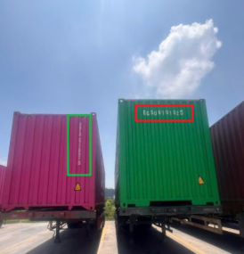
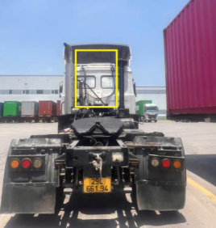
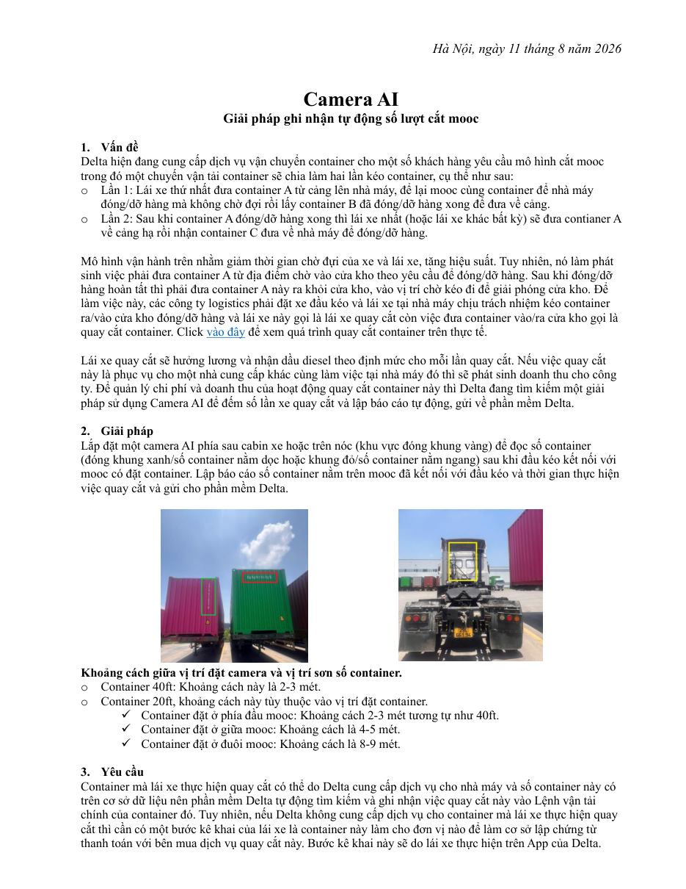

# Camera AI — Giải pháp ghi nhận tự động số lượt cắt mooc

> Nguồn: [`Camera AI_Đếm tự động số lần quay cắt.pdf`](source/camera-ai-quay-cat-de-xuat-2026-08-11.pdf) (PDF 1 trang, xuất từ Word, tác giả file: Nghia Tran Duc) · Ngày tài liệu: 11/8/2026 · Nhận: 2026-10-14 · Chuyển sang Markdown bằng `/intake`.

_Hà Nội, ngày 11 tháng 8 năm 2026_

## 1. Vấn đề

Delta hiện đang cung cấp dịch vụ vận chuyển container cho một số khách hàng yêu cầu mô hình cắt mooc trong đó một chuyến vận tải container sẽ chia làm hai lần kéo container, cụ thể như sau:

- Lần 1: Lái xe thứ nhất đưa container A từ cảng lên nhà máy, để lại mooc cùng container để nhà máy đóng/dỡ hàng mà không chờ đợi rồi lấy container B đã đóng/dỡ hàng xong để đưa về cảng.
- Lần 2: Sau khi container A đóng/dỡ hàng xong thì lái xe nhất (hoặc lái xe khác bất kỳ) sẽ đưa contianer A về cảng hạ rồi nhận container C đưa về nhà máy để đóng/dỡ hàng.

Mô hình vận hành trên nhằm giảm thời gian chờ đựi của xe và lái xe, tăng hiệu suất. Tuy nhiên, nó làm phát sinh việc phải đưa container A từ địa điểm chờ vào cửa kho theo yêu cầu để đóng/dỡ hàng. Sau khi đóng/dỡ hàng hoàn tất thì phải đưa container A này ra khỏi cửa kho, vào vị trí chờ kéo đi để giải phóng cửa kho. Để làm việc này, các công ty logistics phải đặt xe đầu kéo và lái xe tại nhà máy chịu trách nhiệm kéo container ra/vào cửa kho đóng/dỡ hàng và lái xe này gọi là lái xe quay cắt còn việc đưa container vào/ra cửa kho gọi là quay cắt container. [Click vào đây](https://www.youtube.com/watch?v=LlZdS5XNxHo) để xem quá trình quay cắt container trên thực tế.

Lái xe quay cắt sẽ hưởng lương và nhận dầu diesel theo định mức cho mỗi lần quay cắt. Nếu việc quay cắt này là phục vụ cho một nhà cung cấp khác cùng làm việc tại nhà máy đó thì sẽ phát sinh doanh thu cho công ty. Để quản lý chi phí và doanh thu của hoạt động quay cắt container này thì Delta đang tìm kiếm một giải pháp sử dụng Camera AI để đếm số lần xe quay cắt và lập báo cáo tự động, gửi về phần mềm Delta.

## 2. Giải pháp

Lắp đặt một camera AI phía sau cabin xe hoặc trên nóc (khu vực đóng khung vàng) để đọc số container (đóng khung xanh/số container nằm dọc hoặc khung đỏ/số container nằm ngang) sau khi đầu kéo kết nối với mooc có đặt container. Lập báo cáo số container nằm trên mooc đã kết nối với đầu kéo và thời gian thực hiện việc quay cắt và gửi cho phần mềm Delta.

**Khoảng cách giữa vị trí đặt camera và vị trí sơn số container.**

- Container 40ft: Khoảng cách này là 2-3 mét.
- Container 20ft, khoảng cách này tùy thuộc vào vị trí đặt container.
  - ✓ Container đặt ở phía đầu mooc: Khoảng cách 2-3 mét tương tự như 40ft.
  - ✓ Container đặt ở giữa mooc: Khoảng cách là 4-5 mét.
  - ✓ Container đặt ở đuôi mooc: Khoảng cách là 8-9 mét.

## 3. Yêu cầu

Container mà lái xe thực hiện quay cắt có thể do Delta cung cấp dịch vụ cho nhà máy và số container này có trên cơ sở dữ liệu nên phần mềm Delta tự động tìm kiếm và ghi nhận việc quay cắt này vào Lệnh vận tải chính của container đó. Tuy nhiên, nếu Delta không cung cấp dịch vụ cho container mà lái xe thực hiện quay cắt thì cần có một bước kê khai của lái xe là container này làm cho đơn vị nào để làm cơ sở lập chứng từ thanh toán với bên mua dịch vụ quay cắt này. Bước kê khai này sẽ do lái xe thực hiện trên App của Delta.

