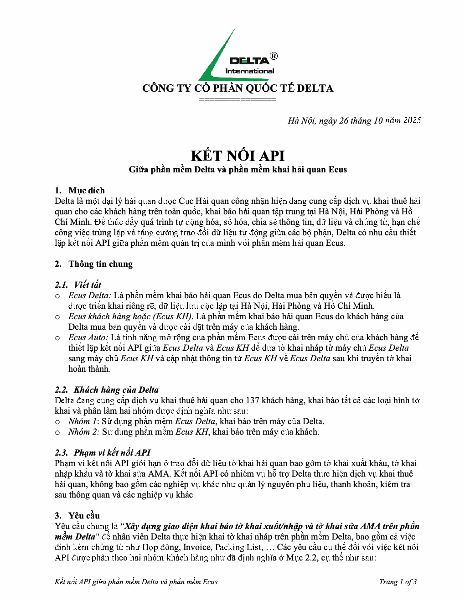
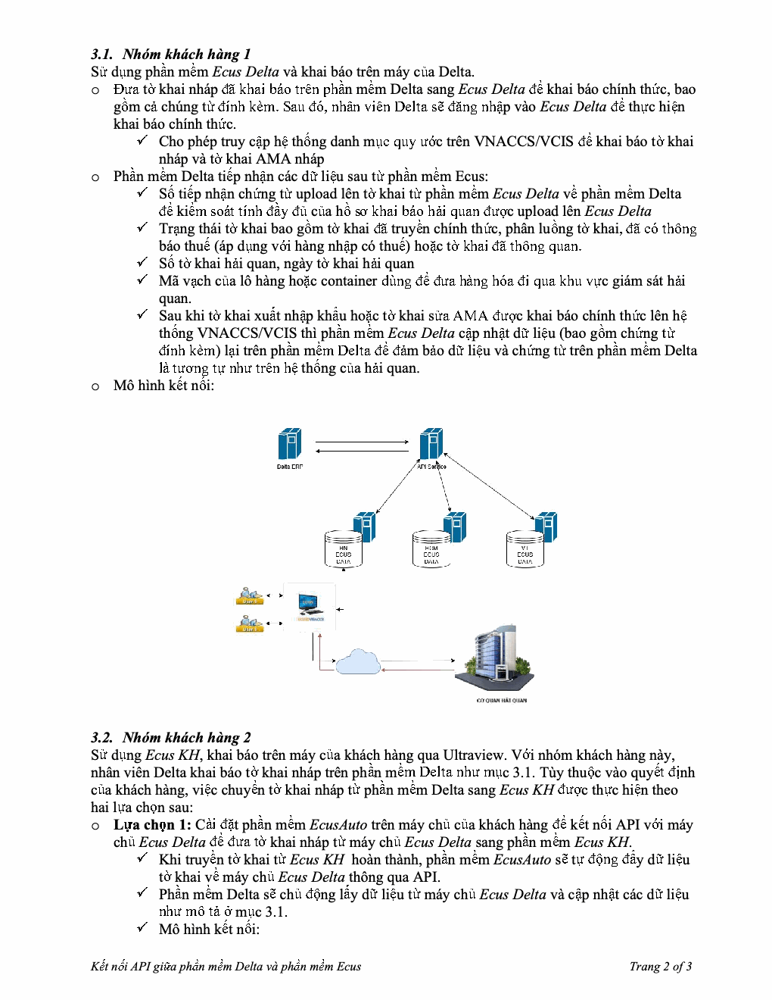
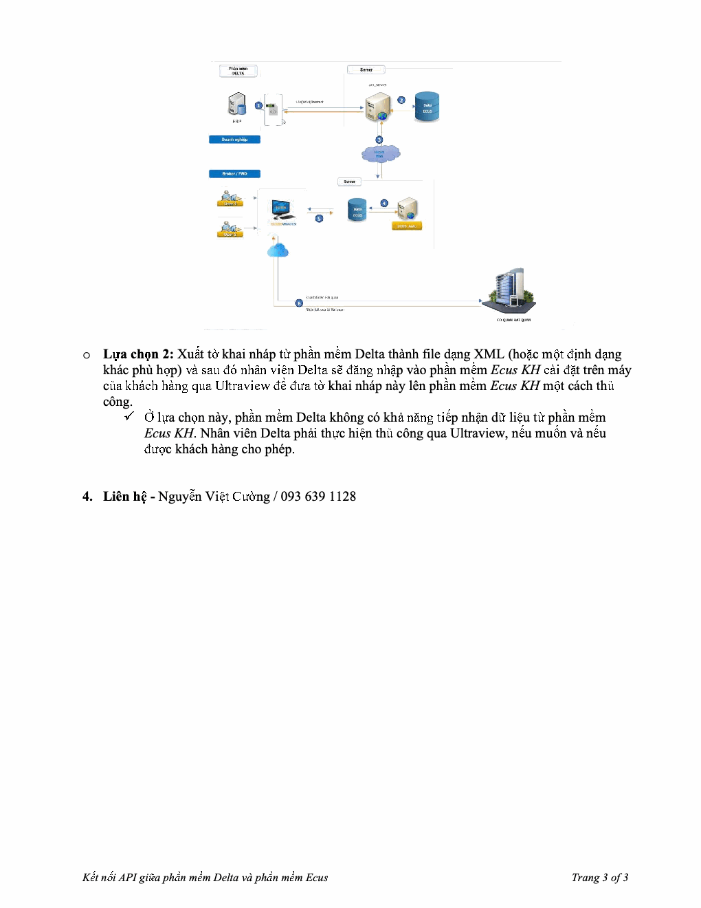

# Kết nối API với Ecus_Mô tả yêu cầu_Oct 26 2025

> Chuyển từ PDF. Ảnh xem trước từng trang được giữ bên dưới để đối chiếu với bản gốc.

## Trang 1

CÔNG TY CỔ PHẦN QUỐC TẾ DELTA
===============
Hà Nội, ngày 26 tháng 10 năm 2025
KẾT NỐI API
Giữa phần mềm Delta và phần mềm khai hải quan Ecus
1. Mục đích
Delta là một đại lý hải quan được Cục Hải quan công nhận hiện đang cung cấp dịch vụ khai thuê hải
quan cho các khách hàng trên toàn quốc, khai báo hải quan tập trung tại Hà Nội, Hải Phòng và Hồ
Chí Minh. Để thúc đẩy quá trình tự động hóa, số hóa, chia sẻ thông tin, dữ liệu và chứng từ, hạn chế
công việc trùng lặp và tăng cường trao đổi dữ liệu tự động giữa các bộ phận, Delta có nhu cầu thiết
lập kết nối API giữa phần mềm quản trị của mình với phần mềm hải quan Ecus.
2. Thông tin chung
2.1. Viết tắt
o Ecus Delta: Là phần mềm khai báo hải quan Ecus do Delta mua bản quyền và được hiểu là
được triển khai riêng rẽ, dữ liệu lưu độc lập tại Hà Nội, Hải Phòng và Hồ Chí Minh.
o Ecus khách hàng hoặc (Ecus KH). Là phần mềm khai báo hải quan Ecus do khách hàng của
Delta mua bản quyền và được cài đặt trên máy của khách hàng.
o Ecus Auto: Là tính năng mở rộng của phần mềm Ecus được cài trên máy chủ của khách hàng để
thiết lập kết nối API giữa Ecus Delta và Ecus KH để đưa tờ khai nháp từ máy chủ Ecus Delta
sang máy chủ Ecus KH và cập nhật thông tin từ Ecus KH về Ecus Delta sau khi truyền tờ khai
hoàn thành.
2.2. Khách hàng của Delta
Delta đang cung cấp dịch vụ khai thuê hải quan cho 137 khách hàng, khai báo tất cả các loại hình tờ
khai và phân làm hai nhóm được định nghĩa như sau:
o Nhóm 1: Sử dụng phần mềm Ecus Delta, khai báo trên máy của Delta.
o Nhóm 2: Sử dụng phần mềm Ecus KH, khai báo trên máy của khách.
2.3. Phạm vi kết nối API
Phạm vi kết nối API giới hạn ở trao đổi dữ liệu tờ khai hải quan bao gồm tờ khai xuất khẩu, tờ khai
nhập khẩu và tờ khai sửa AMA. Kết nối API có nhiệm vụ hỗ trợ Delta thực hiện dịch vụ khai thuê
hải quan, không bao gồm các nghiệp vụ khác như quản lý nguyên phụ liệu, thanh khoản, kiểm tra
sau thông quan và các nghiệp vụ khác
3. Yêu cầu
Yêu cầu chung là “Xây dựng giao diện khai báo tờ khai xuất/nhập và tờ khai sửa AMA trên phần
mềm Delta” để nhân viên Delta thực hiện khai tờ khai nháp trên phần mềm Delta, bao gồm cả việc
đính kèm chứng từ như Hợp đồng, Invoice, Packing List, … Các yêu cầu cụ thể đối với việc kết nối
API được phân theo hai nhóm khách hàng như đã định nghĩa ở Mục 2.2, cụ thể như sau:
Kết nối API giữa phần mềm Delta và phần mềm Ecus Trang 1 of 3

## Trang 2

3.1. Nhóm khách hàng 1
Sử dụng phần mềm Ecus Delta và khai báo trên máy của Delta.
o Đưa tờ khai nháp đã khai báo trên phần mềm Delta sang Ecus Delta để khai báo chính thức, bao
gồm cả chúng từ đính kèm. Sau đó, nhân viên Delta sẽ đăng nhập vào Ecus Delta để thực hiện
khai báo chính thức.
✓ Cho phép truy cập hệ thống danh mục quy ước trên VNACCS/VCIS để khai báo tờ khai
nháp và tờ khai AMA nháp
o Phần mềm Delta tiếp nhận các dữ liệu sau từ phần mềm Ecus:
✓ Số tiếp nhận chứng từ upload lên tờ khai từ phần mềm Ecus Delta về phần mềm Delta
để kiểm soát tính đầy đủ của hồ sơ khai báo hải quan được upload lên Ecus Delta
✓ Trạng thái tờ khai bao gồm tờ khai đã truyền chính thức, phân luồng tờ khai, đã có thông
báo thuế (áp dụng với hàng nhập có thuế) hoặc tờ khai đã thông quan.
✓ Số tờ khai hải quan, ngày tờ khai hải quan
✓ Mã vạch của lô hàng hoặc container dùng để đưa hàng hóa đi qua khu vực giám sát hải
quan.
✓ Sau khi tờ khai xuất nhập khẩu hoặc tờ khai sửa AMA được khai báo chính thức lên hệ
thống VNACCS/VCIS thì phần mềm Ecus Delta cập nhật dữ liệu (bao gồm chứng từ
đính kèm) lại trên phần mềm Delta để đảm bảo dữ liệu và chứng từ trên phần mềm Delta
là tương tự như trên hệ thống của hải quan.
o Mô hình kết nối:
3.2. Nhóm khách hàng 2
Sử dụng Ecus KH, khai báo trên máy của khách hàng qua Ultraview. Với nhóm khách hàng này,
nhân viên Delta khai báo tờ khai nháp trên phần mềm Delta như mục 3.1. Tùy thuộc vào quyết định
của khách hàng, việc chuyển tờ khai nháp từ phần mềm Delta sang Ecus KH được thực hiện theo
hai lựa chọn sau:
o Lựa chọn 1: Cài đặt phần mềm EcusAuto trên máy chủ của khách hàng để kết nối API với máy
chủ Ecus Delta để đưa tờ khai nháp từ máy chủ Ecus Delta sang phần mềm Ecus KH.
✓ Khi truyền tờ khai từ Ecus KH hoàn thành, phần mềm EcusAuto sẽ tự động đẩy dữ liệu
tờ khai về máy chủ Ecus Delta thông qua API.
✓ Phần mềm Delta sẽ chủ động lấy dữ liệu từ máy chủ Ecus Delta và cập nhật các dữ liệu
như mô tả ở mục 3.1.
✓ Mô hình kết nối:
Kết nối API giữa phần mềm Delta và phần mềm Ecus Trang 2 of 3

## Trang 3

o Lựa chọn 2: Xuất tờ khai nháp từ phần mềm Delta thành file dạng XML (hoặc một định dạng
khác phù hợp) và sau đó nhân viên Delta sẽ đăng nhập vào phần mềm Ecus KH cài đặt trên máy
của khách hàng qua Ultraview để đưa tờ khai nháp này lên phần mềm Ecus KH một cách thủ
công.
✓ Ở lựa chọn này, phần mềm Delta không có khả năng tiếp nhận dữ liệu từ phần mềm
Ecus KH. Nhân viên Delta phải thực hiện thủ công qua Ultraview, nếu muốn và nếu
được khách hàng cho phép.
4. Liên hệ - Nguyễn Việt Cường / 093 639 1128
Kết nối API giữa phần mềm Delta và phần mềm Ecus Trang 3 of 3

