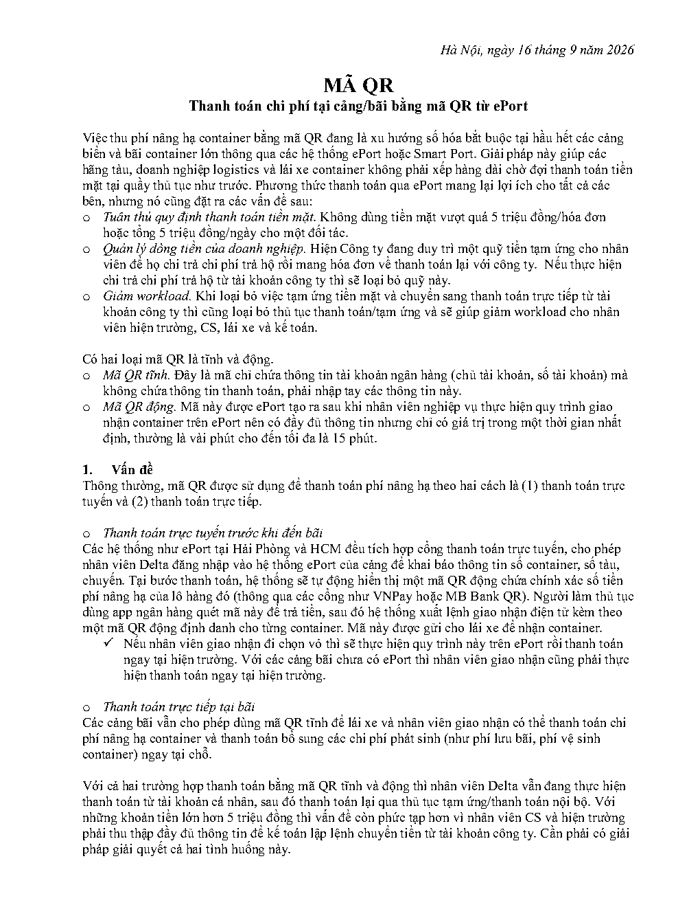
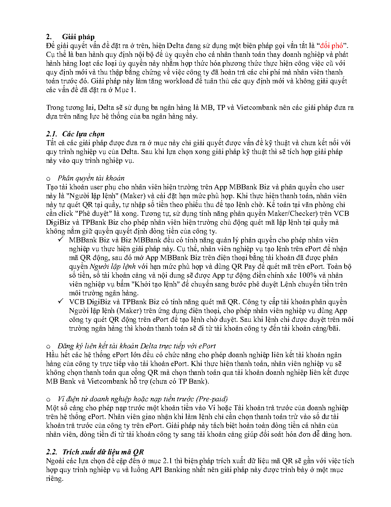
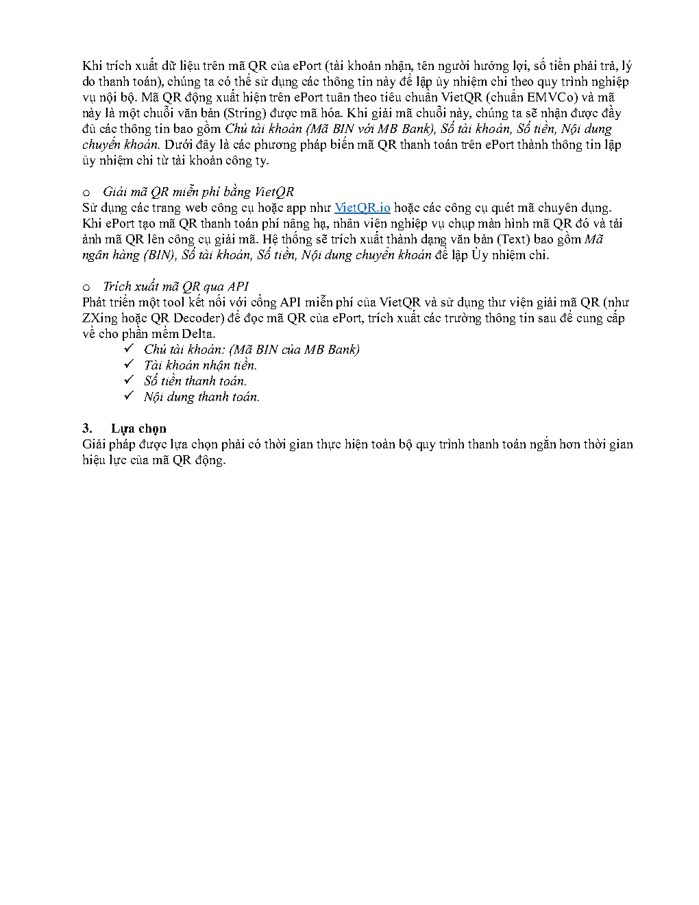

# Mã QR thanh toán của ePort_Sep 16, 2026

> Chuyển từ PDF. Ảnh xem trước từng trang được giữ bên dưới để đối chiếu với bản gốc.

## Trang 1

Hà Nội, ngày 16 tháng 9 năm 2026
MÃ QR
Thanh toán chi phí tại cảng/bãi bằng mã QR từ ePort
Việc thu phí nâng hạ container bằng mã QR đang là xu hướng số hóa bắt buộc tại hầu hết các cảng
biển và bãi container lớn thông qua các hệ thống ePort hoặc Smart Port. Giải pháp này giúp các
hãng tàu, doanh nghiệp logistics và lái xe container không phải xếp hàng dài chờ đợi thanh toán tiền
mặt tại quầy thủ tục như trước. Phương thức thanh toán qua ePort mang lại lợi ích cho tất cả các
bên, nhưng nó cũng đặt ra các vấn đề sau:
o Tuân thủ quy định thanh toán tiền mặt. Không dùng tiền mặt vượt quá 5 triệu đồng/hóa đơn
hoặc tổng 5 triệu đồng/ngày cho một đối tác.
o Quản lý dòng tiền của doanh nghiệp. Hiện Công ty đang duy trì một quỹ tiền tạm ứng cho nhân
viên để họ chi trả chi phí trả hộ rồi mang hóa đơn về thanh toán lại với công ty. Nếu thực hiện
chi trả chi phí trả hộ từ tài khoản công ty thì sẽ loại bỏ quỹ này.
o Giảm workload. Khi loại bỏ việc tạm ứng tiền mặt và chuyển sang thanh toán trực tiếp từ tài
khoản công ty thì cũng loại bỏ thủ tục thanh toán/tạm ứng và sẽ giúp giảm workload cho nhân
viên hiện trường, CS, lái xe và kế toán.
Có hai loại mã QR là tĩnh và động.
o Mã QR tĩnh. Đây là mã chỉ chứa thông tin tài khoản ngân hàng (chủ tài khoản, số tài khoản) mà
không chứa thông tin thanh toán, phải nhập tay các thông tin này.
o Mã QR động. Mã này được ePort tạo ra sau khi nhân viên nghiệp vụ thực hiện quy trình giao
nhận container trên ePort nên có đầy đủ thông tin nhưng chỉ có giá trị trong một thời gian nhất
định, thường là vài phút cho đến tối đa là 15 phút.
1. Vấn đề
Thông thường, mã QR được sử dụng để thanh toán phí nâng hạ theo hai cách là (1) thanh toán trực
tuyến và (2) thanh toán trực tiếp.
o Thanh toán trực tuyến trước khi đến bãi
Các hệ thống như ePort tại Hải Phòng và HCM đều tích hợp cổng thanh toán trực tuyến, cho phép
nhân viên Delta đăng nhập vào hệ thống ePort của cảng để khai báo thông tin số container, số tàu,
chuyến. Tại bước thanh toán, hệ thống sẽ tự động hiển thị một mã QR động chứa chính xác số tiền
phí nâng hạ của lô hàng đó (thông qua các cổng như VNPay hoặc MB Bank QR). Người làm thủ tục
dùng app ngân hàng quét mã này để trả tiền, sau đó hệ thống xuất lệnh giao nhận điện tử kèm theo
một mã QR động định danh cho từng container. Mã này được gửi cho lái xe để nhận container.
✓ Nếu nhân viên giao nhận đi chọn vỏ thì sẽ thực hiện quy trình này trên ePort rồi thanh toán
ngay tại hiện trường. Với các cảng bãi chưa có ePort thì nhân viên giao nhận cũng phải thực
hiện thanh toán ngay tại hiện trường.
o Thanh toán trực tiếp tại bãi
Các cảng bãi vẫn cho phép dùng mã QR tĩnh để lái xe và nhân viên giao nhận có thể thanh toán chi
phí nâng hạ container và thanh toán bổ sung các chi phí phát sinh (như phí lưu bãi, phí vệ sinh
container) ngay tại chỗ.
Với cả hai trường hợp thanh toán bằng mã QR tĩnh và động thì nhân viên Delta vẫn đang thực hiện
thanh toán từ tài khoản cá nhân, sau đó thanh toán lại qua thủ tục tạm ứng/thanh toán nội bộ. Với
những khoản tiền lớn hơn 5 triệu đồng thì vấn đề còn phức tạp hơn vì nhân viên CS và hiện trường
phải thu thập đầy đủ thông tin để kế toán lập lệnh chuyển tiền từ tài khoản công ty. Cần phải có giải
pháp giải quyết cả hai tình huống này.

## Trang 2

2. Giải pháp
Để giải quyết vấn đề đặt ra ở trên, hiện Delta đang sử dụng một biện pháp gọi vắn tắt là “đối phó”.
Cụ thể là ban hành quy định nội bộ để ủy quyền cho cá nhân thanh toán thay doanh nghiệp và phát
hành hàng loạt các loại ủy quyền này nhằm hợp thức hóa phương thức thực hiện công việc cũ với
quy định mới và thu thập bằng chứng về việc công ty đã hoàn trả các chi phí mà nhân viên thanh
toán trước đó. Giải pháp này làm tăng workload để tuân thủ các quy định mới và không giải quyết
các vấn đề đã đặt ra ở Mục 1.
Trong tương lai, Delta sẽ sử dụng ba ngân hàng là MB, TP và Vietcombank nên các giải pháp đưa ra
dựa trên năng lực hệ thống của ba ngân hàng này.
2.1. Các lựa chọn
Tất cả các giải pháp được đưa ra ở mục này chỉ giải quyết được vấn đề kỹ thuật và chưa kết nối với
quy trình nghiệp vụ của Delta. Sau khi lựa chọn xong giải pháp kỹ thuật thì sẽ tích hợp giải pháp
này vào quy trình nghiệp vụ.
o Phân quyền tài khoản
Tạo tài khoản user phụ cho nhân viên hiện trường trên App MBBank Biz và phân quyền cho user
này là "Người lập lệnh" (Maker) và cài đặt hạn mức phù hợp. Khi thực hiện thanh toán, nhân viên
này tự quét QR tại quầy, tự nhập số tiền theo phiếu thu để tạo lệnh chờ. Kế toán tại văn phòng chỉ
cần click "Phê duyệt" là xong. Tương tự, sử dụng tính năng phân quyền Maker/Checker) trên VCB
DigiBiz và TPBank Biz cho phép nhân viên hiện trường chủ động quét mã lập lệnh tại quầy mà
không nắm giữ quyền quyết định dòng tiền của công ty.
✓ MBBank Biz và Biz MBBank đều có tính năng quản lý phân quyền cho phép nhân viên
nghiệp vụ thực hiện giải pháp này. Cụ thể, nhân viên nghiệp vụ tạo lệnh trên ePort để nhận
mã QR động, sau đó mở App MBBank Biz trên điện thoại bằng tài khoản đã được phân
quyền Người lập lệnh với hạn mức phù hợp và dùng QR Pay để quét mã trên ePort. Toàn bộ
số tiền, số tài khoản cảng và nội dung sẽ được App tự động điền chính xác 100% và nhân
viên nghiệp vụ bấm "Khởi tạo lệnh" để chuyển sang bước phê duyệt Lệnh chuyển tiền trên
môi trường ngân hàng.
✓ VCB DigiBiz và TPBank Biz có tính năng quét mã QR. Công ty cấp tài khoản phân quyền
Người lập lệnh (Maker) trên ứng dụng điện thoại, cho phép nhân viên nghiệp vụ dùng App
công ty quét QR động trên ePort để tạo lệnh chờ duyệt. Sau khi lệnh chi được duyệt trên môi
trường ngân hàng thì khoản thanh toán sẽ đi từ tài khoản công ty đến tài khoản cảng/bãi.
o Đăng ký liên kết tài khoản Delta trực tiếp với ePort
Hầu hết các hệ thống ePort lớn đều có chức năng cho phép doanh nghiệp liên kết tài khoản ngân
hàng của công ty trực tiếp vào tài khoản ePort. Khi thực hiện thanh toán, nhân viên nghiệp vụ sẽ
không chọn thanh toán qua cổng QR mà chọn thanh toán qua tài khoản doanh nghiệp liên kết được
MB Bank và Vietcombank hỗ trợ (chưa có TP Bank).
o Ví điện tử doanh nghiệp hoặc nạp tiền trước (Pre-paid)
Một số cảng cho phép nạp trước một khoản tiền vào Ví hoặc Tài khoản trả trước của doanh nghiệp
trên hệ thống ePort. Nhân viên giao nhận khi làm lệnh chỉ cần chọn thanh toán trừ vào số dư tài
khoản trả trước của công ty trên ePort. Giải pháp này tách biệt hoàn toàn dòng tiền cá nhân của
nhân viên, dòng tiền đi từ tài khoản công ty sang tài khoản cảng giúp đối soát hóa đơn dễ dàng hơn.
2.2. Trích xuất dữ liệu mã QR
Ngoài các lựa chọn đề cập đến ở mục 2.1 thì biện pháp trích xuất dữ liệu mã QR sẽ gần với việc tích
hợp quy trình nghiệp vụ và luồng API Banking nhất nên giải pháp này được trình bày ở một mục
riêng.

## Trang 3

Khi trích xuất dữ liệu trên mã QR của ePort (tài khoản nhận, tên người hưởng lợi, số tiền phải trả, lý
do thanh toán), chúng ta có thể sử dụng các thông tin này để lập ủy nhiệm chi theo quy trình nghiệp
vụ nội bộ. Mã QR động xuất hiện trên ePort tuân theo tiêu chuẩn VietQR (chuẩn EMVCo) và mã
này là một chuỗi văn bản (String) được mã hóa. Khi giải mã chuỗi này, chúng ta sẽ nhận được đầy
đủ các thông tin bao gồm Chủ tài khoản (Mã BIN với MB Bank), Số tài khoản, Số tiền, Nội dung
chuyển khoản. Dưới đây là các phương pháp biến mã QR thanh toán trên ePort thành thông tin lập
ủy nhiệm chi từ tài khoản công ty.
o Giải mã QR miễn phí bằng VietQR
Sử dụng các trang web công cụ hoặc app như VietQR.io hoặc các công cụ quét mã chuyên dụng.
Khi ePort tạo mã QR thanh toán phí nâng hạ, nhân viên nghiệp vụ chụp màn hình mã QR đó và tải
ảnh mã QR lên công cụ giải mã. Hệ thống sẽ trích xuất thành dạng văn bản (Text) bao gồm Mã
ngân hàng (BIN), Số tài khoản, Số tiền, Nội dung chuyển khoản để lập Ủy nhiệm chi.
o Trích xuất mã QR qua API
Phát triển một tool kết nối với cổng API miễn phí của VietQR và sử dụng thư viện giải mã QR (như
ZXing hoặc QR Decoder) để đọc mã QR của ePort, trích xuất các trường thông tin sau để cung cấp
về cho phần mềm Delta.
✓ Chủ tài khoản: (Mã BIN của MB Bank)
✓ Tài khoản nhận tiền.
✓ Số tiền thanh toán.
✓ Nội dung thanh toán.
3. Lựa chọn
Giải pháp được lựa chọn phải có thời gian thực hiện toàn bộ quy trình thanh toán ngắn hơn thời gian
hiệu lực của mã QR động.

