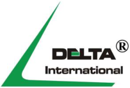
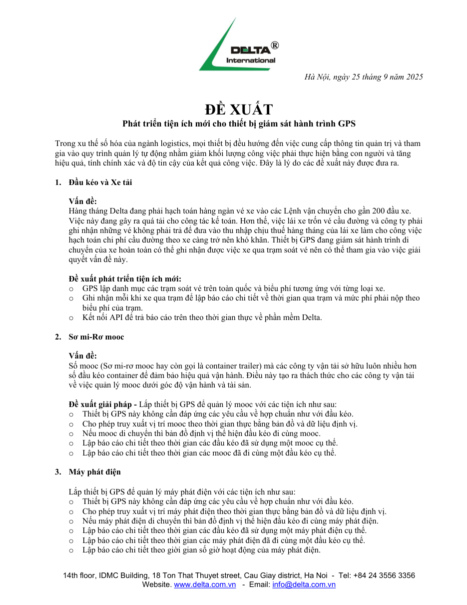

# Đề xuất phát triển tiện ích mới cho thiết bị giám sát hành trình GPS

> Nguồn: [`Đề xuất tiện ích GPS_Sep 25 2025.pdf`](source/gps-tien-ich-de-xuat-2025-09-25.pdf) (PDF, 1 trang, có lớp chữ) · Ngày tài liệu: 25/9/2025 · Nhận: 2026-10-14 · Chuyển sang Markdown bằng `/intake`.
> Thông tin trang: đầu thư Delta — 14th floor, IDMC Building, 18 Ton That Thuyet street, Cau Giay district, Ha Noi - Tel: +84 24 3556 3356 Website. www.delta.com.vn - Email: info@delta.com.vn

_Hà Nội, ngày 25 tháng 9 năm 2025_

**ĐỀ XUẤT**
**Phát triển tiện ích mới cho thiết bị giám sát hành trình GPS**

Trong xu thế số hóa của ngành logistics, mọi thiết bị đều hướng đến việc cung cấp thông tin quản trị và tham gia vào quy trình quản lý tự động nhằm giảm khối lượng công việc phải thực hiện bằng con người và tăng hiệu quả, tính chính xác và độ tin cậy của kết quả công việc. Đây là lý do các đề xuất này được đưa ra.

## 1. Đầu kéo và Xe tải

**Vấn đề:**

Hàng tháng Delta đang phải hạch toán hàng ngàn vé xe vào các Lệnh vận chuyển cho gần 200 đầu xe. Việc này đang gây ra quá tải cho công tác kế toán. Hơn thế, việc lái xe trốn vé cầu đường và công ty phải ghi nhận những vé không phải trả để đưa vào thu nhập chịu thuế hàng tháng của lái xe làm cho công việc hạch toán chi phí cầu đường theo xe càng trở nên khó khăn. Thiết bị GPS đang giám sát hành trình di chuyển của xe hoàn toàn có thể ghi nhận được việc xe qua trạm soát vé nên có thể tham gia vào việc giải quyết vấn đề này.

**Đề xuất phát triển tiện ích mới:**

- GPS lập danh mục các trạm soát vé trên toàn quốc và biểu phí tương ứng với từng loại xe.
- Ghi nhận mỗi khi xe qua trạm để lập báo cáo chi tiết về thời gian qua trạm và mức phí phải nộp theo biểu phí của trạm.
- Kết nối API để trả báo cáo trên theo thời gian thực về phần mềm Delta.

## 2. Sơ mi-Rơ mooc

**Vấn đề:**

Số mooc (Sơ mi-rơ mooc hay còn gọi là container trailer) mà các công ty vận tải sở hữu luôn nhiều hơn số đầu kéo container để đảm bảo hiệu quả vận hành. Điều này tạo ra thách thức cho các công ty vận tải về việc quản lý mooc dưới góc độ vận hành và tài sản.

**Đề xuất giải pháp -** Lắp thiết bị GPS để quản lý mooc với các tiện ích như sau:

- Thiết bị GPS này không cần đáp ứng các yêu cầu về hợp chuẩn như với đầu kéo.
- Cho phép truy xuất vị trí mooc theo thời gian thực bằng bản đồ và dữ liệu định vị.
- Nếu mooc di chuyển thì bản đồ định vị thể hiện đầu kéo đi cùng mooc.
- Lập báo cáo chi tiết theo thời gian các đầu kéo đã sử dụng một mooc cụ thể.
- Lập báo cáo chi tiết theo thời gian các mooc đã đi cùng một đầu kéo cụ thể.

## 3. Máy phát điện

Lắp thiết bị GPS để quản lý máy phát điện với các tiện ích như sau:

- Thiết bị GPS này không cần đáp ứng các yêu cầu về hợp chuẩn như với đầu kéo.
- Cho phép truy xuất vị trí máy phát điện theo thời gian thực bằng bản đồ và dữ liệu định vị.
- Nếu máy phát điện di chuyển thì bản đồ định vị thể hiện đầu kéo đi cùng máy phát điện.
- Lập báo cáo chi tiết theo thời gian các đầu kéo đã sử dụng một máy phát điện cụ thể.
- Lập báo cáo chi tiết theo thời gian các máy phát điện đã đi cùng một đầu kéo cụ thể.
- Lập báo cáo chi tiết theo giời gian số giờ hoạt động của máy phát điện.

