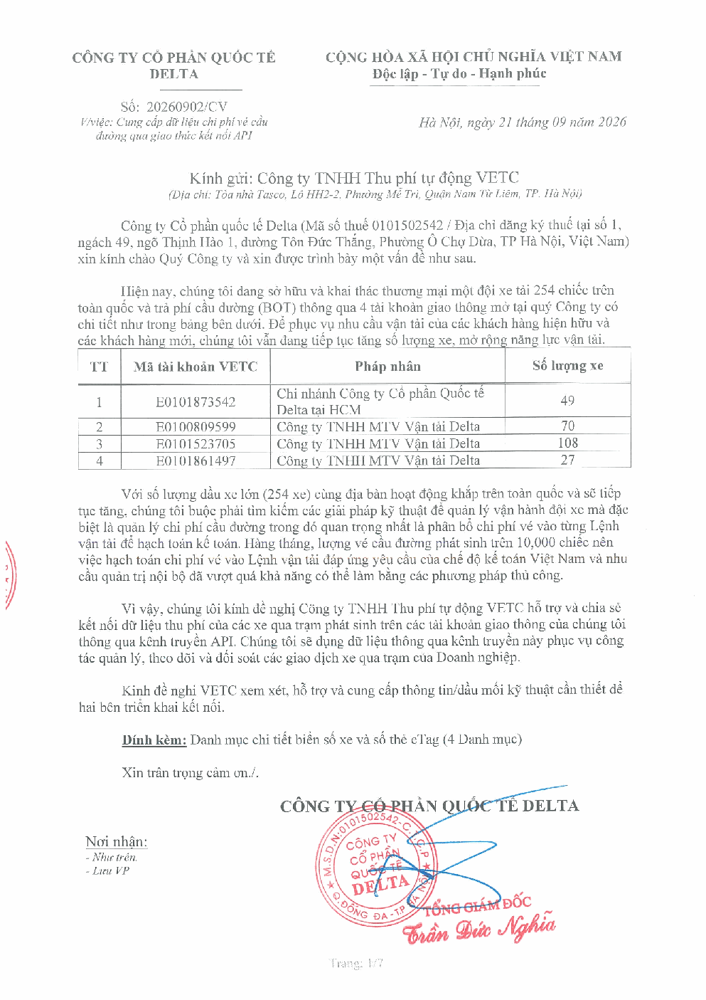
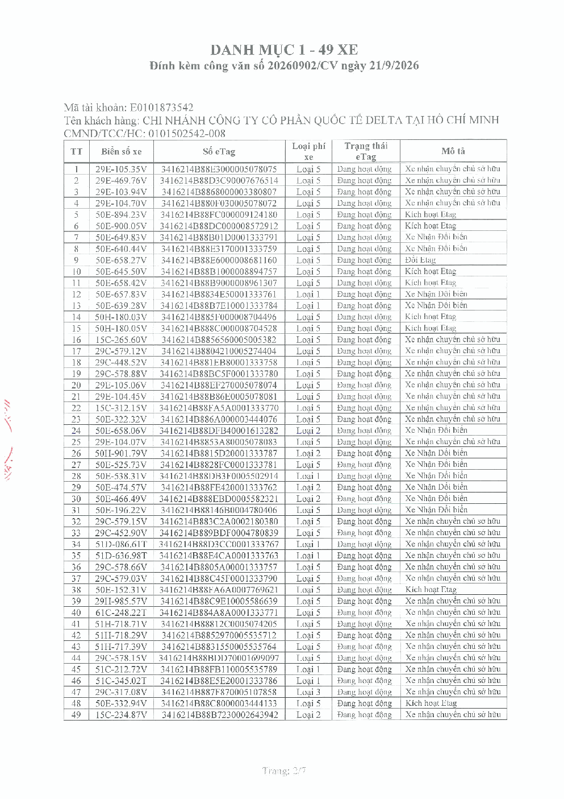
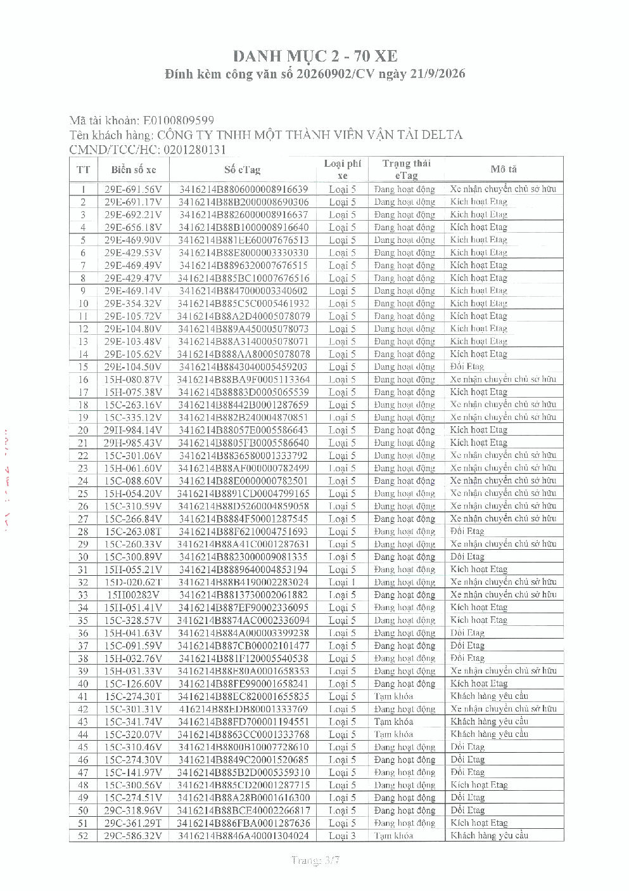
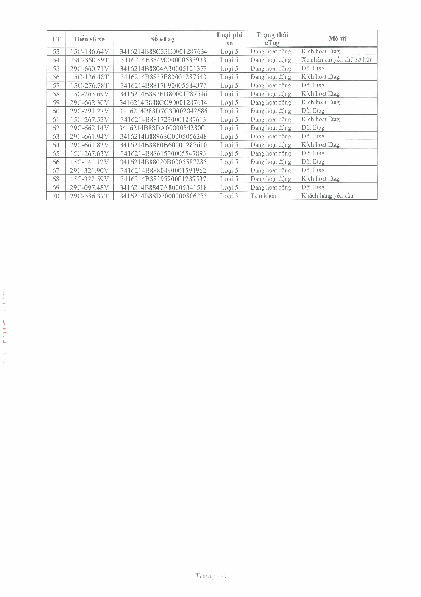
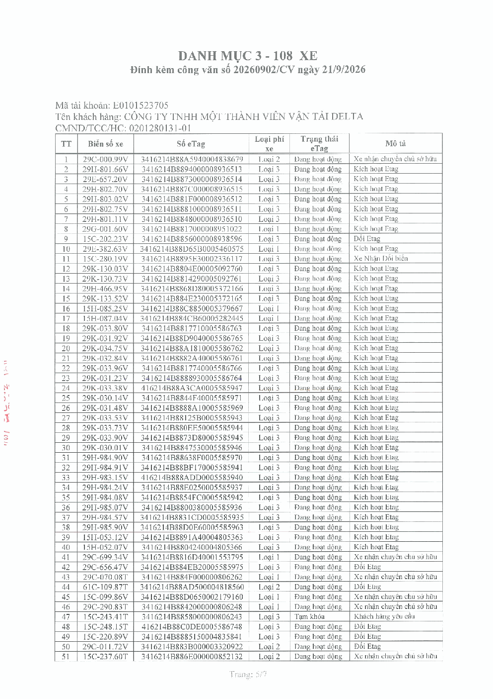
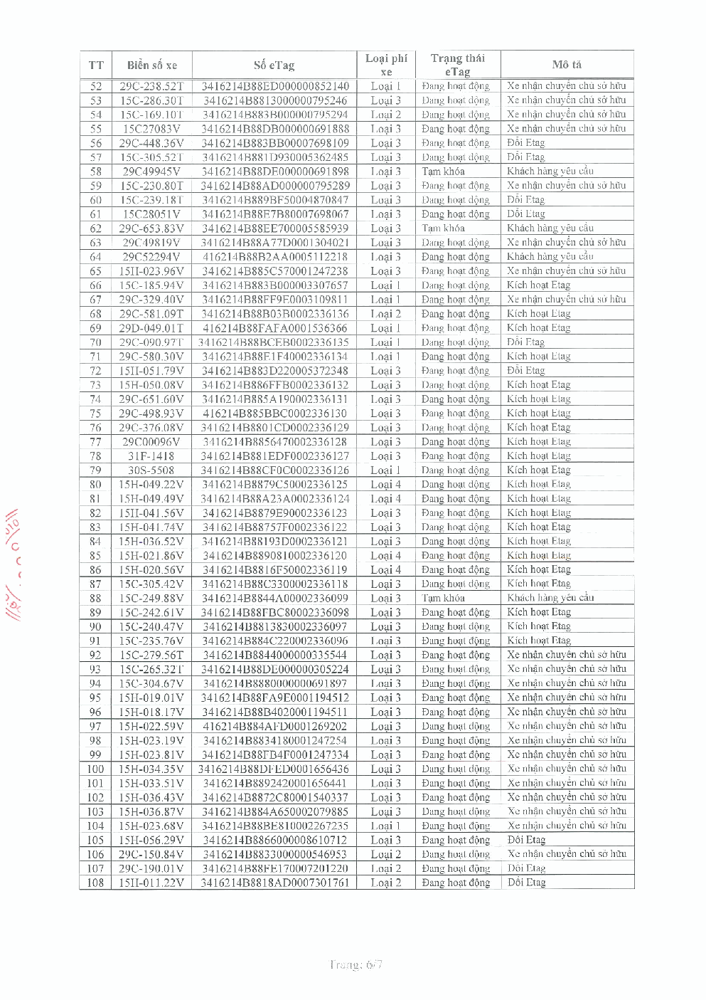
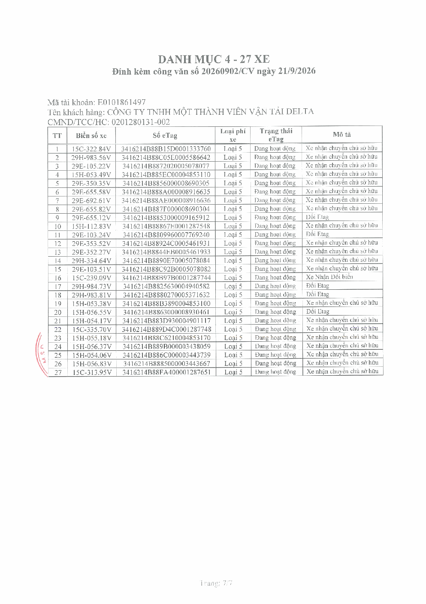

# CV 20260902/CV — Cung cấp dữ liệu chi phí vé cầu đường qua giao thức kết nối API

> Nguồn: `CV 20260902_VETC API_signed.pdf` (PDF scan 7 trang, không có lớp chữ — chữ gõ lại từ ảnh) · Ngày tài liệu: 21/9/2026 (số công văn 20260902/CV; tên folder lấy theo số công văn) · Nhận: 2026-10-02.
> Công văn Công ty CP Quốc tế Delta gửi Công ty TNHH Thu phí tự động VETC. Trang 1 gõ lại đủ chữ; trang 2–7 là 4 danh mục 254 xe, gõ lại phần đầu và tóm tắt cột, giá trị — bảng chi tiết từng xe xem ảnh trang gốc.

## Trang 1 — Công văn

**CÔNG TY CỔ PHẦN QUỐC TẾ DELTA** · **CỘNG HÒA XÃ HỘI CHỦ NGHĨA VIỆT NAM — Độc lập - Tự do - Hạnh phúc**

Số: 20260902/CV
V/việc: Cung cấp dữ liệu chi phí vé cầu đường qua giao thức kết nối API

_Hà Nội, ngày 21 tháng 09 năm 2026_

**Kính gửi: Công ty TNHH Thu phí tự động VETC**
(Địa chỉ: Tòa nhà Tasco, Lô HH2-2, Phường Mễ Trì, Quận Nam Từ Liêm, TP. Hà Nội)

Công ty Cổ phần quốc tế Delta (Mã số thuế 0101502542 / Địa chỉ đăng ký thuế tại số 1, ngách 49, ngõ Thịnh Hào 1, đường Tôn Đức Thắng, Phường Ô Chợ Dừa, TP Hà Nội, Việt Nam) xin kính chào Quý Công ty và xin được trình bày một vấn đề như sau.

Hiện nay, chúng tôi đang sở hữu và khai thác thương mại một đội xe tải 254 chiếc trên toàn quốc và trả phí cầu đường (BOT) thông qua 4 tài khoản giao thông mở tại quý Công ty có chi tiết như trong bảng bên dưới. Để phục vụ nhu cầu vận tải của các khách hàng hiện hữu và các khách hàng mới, chúng tôi vẫn đang tiếp tục tăng số lượng xe, mở rộng năng lực vận tải.

| TT | Mã tài khoản VETC | Pháp nhân | Số lượng xe |
|---|---|---|---|
| 1 | E0101873542 | Chi nhánh Công ty Cổ phần Quốc tế Delta tại HCM | 49 |
| 2 | E0100809599 | Công ty TNHH MTV Vận tải Delta | 70 |
| 3 | E0101523705 | Công ty TNHH MTV Vận tải Delta | 108 |
| 4 | E0101861497 | Công ty TNHH MTV Vận tải Delta | 27 |

Với số lượng đầu xe lớn (254 xe) cùng địa bàn hoạt động khắp trên toàn quốc và sẽ tiếp tục tăng, chúng tôi buộc phải tìm kiếm các giải pháp kỹ thuật để quản lý vận hành đội xe mà đặc biệt là quản lý chi phí cầu đường trong đó quan trọng nhất là phân bổ chi phí vé vào từng Lệnh vận tải để hạch toán kế toán. Hàng tháng, lượng vé cầu đường phát sinh trên 10,000 chiếc nên việc hạch toán chi phí vé vào Lệnh vận tải đáp ứng yêu cầu của chế độ kế toán Việt Nam và nhu cầu quản trị nội bộ đã vượt quá khả năng có thể làm bằng các phương pháp thủ công.

Vì vậy, chúng tôi kính đề nghị Công ty TNHH Thu phí tự động VETC hỗ trợ và chia sẻ kết nối dữ liệu thu phí của các xe qua trạm phát sinh trên các tài khoản giao thông của chúng tôi thông qua kênh truyền API. Chúng tôi sẽ dụng dữ liệu thông qua kênh truyền này phục vụ công tác quản lý, theo dõi và đối soát các giao dịch xe qua trạm của Doanh nghiệp.

Kính đề nghị VETC xem xét, hỗ trợ và cung cấp thông tin/đầu mối kỹ thuật cần thiết để hai bên triển khai kết nối.

**Đính kèm:** Danh mục chi tiết biển số xe và số thẻ eTag (4 Danh mục)

Xin trân trọng cảm ơn./.

Nơi nhận: Như trên; Lưu VP.

CÔNG TY CỔ PHẦN QUỐC TẾ DELTA — TỔNG GIÁM ĐỐC Trần Đức Nghĩa (đã ký, đóng dấu)

## Trang 2–7 — 4 danh mục xe đính kèm

Mỗi danh mục có tiêu đề "DANH MỤC n - x XE — Đính kèm công văn số 20260902/CV ngày 21/9/2026", dòng Mã tài khoản, Tên khách hàng, CMND/TCC/HC (mã số thuế), rồi bảng 6 cột:

| Cột | Giá trị gặp trong 4 danh mục |
|---|---|
| TT | số thứ tự |
| Biển số xe | dạng `29E-105.35V`; chữ cuối là màu biển (V vàng, T trắng); vài xe biển cũ (`31F-1418`, `30S-5508`) hoặc viết liền (`15H00282V`) |
| Số eTag | 24 ký tự, dạng `3416214B88…` |
| Loại phí xe | Loại 1 · Loại 2 · Loại 3 · Loại 4 · Loại 5 (đầu kéo phần lớn Loại 5) |
| Trạng thái eTag | Đang hoạt động · Tạm khóa (9 thẻ: danh mục 2 dòng 41, 43, 44, 52, 70; danh mục 3 dòng 47, 58, 62, 88) |
| Mô tả | Xe nhận chuyển chủ sở hữu · Kích hoạt Etag · Đổi Etag · Xe Nhận Đổi biển · Khách hàng yêu cầu (đi cùng Tạm khóa) |

| Danh mục | Trang | Mã tài khoản | Tên khách hàng | CMND/TCC/HC | Số xe |
|---|---|---|---|---|---|
| 1 | 2 | E0101873542 | Chi nhánh Công ty Cổ phần Quốc tế Delta tại Hồ Chí Minh | 0101502542-008 | 49 |
| 2 | 3–4 | E0100809599 | Công ty TNHH Một thành viên Vận tải Delta | 0201280131 | 70 |
| 3 | 5–6 | E0101523705 | Công ty TNHH Một thành viên Vận tải Delta | 0201280131-01 | 108 |
| 4 | 7 | E0101861497 | Công ty TNHH Một thành viên Vận tải Delta | 0201280131-002 | 27 |

Đáng chú ý: cùng số biển 15C-274.30 có 2 thẻ trong danh mục 2 — biển trắng `15C-274.30T` (dòng 41, Tạm khóa, Khách hàng yêu cầu) và biển vàng `15C-274.30V` (dòng 46, Đang hoạt động, Đổi Etag).

