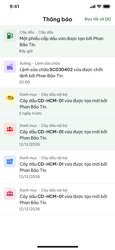
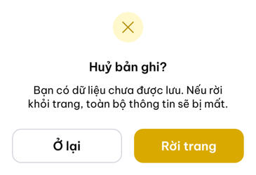
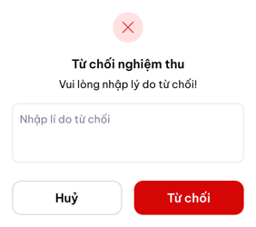
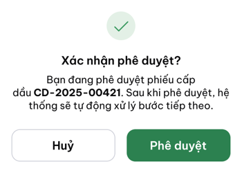
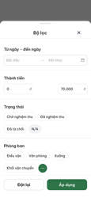
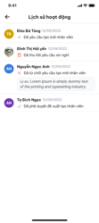
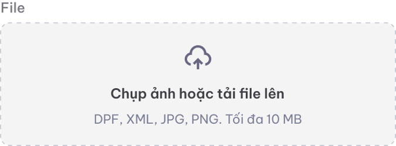
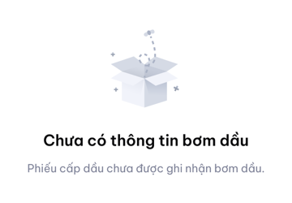
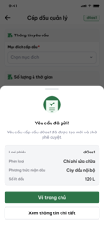

# [v2.0] Quy tắc chung xử lý giao diện trên Application (Application common rules & shared components)

# PHẦN 1 — SHARED COMPONENTS

Các component dùng chung toàn hệ thống. Các UC chỉ cần gọi theo mã: *(Xem MSC-XX — Tên component)*.

| **Mã** | **Tên** | **Dùng khi** |
| --- | --- | --- |
| MSC-01 | [**In-app Notification**](https://deltavn.atlassian.net/wiki/spaces/NDLXD/pages/264634562/v2.0+Quy+t+c+chung+x+l+giao+di+n+tr+n+Application+Application+common+rules+shared+components#MSC-02-%E2%80%94-In-app-Notification) | Mọi hành động nghiệp vụ cần gửi thông báo đến người liên quan trong luồng |
| MSC-02 | [**Confirm Bottom Sheet**](https://deltavn.atlassian.net/wiki/spaces/NDLXD/pages/264634562/v2.0+Quy+t+c+chung+x+l+giao+di+n+tr+n+Application+Application+common+rules+shared+components#MSC-03-%E2%80%94-Confirm-Bottom-Sheet) | Trước hành động quan trọng hoặc không thể hoàn tác |
| MSC-03 | [**Filter Bottom Sheet**](https://deltavn.atlassian.net/wiki/spaces/NDLXD/pages/264634562/v2.0+Quy+t+c+chung+x+l+giao+di+n+tr+n+Application+Application+common+rules+shared+components#MSC-04-%E2%80%94-Filter-Bottom-Sheet) | Bộ lọc nâng cao cho màn hình danh sách |
| MSC-04 | [**Action Sheet**](https://deltavn.atlassian.net/wiki/spaces/NDLXD/pages/264634562/v2.0+Quy+t+c+chung+x+l+giao+di+n+tr+n+Application+Application+common+rules+shared+components#MSC-05-%E2%80%94-Action-Sheet) | Danh sách hành động tuỳ chọn từ 1 item |
| MSC-05 | [**Activity Log**](https://deltavn.atlassian.net/wiki/spaces/NDLXD/pages/264634562/v2.0+Quy+t+c+chung+x+l+giao+di+n+tr+n+Application+Application+common+rules+shared+components#MSC-06-%E2%80%94-Activity-Log) | Icon 🕐 trên màn hình chi tiết |
| MSC-06 | [**Stepper Header**](https://deltavn.atlassian.net/wiki/spaces/NDLXD/pages/264634562/v2.0+Quy+t+c+chung+x+l+giao+di+n+tr+n+Application+Application+common+rules+shared+components#MSC-07-%E2%80%94-Stepper-Header) | Màn hình có luồng nghiệp vụ nhiều bước |
| MSC-07 | [**File Upload**](https://deltavn.atlassian.net/wiki/spaces/NDLXD/pages/264634562/v2.0+Quy+t+c+chung+x+l+giao+di+n+tr+n+Application+Application+common+rules+shared+components#MSC-08-%E2%80%94-File-Upload) | Khi upload file lên hệ thống |
| MSC-08 | [**Bottom Navigation**](https://deltavn.atlassian.net/wiki/spaces/NDLXD/pages/264634562/v2.0+Quy+t+c+chung+x+l+giao+di+n+tr+n+Application+Application+common+rules+shared+components#MSC-09-%E2%80%94-Bottom-Navigation) | Điều hướng chính giữa các module |
| MSC-09 | [**Empty State**](https://deltavn.atlassian.net/wiki/spaces/NDLXD/pages/264634562/v2.0+Quy+t+c+chung+x+l+giao+di+n+tr+n+Application+Application+common+rules+shared+components#MSC-10-%E2%80%94-Empty-State) | Màn hình danh sách hoặc section không có dữ liệu |
| MSC-10 | [**Skeleton Loader**](https://deltavn.atlassian.net/wiki/spaces/NDLXD/pages/264634562/v2.0+Quy+t+c+chung+x+l+giao+di+n+tr+n+Application+Application+common+rules+shared+components#MSC-11-%E2%80%94-Skeleton-Loader) | Khi đang tải dữ liệu |

---

## MSC-01 — In-app Notification

Notification hiển thị trong notification center của app.

Badge số đếm trên icon chuông.

| **Thành phần** | **Control** | **Mô tả** |
| --- | --- | --- |
| Badge đếm | Badge | Số thông báo chưa đọc trên icon chuông. |
| Thông báo chưa đọc | — | Nền xanh nhạt. |
| Thông báo đã đọc | — | Nền trắng. |
| Click vào thông báo | — | Chuyển trạng thái → Đã đọc + badge −1 + navigate đến màn chi tiết bản ghi liên quan. |

> Pattern nội dung thông báo: *(Xem SC-02 Website common rules — Pattern thông báo chung)*

---

## MSC-02 — Confirm Popup

Popup xác nhận trước khi thực hiện hành động quan trọng hoặc không thể hoàn tác.

| **Thành phần** | **Control** | **Mô tả** |
| --- | --- | --- |
| Icon hành động | Icon | Icon đại diện hành động, nền màu theo loại (đỏ = destructive · xanh lá = xác nhận · vàng = cảnh báo). |
| Tiêu đề | Label | Font bold, căn giữa. VD: *"Thu hồi bản ghi?"* |
| Nội dung mô tả | Label | Mô tả hậu quả hành động. Có thể highlight tên bản ghi bằng bold. |
| Button chính | Button | Full width, màu theo loại hành động. Destructive: đỏ. Xác nhận: xanh lá. |
| Button phụ | Button | Full width, outlined/text. VD: *"Huỷ bỏ"*. |
| Backdrop | — | Nền tối mờ phía sau. Tap ra ngoài = đóng (tương đương button Huỷ), **trừ** các hành động không thể hoàn tác. |

**Các hành động bắt buộc dùng MSC-03:** Xoá · Thu hồi · Phê duyệt · Từ chối · Huỷ form (khi có dữ liệu chưa lưu).

| **Action** | **Tiêu đề** | **Nội dung** |
| --- | --- | --- |
| **Xoá** | Xoá **[tên feature]**? | Bạn đang xoá [tên feature] **[tên/mã]**. Hành động này không thể hoàn tác. |
| **Thu hồi** | Thu hồi yêu cầu? | Bạn đang thu hồi [tên feature] **[tên/mã]**. Yêu cầu sẽ trở về trạng thái Bản nháp. |
| **Phê duyệt** | Xác nhận phê duyệt? | Bạn đang phê duyệt [tên feature] **[tên/mã]**. |
| **Từ chối** | Từ chối yêu cầu? | Bạn đang từ chối [tên feature] **[tên/mã]**. |
| **Huỷ form** | Huỷ bản ghi? | Bạn có dữ liệu chưa được lưu. Nếu rời khỏi trang, toàn bộ thông tin sẽ bị mất. |

---

## MSC-03 — Filter Bottom Sheet

Bottom Sheet bộ lọc nâng cao.

| **Thành phần** | **Control** | **Mô tả** |
| --- | --- | --- |
| Trigger | Button | Button **Bộ lọc** trên toolbar màn hình danh sách. Badge số lượng filter đang active. |
| Bottom Sheet | — | Slide up từ dưới. Chiều cao tối đa 85% màn hình. Có thể scroll nội dung bên trong. |
| Header | Label | Tiêu đề *"Bộ lọc"* + button **Đặt lại** (text, xanh lá) góc phải. |
| Các trường lọc | — | Tuỳ từng UC. Dạng: Select · DatePicker · Checkbox list. |
| Button Áp dụng | Button | Full width, filled xanh lá, sticky bottom. Click → đóng sheet + áp dụng bộ lọc. |
| Active filters | Badge | Hiển thị chips bộ lọc đang active ngay dưới search bar màn hình danh sách. Tap vào chip → xoá filter đó. |

---

## MSC-04 — Action Sheet

Bottom Sheet danh sách action từ 1 item. Tương ứng với Action Matrix (SC-07) trên web.

| **Thành phần** | **Control** | **Mô tả** |
| --- | --- | --- |
| Trigger | — | Long press vào item hoặc tap icon ⋯ trên item. |
| Bottom Sheet | — | Slide up. Danh sách action dạng list. |
| Action item | Button | Mỗi action 1 dòng: Icon trái + Label. Destructive action: màu đỏ, luôn ở cuối danh sách. |
| Button Huỷ | Button | Full width, phân cách với danh sách action. Label *"Huỷ"*. |
| Backdrop | — | Tap ra ngoài = đóng. |

---

## MSC-05 — Activity Log

| **Thành phần** | **Control** | **Mô tả** |
| --- | --- | --- |
| Trigger | Icon / Button | Icon 🕐 trên header màn hình chi tiết. |
| Hiển thị | — | Hiển thị màn hình riêng. |
| Nội dung | — | Timeline dọc. Mỗi mốc: Avatar + Tên + Ngày + Icon hành động + Nội dung. Sắp xếp mới nhất lên trên. |

---

## MSC-06 — Stepper Header

Header thanh tiến trình cho màn hình có luồng nghiệp vụ nhiều bước.

Xem thêm ở [UC00.00.02](https://deltavn.atlassian.net/wiki/spaces/LG/pages/139067398/UC00.00.02+-+Xem+thanh+ti+n+tr+nh+v+chuy+n+ti+p+nghi+p+v)  của website.

| **Thành phần** | **Control** | **Mô tả** |
| --- | --- | --- |
| Vị trí | — | Header cố định phía trên màn hình, dưới navigation bar. |
| Step indicator | — | Dạng icon. Step hiện tại: màu xanh lá, bold. Step đã qua: icon ✓ xanh lá. Step chưa đến: xám. |
| Tên bước | Label | Hiển thị dưới step indicator. |
| Navigation | — | Tap trực tiếp vào step để chuyển. |

---

## MSC-07 — File Upload

| **Thành phần** | **Control** | **Mô tả** |
| --- | --- | --- |
| Trigger | Button | Vùng tap. |
| Nguồn file | — | Mở bottom sheet chọn nguồn: **Thư viện ảnh** · **Chụp ảnh** · **Files** (file manager). |
| File đang upload | Card | Icon loại file + Tên file + Progress bar + Nút huỷ. |
| File upload thành công | Card | Icon loại file + Tên file + Icon ✓ xanh lá + Icon xoá 🗑️. |
| File upload thất bại | Card | Icon loại file + Tên file + Icon ✕ đỏ + Icon thử lại 🔄 + Icon xoá 🗑️. |
| Định dạng cho phép | Label | Hiển thị dưới vùng upload. Định nghĩa theo từng UC. |
| Dung lượng tối đa | Label | Hiển thị dưới vùng upload. |

---

## MSC-08 — Bottom Navigation

Thanh điều hướng chính cố định phía dưới màn hình.

| **Thành phần** | **Control** | **Mô tả** |
| --- | --- | --- |
| Vị trí | — | Sticky bottom, phía trên safe area (iPhone notch). |
| Tab items | — | 4 tab. Mỗi tab: Icon + Label ngắn. Trang chủ Lịch nhắc Thông báo Tài khoản |
| Tab active | — | Icon + Label màu xanh lá. |
| Tab inactive | — | Icon + Label màu xám. |
| Badge | Badge | Số đếm thông báo trên tab tương ứng. Tối đa hiển thị *"99+"*. |

---

## MSC-09 — Empty State

| **Thành phần** | **Control** | **Mô tả** |
| --- | --- | --- |
| Illustration | Image | Ảnh minh hoạ căn giữa. |
| Tiêu đề | Label | Font bold, căn giữa. VD: *"Chưa có dữ liệu"*. |
| Mô tả | Label | Text phụ xám, căn giữa. Hướng dẫn hoặc giải thích. |
| CTA button | Button | Tuỳ UC. VD: *"+ Tạo mới"*. Chỉ hiển thị nếu user có quyền tạo. |

---

## MSC-10 — Skeleton Loader

| **Thành phần** | **Control** | **Mô tả** |
| --- | --- | --- |
| Trigger | — | Hiển thị khi màn hình đang tải dữ liệu lần đầu. |
| Layout | — | Skeleton có hình dạng gần giống layout thực tế của màn hình. Shimmer animation từ trái sang phải. |
| Thay thế | — | Sau khi load xong → skeleton fade out, dữ liệu thực fade in. |

---

## MSC-11 — Popcon Thành công (Success Bottom Sheet)

Bottom Sheet chặn toàn bộ flow, yêu cầu người dùng hiện tại chủ động chọn bước tiếp theo sau khi hoàn tất một hành động quan trọng.

| **Thành phần** | **Control** | **Mô tả** |
| --- | --- | --- |
| Backdrop | — | Nền tối mờ. Tap không đóng được — bắt buộc chọn button. |
| Container | Bottom Sheet | Slide-up 300ms ease-out. Bo góc trên 20px. C ao tự động, tối đa 85% màn hình. |
| Handle bar | — | 40×4px, căn giữa. Swipe down **không đóng** (khác Bottom Sheet thông thường). |
| Icon | Icon | Tròn nền xanh lá đậm 64px, checkmark + document trắng bên trong. |
| Tiêu đề | Label | Bold 18px, căn giữa. Định nghĩa theo UC. |
| Mô tả | Label | Regular 14px, xám, căn giữa, tối đa 2 dòng. Định nghĩa theo UC. |
| Card tóm tắt | Card | Nền `#F5F5F5`, border-radius 12px. Các dòng key–value: label xám trái + giá trị semi-bold phải, divider 1px giữa các dòng. Số dòng và nội dung định nghĩa theo UC. |
| Button chính | Button | Full-width, filled xanh lá đậm. Label + navigation định nghĩa theo UC. |
| Button phụ | Button | Full-width, outlined xám nhạt. Label + navigation định nghĩa theo UC. Back gesture (Android/iOS) xử lý như tap button phụ. |

**Cách dùng trong UC:** Ghi *(Xem MSC-11)* và khai báo thêm: nội dung card tóm tắt + label/navigation của 2 button.

---

# PHẦN 2 — QUY TẮC CHUNG GIAO DIỆN

---

## 2.1 Button

| **Quy tắc** | **Mô tả** |
| --- | --- |
| Validate khi tap | Validate toàn bộ trường bắt buộc khi user tap button Submit / Lưu / Tạo mới. |
| Hiển thị lỗi | Lỗi hiển thị inline ngay dưới trường tương ứng. Scroll đến lỗi đầu tiên nếu cần. |
| Loading state | Button hiển thị spinner + disable trong khi đang xử lý request. Tránh double-tap. |
| Full width | Button chính (CTA) trong form hoặc Bottom Sheet luôn full width. |
| Destructive | Button xoá/huỷ màu đỏ. Không dùng làm CTA chính. Luôn là button phụ hoặc ở vị trí thứ yếu. |

---

## 2.2 Input / Textbox

| **Quy tắc** | **Mô tả** |
| --- | --- |
| Validate On Blur | Validate và hiển thị lỗi ngay dưới field sau khi user blur (rời khỏi field). |
| Validate On Submit | Validate toàn bộ khi tap Submit. Scroll đến field lỗi đầu tiên. |
| Max length — Short | ≤ 255 ký tự. Không cho nhập quá. Nếu paste: tự động cắt theo max length. |
| Max length — Long | ≤ 4000 ký tự. Counter *"X/4000"* hiển thị khi còn ≤ 200 ký tự. |
| Keyboard type | Tự động mở đúng loại keyboard: Text · Number · Email · Phone · Decimal. |
| Clear button | Hiển thị icon ✕ trong field khi có nội dung. Tap → xoá toàn bộ. |

---

## 2.3 Select / Dropdown

| **Quy tắc** | **Mô tả** |
| --- | --- |
| Hiển thị | Mở Bottom Sheet thay vì dropdown xuống như web. |
| Tìm kiếm | Bottom Sheet có ô tìm kiếm nếu danh sách > 10 item. |
| Single select | Radio button bên phải mỗi item. Tap → chọn ngay, đóng Bottom Sheet. |
| Multi select | Checkbox bên phải mỗi item. Button **Xong** sticky bottom để xác nhận. |
| User select | Avatar + Tên (bold) + Mã · Chức vụ (dòng 2, xám). Filled: Avatar nhỏ + Mã - Tên trong field. *(Xem Common Rules 2.2 Web)* |

---

## 2.4 Format số tiền

*(Dùng chung với Web — Xem Common Rules 2.4 Website)*

| **Loại** | **Quy tắc** | **Ví dụ** |
| --- | --- | --- |
| Phân tách hàng nghìn | Tự động thêm dấu `,` khi nhập | `100,000` |
| Hiển thị VND | `100,000 đ` hoặc `100,000 VND` tuỳ context | — |
| Làm tròn VND | Không có thập phân. Round Up | `123,456.10 → 123,457` |
| Làm tròn số học | 2 chữ số thập phân, Round Half Up | `12.345 → 12.35` |

---

## 2.5 Format số

*(Dùng chung với Web — Xem Common Rules 2.5 Website)*

---

## 2.6 Format ngày giờ

| **Quy tắc** | **Mô tả** |
| --- | --- |
| Không có giờ | `dd/mm/yyyy` |
| Có giờ | `dd/mm/yyyy HH:mm` |
| DatePicker | Mở native date picker của OS hoặc custom wheel picker tuỳ context. |
| Validate | `"Hãy nhập ngày tháng theo định dạng: dd/mm/yyyy"` |

---

## 2.7 Input Email

| **Quy tắc** | **Mô tả** |
| --- | --- |
| Keyboard type | Tự động mở keyboard email. |
| Format hợp lệ | Phải có `@`. VD: `example@mail.com`. |
| Lỗi | `"Email không đúng định dạng."` |

---

## 2.8 Input Số điện thoại

| **Quy tắc** | **Mô tả** |
| --- | --- |
| Keyboard type | Tự động mở keyboard số (numpad). |
| Ký tự cho phép | Chỉ số. Chặn ký tự khác. |
| Đầu số | `0` hoặc `84`. Tối đa 11 ký tự. |
| Format | `0xxx xxx xxx` hoặc `84 xxx xxx xxx`. |
| Lỗi | `"SĐT không đúng định dạng."` |

---

## 2.9 Tìm kiếm

| **Quy tắc** | **Mô tả** |
| --- | --- |
| Kiểu tìm kiếm | Gần đúng (fuzzy) trong toàn bộ dữ liệu danh sách. |
| Kích hoạt | Realtime debounce **300ms** sau khi ngừng nhập. |
| Không tìm kiếm được | Các trường fix cứng (trạng thái, phân loại...) → dùng bộ lọc *(MSC-05)*. Các trường không tìm kiếm được định nghĩa trong từng UC. |
| Empty state khi search | *(MSC-10)* Tiêu đề: *"Không tìm thấy kết quả"*. Subtext: *"Thử tìm với từ khoá khác."* |

---

## 2.10 Trường không có thông tin

| **Loại trường** | **Hiển thị** |
| --- | --- |
| Ghi chú | Ẩn hoàn toàn nếu không có giá trị. |
| ID / Mã | Hiển thị `"N/A"`. |
| Các trường còn lại | Hiển thị `"--"`. |

---

## 2.11 Generate ID / Mã bản ghi

*(Dùng chung với Web — Xem Common Rules 2.11 Website)*

---

## 2.12 Xử lý lỗi

BE vs FE check trả lỗi

| **Loại lỗi** | **Hiển thị** |
| --- | --- |
| **Lỗi inline** | Ngay dưới field tương ứng. Text đỏ + icon ⚠️. Tự ẩn khi user sửa field. |
| **Lỗi toast** | *(MSC-01)* Nền đỏ. Dùng cho lỗi không gắn với field cụ thể (VD: lỗi server, lỗi network). |
| **Lỗi màn hình** | Màn hình lỗi riêng khi không load được dữ liệu: *(MSC-10)* illustration + mô tả lỗi + button **Thử lại**. |

---

## 2.13 Unsaved Changes

| **Quy tắc** | **Mô tả** |
| --- | --- |
| Trigger | User tap Back hoặc swipe back khi đang có dữ liệu chưa lưu trong form. |
| Hiển thị | *(MSC-03)*: *"Bạn có chắc muốn thoát? Dữ liệu đã nhập sẽ bị mất."* + Button **Thoát** (đỏ) + Button **Ở lại** (outlined). |
| Không trigger | Khi form chưa có bất kỳ thay đổi nào so với dữ liệu ban đầu. |

---

## 2.14 Pull to Refresh

| **Quy tắc** | **Mô tả** |
| --- | --- |
| Trigger | Kéo xuống từ đầu màn hình khi scroll position = 0. |
| Áp dụng | Tất cả màn hình danh sách và màn hình chi tiết. |
| Kết quả | Reload dữ liệu, reset về đầu danh sách. |

---

## 2.15 Scroll behavior

| **Quy tắc** | **Mô tả** |
| --- | --- |
| Infinite scroll | Tự động load thêm 20 item khi scroll đến 80% cuối danh sách. Spinner nhỏ ở cuối khi đang tải thêm. Label *"Đã hiển thị tất cả kết quả"* khi hết dữ liệu. |
| Scroll to top | Tap vào title bar / header → scroll về đầu danh sách. |
| Sticky section header | Section header trong danh sách nhóm dính lại khi scroll qua. |

---

## 2.16 Navigation

| **Quy tắc** | **Mô tả** |
| --- | --- |
| Back | Tap nút Back hoặc swipe từ trái sang phải (iOS) / gesture back (Android) → về màn hình trước. |
| Deep link | App hỗ trợ deep link để navigate thẳng vào màn chi tiết từ thông báo *(MSC-02)*. |
| Bottom Sheet / Modal | Swipe down hoặc tap backdrop → đóng. Ngoại lệ: Bottom Sheet bắt buộc không đóng khi tap backdrop *(Xem MSC-03)*. |

---

## 2.17 Trạng thái kết nối mạng

BE vs FE check trả thế nào

| **Trạng thái** | **Hiển thị** |
| --- | --- |
| Mất kết nối | Banner xám phía trên màn hình: *"Không có kết nối internet"*. Sticky cho đến khi kết nối lại. |
| Kết nối lại | Banner xanh lá: *"Đã kết nối lại"*. Tự ẩn sau 2 giây. Tự động retry request đang pending. |
| Request thất bại do mạng | *(MSC-01)* đỏ: *"Không thể kết nối. Vui lòng kiểm tra mạng và thử lại."* |

---

## 2.18 Popup messages đặc biệt

Các Bottom Sheet bắt buộc dùng *(MSC-03)* với backdrop không dismiss.

| **Loại** | **Trigger** | **Nội dung** | **Button** |
| --- | --- | --- | --- |
| Token hết hạn | Session hết hạn | *"Phiên đăng nhập hết hạn. Vui lòng đăng nhập lại để tiếp tục."* | **Đăng nhập lại** (bắt buộc) |
| Không có quyền | Navigate đến màn không có quyền | *"Bạn không có quyền xem thông tin này. Vui lòng liên hệ quản trị viên."* | **Quay lại** |
| Phân quyền thay đổi | Flag session được set | *"Tài khoản của bạn vừa được thay đổi phân quyền. Vui lòng tải lại để áp dụng thay đổi mới."* | **Tải lại ngay** (bắt buộc) |
| Xác nhận chuyển site | Tap vào item thuộc site khác | *"Bạn đang chuyển sang [Tên site]. Trang sẽ được tải lại theo site mới."* | **Huỷ bỏ** + **Chuyển site** |

---
