# [v2.0] Quy tắc chung xử lý giao diện trên website (Website common rules & shared components)

# PHẦN 1 — SHARED COMPONENTS

Các component dùng chung toàn hệ thống. Các UC chỉ cần gọi theo mã: *(Xem SC-XX — Tên component)*.

| **Mã** | **Tên** | **Dùng khi** |
| --- | --- | --- |
| SC-01 | [**Toast Notification**](https://deltavn.atlassian.net/wiki/spaces/LG/pages/253067265/v2.0+Quy+t+c+chung+x+l+giao+di+n+tr+n+website+Website+common+rules+shared+components#SC-01-%E2%80%94-Toast-Notification) | Sau mọi hành động cần phản hồi người dùng |
| SC-02 | [**In-app Notification**](https://deltavn.atlassian.net/wiki/spaces/LG/pages/253067265/v2.0+Quy+t+c+chung+x+l+giao+di+n+tr+n+website+Website+common+rules+shared+components#SC-02-%E2%80%94-In-app-Notification) | Mọi hành động nghiệp vụ cần gửi thông báo đến người liên quan trong luồng |
| SC-03 | [**Confirm Dialog**](https://deltavn.atlassian.net/wiki/spaces/LG/pages/253067265/v2.0+Quy+t+c+chung+x+l+giao+di+n+tr+n+website+Website+common+rules+shared+components#SC-03-%E2%80%94-Confirm-Dialog) | Trước hành động quan trọng hoặc không thể hoàn tác |
| SC-04 | [**Pagination**](https://deltavn.atlassian.net/wiki/spaces/LG/pages/253067265/v2.0+Quy+t+c+chung+x+l+giao+di+n+tr+n+website+Website+common+rules+shared+components#SC-04-%E2%80%94-Pagination-(Ph%C3%A2n-trang)) | Cuối mọi màn hình danh sách |
| SC-05 | [**Filter Drawer**](https://deltavn.atlassian.net/wiki/spaces/LG/pages/253067265/v2.0+Quy+t+c+chung+x+l+giao+di+n+tr+n+website+Website+common+rules+shared+components#SC-05-%E2%80%94-Filter-Drawer-(B%E1%BB%99-l%E1%BB%8Dc-n%C3%A2ng-cao)) | Bộ lọc nâng cao cho màn hình danh sách |
| SC-06 | [**Column Customizer**](https://deltavn.atlassian.net/wiki/spaces/LG/pages/253067265/v2.0+Quy+t+c+chung+x+l+giao+di+n+tr+n+website+Website+common+rules+shared+components#SC-06-%E2%80%94-Column-Customizer-(Tu%E1%BB%B3-ch%E1%BB%89nh-c%E1%BB%99t)) | Tuỳ chỉnh cột hiển thị trong bảng danh sách |
| SC-07 | [**Action Matrix**](https://deltavn.atlassian.net/wiki/spaces/LG/pages/253067265/v2.0+Quy+t+c+chung+x+l+giao+di+n+tr+n+website+Website+common+rules+shared+components#SC-07-%E2%80%94-Action-Matrix-(Inline-Actions-tr%C3%AAn-danh-s%C3%A1ch)) | Cột action inline cuối mỗi hàng trong danh sách |
| SC-08 | [**Activity Log**](https://deltavn.atlassian.net/wiki/spaces/LG/pages/253067265/v2.0+Quy+t+c+chung+x+l+giao+di+n+tr+n+website+Website+common+rules+shared+components#SC-08-%E2%80%94-Activity-Log-(L%E1%BB%8Bch-s%E1%BB%AD-ho%E1%BA%A1t-%C4%91%E1%BB%99ng)) | Icon 🕐 trên màn hình chi tiết/drawer |
| SC-09 | [**Stepper**](https://deltavn.atlassian.net/wiki/spaces/LG/pages/253067265/v2.0+Quy+t+c+chung+x+l+giao+di+n+tr+n+website+Website+common+rules+shared+components#SC-09-%E2%80%94-Stepper-(Lu%E1%BB%93ng-%C4%91a-b%C6%B0%E1%BB%9Bc)) | Màn hình có luồng nghiệp vụ nhiều bước |
| SC-10 | [**File Upload**](https://deltavn.atlassian.net/wiki/spaces/LG/pages/253067265/v2.0+Quy+t+c+chung+x+l+giao+di+n+tr+n+website+Website+common+rules+shared+components#SC-10-%E2%80%94-File-Upload) | Khi upload file lên hệ thống |
| SC-11 | [**Side bar Menu**](https://deltavn.atlassian.net/wiki/spaces/LG/pages/253067265/v2.0+Quy+t+c+chung+x+l+giao+di+n+tr+n+website+Website+common+rules+shared+components#SC-13-%E2%80%94-Thanh-%C4%91i%E1%BB%81u-h%C6%B0%E1%BB%9Bng-(Sidebar-Menu)) | Khi điều hướng tới các feature khác nhau trong module |

---

## SC-01 — Toast Notification

BE check xem sẽ trả ra toast như thế nào

Toast xuất hiện góc trên phải màn hình, tự động ẩn sau 3 giây. Không block thao tác người dùng.

| **Thành phần** | **Control** | **Mô tả** |
| --- | --- | --- |
| Toast Thành công | Toast | Nền **xanh lá**. Hiển thị sau khi hành động hoàn thành thành công. Nội dung toast cố định: “[Tên hành động] + thành công!” VD: *"Tạo thành công."*, *"Lưu nháp thành công."* |
| Toast Lỗi | Toast | Nền **đỏ**. Hiển thị khi hành động thất bại hoặc có lỗi hệ thống. Nội dung toast cố định: *"Đã xảy ra lỗi. Vui lòng thử lại."* |
| Toast Cảnh báo | Toast | Nền **cam**. Dùng cho các cảnh báo không block hành động. |
| Toast Thông tin | Toast | Nền **xanh dương**. Dùng cho thông tin hướng dẫn hoặc trạng thái trung gian. |

## SC-02 — In-app Notification

Hệ thống thông báo in-app, hiển thị qua icon 🔔 trên header.

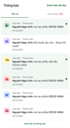

| **Trạng thái thông báo** | **Trạng thái thông báo** | **Trạng thái thông báo** |
| --- | --- | --- |
| **Icon & Badge** |  |  |
| Icon thông báo | Icon / Button | Icon 🔔 cố định trên header. Click → mở panel danh sách thông báo. |
| Badge số lượng | Badge | Hiển thị số thông báo **chưa đọc**. Màu đỏ. Tối đa hiển thị `9+`. Ẩn hoàn toàn khi không có thông báo chưa đọc. Cập nhật realtime khi có thông báo mới. |
| **Panel danh sách thông báo** |  |  |
| Tiêu đề panel | Label | *"Thông báo"* + số thông báo chưa đọc trong ngoặc nếu có. VD: *"Thông báo (3)"*. |
| Button "Đánh dấu là đã đọc" | Button | Variant ghost/link. Hiển thị góc phải tiêu đề. Click → toàn bộ thông báo chuyển **Đã đọc** + badge về 0. Ẩn nếu không có thông báo chưa đọc. |
| **Cấu trúc 1 thông báo** |  |  |
| Tên epic/module | Label | Tên module nguồn phát sinh thông báo. VD: *"Cây dầu"*, *"Kế hoạch mua dầu"*. Font nhỏ, màu xám, in đậm. |
| Nội dung thông báo | Label | Nội dung mô tả hành động vừa xảy ra. Pattern được định nghĩa ở bên dưới. |
| Thời gian | Label | Hiển thị theo quy tắc: Hôm nay, cách > 5 phút → `hh:mm` Hôm nay, cách ≤ 5 phút → `"Bây giờ"` Hôm qua trở về trước → `"X ngày trước"`. |
| **Trạng thái thông báo** |  |  |
| Thông báo chưa đọc | — | Nền màu xanh nhạt. |
| Thông báo đã đọc | — | Nền trắng. |
| Click vào thông báo | — | Chuyển trạng thái → **Đã đọc** + badge −1 + navigate đến màn chi tiết bản ghi liên quan. |

**Pattern thông báo chung:**

[Tên module] · [Tên feature] — [Định danh] vừa được/bị [hành động] bởi [Người thực hiện]

**Quy tắc chọn Định danh:**

| **Trường hợp** | **Dùng** |
| --- | --- |
| Bản ghi đã có mã (sau phê duyệt) | Mã bản ghi. VD: `KH-2025-00001` |
| Bản ghi chưa có mã (trước phê duyệt) | `"một [tên feature]"`. VD: `"một kế hoạch mua dầu"` |

**Nội dung và người nhận theo hành động:**

| **Hành động** | **Động từ** | **Người nhận** |
| --- | --- | --- |
| Tạo mới (submit) | `vừa được tạo` | Người có quyền phê duyệt |
| Phê duyệt | `vừa được phê duyệt` | Người tạo |
| Từ chối | `vừa bị từ chối` | Người tạo |
| Thu hồi | `vừa bị thu hồi` | Người có quyền phê duyệt |

> Các hành động đặc thù không được định nghĩa chung ở đây thì sẽ được định nghĩa riêng trong tài liệu thông báo của feature đó.

---

## SC-03 — Confirm Dialog

Modal xác nhận trước khi thực hiện hành động quan trọng hoặc không thể hoàn tác.

Các hành động bắt buộc dùng SC-03: Xoá, Thu hồi, Phê duyệt, Từ chối, Huỷ form (khi có dữ liệu chưa lưu).

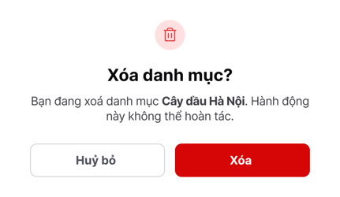

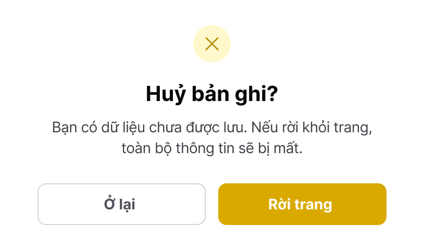

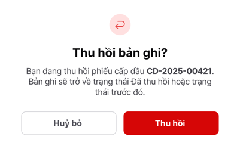

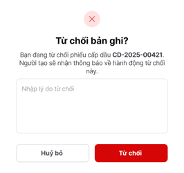

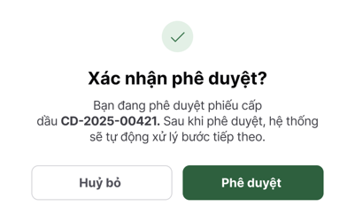

|  | **Action** | **Tiêu đề** | **Nội dung** |
| --- | --- | --- | --- |
| 1 | **Xoá** | Xoá **[tên feature]**? | Bạn đang xoá [tên feature] **[tên/mã]**. Hành động này không thể hoàn tác. |
| 2 | **Thu hồi** | Thu hồi yêu cầu? | Bạn đang thu hồi [tên feature] **[tên/mã]**. Yêu cầu sẽ trở về trạng thái Bản nháp. |
| 3 | **Phê duyệt** | Xác nhận phê duyệt? | Bạn đang phê duyệt [tên feature] **[tên/mã]**. |
| 4 | **Từ chối** | Từ chối yêu cầu? | Bạn đang từ chối [tên feature] **[tên/mã]**. |
| 5 | **Huỷ form** | Huỷ bản ghi? | Bạn có dữ liệu chưa được lưu. Nếu rời khỏi trang, toàn bộ thông tin sẽ bị mất. |

> **Lưu ý:**Nếu có tên bản ghi thì ưu tiên dùng tên, còn không thì dùng mã. Nếu bản ghi không có tên/mã, thì bỏ qua hiển thị tên/mã.

---

## SC-04 — Pagination (Phân trang)

Thanh phân trang chuẩn dùng ở cuối tất cả màn hình danh sách.

|  | **Thành phần** | **Control** | **Mô tả** |
| --- | --- | --- | --- |
| 1 | Dropdown số bản ghi/trang | Select | Các tuỳ chọn: **25 / 50 / 100**. Mặc định: **50**. |
| 2 | Label tổng | Label | Hiển thị dạng *"50 bản ghi trên 1 trang"*. Cập nhật theo bộ lọc hiện tại. |
| 3 | Số trang | Button | Hiển thị: trang đầu, trang hiện tại ± 1, dấu `...`, trang cuối. Trang hiện tại highlight màu xanh lá. |
| 4 | Nút Trước / Sau | Button | Icon `<` / `>`. Disable khi đang ở trang đầu/cuối. |

---

## SC-05 — Filter Drawer (Bộ lọc nâng cao)

Drawer slide-in từ phải, chứa các bộ lọc nâng cao cho màn hình danh sách. Các trường lọc cụ thể được định nghĩa trong từng UC.

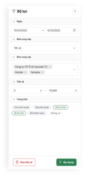

|  | **Thành phần** | **Control** | **Mô tả** |
| --- | --- | --- | --- |
| 1 | Tiêu đề | Label | *"Bộ lọc"* + số điều kiện đang active (VD: *"Bộ lọc (3)"*). |
| 2 | Các trường lọc | Input / Select / DatePicker | Hiển thị các tab là các cột (được phép lọc) theo thứ tự từ trên xuống dưới là thứ tự cột từ trái qua phải của bảng (kể cả các cột đã ẩn). Trong mỗi tab, hiển thị các giá trị của cột đó & 1 giá trị “Không có” cho các dữ liệu null. Hỗ trợ: Select đơn, Select nhiều, Khoảng ngày (từ–đến), Khoảng số (từ–đến). Chọn giá trị: Người dùng có thể chọn giá trị để filter data. Áp dụng cho các trường trạng thái hoặc phân loại ngắn (dưới 5 options) Date time picker: Người dùng có thể chọn ngày bắt đầu - ngày kết thúc để filter data theo thời gian. Từ-đến: Cho phép người dùng nhập trong khoảng. |
| 3 | Button Xoá bộ lọc | Button | Variant ghost. Reset toàn bộ trường về trạng thái rỗng. |
| 4 | Button Áp dụng | Button | Variant filled, màu xanh lá. Click → đóng drawer, áp dụng bộ lọc, refresh danh sách. |
| 5 | Badge trên button Bộ lọc | Badge | Hiển thị số điều kiện đang active trên button **Bộ lọc** ngoài danh sách khi drawer đóng. Ẩn khi không có filter active. |

---

## SC-06 — Column Customizer (Tuỳ chỉnh cột)

Panel/Dropdown cho phép người dùng bật/tắt và sắp xếp thứ tự cột trong bảng danh sách. Cấu hình được lưu theo từng người dùng.

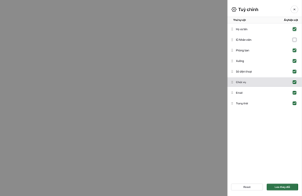

|  | **Thành phần** | **Control** | **Mô tả** |
| --- | --- | --- | --- |
| 1 | Danh sách cột | Checkbox + Drag handle | Hiển thị danh sách toàn bộ các cột theo thứ tự từ trên xuống dưới là thứ tự cột từ trái qua phải của bảng (kể cả các cột đã ẩn). Mỗi cột có Checkbox bật/tắt và drag handle (⠿) để kéo thả thay đổi thứ tự. Tick vào checkbox để hiện/ẩn cột đó ở bảng Drag&drop: Kéo thả (lên trên/xuống dưới) để thay đổi vị trí của cột trong bảng |
| 2 | Cột khoá | Label | Một số cột không thể ẩn (VD: Tên, Trạng thái) — hiển thị icon 🔒, Checkbox disable. |
| 3 | Button Đặt lại mặc định | Button | Variant ghost. Reset về cấu hình cột mặc định của màn hình. |
| 4 | Button Áp dụng | Button | Variant filled. Click → áp dụng cấu hình cột, bảng cập nhật ngay. |

---

## SC-07 — Action Matrix (Inline Actions trên danh sách)

Pattern chuẩn cho cột action cuối mỗi hàng trong bảng danh sách.


|  | **Thành phần** | **Control** | **Mô tả** |
| --- | --- | --- | --- |
| 1 | Icon action visible | Icon / Button | Tối đa **2 icon** hiển thị trực tiếp trên hàng. Chỉ render các action **khả dụng** theo trạng thái + quyền. Không render rồi disable. |
| 2 | Menu ⋯ | Icon / Button | Gom các action phụ. **Destructive actions (Xoá, Huỷ) luôn nằm trong ⋯**, không hiển thị trực tiếp trừ khi chỉ có 1 action phụ thì không hiển thị **⋯** |
| 3 | Vùng click chi tiết | — | Click vào vùng thông tin (tên, mã, người phụ trách...) → mở màn chi tiết. Click vào vùng action **không** trigger mở chi tiết. |

> Action Matrix cụ thể (theo trạng thái × quyền) được định nghĩa trong từng feature, xem thêm ở docs Lưu đồ trạng thái và hành động của mỗi feature hoặc UC xem danh sách.

---

## SC-08 — Activity Log (Lịch sử hoạt động)

Popover/Panel hiển thị lịch sử thay đổi trạng thái và hành động trên bản ghi. Trigger bằng icon 🕐 ở góc trên phải màn hình chi tiết/drawer.

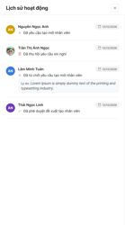

| **Thành phần** | **Control** | **Mô tả** |
| --- | --- | --- |
| Icon trigger | Icon / Button | Icon  góc trên phải ở mỗi màn hình xem thông tin chi tiết. Click → mở panel lịch sử. |
| Mỗi mốc lịch sử | Label | Hiển thị: [Avatar] [Tên tài khoản] [Ngày thực hiện dd/mm/yyyy] [Icon] [Nội dung hành động] [Lý do: ...] ← chỉ hiển thị khi có lý do (Từ chối) |
| Sắp xếp | — | Mới nhất hiển thị trên cùng. |

**Nội dung và icon theo hành động:**

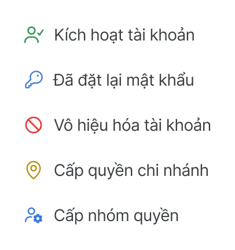

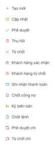

| **Hành động** | **Icon** | **Nội dung hiển thị** |
| --- | --- | --- |
| Tạo mới (submit) | `+` | `Đã tạo mới [tên feature]` |
| Phê duyệt | `✓` | `Đã phê duyệt tạo mới [tên feature]` |
| Từ chối | `✕` | `Đã từ chối phê duyệt [tên feature]` |
| Thu hồi | `🗑` | `Đã huỷ tạo mới [tên feature]` |

> **Lý do từ chối:** Hiển thị dòng thứ 2 ngay dưới nội dung: `Lý do: [nội dung lý do]`. Chỉ xuất hiện với hành động Từ chối.

**Tên feature** điền theo từng màn hình. VD: *"kế hoạch mua dầu"*, *"cây dầu nội bộ"*.

---

## SC-09 — Stepper (Thanh tiến trình)

Header stepper dùng cho các màn hình có luồng nghiệp vụ nhiều bước liên tiếp (VD: Kế hoạch mua → PO → Nhập dầu → Thanh toán).

Xem thêm ở [UC00.00.02](https://deltavn.atlassian.net/wiki/spaces/LG/pages/139067398/UC00.00.02+-+Xem+thanh+ti+n+tr+nh+v+chuy+n+ti+p+nghi+p+v).

---

## SC-10 — File Upload

Component upload file dùng chung cho các màn hình cần đính kèm chứng từ, tài liệu.màn

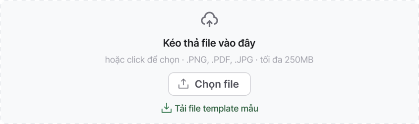

| **Thành phần** | **Control** | **Mô tả** |
| --- | --- | --- |
| **Trạng thái rỗng (chưa có file)** |  |  |
| Vùng upload | — | Dashed border, có icon upload + text hướng dẫn. Hỗ trợ **drag & drop** file trực tiếp vào vùng này. |
| Button chọn file | Button | Variant outlined. Click → mở dialog chọn file từ máy. |
| Định dạng cho phép | Label | Hiển thị dưới vùng upload. Định dạng mặc định: JPG, PNG, PDF. Định dạng bổ sung theo từng UC. |
| Dung lượng tối đa | Label | Hiển thị dưới vùng upload: *"Dung lượng tối đa: 250MB"*. |
| **Sau khi upload:**Mỗi file hiển thị dưới dạng 1 thẻ, ở bên dưới phần upload. |  |  |
| File đang upload | Card | Có Icon loại file + Tên file + số size + icon uploading |
| File upload thành công | Card | Icon loại file + Tên file (click để xem/tải) + số size + icon thành công + Icon Xoá (🗑️). |
| File upload thất bại | Card | Icon loại file + Tên file (click để xem/tải) + số size + icon thất bại + Icon Xoá (🗑️). |
| File ở màn xem | Card | Icon loại file + Tên file (click để xem/tải) |
| Validate số file upload/Upload thêm file | Button | Nếu chỉ cho phép upload 1 file thì sau khi upload file thì ẩn component upload đi. Khi xoá file vừa upload thì hiện lại component upload. Nếu cho phép upload nhiều file, sau khi upload giữ nguyên component upload và file được upload hiển thị dưới component upload |
| **Xử lý lỗi** |  |  |
| Lỗi sai định dạng | Inline error | `"File upload lên không đúng định dạng."` Hiển thị ngay sau khi file được chọn. File không được ghi nhận. |
| Lỗi vượt dung lượng | Inline error | `"Dung lượng các file tải lên không quá 250MB."` Hiển thị ngay sau khi file được chọn. File không được ghi nhận. |

## SC-13 — Thanh điều hướng (Sidebar Menu)

Sidebar menu cố định bên trái màn hình, là điểm truy cập chính đến tất cả module và tính năng trong hệ thống.

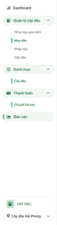

| **Xưởng** | **Cây dầu** | **Danh mục** |
| --- | --- | --- |
| Báo cáo sự cố Nghiệp vụ xưởng Quản lý kinh doanh Đơn mua HHDV Báo giá Quản lý sửa chữa Lệnh sửa chữa Thanh toán Chi phí Thanh toán trả trước Thanh toán trả sau Doanh thu Xuất nhập kho Xuất kho Nhập kho Quản lý tài sản Phương tiện Hàng tồn kho Hàng tồn xưởng Danh mục Xưởng Dịch vụ kỹ thuật Công cụ dụng cụ Phụ tùng vật tư Lốp Ắc quy Nhà cung cấp hàng hoá dịch vụ Khách hàng DK05 Xe của khách hàng Chi phí CP02 Loại chi phí CP02 Quản trị hệ thống Quản lý nhân viên Nhân viên Phân quyền chức năng | Dashboards Quản lý cây dầu Tổng hợp giao dịch Mua dầu Cấp dầu Nhập dầu Danh mục Cây dầu mua ngoài Thanh toán Chi phí trả sau Báo cáo | Cây dầu nội bộ Chi nhánh Xưởng Phương tiện vận tải |

| **Thành phần** | **Control** | **Mô tả** |
| --- | --- | --- |
| **Cấu trúc** |  |  |
| Logo | Icon / Button | Góc trên cùng sidebar. Click → navigate về **List Menu Module**. |
| Toggle thu gọn | Icon / Button | Click → thu gọn sidebar chỉ hiển thị icon, mở rộng lại khi click tiếp. Trạng thái lưu theo người dùng. |
| Menu item cấp 1 (Module) | Button | Tên module + icon đại diện. VD: *Bảng tổng*, *Quản lý cây dầu*, *Danh mục*, *Thanh toán*, *Báo cáo*. Click → navigate hoặc mở rộng submenu. |
| Menu item cấp 2 (Submenu) | Button | Hiển thị thụt lề dưới module cha khi module cha được mở rộng. VD: *Cây dầu*, *Nghiệp vụ cây dầu → Cấp dầu / Mua dầu / Nhập dầu / Tổng hợp giao dịch*. Click → navigate đến màn hình tương ứng. |
| Trạng thái active | — | Menu item đang active (trang hiện tại) highlight màu xanh lá + thanh dọc bên trái. Chỉ 1 item active tại một thời điểm. |
| Trạng thái hover | — | Nền xám nhạt khi hover. |
| Expand/Collapse module | — | Module có submenu hiển thị icon mũi tên (▼ / ▶) bên phải. Click vào module → toggle expand/collapse danh sách submenu. Mặc định: module chứa trang hiện tại tự động expand. |
| **Trạng thái thu gọn** |  |  |
| Sidebar thu gọn | — | Chỉ hiển thị icon đại diện của từng module. Hover vào icon → tooltip hiển thị tên module/submenu. |
| **Footer sidebar** |  |  |
| Tên module | Card | Hiển thị tên module hiện tại đang truy cập. |
| Tên cơ sở | Card | Hiển thị tên cơ sở theo module tương ứng. Nếu module không tách nhỏ cơ sở thì không hiển thị trường này. Nếu người dùng chỉ được phân quyền vào 1 cơ sở duy nhất, hiển thị tên cơ sở đó nhưng k có mũi tên mở dropdown. Nếu người dùng được phân quyền vào nhiều cơ sở, hiển thị tên cơ sở hiện tại đang truy cập và có thêm icon mũi tên để mở/chọn các cơ sở khác. Chọn tới cơ sở khác → Chuyển site sang cơ sở được chọn. |

> **Ghi chú:** Cấu trúc menu (danh sách module, submenu, thứ tự) được định nghĩa theo từng phân quyền role. Người dùng chỉ thấy các module được phân quyền truy cập.

---

# PHẦN 2 — QUY TẮC CHUNG GIAO DIỆN

---

## 2.1 Input / Textbox

| **Quy tắc** | **Mô tả** |
| --- | --- |
| Validate **On Blur** (khi thoát khỏi trường) | Validate và hiển thị lỗi ngay dưới control sau khi người dùng **blur** (thoát khỏi trường). Sau khi người dùng click ra ngoài / chuyển sang trường khác |
| Validate **On Submit** | **Khi user tap Submit / Lưu / Tạo mới:** Validate toàn bộ trường bắt buộc — kể cả trường chưa blur. Nếu có lỗi → inline error + scroll đến lỗi đầu tiên → **không gọi API**, button về active. Nếu không lỗi → button loading + disabled → gọi API. API trả về lỗi → hiển thị lỗi tương ứng → giữ nguyên form, button về active. |
| Max length - Title | Tối đa **50** **ký tự.** Vi phạm báo inline error message: `"Vui lòng nhập dưới 50 ký tự."` |
| Max length — Short textbox | Tối đa **255 ký tự**. Không cho nhập quá từ bàn phím. Copy-paste vượt quá: tự động cắt. |
| Max length — Long textbox (Textarea) | Tối đa **1000 ký tự** (hoặc theo quy định từng UC). Hiển thị đếm ký tự góc dưới phải. Copy-paste vượt quá: tự động cắt. |
| Trường bắt buộc | Label có dấu `*` màu đỏ. Nếu để trống khi submit: `"Vui lòng nhập thông tin này!"` |

---

## 2.2 Select / Combobox / Dropdown

| **Quy tắc** | **Mô tả** |
| --- | --- |
| Single-select | Chọn 1 lựa chọn. |
| Multi-select | Chọn nhiều, hiển thị dạng tag bên trong input. |
| Tìm kiếm | Danh sách từ API: hỗ trợ tìm kiếm gần đúng (fuzzy search) khi nhập. |
| Trường bắt buộc | Label có `*` đỏ. Nếu chưa chọn khi submit: `"Vui lòng nhập thông tin này!"` |

---

## 2.3 Date Picker

| **Quy tắc** | **Mô tả** |
| --- | --- |
| Kiểu nhập | Nhập trực tiếp hoặc chọn từ calendar (click icon mở). |
| Format hiển thị — Không có giờ | `dd/mm/yyyy` |
| Format hiển thị — Có giờ | `dd/mm/yyyy hh:mm` |
| Validate nhập sai format | `"Hãy nhập ngày tháng theo định dạng: dd/mm/yyyy"` |

---

## 2.4 Format số tiền

| **Quy tắc** | **Mô tả** |
| --- | --- |
| Đơn vị mặc định | **VND**. Danh sách đơn vị quản lý trong DB, không chỉnh sửa trên giao diện. |
| Phân tách hàng nghìn | Tự động thêm dấu `,` khi nhập. VD: `100000` → `100,000`. |
| Hiển thị VND | `100,000 đ` hoặc `100,000 VND` tuỳ context. |
| Hiển thị ngoại tệ | `50 USD · 25,000 VND/USD`. |

---

## 2.5 Format số

| **Quy tắc** | **Mô tả** |
| --- | --- |
| Ký tự cho phép | Chỉ số và dấu `.` (phân cách thập phân). Chặn ký tự khác. |
| Phân tách hàng nghìn | Tự động thêm dấu `,`. VD: `1000000` → `1,000,000`. |
| Hiển thị | Hàng nghìn dùng `,`. Thập phân dùng `.`. |

---

## 2.6 Quy tắc làm tròn

Áp dụng thống nhất toàn hệ thống cho mọi giá trị số và tiền tệ hiển thị, tính toán, ghi nhận.

| **Loại** | **Quy tắc** | **Ví dụ** |
| --- | --- | --- |
| Số học | Làm tròn **2 chữ số thập phân**, **Round Half Up** | `12.345` → `12.35` · `45.321` → `45.32` |
| Tiền USD | Làm tròn **2 chữ số thập phân**, **Round Half Up** | `123.456 USD` → `123.46 USD` |
| Tiền VND | **Không có thập phân**. Làm tròn lên hàng đơn vị **(Round Up)** | `123,456.10 VND` → `123,457 VND` |

---

## 2.7 Input Email

| **Quy tắc** | **Mô tả** |
| --- | --- |
| Format hợp lệ | Phải có `@`. VD: `example@mail.com`. |
| Lỗi | `"Email không đúng định dạng."` |

---

## 2.8 Input Số điện thoại

| **Quy tắc** | **Mô tả** |
| --- | --- |
| Ký tự cho phép | Chỉ số. Chặn ký tự khác. |
| Đầu số | `0` hoặc `84`. Tối đa **11 ký tự**. |
| Format | `0xxx xxx xxx` hoặc `84 xxx xxx xxx`. |
| Lỗi | `"SĐT không đúng định dạng."` |

---

## 2.9 Thanh tìm kiếm

| **Quy tắc** | **Mô tả** |
| --- | --- |
| Kiểu tìm kiếm | Gần đúng (fuzzy) trong toàn bộ dữ liệu bảng/danh sách. Hệ thống sẽ không search được các trường thông tin dạng fix cứng như trạng thái, phân loại,… UI sẽ thể hiện tooltip: Khi hover vào sẽ thể hiện các trường không search được. → Người dùng sẽ sử dụng lọc thay thế. Các trường thông tin không tìm kiếm được sẽ được định nghĩa trong từng UC. |
| Kích hoạt | Nhấn **Enter** hoặc click ra ngoài search box. Màn hình có realtime search: debounce **300ms**. |

---

## 2.10 Trường không có thông tin

| **Loại trường** | **Quy tắc** |
| --- | --- |
| Ghi chú | **Ẩn hoàn toàn** nếu không có giá trị. |
| ID/Mã | Hiển thị `"N/A"` |
| Các trường còn lại | Hiển thị `"-"` (dash). |

---

## 2.11 Generate ID / Mã bản ghi

| **Quy tắc** | **Mô tả** |
| --- | --- |
| Thời điểm sinh mã | Sau khi bản ghi được **phê duyệt**. Trước đó không có mã, nhận diện qua thông tin khác (người tạo, ngày tạo, trạng thái). Đối với các feature không bao gồm việc phê duyệt hoặc được tạo tự động, ID sẽ được sinh ngay sau khi tạo. Các trường hợp sinh ID khác với quy tắc trên sẽ được định nghĩa riêng trong từng UC. |
| Format & Prefix theo từng feature | Quy tắc gen mã chi tiết cho từng feature (bảng mã chính thức + mã yêu cầu, 2 tầng Yêu cầu → Chính thức) đã được tách ra tài liệu riêng để dễ bảo trì, tránh trùng/mâu thuẫn prefix giữa các feature: **UC00.00.07 - Format mã quản lý feature và yêu cầu**. |

---

## 2.12 Empty State

| **Trường hợp** | **Hiển thị** |
| --- | --- |
| Danh sách chưa có dữ liệu | Illustration + text mô tả + button **+ Tạo mới** (nếu có quyền). |
| Lọc không có kết quả | *"Không tìm thấy kết quả phù hợp"* + button **Xoá bộ lọc**. Không có button Tạo mới. |
| Đang tải | Skeleton loader theo số cột và dòng hiện tại. |

---

## 2.13 Unsaved Changes

| **Tình huống** | **Quy tắc** |
| --- | --- |
| Đóng trình duyệt / chuyển tab khi có dữ liệu chưa lưu | Browser confirm: *"Bạn có muốn rời trang? Dữ liệu chưa lưu sẽ mất."* |
| Click Huỷ trên form có dữ liệu đã nhập | Confirm Dialog *(SC-03)*: *"Bạn có chắc muốn huỷ? Dữ liệu đã nhập sẽ bị mất."* |

## 2.14 Căn lề & Trình bày dữ liệu trong bảng

|  | **Loại dữ liệu** | **Quy tắc** |
| --- | --- | --- |
| 1 | Tiêu đề | Căn lề theo dữ liệu của cột |
| 2 | Dữ liệu số | Căn phải |
| 3 | Dữ liệu ngày tháng | Căn giữa |
| 4 | Dữ liệu văn bản | Căn trái |
| 5 | Dữ liệu trạng thái | Căn trái |

## 2.15 Phân loại sử dụng Error Message

Hệ thống có **3 loại error message** phân biệt rõ theo nguồn gốc và tính chất lỗi.

| **Thuộc tính** | **Loại 1 — Inline Error** | **Loại 2 — Popup Error** | **Loại 3 — Toast Error** |
| --- | --- | --- | --- |
| **Khi nào dùng** | Lỗi validate **từng trường cụ thể**: format sai, bắt buộc bỏ trống, giá trị không hợp lệ của chính trường đó. Trigger bởi **On Blur** hoặc **On Submit.** | Lỗi chỉ phát hiện được **sau khi submit** do cần đối chiếu với dữ liệu khác từ server (conflict, trùng mã, vượt hạn mức, vi phạm ràng buộc nghiệp vụ...). Không thuộc về trường cụ thể nào để hiện inline. | Lỗi **kỹ thuật / hệ thống** không liên quan đến dữ liệu người dùng nhập: API thất bại, mất kết nối, timeout, lỗi server (5xx). Người dùng không thể tự sửa bằng cách thay đổi input. |
| **Vị trí** | Ngay dưới trường input bị lỗi. | Modal overlay trung tâm màn hình. Có backdrop mờ. | Toast góc trên phải màn hình. Nền đỏ. *Xem*[*SC-01*](https://deltavn.atlassian.net/wiki/spaces/LG/pages/253067265/v2.0+Quy+t+c+chung+x+l+giao+di+n+tr+n+website+Website+common+rules+shared+components#SC-01-%E2%80%94-Toast-Notification)*— Toast Notification* |
| **Visual** | Border trường chuyển màu đỏ + text lỗi màu đỏ, font nhỏ bên dưới. | Tiêu đề lỗi (màu đỏ) + mô tả chi tiết + button **Đóng**. Button **Thử lại** nếu hành động có thể retry. |  |
| **Hành vi** | Tự động ẩn khi người dùng sửa trường và giá trị hợp lệ. | Không tự động ẩn. Người dùng phải chủ động đóng. Giữ nguyên form sau khi đóng để người dùng xem lại và điều chỉnh. | Tự động ẩn sau 3 giây. Không block thao tác người dùng. |
| **Ví dụ** | *"Vui lòng nhập tên cây dầu."* · *"Email không đúng định dạng."* · *"Số lượng phải lớn hơn 0."* · *"SĐT không đúng định dạng."* | *"Nhà cung cấp này đã tồn tại trong hệ thống."* · *"Lượng đặt mua vượt quá hạn mức hợp đồng."* · *"Tên cây dầu đã được sử dụng. Vui lòng chọn tên khác."* | *"Đã xảy ra lỗi. Vui lòng thử lại."* · *"Mất kết nối. Vui lòng kiểm tra mạng."* · *"Phiên làm việc đã hết hạn. Vui lòng đăng nhập lại."* |

---

## 2.16 Freeze cột trong bảng danh sách

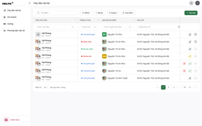

| **Quy tắc** | **Mô tả** |
| --- | --- |
| Điều kiện áp dụng | Chỉ áp dụng khi bảng có **nhiều cột, cần scroll ngang**. Khi màn hình đủ rộng hiển thị hết tất cả cột (không cần scroll ngang): không áp dụng freeze. |
| Cột đầu (Tên / Mã) | Freeze cố định bên trái. Luôn hiển thị khi scroll ngang. |
| Cột cuối (Action) | Freeze cố định bên phải. Luôn hiển thị khi scroll ngang. |
| Visual khi scroll | Cột freeze có shadow nhẹ ở cạnh trong để phân biệt với vùng scroll. |

---

## 2.17 — Nhóm dữ liệu trong bảng (Group By)

| **Quy tắc** | **Mô tả** |
| --- | --- |
| Chọn nhóm | Người dùng chọn **1 cột** để nhóm qua button **Nhóm** trên toolbar. Các cột được phép nhóm định nghĩa trong từng UC. |
| Bỏ nhóm | Click button **Nhóm** → chọn **Xoá** để tắt nhóm, danh sách trở về trạng thái bình thường. |
| Hiển thị sau khi nhóm | Mặc định hiển thị các **dòng cha** (header nhóm, là tên giá trị theo trường thông tin được nhóm) kèm số lượng bản ghi con. VD: *"Petrolimex (5)"*. |
| Expand mặc định | Nhóm **đầu tiên** tự động mở rộng, hiển thị tối đa **10 bản ghi con** đầu tiên. Các nhóm còn lại mặc định thu gọn. |
| Expand/Collapse | Click vào dòng cha → mở rộng hiển thị 10 bản ghi con đầu tiên. Click lại → thu gọn toàn bộ bản ghi con trong nhóm đó. |
| Xem thêm | Nếu số bản ghi con > 10: hiển thị button **"Xem thêm"** cuối danh sách con. Mỗi lần click: hiển thị thêm **10 bản ghi** tiếp theo. |
| Phân trang khi nhóm | Phân trang áp dụng theo **nhóm** (mỗi nhóm = 1 đơn vị phân trang). |

---

## 2.18 — Sắp xếp dữ liệu (Sort)

| **Quy tắc** | **Mô tả** |
| --- | --- |
| Trigger | Click vào **header cột** để sort theo cột đó. Áp dụng cho **tất cả các cột**. |
| Chu kỳ sort | Click chuột trái lần 1 → **Tăng dần (ASC)** · Click chuột trái lần 2 → **Giảm dần (DESC)** Click chuột trái lần 3 → **Về mặc định**. |
| Visual | Header cột đang sort hiển thị icon mũi tên: ↑ ASC · ↓ DESC. Icon mờ khi chưa sort. |
| Sort mặc định | **Mới nhất lên trên** (theo thời gian tạo, DESC). Áp dụng khi chưa chọn sort hoặc sau khi reset. |
| Chỉ sort 1 cột | Tại một thời điểm chỉ sort theo **1 cột**. Khi click header cột khác: sort cột cũ tự động reset. |

---

## 2.19 — Export

Cho phép xuất bảng danh sách dưới dạng file PDF / Excel.

Nội dung file được xuất sẽ bao gồm toàn bộ bảng (sau khi áp dụng bộ lọc, nhóm, tuỳ chỉnh,…) của toàn bộ các trang được trải ra.

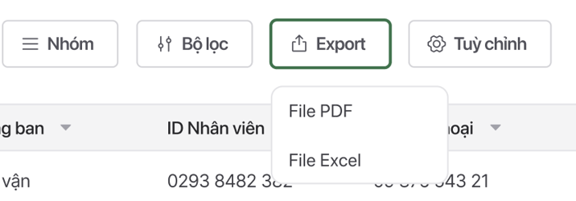

## 2.20 — Filter by keyword

Cho phép người dùng search hoặc filter giá trị theo từng cột.

Nếu là các trường **nhập giá trị/ID**, hiển thị searchbox

![Screenshot 2025-04-03 at 00.19.32.png]

Nếu là các trường **chọn giá trị**, hiển thị dropdown để filter

![Screenshot 2025-04-03 at 00.20.42.png]

Nếu là các trường **date time**, hiển thị date range picker để chọn from - to. Date range picker chỉ chọn dd/mm/yyyy chứ không chọn giờ.

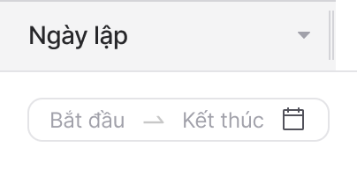

Nếu là các trường **số/tiền/phần trăm**, hiển thị 2 ô textbox min - max để người dùng nhập.

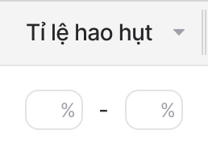
