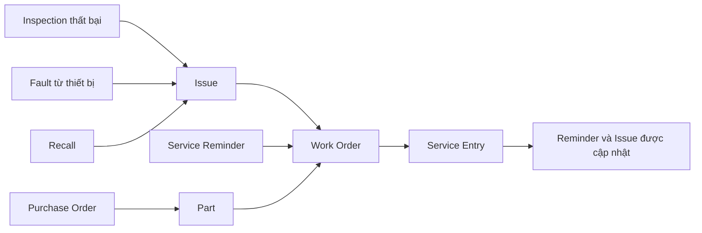

# Phân tích ngược web app Fleetio

> **Khuyến nghị: NÊN THAM KHẢO — chọn lọc.** Đáng học cách Fleetio nối chuỗi Kiểm tra → Sự cố → Lệnh sửa chữa → Lịch sử dịch vụ, cách nhắc bảo dưỡng theo cả thời gian lẫn số km, và cách đưa trạng thái, mã, loại vào cấu hình. Chưa dùng được làm mẫu cho marker xe trên bản đồ, vì chưa thấy marker thật nào.

***

## Tóm tắt

Fleetio là SaaS quản lý vòng đời đội xe, trọng tâm là bảo dưỡng và chi phí, không phải điều vận chuyến hàng. Mục Jobs chỉ ghi xe nào gắn với việc nào, tại đâu và trong bao lâu. Đợt này đã đi qua các module chính bằng tài khoản dùng thử có dữ liệu mẫu, ở chế độ chỉ đọc. Các trang cần bật trial, phần lớn Settings, app di động và luật chạy phía máy chủ chưa được xem.

**Nhãn độ chắc chắn dùng trong tài liệu:**

| Nhãn | Nghĩa |
|---|---|
| **Thấy trực tiếp** | Đọc được trên giao diện, trong DOM hoặc trong tên request |
| **Suy ra** | Kết luận rút từ các dữ kiện trên, chưa kiểm chứng |
| **Chưa biết** | Không có dữ liệu để trả lời |

## Nguồn phân tích

| Mục | Giá trị |
|---|---|
| App | Fleetio web, `secure.fleetio.com` |
| Tài khoản | Dùng thử gói Premium của người dùng, còn 14 ngày, đang bật Sample Data |
| Ngày xem | 2026-11-02 |
| Cách làm | Mở trang trên Chrome, đọc giao diện, DOM và Performance API |
| Giới hạn thao tác | Không lưu form, không đổi cài đặt, không bấm nút thanh toán hay bắt đầu trial |
| Công cụ | Claude in Chrome; không dùng bộ công cụ REA nên không có Evidence ID |

Mã tài khoản, email và mã định danh người dùng không ghi vào tài liệu. Đường dẫn dưới đây viết `{account}` thay cho mã tài khoản.

## 1. Bản đồ module

**Thấy trực tiếp** trên menu và các trang danh sách.

| Nhóm | Mục | Tab hoặc trạng thái thấy được | Cột hoặc điểm chính |
|---|---|---|---|
| Dashboard | Fleet Overview | — | Khối Needs Attention: Issues, Service Reminders, ROs Needing Approval, Inspections quá hạn, Faults, Renewals; thêm các khối chi phí và trạng thái xe |
| Fleet Map | Nearby | Vehicles | Xem Mục 3 |
| Vehicles | Vehicle List | All, Assigned, Unassigned, Archived | Name, Year, Make, Model, VIN, Status, Type, Group, Current Meter, License Plate, Watchers, Operator |
| Vehicles | Vehicle Assignments | Lịch theo ngày | Dạng lịch tài nguyên: mỗi xe một hàng, trục giờ, lịch tháng bên phải |
| Vehicles | Meter History | — | Meter Date, Value, Type, Void, Source, Void Status, Auto-Void Reason |
| Vehicles | Tire Readings | — | Tread Depth, Pressure, Position, Tire Meter, Life Expectancy, Minimum và Factory Tread Depth, số nhận dạng lốp |
| Vehicles | Expense History | Past, Future | Date, Type, Vendor, Source, Amount |
| Vehicles | Replacement Analysis | — | Biểu đồ chi phí trên km theo tuổi xe, kèm các ô giả định về vòng đời, mua, thanh lý, dịch vụ, nhiên liệu |
| Tools | Tool List, Service Entries, Reminders | All, Assigned, Unassigned | Sau cổng "Start Tools Trial", chưa mở |
| Inspections | History | All, Submissions with Failed Items | Duration, User, Location Exception, Failed Items |
| Inspections | Item Failures | All, Needs Action, Open Issue, Acknowledged, Resolved | Failure Timeline, Status |
| Inspections | Schedules | All, Due Soon, Overdue, Skipped | Next Due, Frequency, Manually Overridden |
| Inspections | Forms | Active, Archived | Chưa mở trình dựng form |
| Issues | Issues | All, Open, Overdue, Resolved, Closed | Priority, Type, Summary, Status, Source, Assigned, Labels |
| Issues | Faults | All, Open, Pending, Resolved, Ignored | Code, Critical, Name, Description, Last Occurred, Status, Issue |
| Issues | Recalls | All, Needs Action, Open, Resolved, Acknowledged | Số chiến dịch của hãng và của NHTSA (cơ quan an toàn giao thông Mỹ) |
| Reminders | Service Reminders | All, Due Soon, Overdue, Snoozed | Next Due, Incomplete Work Order, Last Completed, Compliance |
| Reminders | Vehicle và Contact Renewals | All, Due Soon, Overdue | Renewal Type, Status, Due Date |
| Service | Service History | All | Có nút Smart Upload; Assessment, Repair Priority Class, Meter, Tasks, Issues, Vendor, Total, Work Order |
| Service | Work Orders | All, Open, Pending, Completed | Ba cách xem: List, Calendar, Resource Scheduler |
| Service | Service Tasks | Active, Archived | Mã Reason, Category, System, Assembly mặc định; giờ công dự kiến; phụ tùng gắn kèm |
| Service | Service Programs | — | Vehicles, Schedules, Primary và Secondary Meter; có lọc OEM Service Program |
| Contacts | Contacts | All, Users, No User Access | Một danh bạ chung, có hoặc không có quyền đăng nhập |
| Vendors | Vendors | All, Charging, Fuel, Parts, Service, Vehicle | Rating, Labels; có nút Find Shops |
| Parts | Parts List | All | Mã hãng, đơn vị, số lượng, Aisle/Row/Bin, Track Inventory, Unit Cost, Linked Service Tasks |
| Parts | Purchase Orders | All, Draft, Pending Approval, Rejected, Approved, Purchased, Received Partial, Received Full, Closed | Part Location, Vendor, Created By, Total |
| Fuel | Fuel History | — | Usage, Volume, Fuel Economy, Cost per Meter, Alerts, Capacity Exception Volume, Location Exception Distance |
| Fuel | Charging History | — | Start, End, Duration, Total Energy, Unit Price, Energy Cost |
| Jobs | Jobs, Job Assignment History | Active, Completed | Job, Place, Vehicle, Time on Job, Start, End |
| Khác | Places | — | Name, Description, Address; lọc theo bán kính geofence |
| Khác | Motor Pool | — | Đặt xe dùng chung: Operator, Vehicle Types, Pick Up, Drop Off, Status |
| Khác | Documents | All Documents và thư mục | File Type, Location Type |
| Khác | Warranties | — | Bảo hành theo ngày và theo hai đồng hồ, Coverage Type, Warranty Vendor, Contract ID |
| Khác | Custom Records | Trang giới thiệu | Tự tạo loại bản ghi, trường riêng, liên kết tới xe, liên hệ, nhà cung cấp |
| Reports | Advanced Analytics | Màn Getting Started | Chưa bấm Start Setup |
| Reports | Standard Reports | Favorites, Saved, Shared | 48 báo cáo trong 12 nhóm |

### Báo cáo chuẩn theo nhóm

| Nhóm | Số báo cáo | | Nhóm | Số báo cáo |
|---|---|---|---|---|
| Vehicles | 14 | | Work Orders | 5 |
| Service | 8 | | Fuel | 3 |
| Inspections | 4 | | Issues, Warranties, Contacts, Vehicle Assignments | 2 mỗi nhóm |
| Parts | 4 | | Jobs, Motor Pools | 1 mỗi nhóm |

## 2. Luồng nghiệp vụ lõi

**Suy ra** từ cột liên kết chéo giữa các trang. Chưa chạy thử trọn luồng, vì làm vậy phải tạo dữ liệu.

Dữ kiện làm căn cứ:

| Dữ kiện thấy trực tiếp | Ý nghĩa |
|---|---|
| Item Failures có tab `Open Issue`; Faults và Recalls có cột `Issue` | Lỗi từ ba nguồn đổ về cùng một loại bản ghi Issue |
| Service Reminders có cột `Incomplete Work Order` | Nhắc bảo dưỡng gắn được với lệnh chưa xong |
| Mô tả trạng thái Completed: finished, reminders được cập nhật, issues được giải quyết | Hoàn thành lệnh kéo theo cập nhật hai loại bản ghi khác |
| Work Order có trường `Service Entry`; Service History có cột `Work Order` | Hai bản ghi trỏ qua lại |
| Service Tasks có `Linked Parts`, Parts có `Linked Service Tasks` | Định mức phụ tùng theo đầu việc |

### Trạng thái và cấu hình

**Thấy trực tiếp** trong Settings.

| Đối tượng | Giá trị | Ghi chú |
|---|---|---|
| Work Order | Open (mặc định), Pending, Completed | Mỗi trạng thái thuộc loại Incomplete hoặc Completed; thêm được trạng thái mới |
| Issue Priority | No Priority, Low, Medium, High, Critical | Đặt được tên thay thế, bật tắt từng mức |
| Role có sẵn | Fleet Manager, Operator, Technician, Viewer | Thêm được role; có thêm Record Sets, chưa mở |
| Repair Priority Class | Scheduled, Non-Scheduled, Emergency | Theo mô tả báo cáo Repair Priority Class Summary |

### Nhắc bảo dưỡng theo hai trục

**Thấy trực tiếp** trên một dòng mẫu: "Every 1 month(s) or 4,000 miles", "4 weeks ago", "71 miles overdue", Compliance 50%. Settings có ô Forecasting: dùng số km trung bình ngày để dự đoán ngày đến hạn.

**Suy ra:** quá hạn được tính theo cả thời gian lẫn đồng hồ xe, và tỷ lệ tuân thủ tính từ lịch sử hoàn thành đúng hạn hay trễ.

## 3. Fleet Map

**Thấy trực tiếp:**

- **Bố cục:** cột trái "Nearby" sắp theo Distance; ô "Update list when map moves" ở cuối cột.
- **Trên bản đồ:** ô tìm vehicles, places, vendors; nút Filters; ba nút bật tắt Vehicles, Places, Vendors.
- **Điều khiển:** Map Options, Maximize Map, Map Legend, Center on Default Location, zoom.
- **Hình minh hoạ trong khung Learn:** icon xe, icon cửa hàng kèm dấu trạng thái, vòng tròn vùng quanh một địa điểm.

| Câu hỏi | Trạng thái | Căn cứ |
|---|---|---|
| Engine bản đồ | Thấy trực tiếp | Google Maps JS API, script `maps-api-v3/api/js/64/14a` |
| API vị trí | Thấy trực tiếp | `GET /web_api/{account}/map/last_live_location_values` với `current_bounds` gồm tâm, góc đông bắc, góc tây nam, zoom |
| Gọi lại khi đổi khung nhìn | Thấy trực tiếp | Sau 10 lần zoom liên tiếp, Performance API ghi 2 lần gọi với zoom 6 và 4 |
| Có chống gọi dồn (debounce) | Suy ra | Số lần gọi ít hơn hẳn số lần zoom |
| Vị trí mở đầu theo IP | Suy ra | Có gọi `/web_api/ip_geo_location` và bản đồ mở ở Hà Nội; cũng có thể do cài đặt |
| Vị trí đẩy realtime qua Pusher | Suy ra yếu | Chỉ thấy `/pusher/auth`, chưa thấy sự kiện vị trí nào |
| Marker thật, gom cụm, panel chi tiết | **Chưa biết** | Danh sách luôn báo 0 kết quả; xe mẫu đã mở báo "No current location information" |

**Lỗi nhãn nút zoom (thấy trực tiếp):** nút nằm trên, hiện dấu cộng, có nhãn `Zoom Out`, và bấm vào thì phóng to. Nút còn lại nhãn `Zoom In` và thu nhỏ. Người dùng trình đọc màn hình sẽ nghe ngược chức năng. Invlogis nên kiểm tra lỗi này khi tự làm điều khiển bản đồ.

## 4. Trang chi tiết

### Chi tiết xe

**Thấy trực tiếp:**

- **Đầu trang:** ảnh, tên, loại, năm, hãng, VIN, đồng hồ, trạng thái, nhóm, người lái, nhãn; nút Watch, Edit, Add.
- **Tab:** Overview, Sensor Data Snapshots, Service History, Inspection History, Work Orders, Job Assignment History, Warranties, Tire Management, Tire Activity, Service Reminders.
- **Trong menu More:** Renewal Reminders, Issues, Meter History, Fuel History, Assignment History, Expense History, Recalls, Faults, Location History, Parts History.
- **Menu Add:** tạo Work Order nháp, Assignment, Fuel, Expense, Service Entry, Issue, Inspection, Work Order, Warranty, Service Reminder, Renewal, Meter ngay từ trang xe.
- **Overview:** khối Fields tìm được theo tên trường và có Customize Layout; các khối Last Known Location, Open Issues, Service Reminders.
- **Cột phải:** Comments, Photos, Documents.

### Chi tiết Work Order

**Thấy trực tiếp:**

- **Cột trái:** Vehicle, Status (có lịch sử đổi), Repair Priority Class, Service Entry, Issued By, Assigned To, các ngày dự kiến và thực tế.
- **Khối Assessment do AI viết:** nhãn Acceptable, tóm tắt, dòng "Auto-assessed".
- **Khối Warranty Opportunities:** xe còn bảo hành bao nhiêu, phụ tùng thay có được bảo hành không.
- **Line Items:** tổng Labor, Parts, Total, rồi từng dòng việc với Labor, Parts, Subtotal.

### Trường của form tạo mới

**Thấy trực tiếp** từ nhãn form, có thể chưa đủ vì chỉ đọc nhãn đang hiện và giới hạn số lượng khi quét.

| Form | Trường bắt buộc | Trường khác đáng chú ý |
|---|---|---|
| Work Order | Vehicle, Status, Issue Date | Repair Priority Class, Issued By, ngày dự kiến và thực tế, nhắc ngày bắt đầu, "Use start odometer for completion meter", Vendor, Invoice Number, PO Number |
| Issue | Asset, Reported Date, Summary | Priority, Description, Reported By, Assigned To, Due Date |
| Vehicle | Vehicle Name, Type, Status, Ownership | VIN, biển số, Linked Vehicles, vòng đời sử dụng, kích thước, tải trọng, động cơ; khoảng 45 trường trở lên |
| Fuel Entry | Vehicle, Fuel Entry Date | Vendor, Reference; cờ Personal, Partial fuel-up, Reset usage |

## 5. Settings và khả năng cấu hình

**Thấy trực tiếp** trên menu Settings, khoảng 65 mục. Mới mở 8 trang: Work Order Statuses, Roles, AI Service Advisor, Fleetio MCP, Service Reminder Settings, Fault Rules, Issue Priorities và General Settings.

| Nhóm | Mục |
|---|---|
| Cá nhân | User Profile, Notification Settings, Custom Dashboards, My Saved Views, Login & Password, Appearance & Theme, Manage API Keys |
| Tài khoản | General Settings, Billing & Subscriptions, Export Account Data, Sandboxes |
| Thông báo | Notification Profiles, Watched Vehicle Groups |
| Quyền | Manage Users, Security, Roles, Record Sets |
| AI | AI Service Advisor |
| Tích hợp | Integrations Directory, Integration Links, Webhooks, External Connections, SAML Connectors, Fleetio MCP |
| Dữ liệu | Standard Records, Custom Records, Groups & Subgroups, Saved Views, Labels, Custom Widgets |
| Xe | Vehicle Statuses, Vehicle Types, External Vehicle IDs, Expense Types, Expense Settings, Tire Management Settings |
| Motor Pool | Motor Pools, Reservation Rates, Flat Fees |
| Vận hành | Inspection Settings, Issue Priorities, Fault Rules, Service Reminder Settings, Vehicle và Contact Renewal Types |
| Bảo dưỡng | Maintenance Settings, Work Order Statuses, Reason For Repair Codes, Repair Priority Class Codes, System/Assembly/Component Codes, Warranty Templates |
| Phụ tùng | Part Settings, Part Locations, Part Categories, Part Manufacturers, Inventory Adjustment Reasons, Inventory Valuation Method, Measurement Units |
| Mua hàng | Purchase Order Settings, Purchase Order Statuses |
| Nhiên liệu | Fuel & Energy Settings, Fuel Types |
| Báo cáo | Saved Reports |

**General Settings** cho từng công ty chọn: tiền tệ, định dạng ngày, múi giờ, đồng hồ 12 hoặc 24 giờ, đơn vị số đo (Miles, Kilometers, Hours), đơn vị nhiên liệu, hệ đo lường, và gọi đối tượng là Vehicle hay Asset.

**Giới hạn gói** hiện trên trang: Documents 250 GB, Roles 50, Vehicles 5, Automations 75, Custom Records 25. Số đọc từ ảnh chụp độ phân giải thấp, cần xem lại nếu dùng.

### Lớp AI

**Thấy trực tiếp** trong AI Service Advisor:

| Tính năng | Mô tả trên trang |
|---|---|
| Issue Prioritization | Xếp ưu tiên khi Issue được tạo |
| Issue Resolution | Khớp và giải quyết Issue từ dịch vụ đã hoàn thành |
| Fault Monitoring | Gom lỗi liên quan, thêm chẩn đoán, tạo sẵn để xử lý |
| Service Assessments | Rà lệnh và lịch sử dịch vụ, chỉ ra chỗ cần xem kỹ |
| Service Writer | Soạn Work Order từ Issue đang mở và nhắc bảo dưỡng |

Ngoài ra có nút "Ask a data question" ở thanh trên, nút Smart Upload ở Service History, và máy chủ Fleetio MCP để kết nối Claude, Codex, theo quyền của từng người dùng. Trang ghi rõ khách hàng tự chịu trách nhiệm xem xét và quyết định theo gợi ý AI. Chưa chạy thử tính năng nào.

## 6. Công nghệ

| Hạng mục | Thấy trực tiếp |
|---|---|
| Frontend | React, CSS-in-JS bằng Emotion; bundle `application_base`, `application_react` |
| API nội bộ | Tiền tố `/web_api/{account}/...`; thống kê tải riêng từng khối qua `/async_stats/*_job` |
| Lọc và sắp xếp | Tham số kiểu `q[user_id_eq]`, `q[s]`, `page`, `per` trên URL |
| Cập nhật realtime | `/pusher/auth` |
| Dịch vụ ngoài | Google Maps, Stripe, Segment, Heap, Amplitude, Contentsquare, Sprig, Chameleon, Filestack, Front, AnnounceKit, Statuspage |

**Suy ra:** backend nhiều khả năng là Rails với Ransack, vì cú pháp `q[..._eq]` đúng kiểu đó. Chưa có bằng chứng trực tiếp.

## 7. Mẫu giao diện dùng lại

**Thấy trực tiếp** lặp lại trên nhiều trang:

| Mẫu | Cách làm |
|---|---|
| Trang danh sách | Tiêu đề, tab đếm số, tìm kiếm, 3 đến 5 bộ lọc nhanh, nút Filters mở nhóm điều kiện, View Settings, Save View |
| Tab tự tạo | `Add Tab` trên Vehicles, Work Orders, Vendors, Parts, Service History; lưu được thành Saved Views |
| Bình luận và theo dõi | Cột Watchers, comments_count, panel bên phải trên trang chi tiết |
| Xem nhanh | Nút `Close record peek` cho thấy mở bản ghi được ngay trên danh sách |
| Hướng dẫn tại chỗ | Khung Learn trên từng trang, dẫn sang Fleetio Academy |
| Dữ liệu mẫu | Nhãn `Sample` trên từng bản ghi, tắt được một nút |
| Mốc thời gian | Đầu trang cảnh báo khi múi giờ thiết bị khác cài đặt tài khoản |

## 8. Gợi ý cho Invlogis

Các gợi ý này là đề xuất để cùng review, **chưa đối chiếu** với tài liệu Xưởng, Kho, Mua hàng và Phương tiện của Delta.

| Điểm học | Áp vào đâu | Lưu ý |
|---|---|---|
| Mọi nguồn lỗi đổ về một loại Issue rồi mới thành lệnh | Xưởng sửa chữa | Cần xem có khớp SOP Delta không |
| Nhắc bảo dưỡng theo thời gian hoặc km, có tỷ lệ tuân thủ và dự đoán ngày | Phương tiện, Xưởng | Chu kỳ phải đi qua mã `P-…` |
| Đóng lệnh tự cập nhật nhắc bảo dưỡng và sự cố | Xưởng | Cần nêu rõ thành quy tắc nghiệp vụ |
| Bất thường nhiên liệu: vượt dung tích, sai vị trí | Định mức nhiên liệu, Cấp dầu | Ngưỡng là tham số theo khách |
| Trạng thái, mã, loại, đơn vị đều cấu hình theo khách | Định hướng SaaS | Có thể làm tham khảo khi xếp `[Lõi]` và `[Cấu hình]` |
| Luồng duyệt PO 8 trạng thái, nhận hàng một phần | Mua hàng, Kho | So với quy trình duyệt của Delta |
| Xem lệnh ở List, Calendar, Resource Scheduler | Xưởng, Lệnh vận tải | Lịch tài nguyên hợp để xếp xe |
| Chi tiết xe làm trung tâm, tạo mọi bản ghi từ đó | Phương tiện | Xem có quá tải trên mobile không |
| Saved Views và tab tự tạo | Khung danh sách của design system | Cần xem chi phí xây dựng |

**Không nên lấy làm mẫu:** điều vận. Fleetio chỉ có Jobs và Motor Pool ở mức gán xe, trong khi Lệnh vận tải của Delta phức tạp hơn nhiều.

## 9. Giới hạn và việc chưa làm

| Phần | Vì sao chưa có |
|---|---|
| Marker thật, gom cụm, panel chi tiết trên bản đồ | Không thấy xe nào có vị trí; cần tài khoản có thiết bị định vị hoặc tìm vùng khác |
| Tools | Sau cổng trial; `/tools` trả về 404 |
| Advanced Analytics, Custom Records | Phải bấm Start Setup hoặc Create, sẽ đổi trạng thái tài khoản |
| Trình dựng Inspection Form, Service Program, luồng làm Inspection | Chưa mở sâu |
| Khoảng 55 mục Settings còn lại | Mới đọc tên mục |
| Trạng thái sau khi lưu, quy tắc chuyển trạng thái, tính chi phí | Phải tạo dữ liệu mới thấy |
| Nội dung API trả về | Chỉ đọc đường dẫn và tên tham số |
| App di động | Không nằm trong đợt này |
| Bulk Manage Parts, Documents | Chỉ thấy khung trang, chưa đọc đủ cột |

**Hai hiện tượng chưa rõ nguyên nhân trong lúc xem:**

- Bộ đếm Get Started đổi từ 1/6 sang 1/5. Có thể do các lượt mở trang hoặc do app tự tính lại.
- Tab đang ở `/map` tự chuyển sang `/dashboard` một lần dù không có thao tác từ phía phân tích.

Dữ liệu mẫu do Fleetio sinh, nhiều mốc nằm trong tương lai và giá tiền rất nhỏ khi đổi sang ₫, nên không dùng được làm số liệu thị trường.
