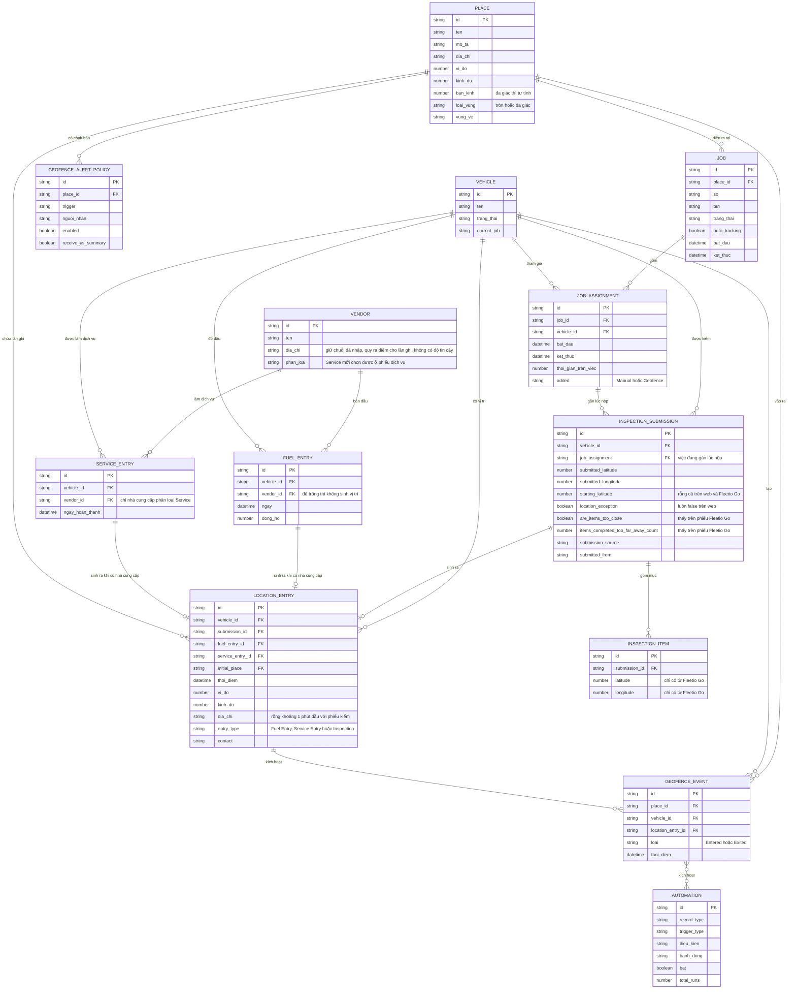

# Bản đồ, gán việc — ERD nghiệp vụ

Suy ra từ form, màn hình, dữ liệu phiếu quan sát được và tài liệu hãng, không phải sơ đồ cơ sở dữ liệu thật.

## Mức bằng chứng

| Thành phần | Mức |
|---|---|
| JOB, JOB_ASSIGNMENT, các cột hiện trên màn | `Chạy` |
| JOB_ASSIGNMENT.added = Geofence, INSPECTION_SUBMISSION.job_assignment | `Chạy (vị trí giả lập)` |
| LOCATION_ENTRY, `initial_place`, `location_exception`, `submitted_latitude`, `submitted_longitude` | `Chạy (vị trí giả lập)` |
| FUEL_ENTRY, VENDOR, LOCATION_ENTRY.entry_type, liên kết phiếu dầu với lần ghi | `Chạy`; quan hệ qua khoá ngoại là `Suy` từ Source trên panel |
| VENDOR.phan_loai | `Chạy`, chỉ thấy tác dụng ở form Service Entry |
| SERVICE_ENTRY, Location Entry loại Service Entry | `Chạy`; quan hệ qua khoá ngoại là `Suy` từ dòng cùng giờ phiếu |
| INSPECTION_ITEM.latitude, longitude, `submitted_from`, `are_items_too_close`, `items_completed_too_far_away_count` | `Chạy (Fleetio Go)` |
| PLACE, loại vùng | `Chạy` |
| GEOFENCE_EVENT.loai, trigger Created | `Chạy (vị trí giả lập)` |
| GEOFENCE_EVENT là bản ghi riêng, liên kết với LOCATION_ENTRY | `Suy`: có Record Type nhưng không có màn xem |
| GEOFENCE_ALERT_POLICY | `Xem`, chưa lưu |
| AUTOMATION nhiều-nhiều với GEOFENCE_EVENT | `Suy` từ số lần chạy |
| Khoá chính, khoá ngoại | `Suy`, thêm để đọc quan hệ |
| Lớp đồng hồ, Issue, Equipment | Ngoài sơ đồ; Equipment có API tương tự (`Docs`) |
