# Bản đồ, gán việc — Flows

Mã lỗi viết tắt, đầy đủ có tiền tố `E-fleetio-location-dispatch-`.

## Flow 1: Xem đội xe (`Chạy (vị trí giả lập)`, gọi dữ liệu theo khung là `Chạy`)

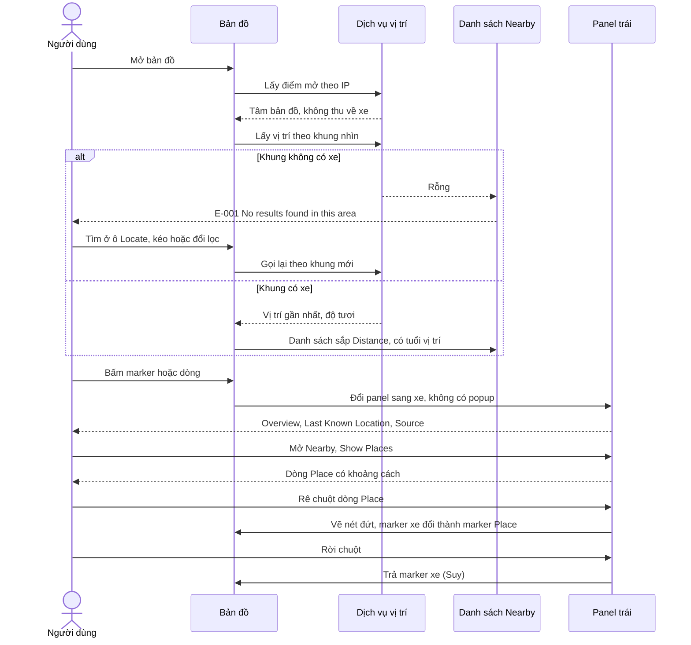

Bỏ tích "Update list when map moves": chưa thấy khác biệt rõ, chưa thử kéo tay (OQ-6). Map Options lưu theo người dùng, đổi lại được.

## Flow 2: Khai địa điểm, vùng (`Chạy`)

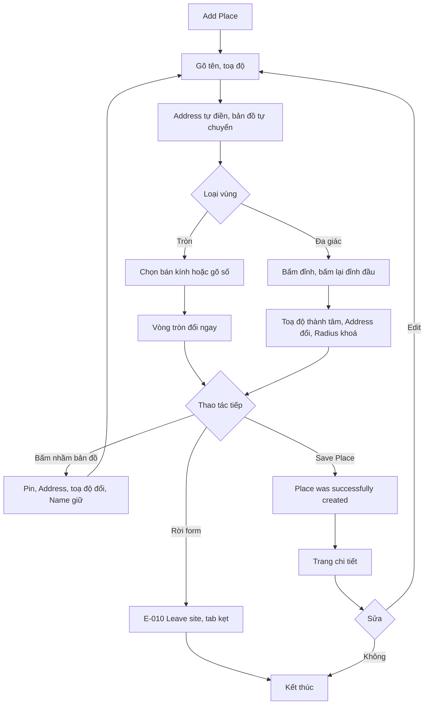

Đa giác 2 đỉnh: form không chặn, chưa thử lưu (OQ-10). Bỏ đa giác để quay về vòng tròn: chưa thử.

## Flow 3: Vị trí từ phiếu kiểm web (`Chạy`; toạ độ giả là `Chạy (vị trí giả lập)`)

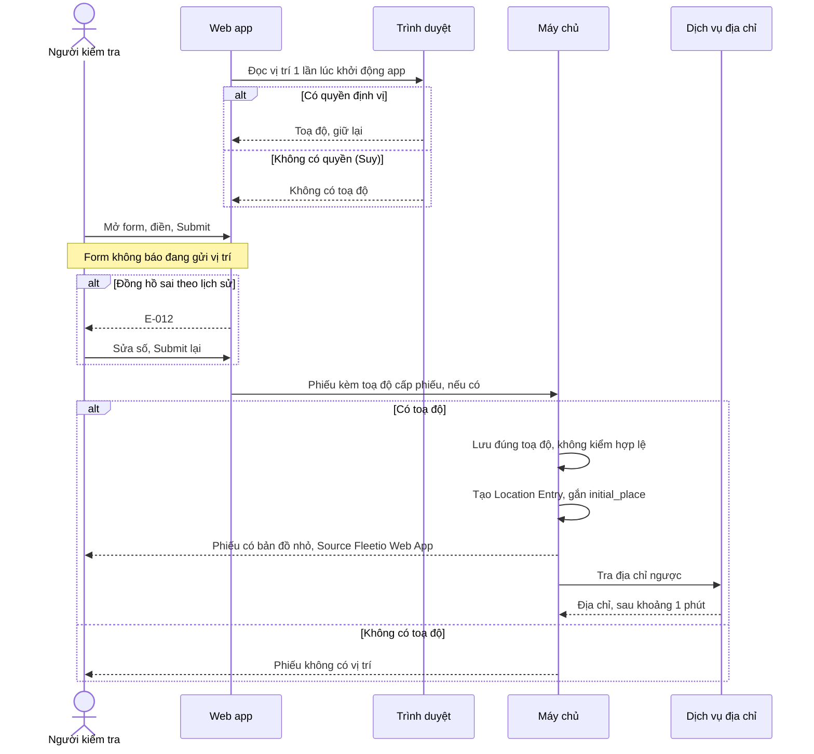

Phiếu dầu, phiếu dịch vụ trên web không có ô vị trí nên không có đường này (`Chạy`). API `POST /vehicles/:id/location_entries` và thiết bị là nguồn khác (`Docs`).

## Flow 4: Sự kiện vùng và hệ quả (`Chạy (vị trí giả lập)`, bước so sánh là `Suy`)

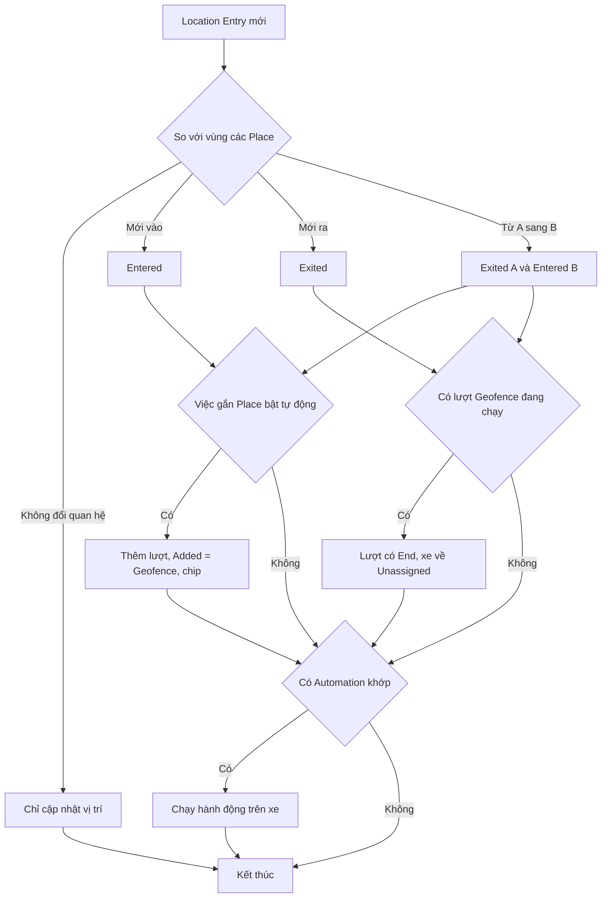

Phiếu làm xe ra vùng vẫn mang `job_assignment` của việc đó, vì phiếu ghi lại việc đang gán lúc nộp. Xe đang có việc khác, xe đã trong vùng khi bật ô, chống nhiễu mép vùng: chưa kiểm (OQ-8, OQ-9). Không có màn xem lại sự kiện.

## Flow 5: Tạo việc (`Chạy`)

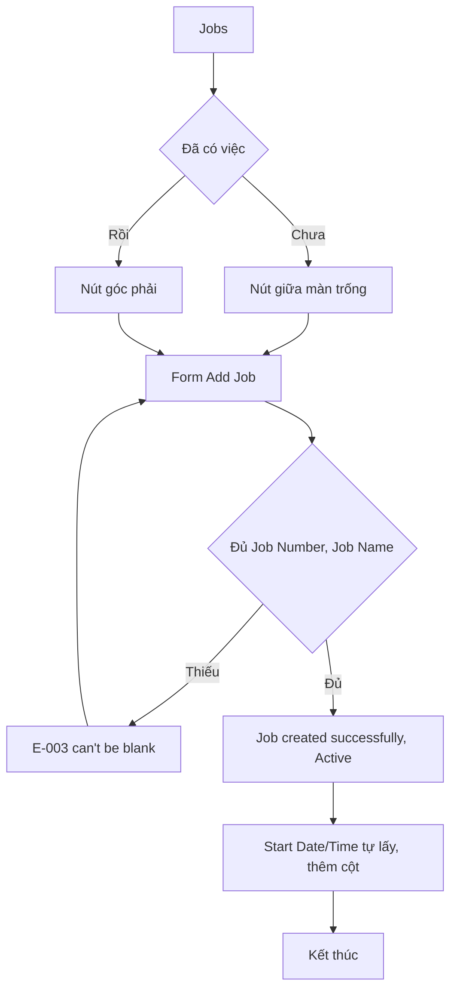

## Flow 6: Gán tay và kết thúc, kể cả đảo ngược (`Chạy`)

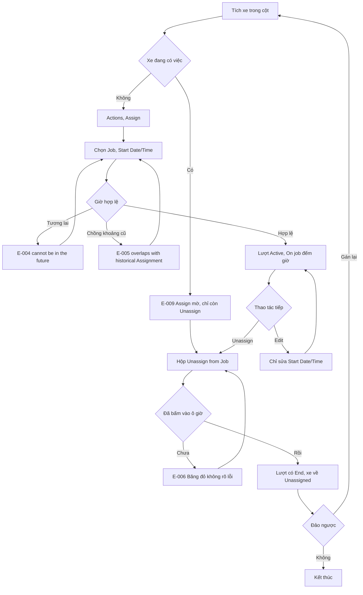

Kéo thả thẻ xe không hoạt động. Không có chuyển thẳng xe sang việc khác. Đảo ngược việc kết thúc chỉ bằng cách tạo lượt mới, giờ không chồng lượt cũ; Delete lượt chưa thử.

## Flow 7: Hoàn thành việc (`Chạy`)

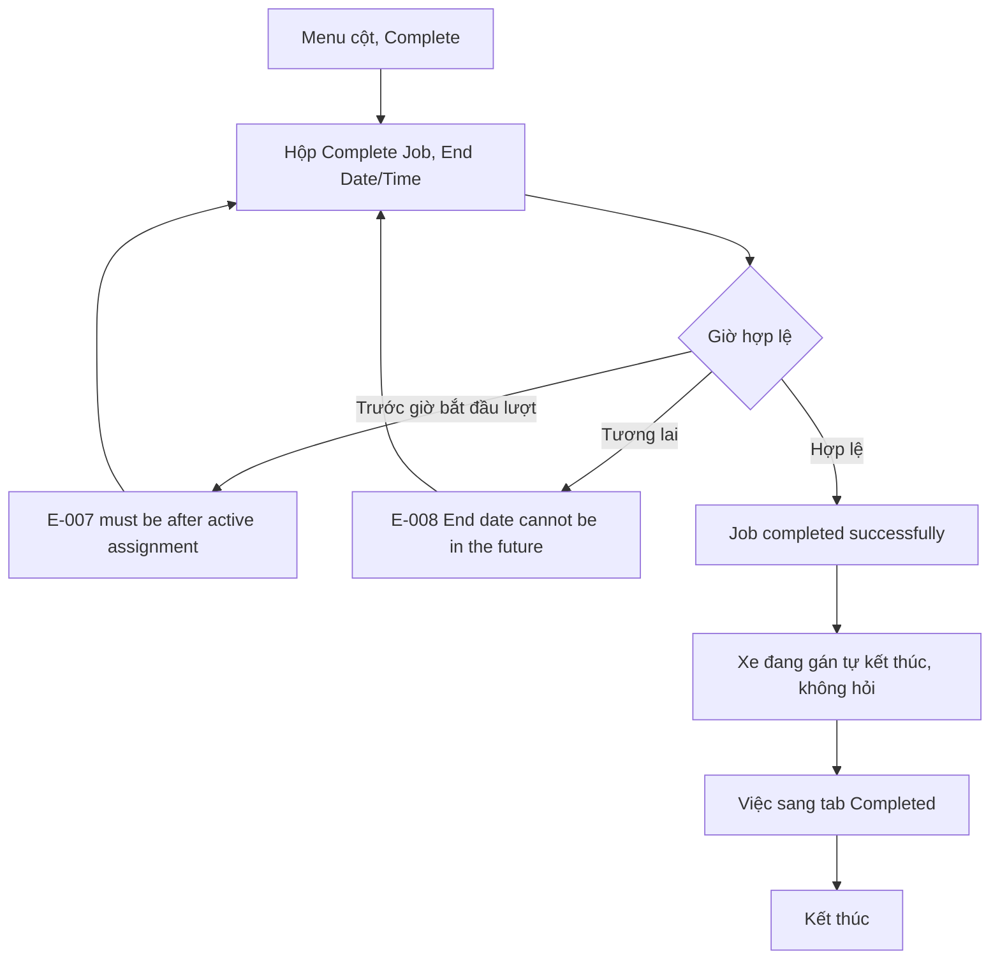

Mở lại việc đã hoàn thành: chưa thấy đường (OQ-13).

## Flow 8: Automation theo sự kiện vùng (`Chạy (vị trí giả lập)`)

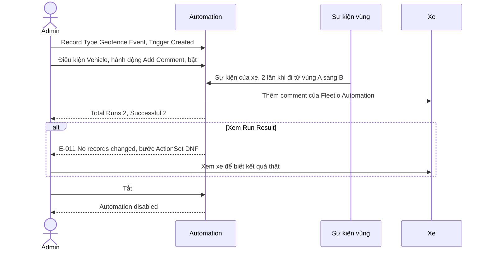

Không có điều kiện Geofence Event Type thì chạy cả vào lẫn ra (`Suy`). Update Field, Send Email chưa chạy.

## Flow 9: Cảnh báo vùng (`Xem`, chưa lưu)

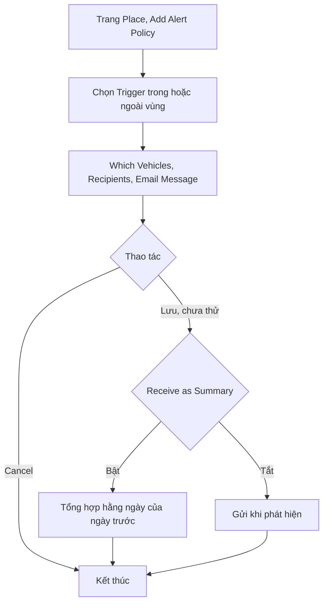

Hai nhánh lưu lấy từ câu chữ trên form, chưa chạy (OQ-12).

## Flow 10: Quick Add từ bản đồ (`Chạy (vị trí giả lập)` với Add Issue, còn lại `Xem`)

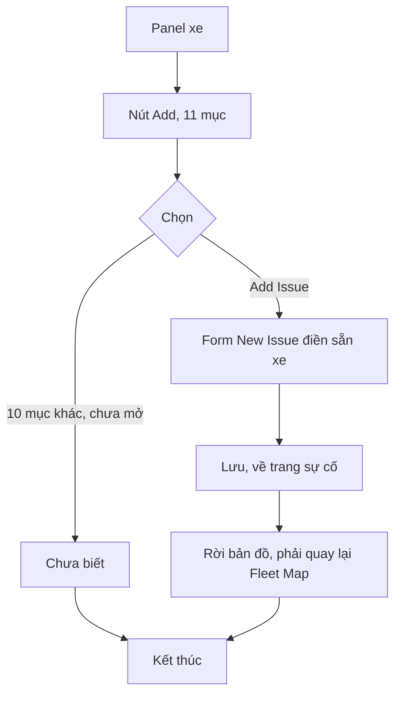

## Flow 11: Location Exception trên web (`Chạy (vị trí giả lập)`, nguyên nhân là `Suy`)

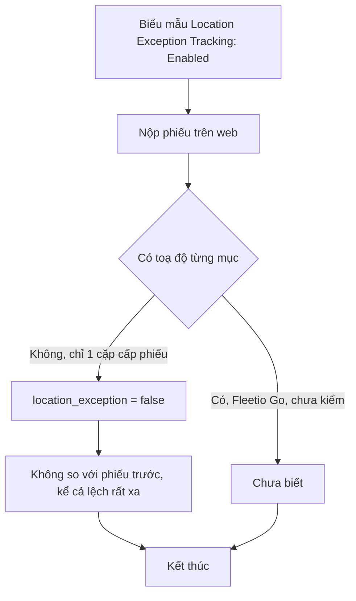
