# Bản đồ, gán việc — Màn hình thật

Ảnh chụp từ tài khoản dùng thử ngày 02/11/2026 và 03/11/2026, dùng nội bộ để phân tích. Bảng theo [[docs/_research/fleetio/run-notes/location-dispatch.md|ghi chú chạy thử]]; phần ghi chú không mô tả thì ghi "Chưa ghi". Xe, marker, sự kiện vùng trên ảnh dùng vị trí giả lập. Lượt 3, lượt 4 không lưu ảnh mới: màn có vị trí hoặc địa chỉ thật được đọc qua DOM, ghi rõ ở từng mục.

## 1.1 Bản đồ

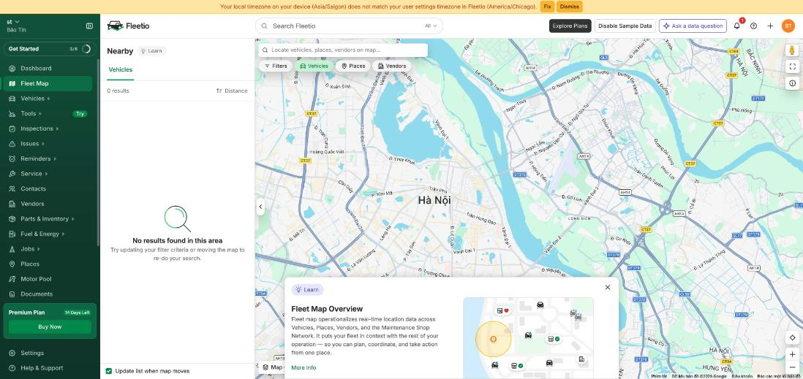

| # | Items | Control type | Data type | Description |
|---|---|---|---|---|
| 1 | Nearby | Cột | — | Tab theo lớp, số kết quả, sắp Distance |
| 2 | Update list when map moves | Tick | — | Mặc định bật. Bỏ tick: kéo tay không cập nhật (E-016), chọn từ ô tìm vẫn cập nhật; tick lại là áp ngay (`Chạy`, đọc DOM) |
| 3 | Ô Locate | Tìm | Chữ | Vehicles, places, vendors. Kết quả "10 results available for search term TEST", nhà cung cấp trước, khớp mờ; Enter chọn dòng đầu (E-014); xe chưa có vị trí vẫn có dòng (`Chạy`, đọc DOM) |
| 4 | Filters, Vehicles, Places, Vendors | Nút | — | Bật lớp; Filters mở 1.13. Bật Vendors thêm marker và tab Places, Vendors; tắt Vehicles mất tab và marker; tắt hết ra E-001; nút có `aria-pressed`; tải lại về mặc định (`Chạy`, đọc DOM). Không có nút Shops riêng |
| 5 | Map Options | Nút | — | Kiểu, nhãn, điểm mở |
| 6 | Street View, Maximize, Legend | Nút | — | Góc phải trên |
| 7 | Center on Default Location, zoom | Nút | — | Góc phải dưới; "+" có `aria-label` "Zoom Out", "−" có "Zoom In", hành vi đúng theo hình |
| 8 | Hình minh hoạ Learn | Ảnh | — | Icon xe, cửa hàng kèm dấu, vùng tròn; không phải marker thật |

## 1.2 Danh sách Nearby có xe

Mức: `Chạy (vị trí giả lập)`.

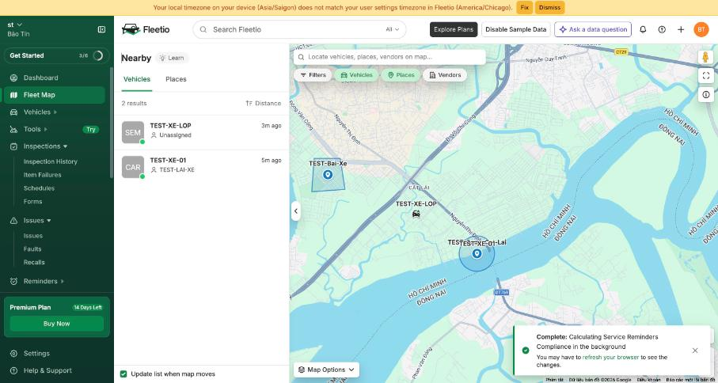

| # | Items | Control type | Data type | Description |
|---|---|---|---|---|
| 1 | Tab Vehicles, Places | Tab | — | "2 results" |
| 2 | Sắp Distance | Nhãn | — | Theo khoảng cách với tâm bản đồ (`Suy`) |
| 3 | Dòng xe | Dòng | Chữ | Tên xe, người lái ("Unassigned" nếu chưa gán), tuổi vị trí "3m ago"; bấm mở panel 1.3 |

## 1.3 Panel xe, Overview

Mức: `Chạy (vị trí giả lập)`.

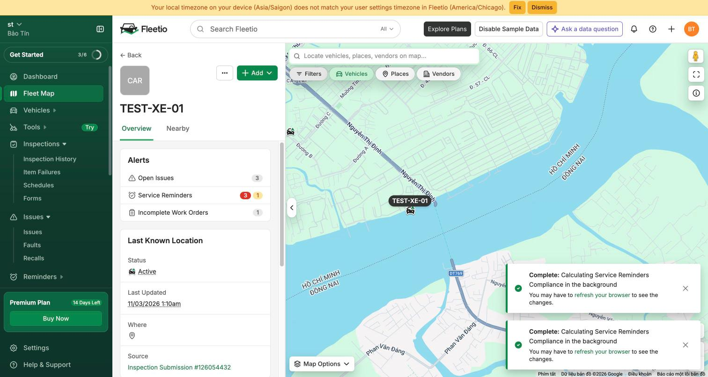

| # | Items | Control type | Data type | Description |
|---|---|---|---|---|
| 1 | Nút Add | Nút menu | — | Quick Add 11 mục; Add Issue mở form điền sẵn xe |
| 2 | Tab Overview, Nearby | Tab | — | Mở ở Overview |
| 3 | Alerts | Khối | Số | Open Issues, Service Reminders, Incomplete Work Orders |
| 4 | Last Known Location | Khối | Chữ | Status, Last Updated, Where, Source "Inspection Submission #..." trên ảnh; xe có vị trí từ phiếu dầu ghi Source "Fuel Entry #...", Status "Stale" (`Chạy`, không có ảnh) |
| 5 | Details | Khối | Chữ | Chưa ghi chi tiết |
| 6 | Marker xe | Marker | — | Hình xe đen nhỏ, gắn nhãn tên; không có popup |

## 1.4 Panel xe, Nearby

Mức: `Chạy (vị trí giả lập)`.

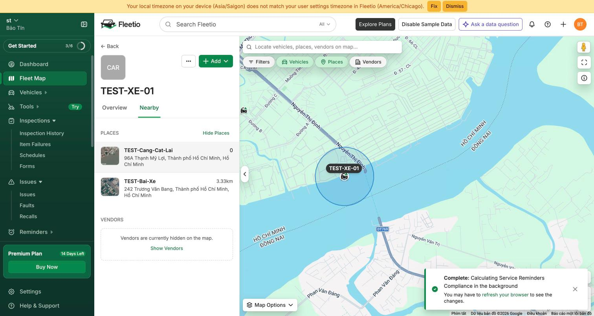

| # | Items | Control type | Data type | Description |
|---|---|---|---|---|
| 1 | PLACES, VENDORS | Khối | — | Mặc định ẩn; "Show Places", "Show Vendors" |
| 2 | Dòng Place | Dòng | Chữ, khoảng cách | Tên, địa chỉ, khoảng cách: "0", "3.33km", "1.44km", "1.91km"; rê chuột sang 1.5 |

## 1.5 Rê chuột dòng địa điểm

Mức: `Chạy (vị trí giả lập)`.

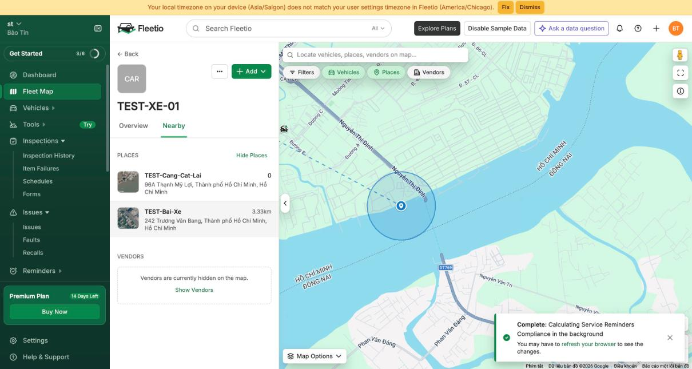

| # | Items | Control type | Data type | Description |
|---|---|---|---|---|
| 1 | Đường nét đứt | Hình bản đồ | — | Thẳng từ xe tới Place trong lúc rê |
| 2 | Marker xe | Marker | — | Đổi thành marker Place trong lúc rê |

## 1.6 Chú giải bản đồ

Mức: `Chạy (vị trí giả lập)`.

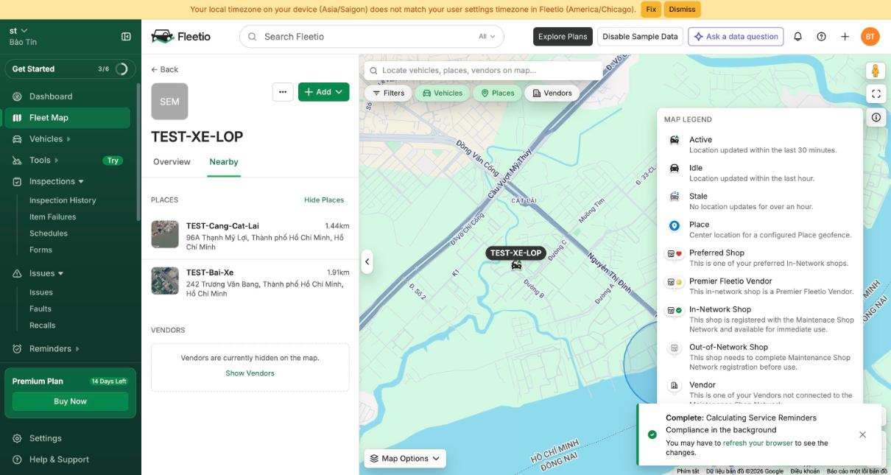

| # | Items | Control type | Data type | Description |
|---|---|---|---|---|
| 1 | Active | Dòng chú giải | — | "Location updated within the last 30 minutes." |
| 2 | Idle | Dòng chú giải | — | "Location updated within the last hour." |
| 3 | Stale | Dòng chú giải | — | "No location updates for over an hour." |
| 4 | Place | Dòng chú giải | — | "Center location for a configured Place geofence." |
| 5 | Preferred Shop, Premier Fleetio Vendor, In-Network Shop, Out-of-Network Shop, Vendor | Dòng chú giải | — | Các loại cửa hàng, nhà cung cấp |

## 1.7 Tuỳ chọn bản đồ

Mức: `Chạy (vị trí giả lập)`.

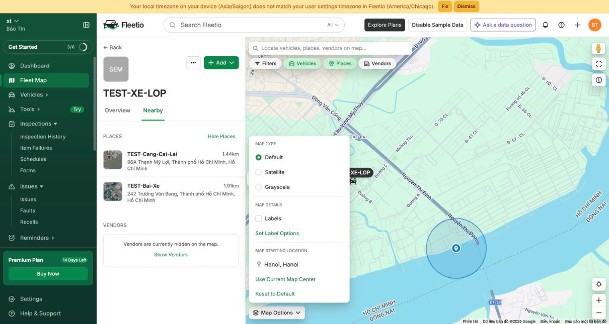

| # | Items | Control type | Data type | Description |
|---|---|---|---|---|
| 1 | Default, Satellite, Grayscale | Chọn một | — | Lưu theo người dùng, tải lại vẫn giữ |
| 2 | Labels | Bật tắt | — | Hiện tên Place |
| 3 | Set Label Options | Liên kết | — | Mở hộp 1.14 |
| 4 | Map Starting Location | Lựa chọn | — | Ghi thành phố theo IP. "Use Current Map Center": toast "Map Preferences Updated", dòng này đổi sang tên vùng đang xem; "Reset to Default" trả lại (`Chạy` lượt 4, ngoài ảnh) |

## 1.8 Nền vệ tinh

Mức: `Chạy (vị trí giả lập)`.

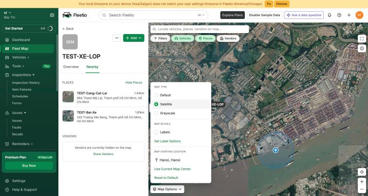

| # | Items | Control type | Data type | Description |
|---|---|---|---|---|
| 1 | Bản đồ nền Satellite | Bản đồ | — | Đổi được; chưa ghi thêm |

## 1.9 Nền xám

Mức: `Chạy (vị trí giả lập)`.

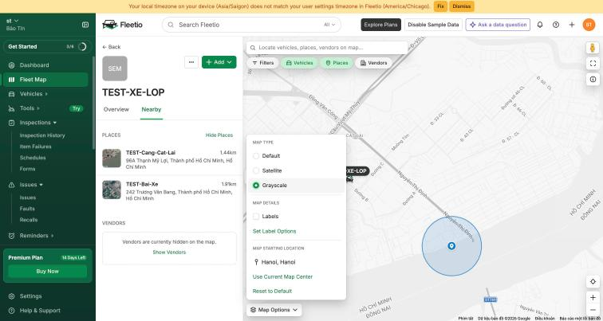

| # | Items | Control type | Data type | Description |
|---|---|---|---|---|
| 1 | Bản đồ nền Grayscale | Bản đồ | — | Đổi được; chưa ghi thêm |

## 1.10 Nhãn địa điểm, đa giác

Mức: `Chạy (vị trí giả lập)`.

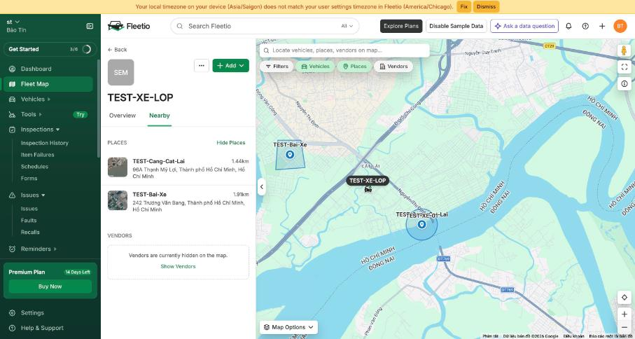

| # | Items | Control type | Data type | Description |
|---|---|---|---|---|
| 1 | Nhãn Place | Nhãn | Chữ | Đè lên nhau khi các Place gần |
| 2 | Vùng đa giác | Hình bản đồ | — | Đúng hình đã vẽ |
| 3 | Tâm Place | Marker | — | Marker tròn xanh; che marker xe nếu trùng toạ độ |

## 1.11 Zoom xa, không gom cụm

Mức: `Chạy (vị trí giả lập)`.

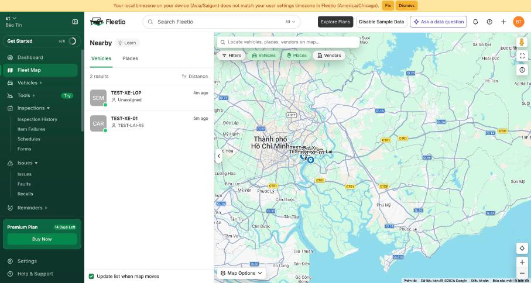

| # | Items | Control type | Data type | Description |
|---|---|---|---|---|
| 1 | Marker xe, Place | Marker | — | 2 xe, 2 Place không gom, đè nhau. Lượt 3 đọc DOM: 15 nhà cung cấp, 4 xe vẫn không gom, không có marker dạng số; chưa biết ngưỡng lớn hơn |

## 1.12 Lịch sử vị trí xe

Mức: `Chạy`. Không có ảnh: màn hiện địa chỉ nên không lưu; bảng theo ghi chú chạy thử, chưa đối chiếu ảnh.

| # | Items | Control type | Data type | Description |
|---|---|---|---|---|
| 1 | Ô Search | Tìm | Chữ | Chưa ghi kết quả tìm |
| 2 | Location Entry Date | Lọc nhanh | Ngày | Chưa ghi chi tiết |
| 3 | Location Entry Type | Lọc nhanh | Chọn | Đúng 3 giá trị "Fuel Entry", "Service Entry", "Inspection"; mở được, không lưu lọc |
| 4 | Sort | Nhãn | — | "Sort: Date - Newest First" |
| 5 | Danh sách trái | Dòng | Chữ, ngày | Icon loại, ngày, địa chỉ |
| 6 | Bản đồ phải | Bản đồ | — | Chưa ghi tương tác với danh sách |
| 7 | Phân trang | Điều hướng | — | "Page 1 of 1"; Fleetio: 30 dòng mỗi trang |
| 8 | Trạng thái rỗng | Chữ | — | "No results found." khi xe chưa có vị trí (E-017) |

## 1.13 Bộ lọc bản đồ

Mức: `Chạy`. Không có ảnh: lượt 3 đọc qua DOM; bảng theo ghi chú chạy thử, chưa đối chiếu ảnh.

| # | Items | Control type | Data type | Description |
|---|---|---|---|---|
| 1 | VEHICLES | Nhóm lọc | Chọn | Vehicle Type, Vehicle Group, Vehicle Status, Vehicle Operator, Vehicle Assigned, Vehicle GPS Integration, Vehicle GPS Device Assigned, Vehicle Has Overdue Service Reminders |
| 2 | VENDORS | Nhóm lọc | Chọn | Classification |
| 3 | Cancel, Apply | Nút | — | Apply với Vehicle Type = Trailer còn 1 marker; Cancel chưa ghi kết quả |
| 4 | Huy hiệu trên Filters | Số | Số | Hiện "1" khi có 1 bộ lọc; bộ lọc mất khi tải lại trang (E-015) |

## 1.14 Nhãn marker xe

Mức: `Chạy` lượt 4, đã trả về Name. Không có ảnh: đọc qua DOM; bảng theo ghi chú chạy thử, chưa đối chiếu ảnh.

| # | Items | Control type | Data type | Description |
|---|---|---|---|---|
| 1 | Vehicle Marker Label | Chọn một | Trường của xe | Mặc định Name; 5 giá trị Name, VIN/SN, Vehicle Type, License Plate, "Year, Make, Model". "Select field to display for Vehicle map marker labels. Falls back to Vehicle Name if selected field value is empty/blank." |
| 2 | Cancel, Save | Nút | — | Save VIN/SN: xe có VIN hiện số VIN, xe không có hiện tên; tải lại vẫn giữ. Cancel chưa ghi kết quả |

## 2.1 Form địa điểm

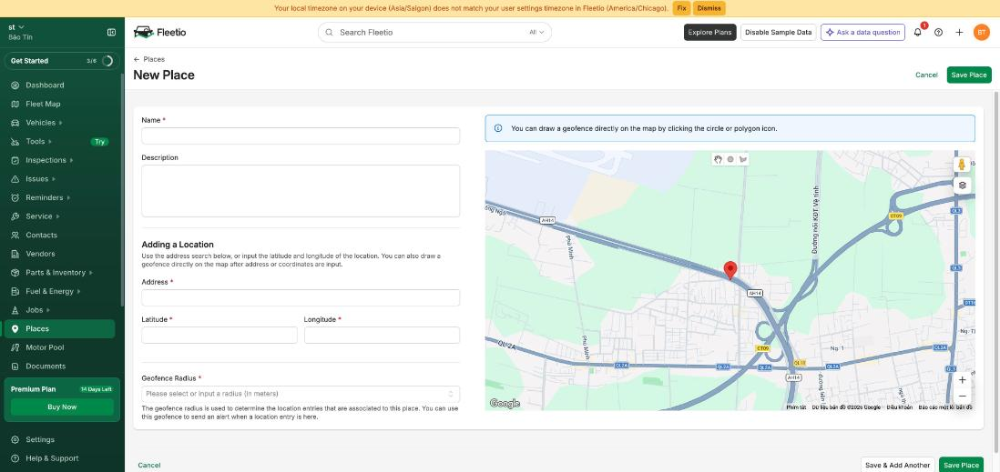

| # | Items | Control type | Data type | Description |
|---|---|---|---|---|
| 1 | Name, Description | Chữ | Bắt buộc tên | — |
| 2 | Address | Tìm | Bắt buộc | Nhập toạ độ thì tự điền địa chỉ ngược (`Chạy`); chiều ngược lại là `Suy` |
| 3 | Latitude, Longitude | Số | Bắt buộc | — |
| 4 | Geofence Radius | Chọn hoặc nhập | Mét, bắt buộc | Gắn lượt vị trí với địa điểm, gửi cảnh báo |
| 5 | Bản đồ | Bản đồ | — | Vẽ vùng tròn hoặc đa giác |

## 2.2 Form địa điểm, vùng tròn

Mức: `Chạy`.

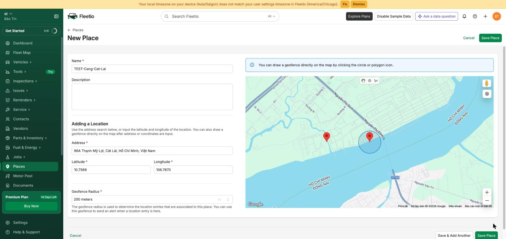

| # | Items | Control type | Data type | Description |
|---|---|---|---|---|
| 1 | Name, Description | Chữ | Chữ | Name giữ nguyên khi đặt lại pin |
| 2 | Adding a Location: Address, Latitude, Longitude | Tìm, số | Chữ, số | Gõ toạ độ: Address tự điền, bản đồ tự chuyển |
| 3 | Geofence Radius | Chọn hoặc nhập | Mét | "100 meters", "200 meters", "500 meters", "1000 meters"; gõ số khác được; vòng tròn đổi ngay |
| 4 | Bản đồ | Bản đồ | — | Công cụ tay, hình tròn, đa giác, Pegman, lớp bản đồ, zoom; bấm ở chế độ thường đặt lại pin; đổi toạ độ để lại pin đỏ |
| 5 | Câu gợi ý | Chữ | — | "You can draw a geofence directly on the map by clicking the circle or polygon icon." |

## 2.3 Form địa điểm, đa giác

Mức: `Chạy`.

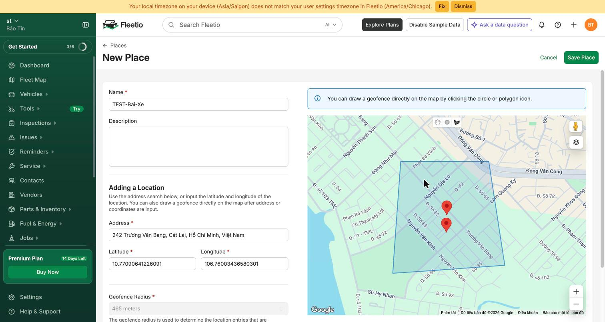

| # | Items | Control type | Data type | Description |
|---|---|---|---|---|
| 1 | Vùng đa giác | Bản đồ | — | Bấm đỉnh, bấm lại đỉnh đầu để đóng; 2 đỉnh vẫn không bị chặn trên form |
| 2 | Latitude, Longitude, Address | Số, chữ | — | Tự thay theo tâm |
| 3 | Geofence Radius | Khoá | Mét | Xám, tự tính; ví dụ "465 meters" |

## 2.4 Danh sách địa điểm

Mức: `Chạy`.

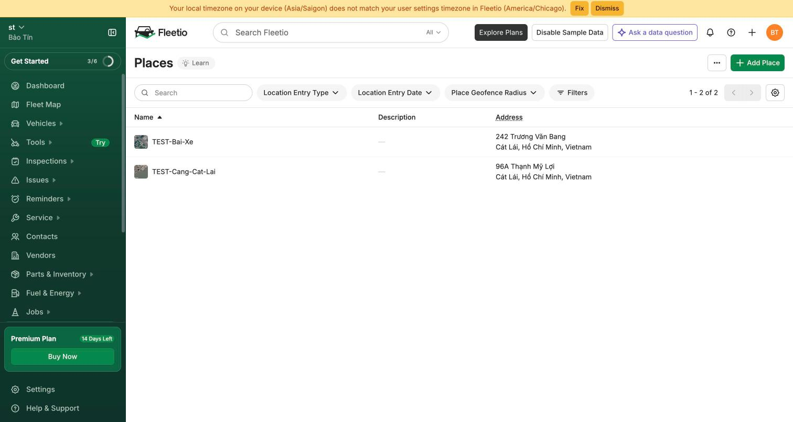

| # | Items | Control type | Data type | Description |
|---|---|---|---|---|
| 1 | Cột Name, Description, Address | Bảng | Chữ | "1 - 2 of 2" |
| 2 | Lọc nhanh | Lọc | — | "Location Entry Type", "Location Entry Date", "Place Geofence Radius" |

## 2.5 Chi tiết địa điểm

Mức: `Chạy`.

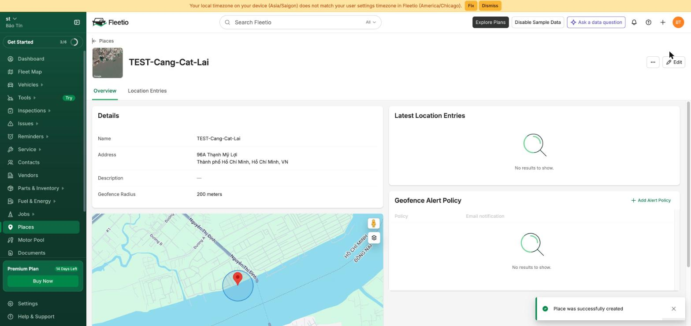

| # | Items | Control type | Data type | Description |
|---|---|---|---|---|
| 1 | Tab Overview, Location Entries | Tab | — | — |
| 2 | Details | Khối | Chữ | Name, Address, Description, Geofence Radius; đa giác vẫn ghi bán kính |
| 3 | Latest Location Entries | Khối | — | Chưa có dòng trong ảnh này (`Suy`) |
| 4 | Geofence Alert Policy | Khối | — | Add Alert Policy sang 2.8 |
| 5 | Bản đồ | Bản đồ | — | Vẽ vùng |

## 2.6 Chi tiết có lần ghi vị trí

Mức: `Chạy (vị trí giả lập)`.

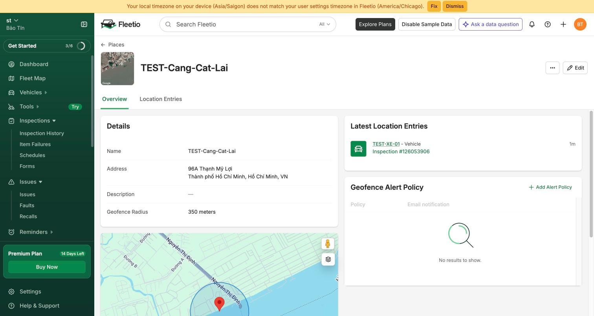

| # | Items | Control type | Data type | Description |
|---|---|---|---|---|
| 1 | Latest Location Entries | Khối | Danh sách | Có lần ghi từ phiếu; chưa ghi thêm cột trong khối |

## 2.7 Lần ghi vị trí của địa điểm

Mức: `Chạy (vị trí giả lập)`.

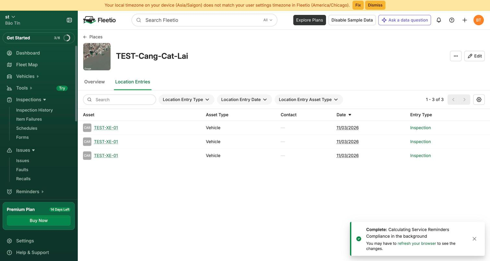

| # | Items | Control type | Data type | Description |
|---|---|---|---|---|
| 1 | Cột Asset, Asset Type, Contact, Date, Entry Type | Bảng | Chữ, ngày | Không có cột Geofence Event |
| 2 | Manage Columns | Nút | — | Chỉ thêm Address, Created On, Updated On |

## 2.8 Cảnh báo vùng

Mức: `Xem`.

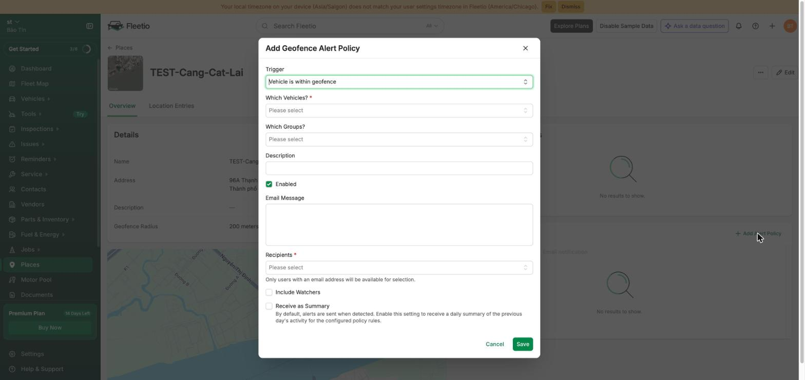

| # | Items | Control type | Data type | Description |
|---|---|---|---|---|
| 1 | Trigger | Chọn | — | "Vehicle is within geofence", "Vehicle is outside geofence", "Contact is within geofence", "Contact is outside geofence" |
| 2 | Which Vehicles?, Which Groups? | Chọn nhiều | — | Which Vehicles bắt buộc |
| 3 | Description, Enabled, Email Message | Chữ, bật tắt | — | Chưa lưu |
| 4 | Recipients | Chọn nhiều | — | Bắt buộc. "Only users with an email address will be available for selection." |
| 5 | Include Watchers | Bật tắt | — | Chưa ghi thêm |
| 6 | Receive as Summary | Bật tắt | — | "By default, alerts are sent when detected. Enable this setting to receive a daily summary of the previous day's activity for the configured policy rules." |

## 3.1 Danh sách việc

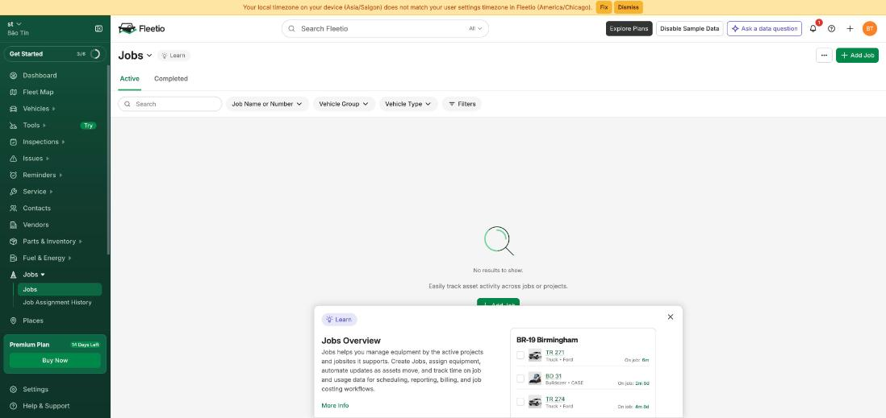

| # | Items | Control type | Data type | Description |
|---|---|---|---|---|
| 1 | Tab Active, Completed | Tab | — | — |
| 2 | Lọc Job Name or Number, Vehicle Group, Vehicle Type | Lọc | — | — |
| 3 | Trạng thái rỗng | Chữ | — | "Easily track asset activity across jobs or projects." |
| 4 | Add Job | Nút | — | Mở form ở màn 3.3; nút giữa chỉ có khi chưa có việc |

## 3.2 Bảng việc

Mức: `Chạy`.

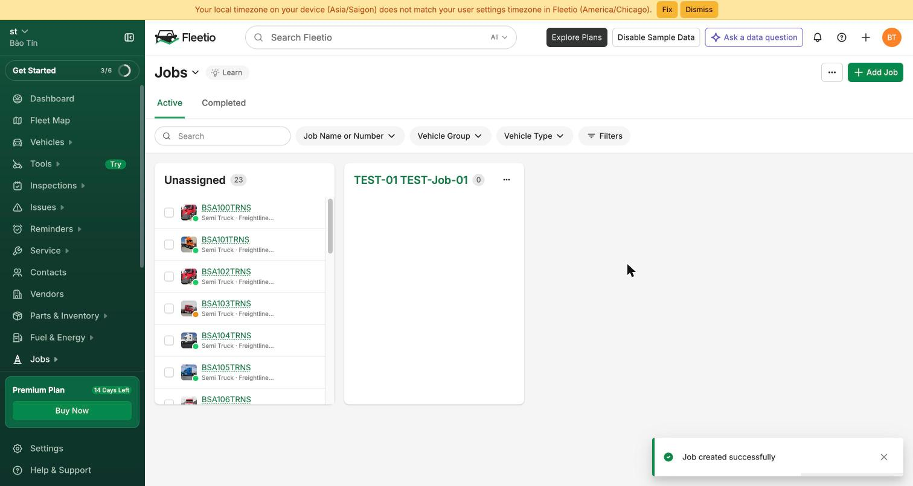

| # | Items | Control type | Data type | Description |
|---|---|---|---|---|
| 1 | Cột Unassigned | Cột | Thẻ xe | Toàn bộ xe chưa gán, có số đếm |
| 2 | Cột việc | Cột | Thẻ xe | Mỗi việc đang chạy một cột; menu Edit, Complete, Delete |
| 3 | Thẻ xe | Thẻ | Chữ | "On job: 0m"; tích chọn; menu dòng Edit, Delete; kéo thả không hoạt động |
| 4 | Actions | Menu | — | Assign, Unassign; Assign mờ nếu xe đang có việc |
| 5 | Tab Active, Completed | Tab | — | — |
| 6 | Lọc | Lọc | — | "Job Name or Number", "Vehicle Group", "Vehicle Type", "Filters"; ô tìm ẩn cột không có xe khớp |

## 3.3 Form việc

Mức: `Chạy`.

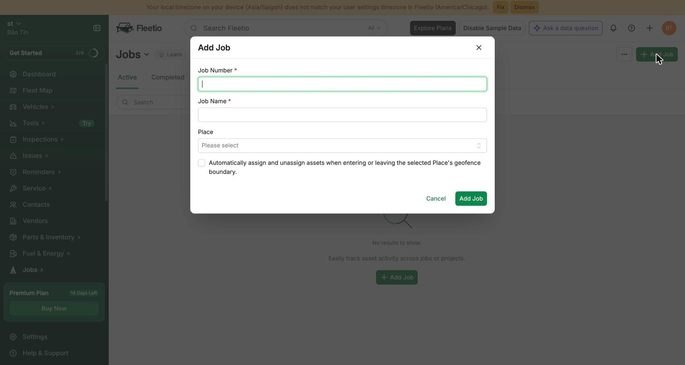

| # | Items | Control type | Data type | Description |
|---|---|---|---|---|
| 1 | Job Number | Chữ | Bắt buộc | "can't be blank" (E-003) |
| 2 | Job Name | Chữ | Bắt buộc | — |
| 3 | Place | Chọn | — | Tuỳ chọn; cần cho tự gán |
| 4 | Ô tự động | Tick | — | "Automatically assign and unassign assets when entering or leaving the selected Place's geofence boundary." |

## 3.4 Gán xe

Mức: `Chạy`.

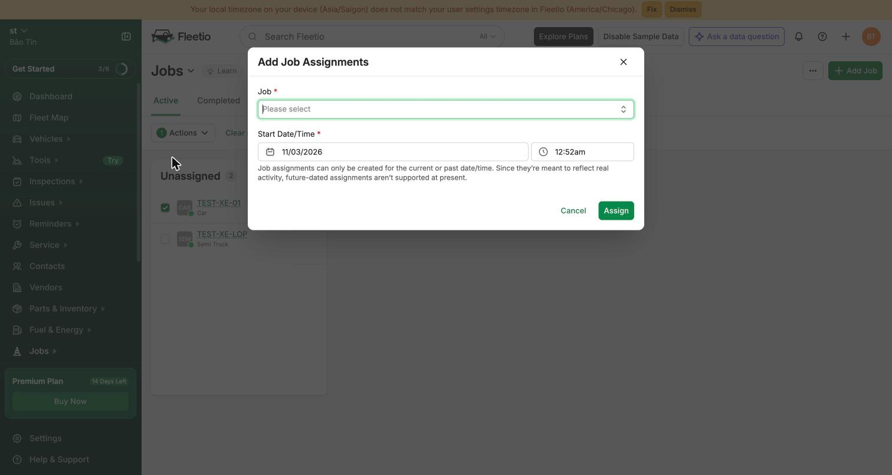

| # | Items | Control type | Data type | Description |
|---|---|---|---|---|
| 1 | Job | Chọn | — | — |
| 2 | Start Date/Time | Ngày giờ | Bắt buộc | Giờ tương lai: "cannot be in the future" (E-004) |
| 3 | Câu giải thích | Chữ | — | "Job assignments can only be created for the current or past date/time. Since they're meant to reflect real activity, future-dated assignments aren't supported at present." |

## 3.5 Gán trùng khoảng

Mức: `Chạy`.

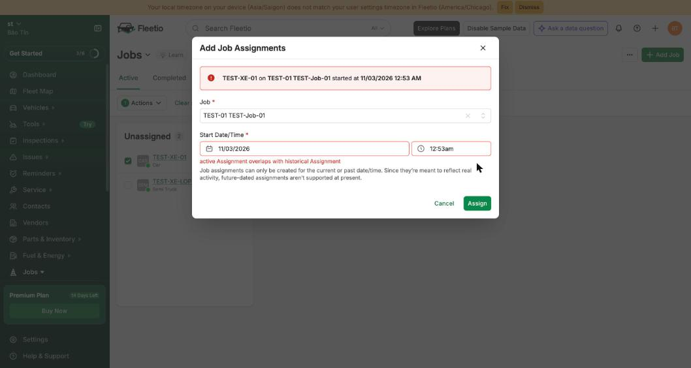

| # | Items | Control type | Data type | Description |
|---|---|---|---|---|
| 1 | Lỗi | Chữ | — | "active Assignment overlaps with historical Assignment" (E-005) |
| 2 | Băng đỏ | Băng | — | "TEST-XE-01 on TEST-01 TEST-Job-01 started at 11/03/2026 12:53 AM" |

## 3.6 Kết thúc gán

Mức: `Chạy`.

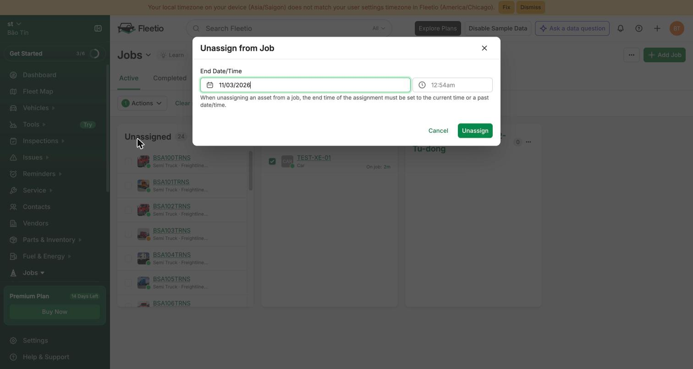

| # | Items | Control type | Data type | Description |
|---|---|---|---|---|
| 1 | End Date/Time | Ngày giờ | — | Chỉ hiện chữ mờ giờ hiện tại; bấm ngay báo băng đỏ không rõ lỗi (E-006); phải bấm vào ô |
| 2 | Câu giải thích | Chữ | — | "When unassigning an asset from a job, the end time of the assignment must be set to the current time or a past date/time." |

## 3.7 Chi tiết việc

Mức: `Chạy`.

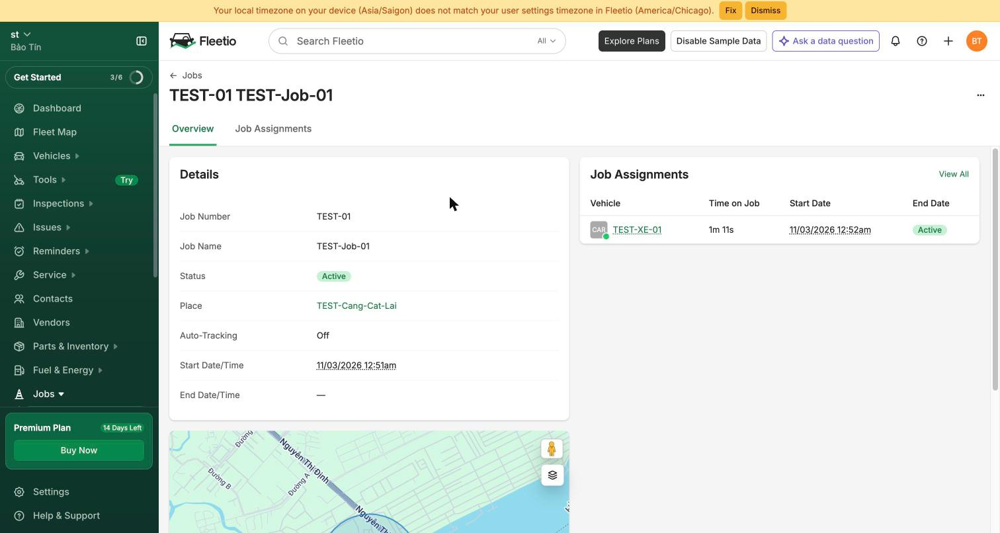

| # | Items | Control type | Data type | Description |
|---|---|---|---|---|
| 1 | Tab Overview, Job Assignments | Tab | — | — |
| 2 | Details | Khối | Chữ | Job Number, Job Name, Status, Place, "Auto-Tracking", Start Date/Time, End Date/Time |
| 3 | Bản đồ | Bản đồ | — | Vùng của Place |

## 3.8 Lịch sử gán

Mức: `Chạy`.

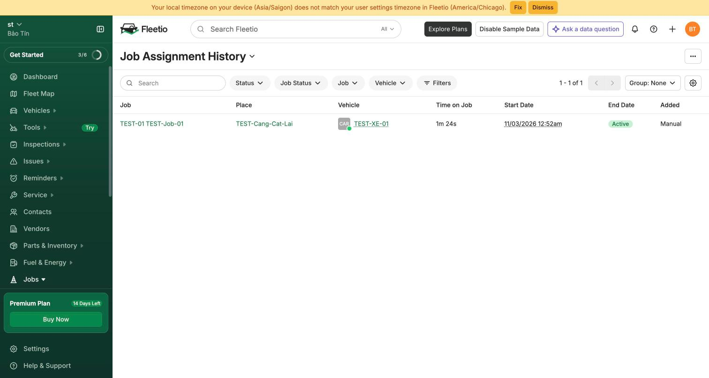

| # | Items | Control type | Data type | Description |
|---|---|---|---|---|
| 1 | Cột Job, Place, Vehicle, Time on Job, Start Date, End Date, Added | Bảng | Chữ, ngày | End Date ghi Active khi đang gán; Added = "Manual" |
| 2 | Lọc | Lọc | — | Status, Job Status, Job, Vehicle; "Group: None" |

## 3.9 Việc đã hoàn thành

Mức: `Chạy`.

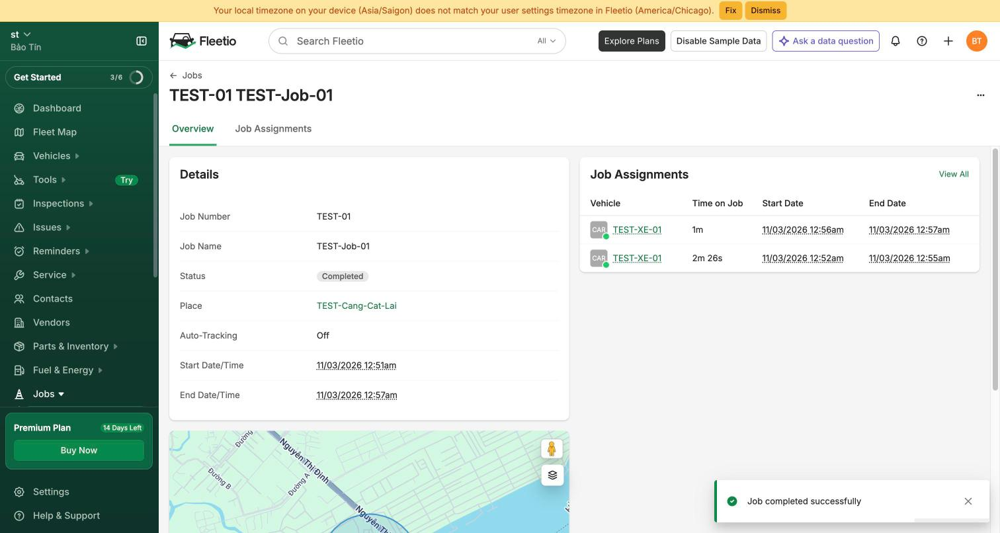

| # | Items | Control type | Data type | Description |
|---|---|---|---|---|
| 1 | Status | Chữ | — | Completed, có End Date/Time; xe đang gán tự kết thúc cùng giờ |
| 2 | Khác | — | — | Ghi chú không mô tả riêng màn này |

## 3.10 Thẻ xe có chip vùng

Mức: `Chạy (vị trí giả lập)`.

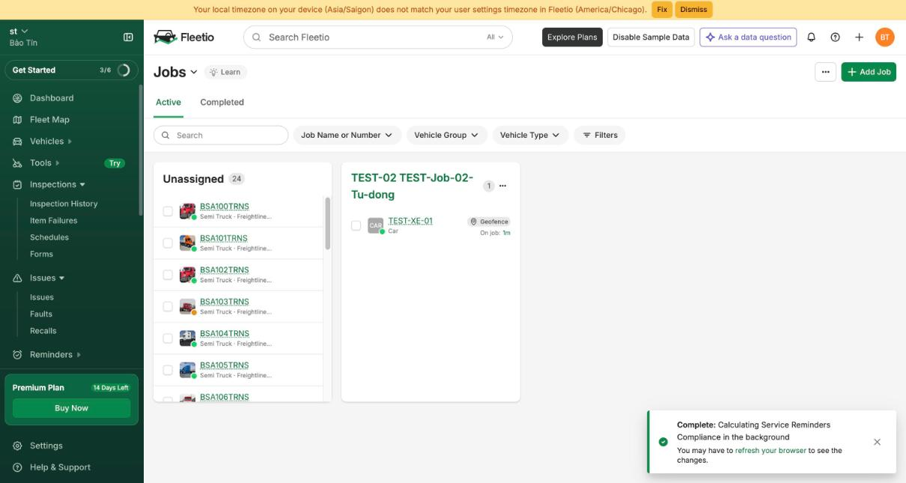

| # | Items | Control type | Data type | Description |
|---|---|---|---|---|
| 1 | Chip "Geofence" | Nhãn | — | Trên thẻ xe khi lượt do vùng tạo |

## 3.11 Lịch sử gán tự động

Mức: `Chạy (vị trí giả lập)`.

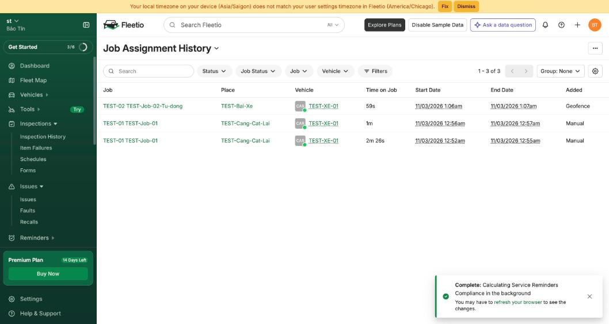

| # | Items | Control type | Data type | Description |
|---|---|---|---|---|
| 1 | Dòng Added = "Geofence" | Dòng | — | Start, End Date khi ra vùng, Time on Job 59s |

## 4.1 Điều kiện tự động hoá vùng

Mức: `Chạy (vị trí giả lập)`.

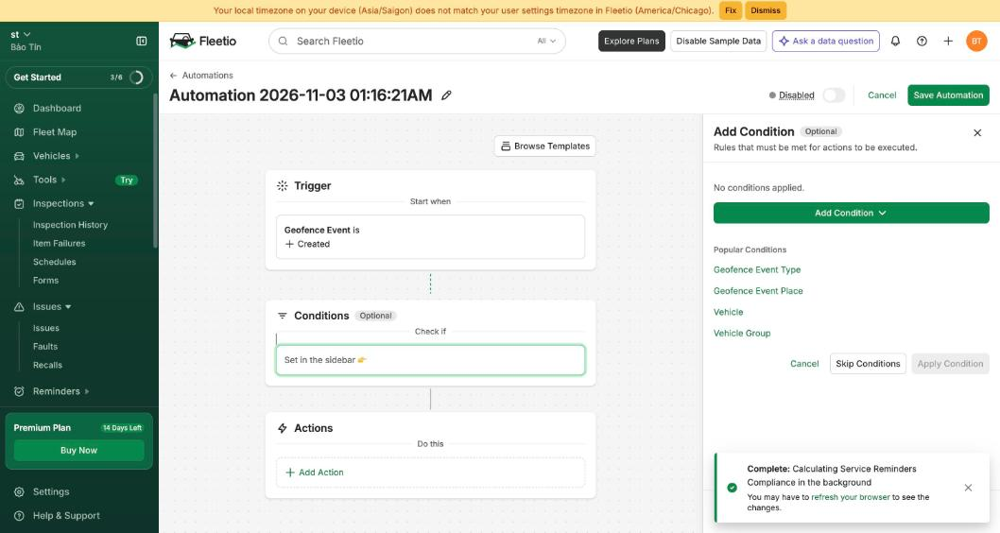

| # | Items | Control type | Data type | Description |
|---|---|---|---|---|
| 1 | Record Type, Trigger Type | Chọn | — | "Geofence Event", "Created" là lựa chọn duy nhất |
| 2 | Điều kiện | Chọn | — | "Geofence Event Type" (Entered, Exited), "Geofence Event Place", "Vehicle", "Vehicle Group" |
| 3 | Hành động | Chọn | — | Trên Vehicle: "Update Field", "Add Comment", "Send Email" |

## 4.2 Tự động hoá đã lưu

Mức: `Chạy (vị trí giả lập)`.

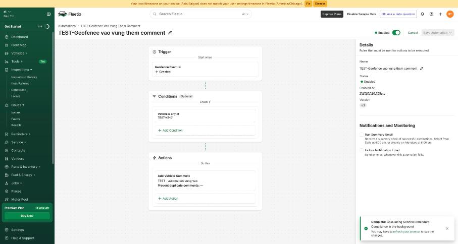

| # | Items | Control type | Data type | Description |
|---|---|---|---|---|
| 1 | Tên, trạng thái bật | Chữ | — | `TEST-Geofence vao vung them comment`; đã tắt sau khi kiểm: "Automation disabled" |

## 4.3 Lịch sử chạy

Mức: `Chạy (vị trí giả lập)`.

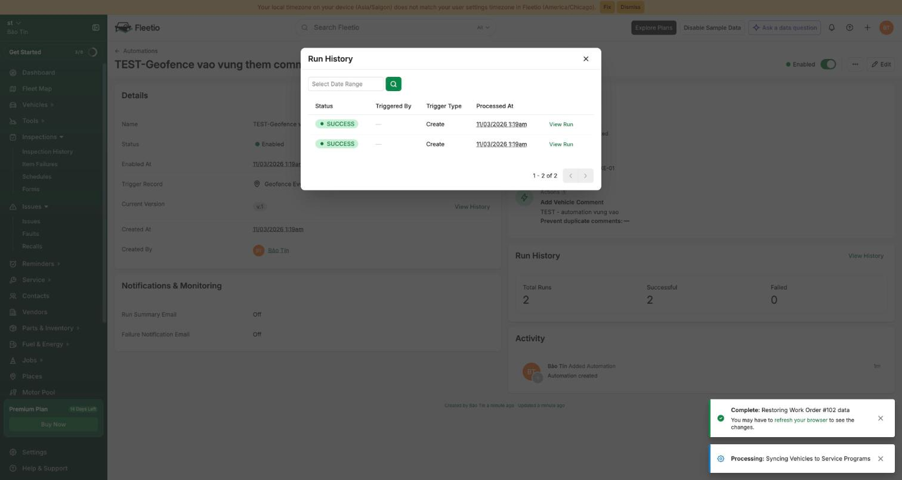

| # | Items | Control type | Data type | Description |
|---|---|---|---|---|
| 1 | Total Runs, Successful | Số | Số | 2 và 2 |
| 2 | Run Result | Màn | — | "Records": "No records changed"; không ghi loại sự kiện, Place (E-011) |

## 4.4 Comment trên xe

Mức: `Chạy (vị trí giả lập)`.

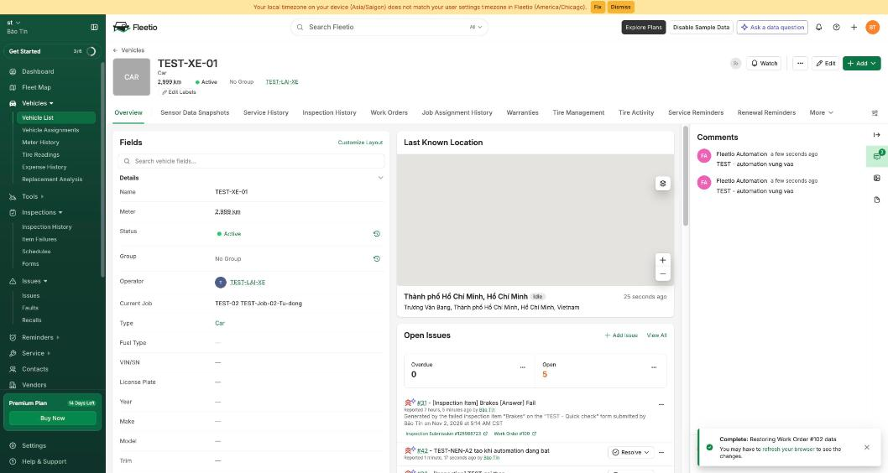

| # | Items | Control type | Data type | Description |
|---|---|---|---|---|
| 1 | Comment của "Fleetio Automation" | Dòng | Chữ | 2 dòng "TEST - automation vung vao" |

## 5.1 Phiếu có vị trí

Mức: `Chạy (vị trí giả lập)`.

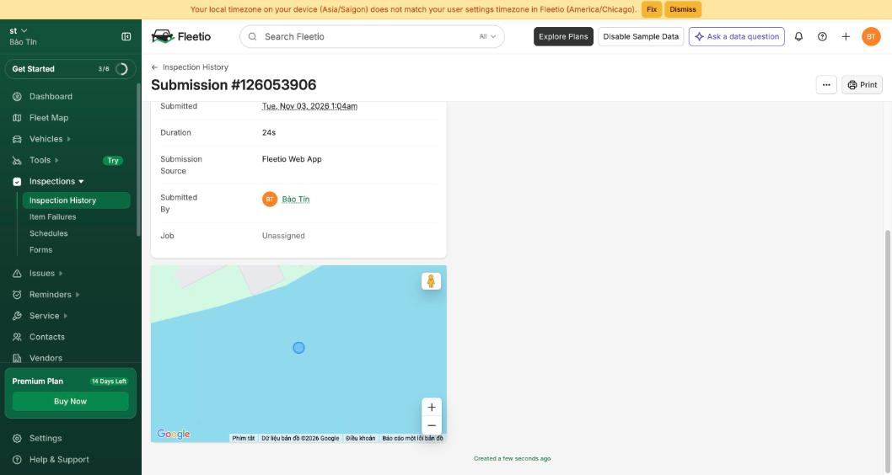

| # | Items | Control type | Data type | Description |
|---|---|---|---|---|
| 1 | Submission Source | Chữ | — | "Fleetio Web App" |
| 2 | Bản đồ nhỏ | Bản đồ | — | Chấm xanh tại vị trí; địa chỉ có sau khoảng 1 phút |

## 5.2 Phiếu Pre-trip

Mức: `Chạy (vị trí giả lập)`.

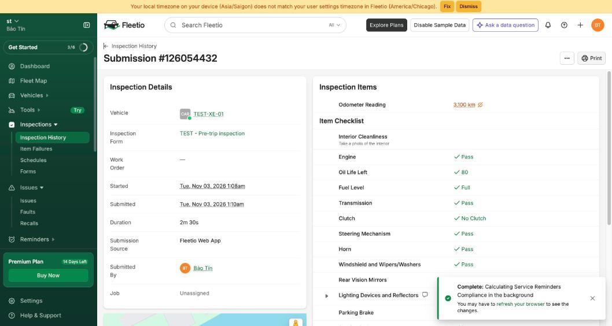

| # | Items | Control type | Data type | Description |
|---|---|---|---|---|
| 1 | Phiếu đủ mục | Trang | — | Biểu mẫu bật Location Exception Tracking, `location_exception` = false; mục kiểm không có toạ độ |
| 2 | Đồng hồ | Số | Số | "must be less than 2,499 or marked as void" (E-012) khi nộp |
