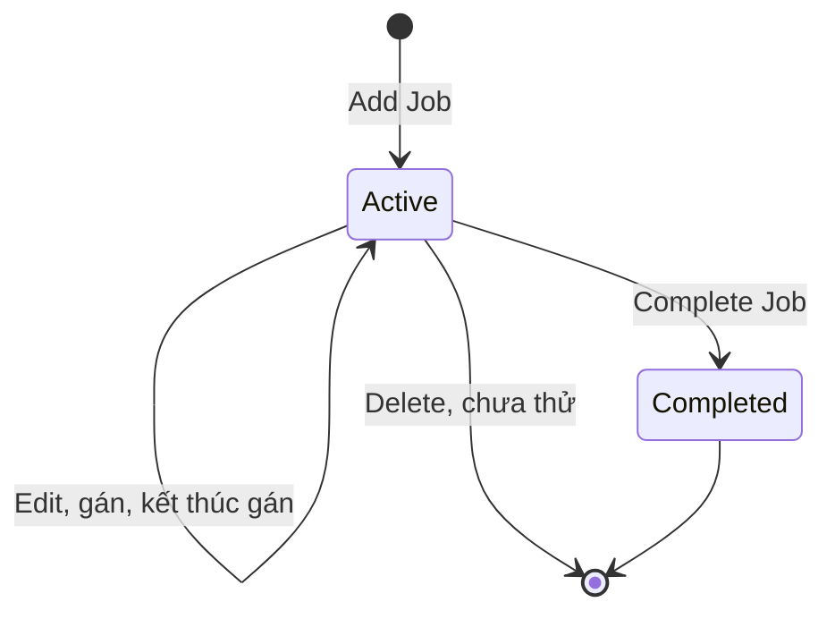
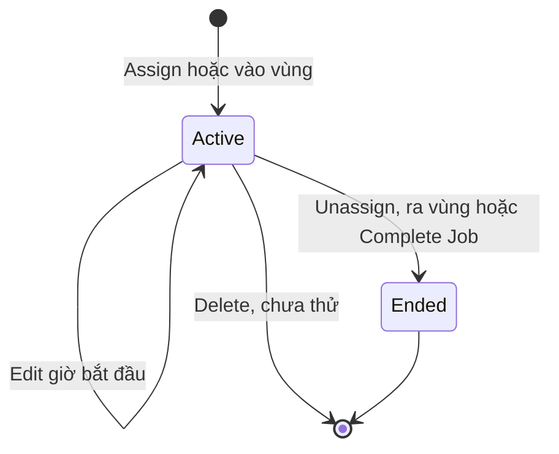
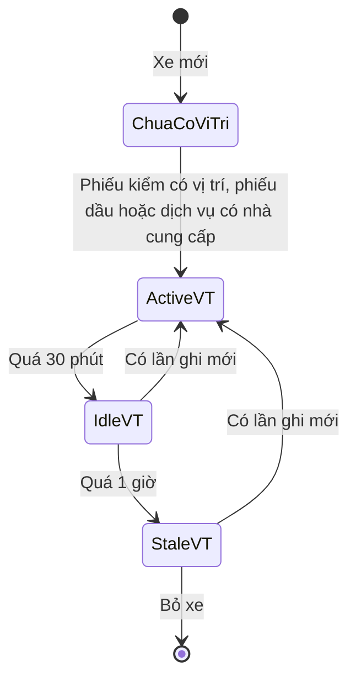
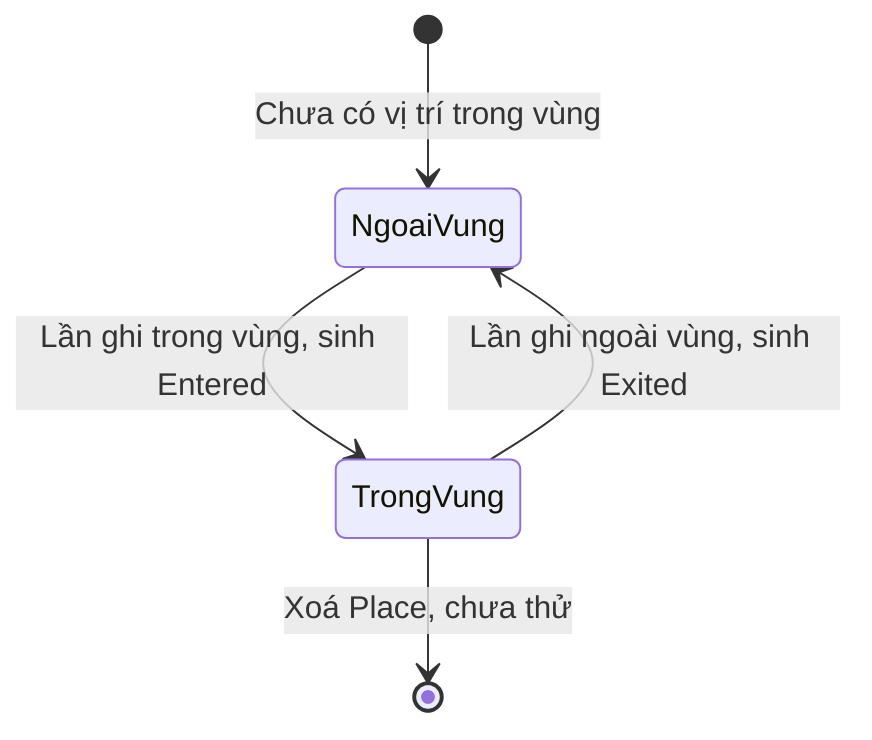
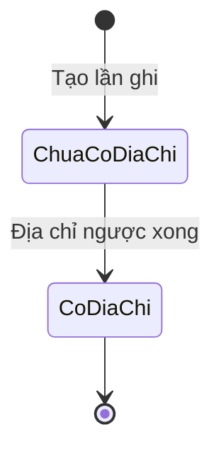
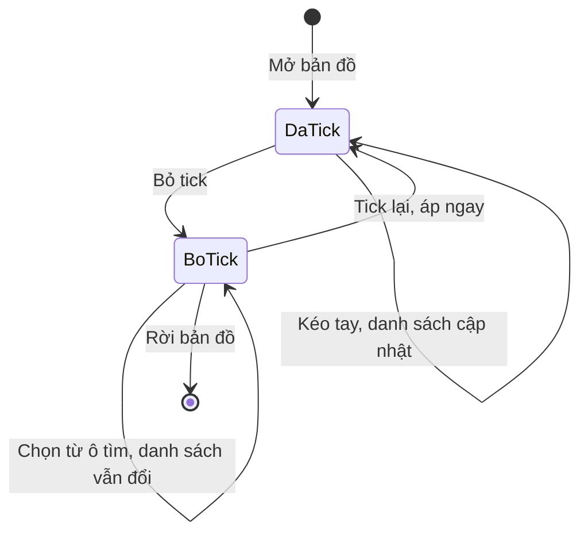
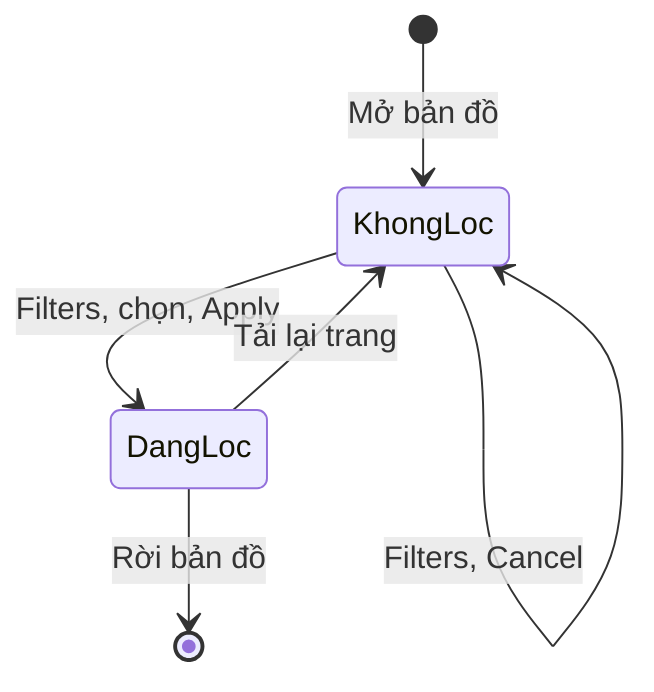
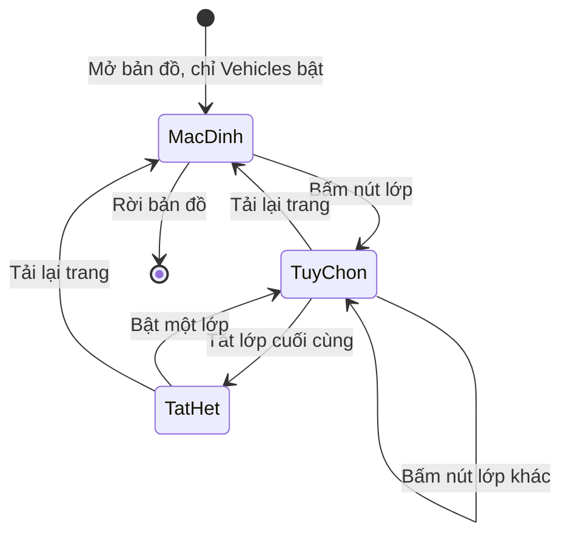
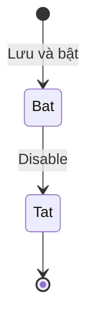

# Bản đồ, gán việc — States

Mã lỗi viết tắt, đầy đủ có tiền tố `E-fleetio-location-dispatch-`. Ô "—" nghĩa là không có câu chữ hoặc không áp dụng.

## Việc (Job)

| Trạng thái | Hành động | Sang | Điều kiện | Hiệu ứng | Câu chữ | Mức |
|---|---|---|---|---|---|---|
| (chưa có) | Add Job, nút giữa hoặc góc phải | Active | Có Job Number, Job Name | Start Date/Time tự lấy lúc tạo; thêm 1 cột trên bảng | "Job created successfully" | `Chạy` |
| (chưa có) | Add Job, bỏ trống | Không đổi | Thiếu trường bắt buộc | Không tạo; E-003 | "can't be blank" | `Chạy` |
| Active | Assign, Unassign | Active | Xem bảng Lượt gán | Đổi số đếm cột | Xem bảng Lượt gán | `Chạy` |
| Active | Vào hoặc ra vùng, việc bật tự động | Active | Việc có Place, bật ô tự động | Thêm hoặc kết thúc lượt gán | — | `Chạy (vị trí giả lập)` |
| Active | Complete, giờ hợp lệ | Completed | End sau giờ bắt đầu lượt đang chạy, không ở tương lai | Có End Date/Time; lượt đang chạy tự kết thúc cùng giờ, không hỏi; việc sang tab Completed | "Job completed successfully" | `Chạy` |
| Active | Complete, End trước giờ bắt đầu | Không đổi | Vi phạm điều kiện | E-007 | "must be after active assignment start date/time" | `Chạy` |
| Active | Complete, End ở tương lai | Không đổi | Vi phạm điều kiện | E-008 | "End date cannot be in the future" | `Chạy` |
| Active | Edit | Active | Chưa thử | Chưa biết | — | `Xem` |
| Active | Delete | Chưa biết | Chưa thử | Chưa biết (OQ-13) | — | `Xem` |
| Completed | Mở lại | Chưa thấy | Chưa thấy nút mở lại, chưa thử tìm hết (OQ-13) | — | — | `Suy` |

## Lượt gán (Job Assignment)

Cột End Date hiện "Active" khi đang gán. Added ghi nguồn: Manual hoặc Geofence.

| Trạng thái | Hành động | Sang | Điều kiện | Hiệu ứng | Câu chữ | Mức |
|---|---|---|---|---|---|---|
| (chưa có) | Tích xe, Actions, Assign | Active | Xe chưa có việc, giờ hiện tại hoặc quá khứ, không chồng khoảng cũ | Added = Manual; thẻ xe chuyển cột, "On job: 0m" | "Job assignments created successfully" | `Chạy` |
| (chưa có) | Assign, giờ tương lai | Không tạo | Vi phạm điều kiện | E-004 | "cannot be in the future" | `Chạy` |
| (chưa có) | Assign, giờ chồng khoảng cũ | Không tạo | Vi phạm điều kiện | E-005, băng đỏ nêu lượt bị chồng | "active Assignment overlaps with historical Assignment" | `Chạy` |
| (chưa có) | Kéo thẻ xe sang cột khác | Không tạo | Mọi trường hợp đã thử | Không hoạt động, chỉ bôi đen chữ | — | `Chạy` |
| (chưa có) | Xe vào vùng | Active | Việc bật tự động, gắn Place đó | Added = Geofence; thẻ xe có chip "Geofence"; "Current Job" của xe đổi | — | `Chạy (vị trí giả lập)` |
| Active | Assign sang việc khác | Không đổi | Xe đang có việc | Assign mờ, E-009 | — | `Chạy` |
| Active | Edit Job Assignment | Active | Job, Vehicle khoá | Chỉ sửa Start Date/Time | — | `Chạy` |
| Active | Unassign, đã bấm ô giờ | Ended | End là hiện tại hoặc quá khứ | Có End Date, Time on Job; xe về Unassigned | "Vehicles successfully unassigned from Jobs" | `Chạy` |
| Active | Unassign, chưa bấm ô giờ | Không đổi | Ô giờ chỉ có chữ mờ | E-006, băng đỏ không rõ lỗi | Không ghi lại câu chữ | `Chạy` |
| Active | Xe ra vùng | Ended | Lượt có Added = Geofence, đo được 1 lần | Có End Date, Time on Job; xe về Unassigned; phiếu vừa nộp vẫn mang việc đó | — | `Chạy (vị trí giả lập)` |
| Active | Xe ra vùng, lượt gán tay | Chưa biết | Chưa thử (OQ-9) | — | — | `Suy` |
| Active | Complete Job | Ended | Việc hoàn thành với giờ hợp lệ | End bằng giờ hoàn thành, không hỏi | "Job completed successfully" | `Chạy` |
| Active | Delete | Chưa biết | Chưa thử (OQ-13) | — | — | `Xem` |
| Ended | Gán lại xe cùng việc hoặc việc khác | Lượt mới | Giờ không chồng khoảng cũ | Lượt cũ giữ trong lịch sử | Như dòng Assign | `Chạy` |

## Độ tươi vị trí xe

Không phải trạng thái xe chạy hay dừng. Tính theo tuổi lần ghi gần nhất, nên đi lùi được khi có lần ghi mới (`Suy` phần chuyển theo thời gian). Fleetio: 30 phút, 1 giờ; tham số mới, chưa có mã.

| Trạng thái | Hành động | Sang | Điều kiện | Hiệu ứng | Câu chữ | Mức |
|---|---|---|---|---|---|---|
| Chưa có vị trí | Nộp phiếu có vị trí | Active | Có toạ độ | Xe lên marker ngay, Source trỏ về phiếu | "No current location information available for this Vehicle" trước khi có | `Chạy` |
| Chưa có vị trí | Lưu phiếu dầu có nhà cung cấp | Có vị trí, xe lên Fleet Map "5m ago" (tên mức Active là `Suy` từ tuổi vị trí) | Có chọn nhà cung cấp | Location Entry loại Fuel Entry tại địa chỉ nhà cung cấp; Source trỏ về phiếu; form không báo | — | `Chạy` |
| Chưa có vị trí | Lưu phiếu dầu không có nhà cung cấp | Không đổi | Không chọn nhà cung cấp | Không sinh vị trí (14 phiếu, chỉ 1 lần ghi, phần không sinh là `Suy`) | — | `Chạy` |
| Chưa có vị trí | Chọn nhà cung cấp không có phân loại Service trên phiếu dịch vụ | Không đổi | Form chỉ nhận nhà cung cấp phân loại Service | E-013, không tạo được phiếu | `Create "TEST"` | `Chạy` |
| Chưa có vị trí | Lưu phiếu dịch vụ có nhà cung cấp phân loại Service | Có vị trí | Cùng cơ chế phiếu dầu; đo trên xe đã có vị trí nên nhánh này là `Suy` | Location Entry loại Service Entry | — | `Suy` |
| Có vị trí | Lưu phiếu dịch vụ có nhà cung cấp phân loại Service | Có lần ghi mới | Có chọn nhà cung cấp | Thêm dòng Service Entry cùng giờ phiếu, đứng trên dòng cũ; form không báo | — | `Chạy` |
| Có vị trí | Địa chỉ nhà cung cấp khai sai | Có lần ghi mới, điểm sai | Địa chỉ quy được ra điểm, kể cả ở nước khác | E-019, không báo độ tin cậy | — | `Chạy` |
| Stale | Mở panel xe | Không đổi | Vị trí từ phiếu dầu cũ | Status "Stale", Source "Fuel Entry #..." | — | `Chạy` |
| Active | Thời gian trôi | Idle | Quá 30 phút | Đổi icon, Status (chưa theo dõi đủ lâu để thấy) | "Location updated within the last 30 minutes." | `Xem` chú giải, `Suy` chuyển |
| Idle | Thời gian trôi | Stale | Quá 1 giờ | Như trên | "Location updated within the last hour." | `Xem` chú giải, `Suy` chuyển |
| Stale | Có lần ghi mới | Active | Có toạ độ | Như trên | "No location updates for over an hour." | `Xem` chú giải, `Suy` chuyển |
| Idle | Có lần ghi mới | Active | Có toạ độ | Như trên | — | `Suy` |
| Active | Xem trang xe khi vị trí mới 25 giây | Hiện Idle trên trang xe | Chưa rõ (OQ-7) | Bản đồ vẫn Active, hai nơi lệch nhau | — | `Chạy (vị trí giả lập)` |

## Quan hệ xe với vùng

Không có bản ghi trạng thái nhìn thấy được; suy từ kết quả sự kiện. Mỗi cặp xe, Place một quan hệ.

| Trạng thái | Hành động | Sang | Điều kiện | Hiệu ứng | Câu chữ | Mức |
|---|---|---|---|---|---|---|
| Ngoài vùng | Lần ghi trong vùng | Trong vùng | Toạ độ trong vùng tròn hoặc đa giác | `initial_place` = Place; Entered; tự gán nếu bật; Automation chạy | — | `Chạy (vị trí giả lập)` |
| Trong vùng | Lần ghi ngoài vùng | Ngoài vùng | Toạ độ ngoài vùng | Exited; lượt tự gán kết thúc; Automation chạy | — | `Chạy (vị trí giả lập)` |
| Trong A | Lần ghi trong B | Ngoài A, trong B | Hai vùng tách nhau | Automation chạy 2 lần, ứng với ra A, vào B là `Suy` | — | `Chạy (vị trí giả lập)` |
| Trong vùng | Lần ghi vẫn trong vùng | Không đổi | Chưa tách riêng để đo | Chưa biết có sinh sự kiện lặp (OQ-8) | — | `Suy` |
| Ở mép vùng | Lần ghi dao động | Chưa biết | Chưa thử (OQ-8) | — | — | `Suy` |

## Địa chỉ của Location Entry

| Trạng thái | Hành động | Sang | Điều kiện | Hiệu ứng | Câu chữ | Mức |
|---|---|---|---|---|---|---|
| Chưa có địa chỉ | Hệ thống tra địa chỉ ngược | Có địa chỉ | Khoảng 1 phút, đo một lần | `address` có giá trị | — | `Chạy (vị trí giả lập)` |
| (chưa có) | Lần ghi từ phiếu dầu, phiếu dịch vụ có nhà cung cấp | Có địa chỉ | Quy từ địa chỉ nhà cung cấp, kể cả địa chỉ giả; chưa đo độ trễ | Dòng Location History có địa chỉ | — | `Chạy` |

Kiểm định toạ độ không có: toạ độ giả không bị đổi hay gắn cờ, `location_exception` luôn false trên web. Fleetio Go có toạ độ từng mục, ca không vi phạm vẫn false (`Chạy (Fleetio Go)`).

## Ô "Update list when map moves"

Trạng thái giao diện của danh sách, không phải bản ghi. Lưu theo người dùng hay không: chưa kiểm.

| Trạng thái | Hành động | Sang | Điều kiện | Hiệu ứng | Câu chữ | Mức |
|---|---|---|---|---|---|---|
| Đã tick | Kéo bản đồ ra vùng trống | Không đổi | — | Danh sách cập nhật theo khung | "0 results", "No results found in this area" | `Chạy` |
| Đã tick | Bỏ tick | Bỏ tick | — | Từ đây kéo tay không cập nhật | — | `Chạy` |
| Bỏ tick | Kéo về vùng có 2 nhà cung cấp | Không đổi | — | Danh sách đứng yên, bản đồ thấy marker: E-016 | "0 results" | `Chạy` |
| Bỏ tick | Chọn kết quả từ ô tìm | Không đổi | — | Danh sách vẫn đổi theo vùng mới | — | `Chạy` |
| Bỏ tick | Tick lại, không kéo | Đã tick | — | Danh sách ra ngay 2 kết quả | — | `Chạy` |
| Bỏ tick | Center on Default Location | Không đổi | — | Danh sách vẫn ra kết quả theo vùng, không thấy khác biệt rõ | "No results found in this area" | `Chạy (vị trí giả lập)` |

## Bộ lọc Fleet Map

Trạng thái trong phiên xem, không giữ qua tải lại trang (khác Map Options).

| Trạng thái | Hành động | Sang | Điều kiện | Hiệu ứng | Câu chữ | Mức |
|---|---|---|---|---|---|---|
| Không lọc | Filters, chọn Vehicle Type = Trailer, Apply | Đang lọc | Có giá trị lọc | Còn 1 marker khớp; huy hiệu "1" trên Filters | — | `Chạy` |
| Không lọc | Filters, Cancel | Không đổi | Nút có trên hộp, chưa ghi kết quả bấm | Không đổi (`Suy`) | — | `Xem` |
| Đang lọc | Tải lại trang | Không lọc | Mọi trường hợp đã thử | Bộ lọc mất, về 2 kết quả: E-015 | — | `Chạy` |
| Đang lọc | Bỏ bộ lọc trên hộp | Chưa thử | — | — | — | `Suy` |

## Lớp bản đồ

Mỗi nút lớp có trạng thái `aria-pressed`. Trạng thái trong phiên xem, tải lại trang về mặc định: Vehicles bật, Places, Vendors tắt.

| Trạng thái | Hành động | Sang | Điều kiện | Hiệu ứng | Câu chữ | Mức |
|---|---|---|---|---|---|---|
| Mặc định | Mở bản đồ | Không đổi | Khung có 3 xe | Tab Vehicles, 3 marker | "3 results" | `Chạy` |
| Mặc định | Tắt Vehicles | Tuỳ chọn hoặc Tắt hết | — | Tab Vehicles biến mất, 0 marker | — | `Chạy` |
| Tuỳ chọn | Chỉ bật Vendors | Không đổi | — | Tab Vendors, chỉ marker nhà cung cấp | — | `Chạy` |
| Tuỳ chọn | Bật Vendors và Places | Không đổi | — | Tab Places, Vendors; marker nhà cung cấp, Place | — | `Chạy` |
| Tuỳ chọn | Tắt hết | Tắt hết | — | 0 marker | "No results found in this area" | `Chạy` |
| Tuỳ chọn, Tắt hết | Tải lại trang | Mặc định | — | Không lưu như Map Options | — | `Chạy` |

## Automation

Chỉ ghi phần liên quan sự kiện vùng; đầy đủ ở nhóm Nền tảng.

| Trạng thái | Hành động | Sang | Điều kiện | Hiệu ứng | Câu chữ | Mức |
|---|---|---|---|---|---|---|
| Bật | Sự kiện vùng khớp điều kiện | Bật | Xe khớp điều kiện Vehicle | Thêm comment của "Fleetio Automation"; Total Runs tăng; log có thể mâu thuẫn (E-011) | "No records changed" | `Chạy (vị trí giả lập)` |
| Bật | Tắt | Tắt | — | Không chạy nữa (`Suy`, không kiểm sau khi tắt) | "Automation disabled" | `Chạy` |

## Đối tượng không có trạng thái thật

| Đối tượng | Ghi nhận | Mức |
|---|---|---|
| Địa điểm (Place) | Không có trạng thái; chỉ tạo, sửa. Loại vùng tròn hoặc đa giác là thuộc tính. Form đa giác khoá Radius, chưa thử đổi ngược về tròn | `Chạy` |
| Sự kiện vùng (Geofence Event) | Bản ghi một lần, loại Entered hoặc Exited, không chuyển trạng thái; trigger Created là duy nhất; không có màn xem | `Chạy (vị trí giả lập)` |
| Location Exception | Chỉ là cờ trên phiếu, luôn false trên web. Fleetio Go thêm 2 chỉ báo `are_items_too_close`, `items_completed_too_far_away_count`; ca không vi phạm đều không bật, chưa thấy cờ bật thật | `Chạy (vị trí giả lập)`, `Chạy (Fleetio Go)` |
| Geofence Alert Policy | Có ô Enabled, chưa lưu nên chưa thấy chuyển; lượt 3 vẫn không lưu vì hành động duy nhất là gửi email | `Xem` |
| Location Entry | Không có trạng thái ngoài địa chỉ; loại Fuel Entry, Service Entry, Inspection là thuộc tính | `Chạy` |
| Map Options, nhãn marker xe, vị trí mở đầu | Tuỳ chọn lưu theo người dùng, không có vòng đời. Vehicle Marker Label giữ sau tải lại; Use Current Map Center đổi, Reset to Default trả lại | `Chạy (vị trí giả lập)`, `Chạy` |
