# Bản đồ, gán việc — User flow

`stage` ghi theo lựa chọn của user: tự chốt, xem ở bản cuối (02/11/2026). Mục 1 và Mục 2 cập nhật theo chạy thử 03/11/2026.

## 1. Sơ đồ tổng

```mermaid
flowchart TD
    s["Menu bên"]
    a["1.1 Bản đồ đội xe"]
    e1["E-001 Không có kết quả trong khu vực này"]
    a2["1.2 Danh sách Nearby có xe"]
    p["1.3 Panel xe, Overview"]
    n["1.4 Panel xe, Nearby"]
    n2["1.5 Rê chuột dòng địa điểm, nét đứt"]
    leg["1.6 Chú giải"]
    opt["1.7 Tuỳ chọn bản đồ"]
    sat["1.8 Nền vệ tinh"]
    gray["1.9 Nền xám"]
    lab["1.10 Nhãn địa điểm, đa giác"]
    zo["1.11 Zoom xa, không gom cụm"]
    q["Form thêm nhanh"]
    iss["Trang sự cố"]
    v["Trang xe"]
    e2["E-002 Không có thông tin vị trí hiện tại"]
    l["2.4 Danh sách địa điểm"]
    f["2.2 Thêm địa điểm, vùng tròn"]
    f2["2.3 Thêm địa điểm, đa giác"]
    e10["E-010 Hộp rời trang, tab kẹt"]
    pd["2.5 Chi tiết địa điểm"]
    pd2["2.6 Chi tiết có lần ghi vị trí"]
    pe["2.7 Lần ghi vị trí của địa điểm"]
    pa["2.8 Cảnh báo vùng"]
    g["3.2 Bảng việc"]
    g0["3.1 Việc, màn trống"]
    h["3.3 Form việc"]
    e3["E-003 Bỏ trống trường bắt buộc"]
    as["3.4 Gán xe"]
    e4["E-004 Giờ ở tương lai"]
    e5["3.5 E-005 Gán trùng khoảng"]
    e9["E-009 Nút gán mờ"]
    un["3.6 Kết thúc gán"]
    e6["E-006 Lỗi không rõ khi chưa có giờ"]
    jd["3.7 Chi tiết việc"]
    his["3.8 Lịch sử gán"]
    cp["Hộp hoàn thành việc"]
    e7["E-007 E-008 Giờ hoàn thành sai"]
    jc["3.9 Việc đã hoàn thành"]
    chip["3.10 Thẻ xe có chip vùng"]
    his2["3.11 Lịch sử gán tự động"]
    au["4.1 Điều kiện tự động hoá vùng"]
    au2["4.2 Tự động hoá đã lưu"]
    ar["4.3 Lịch sử chạy"]
    e11["E-011 Log mâu thuẫn"]
    vc["4.4 Comment trên xe"]
    ins["Form phiếu kiểm"]
    e12["E-012 Đồng hồ bị chặn"]
    is1["5.1 Phiếu có vị trí"]
    is2["5.2 Phiếu Pre-trip"]
    z["Xong"]
    s -->|"Bản đồ đội xe"| a
    s -->|"Địa điểm"| l
    s -->|"Việc, chưa có"| g0
    s -->|"Việc, đã có"| g
    s -->|"Tự động hoá"| au
    s -->|"Nộp phiếu kiểm"| ins
    a -->|"Không có xe trong khung"| e1
    e1 -.->|"Di chuyển bản đồ, đổi lọc"| a
    a -->|"Khung có xe"| a2
    a -->|"Chú giải"| leg
    leg -.->|"Đóng"| a
    a -->|"Tuỳ chọn bản đồ"| opt
    opt -->|"Vệ tinh"| sat
    opt -->|"Xám"| gray
    opt -->|"Nhãn"| lab
    sat -.->|"Đổi lại"| a
    gray -.->|"Đổi lại"| a
    lab -.->|"Tắt nhãn"| a
    a -->|"Zoom xa"| zo
    zo -.->|"Zoom gần"| a
    a2 -->|"Chọn xe"| p
    p -->|"Tab Nearby"| n
    n -->|"Rê chuột dòng"| n2
    n2 -.->|"Rời chuột"| n
    n -.->|"Tab Overview"| p
    p -->|"Thêm nhanh"| q
    p -->|"Mở trang xe"| v
    q -->|"Lưu sự cố"| iss
    iss -->|"Kết thúc"| z
    v -->|"Xe chưa có vị trí"| e2
    e2 -->|"Chờ dữ liệu"| z
    v -->|"Kết thúc"| z
    l -->|"Thêm địa điểm"| f
    f -->|"Vẽ đa giác"| f2
    f -->|"Rời form"| e10
    e10 -->|"Đóng tab"| z
    f -->|"Lưu"| pd
    f2 -->|"Lưu"| pd
    l -->|"Mở dòng"| pd
    pd -->|"Có lần ghi"| pd2
    pd2 -->|"Tab lần ghi"| pe
    pd -->|"Thêm cảnh báo"| pa
    pa -.->|"Huỷ"| pd
    pe -->|"Kết thúc"| z
    pd -->|"Kết thúc"| z
    g0 -->|"Thêm việc"| h
    g -->|"Thêm việc"| h
    h -->|"Thiếu trường"| e3
    e3 -.->|"Điền đủ"| h
    h -->|"Lưu"| g
    g -->|"Gán xe"| as
    as -->|"Giờ tương lai"| e4
    e4 -.->|"Đổi giờ"| as
    as -->|"Trùng khoảng"| e5
    e5 -.->|"Đổi giờ"| as
    as -->|"Lưu"| g
    g -->|"Xe đang có việc"| e9
    e9 -->|"Kết thúc gán trước"| un
    g -->|"Kết thúc gán"| un
    un -->|"Chưa bấm ô giờ"| e6
    e6 -.->|"Bấm ô giờ"| un
    un -->|"Lưu"| g
    g -->|"Mở việc"| jd
    g -->|"Lịch sử gán"| his
    his -->|"Kết thúc"| z
    jd -.->|"Quay lại"| g
    g -->|"Hoàn thành"| cp
    cp -->|"Giờ sai"| e7
    e7 -.->|"Đổi giờ"| cp
    cp -->|"Lưu"| jc
    jc -->|"Kết thúc"| z
    g -->|"Xe vào vùng"| chip
    chip -->|"Xe ra vùng"| his2
    his2 -->|"Kết thúc"| z
    au -->|"Lưu và bật"| au2
    au2 -->|"Sự kiện vùng xảy ra"| ar
    ar -->|"Mở kết quả"| e11
    e11 -->|"Xem xe"| vc
    ar -->|"Xem xe"| vc
    vc -->|"Kết thúc"| z
    ins -->|"Đồng hồ sai"| e12
    e12 -.->|"Sửa số"| ins
    ins -->|"Nộp"| is1
    ins -->|"Nộp Pre-trip"| is2
    is1 -->|"Xem trên bản đồ"| a
    is2 -->|"Kết thúc"| z
```

Bản vẽ trên Figma: trang `Research · Fleetio`, frame `7214:221937`, chỉ gồm các màn của bản 02/11. Đường liền là luồng thường, nét đứt là quay lại.

## 2. Màn hình

| # | Màn | Slug | Trạng thái | Ảnh |
|---|---|---|---|---|
| 1.1 | Bản đồ | map | Không có xe | Có |
| 1.2 | Danh sách Nearby có xe | fleet-map-nearby-list-2-vehicles | 2 xe | Có |
| 1.3 | Panel xe, Overview | fleet-map-vehicle-panel | Có vị trí | Có |
| 1.4 | Panel xe, Nearby | fleet-map-vehicle-nearby-places | Đã bật Places | Có |
| 1.5 | Rê chuột dòng địa điểm | fleet-map-nearby-hover-dashed | Hover | Có |
| 1.6 | Chú giải bản đồ | fleet-map-legend | Mở | Có |
| 1.7 | Tuỳ chọn bản đồ | fleet-map-options | Mở | Có |
| 1.8 | Nền vệ tinh | fleet-map-satellite | Satellite | Có |
| 1.9 | Nền xám | fleet-map-grayscale | Grayscale | Có |
| 1.10 | Nhãn địa điểm, đa giác | fleet-map-labels-polygon | Labels bật | Có |
| 1.11 | Zoom xa, không gom cụm | fleet-map-zoomed-out-no-cluster | Marker đè nhau | Có |
| 2.1 | Form địa điểm | place-new | Trống | Có |
| 2.2 | Form địa điểm, vùng tròn | place-new-form | Có toạ độ | Có |
| 2.3 | Form địa điểm, đa giác | place-new-polygon | Radius khoá | Có |
| 2.4 | Danh sách địa điểm | places-list-data | Có dữ liệu | Có |
| 2.5 | Chi tiết địa điểm | place-detail-circle | Vùng tròn | Có |
| 2.6 | Chi tiết có lần ghi vị trí | place-detail-with-entries | Có lần ghi | Có |
| 2.7 | Lần ghi vị trí của địa điểm | place-location-entries | Có dữ liệu | Có |
| 2.8 | Cảnh báo vùng | place-geofence-alert-policy | Form, chưa lưu | Có |
| 3.1 | Danh sách việc | jobs | Trống | Có |
| 3.2 | Bảng việc | jobs-board | Có cột việc | Có |
| 3.3 | Form việc | job-add-modal | Trống | Có |
| 3.4 | Gán xe | job-assign-modal | Mở | Có |
| 3.5 | Gán trùng khoảng | job-assign-overlap-error | Lỗi | Có |
| 3.6 | Kết thúc gán | job-unassign-modal | Mở | Có |
| 3.7 | Chi tiết việc | job-detail | Active | Có |
| 3.8 | Lịch sử gán | job-assignment-history | Manual | Có |
| 3.9 | Việc đã hoàn thành | job-completed | Completed | Có |
| 3.10 | Thẻ xe có chip vùng | jobs-board-geofence-chip | Tự gán | Có |
| 3.11 | Lịch sử gán tự động | job-history-auto-geofence | Geofence | Có |
| 4.1 | Điều kiện tự động hoá vùng | automation-geofence-conditions | Đang soạn | Có |
| 4.2 | Tự động hoá đã lưu | automation-geofence-saved | Bật | Có |
| 4.3 | Lịch sử chạy | automation-run-history | 2 lần chạy | Có |
| 4.4 | Comment trên xe | vehicle-automation-comments | 2 comment | Có |
| 5.1 | Phiếu có vị trí | inspection-submission-location | Vị trí giả lập | Có |
| 5.2 | Phiếu Pre-trip | inspection-pretrip-simulated | Vị trí giả lập | Có |

Hộp hoàn thành việc, form phiếu kiểm, form thêm nhanh: không có ảnh riêng trong nhóm này. Street View: chưa vào được.
