# Phụ tùng, mua hàng, nhiên liệu — ERD nghiệp vụ

Suy ra từ form và tài liệu hãng, không phải sơ đồ cơ sở dữ liệu thật. Đợt chạy 03/11 bổ sung: lịch sử giá theo nhà cung cấp, dòng phụ tùng trên lệnh, Service Entry, các trường cảnh báo và Void trên phiếu dầu; lượt 3 thêm lịch sử bản ghi đơn, nguồn vị trí xe từ phiếu dầu, trường giao dịch thẻ, liên kết phụ tùng với đầu việc, cách tính số đang về. CHARGING_ENTRY ngoài phạm vi theo yêu cầu user, giữ lại để không mất ghi nhận cũ.

```mermaid
erDiagram
    PART ||--o{ PART_STOCK : "co tai"
    PART_LOCATION ||--o{ PART_STOCK : "chua"
    PART_STOCK ||--o{ INVENTORY_ACTIVITY : "bien dong"
    PART ||--o{ PART_VENDOR_PRICE : "co gia"
    VENDOR ||--o{ PART_VENDOR_PRICE : "bao gia"
    VENDOR ||--o{ PURCHASE_ORDER : "nhan don"
    PART_LOCATION ||--o{ PURCHASE_ORDER : "nhap vao"
    PURCHASE_ORDER ||--o{ PO_LINE : "gom"
    PART ||--o{ PO_LINE : "duoc dat"
    PURCHASE_ORDER ||--o{ INVENTORY_ACTIVITY : "sinh"
    WORK_ORDER ||--o{ WO_PART_LINE : "gom"
    PART ||--o{ WO_PART_LINE : "duoc xuat"
    PART_LOCATION |o--o{ WO_PART_LINE : "lay tu"
    PURCHASE_ORDER |o--o{ WO_PART_LINE : "nhan vao lenh"
    WORK_ORDER ||--o{ INVENTORY_ACTIVITY : "sinh"
    WORK_ORDER |o--o| SERVICE_ENTRY : "sinh khi hoan thanh"
    VEHICLE ||--o{ FUEL_ENTRY : "do dau"
    VEHICLE ||--o{ CHARGING_ENTRY : "sac"
    VENDOR |o--o{ FUEL_ENTRY : "ban"
    FUEL_ENTRY |o--o| FUEL_ENTRY : "phieu truoc"
    PURCHASE_ORDER ||--o{ PO_RECORD_HISTORY : "ghi lich su"
    VEHICLE ||--o{ LOCATION_ENTRY : "co vi tri"
    FUEL_ENTRY |o--o| LOCATION_ENTRY : "tao khi chon nha cung cap"
    PART ||--o{ PART_SERVICE_TASK : "lien ket"
    SERVICE_TASK ||--o{ PART_SERVICE_TASK : "dung phu tung"

    PART {
        string ma_duy_nhat PK
        string mo_ta
        string nhom
        string hang
        string ma_hang
        string upc
        money don_gia
        string don_vi
        string bao_hanh
        money tong_gia_tri_ton
        datetime archived_at "Archive mo voi PT-A, chua chay"
    }
    PART_SERVICE_TASK {
        string part_id FK
        string service_task_id FK
    }
    SERVICE_TASK {
        string ten PK
    }
    PO_RECORD_HISTORY {
        number purchase_order_id FK
        datetime ngay
        string nguoi
        string thay_doi "trang thai, thue, giam gia, tam tinh, tong"
    }
    LOCATION_ENTRY {
        string vehicle_id FK
        string fuel_entry_id FK
        string loai "Fuel Entry, Service Entry, Inspection"
        datetime thoi_gian
    }
    PART_LOCATION {
        string ten PK "khong trung"
        string mo_ta
    }
    PART_STOCK {
        string part_id FK
        string location_id FK
        string day
        string hang
        string o
        number ton "cho phep am, so le"
        number diem_dat_lai "luu duoc 0"
        number dang_ve "Draft da Edit cung tinh, khong giam khi lui"
        number da_xuat_cho_lenh
        boolean theo_doi_ton
        boolean hoat_dong
        datetime lan_cap_nhat_cuoi
    }
    INVENTORY_ACTIVITY {
        string stock_id FK
        number purchase_order_id FK
        number work_order_id FK
        datetime ngay
        string loai "Initial, Manual, Transfer, Purchase Order, Work Order, Bulk Update"
        string ly_do "11 gia tri"
        number so_bien_dong
        number so_truoc
        number so_sau
        string nguoi
        string ghi_chu
    }
    PART_VENDOR_PRICE {
        string part_id FK
        string vendor_id FK
        money don_gia
    }
    PURCHASE_ORDER {
        number so PK
        string vendor_id FK
        string location_id FK
        string trang_thai
        money giam_gia
        money van_chuyen
        money thue
        money tong
        string nhan
        string mo_ta
        string nguoi_tao
        datetime ngay_tao
        string nguoi_duyet "mat khi Save as Draft"
        datetime ngay_duyet
        string nguoi_mua "con sau Unmark"
        datetime ngay_mua "con sau Unmark"
        string nguoi_nhan_du "con sau khi lui ve Partial"
        string nguoi_dong
        datetime ngay_dong
    }
    PO_LINE {
        number purchase_order_id FK
        string part_id FK
        number so_dat
        number so_nhan "duoc vuot so dat"
        money don_gia
    }
    VENDOR {
        string ten PK
        string dia_chi
        string thanh_pho
        string tinh
        string ma_buu_chinh
        string quoc_gia
        string lien_he
        string phan_loai "khong bat buoc"
        number danh_gia "la so, khong thay cho nhap, nguon chua ro"
        string network_status
        datetime archived_at
    }
    WORK_ORDER {
        number so PK
        string trang_thai
        datetime bat_dau
        number so_dong_ho_dau
    }
    WO_PART_LINE {
        number work_order_id FK
        string part_id FK
        string location_id FK "None thi trong"
        number purchase_order_id FK
        number so_luong
        money don_gia
        string ghi_chu
    }
    SERVICE_ENTRY {
        number so PK
        number work_order_id FK
        money tong
    }
    VEHICLE {
        string ten PK
        number dung_tich_binh "chua khai thi khong kiem"
    }
    FUEL_ENTRY {
        string vehicle_id FK
        string vendor_id FK
        string fuel_entry_id FK
        datetime ngay
        number so_dong_ho
        number so_lit
        money don_gia
        money tong
        number quang_duong
        number tieu_hao
        boolean ca_nhan
        boolean do_mot_phan
        boolean dat_lai
        boolean void "van cong vao the tong"
        string the_dau
        string the_giao_dich
        string ma_lai_xe_giao_dich
        string ten_lai_xe_giao_dich
        string ma_xe_giao_dich
        string tham_chieu
        string loai_dau
        string loai_canh_bao "Vendor Location, Fuel Capacity, Missing GPS Location"
        number canh_bao_vuot_binh "khong go khi sua phieu"
        number canh_bao_sai_vi_tri
    }
    CHARGING_ENTRY {
        string vehicle_id FK
        datetime bat_dau
        datetime ket_thuc
        number dien_nang
        money don_gia
    }
```

Chưa thấy trong form, danh sách, menu phụ tùng nên không vẽ: thay thế, tương thích xe của phụ tùng (K23–K26). PO_RECORD_HISTORY suy từ hộp Record History, phần đọc được không có số nhận (D20). LOCATION_ENTRY suy từ Location History, loại đọc ở nhóm Vị trí (F25); không lưu toạ độ ở đây. PART_SERVICE_TASK suy từ cột Linked Service Tasks, trang này chưa rà (K25). Cách tính `dang_ve` khi lùi trạng thái là `Suy` (OQ-25); thao tác nào ở Draft làm số vào `dang_ve` chưa tách riêng (OQ-13). Trạng thái PURCHASE_ORDER không tính lại từ `so_dat`, `so_nhan` khi sửa số đặt (D36). Một đơn chỉ một nhà cung cấp, một kho nên hai khoá này nằm trên PURCHASE_ORDER, không nằm trên PO_LINE (D3). Dòng phiếu trả hàng không có bảng riêng: `Suy` Make Adjustment đi qua INVENTORY_ACTIVITY và số nhận của PO_LINE.
