# Phụ tùng, mua hàng, nhiên liệu — Flows

Mã lỗi viết tắt, đầy đủ có tiền tố `E-fleetio-parts-purchasing-fuel-`. Mã case dẫn về SRS Mục 6A. Mô tả Fleetio đang làm gì, không phải yêu cầu đã chốt.

## Flow 1: Mua và nhận hàng (`Chạy` nhánh có quyền, `Docs` nhánh chờ duyệt)

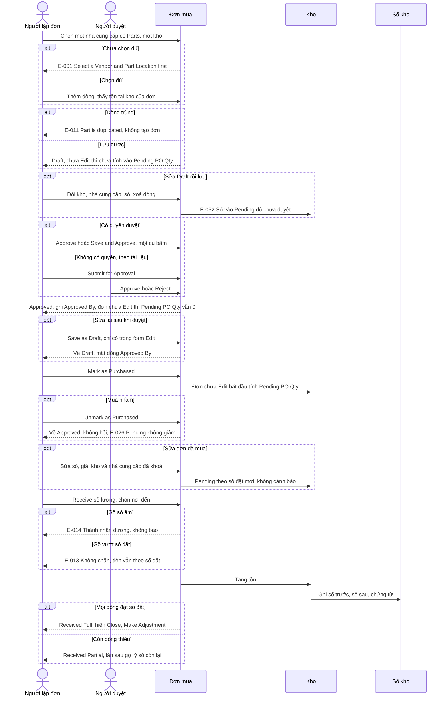

Nhánh: D1 đến D11, D22 đến D33 ở SRS Mục 6A. Nhánh Submit for Approval lượt 3 vẫn không chạy được (D32). Tổng đơn tính theo số đặt, thuế tính trên phần sau giảm, không gồm phí (D6). Ô Shipping sai 100 lần: E-012.

## Flow 2: Nhận hàng vào lệnh (`Chạy`)

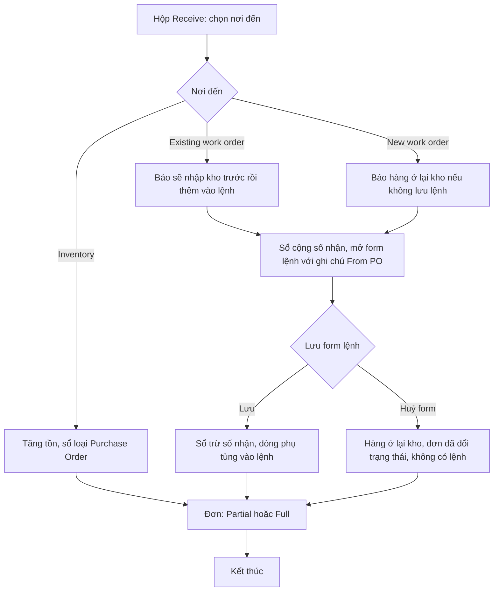

D14 chạy nhánh lệnh có sẵn đến lưu lệnh; D15 chạy nhánh lệnh mới đến huỷ form. Lưu lệnh mới chưa được nhật ký ghi riêng. `Docs`: chỉ với Static Pricing; phương pháp khác chưa thử (OQ-11).

## Flow 3: Trả hàng và đóng đơn (`Chạy`)

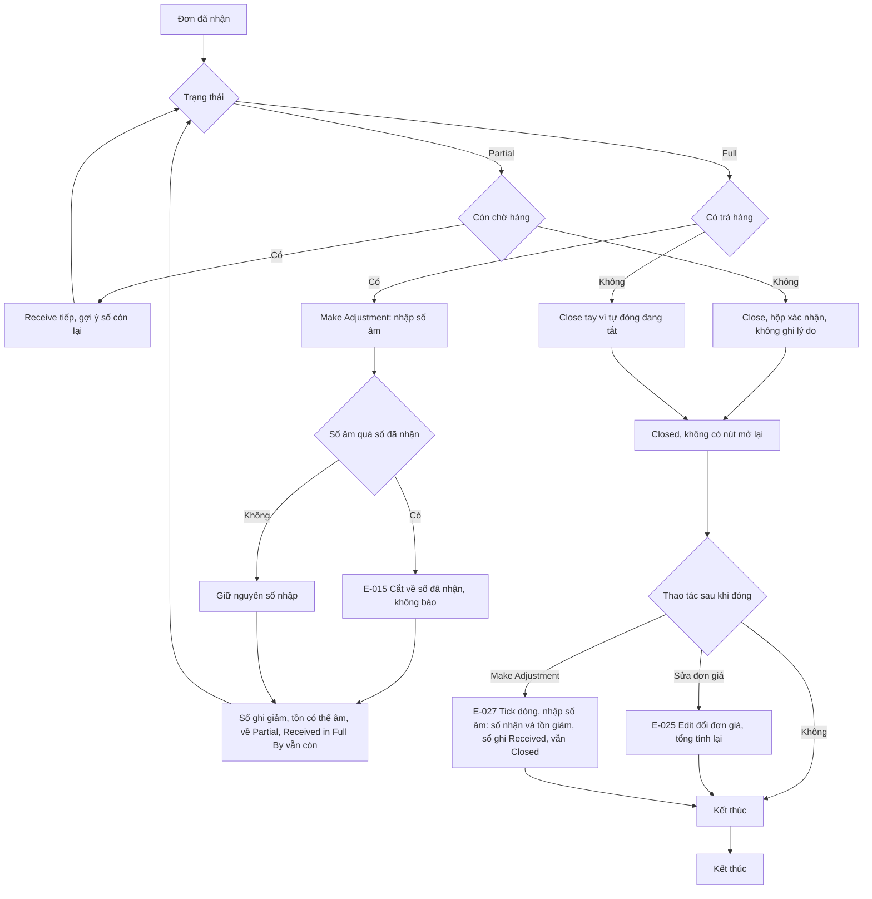

Partial không có Make Adjustment. Receive gõ số âm thành nhận dương (E-014), nên đó không phải đường trả hàng. Make Adjustment từ Closed: -1 làm Qty Received 110 xuống 109, đơn vẫn Closed, không hỏi lý do (D18). Không có huỷ đơn; lùi về Draft trước khi Purchased, hoặc Delete (chưa bấm, OQ-10).

## Flow 4: Xuất phụ tùng cho lệnh, sửa, xoá, hoàn thành (`Chạy`)

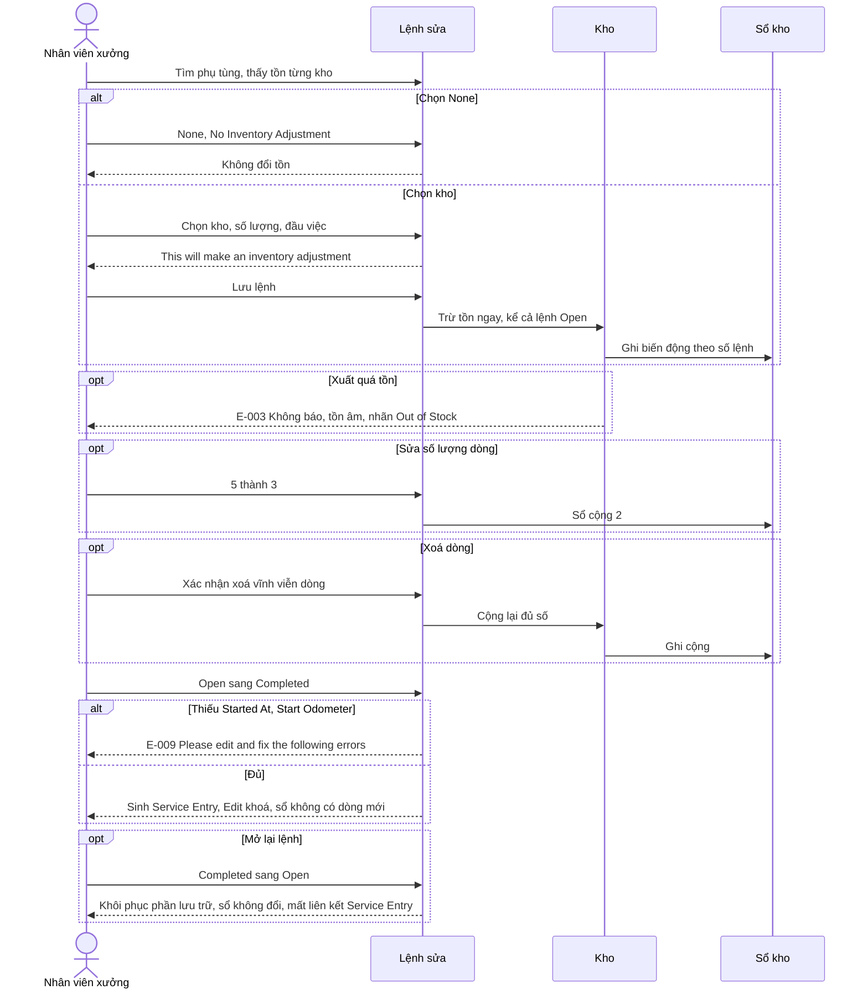

Lệch tiền 100 lần ở trang chi tiết lệnh, Service Entry: E-005; hộp Add Part thì đúng. Xoá cả lệnh chưa chạy (OQ-9). Đổi vị trí dòng sang None chưa thử (OQ-12).

## Flow 5: Khai kho và phụ tùng (`Chạy`)

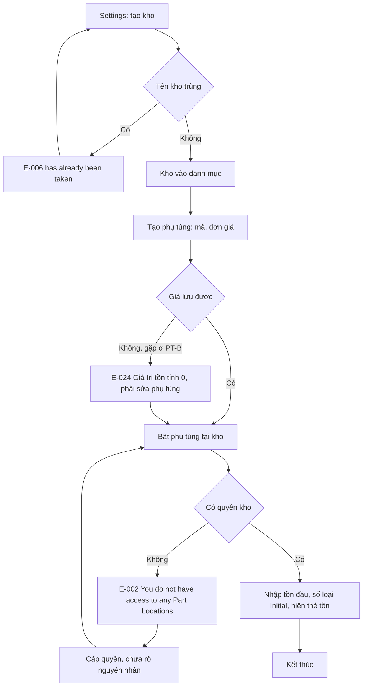

Thẻ tồn hiện Current Qty, Reorder Point, Pending PO Qty, WO Current Qty. Điểm đặt lại lưu được 0 dù tài liệu nói phải lớn hơn 0 (S4). Tắt khi có đơn bị chặn: E-010.

## Flow 6: Chỉnh tồn và chuyển kho (`Chạy`)

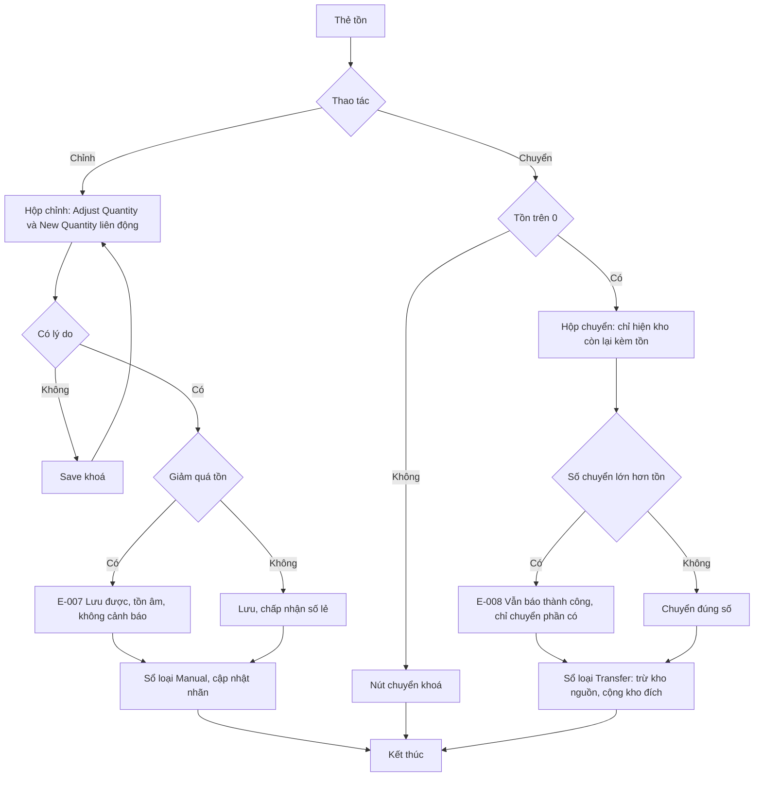

Nhánh chuyển đúng số là `Suy` từ sổ kho; nhật ký chỉ ghi lần chuyển quá tồn (K7). Đảo ngược: chỉnh tay ngược lại hoặc chuyển ngược, đều ghi dòng sổ mới, không có nút hoàn tác.

## Flow 7: Kiểm kê hàng loạt (`Chạy`)

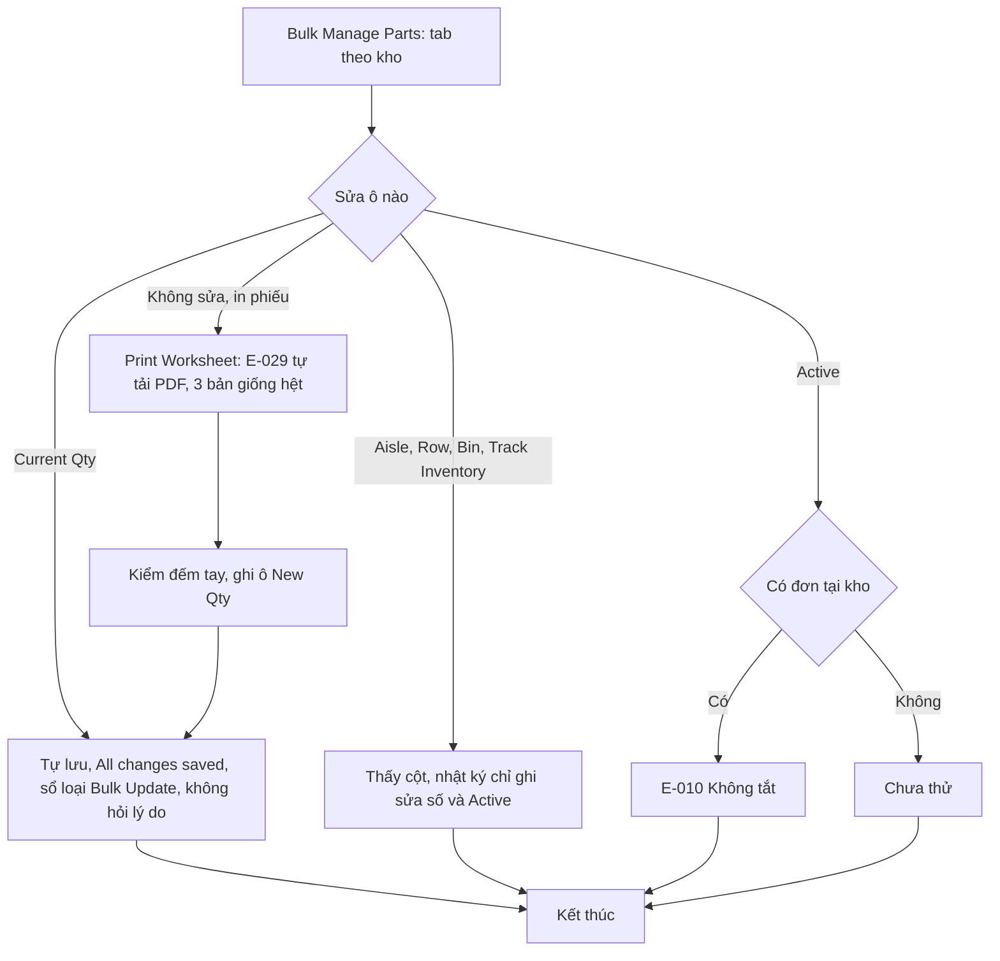

Print Worksheet `Chạy`: toast "Complete: Bulk Manage Parts Worksheet", không mở tab, PDF in theo kho đang chọn (K27, K28). Từ phiếu giấy về ô Current Qty là `Suy` theo công dụng ô New Qty, chưa thao tác. Sửa số về 0 với điểm đặt lại 0: Out of Stock (S5).

## Flow 8: Phiếu dầu và cảnh báo (`Chạy` phần phiếu và Capacity Alert, `Docs` Vendor Location Alert)

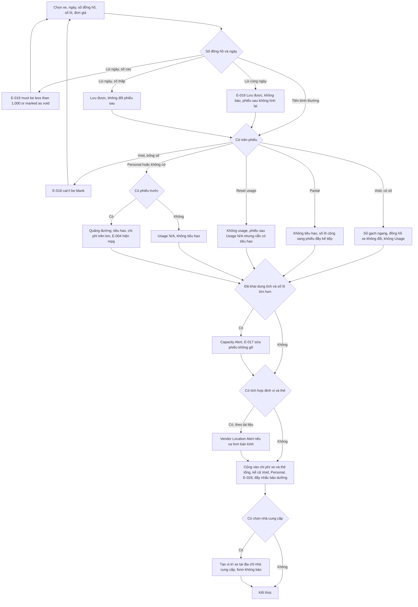

Đường đảo ngược: sửa phiếu đổi số lít nhưng không gỡ cảnh báo (E-017, F19); hiệu ứng lên tiêu hao của phiếu sau chỉ đo ở F8. Void không phải đường huỷ: phiếu vẫn cộng vào thẻ tổng (F22). Báo cáo dầu lệch tiền: E-020, kể cả khi lọc (T9, T10); trang chi tiết xe đúng (T6). Tạo vị trí đo một lần (F25); chi tiết ở nhóm Vị trí. Số 0 lít vẫn lưu được (F11). Có áp số lít, dung tích ở phiếu Void không thì chưa thử, sơ đồ vẽ theo đường chung.

## Flow 9: Khai nhà cung cấp (`Chạy`, Find Shops ở Flow 12)

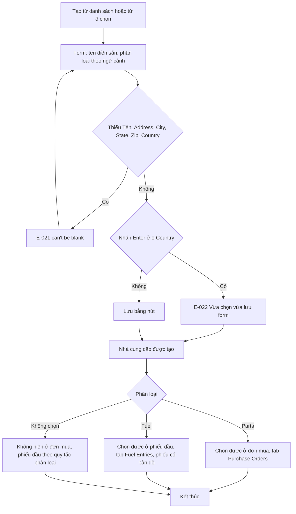

Nhánh không phân loại là `Suy` từ D1 và F-NCC. Nhánh trùng tên nhà cung cấp không có trong nhật ký.

## Flow 10: Số đang về khi đơn tiến và lùi (`Chạy`, chỉ đo trên PO #4)

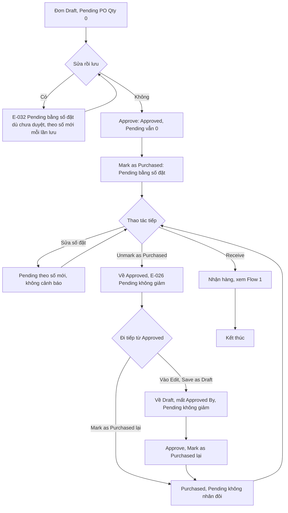

Bảng số đo ở States Mục 1. Nhánh sửa Draft đo trên PO #5 (D40, D41); từ đó đi tiếp Approve chưa đo, sơ đồ không vẽ. Sửa tăng số đặt ở Full không cộng Pending, đơn vẫn Full (D36, D37, E-033). Nhánh Mark as Purchased lại ngay từ Approved không đo riêng, chỉ đo đường qua Draft (D29). Công thức khi lùi là `Suy` (OQ-25).

## Flow 11: Sao chép, in, xem lịch sử đơn (`Chạy`)

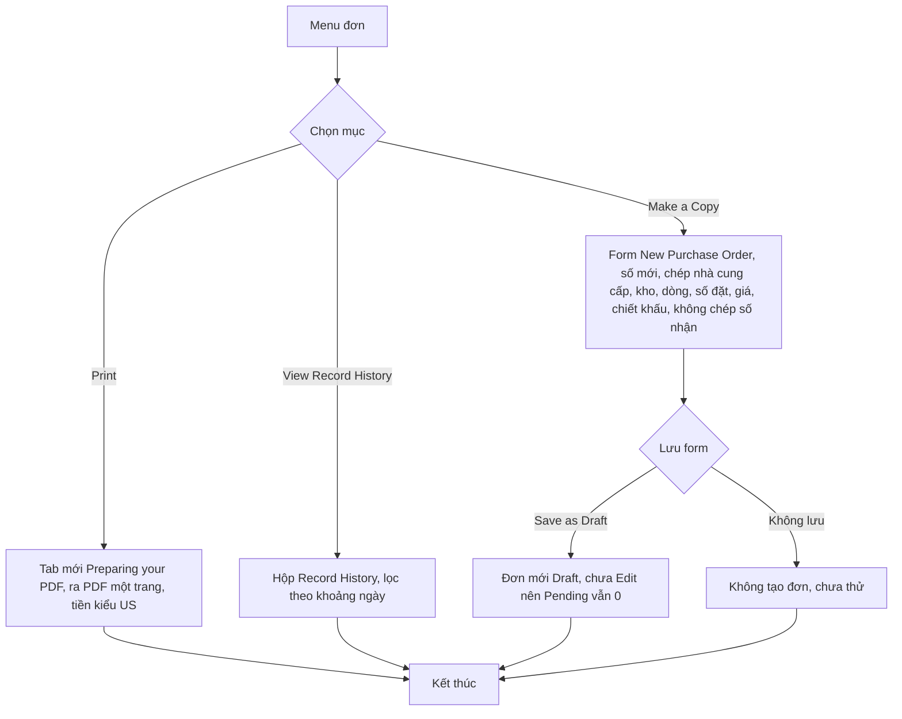

Save & Approve trên form copy chưa thử. Copy từ đơn đã sửa lấy số đặt, giá đã sửa (D39). Báo cáo đơn mua cộng cả Draft vào Total Amount: E-034. Đơn Approved sau Unmark vẫn in Purchase Date, Purchased By (D35). Record History: phần ảnh đọc được chỉ có trạng thái và tiền (D20, OQ-22).

## Flow 12: Tìm xưởng (`Chạy` tới bước tick, Add Vendor không bấm)

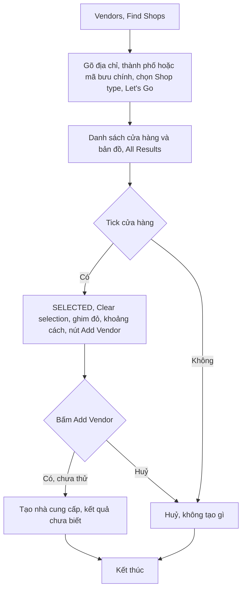

Không bấm Add Vendor vì sẽ tạo nhà cung cấp trùng tên doanh nghiệp thật (N8). Network Status: Invite không bấm (N11).

## Flow 13: Lọc phiếu dầu (`Chạy`)

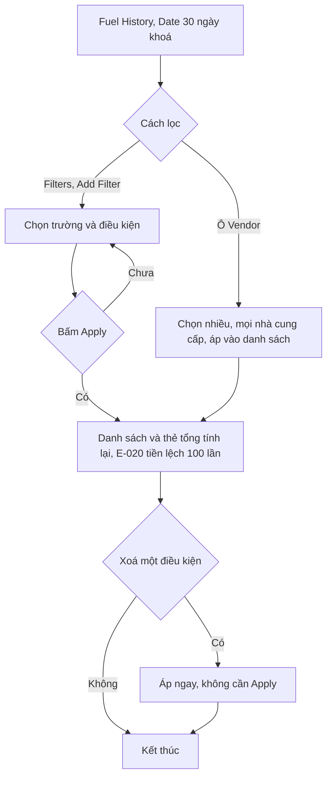

Đã lọc Vendor (1 phiếu), Fuel Capacity Alert (2 phiếu), Personal (1 phiếu), theo xe (F16, F19, F20, F22). Nhóm OR thứ 4 chưa thử; Fleetio: tối đa 3 theo câu trên panel. Trường thẻ có ở bộ lọc nhưng không có dữ liệu thẻ để lọc (F24).
