# Phụ tùng, mua hàng, nhiên liệu — Màn hình thật

Ảnh chụp từ tài khoản dùng thử ngày 02/11/2026 và 03/11/2026, dùng nội bộ để phân tích. Mã lỗi và mã case dẫn về SRS Mục 6 và 6A.

## 1.1 Chi tiết phụ tùng

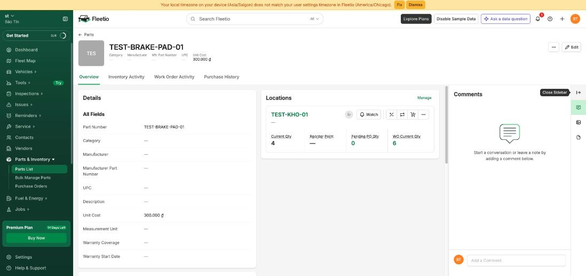

| # | Items | Control type | Data type | Description |
|---|---|---|---|---|
| 1 | Đầu trang | Chữ | — | Mã, Category, Manufacturer, Mfr. Part Number, UPC, Unit Cost |
| 2 | Tab Overview, Inventory Activity, Work Order Activity, Purchase History | Tab | — | — |
| 3 | Locations | Khối | — | Mỗi kho một thẻ; Manage bật tắt kho |
| 4 | Thẻ kho | Số | — | Current Qty, Reorder Point, Pending PO Qty, WO Current Qty; 4 nút chỉnh, chuyển, đặt mua, menu (Edit, View History); Watch. Nhãn Low Stock số màu cam, Out of Stock khoá nút chuyển |
| 5 | Details | Khối | — | Thông tin phụ tùng, bảo hành |

## 1.2 Sổ kho

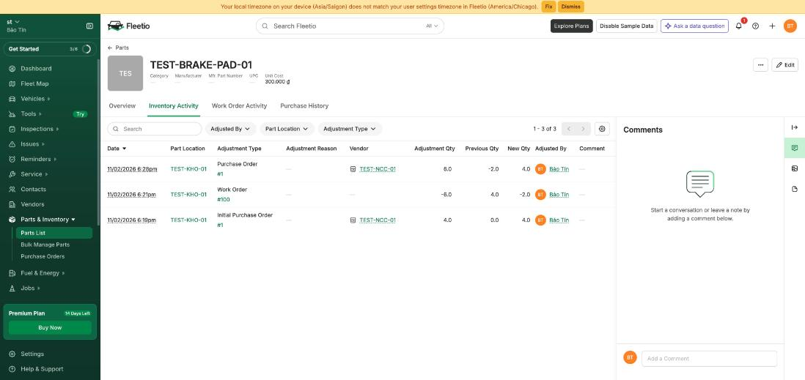

| # | Items | Control type | Data type | Description |
|---|---|---|---|---|
| 1 | Lọc Adjusted By, Part Location, Adjustment Type | Lọc | — | — |
| 2 | Date, Part Location | Cột | — | — |
| 3 | Adjustment Type | Cột | Liên kết | Initial Purchase Order, Work Order, Purchase Order, kèm số chứng từ |
| 4 | Reason, Vendor | Cột | — | — |
| 5 | Adjustment, Previous, New Qty | Cột | Số | Thấy rõ 4, -6, +6 và tồn 4, -2, 4 |
| 6 | Adjusted By, Comment | Cột | — | — |

## 2.3 Form đơn mua

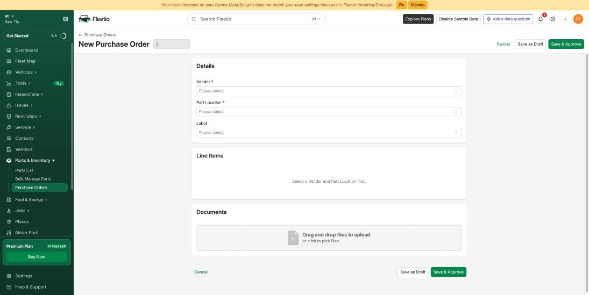

| # | Items | Control type | Data type | Description |
|---|---|---|---|---|
| 1 | Số đơn | Số | — | Tự tăng |
| 2 | Vendor, Part Location | Chọn | Bắt buộc | Chọn đủ mới mở dòng hàng |
| 3 | Label | Chọn | — | — |
| 4 | Line Items | Bảng | — | Part, Qty, Unit Cost, Amount |
| 5 | Documents | Tải | — | — |
| 6 | Save as Draft, Save & Approve | Nút | — | Có quyền duyệt thì thấy Save & Approve |

## 2.1 Chi tiết đơn mua

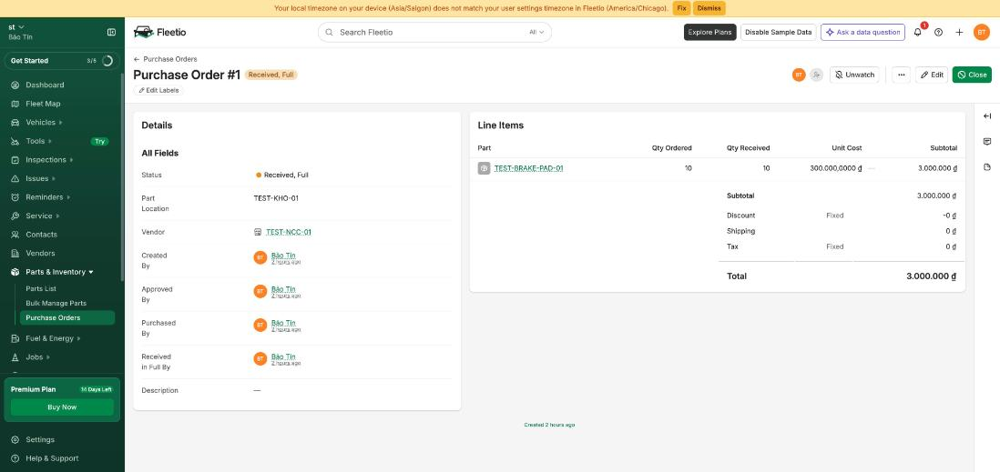

| # | Items | Control type | Data type | Description |
|---|---|---|---|---|
| 1 | Nhãn trạng thái | Badge | — | Cạnh tiêu đề |
| 2 | Nút chính | Nút | — | Approve, Mark as Purchased, Receive, Close theo trạng thái |
| 3 | Details | Khối | — | Status, Part Location, Vendor, Created, Approved, Purchased, Received in Full By kèm thời gian |
| 4 | Line Items | Bảng | — | Qty Ordered, Qty Received, Unit Cost, Subtotal |
| 5 | Tổng | Khối | Tiền | Subtotal, Discount, Shipping, Tax, Total |

## 2.2 Danh sách nhà cung cấp

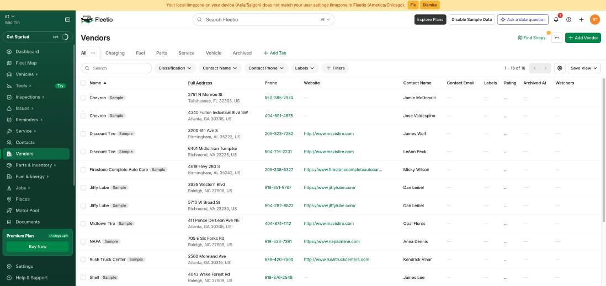

| # | Items | Control type | Data type | Description |
|---|---|---|---|---|
| 1 | Tab All, Charging, Fuel, Parts, Service, Vehicle, Archived | Tab | — | Theo phân loại |
| 2 | Cột | Bảng | — | Name, Full Address, Phone, Website, Contact, Labels, Rating, Watchers. Rating hiện "...", rê chuột "Rating not available"; bộ lọc coi là số (N13, N14) |
| 3 | Find Shops | Nút | — | Mở hộp tìm xưởng, xem màn 2.13 |

## 3.1 Chi tiết phiếu dầu

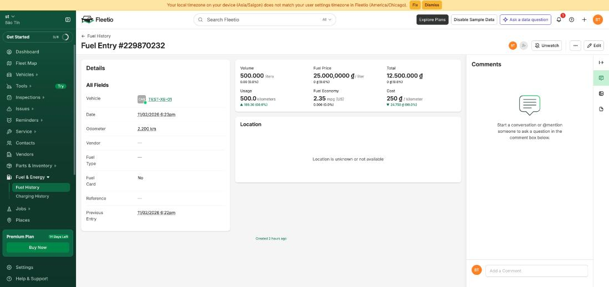

| # | Items | Control type | Data type | Description |
|---|---|---|---|---|
| 1 | Thẻ số | Số | — | Volume, Fuel Price, Total, Usage, Fuel Economy, Cost, kèm chênh so với lần trước |
| 2 | Location | Bản đồ | — | Phiếu có nhà cung cấp Fuel hiện bản đồ; phiếu không có ghi "Location is unknown or not available" |
| 3 | Details | Khối | — | Vehicle, Date, Odometer, Vendor, Fuel Type, Fuel Card (ô "No"), Reference, Previous Entry |

## 3.2 Danh sách dầu

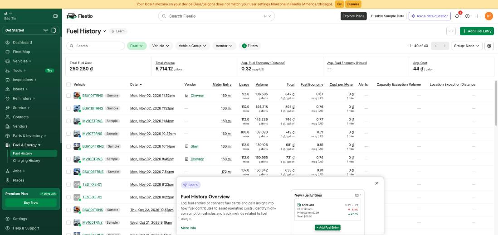

| # | Items | Control type | Data type | Description |
|---|---|---|---|---|
| 1 | Thẻ tổng | Số | — | Total Fuel Cost, Total Volume, Avg. Economy theo quãng đường, theo giờ, Avg. Cost |
| 2 | Cột | Bảng | — | Vehicle, Date, Vendor, Meter, Usage, Volume, Total, Economy, Cost per Meter, Alerts, Capacity Exception Volume, Location Exception Distance |

## 1.3 Hộp điều chỉnh tồn

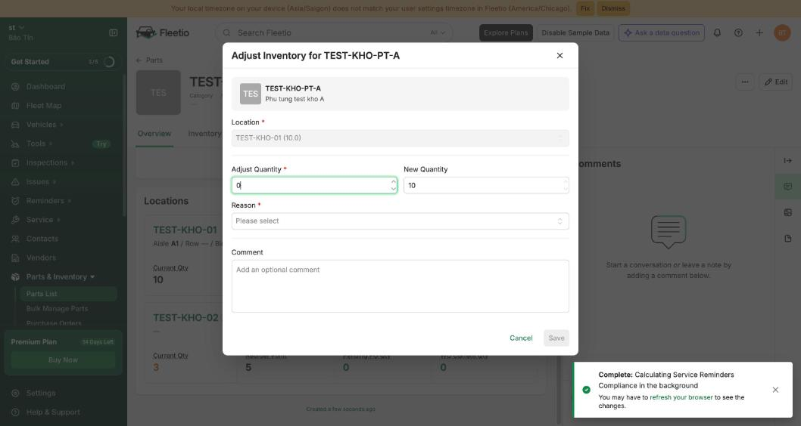

| # | Items | Control type | Data type | Description |
|---|---|---|---|---|
| 1 | Location | Chữ | — | Khoá theo kho của thẻ tồn |
| 2 | Adjust Quantity | Nhập | Số | Liên động với New Quantity; nhận số lẻ, số âm; giảm quá tồn vẫn lưu, tồn âm, không cảnh báo (K3, E-007) |
| 3 | New Quantity | Nhập | Số | Gõ 0 khi tồn -10 thì Adjust Quantity tự thành 10 (K4) |
| 4 | Reason | Chọn | Bắt buộc | 11 lý do: Broken, Checked Inventory, Expired, Found, Lost, Miscellaneous, Received, Sold, Stolen, Transferred, Used; trống thì Save khoá (K6) |
| 5 | Comment | Nhập | Chữ | Ghi chú; ràng buộc chưa ghi |

## 1.4 Hộp chuyển kho

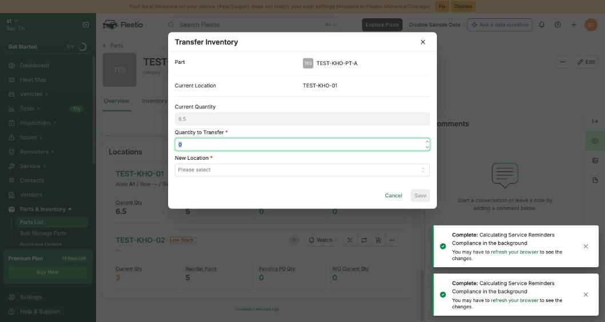

| # | Items | Control type | Data type | Description |
|---|---|---|---|---|
| 1 | Current Location | Chữ | — | Kho nguồn |
| 2 | Current Quantity | Chữ | Số | Tồn kho nguồn |
| 3 | Quantity to Transfer | Nhập | Số | Lớn hơn tồn vẫn cho Save; chỉ chuyển phần có, báo "Parts transfer was successful." (K7, E-008) |
| 4 | New Location | Chọn | Bắt buộc theo luồng | Chỉ hiện kho còn lại kèm tồn (K9). Mở hộp khi tồn từ 0 trở xuống không được, nút khoá (K8) |

## 1.5 Sổ kho đủ loại biến động

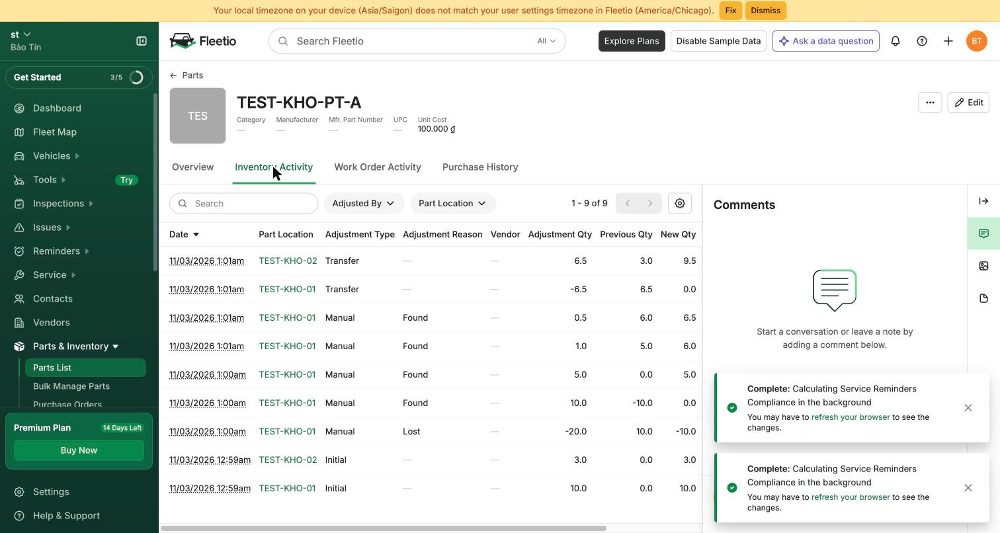

| # | Items | Control type | Data type | Description |
|---|---|---|---|---|
| 1 | Bảng biến động | Bảng | — | Cùng cột với màn 1.2 |
| 2 | Adjustment Type | Cột | Liên kết | Có Initial, Manual, Transfer, Purchase Order, Work Order, Bulk Update; nhật ký chỉ ghi "đủ loại", mỗi ảnh có loại nào cần đối chiếu ảnh |
| 3 | Dòng ghi bù | Dòng | Số | Sửa số lượng dòng lệnh +2 (K11); xoá dòng lệnh +20 (K16); chuyển kho -6,5 và +6,5 (K7) |

## 1.6 Cập nhật phụ tùng hàng loạt

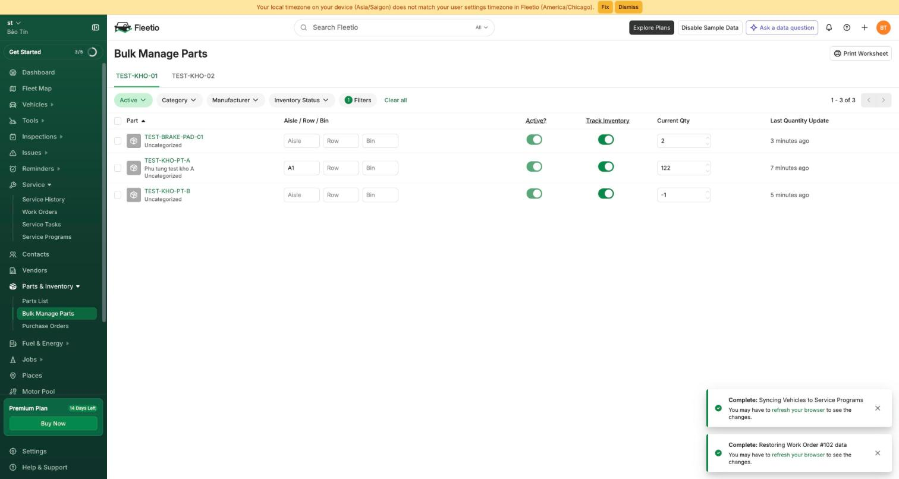

| # | Items | Control type | Data type | Description |
|---|---|---|---|---|
| 1 | Tab theo kho | Tab | — | Mỗi kho một tab |
| 2 | Aisle, Row, Bin | Nhập | Chữ | Vị trí; nhật ký không ghi lần sửa |
| 3 | Active? | Gạt | Bật, tắt | Có đơn tại kho thì không tắt: E-010 (K20) |
| 4 | Track Inventory | Gạt | Bật, tắt | Thấy; nhật ký không ghi lần sửa |
| 5 | Current Qty | Nhập | Số | Sửa là tự lưu, "All changes saved"; -1 thành 8, sổ Bulk Update +9, không hỏi lý do (K19) |
| 6 | Last Quantity Update | Chữ | Ngày | Thấy; định dạng chưa ghi |
| 7 | Print Worksheet | Nút | — | `Chạy`: tự tải PDF, xem màn 1.7; một cú bấm ra 3 file (K27, E-029) |

## 2.4 Hộp nhận hàng

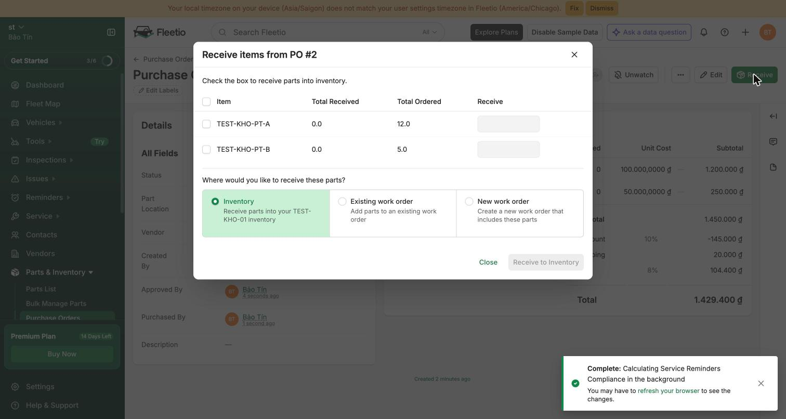

| # | Items | Control type | Data type | Description |
|---|---|---|---|---|
| 1 | Item | Chữ | — | Phụ tùng trên dòng |
| 2 | Total Received | Chữ | Số | Đã nhận |
| 3 | Total Ordered | Chữ | Số | Đã đặt |
| 4 | Receive | Nhập | Số | Lần sau gợi ý số còn lại (D8); vượt không chặn (D9, E-013); số âm thành dương (D11, E-014) |
| 5 | Nơi đến | Chọn | — | Inventory, Existing work order, New work order |

## 2.5 Hộp nhận vào lệnh có sẵn

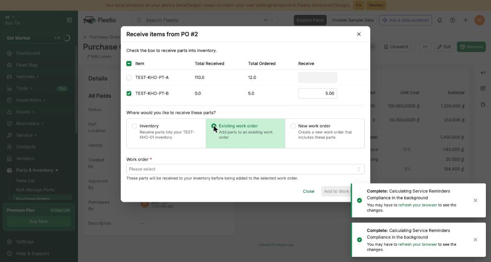

| # | Items | Control type | Data type | Description |
|---|---|---|---|---|
| 1 | Item, Total Received, Total Ordered, Receive | Bảng | Số | Như màn 2.4 |
| 2 | Nơi đến Existing work order | Chọn | — | Báo "These parts will be received to your inventory before being added to the selected work order." Sau đó mở form lệnh với dòng ghi chú "From PO #2"; sổ +5 trước, -5 khi lưu lệnh (D14) |
| 3 | Ô chọn lệnh | Chọn | — | Nhật ký không mô tả riêng ô này, xem ảnh |

## 2.6 Sửa đơn đã nhận một phần

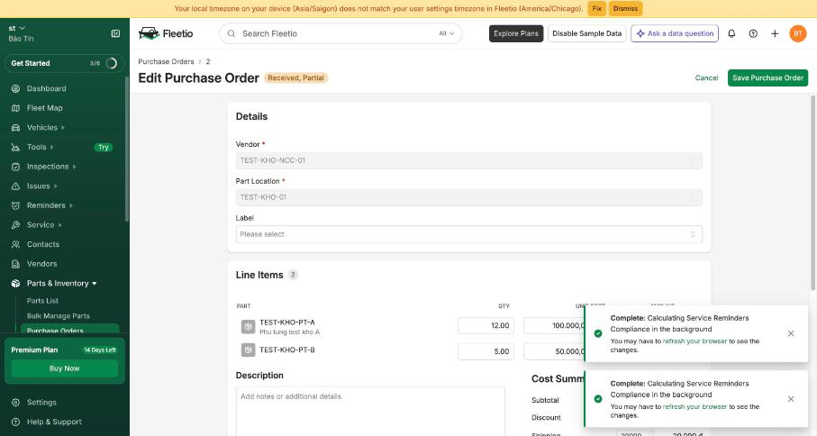

| # | Items | Control type | Data type | Description |
|---|---|---|---|---|
| 1 | Vendor | Chọn | Khoá | Không đổi được sau khi nhận |
| 2 | Part Location | Chọn | Khoá | Không đổi được sau khi nhận |
| 3 | Line Items | Bảng | Số, tiền | Sửa số và giá được; không có Add Line Item |

## 2.7 Hộp điều chỉnh số nhận

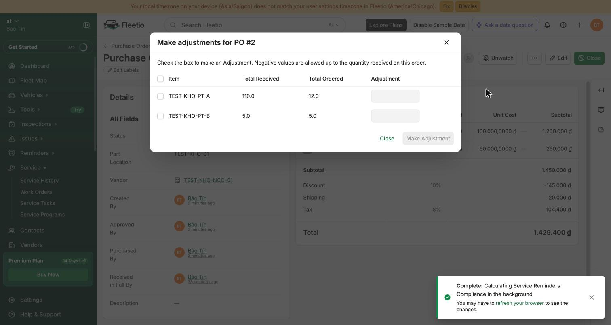

| # | Items | Control type | Data type | Description |
|---|---|---|---|---|
| 1 | Item | Chữ | — | Phụ tùng trên dòng |
| 2 | Total Received | Chữ | Số | Đã nhận |
| 3 | Total Ordered | Chữ | Số | Đã đặt |
| 4 | Adjustment | Nhập | Số | "Negative values are allowed up to the quantity received on this order."; -6 trên 5 cắt còn -5, không báo (D12, E-015); lưu xong về Partial |

## 2.8 Đơn đã đóng khi nhận thiếu

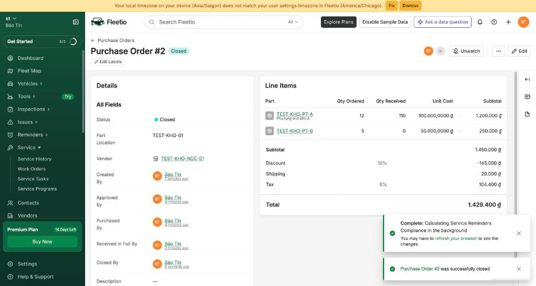

| # | Items | Control type | Data type | Description |
|---|---|---|---|---|
| 1 | Closed By | Chữ | Người, thời gian | Dấu người đóng |
| 2 | Received in Full By | Chữ | Người, thời gian | Còn dấu dù đơn đã lùi về Partial và đóng thiếu (D12, D13) |
| 3 | Line Items | Bảng | Số | PT-B 0 trên 5; không có ô lý do đóng (D13) |
| 4 | Nút hành động | Nút | — | Make Adjustment, Edit, Copy, Delete; không có nút mở lại |

## 3.3 Lịch sử dầu có cảnh báo dung tích

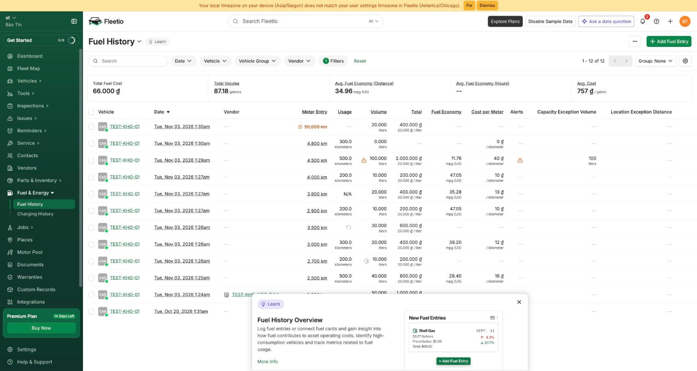

| # | Items | Control type | Data type | Description |
|---|---|---|---|---|
| 1 | Alerts | Cột | Icon | Có icon khi số lít lớn hơn dung tích đã khai (F9, F14); bằng dung tích không có (F13); chưa khai không kiểm (F1b) |
| 2 | Capacity Exception Volume | Cột | Số lít | "100 liters" với bình 60; sửa phiếu xuống 50 vẫn giữ 100 (F9b, E-017) |
| 3 | Location Exception Distance | Cột | Khoảng cách | Thấy cột; không chạy được vì cần tích hợp (F-VLA) |

## 3.4 Lỗi lùi ngày, số đồng hồ cao

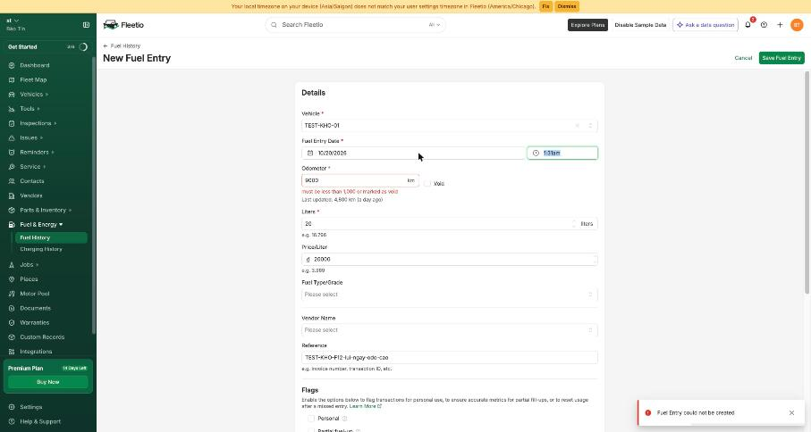

| # | Items | Control type | Data type | Description |
|---|---|---|---|---|
| 1 | Ngày | Chọn | Ngày | Lùi về 20/10 |
| 2 | Odometer | Nhập | Số | 9.000 km báo "must be less than 1,000 or marked as void" (F12, E-019); 900 km lưu được (F12b) |
| 3 | Void | Ô tick | Bật, tắt | Đường thoát lỗi theo câu báo; trống số thì "can't be blank" (F10, E-018) |

## 2.9 Hộp điều chỉnh từ đơn đã đóng

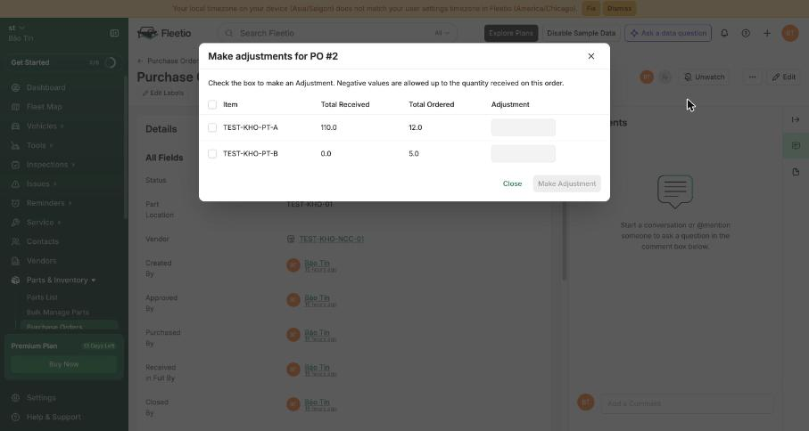

Ảnh chụp trước khi tick, số còn 110; sau khi lưu xuống 109 theo nhật ký (D18).

| # | Items | Control type | Data type | Description |
|---|---|---|---|---|
| 1 | Tiêu đề | Chữ | — | "Make adjustments for PO #2" |
| 2 | Câu hướng dẫn | Chữ | — | "Check the box to make an Adjustment. Negative values are allowed up to the quantity received on this order." |
| 3 | Ô tick đầu bảng, ô tick từng dòng | Ô tick | Bật, tắt | Tick dòng nào mới điều chỉnh dòng đó; ảnh chưa tick; ô đầu bảng chưa ghi lần bấm |
| 4 | Item | Chữ | — | TEST-KHO-PT-A, TEST-KHO-PT-B |
| 5 | Total Received | Chữ | Số | 110.0 và 0.0 |
| 6 | Total Ordered | Chữ | Số | 12.0 và 5.0 |
| 7 | Adjustment | Nhập | Số | Ô xám trong ảnh khi chưa tick. -1 làm số nhận 110 xuống 109, sổ "Received: -1.0", đơn vẫn Closed (D18, E-027) |
| 8 | Close, Make Adjustment | Nút | — | Make Adjustment mờ tới khi tick. Không có ô lý do |
| 9 | Nền sau hộp | Chữ | — | Details còn các dòng Created By, Approved By, Purchased By, Received in Full By, Closed By; bị hộp che một phần nên không đọc hết |

## 2.10 Lịch sử bản ghi đơn

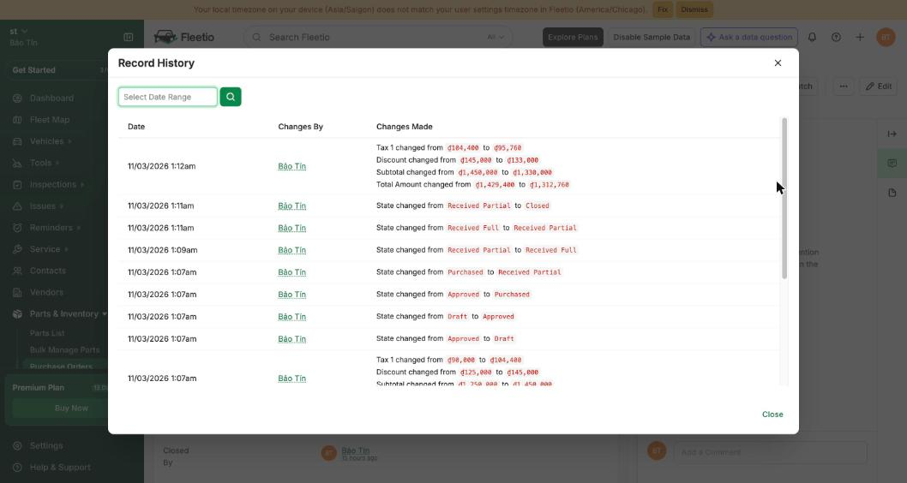

| # | Items | Control type | Data type | Description |
|---|---|---|---|---|
| 1 | Select Date Range, nút tìm | Chọn | Ngày | Lọc theo khoảng ngày; chưa ghi lần lọc |
| 2 | Date | Cột | Ngày giờ | Kiểu 11/03/2026 1:12am, theo múi giờ cài đặt tài khoản |
| 3 | Changes By | Cột | Liên kết | Tên người, bấm được |
| 4 | Changes Made | Cột | Chữ | "State changed from … to …": Purchased to Received Partial, Received Partial to Received Full, Received Full to Received Partial, Received Partial to Closed, Approved to Draft, Draft to Approved, Approved to Purchased |
| 5 | Đổi tiền | Trong Changes Made | Tiền | Tax 1, Discount, Subtotal, Total Amount kèm số cũ, số mới, kiểu US: Total Amount ₫1,429,400 thành ₫1,312,760 (T12, E-030) |
| 6 | Số nhận | Không thấy | — | Phần đọc được không có dòng số nhận (D20, OQ-22). Nhóm tiền cuối bị cắt ở mép, phần dưới phải cuộn, ảnh không đọc được |
| 7 | Close | Nút | — | Đóng hộp |

## 2.11 Sửa đơn đã mua

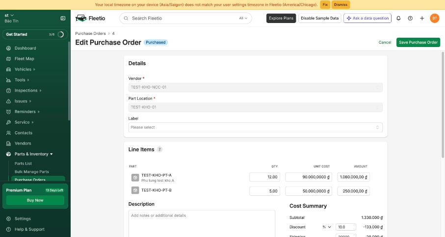

Ảnh chụp trước khi đổi số 12 thành 15. Phần dưới bị cắt: Shipping chỉ thấy một phần, không thấy Tax.

| # | Items | Control type | Data type | Description |
|---|---|---|---|---|
| 1 | Tiêu đề, nhãn | Chữ, badge | — | "Edit Purchase Order", nhãn Purchased, đường dẫn Purchase Orders › 4 |
| 2 | Cancel, Save Purchase Order | Nút | — | Lưu được, không cảnh báo đã gửi nhà cung cấp (D26) |
| 3 | Vendor | Chọn | Bắt buộc, khoá | Xám, không đổi được từ Purchased (BR-017) |
| 4 | Part Location | Chọn | Bắt buộc, khoá | Xám, không đổi được từ Purchased |
| 5 | Label | Chọn | — | Mở, "Please select" |
| 6 | Line Items | Bảng | — | Part, Qty, Unit Cost, Amount; không có Add Line Item, nút xoá dòng trong phần ảnh thấy (D26) |
| 7 | Qty | Nhập | Số | 12.00 và 5.00; 12 thành 15 thì Pending thành 15 (D25) |
| 8 | Unit Cost | Nhập | Tiền | 90.000,0000 ₫ và 50.000,0000 ₫, bốn số lẻ |
| 9 | Amount | Chữ trong ô | Tiền | 1.080.000,00 ₫ và 250.000,00 ₫ |
| 10 | Description | Nhập | Chữ | "Add notes or additional details" |
| 11 | Cost Summary | Khối | Tiền | Subtotal 1.330.000 ₫; Discount % 10.0, -133.000 ₫; Shipping thấy một phần, ảnh không đọc rõ; Tax nằm ngoài ảnh |

## 2.12 PDF đơn mua

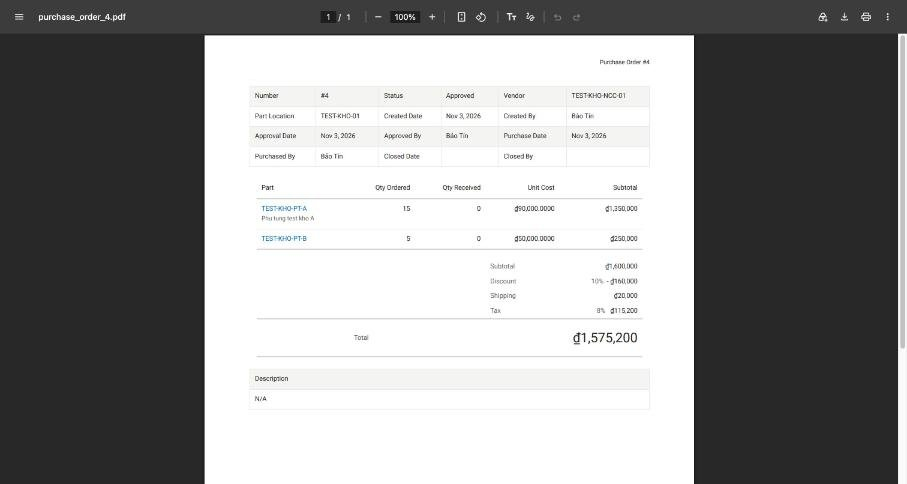

Mở ở trình xem PDF của trình duyệt. Dòng địa chỉ tài khoản ở đầu trang đã che trong ảnh nên không đọc được.

| # | Items | Control type | Data type | Description |
|---|---|---|---|---|
| 1 | Tên file | Chữ | — | `purchase_order_4.pdf`, 1 trang |
| 2 | Đầu trang | Chữ | — | "Purchase Order #4" |
| 3 | Bảng thông tin | Chữ | — | Number, Status, Vendor, Part Location, Created Date, Created By, Approval Date, Approved By, Purchase Date, Purchased By, Closed Date, Closed By. Status Approved mà vẫn có Purchase Date, Purchased By (D35); Closed Date, Closed By trống |
| 4 | Dòng hàng | Bảng | Số, tiền | Part, Qty Ordered, Qty Received, Unit Cost, Subtotal: 15, 0, ₫90,000.0000, ₫1,350,000; 5, 0, ₫50,000.0000, ₫250,000 |
| 5 | Tổng | Khối | Tiền | Subtotal ₫1,600,000; Discount 10% ₫160,000; Shipping ₫20,000; Tax 8% ₫115,200; Total ₫1,575,200. Kiểu US, khác web (T11, E-030) |
| 6 | Description | Chữ | — | "N/A" khi trống |

## 3.5 Lọc dầu theo loại cảnh báo

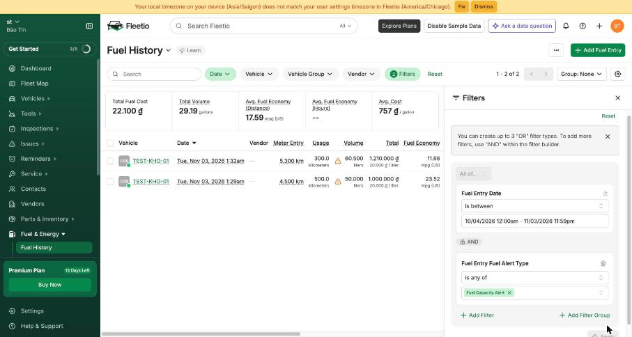

Nút Apply bị cắt ở mép dưới ảnh, chỉ thấy một phần. Ảnh chỉ hiện giá trị đã chọn Fuel Capacity Alert; hai giá trị còn lại theo nhật ký (F18).

| # | Items | Control type | Data type | Description |
|---|---|---|---|---|
| 1 | Thanh lọc | Lọc | — | Search, Date, Vehicle, Vehicle Group, Vendor, Filters (số 2), Reset; "1 - 2 of 2"; Group: None |
| 2 | Thẻ tổng | Số | — | Total Fuel Cost 22.100 ₫ trong khi hai dòng cộng 2.210.000 ₫ (T10, E-020); Total Volume 29.19 gallons; Avg. Fuel Economy (Distance) 17.59 mpg (US); Avg. Fuel Economy (Hours) "--"; Avg. Cost 757 ₫/gallon |
| 3 | Bảng | Cột | — | Vehicle, Date, Vendor, Meter Entry, Usage, Volume, Total, Fuel Economy; cột sau bị che. Icon cảnh báo cạnh Volume |
| 4 | Dòng 60,5 lít | Dòng | — | 5.300 km, Usage 300, 1.210.000 ₫, 20.000 ₫/lít, 11.66 mpg (US) (F14, F19) |
| 5 | Dòng 50 lít | Dòng | — | 4.500 km, Usage 500, 1.000.000 ₫, 20.000 ₫/lít, 23.52 mpg (US). Là phiếu sửa từ 100 lít, vẫn có cảnh báo (F9b, E-017) |
| 6 | Panel Filters | Panel | — | "You can create up to 3 "OR" filter types. To add more filters, use "AND" within the filter builder."; "All of..."; Reset; đóng được |
| 7 | Fuel Entry Date | Điều kiện | Ngày | "Is between", khoảng 30 ngày, biểu tượng khoá, không có nút xoá (F15) |
| 8 | Fuel Entry Fuel Alert Type | Điều kiện | Chọn nhiều | "is any of", chip Fuel Capacity Alert, có nút xoá (F18, F19) |
| 9 | Add Filter, Add Filter Group, Apply | Nút | — | Thêm điều kiện phải bấm Apply (F21) |

## 2.13 Tìm xưởng

Không có ảnh: nhật ký không lưu vì có địa chỉ thật. Bảng theo nhật ký, chưa đối chiếu ảnh.

| # | Items | Control type | Data type | Description |
|---|---|---|---|---|
| 1 | Tiêu đề hộp | Chữ | — | "Select service shops and easily save them to your vendors list" |
| 2 | Enter address, city or ZIP/postal code | Nhập | Chữ | Ô tìm theo địa điểm |
| 3 | Shop type | Chọn | — | Giá trị chưa ghi |
| 4 | Let's Go | Nút | — | Chạy tìm, khoảng 30 cửa hàng (N7) |
| 5 | Kết quả, bản đồ | Danh sách, bản đồ | — | Chữ "All Results"; tick thì "SELECTED", "Clear selection", ghim đổi đỏ, nhãn khoảng cách (N8); thẻ và bóng ghim không có điểm (N15) |
| 6 | Add Vendor | Nút | — | Hiện khi tick; không bấm nên kết quả chưa biết |

## 1.7 PDF phiếu kiểm kê

Không có ảnh: nhật ký không lưu vì có địa chỉ tài khoản. Bảng theo nhật ký, chưa đối chiếu ảnh.

| # | Items | Control type | Data type | Description |
|---|---|---|---|---|
| 1 | Đầu trang | Chữ | — | Tên, địa chỉ tài khoản |
| 2 | Part, Category, Manufacturer | Cột | Chữ | Theo kho đang chọn ở Bulk Manage |
| 3 | Aisle, Row, Bin | Cột | Chữ | Vị trí trong kho |
| 4 | Current Qty | Cột | Số | Kèm mốc "Yesterday", "Today" |
| 5 | New Qty | Ô trống | Số | Để kiểm đếm tay (K28) |

## 1.8 Đổi phương pháp tính giá tồn

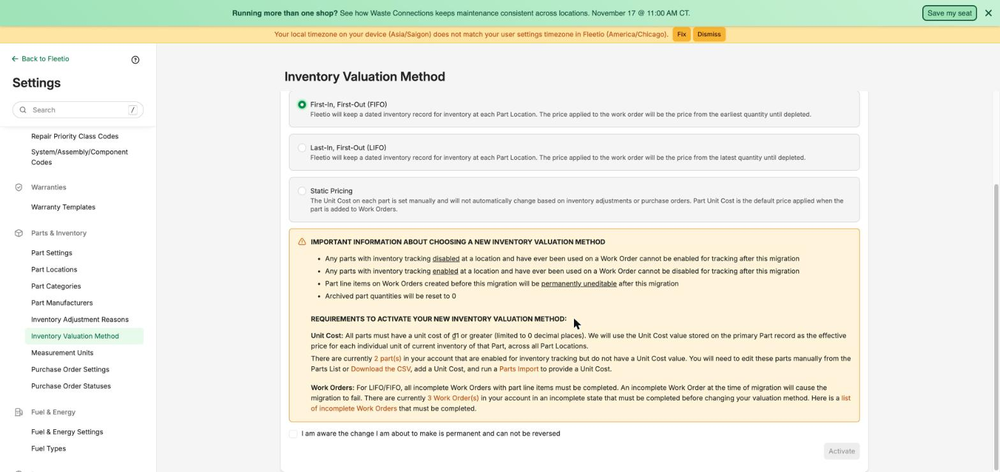

Ảnh chọn FIFO, chưa tích, chưa Activate; đã cuộn nên radio Average nằm ngoài ảnh, không đọc được, mô tả theo nhật ký (K31). Cảnh báo trong ảnh là của FIFO; cảnh báo riêng Average theo nhật ký (K33). Mức `Xem` từ khối cảnh báo trở xuống.

| # | Items | Control type | Data type | Description |
|---|---|---|---|---|
| 1 | Menu Settings | Menu | — | Nhóm Parts & Inventory: Part Settings, Part Locations, Part Categories, Part Manufacturers, Inventory Adjustment Reasons, Inventory Valuation Method (đang chọn), Measurement Units, Purchase Order Settings, Purchase Order Statuses |
| 2 | First-In, First-Out (FIFO) | Radio | Chọn một | Đang chọn. "Fleetio will keep a dated inventory record for inventory at each Part Location. The price applied to the work order will be the price from the earliest quantity until depleted." |
| 3 | Last-In, First-Out (LIFO) | Radio | Chọn một | "... The price applied to the work order will be the price from the latest quantity until depleted." |
| 4 | Static Pricing | Radio | Chọn một | Đang áp dụng, chưa đổi. "The Unit Cost on each part is set manually and will not automatically change based on inventory adjustments or purchase orders. Part Unit Cost is the default price applied when the part is added to Work Orders." |
| 5 | Khối cảnh báo | Chữ | — | "IMPORTANT INFORMATION ABOUT CHOOSING A NEW INVENTORY VALUATION METHOD": không đổi được theo dõi tồn của phụ tùng đã dùng trên lệnh; dòng phụ tùng lệnh cũ "permanently uneditable"; "Archived part quantities will be reset to 0" (K32, K34) |
| 6 | Điều kiện Unit Cost | Chữ, liên kết | — | "REQUIREMENTS TO ACTIVATE...". Unit Cost từ ₫1, không số lẻ; "2 part(s)", "Download the CSV", "Parts Import" (K35, E-035) |
| 7 | Điều kiện lệnh dở | Chữ, liên kết | — | "3 Work Order(s)", "list of incomplete Work Orders"; còn lệnh dở thì migration thất bại (K36, E-035). Link lọc lệnh chưa xong có dòng phụ tùng, mở tab mới (K39) |
| 8 | Ô tích nhận thức | Ô tick | Bật, tắt | "I am aware the change I am about to make is permanent and can not be reversed". Chưa tích |
| 9 | Activate | Nút | — | Xám. Không bấm (K37). Không có nút Save, không có xem thử |
