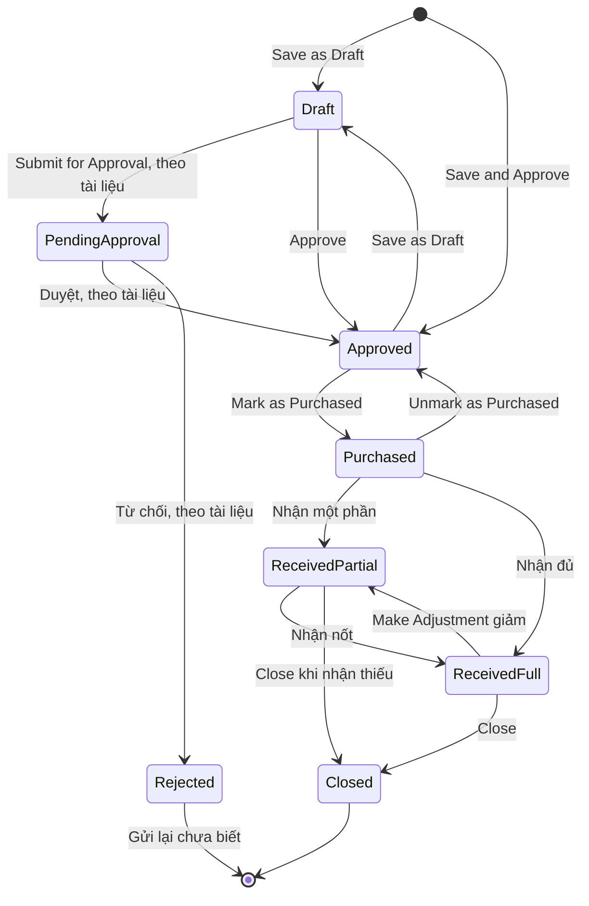
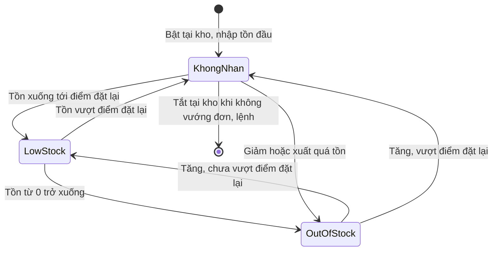
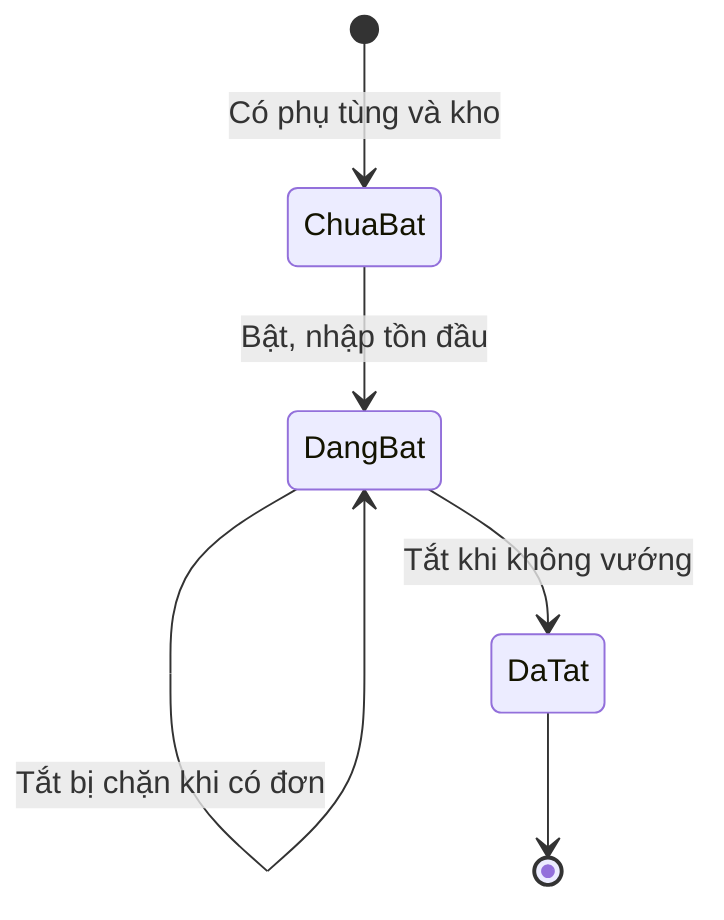
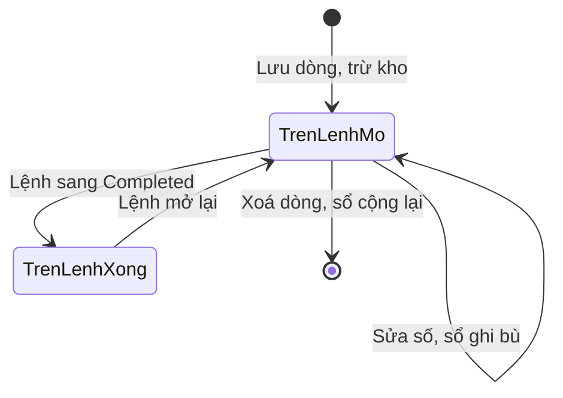
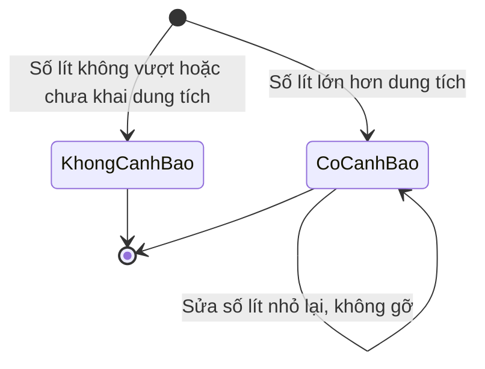

# Phụ tùng, mua hàng, nhiên liệu — States

Nhãn mức: `Chạy` đã thao tác · `Xem` thấy, không thao tác · `Docs` tài liệu hãng · `Suy` suy ra. "Chưa ghi" là nhật ký chạy không ghi câu chữ hoặc kết quả cho ô đó. Mã case dẫn về SRS Mục 6A.

## 1. Đơn mua

Sơ đồ không vẽ Delete và Make a Copy vì có ở nhiều trạng thái, xem cuối bảng. Không có trạng thái hay nút huỷ riêng; thoát đơn chỉ có Close (từ Partial, Full) hoặc Delete. Closed không có nút mở lại. Trạng thái cố định, trang cấu hình không có nút thêm (`Xem`).

| Trạng thái | Hành động | Sang | Điều kiện | Hiệu ứng | Câu chữ | Mức |
|---|---|---|---|---|---|---|
| Mới | Save as Draft | Draft | Đã chọn nhà cung cấp, kho; 0 dòng vẫn lưu được | Có số đơn tự tăng; có tính vào Pending PO Qty không thì chưa đo riêng | Chưa ghi | `Chạy` |
| Mới | Save & Approve | Approved | Có quyền duyệt; có dòng | Lưu và ghi Approved By | Chưa ghi | `Chạy` |
| Mới | Lưu khi trùng dòng | Không tạo | Hai dòng cùng phụ tùng (D4) | Chặn | "Part TEST-KHO-PT-A is duplicated", "Purchase Order could not be created" | `Chạy` |
| Draft | Sửa | Draft | Sửa mọi thứ | Không đổi trạng thái | Chưa ghi | `Chạy` |
| Draft | Approve | Approved | Khoá khi 0 dòng; dòng số lượng 0 vẫn duyệt được (D5); duyệt đơn của mình được, một cú bấm, không hộp xác nhận (D17) | Ghi Approved By; Pending PO Qty thành 12 | "Purchase Order #2 approved" | `Chạy` |
| Draft | Save & Approve | Approved | Có quyền duyệt | Lưu sửa và duyệt | Chưa ghi | `Chạy` |
| Draft | Submit for Approval | Pending Approval | Người không có quyền duyệt; người có quyền không thấy nút | Chờ người duyệt | Không thấy nút | `Docs` |
| Pending Approval | Duyệt | Approved | Người có quyền | Ghi người duyệt | Có tab lọc, chưa ghi câu | `Docs` |
| Pending Approval | Từ chối | Rejected | Người có quyền | Chưa biết | Có tab lọc, chưa ghi câu | `Docs` |
| Rejected | Gửi lại | Chưa biết | Tài khoản một người không tới được, OQ-8 | Chưa biết | Có tab lọc, chưa ghi câu | `Docs` |
| Approved | Mark as Purchased | Purchased | Một cú bấm | Pending PO Qty vẫn 12 | "marked as purchased" | `Chạy` |
| Approved | Edit | Approved | Đủ trường | Lưu không đổi trạng thái | Chưa ghi | `Chạy` |
| Approved | Save as Draft | Draft | Trong form Edit | Mất dòng Approved By | Chưa ghi | `Chạy` |
| Approved | Save & Approve | Approved | Trong form Edit | Lưu, giữ trạng thái | Chưa ghi | `Chạy` |
| Purchased | Receive một phần | Received, Partial | Chọn nơi đến | Tồn tăng theo số nhận (D8) | "was successfully received" | `Chạy` |
| Purchased | Receive đủ | Received, Full | Mọi dòng đạt số đặt; nhận vào lệnh mới rồi huỷ form cũng vậy (D15) | Tồn tăng, hàng ở lại kho nếu huỷ form | "Your received parts will remain in inventory even if you don't save this work order." | `Chạy` |
| Purchased | Unmark as Purchased | Approved | Một cú bấm, không hỏi | Trở lại trước khi mua | "unmarked as purchased" | `Chạy` |
| Purchased | Edit | Purchased | Có nút, phạm vi trường chưa ghi | Chưa ghi | Chưa ghi | `Chạy` |
| Received, Partial | Receive tiếp, còn thiếu | Received, Partial | Lần sau gợi ý số còn lại (D8); vượt ở một dòng mà dòng khác 0 vẫn Partial (D10) | Tồn tăng từng lần; nhận vượt không chặn (D9) | "was successfully received" | `Chạy` |
| Received, Partial | Receive đủ | Received, Full | Mọi dòng đạt số đặt | Ghi Received in Full By | "was successfully received" | `Chạy` |
| Received, Partial | Receive gõ số âm | Không lùi | Gõ -5 (D11) | Thành nhận +5, mất dấu âm, không báo | "was successfully received" | `Chạy` |
| Received, Partial | Close | Closed | Hộp xác nhận; đóng được khi còn thiếu, không ghi lý do (D13) | Ghi Closed By; dòng PT-B giữ 0 trên 5 | "Are you sure you want to close the selected purchase order?", "was successfully closed" | `Chạy` |
| Received, Partial | Edit | Received, Partial | Khoá nhà cung cấp, kho, không thêm bớt dòng; sửa số và giá được | Tổng tính lại | "was successfully updated" | `Chạy` |
| Received, Partial | Make Adjustment | Không có | Không có nút ở trạng thái này | Không có | Không có | `Chạy` |
| Received, Full | Close | Closed | Tự đóng tắt nên cần Close tay | Ghi Closed By | "was successfully closed" | `Chạy` |
| Received, Full | Make Adjustment giảm | Received, Partial | Số âm tới số đã nhận; -6 trên 5 cắt còn -5, không báo (D12) | Sổ -5, tồn 2 thành -3; "Received in Full By" vẫn còn | "Negative values are allowed up to the quantity received on this order.", "was successfully adjusted" | `Chạy` |
| Received, Full | Edit | Received, Full | Có nút, phạm vi trường chưa ghi | Chưa ghi | Chưa ghi | `Chạy` |
| Closed | Edit | Closed | Vẫn đổi được đơn giá dưới Static Pricing | Tổng 1.429.400 thành 1.312.760 | "was successfully updated" | `Chạy` |
| Closed | Make Adjustment | Chưa ghi | Có nút; nhật ký không ghi lần bấm ở Closed | Chưa ghi | Chưa ghi | `Xem` |
| Closed | Mở lại | Không có | Không có nút | Không có | Không có | `Chạy` |
| Draft, Approved, Purchased, Received, Closed | Make a Copy | Form đơn mới | Mở form điền sẵn (D16) | Giữ giá đơn cũ, số đơn tăng | Chưa ghi | `Chạy` một lần; các trạng thái khác `Xem` |
| Draft, Approved, Purchased, Received, Closed | Delete | Chưa biết | Không bấm, OQ-10 | Chưa biết | Chưa ghi | `Xem` |
| Draft | Print, View Record History | Draft | Có nút | Không đổi trạng thái | Chưa ghi | `Xem` |

## 2. Tồn theo từng kho

Tồn là nhãn tính từ số lượng, không phải trạng thái lưu; mỗi kho một nhãn. Ngưỡng: tồn từ 0 trở xuống là Out of Stock; trên 0 và từ điểm đặt lại trở xuống là Low Stock; còn lại không nhãn.

| Trạng thái | Hành động | Sang | Điều kiện | Hiệu ứng | Câu chữ | Mức |
|---|---|---|---|---|---|---|
| Không nhãn | Chỉnh tăng | Không nhãn | +0,5 trên 6, điểm 5 (K5); lý do bắt buộc (K6) | Tồn 6,5, sổ Manual | Chưa ghi | `Chạy` |
| Không nhãn | Chỉnh giảm, còn trên 0 | Low Stock | Tồn từ điểm trở xuống | Số màu cam, đủ nút | "Low Stock" | `Chạy` |
| Không nhãn | Chỉnh giảm quá tồn | Out of Stock | 10, chỉnh -20, lý do Lost (K3) | Tồn -10, không cảnh báo | "Out of Stock" | `Chạy` |
| Không nhãn | Chuyển quá tồn | Out of Stock ở kho nguồn | Có 6,5, chuyển 100, Save vẫn mở (K7) | Chỉ chuyển 6,5, sổ -6,5 và +6,5, không báo đã cắt | "Parts transfer was successful." | `Chạy` |
| Không nhãn | Xuất cho lệnh, vượt tồn | Out of Stock | PT-A 20, kho 9,5 (K12) | Trừ ngay khi lưu, tồn -10,5, không cảnh báo | "This will make an inventory adjustment" | `Chạy` |
| Không nhãn | Xuất cho lệnh, trong tồn | Theo số còn lại | PT-B 5 cái, WO Open (K10) | -5 ngay lúc lưu | "This will make an inventory adjustment" | `Chạy` |
| Không nhãn | Đặt mua | Không đổi | Nút trên thẻ tồn | Tạo đơn mua cho phụ tùng; chưa ghi lần bấm | Chưa ghi | `Xem` |
| Không nhãn | Menu Edit | Không nhãn | Điểm đặt lại lưu được 0 dù tài liệu nói phải lớn hơn 0, tồn 9,5 (S4) | Không nhãn; tồn về 0 với điểm 0 chưa thử | "Part was successfully updated" | `Chạy` |
| Không nhãn | Menu View History | Không đổi | Nút trong menu | Mở sổ kho | Chưa ghi | `Xem` |
| Không nhãn | Tắt tại kho | Tắt | Không vướng đơn ở mọi trạng thái, lệnh chưa xong | Chưa thử nhánh thành công | "A location cannot be disabled if the part is used on any incomplete Work Orders, or on Purchase Orders in any status." | `Xem` |
| Không nhãn | Tắt tại kho ở Bulk | Không tắt | Có đơn tại kho (K20) | Giữ nguyên | "This part can't be deactivated because it's used in one or more purchase orders at this location." | `Chạy` |
| Low Stock | Tăng vượt điểm | Không nhãn | Tồn vượt điểm đặt lại | Bỏ nhãn | Không có nhãn | `Chạy` |
| Low Stock | Giảm tới 0 hoặc quá tồn | Out of Stock | Make Adjustment: tồn 2 thành -3 (D12) | Sổ ghi; không cảnh báo | "Out of Stock" | `Chạy` |
| Low Stock | Chuyển, chỉnh, đặt mua | Theo số còn lại | Đủ nút | Như không nhãn | "Low Stock" | `Chạy` |
| Out of Stock | Chuyển kho | Không đổi | Tồn từ 0 trở xuống (K8) | Nút khoá | "Out of Stock" | `Chạy` |
| Out of Stock | Chỉnh bằng số mới | Out of Stock | Từ -10 gõ New Quantity 0, Adjust Quantity tự thành 10 (K4) | Tồn 0 | "Out of Stock" | `Chạy` |
| Out of Stock | Tăng, chưa vượt điểm | Low Stock | 0 cộng 5, điểm 5 | Số màu cam | "Low Stock" | `Chạy` |
| Out of Stock | Tăng, vượt điểm | Không nhãn | Bulk -1 thành 8, sổ Bulk Update +9, không hỏi lý do (K19); xoá dòng lệnh +20, về 9,5 (K16) | Bỏ nhãn | "All changes saved" ở Bulk | `Chạy` |
| Out of Stock | Nhận hàng | Theo số sau | -2 nhận 6 về 4 (C1) | Sổ Purchase Order | "was successfully received" | `Chạy` |

## 3. Phụ tùng tại kho

Bật, tắt theo từng cặp phụ tùng, kho; xem cột Active? ở Bulk.

| Trạng thái | Hành động | Sang | Điều kiện | Hiệu ứng | Câu chữ | Mức |
|---|---|---|---|---|---|---|
| Chưa bật | Bật qua Manage | Đang bật | Có kho | Hiện thẻ tồn, sổ loại Initial | Chưa ghi | `Chạy` |
| Chưa bật | Chọn trên đơn mua | Không chọn được | Kho của đơn chưa bật phụ tùng (D2) | Dòng xám, có khoá | Chưa ghi | `Chạy` |
| Đang bật | Tắt ở Bulk | Đang bật | Có đơn tại kho (K20) | Gạt không có tác dụng | "This part can't be deactivated because it's used in one or more purchase orders at this location." | `Chạy` |
| Đang bật | Tắt khi không vướng | Đã tắt | Không có đơn, lệnh chưa xong | Chưa thử | Chưa ghi | `Xem` |
| Đã tắt | Bật lại | Chưa biết | Chưa thử | Chưa biết | Chưa ghi | Không chạy |

## 4. Dòng phụ tùng trên lệnh

Dòng không có trường trạng thái riêng; hành vi đi theo trạng thái lệnh. Trạng thái lệnh đầy đủ ở nhóm Sửa chữa, ở đây chỉ ghi tác động lên kho.

| Trạng thái | Hành động | Sang | Điều kiện | Hiệu ứng | Câu chữ | Mức |
|---|---|---|---|---|---|---|
| Mới | Thêm từ kho | Trên lệnh Open | Chọn kho, số lượng | Trừ ngay, sổ Work Order (K10); không chặn vượt tồn (K12) | "This will make an inventory adjustment" | `Chạy` |
| Mới | Thêm với None | Trên lệnh Open | "None (No Inventory Adjustment)" (K13) | Không đổi tồn | Chưa ghi | `Chạy` |
| Mới | Nhận từ đơn | Trên lệnh Open | Nhận vào lệnh có sẵn (D14) | Sổ +5, rồi -5 khi lưu lệnh; ghi chú "From PO #2" | "These parts will be received to your inventory before being added to the selected work order." | `Chạy` |
| Trên lệnh Open | Sửa số lượng | Trên lệnh Open | 5 thành 3 (K11) | Sổ +2, loại Work Order #102 | Chưa ghi | `Chạy` |
| Trên lệnh Open | Xoá dòng | Hết dòng | Sau hộp xác nhận (K16) | Sổ +20, tồn về 9,5 | "Are you sure you want to permanently delete this line item?" | `Chạy` |
| Trên lệnh Open | Đổi vị trí sang None | Chưa biết | Chưa thử, OQ-12 | Chưa biết | Chưa ghi | Không chạy |
| Trên lệnh Open | Lệnh sang Completed | Trên lệnh Completed | Có Started At, Start Odometer theo cài đặt (K14) | Sổ không có dòng mới; sinh Service Entry; Edit khoá | "Please edit and fix the following errors: Started At can't be blank", "Start Odometer can't be blank (per your account settings)" | `Chạy` |
| Trên lệnh Completed | Lệnh mở lại | Trên lệnh Open | Đổi trạng thái (K15) | Sổ không đổi; liên kết Service Entry biến mất | "Changing this completed Work Order to an incomplete Status will automatically restore any archived parts, part locations, and contacts associated with line items." | `Chạy` |
| Trên lệnh Open | Xoá cả lệnh | Chưa biết | Đã huỷ ở hộp xác nhận (K21), OQ-9 | Chưa biết có hoàn kho không | "All data will be lost forever." | Không chạy |

## 5. Phiếu dầu

Phiếu dầu không có vòng đời trạng thái: không có Draft, duyệt hay đóng. Khác biệt nằm ở cờ trên phiếu và cảnh báo. Sơ đồ chỉ vẽ cảnh báo dung tích vì đây là thứ duy nhất đổi theo sự kiện.

| Trạng thái | Hành động | Sang | Điều kiện | Hiệu ứng | Câu chữ | Mức |
|---|---|---|---|---|---|---|
| Phiếu đầu | Lưu | Phiếu thường | Chưa có phiếu trước (F1) | Tổng tiền; không tiêu hao | Usage "N/A" | `Chạy` |
| Phiếu thường | Lưu | Phiếu thường | Có phiếu trước (F2) | Tiêu hao theo mpg dù xe km, lít | "mpg (US)" | `Chạy` |
| Cờ Partial | Lưu | Phiếu Partial | Đổ không đầy (F3) | Không tiêu hao; số lít cộng sang phiếu đầy kế tiếp (F4) | Chưa ghi | `Chạy` |
| Cờ Reset usage | Lưu | Phiếu Reset | Bỏ lần ghi (F5) | Không usage; phiếu sau Usage "N/A" nhưng vẫn tính tiêu hao (F6) | Usage "N/A" | `Chạy` |
| Cờ Personal | Lưu | Phiếu Personal | Dùng riêng (F7) | Tính tiêu hao bình thường, vẫn vào Cost of Ownership | Chưa ghi | `Chạy` |
| Cờ Void | Lưu, trống số | Không lưu | Tick Void, trống số (F10) | Chặn | "can't be blank" | `Chạy` |
| Cờ Void | Lưu, có số | Phiếu Void | Ghi 50.000 (F10) | Số gạch ngang, đồng hồ xe không đổi, không Usage; vẫn vào chi phí xe | Chưa ghi | `Chạy` |
| Không cảnh báo | Lưu số lít bằng dung tích | Không cảnh báo | 60 lít, bình 60 (F13) | Không cảnh báo | Không có | `Chạy` |
| Không cảnh báo | Lưu khi chưa khai dung tích | Không cảnh báo | 50 lít (F1b) | Không kiểm | Không có | `Chạy` |
| Có cảnh báo | Lưu số lít lớn hơn dung tích | Có cảnh báo | 100 lít (F9), 60,5 lít (F14), bình 60 | Icon Alerts, Capacity Exception Volume | "100 liters" | `Chạy` |
| Có cảnh báo | Sửa số lít nhỏ lại | Có cảnh báo | 100 thành 50 (F9b) | Cảnh báo không mất, cột vẫn 100 | "100 liters" | `Chạy` |
| Mọi phiếu | Vendor Location Alert | Chưa biết | Cần định vị và thẻ (F-VLA), OQ-14 | Theo tài liệu gắn cảnh báo | Location Exception Distance | `Docs` |

## 6. Nhà cung cấp

Nhà cung cấp không có vòng đời trạng thái đã chạy nên không vẽ sơ đồ. Phân loại Parts, Fuel, Service, Vehicle quyết định nơi được chọn (N2), không phải trạng thái. Tab Archived có trên danh sách (`Xem`), lưu trữ và khôi phục chưa thử. "Network Status: Invite" thấy, không bấm (`Xem`); giá trị khác của trường này chưa biết (OQ-15). Sạc ngoài phạm vi theo yêu cầu user.
