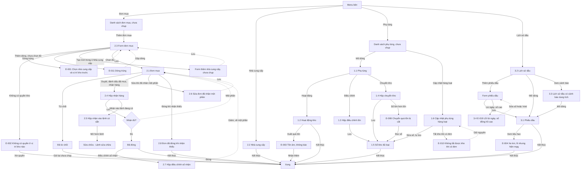

# Phụ tùng, mua hàng, nhiên liệu — User flow

`stage` ghi theo lựa chọn của user: tự chốt, xem ở bản cuối (02/11/2026).

## 1. Sơ đồ tổng

Bản vẽ trên Figma: trang `Research · Fleetio`, frame `7214:221572`, vẽ theo bản 02/11/2026, chưa có các màn thêm ngày 03/11/2026. Đường liền là luồng thường, nét đứt là quay lại.

## 2. Màn hình

| # | Màn | Slug | Trạng thái | Ảnh |
|---|---|---|---|---|
| 1.1 | Chi tiết phụ tùng | part-detail | Có tồn | Có |
| 1.2 | Sổ kho | inventory-activity | 3 dòng | Có |
| 2.3 | Form đơn mua | po-new | Trống | Có |
| 2.1 | Chi tiết đơn | po-detail | Received, Full | Có |
| 2.2 | Danh sách nhà cung cấp | vendors | Có dữ liệu | Có |
| 3.1 | Chi tiết phiếu dầu | fuel-entry | Có tiêu hao | Có |
| 3.2 | Danh sách dầu | fuel-list | Có dữ liệu | Có |
| 1.3 | Hộp điều chỉnh tồn | part-adjust-dialog | Có số | Có |
| 1.4 | Hộp chuyển kho | part-transfer-dialog | Có số | Có |
| 1.5 | Sổ kho đủ loại biến động | inventory-activity-adjust-transfer | Nhiều loại | Có |
| 1.6 | Cập nhật phụ tùng hàng loạt | parts-bulk-manage | Tab theo kho | Có |
| 2.4 | Hộp nhận hàng | po-receive-dialog | Nhận một phần | Có |
| 2.5 | Hộp nhận vào lệnh có sẵn | po-receive-existing-wo | Chọn lệnh | Có |
| 2.6 | Sửa đơn đã nhận một phần | po-edit-received-partial | Khoá nhà cung cấp, kho | Có |
| 2.7 | Hộp điều chỉnh số nhận | po-make-adjustment | Có số âm | Có |
| 2.8 | Đơn đã đóng khi nhận thiếu | po-closed-partial | Closed, thiếu | Có |
| 3.3 | Lịch sử dầu có cảnh báo dung tích | fuel-history-capacity-alert | Có cảnh báo | Có |
| 3.4 | Lỗi lùi ngày, số đồng hồ cao | fuel-entry-odometer-backdate-error | Lỗi | Có |

## 3. Flow theo tác vụ

| Flow | Happy path | Nhánh lỗi, ngoại lệ |
|---|---|---|
| Mua | Danh sách → form → 2.1 → hộp nhận 2.4 → Close | E-fleetio-parts-purchasing-fuel-001; E-fleetio-parts-purchasing-fuel-011; E-fleetio-parts-purchasing-fuel-012; từ chối |
| Nhận vào lệnh | 2.1 → 2.5 → form lệnh | Huỷ form: hàng ở lại kho; E-fleetio-parts-purchasing-fuel-013; E-fleetio-parts-purchasing-fuel-014 |
| Trả, đóng | 2.1 → 2.7 → 2.1 → 2.8 | E-fleetio-parts-purchasing-fuel-015; E-fleetio-parts-purchasing-fuel-025 |
| Sửa sau nhận | 2.1 → 2.6 → 2.1 | Nhà cung cấp, kho khoá; không thêm bớt dòng |
| Tồn | 1.1 → 1.2 | E-fleetio-parts-purchasing-fuel-002 |
| Chỉnh, chuyển | 1.1 → 1.3 hoặc 1.4 → 1.5 | E-fleetio-parts-purchasing-fuel-007; E-fleetio-parts-purchasing-fuel-008 |
| Kiểm kê | Danh sách → 1.6 → 1.5 | E-fleetio-parts-purchasing-fuel-010 |
| Dầu | 3.2 → form → 3.1 → 3.3 | E-fleetio-parts-purchasing-fuel-004; E-fleetio-parts-purchasing-fuel-016; E-fleetio-parts-purchasing-fuel-017; E-fleetio-parts-purchasing-fuel-018; E-fleetio-parts-purchasing-fuel-019 tại 3.4; E-fleetio-parts-purchasing-fuel-020 |
