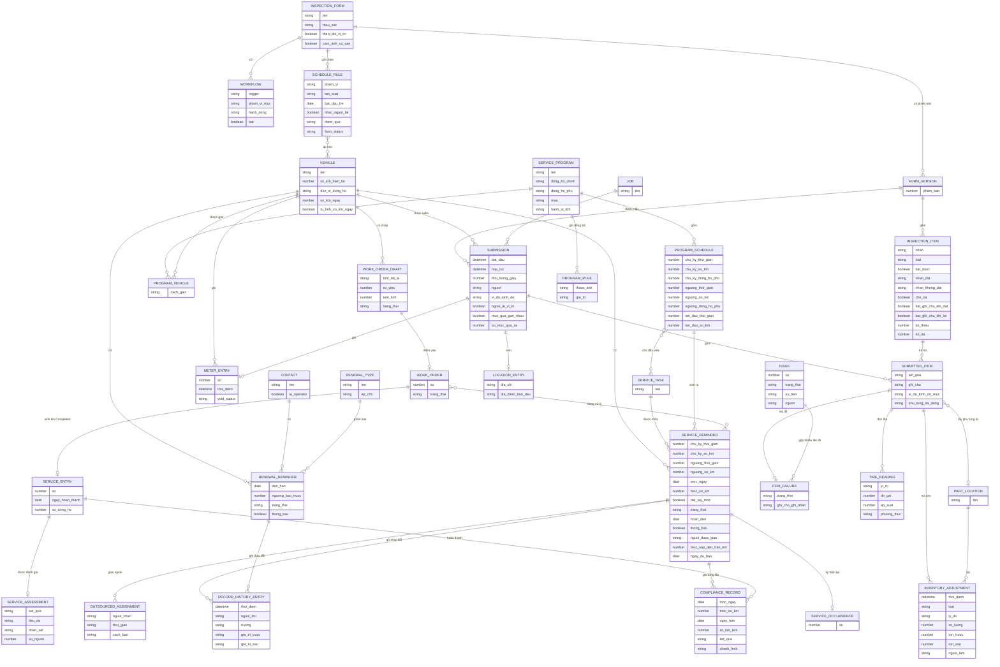

# Nhắc và kiểm tra — ERD nghiệp vụ

Suy ra từ form, kết quả chạy và tài liệu hãng, không phải sơ đồ cơ sở dữ liệu thật.

`FORM_VERSION` đã có bằng chứng hành vi (phiếu cũ mang "Past Version", `Chạy`); cách lưu phiên bản là `Suy`. Vị trí từng mục: trên web gói tin chỉ có một cặp toạ độ cấp phiếu (`Chạy (vị trí giả lập)`); phiếu Fleetio Go có cặp `latitude`, `longitude` riêng cho 21/21 mục cùng hai chỉ báo `are_items_too_close`, `items_completed_too_far_away_count` (`Chạy (Fleetio Go)`). `moc_sap_den_han_km`, `SERVICE_OCCURRENCE` lộ từ Record History ("Due Soon Meter Value", "Current Service Occurrence"), `Chạy`. `RECORD_HISTORY_ENTRY` có bản ghi thật; cấu trúc là `Suy`. `WORK_ORDER_DRAFT`, `PROGRAM_RULE`, `PART_LOCATION` đặt tên theo màn; quan hệ của `WORK_ORDER_DRAFT` với `WORK_ORDER` chưa chạy, `PROGRAM_RULE` chưa lưu được vì còn Sample Data (`Suy`). `INVENTORY_ADJUSTMENT` có bản ghi thật ở Inventory Activity (`Chạy`). `SERVICE_ASSESSMENT` thấy trên phiếu (`Chạy`). `OUTSOURCED_ASSIGNMENT` dừng ở Confirm, chưa tạo (`Suy`). `so_km_ngay`, `tu_tinh_so_km_ngay` thấy trên form Vehicle (`Chạy`); `ngay_du_bao` có thể tính khi đọc, không lưu (`Suy`). Cờ Forecasting ở cấp tài khoản, không vẽ. `COMPLIANCE_RECORD`, `ITEM_FAILURE`, `PROGRAM_SCHEDULE`, `PROGRAM_VEHICLE` là tên đặt để mô tả, suy từ màn hình (`Suy`). Một `ISSUE` gom nhiều `ITEM_FAILURE` khi lỗi lặp lúc sự cố còn mở (`Chạy`).
