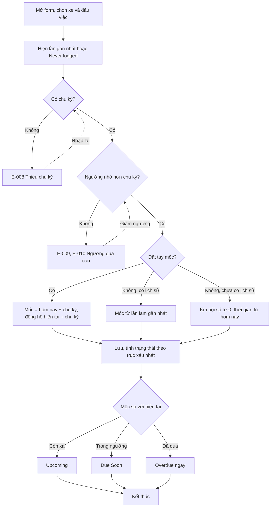
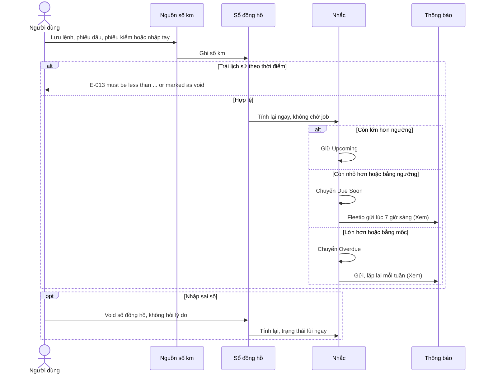
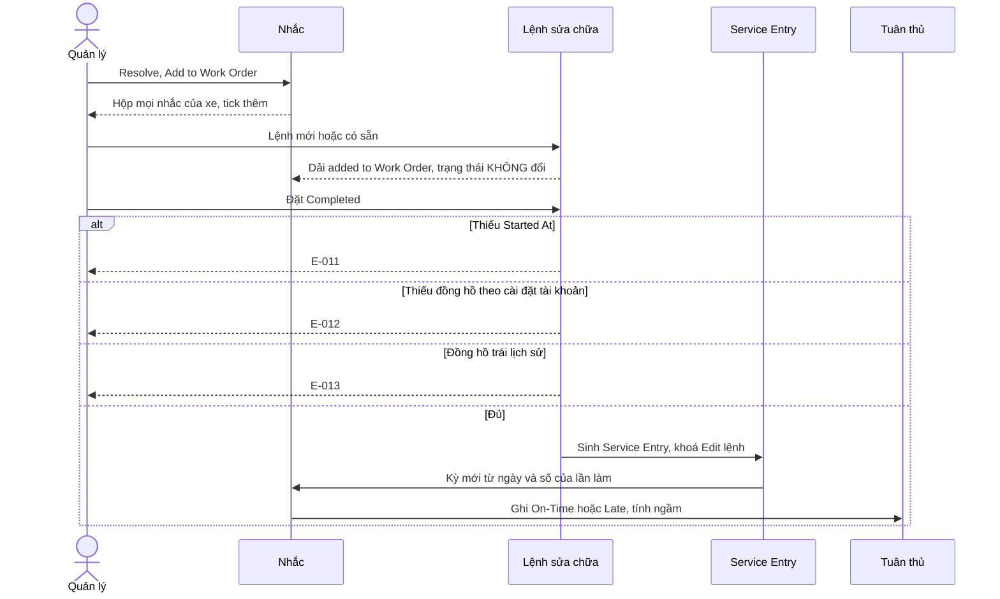
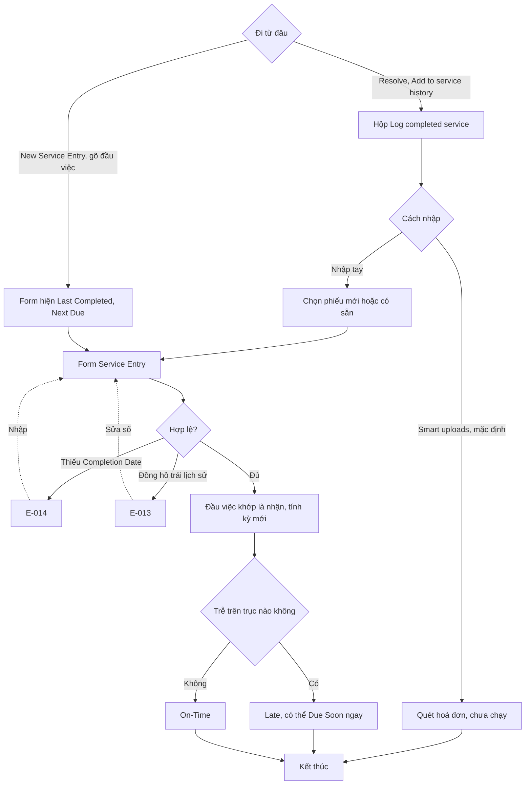
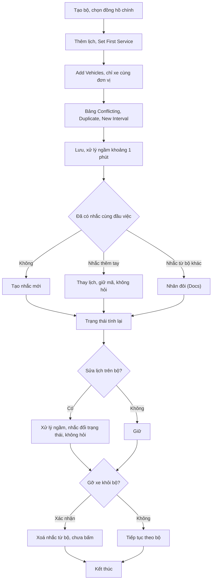
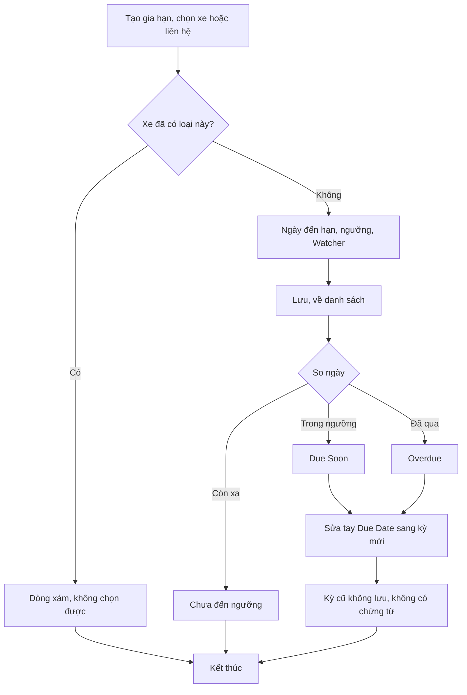
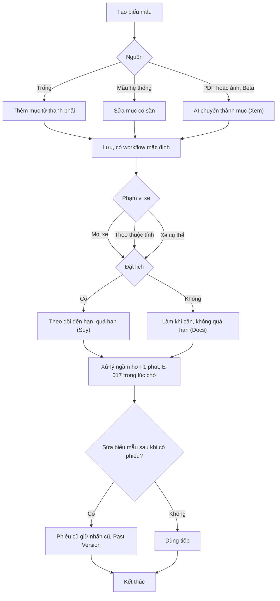
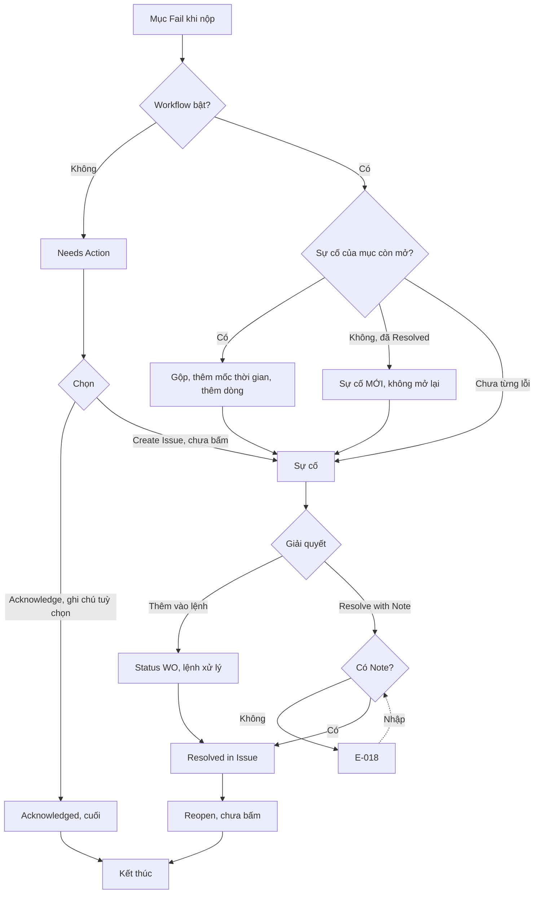

# Nhắc và kiểm tra — Flows

Mã lỗi đầy đủ có tiền tố `E-fleetio-reminders-inspection-`. Luồng đảo ngược ghi cạnh từng flow; "không có" nghĩa là đã tìm và không thấy.

## Flow 1: Tạo nhắc bảo dưỡng (`Chạy`)

**Nhánh đảo ngược:** sửa chu kỳ tính lại ngay, không ghi lịch sử; xoá chưa bấm.

## Flow 2: Số đồng hồ đổi, nhắc đổi trạng thái (`Chạy`)

**Nhánh lỗi:** lệch múi giờ thiết bị và tài khoản làm số đúng bị E-013 (`Chạy`).

## Flow 3: Tạm hoãn và huỷ hoãn (`Chạy`)

**Không có:** ô lý do, mức chọn sẵn, cảnh báo ngày đã qua. Hoãn từ Upcoming, Due Soon chưa bấm.

## Flow 4: Đóng nhắc bằng lệnh sửa chữa (`Chạy`)

**Nhánh đảo ngược:** lệnh đã Completed khoá Edit; mở lại xem nhóm Sửa chữa. Draft Work Order xám, bấm không phản hồi.

## Flow 5: Đóng nhắc bằng phiếu dịch vụ (`Chạy`)

## Flow 6: Áp và sửa bộ lịch (`Chạy`, phần nhân đôi là `Docs`)

**Nhánh đảo ngược:** không có hoàn tác khi áp bộ (`Docs`).

## Flow 7: Gia hạn giấy tờ (`Chạy`)

**Không có:** Resolve, History, tải giấy tờ mới.

## Flow 8: Dựng và gán biểu mẫu (`Chạy`)

## Flow 9: Làm và nộp phiếu (`Chạy`; vị trí `Chạy (vị trí giả lập)`)

```mermaid
sequenceDiagram
    actor L as Lái xe
    participant F as Biểu mẫu
    participant S as Phiếu
    participant G as Vị trí
    participant W as Workflow
    L->>F: Chọn biểu mẫu và xe
    alt Chưa gán xe
        F-->>L: E-017 danh sách rỗng
    else Có quyền vị trí
        G-->>F: Toạ độ lấy lúc khởi động app
    else Không có quyền
        F-->>L: E-007 cảnh báo, vẫn làm được
    end
    L->>S: Trả lời mục
    opt Mục lốp, xe chưa khai trục
        S-->>L: E-004 hộp More info needed
        L->>S: Chọn trục, Done, tự sinh lốp
    end
    opt Rời trang
        S-->>L: E-019 Leave site, phiếu mất
    end
    L->>S: Save Inspection
    alt Thiếu dữ liệu
        S-->>L: E-001, E-002, E-003, E-005, E-013, E-015, kèm E-006
    else Hợp lệ
        S->>G: Lưu một cặp toạ độ, sinh Location Entry
        S->>S: Gắn Job đang gán, ghi đồng hồ, đọc lốp
        S->>W: Chạy theo mục
        S-->>L: Inspection form submitted
    end
```

**Nhánh đảo ngược:** phiếu đã nộp không sửa, chỉ Delete (chưa bấm). **Không có:** nháp, phát hiện toạ độ giả, Location Exception trên web.

## Flow 10: Xử lý mục lỗi (`Chạy`; Create Issue, Reopen là `Xem`)

**Không có:** đạt lại tự đóng sự cố; câu hỏi xác nhận lại trên web; đường quay lại từ Acknowledged.
