# Nhắc và kiểm tra — Flows

Mã lỗi đầy đủ có tiền tố `E-fleetio-reminders-inspection-`. Luồng đảo ngược ghi cạnh từng flow; "không có" nghĩa là đã tìm và không thấy.

## Flow 1: Tạo nhắc bảo dưỡng (`Chạy`)

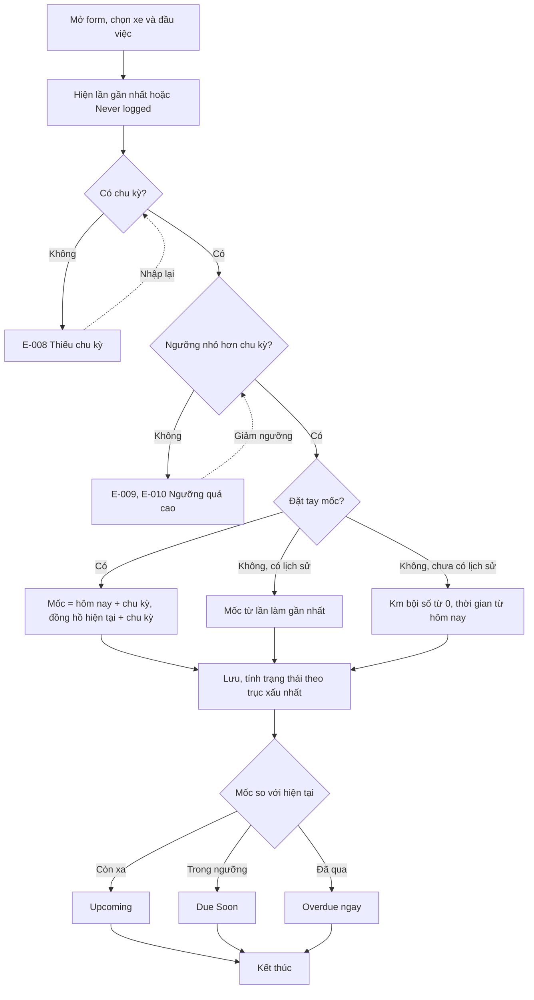

**Nhánh đảo ngược:** sửa chu kỳ tính lại ngay, không hiện ở tab History nhưng có ở Record History; đặt tay hạn cũ không bị chặn, Overdue ngay; xoá chưa bấm.

## Flow 2: Số đồng hồ đổi, nhắc đổi trạng thái (`Chạy`)

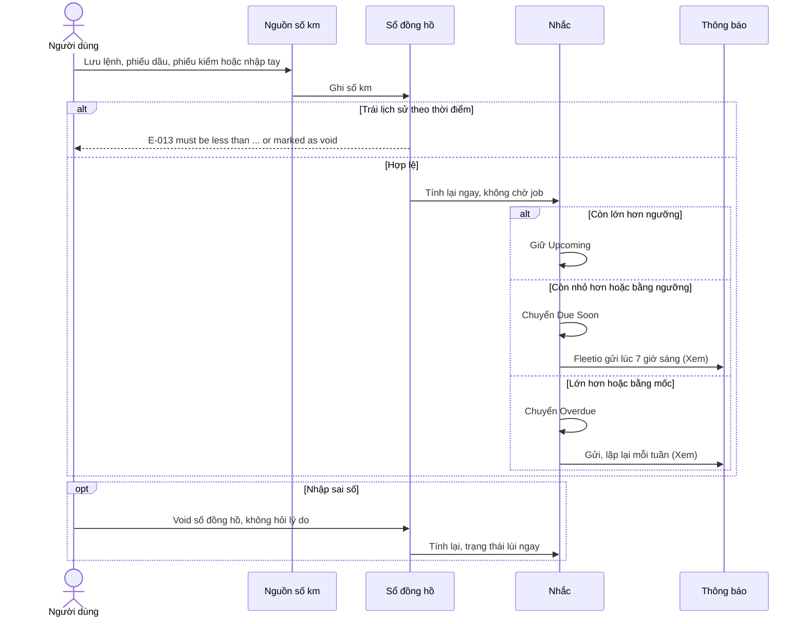

**Nhánh lỗi:** lệch múi giờ thiết bị và tài khoản làm số đúng bị E-013 (`Chạy`).

## Flow 3: Tạm hoãn và huỷ hoãn (`Chạy`)

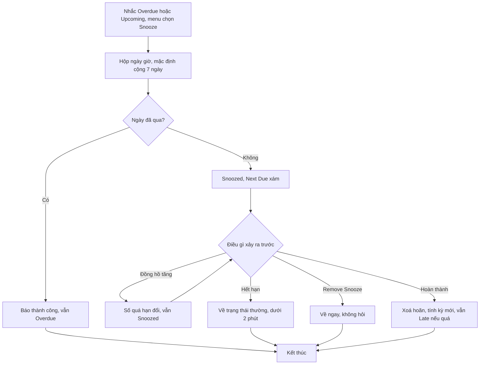

**Không có:** ô lý do, mức chọn sẵn, cảnh báo ngày đã qua. Hoãn từ Due Soon chưa bấm trực tiếp. Mỗi lần hoãn, bỏ hoãn ghi Record History.

## Flow 4: Đóng nhắc bằng lệnh sửa chữa (`Chạy`)

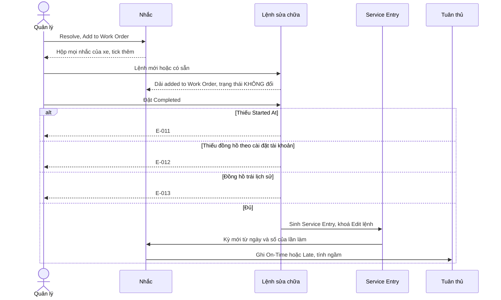

**Nhánh đảo ngược:** lệnh đã Completed khoá Edit; mở lại xem nhóm Sửa chữa. Draft Work Order xem Flow 11.

## Flow 5: Đóng nhắc bằng phiếu dịch vụ (`Chạy`)

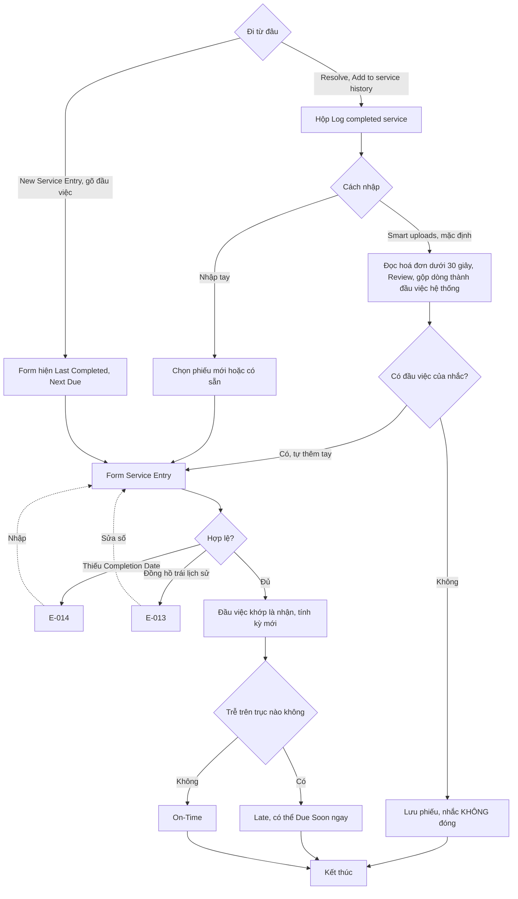

**Nhánh đảo ngược:** Discard bỏ kết quả đọc. "Add to Service Entry" chỉ đổ vào form, phải Save lần nữa. Xem thêm khối Assessment sau lưu: FR-049.

## Flow 6: Áp và sửa bộ lịch (`Chạy`, phần nhân đôi là `Docs`)

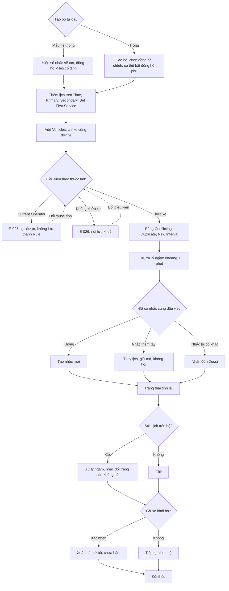

**Nhánh đảo ngược:** không có hoàn tác khi áp bộ (`Docs`). Gỡ xe chỉ có Delete, chưa bấm (OQ-12). Ô Rule khoá khi còn Sample Data (E-029) nên xe mới tự vào chưa chạy (OQ-21); lần gán chỉ là gán một lần theo kết quả lọc. Sau khi gán, đầu việc của bộ xám ở form nhắc lẻ của xe.

## Flow 7: Gia hạn giấy tờ (`Chạy`)

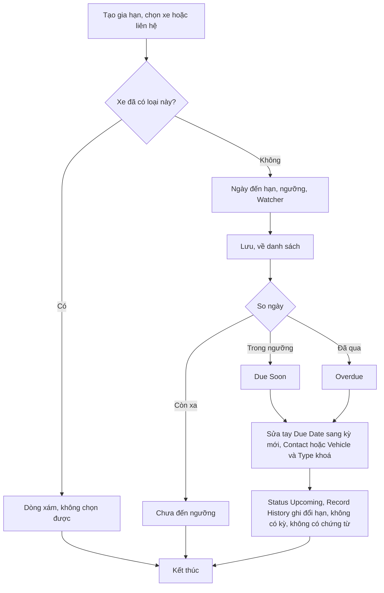

**Không có:** Resolve, tab History, tải giấy tờ mới. **Nhánh đảo ngược:** sửa ngày lại lần nữa; lịch sử đổi xem ở Record History.

## Flow 8: Dựng và gán biểu mẫu (`Chạy`)

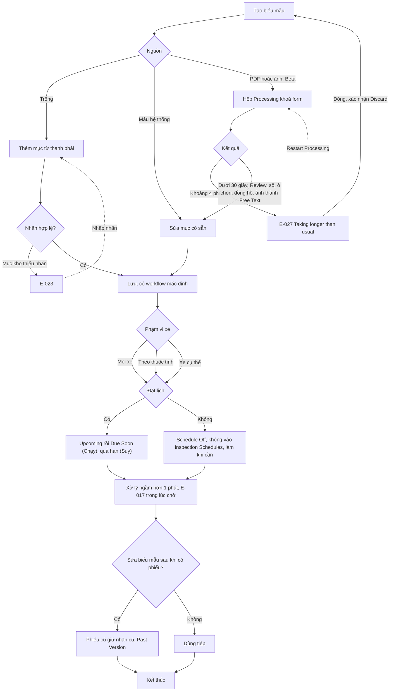

## Flow 9: Làm và nộp phiếu (`Chạy`; vị trí `Chạy (vị trí giả lập)`)

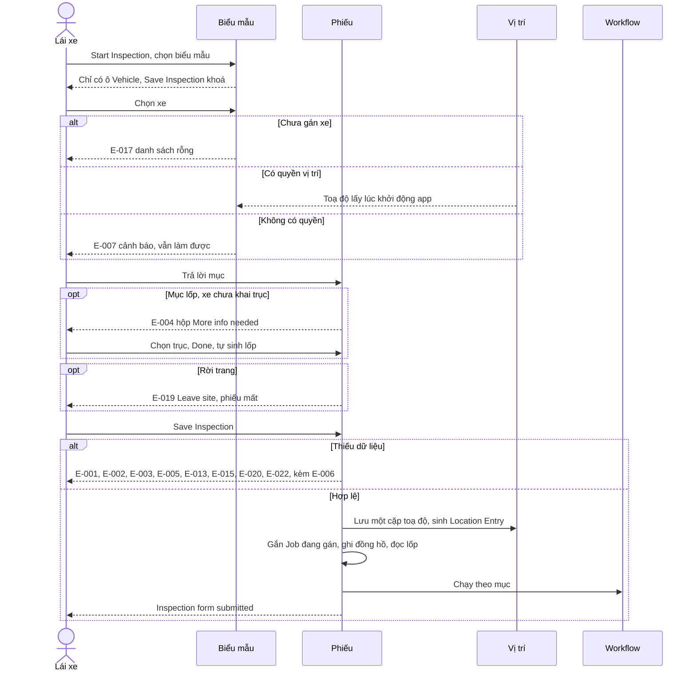

**Nhánh đảo ngược:** phiếu đã nộp không sửa, chỉ Delete (chưa bấm). **Không có:** nháp, phát hiện toạ độ giả, Location Exception trên web. Ảnh trên phiếu xem Flow 13, workflow khi nộp xem Flow 14, vị trí xem Flow 15.

## Flow 10: Xử lý mục lỗi (`Chạy`)

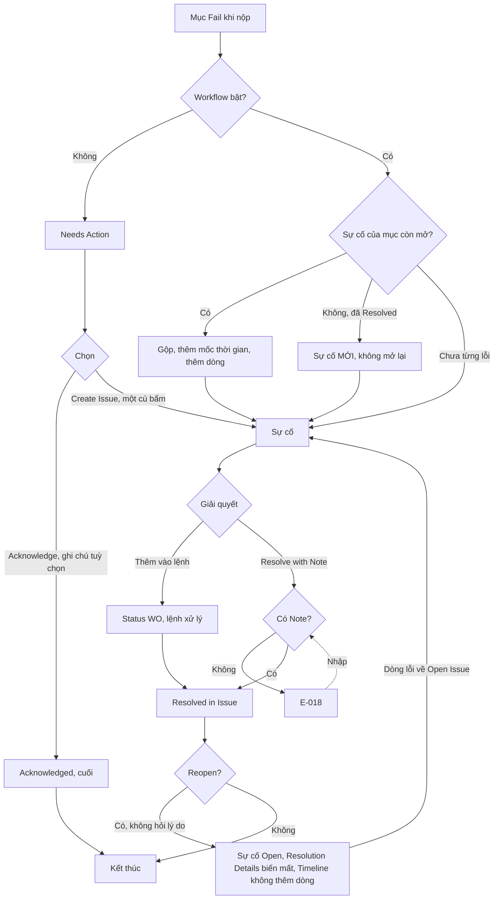

**Không có:** đạt lại tự đóng sự cố; câu hỏi xác nhận lại trên web; đường quay lại từ Acknowledged; lý do khi Reopen. Reopen có vào Record History của sự cố không: chưa mở (OQ-18).

## Flow 11: Bản nháp lệnh bằng AI (`Chạy` đến Discard; Add to là `Xem`)

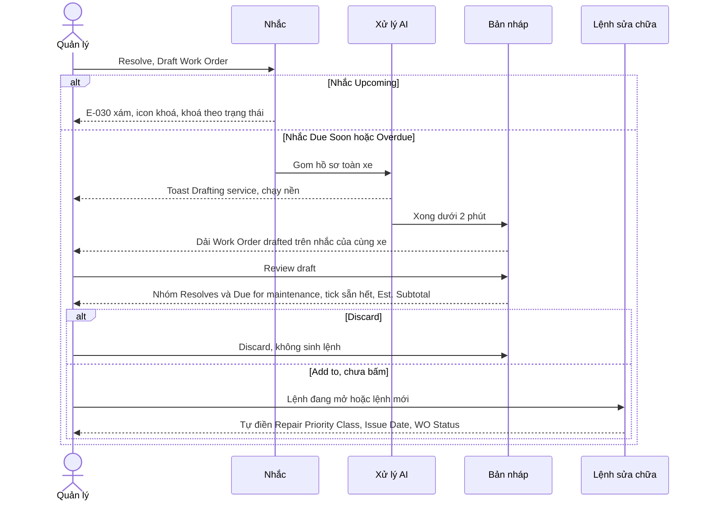

**Nhánh đảo ngược:** Discard là bỏ hết; bỏ tick từng dòng có "Clear all" trên hộp. Thêm việc Upcoming vào lệnh rồi hoàn thành sẽ mất phần còn lại của chu kỳ (`Suy`).

## Flow 12: Ghi tuân thủ từng lần (`Chạy`)

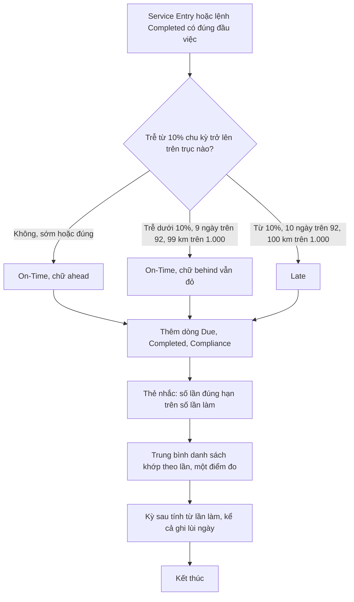

**Nhánh đảo ngược:** Void số đồng hồ làm trạng thái lùi; xoá Service Entry chưa thử.

## Flow 13: Ảnh trên phiếu (`Chạy`; chụp webcam thật chưa chạy)

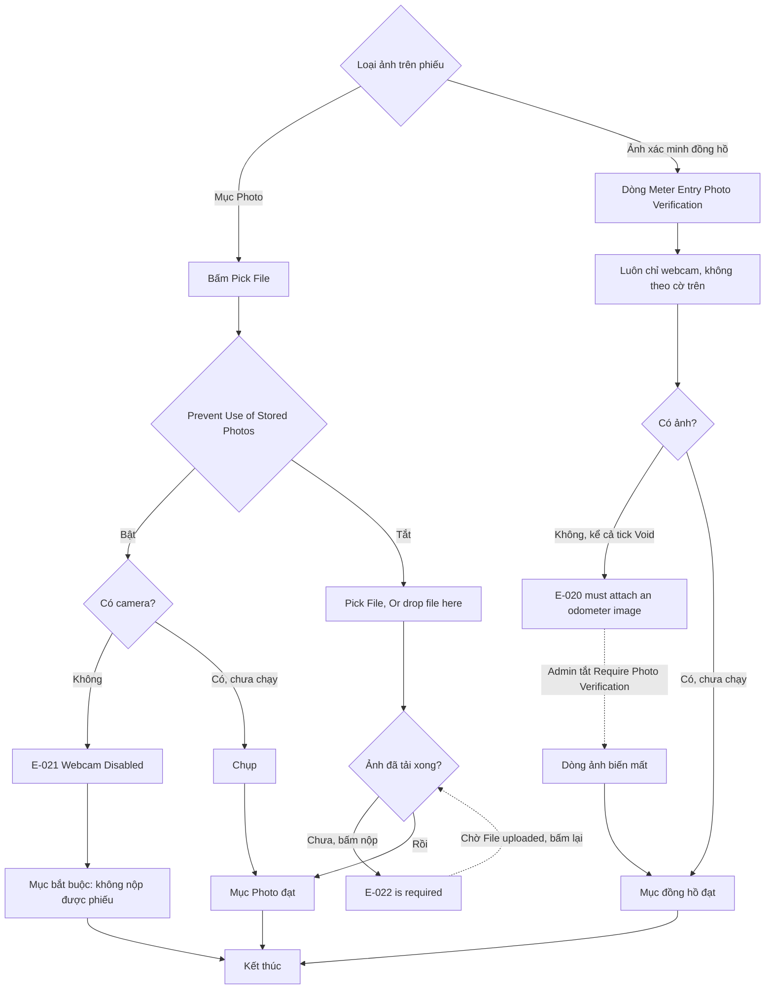

**Nhánh đảo ngược:** đổi cờ trên biểu mẫu áp ngay cho lần làm phiếu sau; không có đường bỏ qua cho từng phiếu.

## Flow 14: Workflow khi nộp phiếu (`Chạy` cho form submitted, trigger đạt, lỗi, mục lỗi tạo sự cố)

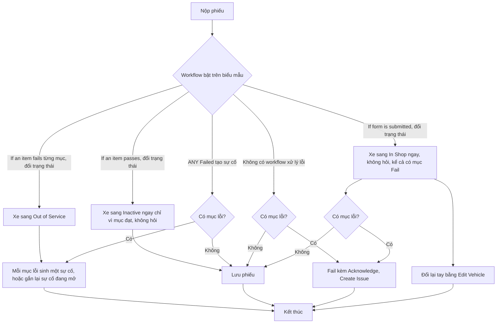

**Nhánh đảo ngược:** workflow không tự đổi trạng thái xe về; phải sửa tay, bằng Edit Vehicle hoặc ô trạng thái đầu trang (`Chạy`). Chưa chạy Send an email, Assign user (OQ-15). Không có action tạo lệnh. Trạng thái xe không chặn làm phiếu.

## Flow 15: Vị trí và Location Exception (`Chạy (vị trí giả lập)` trên web; `Chạy (Fleetio Go)` một ca)

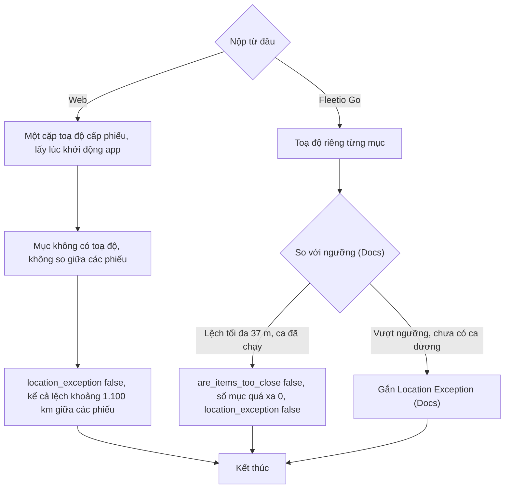

**Không có:** phát hiện toạ độ giả trên web. Tắt định vị trên app chưa thử (OQ-7).

## Flow 16: Giao dịch vụ thuê ngoài (`Chạy` đến Confirm)

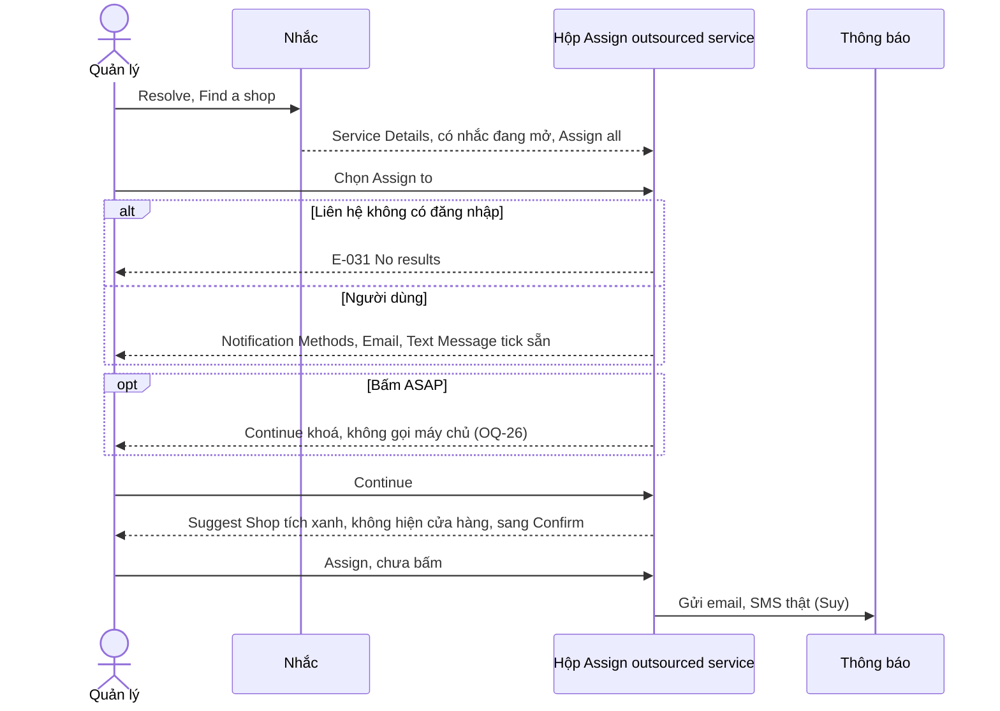

**Nhánh đảo ngược:** Back ở Confirm, hoặc đóng hộp, không sinh gì (`Chạy`).

## Flow 17: Trừ kho từ phiếu (`Chạy`)

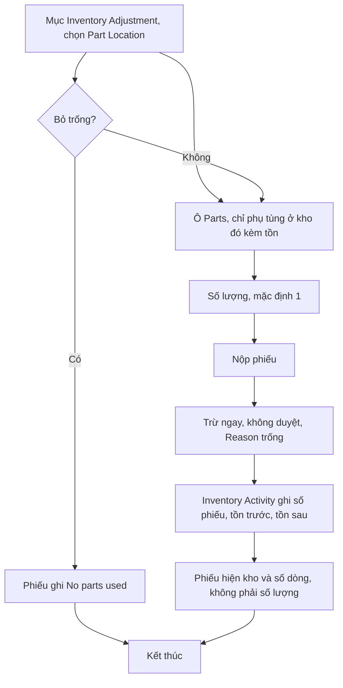

**Nhánh đảo ngược:** phiếu không sửa được; hoàn kho qua Adjust Inventory tay là `Suy`, chưa thử.

## Flow 18: Bật và đọc dự báo (`Chạy`; usage tự tính thật, đồng hồ phụ, thông báo chưa đo)

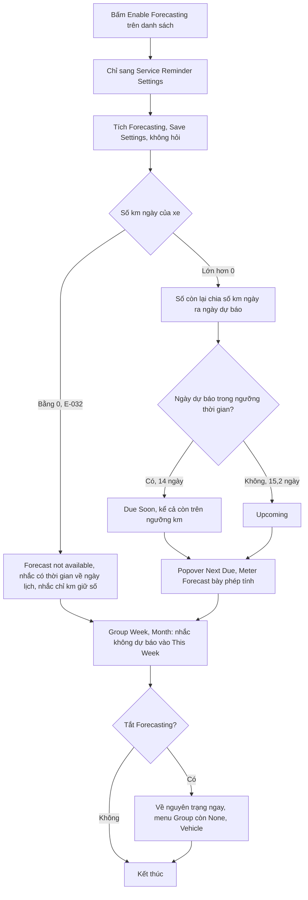

**Nhánh đảo ngược:** tắt ô Forecasting; xe tick lại tự tính thì đọc lại mới về số tự tính. **Chưa giải thích:** OQ-28 đến OQ-31.
