# Nhắc và kiểm tra — Màn hình thật

Ảnh chụp từ tài khoản dùng thử ngày 02/11/2026 và 03/11/2026, dùng nội bộ để phân tích. Màn không có ảnh ghi rõ "Chưa có ảnh", bảng lấy từ ghi chú chạy.

## 1.1 Danh sách nhắc bảo dưỡng

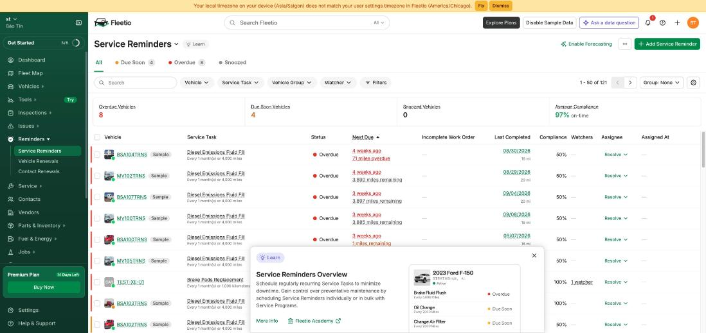

| # | Items | Control type | Data type | Description |
|---|---|---|---|---|
| 1 | Tab All, Due Soon, Overdue, Snoozed | Tab | Số | Due Soon, Overdue có số; All, Snoozed không |
| 2 | Thẻ Overdue Vehicles, Due Soon Vehicles, Snoozed Vehicles, Average Compliance | Thẻ | Số, % | Đếm theo xe, không theo nhắc |
| 3 | Vehicle, Service Task | Cột | Chữ | Dưới đầu việc ghi chu kỳ "Every 1 month(s) or 4,000 miles" |
| 4 | Status | Cột | Badge | Overdue đỏ, Due Soon cam, thanh màu mép dòng |
| 5 | Next Due | Cột | 2 dòng | Thời gian và số km còn hoặc quá; phần đang gây quá hạn tô đỏ |
| 6 | Incomplete Work Order | Cột | Liên kết | Lệnh đang xử lý nhắc |
| 7 | Last Completed, Compliance | Cột | Ngày, % | — |
| 8 | Watchers, Assignee, Assigned At | Cột | Người, ngày | Giao cho người |
| 8b | Add Service Reminder | Nút | — | Góc phải trên |
| 9 | Resolve | Menu dòng | — | Mở các cách xử lý ngay trên dòng |
| 10 | Enable Forecasting, Group | Nút | — | Bật dự báo, nhóm theo xe |

## 1.4 Form nhắc

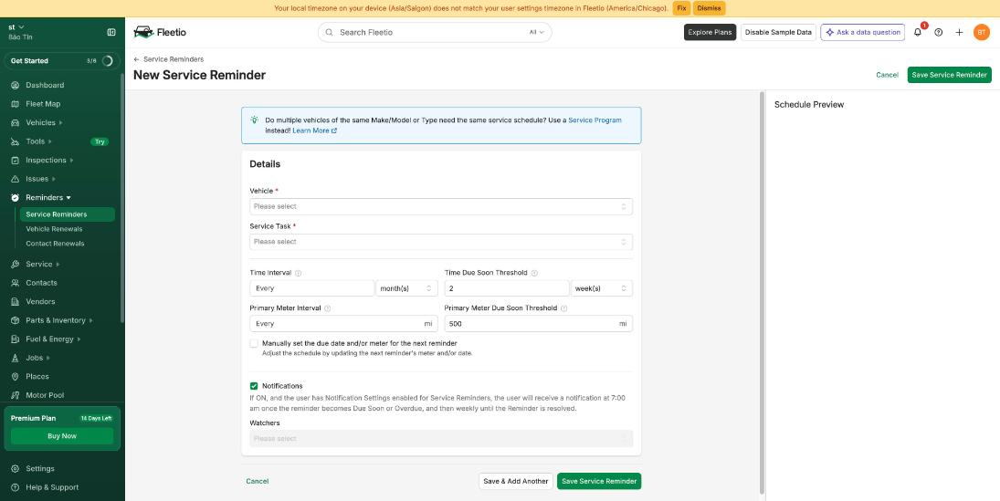

| # | Items | Control type | Data type | Description |
|---|---|---|---|---|
| 1 | Dải gợi ý | Chữ | — | Nhiều xe cùng lịch thì dùng Service Program |
| 2 | Vehicle, Service Task | Chọn | Bắt buộc | Chọn xong hiện lần hoàn thành gần nhất |
| 3 | Time Interval, Time Due Soon Threshold | Số, đơn vị | — | Mặc định ngưỡng 2 tuần |
| 4 | Primary Meter Interval, Due Soon Threshold | Số | — | Mặc định ngưỡng 500; đơn vị theo xe |
| 5 | Manually set the due date and/or meter | Tick | — | Đặt tay kỳ tới |
| 6 | Notifications, Watchers | Tick, chọn | — | 7 giờ sáng rồi mỗi tuần |
| 7 | Schedule Preview | Bảng | Ngày, số | 5 kỳ tới, khi đủ dữ liệu |

## 1.2 Form bộ lịch

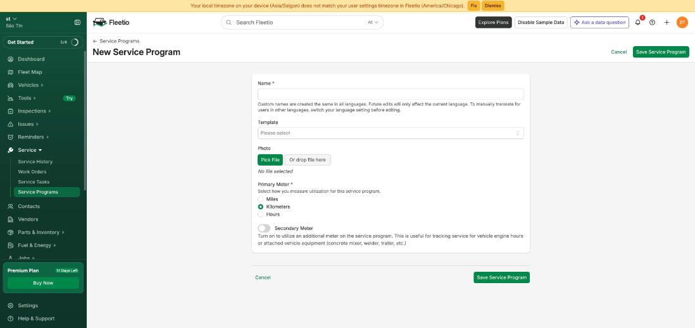

| # | Items | Control type | Data type | Description |
|---|---|---|---|---|
| 1 | Name | Chữ | Bắt buộc | Tên tuỳ biến theo ngôn ngữ |
| 2 | Template | Chọn | — | Mẫu có sẵn |
| 3 | Photo | Tải | Ảnh | — |
| 4 | Primary Meter | Chọn một | Bắt buộc | Miles, Kilometers, Hours |
| 5 | Secondary Meter | Bật tắt | — | Theo dõi thêm giờ máy, thiết bị kèm |

## 1.3 Danh sách gia hạn

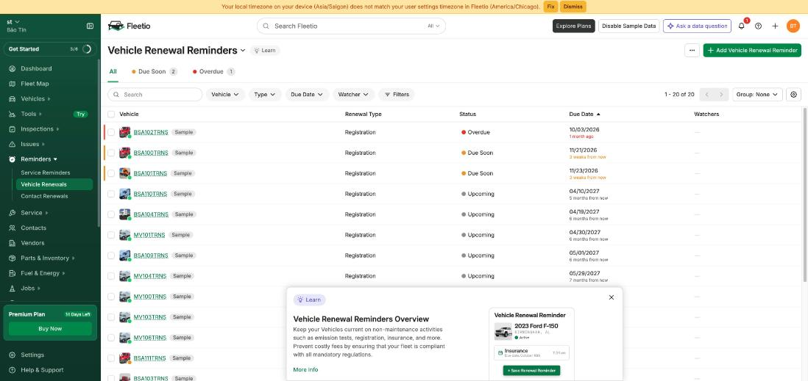

| # | Items | Control type | Data type | Description |
|---|---|---|---|---|
| 1 | Tab All, Due Soon, Overdue | Tab đếm | Số | — |
| 2 | Vehicle, Renewal Type | Cột | Chữ | Loại có sẵn: Emission Test, Inspection, Insurance, Registration; thêm loại mới chưa thử |
| 3 | Status, Due Date | Cột | Badge, ngày | Kèm "3 weeks from now", "1 month ago" |
| 4 | Watchers | Cột | Người | — |

## 2.1 Chi tiết biểu mẫu

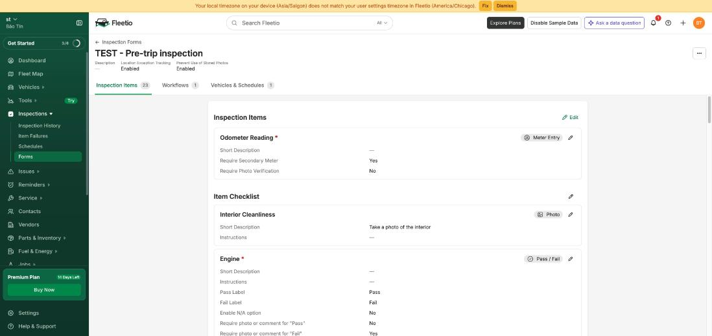

| # | Items | Control type | Data type | Description |
|---|---|---|---|---|
| 1 | Đầu trang | Chữ | — | Description, Location Exception Tracking, Prevent Use of Stored Photos |
| 2 | Tab Inspection Items, Workflows, Vehicles & Schedules | Tab đếm | Số | — |
| 3 | Thẻ từng mục | Khối | — | Đọc được luật: nhãn, N/A, bắt ảnh hoặc ghi chú |

## 2.2 Dựng mục

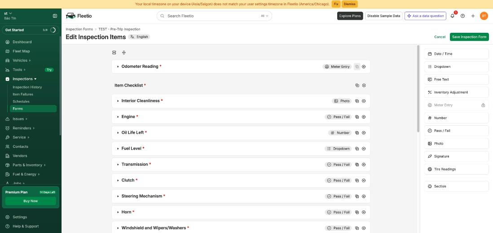

| # | Items | Control type | Data type | Description |
|---|---|---|---|---|
| 1 | Danh sách mục | Kéo thả | — | Mở rộng để sửa; nhân bản, xoá; có nhóm |
| 2 | Thanh phải | Nút | — | 10 loại mục và Section; Meter Entry khoá khi đã có; bấm panel thêm mục, ô label tự focus |
| 3 | Ngôn ngữ | Nhãn | — | Sửa theo ngôn ngữ đang chọn |

## 2.3 Trang phiếu

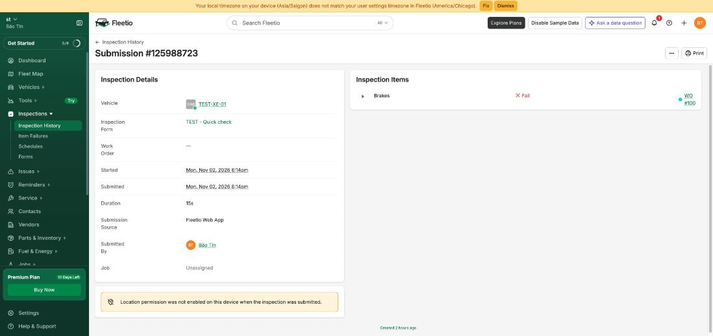

| # | Items | Control type | Data type | Description |
|---|---|---|---|---|
| 1 | Inspection Details | Khối | — | Xe, biểu mẫu, Work Order, Started, Submitted, Duration, Source, Submitted By, Job |
| 2 | Cảnh báo vị trí | Dải | — | "Location permission was not enabled on this device when the inspection was submitted." |
| 3 | Inspection Items | Khối | — | Kết quả, liên kết lệnh hoặc sự cố |
| 4 | Print | Nút | — | In phiếu |

## 2.4 Item Failures

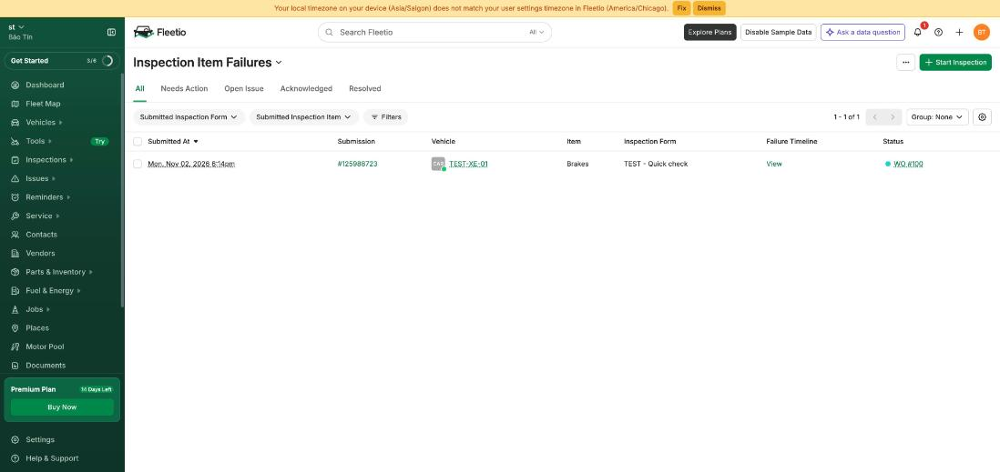

| # | Items | Control type | Data type | Description |
|---|---|---|---|---|
| 1 | Tab All, Needs Action, Open Issue, Acknowledged, Resolved | Tab | — | — |
| 2 | Cột | Bảng | — | Submitted At, Submission, Vehicle, Item, Form, Failure Timeline, Status |
| 3 | Status | Liên kết | — | Trỏ sự cố hoặc lệnh hiện tại |

## 2.5 Lịch kiểm tra

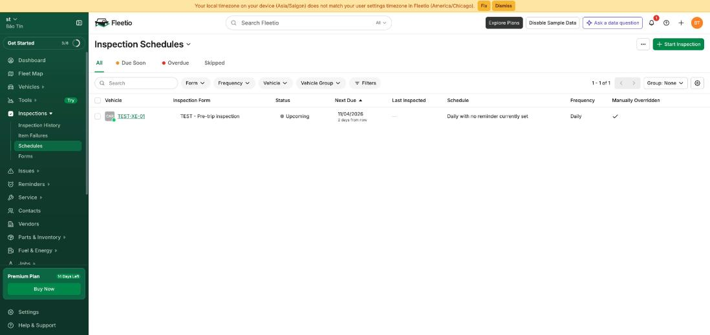

| # | Items | Control type | Data type | Description |
|---|---|---|---|---|
| 1 | Tab All, Due Soon, Overdue, Skipped | Tab | — | — |
| 2 | Cột | Bảng | — | Vehicle, Form, Status, Next Due, Last Inspected, Schedule, Frequency, Manually Overridden |
| 3 | Start Inspection | Nút | — | Bắt đầu phiếu |

## 1.5 Chi tiết nhắc

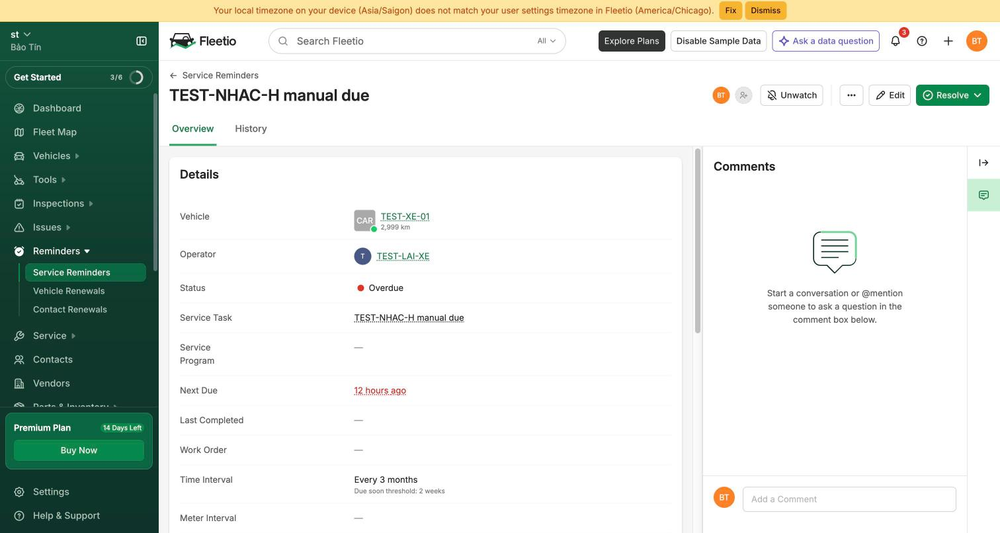

Ảnh là nhắc H, chỉ có trục thời gian, phần dưới Meter Interval bị cắt. Khối Next Due, thẻ History không có trong ảnh này; dòng 3 lấy từ ghi chú chạy trên nhắc C.

| # | Items | Control type | Data type | Description |
|---|---|---|---|---|
| 1 | Unwatch, "...", Edit, Resolve | Nút | — | Góc phải trên, kèm avatar người theo dõi. "..." có Snooze hoặc Remove Snooze, Send Notifications, View Record History, Recalculate Compliance, Delete; Resolve mở 1.9 |
| 2 | Details | Khối | — | Vehicle kèm số km 2,999, Operator lấy từ phân công xe, Status chấm đỏ Overdue, Service Task, Service Program "—", Next Due chữ đỏ "12 hours ago", Last Completed "—", Work Order "—", Time Interval "Every 3 months" kèm "Due soon threshold: 2 weeks", Meter Interval "—", Manually Set Next Due, Notifications |
| 3 | Next Due | Khối | Ngày, số | "3 months from now" kèm "1,300 kilometers overdue" |
| 4 | Tab Overview, History | Tab | — | History là lịch sử hoàn thành; sửa chu kỳ không hiện ở đây, xem 1.13 |
| 5 | Comments | Panel phải | Chữ | Rỗng: "Start a conversation or @mention someone to ask a question in the comment box below."; ô "Add a Comment" |
| 6 | Dải đầu trang | Dải | — | Cảnh báo múi giờ thiết bị khác múi giờ tài khoản, có Fix, Dismiss |

## 1.6 Chi tiết nhắc sau khi hoàn thành

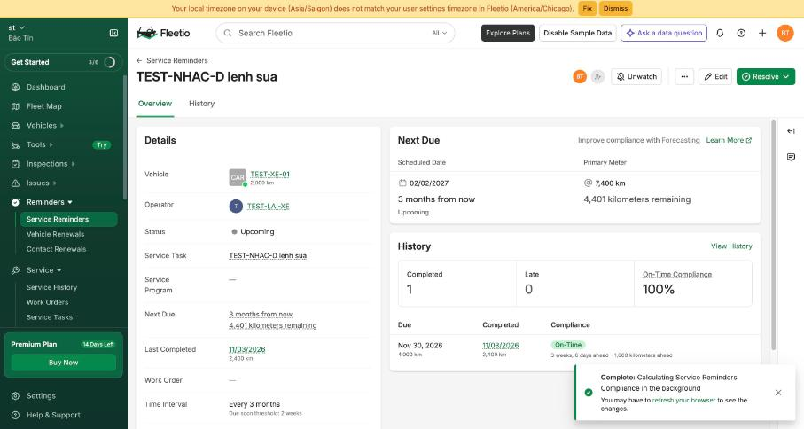

| # | Items | Control type | Data type | Description |
|---|---|---|---|---|
| 1 | Tab Overview, History | Tab | — | Overview mặc định |
| 2 | Details | Khối | — | Status Upcoming, Next Due "3 months from now", "4,401 kilometers remaining", Last Completed 11/03/2026 và 2.400 km, Work Order trống, Time Interval kèm ngưỡng |
| 3 | Next Due | Khối | Ngày, số | Scheduled Date 02/02/2027, Primary Meter 7.400 km; liên kết "Improve compliance with Forecasting" |
| 4 | History | Thẻ | Số, % | Completed 1, Late 0, On-Time Compliance 100%; liên kết View History |
| 5 | Dòng lịch sử | Bảng | — | Due Nov 30, 2026 / 4.000 km; Completed 11/03/2026 / 2.400 km; nhãn On-Time; "3 weeks, 6 days ahead · 1,600 kilometers ahead" |
| 6 | Toast | Chữ | — | "Complete: Calculating Service Reminders Compliance in the background" kèm gợi ý tải lại trang |
| 7 | Dải đầu trang | Dải | — | Cảnh báo múi giờ thiết bị khác múi giờ tài khoản, có Fix, Dismiss |

## 1.7 Danh sách nhắc kèm tuân thủ

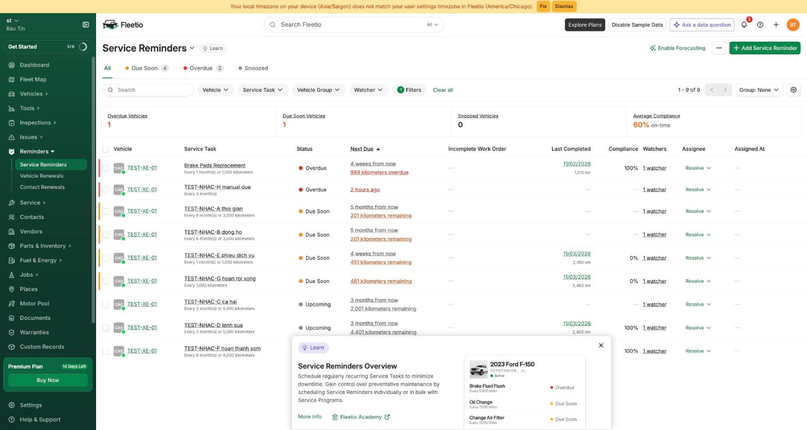

| # | Items | Control type | Data type | Description |
|---|---|---|---|---|
| 1 | Tab All, Due Soon 4, Overdue 2, Snoozed | Tab | Số | Tab có số |
| 2 | Lọc Vehicle, Service Task, Vehicle Group, Watcher, Filters | Bộ lọc | — | Đang lọc một xe; Group: None |
| 3 | Thẻ KPI | Thẻ | Số, % | Overdue Vehicles 1, Due Soon Vehicles 1, Snoozed Vehicles 0, Average Compliance 60% on-time; đếm xe, không đếm nhắc |
| 4 | Next Due | Cột | 2 dòng | Trục gây quá hạn đỏ, trục Due Soon cam |
| 5 | Compliance | Cột | % | 100%, 0%; chưa làm thì trống |
| 6 | Resolve | Nút dòng | — | Mở ngay trên dòng |

## 1.8 Hộp tạm hoãn

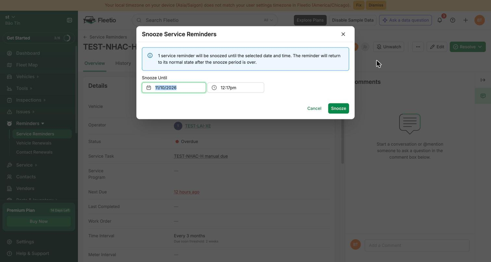

Ảnh mở trên nhắc H đang Overdue; ca Upcoming cùng hộp, ghi ở ghi chú chạy.

| # | Items | Control type | Data type | Description |
|---|---|---|---|---|
| 1 | Tiêu đề "Snooze Service Reminders" | Chữ | — | Số nhiều vì dùng chung với thao tác hàng loạt; nút đóng X |
| 2 | Câu mô tả | Dải xanh | — | "1 service reminder will be snoozed until the selected date and time. The reminder will return to its normal state after the snooze period is over." |
| 3 | Snooze Until | Ngày, giờ | Ngày giờ | Ảnh: 11/10/2026, 12:17pm. Mặc định +7 ngày, giờ theo thiết bị; không có mức chọn sẵn; ngày đã qua không bị chặn |
| 4 | Cancel, Snooze | Nút | — | Snooze xong về trang nhắc, Status "Snoozed" |
| 5 | Lý do | — | — | Không có ô này |

## 1.9 Hộp giải quyết nhắc

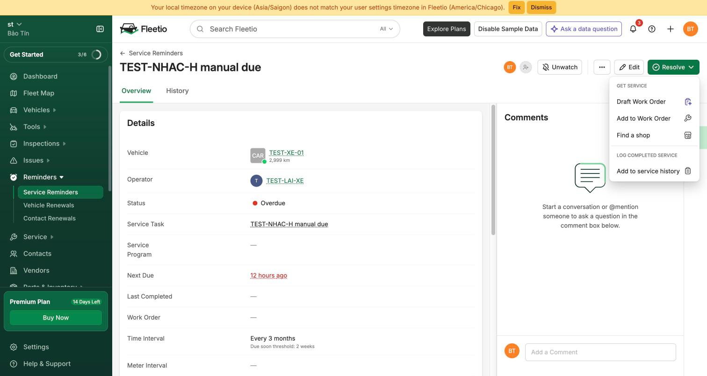

Ảnh là menu Resolve mở trên nhắc H Overdue. Hai hộp con ở dòng 3, 4 không có ảnh, lấy từ ghi chú chạy. Icon cạnh Draft Work Order trong ảnh không phải icon khoá; trạng thái khoá ở dòng 5 chỉ có trên nhắc Upcoming.

| # | Items | Control type | Data type | Description |
|---|---|---|---|---|
| 1 | Nhóm GET SERVICE | Menu | — | Draft Work Order, Add to Work Order, Find a shop |
| 2 | Nhóm LOG COMPLETED SERVICE | Menu | — | Add to service history |
| 3 | Add to Work Order | Hộp | — | Liệt kê mọi nhắc của xe để tick thêm: "1 Service Reminder will be added", "Show 1 more"; "Add to New Work Order" hoặc "Add to Existing Work Order" |
| 4 | Add to service history | Hộp | — | "Log completed service": "Manually add to service entry" hoặc "Smart uploads" (mặc định); sau đó New hoặc Existing |
| 5 | Draft Work Order | Mục | — | Khoá theo trạng thái nhắc, không theo gói. Nhắc Overdue: bấm được, toast "Drafting service", xem 1.12. Nhắc Upcoming: xám, icon khoá, E-fleetio-reminders-inspection-030 |
| 6 | Find a shop | Mục | — | Mở 1.18 |

## 1.10 Gán xe vào bộ lịch

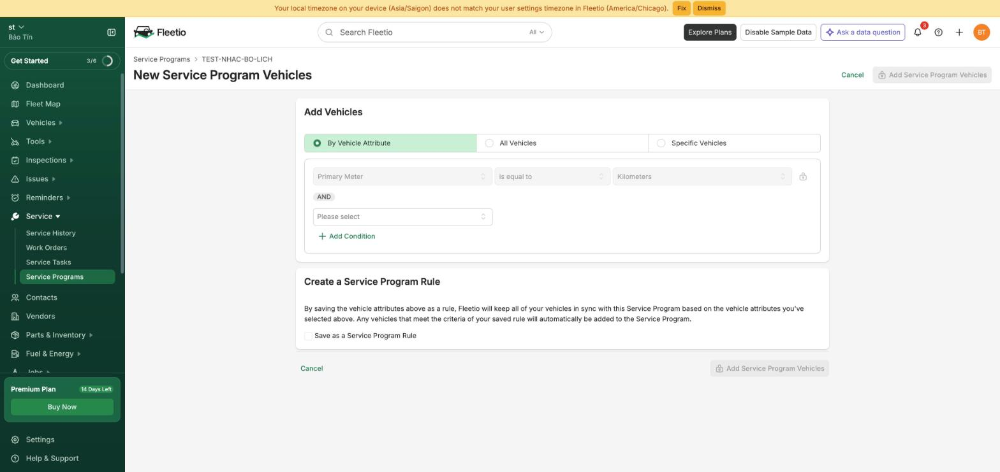

Ảnh ở trạng thái chưa khớp xe: chưa có câu tóm tắt, bảng đối chiếu; dòng 5, 6 lấy từ ghi chú chạy. Cảnh báo E-fleetio-reminders-inspection-025 không có trong ảnh.

| # | Items | Control type | Data type | Description |
|---|---|---|---|---|
| 1 | By Vehicle Attribute, All Vehicles, Specific Vehicles | Chọn một | — | Tiêu đề "New Service Program Vehicles"; ô chọn xe loại xe khác đơn vị |
| 2 | Điều kiện đầu | Dòng khoá | — | "Primary Meter" "is equal to" "Kilometers", xám, icon khoá |
| 3 | Điều kiện thêm | Chọn | — | Nhãn AND, "Please select"; "Add Condition". 28 thuộc tính; Current Operator báo E-fleetio-reminders-inspection-025 |
| 4 | Create a Service Program Rule | Khối, tick | — | "By saving the vehicle attributes above as a rule, Fleetio will keep all of your vehicles in sync with this Service Program based on the vehicle attributes you've selected above. Any vehicles that meet the criteria of your saved rule will automatically be added to the Service Program."; "Save as a Service Program Rule" mờ khi Specific Vehicles; khoá khi còn Sample Data, bấm không tick, E-fleetio-reminders-inspection-029. Ảnh không thể hiện lý do khoá vì tooltip chỉ hiện khi rê |
| 5 | Câu tóm tắt | Chữ | — | "1 Vehicle will receive 2 Service Reminders based on the intervals below. Any conflicting individual Service Reminders will be replaced by the schedule from the Service Program." |
| 6 | Bảng đối chiếu | Bảng | — | Service Task, Conflicting, Duplicate, New Interval |
| 7 | Cancel, Add Service Program Vehicles | Nút | — | Hiện ở đầu và cuối trang; icon khoá khi không khớp xe, tooltip E-fleetio-reminders-inspection-026 |

## 1.11 Thêm nhắc gia hạn

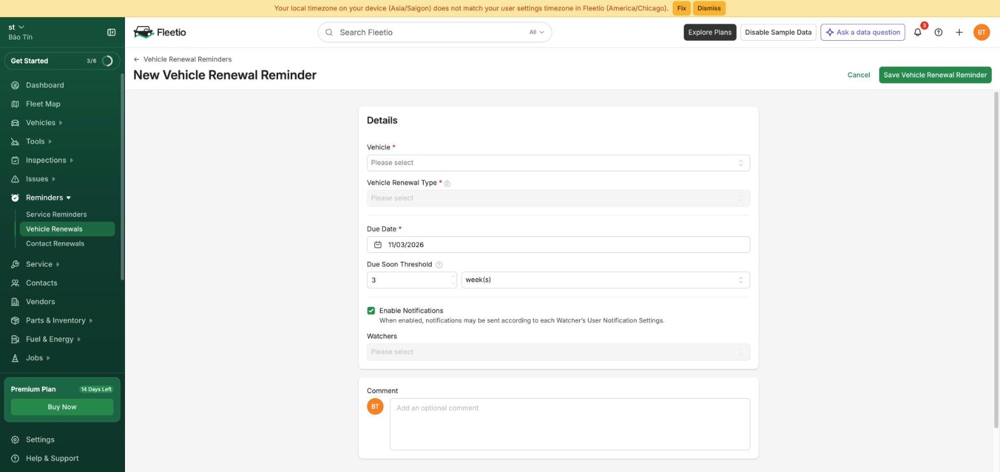

Ảnh là "New Vehicle Renewal Reminder". Form liên hệ chưa có ảnh riêng.

| # | Items | Control type | Data type | Description |
|---|---|---|---|---|
| 1 | Vehicle hoặc Contact | Chọn | Bắt buộc | "Please select"; chọn xe xong Watchers tự điền; Edit khoá |
| 2 | Vehicle Renewal Type | Chọn | Bắt buộc | Xám, icon khoá tới khi chọn xe; loại đã có hiện xám "the selected vehicle already has a reminder of this type"; Edit khoá |
| 3 | Due Date | Ngày | Bắt buộc | Mặc định hôm nay (ảnh: 11/03/2026) |
| 4 | Due Soon Threshold | Số, đơn vị | — | Fleetio: xe 3 tuần (ảnh "3", "week(s)"), liên hệ 3 tuần |
| 5 | Enable Notifications | Tick | — | Bật sẵn; "When enabled, notifications may be sent according to each Watcher's User Notification Settings." |
| 6 | Watchers | Chọn | — | Xám tới khi chọn xe |
| 7 | Comment | Ô chữ | — | "Add an optional comment" |
| 8 | Cancel, Save Vehicle Renewal Reminder | Nút | — | Lưu xong về danh sách |

## 2.6 Form làm phiếu

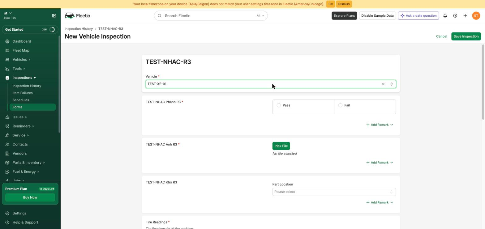

Ảnh là biểu mẫu TEST-NHAC-R3 ngay sau khi chọn xe, phần dưới Tire Readings bị cắt; Tire Readings, Meter Entry không đọc được từ ảnh, lấy từ ghi chú chạy. Trạng thái lỗi lốp ở 2.7, 2.8.

| # | Items | Control type | Data type | Description |
|---|---|---|---|---|
| 1 | Chọn biểu mẫu, xe | Chọn | Bắt buộc | Start Inspection mở Select Inspection Form, nhóm MOST USED, ALL. Chưa chọn xe: chỉ có ô Vehicle, Save Inspection khoá. Biểu mẫu chưa gán xe: "No options", E-fleetio-reminders-inspection-017 |
| 2 | Các mục | Theo loại | — | Ảnh có Pass/Fail "TEST-NHAC Phanh R3", dấu đỏ bắt buộc. Lỗi ở nhãn và ô: E-fleetio-reminders-inspection-001, 002, 003, 015, 020, 022 |
| 3 | Photo | Nút | Bắt buộc | "Pick File", "No file selected". Cờ cấm ảnh bật: mở 2.17. Cờ tắt: thêm "Or drop file here", xem trước, "File uploaded: ..." |
| 4 | Inventory Adjustment | Chọn | Tuỳ chọn | Không có dấu bắt buộc. "Part Location" "Please select"; chọn kho mới hiện "Search and add parts...", chỉ phụ tùng có ở kho đó kèm tồn; để trống phiếu ghi "No parts used" |
| 5 | Tire Readings | Bảng ô | Bắt buộc | "Tire Readings for all tire positions"; LF, LR, RR, RF, mỗi vị trí Tread Depth (/32 in), Pressure (PSI) |
| 6 | Meter Entry | Số | Bắt buộc | "Last updated: 2,999 km (Today)", Void; Require Photo Verification thêm dòng ảnh luôn webcam; xe không có đồng hồ phụ thì chỉ hiện Primary Meter |
| 7 | Add Remark | Nút | — | "Add Comment", "Add Photo"; chỉ lưu khi gõ vào ô Comment |
| 8 | Chữ ký | Chữ | — | Nhập text "Type your name", vẽ thành nét chữ; không có ở biểu mẫu trong ảnh |
| 9 | Save Inspection, Cancel | Nút | — | Không có lưu nháp; toast E-fleetio-reminders-inspection-006; rời trang E-fleetio-reminders-inspection-019 |

## 2.7 Phiếu thiếu cấu hình trục

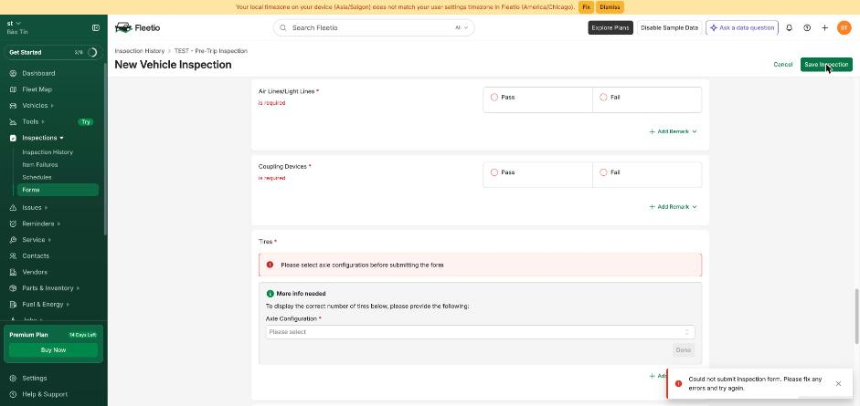

| # | Items | Control type | Data type | Description |
|---|---|---|---|---|
| 1 | Hộp lỗi đỏ | Chữ | — | "Please select axle configuration before submitting the form", kèm E-fleetio-reminders-inspection-006 |
| 2 | More info needed | Khối | — | "To display the correct number of tires below, please provide the following:" |
| 3 | Axle Configuration, Done | Chọn, nút | — | Khai ngay trong phiếu; Done sinh ô gai, áp suất và lốp cho từng vị trí |

## 2.8 Phiếu lốp bắt nhận xét

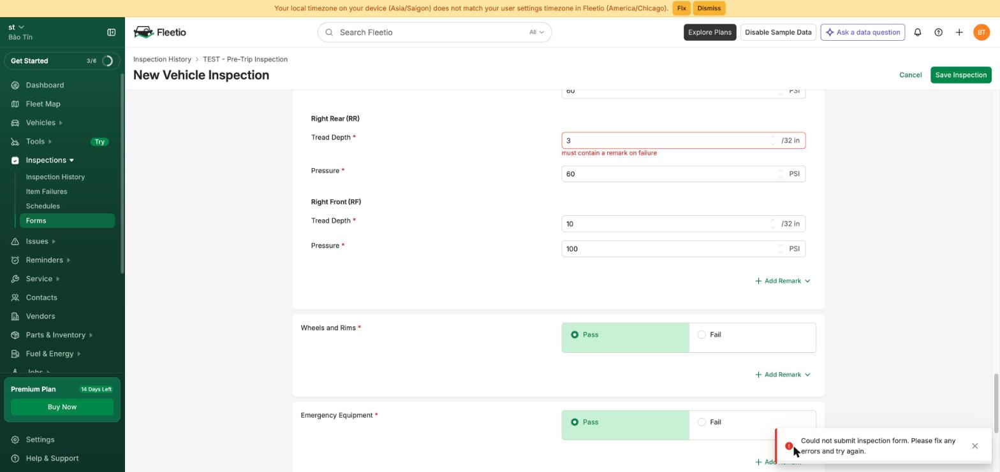

| # | Items | Control type | Data type | Description |
|---|---|---|---|---|
| 1 | Ô gai từng vị trí | Số | Bắt buộc | Theo cấu hình trục |
| 2 | Lỗi | Chữ | — | "must contain a remark on failure" khi dưới mức của biểu mẫu |

## 2.9 Phiếu lốp không đạt, tổng

| # | Items | Control type | Data type | Description |
|---|---|---|---|---|
| 1 | Submission | Khối | — | Thông tin phiếu |
| 2 | Dòng Tire Readings | Dòng | — | Một chữ "Fail", không tách vị trí ở dòng tổng |
| 3 | Issue #41 | Liên kết | — | Một sự cố cho nhiều lốp; "Added to Issue #41 (1 time reported)" |

## 2.10 Phiếu lốp không đạt, từng vị trí

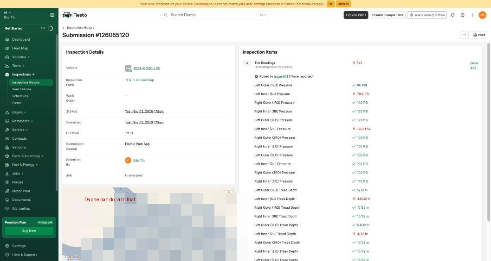

| # | Items | Control type | Data type | Description |
|---|---|---|---|---|
| 1 | Dòng từng vị trí | Mở rộng | — | Dấu tích hoặc X cho gai, áp suất; đi vòng trái rồi phải; không có Spare |

## 2.11 Phiếu có bản đồ vị trí

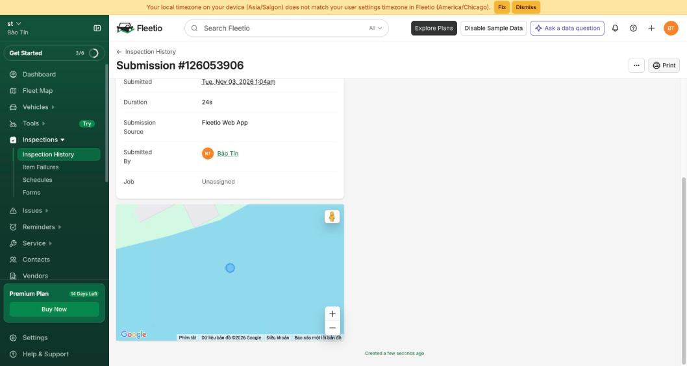

| # | Items | Control type | Data type | Description |
|---|---|---|---|---|
| 1 | Submitted, Duration, Submission Source, Submitted By, Job | Khối | — | "Fleetio Web App"; Job "Unassigned" khi xe không có việc |
| 2 | Bản đồ nhỏ | Bản đồ | — | Chấm xanh tại vị trí; ảnh dùng toạ độ giả lập |
| 3 | "...", Print | Nút | — | "..." chỉ có Delete |

## 2.12 Phiếu đủ mục, vị trí giả lập

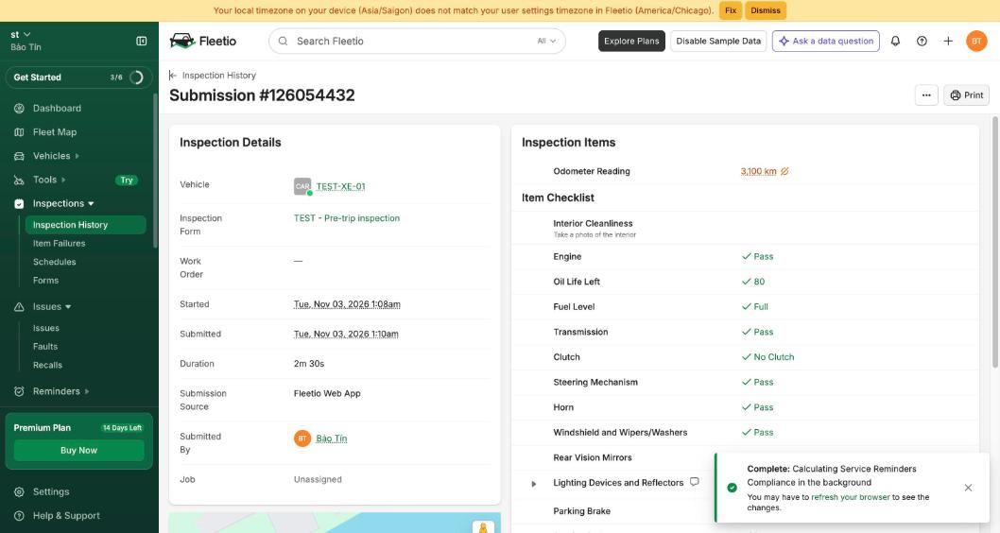

| # | Items | Control type | Data type | Description |
|---|---|---|---|---|
| 1 | Inspection Details | Khối | — | Vehicle, Inspection Form, Work Order, Started, Submitted, Duration, Submission Source, Submitted By, Job |
| 2 | Inspection Items | Khối | — | Odometer Reading, Item Checklist với kết quả Pass, số, nhãn lựa chọn |
| 3 | Location Exception | — | — | Không hiện cờ; `location_exception` false dù biểu mẫu bật |

## 2.13 Mục lỗi cần xử lý

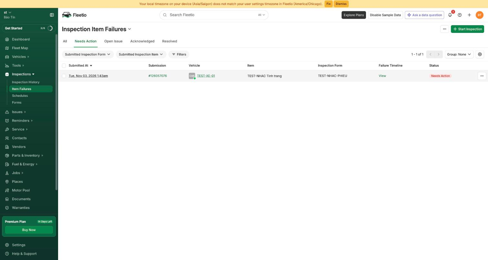

| # | Items | Control type | Data type | Description |
|---|---|---|---|---|
| 1 | Tab All, Needs Action, Open Issue, Acknowledged, Resolved | Tab | — | Đang ở Needs Action |
| 2 | Lọc Submitted Inspection Form, Submitted Inspection Item, Filters | Bộ lọc | — | — |
| 3 | Cột | Bảng | — | Submitted At, Submission, Vehicle, Item, Inspection Form, Failure Timeline (View), Status |
| 4 | Status | Nhãn | — | "Needs Action" đỏ; chỉ ra khi workflow tắt |
| 5 | Row menu "..." | Menu | — | Acknowledge, Create Issue, View Failure Timeline |

## 2.14 Thêm workflow

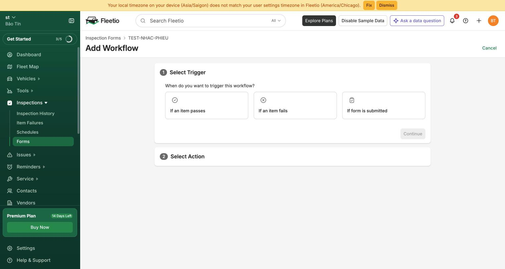

Ảnh chỉ có bước 1 trên biểu mẫu TEST-NHAC-PHIEU; dòng 3 đến 5 không có trong ảnh, lấy từ ghi chú chạy.

| # | Items | Control type | Data type | Description |
|---|---|---|---|---|
| 1 | Select Trigger | Thẻ chọn một | — | "When do you want to trigger this workflow?": If an item passes, If an item fails, If form is submitted |
| 2 | Continue, Cancel | Nút | — | Continue khoá tới khi chọn trigger; Select Action thu gọn tới khi xong bước 1 |
| 3 | Which inspection item(s)? | Chọn | — | "ANY Failed Inspection Item" hoặc từng mục Pass/Fail, Number, Dropdown |
| 4 | Select Action | Chọn | — | Change vehicle status (Active, In Shop, Inactive, Out of Service, Sold), Send an email, Create an issue ("Not Available" khi đã có workflow ANY, kể cả trigger form submitted), Assign user to vehicle, Unassign user from vehicle; không có tạo lệnh |
| 5 | Description, Enable Workflow | Chữ, bật tắt | — | Description tự điền, vd "If form is submitted then change vehicle status" |

## 2.15 Xe và lịch của biểu mẫu

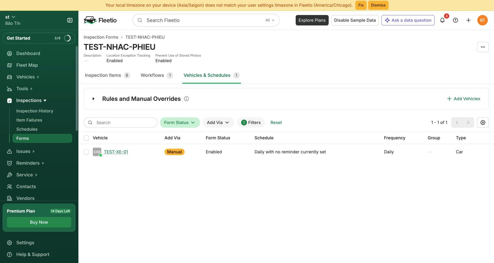

Bảng gán xe trên biểu mẫu TEST-NHAC-PHIEU. Form Add Vehicles (dòng 5, 6) không có trong ảnh, lấy từ ghi chú chạy.

| # | Items | Control type | Data type | Description |
|---|---|---|---|---|
| 1 | Đầu biểu mẫu | Chữ | — | Description, Location Exception Tracking "Enabled", Prevent Use of Stored Photos "Enabled"; nút "..." |
| 2 | Tab Inspection Items, Workflows, Vehicles & Schedules | Tab | Số | Ảnh: 8, 1, 1 |
| 3 | Rules and Manual Overrides | Khối thu gọn | — | Có nút Add Vehicles |
| 4 | Bảng xe | Bảng | — | Vehicle, Add Via "Manual", Form Status "Enabled", Schedule "Daily with no reminder currently set", Frequency "Daily", Group, Type "Car"; rỗng trong lúc xử lý ngầm hơn 1 phút. Không đặt lịch: Schedule "Off", Frequency trống. Lọc Search, Form Status, Add Via, Filters, Reset |
| 5 | All Vehicles, By Vehicle Attribute, Specific Vehicle | Chọn một | — | "This Rule enables the inspection form for ALL vehicles. The form will also be enabled for any new vehicles added to the account."; "This manual override will enable the form for specific vehicles, ignoring any rules which would otherwise apply." |
| 6 | Set Schedule, Advanced | Tick, khối | — | Mặc định Daily, Every 1 Day; bỏ tick là "as needed"; Set Delayed Start, Enable Reminder Notification, gửi theo múi giờ tài khoản |

## 1.12 Hộp xem bản nháp lệnh

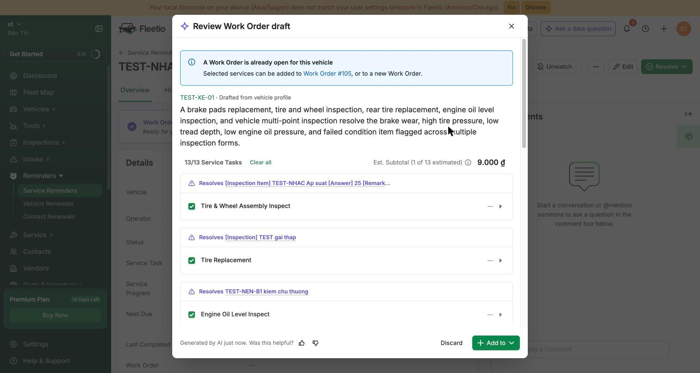

Ảnh là phần đầu hộp. Nhóm "Due for maintenance", dòng "No estimate available", "Will auto-fill when created", menu "Add to" nằm dưới phần cuộn, không đọc được từ ảnh, lấy từ ghi chú chạy.

| # | Items | Control type | Data type | Description |
|---|---|---|---|---|
| 1 | Tiêu đề "Review Work Order draft" | Chữ | — | Biểu tượng AI, nút đóng X |
| 2 | Dải lệnh đang mở | Dải xanh | — | "A Work Order is already open for this vehicle", "Selected services can be added to Work Order #105, or to a new Work Order." |
| 3 | Tóm tắt | Chữ | Tiếng Anh | Tên xe, "Drafted from vehicle profile", đoạn tóm tắt AI |
| 4 | Dòng tổng | Chữ, liên kết | Số, tiền | "13/13 Service Tasks", "Clear all", "Est. Subtotal (1 of 13 estimated)" 9.000 ₫ |
| 5 | Nhóm "Resolves ..." | Khối, tick | — | Ghép sự cố đang mở với đầu việc AI chọn: "Tire & Wheel Assembly Inspect", "Tire Replacement", "Engine Oil Level Inspect"; tick sẵn; mở rộng từng dòng |
| 6 | Nhóm "Due for maintenance" | Khối, tick | — | Nhắc Overdue, Due Soon, Upcoming, tick sẵn hết kể cả việc còn 3 tháng |
| 7 | Will auto-fill when created | Chữ | — | Repair Priority Class Non-Scheduled, Issue Date Today, WO Status Open |
| 8 | Phản hồi AI | Nút | — | "Generated by AI just now. Was this helpful?", thích, không thích |
| 9 | Discard, Add to | Nút, menu | — | Add to có lệnh đang mở hoặc lệnh mới, chưa bấm; Discard không sinh lệnh |

## 1.13 Hộp lịch sử thay đổi

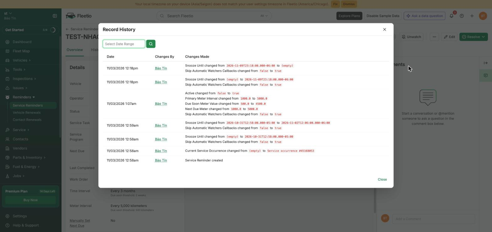

Ảnh là Record History của nhắc C. Bản gia hạn chưa có ảnh, ghi chú chạy ghi "Next Due At", "Due Soon At".

| # | Items | Control type | Data type | Description |
|---|---|---|---|---|
| 1 | Select Date Range | Ô ngày, nút tìm | Khoảng ngày | Lọc theo khoảng ngày |
| 2 | Date | Cột | Ngày giờ | Mới nhất ở trên |
| 3 | Changes By | Cột | Liên kết người | Người đổi |
| 4 | Changes Made | Cột | Chữ kỹ thuật | Từng dòng "{trường} changed from {cũ} to {mới}": Snooze Until, Skip Automatic Watchers Callbacks, Active, Primary Meter Interval, Due Soon Meter Value, Next Due Meter, Current Service Occurrence; dòng đầu "Service Reminder created". Giá trị dạng thô, kèm múi giờ |
| 5 | Close, X | Nút | — | Về trang nhắc |

## 1.14 Chi tiết nhắc nhiều lần hoàn thành

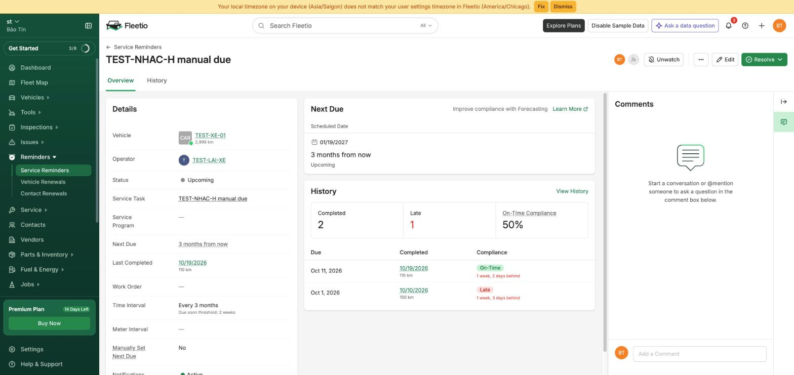

| # | Items | Control type | Data type | Description |
|---|---|---|---|---|
| 1 | Details | Khối | — | Status Upcoming, Next Due "3 months from now", Last Completed 10/19/2026 và 110 km, Time Interval kèm ngưỡng, Manually Set Next Due "No", Notifications Active |
| 2 | Next Due | Khối | Ngày | Scheduled Date 01/19/2027, "3 months from now", Upcoming; "Improve compliance with Forecasting", Learn More |
| 3 | History | Thẻ | Số, % | Completed 2, Late 1 đỏ, On-Time Compliance 50%; liên kết View History |
| 4 | Due, Completed, Compliance | Bảng | Ngày, nhãn | Oct 11, 2026; 10/19/2026, 110 km; On-Time, "1 week, 2 days behind" đỏ. Oct 1, 2026; 10/10/2026, 100 km; Late, "1 week, 3 days behind" đỏ |

## 1.15 Panel gia hạn liên hệ

Chưa có ảnh, bảng lấy từ ghi chú chạy.

| # | Items | Control type | Data type | Description |
|---|---|---|---|---|
| 1 | Tiêu đề "Contact Renewal #..." | Chữ | — | Mở khi bấm dòng trên danh sách, panel phải |
| 2 | Edit | Nút | — | Khoá Contact, Contact Renewal Type; sửa được Due Date |
| 3 | "..." | Menu | — | View, Send Notifications, View Record History, Delete; Send Notifications, Delete không bấm |
| 4 | Trang chi tiết (View) | Trang | — | Chỉ Details, Comments; không Resolve, không tab History |

## 2.16 Lịch kiểm tra sắp đến hạn

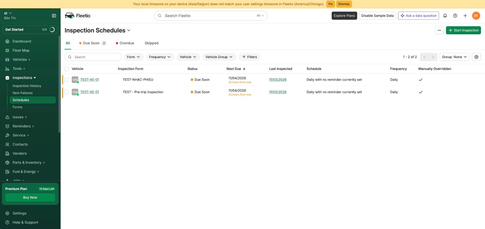

| # | Items | Control type | Data type | Description |
|---|---|---|---|---|
| 1 | Tab All, Due Soon 2, Overdue, Skipped | Tab | Số | Overdue, Skipped rỗng |
| 2 | Lọc Form, Frequency, Vehicle, Vehicle Group, Filters | Bộ lọc | — | Frequency chỉ Daily, Weekly, Monthly, Yearly; Group: None |
| 3 | Vehicle, Inspection Form | Cột | Chữ | Thanh cam mép dòng |
| 4 | Status | Cột | Badge | Chấm cam "Due Soon" |
| 5 | Next Due | Cột | 2 dòng | 11/04/2026, "22 hours from now" cam; sắp xếp tăng dần |
| 6 | Last Inspected | Cột | Liên kết ngày | 11/03/2026 |
| 7 | Schedule, Frequency, Manually Overridden | Cột | Chữ, dấu tick | "Daily with no reminder currently set", Daily, có tick |
| 8 | Start Inspection, "..." | Nút | — | Góc phải trên, mở 2.6 |

## 2.17 Hộp chụp ảnh không có camera

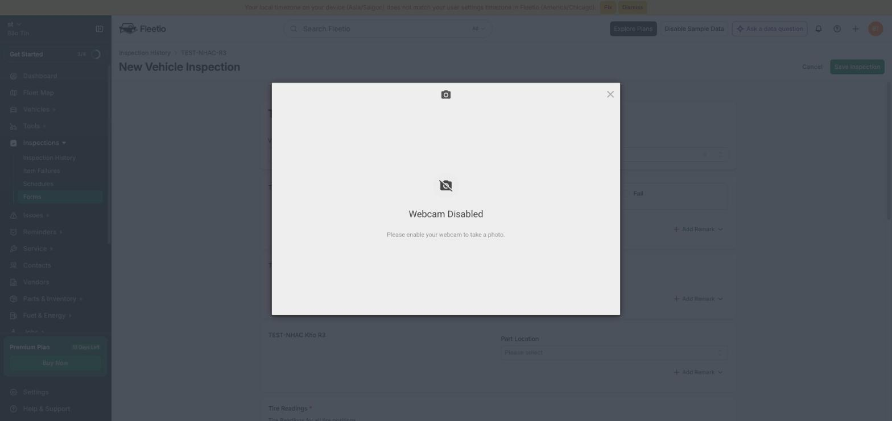

| # | Items | Control type | Data type | Description |
|---|---|---|---|---|
| 1 | Biểu tượng camera, X | Icon, nút | — | Hộp mở thẳng từ Pick File khi cờ cấm ảnh bật, hoặc từ ảnh đồng hồ |
| 2 | Thông báo | Chữ | — | "Webcam Disabled", "Please enable your webcam to take a photo."; E-fleetio-reminders-inspection-021 |
| 3 | Đường chọn file | — | — | Không có. Trạng thái có camera chưa thấy vì không cấp quyền |

## 2.18 Hộp xử lý phiếu giấy

Chưa có ảnh, bảng lấy từ ghi chú chạy.

| # | Items | Control type | Data type | Description |
|---|---|---|---|---|
| 1 | "Processing Your Inspection Form" | Hộp | — | "We're analyzing the details of your inspection form. This may take a moment."; khoá toàn form |
| 2 | "Taking longer than usual..." | Chữ | — | Khoảng 4 phút sau; "Our system might be spinning its wheels here. You can wait, or restart the processing to get things moving again."; E-fleetio-reminders-inspection-027 |
| 3 | Restart Processing | Nút | — | Lần đầu bấm một lần, thêm khoảng 2 phút vẫn không ra bản dựng; lần thử lại ra trong dưới 30 giây, xem 2.19 |
| 4 | Đóng | Nút | — | Hộp "Discard Smart Upload": "Are you sure you'd like to discard this smart upload?" |

## 1.16 Đọc hoá đơn bằng AI

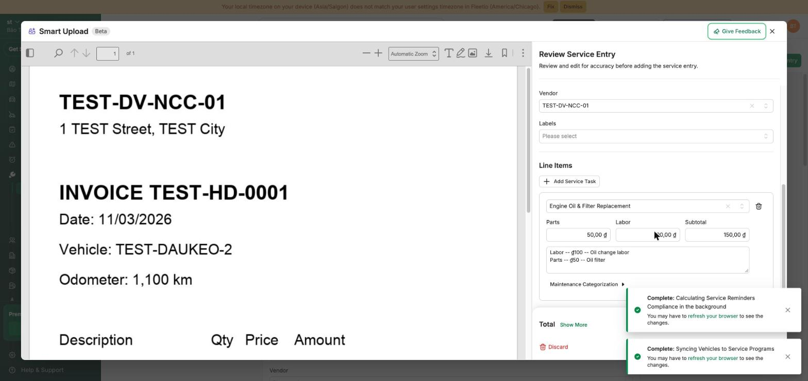

Ảnh cuộn giữa cột phải: các ô Primary Meter, Completion Date, Reference nằm trên phần cuộn; Tax, Total bị hai toast che; ô Labor bị con trỏ che một phần. Hoá đơn trong ảnh là tự tạo, nội dung TEST.

| # | Items | Control type | Data type | Description |
|---|---|---|---|---|
| 1 | Tiêu đề "Smart Upload" Beta | Chữ, nút | — | Give Feedback, X |
| 2 | Trình xem tài liệu | Khung trái | PDF | Trang, thu phóng, tải về, ghi chú |
| 3 | "Review Service Entry" | Chữ | — | "Review and edit for accuracy before adding the service entry." |
| 4 | Vendor | Chọn | Bản ghi | Khớp bản ghi có sẵn TEST-DV-NCC-01 |
| 5 | Primary Meter, Completion Date, Reference | Ô | — | Không có trong ảnh; ghi chú chạy: 1100, 11/03/2026, TEST-HD-0001 |
| 6 | Labels | Chọn | — | "Please select" |
| 7 | Line Items, Add Service Task | Nút | — | Dòng mới chưa chọn đầu việc làm "Add to Service Entry" khoá |
| 8 | Dòng đầu việc | Khối | Tiền | "Engine Oil & Filter Replacement"; Parts 50, Labor, Subtotal 150; mô tả "Labor -- ₫100 -- Oil change labor", "Parts -- ₫50 -- Oil filter"; Maintenance Categorization; xoá dòng |
| 9 | Total, Show More | Khối | Tiền | Show More có Labor, Parts, Labor Markup, Parts Markup, Warranty Credits, Discount, Tax; Total 165 theo ghi chú, bị toast che |
| 10 | Discard, Add to Service Entry | Nút | — | Add chỉ đổ vào form, phải Save; nút Add bị toast che trong ảnh |

## 1.17 Chi tiết nhắc biên km

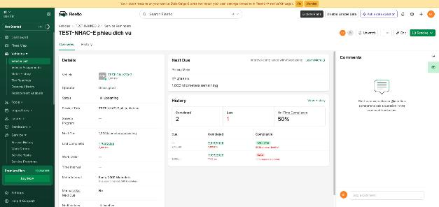

Ảnh độ phân giải thấp (rộng khoảng 630 px), đọc được bố cục và số lớn; số km, chữ "behind", dòng lịch sử không đọc rõ, lấy từ ghi chú chạy.

| # | Items | Control type | Data type | Description |
|---|---|---|---|---|
| 1 | Details | Khối | — | Status Upcoming; Meter Interval "Every 1,000 kilometers", ngưỡng 500; Time Interval "—" |
| 2 | Next Due | Khối | Số | Chỉ Primary Meter, không có Scheduled Date |
| 3 | History | Thẻ | Số, % | Completed 2, Late 1, On-Time Compliance 50% (đọc được từ ảnh) |
| 4 | Due, Completed, Compliance | Bảng | Số, nhãn | Hạn 2.100, làm 2.199, On-Time, "99 kilometers behind" đỏ. Hạn 1.000, làm 1.100, Late, "100 kilometers behind" đỏ |

## 1.18 Giao dịch vụ thuê ngoài

Chưa có ảnh, bảng lấy từ ghi chú chạy.

| # | Items | Control type | Data type | Description |
|---|---|---|---|---|
| 1 | "Assign outsourced service" | Hộp 3 bước | — | Service Details, Suggest Shop, Confirm |
| 2 | Assign to | Chọn | Bắt buộc | Chỉ người dùng, "Fleetio Automation", "Service Advisor"; E-fleetio-reminders-inspection-031 |
| 3 | Notification Methods | Tick | — | Hiện sau khi chọn người; Email, Text Message tick sẵn |
| 4 | Vehicle, Service Reminders | Chọn, tick | — | Tick nhắc đang mở; "Assign all service reminders (3)" |
| 5 | When, ASAP | Chọn, nút | — | Bấm ASAP làm Continue khoá, không gọi máy chủ (OQ-26) |
| 6 | Suggest Shop | Bước | — | Tích xanh, không hiện cửa hàng nào ở tài khoản này |
| 7 | Confirm | Bước | — | "Service Assignment", Vehicle, Service Reminders, Assigned to, "Notification methods: Email, SMS", "Ready to assign", Back, Assign; không bấm Assign |

## 2.19 Xem biểu mẫu từ phiếu giấy

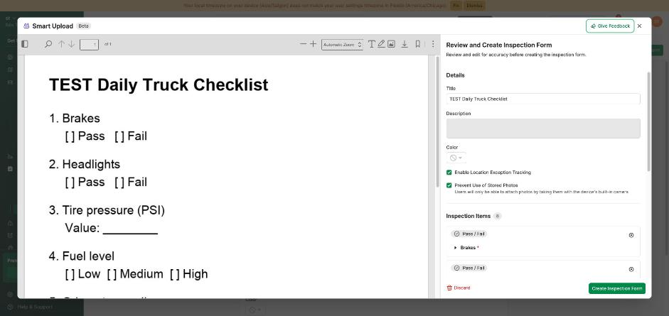

Ảnh có 2 mục đầu trong danh sách mục; phần sau cần cuộn, bảng loại mục lấy từ ghi chú chạy. Phiếu trong ảnh là tự tạo, nội dung TEST.

| # | Items | Control type | Data type | Description |
|---|---|---|---|---|
| 1 | Trình xem tài liệu | Khung trái | PDF | Như 1.16 |
| 2 | "Review and Create Inspection Form" | Chữ | — | "Review and edit for accuracy before creating the inspection form." |
| 3 | Title, Description, Color | Ô | — | Title lấy từ ảnh; Description xám trong ảnh |
| 4 | Enable Location Exception Tracking, Prevent Use of Stored Photos | Tick | — | Đều tick; biểu mẫu tạo ra ghi Prevent Disabled |
| 5 | Inspection Items | Danh sách | Số 8 | Icon loại; Brakes, Headlights Pass/Fail đúng; Tire pressure, Fuel level, Odometer, Photo thành Free Text; mọi mục bắt buộc |
| 6 | Discard, Create Inspection Form | Nút | — | Tạo xong có sẵn workflow ANY tạo sự cố |

## 2.20 Sự cố từ workflow trên xe

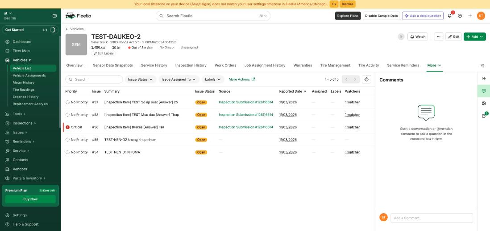

Ảnh là tab sự cố của xe, Status đang "Out of Service" do workflow. Đầu xe hiện số VIN của xe TEST.

| # | Items | Control type | Data type | Description |
|---|---|---|---|---|
| 1 | Đầu xe | Khối | — | Tên, loại, số km và giờ máy "2,400 km", "20 hr", chấm đỏ "Out of Service" |
| 2 | Lọc Search, Issue Status, Issue Assigned To, Labels, More Actions | Bộ lọc | — | 1 - 5 of 5 |
| 3 | Priority | Cột | Icon | #56 "Critical" đỏ kèm thanh mép dòng; #57, #58 "No Priority" |
| 4 | Issue, Summary | Cột | Chữ | "[Inspection Item] {mục} [Answer] {giá trị}"; dòng #54, #55 không từ phiếu |
| 5 | Issue Status, Source | Cột | Badge, liên kết | Open; "Inspection Submission #126116614" |
| 6 | Reported Date, Assigned, Labels, Watchers | Cột | — | 11/03/2026; "1 watcher" |

## 2.21 Lịch sử tồn của phụ tùng

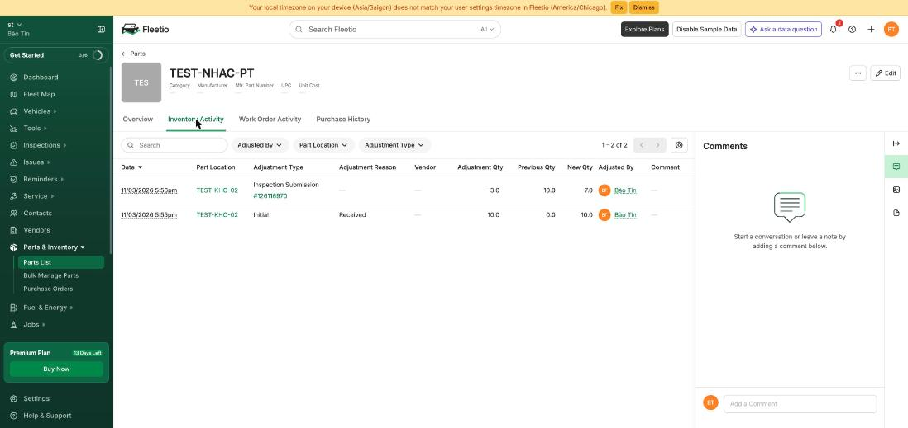

| # | Items | Control type | Data type | Description |
|---|---|---|---|---|
| 1 | Tab Overview, Inventory Activity, Work Order Activity, Purchase History | Tab | — | Đang ở Inventory Activity |
| 2 | Lọc Search, Adjusted By, Part Location, Adjustment Type | Bộ lọc | — | 1 - 2 of 2 |
| 3 | Date, Part Location | Cột | Ngày giờ, liên kết | 11/03/2026 5:56pm; TEST-KHO-02 |
| 4 | Adjustment Type | Cột | Chữ, liên kết | "Inspection Submission #126116970"; dòng đầu "Initial" |
| 5 | Adjustment Reason, Vendor | Cột | Chữ | Từ phiếu: trống; Initial: "Received" |
| 6 | Adjustment Qty, Previous Qty, New Qty | Cột | Số | -3.0, 10.0, 7.0; 10.0, 0.0, 10.0 |
| 7 | Adjusted By, Comment | Cột | Người, chữ | Người làm; trống |
