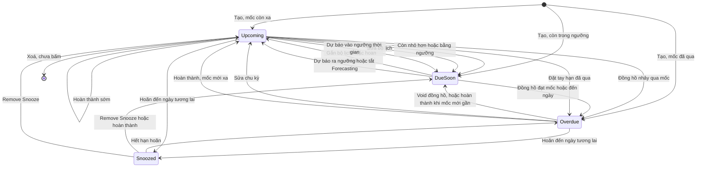
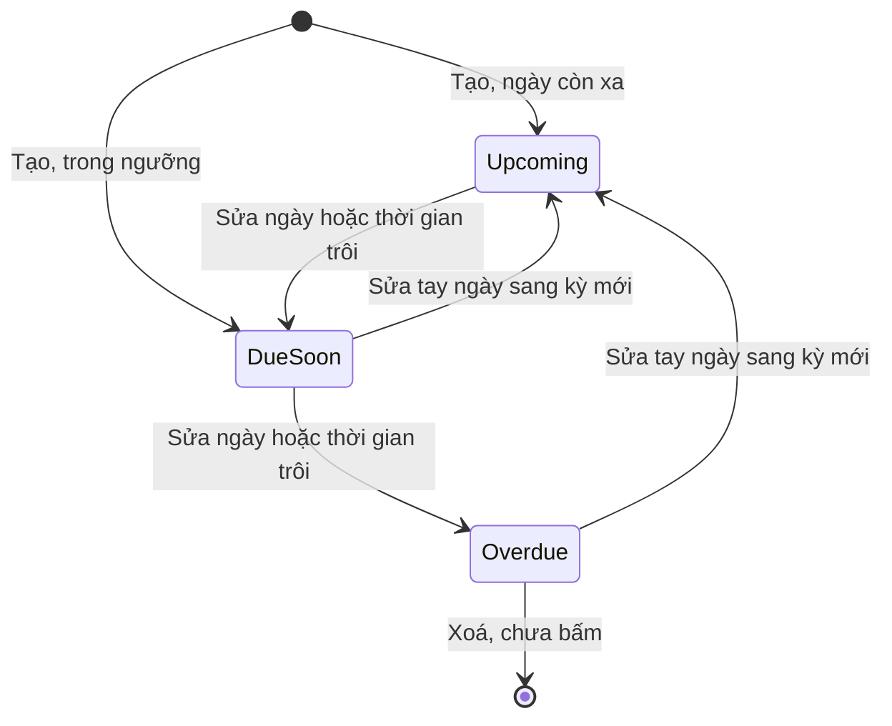
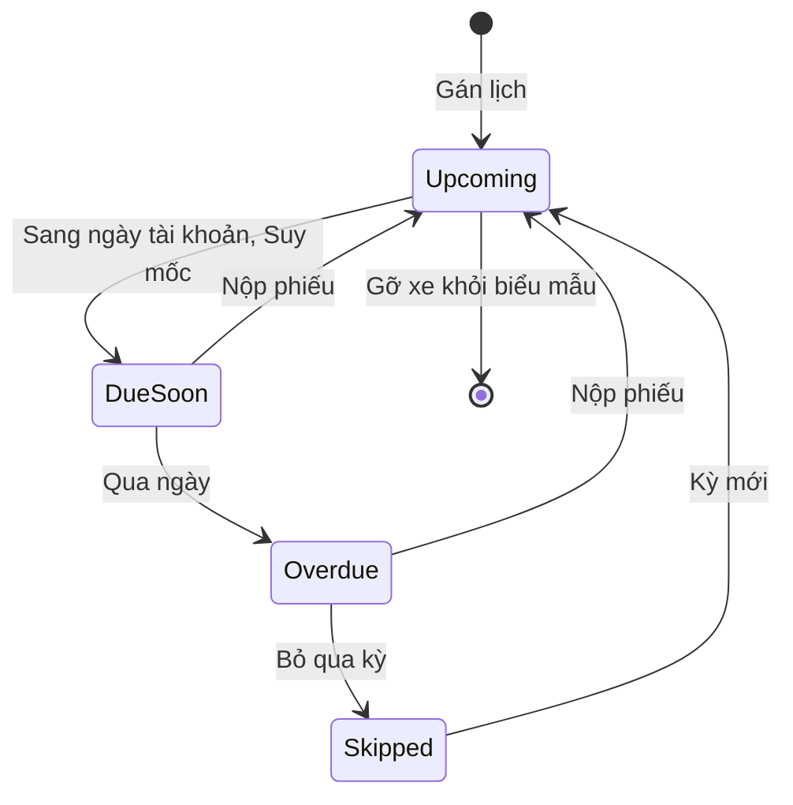
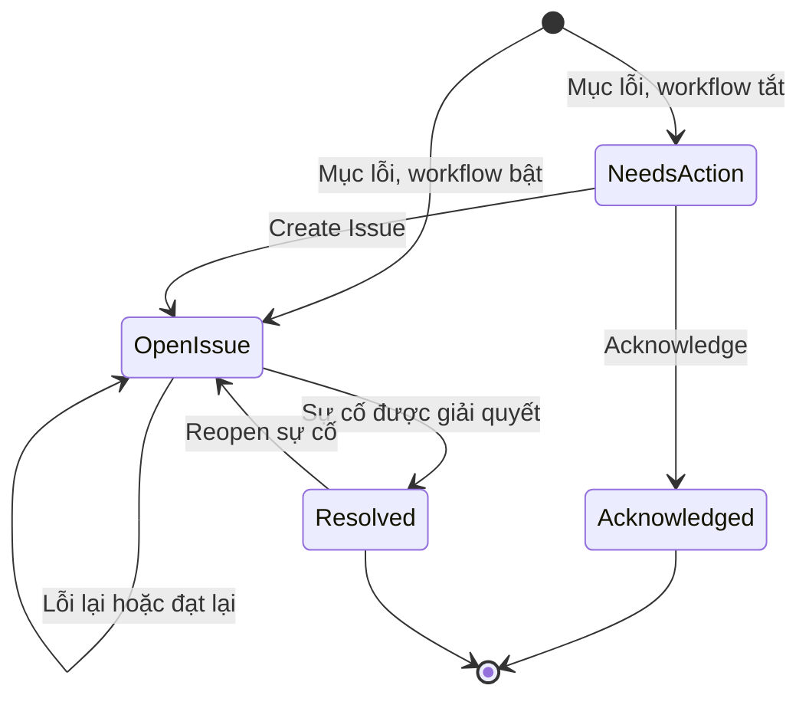
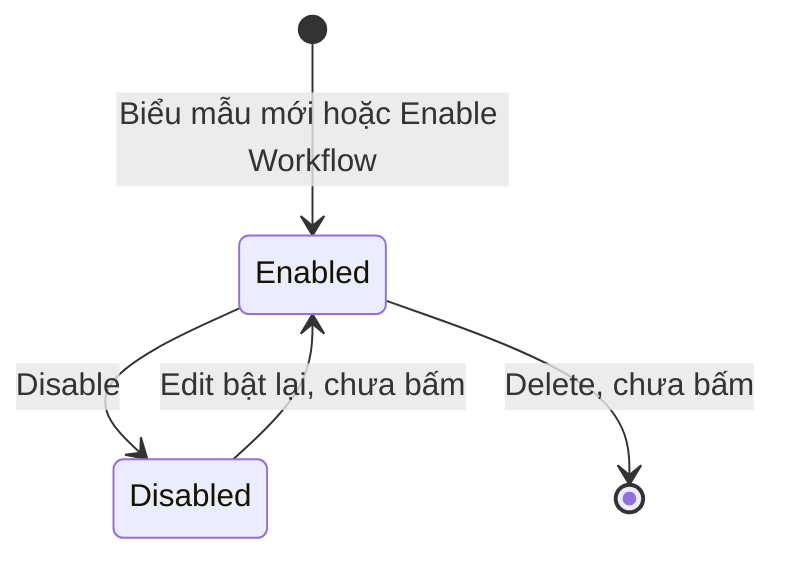
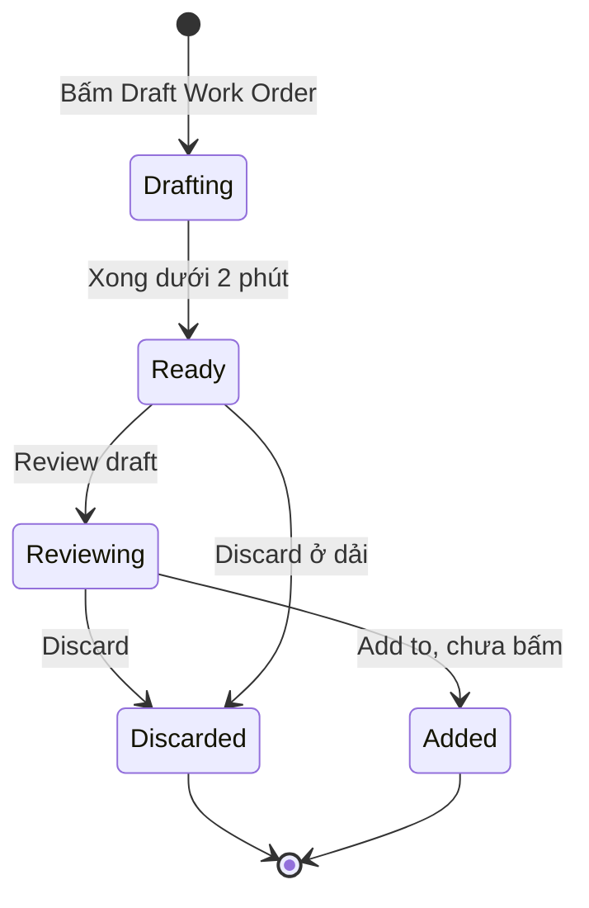
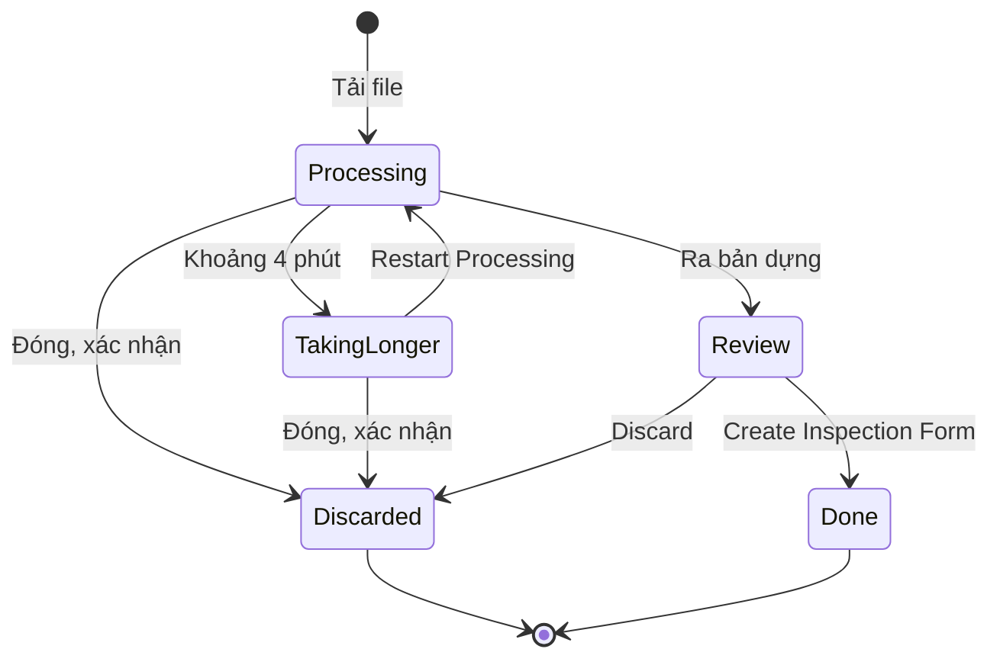

# Nhắc và kiểm tra — States

Mức ghi theo kết quả chạy; câu chữ giữ nguyên văn của Fleetio. Mã lỗi đầy đủ có tiền tố `E-fleetio-reminders-inspection-`.

## 1. Nhắc bảo dưỡng (Service Reminder)

Không có trạng thái Đóng: nhắc lặp vòng; kết thúc chỉ khi xoá (chưa bấm).

| Trạng thái | Hành động | Sang | Điều kiện | Hiệu ứng | Câu chữ | Mức |
|---|---|---|---|---|---|---|
| (tạo mới) | Lưu form | Upcoming, Due Soon hoặc Overdue | Theo mốc so với hiện tại. Chưa có lịch sử: mốc km bội số từ 0; thời gian từ hôm nay | Thêm dòng danh sách; KPI theo xe; người tạo là Watcher | "Service Reminder was successfully created" | `Chạy` |
| (tạo mới) | Lưu thiếu chu kỳ | Không tạo | Cả hai trục trống | E-008 | "Please provide a usage or a time interval" | `Chạy` |
| (tạo mới) | Lưu ngưỡng lớn hơn hoặc bằng chu kỳ | Không tạo | Mọi đơn vị | E-009, E-010 trong Schedule Preview | "... is too high (can't be equal to or greater than ...)" | `Chạy` |
| Upcoming | Đồng hồ tăng | Due Soon | Còn nhỏ hơn hoặc bằng ngưỡng | Next Due đổi | "500 kilometers remaining" | `Chạy` |
| Upcoming | Đồng hồ tăng, chưa tới ngưỡng | Giữ Upcoming | Còn lớn hơn ngưỡng | Next Due đổi | "501 kilometers remaining" | `Chạy` |
| Upcoming | Đồng hồ nhảy qua mốc | Overdue | Lớn hơn hoặc bằng mốc | | | `Chạy` đợt 1, cùng công thức |
| Upcoming | Thời gian trôi đến ngưỡng | Due Soon | Còn trong ngưỡng thời gian | | "2 weeks from now" | `Chạy` biên bằng cách sửa ngày; trôi thật là `Suy` |
| Upcoming | Hoàn thành sớm | Giữ Upcoming | Mốc mới còn xa | Kỳ mới từ lần làm; On-Time; hết dải lệnh | "On-Time" | `Chạy` |
| Upcoming | Sửa bộ lịch | Due Soon | Mốc mới gần | Xử lý ngầm rồi đổi; không hỏi | "Service Schedule was successfully updated" | `Chạy` |
| Upcoming | Snooze | Snoozed | Không có ô lý do | Next Due giữ "3 months from now"; Record History ghi Snooze Until | "2,001 kilometers remaining" | `Chạy` |
| Upcoming | Đặt tay hạn cũ hơn hôm nay | Overdue | Không chặn | Overdue ngay | | `Chạy` |
| Upcoming | Forecasting bật, số km ngày đưa ngày dự báo vào ngưỡng | Due Soon | 14 ngày trên ngưỡng 2 tuần; còn 700 km trên ngưỡng 500 km vẫn đổi; nhắc chỉ km cũng đổi, cơ chế chưa rõ (OQ-30) | Tab, thẻ Due Soon tăng; có thể sinh thông báo, chưa đo | "6 days from now", "2 weeks from now" | `Chạy` |
| Due Soon | Số km ngày giảm, ngày dự báo ra ngoài ngưỡng | Upcoming | 15,2 ngày | | "2 weeks from now" | `Chạy` |
| Due Soon | Tắt Forecasting, trạng thái do dự báo | Upcoming | Về ngay | Due Soon 11 về 8 | | `Chạy` |
| Upcoming | Resolve › Draft Work Order | Giữ nguyên | Khoá theo trạng thái, không theo gói; xám, icon khoá | Bấm không phản hồi | "Available when this reminder is due soon or overdue." | `Chạy` |
| Upcoming | Resolve › Find a shop | Giữ nguyên | Dừng ở Confirm, không bấm Assign | Hộp "Assign outsourced service" | "Ready to assign" | `Chạy` đến Confirm |
| Due Soon | Đồng hồ đạt mốc | Overdue | Đúng bằng mốc cũng Overdue | Next Due đỏ | "0 kilometers remaining" | `Chạy` |
| Due Soon | Gắn Service Program | Upcoming | Đầu việc trùng, lịch bộ xa hơn | Giữ mã nhắc, đổi chu kỳ | "Any conflicting individual Service Reminders will be replaced..." | `Chạy` |
| Due Soon | Void đồng hồ | Upcoming | Theo số hiện tại | | | Chưa bấm |
| Due Soon | Snooze | Snoozed | | | | Chưa bấm trực tiếp |
| Overdue | Đồng hồ tăng tiếp | Giữ Overdue | | Số quá hạn tăng | "1 kilometers overdue" | `Chạy` |
| Overdue | Void số cao nhất, vẫn đạt mốc | Giữ Overdue | Số còn lại vẫn lớn hơn hoặc bằng mốc | Dòng gạch ngang, "Manually Voided" | "0 kilometers remaining" | `Chạy` |
| Overdue | Void đồng hồ, lùi dưới mốc | Due Soon | Theo số hiện tại; không hỏi lý do | | "Successfully voided Meter Entry" | `Chạy` |
| Overdue | Edit chu kỳ lớn hơn | Upcoming | Không hỏi, không bắt lý do | Xoá trắng quá hạn; tab History không ghi, Record History có | "Primary Meter Interval changed from 1000.0 to 5000.0" | `Chạy` |
| Overdue | Resolve › Draft Work Order | Giữ Overdue | Mở vì nhắc đã Overdue, không khoá theo gói | Dải "Work Order drafted" trên mọi nhắc của xe; xem Mục 7 | "Ready for your review." | `Chạy` |
| Overdue | Hoàn thành, mốc mới xa | Upcoming | H, ghi lùi 19/10, kỳ sau 01/19/2027; E làm 1.100, hạn sau 2.100 | On-Time hoặc Late theo từng lần; dung sai dưới 10% | "3 months from now" | `Chạy` |
| Overdue | Snooze, ngày tương lai | Snoozed | Không có ô lý do | Next Due xám; menu đổi thành Remove Snooze | "Snoozed until 11/03/2026" | `Chạy` |
| Overdue | Snooze, ngày đã qua | Giữ Overdue | Không chặn | Thao tác vô hiệu, không báo | "The Service Reminder was successfully updated." | `Chạy` |
| Overdue | Hoàn thành, mốc mới gần | Due Soon | E mốc mới 3.450, đồng hồ 2.999 | Late; không về Upcoming | "Late" | `Chạy` |
| Snoozed | Hết hạn | Overdue hoặc trạng thái theo mốc | Dưới 2 phút sau mốc | | | `Chạy` về Overdue |
| Snoozed | Remove Snooze | Upcoming, Due Soon hoặc trạng thái theo mốc | Không hỏi | Record History ghi Snooze Until về (empty) | "The Service Reminder was successfully updated." | `Chạy` |
| Snoozed | Đồng hồ tăng | Giữ Snoozed | | Số quá hạn vẫn đổi, màu xám | "kilometers overdue" | `Chạy` |
| Snoozed | Hoàn thành | Kỳ mới, ra Due Soon | Xoá hoãn, không hỏi | Vẫn Late nếu quá hạn | | `Chạy` |
| Bất kỳ | Add to Work Order | Không đổi | Lệnh Open | Dải "This Service Task was added to Work Order #101" | "Work Order #101, Added ..." | `Chạy` |
| Bất kỳ | Lệnh Completed | Kỳ mới từ lần làm | Bắt Started At, Odometer; E-011, E-012 | Sinh Service Entry | "On-Time", "Late" | `Chạy` |
| Bất kỳ | Add to service history, Service Entry | Kỳ mới từ lần làm | Đầu việc khớp là nhận | Tuân thủ | | `Chạy` |
| Bất kỳ | Manually set | Theo ngày, số đặt | Tự tắt sau hoàn thành | Kỳ sau tính từ mốc đặt | "Manually Set Next Due: Yes" | `Chạy` |
| Bất kỳ | Mở Edit rồi lưu | Không đổi | Notifications đang Inactive | Thành Active; Record History ghi | "Active changed from false to true" | `Chạy` |
| Bất kỳ | View Record History | Không đổi | | Hộp có lọc khoảng ngày | "Changes Made" | `Chạy` |
| Bất kỳ | Recalculate Compliance | Không đổi | Có lịch sử | Tính ngầm | "Calculating Service Reminders Compliance in the background" | `Xem` |
| Bất kỳ | Thao tác hàng loạt qua Actions | Theo hành động | Chỉ đọc menu | | "Snooze Service Reminder", "Add Watchers" | `Xem` |
| Bất kỳ | Delete | | | | | Chưa bấm |
| Bất kỳ | Find a shop, Send Notifications | | Không gửi ra ngoài | | | `Xem` |

## 2. Nhắc gia hạn (Vehicle Renewal, Contact Renewal)

Trạng thái chỉ tính theo ngày. Trạng thái thường không có tab riêng, tên hiển thị là "Upcoming" (`Chạy` trên Contact Renewal #1596560; bản trước ghi chưa rõ tên).

| Trạng thái | Hành động | Sang | Điều kiện | Hiệu ứng | Câu chữ | Mức |
|---|---|---|---|---|---|---|
| (tạo mới) | Lưu | Due Soon | Đến hạn hôm nay; Fleetio: ngưỡng xe 3 tuần, liên hệ 3 tuần | Về danh sách; Watcher tự điền | "19 hours from now" | `Chạy` |
| (tạo mới) | Chọn loại đã có | Không chọn được | Cùng xe, cùng loại | Dòng xám | "the selected vehicle already has a reminder of this type" | `Chạy` |
| Due Soon | Edit ngày về quá khứ | Overdue | Ngày đã qua | | "1 month ago" | `Chạy` |
| Overdue | Edit ngày sang 01/11/2027 | Upcoming | Gia hạn bằng sửa tay | Không có kỳ, không có chứng từ; Vehicle, Renewal Type khoá; Record History ghi đổi hạn | "1 year from now" | `Chạy` |
| Due Soon | Edit ngày sang 11/01/2027 | Upcoming | Liên hệ; Contact, Contact Renewal Type khoá | Record History ghi Next Due At, Due Soon At | "Next Due At changed from ..." | `Chạy` |
| Upcoming | Thời gian trôi | Due Soon | | | | `Suy` |
| Due Soon | Thời gian trôi | Overdue | | | | `Suy` |
| Bất kỳ | Bấm dòng danh sách | Không đổi | | Panel phải có Edit, "...": View, Send Notifications, View Record History, Delete | "Contact Renewal #1596560" | `Chạy` trên liên hệ |
| Bất kỳ | Resolve, tab History, tải giấy tờ | Không có | Chi tiết chỉ có Details, Comments, "...", Edit | | | `Chạy` cả xe và liên hệ |

## 3. Lịch kiểm tra (Schedule)

Upcoming, Due Soon đã thấy thật (`Chạy`). Overdue, Skipped lấy từ tab trên màn Schedules (`Xem`), chuyển trạng thái là `Suy` vì cần qua hạn thật (OQ-11). Gán không lịch thì không có dòng ở màn này.

| Trạng thái | Hành động | Sang | Điều kiện | Hiệu ứng | Câu chữ | Mức |
|---|---|---|---|---|---|---|
| (gán xe) | Add Vehicles, Set Schedule Daily | Enabled, chưa đến hạn | Rule hoặc Manual; xử lý ngầm hơn 1 phút | Tab rỗng trong lúc chờ | "Adding Rule in the background. You'll be notified when it's complete." | `Chạy` |
| (gán xe) | Không tick Set Schedule | Không có lịch | "as needed" | Dòng gán Schedule "Off", Frequency trống; không vào Inspection Schedules; không bao giờ đến hạn (`Docs`) | "the form will still be available to these Vehicles on an "as needed" basis" | `Chạy` |
| Enabled, chưa đến hạn | Xem | | Add Via "Manual", Form Status "Enabled" | | "Daily with no reminder currently set" | `Chạy` |
| Upcoming | Thời gian trôi, hạn không đổi | Due Soon | Hạn 11/04: 12:17 giờ máy Upcoming, 14:42 giờ máy Due Soon. Theo ngày tài khoản là `Suy` | Tab Due Soon (2) | "22 hours from now" | `Chạy` |
| Due Soon | Qua ngày | Overdue | Set Delayed Start không đặt được hạn quá khứ, phải chờ thời gian thật | | "The next due date will always be in the future." | `Suy` |
| Due Soon, Overdue | Nộp phiếu | Upcoming | | | | `Suy` |
| Overdue | Bỏ qua kỳ | Skipped | | | | `Suy` |
| Skipped | Kỳ mới | Upcoming | | | | `Suy` |

## 4. Mục lỗi kiểm tra (Item Failure)

Status hiển thị thay đổi theo sự cố: "Issue #n" hoặc "WO #n" đều thuộc tab Open Issue khi sự cố còn mở.

| Trạng thái | Hành động | Sang | Điều kiện | Hiệu ứng | Câu chữ | Mức |
|---|---|---|---|---|---|---|
| (nộp phiếu, workflow bật) | Mục Fail | Open Issue, "Issue #n" | Tự động | Sinh sự cố "[Inspection Item] ..."; ưu tiên theo loại mục | "Issue Opened by workflow" | `Chạy` |
| (nộp phiếu, workflow tắt) | Mục Fail | Needs Action | Đường duy nhất ra trạng thái này; workflow form submitted không tạo sự cố nên cũng rơi vào đây | Hai nút trên phiếu | "Needs Action" | `Chạy` |
| Needs Action | Acknowledge | Acknowledged | Comment tuỳ chọn, lưu rỗng được | Hết hàng việc | "Successfully acknowledged failed inspection item." | `Chạy` |
| Needs Action | Create Issue | Open Issue, "Issue #51" | Một cú bấm, không mở form | Sinh sự cố "[Inspection Item] ...", chuyển sang trang sự cố; người bấm là người mở; Priority "Prioritizing" | "Inspection Item was linked to an Issue." | `Chạy` |
| Needs Action | View Failure Timeline | Giữ nguyên | | | "View Failure Timeline" | `Xem` |
| Open Issue | Lỗi lại | Giữ sự cố | Gộp timeline, không báo người kiểm | Thêm dòng Item Failures | "submitted an inspection with a failed item" | `Chạy` |
| Open Issue | Đạt lại | Giữ sự cố | Không tự đóng, không hỏi xác nhận; Number, Dropdown cũng vậy | Phiếu hiện đạt kèm liên kết | "✓ Pass", "Issue #47", "Issue #57" | `Chạy` |
| Open Issue | Add to Work Order | "WO #n" | | Status đổi | "WO #100" | `Chạy` đợt 1, thấy ở #31 |
| Open Issue | Resolve with Note | Resolved | Note bắt buộc; E-018 | Phiếu cũ đổi Status | "Resolved in Issue #49" | `Chạy` |
| Resolved | Lỗi lại | Dòng mới, sự cố MỚI | Không mở lại sự cố cũ | Issue #50 | | `Chạy` |
| Resolved | Reopen ở sự cố | Open Issue, "Issue #49" | Hộp xác nhận, không hỏi lý do | Sự cố về Open, nút lại thành Resolve; Resolution Details biến mất, Timeline không thêm dòng; chỉ Comment cũ còn | "Successfully reopened Issue." | `Chạy` |
| Resolved | Làm lại phiếu | | Không có câu hỏi xác nhận trên web | | | `Chạy`; tài liệu hãng ghi có, `Docs` |
| Acknowledged | Chỉ xem | Cuối | Không có đường quay lại, không tạo sự cố được | | "View Failure Timeline" | `Chạy` |

## 5. Workflow biểu mẫu

| Trạng thái | Hành động | Sang | Điều kiện | Hiệu ứng | Câu chữ | Mức |
|---|---|---|---|---|---|---|
| Enabled | Mục lỗi khi nộp | Giữ nguyên | "ANY Failed Inspection Item" | Sinh hoặc gộp sự cố | "Create issues automatically" | `Chạy` |
| Enabled | Nộp phiếu, trigger "If form is submitted" | Giữ nguyên | Không phân biệt đạt, lỗi; không hỏi | Trạng thái xe Active sang In Shop ngay | "If form is submitted then change vehicle status" | `Chạy` |
| Enabled | Nộp phiếu, trigger đạt từng mục | Giữ nguyên | Brakes Pass | Xe sang Inactive ngay, không hỏi, không báo trên phiếu | "Inactive" | `Chạy` |
| Enabled | Nộp phiếu, trigger lỗi từng mục | Giữ nguyên | TEST Muc dau Thap, "Fail item if chosen" | Xe sang Out of Service; workflow ANY cùng lúc sinh 3 sự cố | "Out of Service" | `Chạy` |
| Enabled | Disable | Disabled | Hộp xác nhận | Mục lỗi sau đó vào Needs Action; danh sách chia nhóm Enabled, Disabled, dòng tắt có nhãn "Disabled" | "Are you sure you want to disable this workflow? This will prevent any actions from running." | `Chạy` |
| Bất kỳ | Add Workflow, chọn Create an issue | Không chọn được | Đang có workflow ANY tạo sự cố, kể cả chọn trigger form submitted | | "Not Available" | `Chạy` |
| Disabled | Bật lại | Enabled | | | | Chưa bấm |
| Bất kỳ | Delete | | | | | Chưa bấm |

## 6. Đối tượng không có trạng thái thật

| Đối tượng | Vì sao | Mức |
|---|---|---|
| Phiếu (Submission) | Nộp một lần, không có nháp; sau nộp chỉ Delete hoặc Print. "Past Version" là nhãn phiên bản biểu mẫu, không phải trạng thái phiếu | `Chạy` |
| Biểu mẫu (Inspection Form) | Không có trạng thái vòng đời; "Form Status: Enabled" nằm ở từng dòng gán xe | `Chạy` |
| Bộ lịch (Service Program) | Không có trạng thái; chỉ có tiến trình ngầm "Processing", "Complete" | `Chạy` |
| Đầu việc (Service Task) | Danh mục | `Chạy` |
| Số đồng hồ (Meter Entry) | Chỉ có cờ Void Status "Manually Voided"; tick Void trên phiếu không gỡ yêu cầu ảnh | `Chạy` |
| Cài đặt Forecasting | Chỉ bật, tắt ở cấp tài khoản, không có vòng đời; tắt về nguyên trạng | `Chạy` |
| Trạng thái xe qua workflow | Vòng đời xe xem nhóm Phương tiện; ở đây chỉ ghi tác động: "If form is submitted" đổi được sang Active, In Shop, Inactive, Out of Service, Sold | `Chạy` với In Shop |

## 7. Bản nháp lệnh (Draft Work Order)

Gắn với xe, không với nhắc. Chưa bấm Add to nên không có bằng chứng đi tới lệnh thật.

| Trạng thái | Hành động | Sang | Điều kiện | Hiệu ứng | Câu chữ | Mức |
|---|---|---|---|---|---|---|
| (nhắc Overdue) | Resolve › Draft Work Order | Drafting | Không khoá theo gói | Chạy nền | "Drafting service", "No need to wait here — we'll notify you when the draft is ready." | `Chạy` |
| Drafting | Xử lý xong | Ready | Dưới 2 phút | Dải trên nhắc của xe | "Work Order drafted", "Ready for your review." | `Chạy` |
| Ready | Review draft | Reviewing | | Hộp "Review Work Order draft" tick sẵn mọi việc | "13/13 Service Tasks" | `Chạy` |
| Reviewing | Discard | Discarded | | Không sinh lệnh | | `Chạy` |
| Ready | Discard ở dải | Discarded | | | | `Xem` |
| Reviewing | Add to, lệnh đang mở hoặc lệnh mới | Added | Chưa bấm | Tự điền Repair Priority Class, Issue Date, WO Status | "Will auto-fill when created" | `Xem` |

## 8. Smart Upload biểu mẫu

Lần đầu treo, lần thử lại ra bản dựng dưới 30 giây. Smart Upload phiếu dịch vụ cũng đi nhánh Done, sang Review rồi đổ vào form, chưa lưu.

| Trạng thái | Hành động | Sang | Điều kiện | Hiệu ứng | Câu chữ | Mức |
|---|---|---|---|---|---|---|
| (form mới) | Tải PDF hoặc ảnh | Processing | | Khoá toàn form bằng hộp | "Processing Your Inspection Form" | `Chạy` |
| Processing | Chờ | Taking longer | Khoảng 4 phút | Không báo lỗi, không có thời hạn | "Taking longer than usual..." | `Chạy` |
| Taking longer | Restart Processing | Processing | | Thêm khoảng 2 phút vẫn không ra | | `Chạy` |
| Processing, Taking longer | Đóng | Discarded | Xác nhận | | "Are you sure you'd like to discard this smart upload?" | `Chạy` |
| Processing | Ra bản dựng | Review | Dưới 30 giây ở lần thử lại | Trái tài liệu, phải các ô chỉnh được | "Review and Create Inspection Form" | `Chạy` |
| Review | Create Inspection Form | Done | | Có sẵn workflow ANY tạo sự cố; cờ cấm ảnh lưu Disabled dù đã tick | "Prevent Use of Stored Photos: Disabled" | `Chạy` |
| Review | Discard | Discarded | | | "Discard" | `Xem` |
