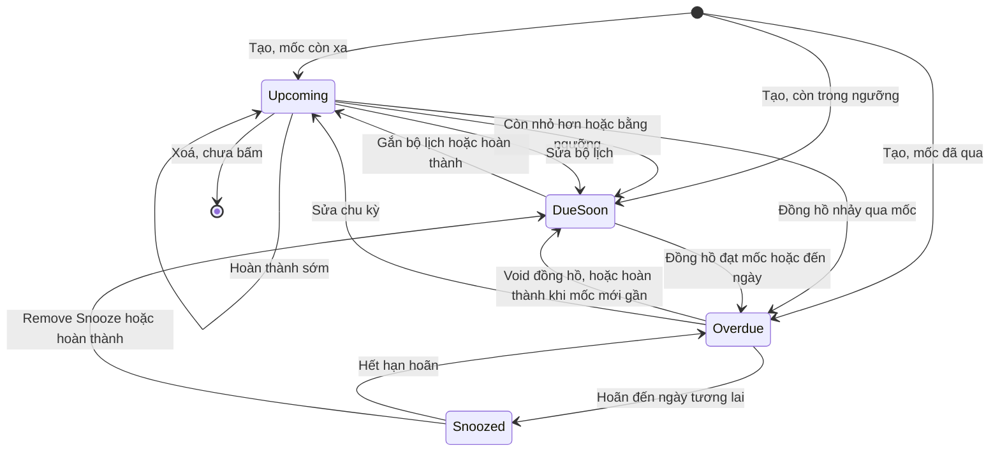
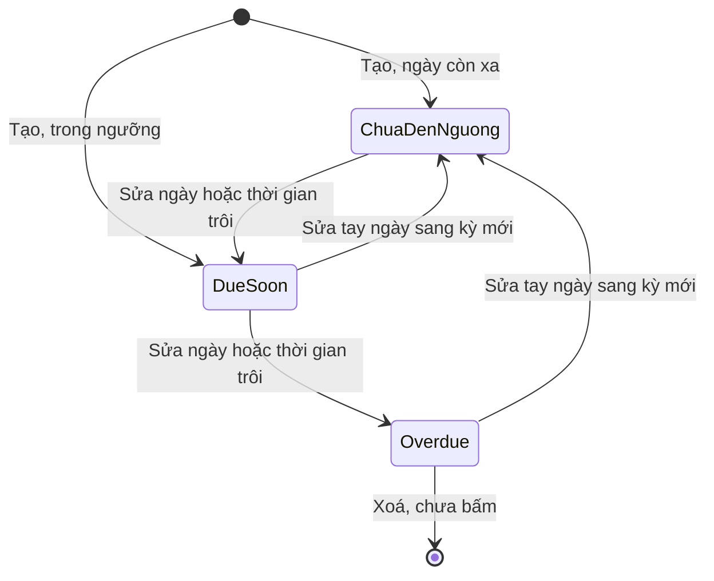
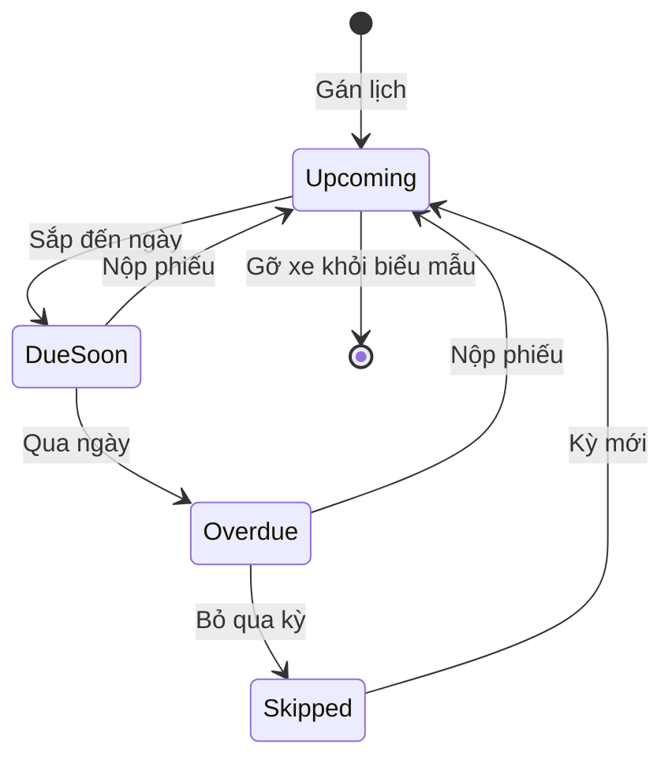
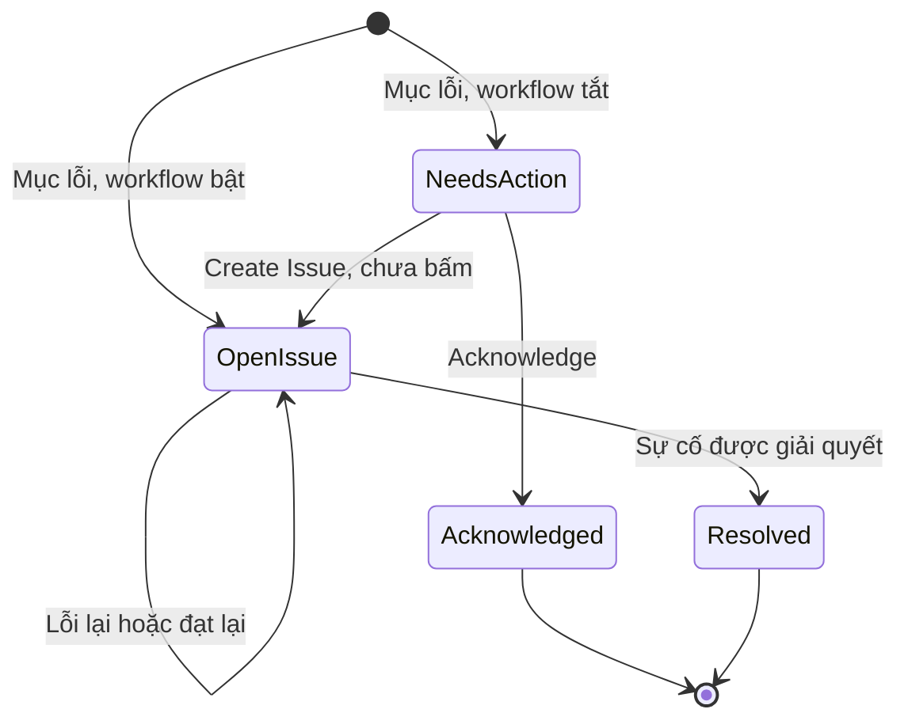
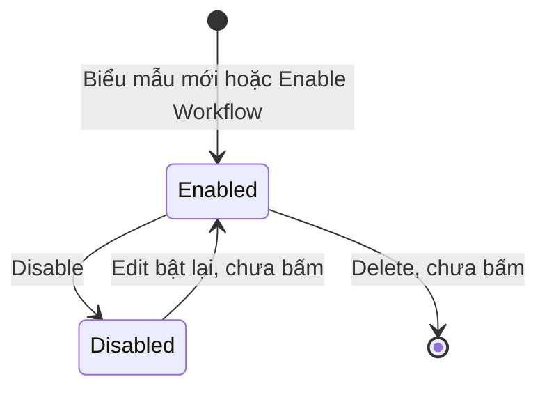

# Nhắc và kiểm tra — States

Mức ghi theo kết quả chạy; câu chữ giữ nguyên văn của Fleetio. Mã lỗi đầy đủ có tiền tố `E-fleetio-reminders-inspection-`.

## 1. Nhắc bảo dưỡng (Service Reminder)

Không có trạng thái Đóng: nhắc lặp vòng; kết thúc chỉ khi xoá (chưa bấm).

| Trạng thái | Hành động | Sang | Điều kiện | Hiệu ứng | Câu chữ | Mức |
|---|---|---|---|---|---|---|
| (tạo mới) | Lưu form | Upcoming, Due Soon hoặc Overdue | Theo mốc so với hiện tại. Chưa có lịch sử: mốc km bội số từ 0; thời gian từ hôm nay | Thêm dòng danh sách; KPI theo xe; người tạo là Watcher | "Service Reminder was successfully created" | `Chạy` |
| (tạo mới) | Lưu thiếu chu kỳ | Không tạo | Cả hai trục trống | E-008 | "Please provide a usage or a time interval" | `Chạy` |
| (tạo mới) | Lưu ngưỡng lớn hơn hoặc bằng chu kỳ | Không tạo | Mọi đơn vị | E-009, E-010 trong Schedule Preview | "... is too high (can't be equal to or greater than ...)" | `Chạy` |
| Upcoming | Đồng hồ tăng | Due Soon | Còn nhỏ hơn hoặc bằng ngưỡng | Next Due đổi | "500 kilometers remaining" | `Chạy` |
| Upcoming | Đồng hồ tăng, chưa tới ngưỡng | Giữ Upcoming | Còn lớn hơn ngưỡng | Next Due đổi | "501 kilometers remaining" | `Chạy` |
| Upcoming | Đồng hồ nhảy qua mốc | Overdue | Lớn hơn hoặc bằng mốc | | | `Chạy` đợt 1, cùng công thức |
| Upcoming | Thời gian trôi đến ngưỡng | Due Soon | Còn trong ngưỡng thời gian | | "2 weeks from now" | `Chạy` biên bằng cách sửa ngày; trôi thật là `Suy` |
| Upcoming | Hoàn thành sớm | Giữ Upcoming | Mốc mới còn xa | Kỳ mới từ lần làm; On-Time; hết dải lệnh | "On-Time" | `Chạy` |
| Upcoming | Sửa bộ lịch | Due Soon | Mốc mới gần | Xử lý ngầm rồi đổi; không hỏi | "Service Schedule was successfully updated" | `Chạy` |
| Upcoming | Snooze | Snoozed | | | | Chưa bấm |
| Upcoming | Resolve › Draft Work Order | Giữ nguyên | Xám, icon khoá | Bấm không phản hồi | "Draft Work Order" | `Chạy` |
| Due Soon | Đồng hồ đạt mốc | Overdue | Đúng bằng mốc cũng Overdue | Next Due đỏ | "0 kilometers remaining" | `Chạy` |
| Due Soon | Gắn Service Program | Upcoming | Đầu việc trùng, lịch bộ xa hơn | Giữ mã nhắc, đổi chu kỳ | "Any conflicting individual Service Reminders will be replaced..." | `Chạy` |
| Due Soon | Void đồng hồ | Upcoming | Theo số hiện tại | | | Chưa bấm |
| Due Soon | Snooze | Snoozed | | | | Chưa bấm |
| Overdue | Đồng hồ tăng tiếp | Giữ Overdue | | Số quá hạn tăng | "1 kilometers overdue" | `Chạy` |
| Overdue | Void số cao nhất, vẫn đạt mốc | Giữ Overdue | Số còn lại vẫn lớn hơn hoặc bằng mốc | Dòng gạch ngang, "Manually Voided" | "0 kilometers remaining" | `Chạy` |
| Overdue | Void đồng hồ, lùi dưới mốc | Due Soon | Theo số hiện tại; không hỏi lý do | | "Successfully voided Meter Entry" | `Chạy` |
| Overdue | Edit chu kỳ lớn hơn | Upcoming | Không hỏi, không ghi History | Xoá trắng quá hạn | "2,001 kilometers remaining" | `Chạy` |
| Overdue | Snooze, ngày tương lai | Snoozed | Không có ô lý do | Next Due xám; menu đổi thành Remove Snooze | "Snoozed until 11/03/2026" | `Chạy` |
| Overdue | Snooze, ngày đã qua | Giữ Overdue | Không chặn | Thao tác vô hiệu, không báo | "The Service Reminder was successfully updated." | `Chạy` |
| Overdue | Hoàn thành, mốc mới gần | Due Soon | E mốc mới 3.450, đồng hồ 2.999 | Late; không về Upcoming | "Late" | `Chạy` |
| Snoozed | Hết hạn | Overdue hoặc trạng thái theo mốc | Dưới 2 phút sau mốc | | | `Chạy` về Overdue |
| Snoozed | Remove Snooze | Due Soon hoặc trạng thái theo mốc | Không hỏi | | "The Service Reminder was successfully updated." | `Chạy` |
| Snoozed | Đồng hồ tăng | Giữ Snoozed | | Số quá hạn vẫn đổi, màu xám | "kilometers overdue" | `Chạy` |
| Snoozed | Hoàn thành | Kỳ mới, ra Due Soon | Xoá hoãn, không hỏi | Vẫn Late nếu quá hạn | | `Chạy` |
| Bất kỳ | Add to Work Order | Không đổi | Lệnh Open | Dải "This Service Task was added to Work Order #101" | "Work Order #101, Added ..." | `Chạy` |
| Bất kỳ | Lệnh Completed | Kỳ mới từ lần làm | Bắt Started At, Odometer; E-011, E-012 | Sinh Service Entry | "On-Time", "Late" | `Chạy` |
| Bất kỳ | Add to service history, Service Entry | Kỳ mới từ lần làm | Đầu việc khớp là nhận | Tuân thủ | | `Chạy` |
| Bất kỳ | Manually set | Theo ngày, số đặt | Tự tắt sau hoàn thành | Kỳ sau tính từ mốc đặt | "Manually Set Next Due: Yes" | `Chạy` |
| Bất kỳ | Mở Edit rồi lưu | Không đổi | Notifications đang Inactive | Thành Active | | `Chạy` |
| Bất kỳ | Recalculate Compliance | Không đổi | Có lịch sử | Tính ngầm | "Calculating Service Reminders Compliance in the background" | `Xem` |
| Bất kỳ | Delete | | | | | Chưa bấm |
| Bất kỳ | Find a shop, Send Notifications | | Không gửi ra ngoài | | | `Xem` |

## 2. Nhắc gia hạn (Vehicle Renewal, Contact Renewal)

Trạng thái chỉ tính theo ngày. Trạng thái thường không có tab riêng; tên hiển thị của nó chưa ghi lại khi chạy.

| Trạng thái | Hành động | Sang | Điều kiện | Hiệu ứng | Câu chữ | Mức |
|---|---|---|---|---|---|---|
| (tạo mới) | Lưu | Due Soon | Đến hạn hôm nay; Fleetio: ngưỡng xe 3 tuần, liên hệ 4 tuần | Về danh sách; Watcher tự điền | "19 hours from now" | `Chạy` |
| (tạo mới) | Chọn loại đã có | Không chọn được | Cùng xe, cùng loại | Dòng xám | "the selected vehicle already has a reminder of this type" | `Chạy` |
| Due Soon | Edit ngày về quá khứ | Overdue | Ngày đã qua | | "1 month ago" | `Chạy` |
| Overdue | Edit ngày sang 01/11/2027 | Chưa đến ngưỡng | Gia hạn bằng sửa tay | Kỳ cũ không lưu; Vehicle, Renewal Type khoá | | `Chạy` |
| Chưa đến ngưỡng | Thời gian trôi | Due Soon | | | | `Suy` |
| Due Soon | Thời gian trôi | Overdue | | | | `Suy` |
| Bất kỳ | Resolve, History, tải giấy tờ | Không có | Chi tiết chỉ có Details, Comments, "...", Edit | | | `Chạy` trên xe; liên hệ chưa mở chi tiết |

## 3. Lịch kiểm tra (Schedule)

Trạng thái lấy từ tab trên màn Schedules (`Xem`); chuyển trạng thái là `Suy`, vì cần qua ngày thật (OQ-11).

| Trạng thái | Hành động | Sang | Điều kiện | Hiệu ứng | Câu chữ | Mức |
|---|---|---|---|---|---|---|
| (gán xe) | Add Vehicles, Set Schedule Daily | Enabled, chưa đến hạn | Rule hoặc Manual; xử lý ngầm hơn 1 phút | Tab rỗng trong lúc chờ | "Adding Rule in the background. You'll be notified when it's complete." | `Chạy` |
| (gán xe) | Không tick Set Schedule | Không có lịch | "as needed" | Không bao giờ đến hạn | "the form will still be available to these Vehicles on an "as needed" basis" | `Xem`, `Docs` |
| Enabled, chưa đến hạn | Xem | | Add Via "Manual", Form Status "Enabled" | | "Daily with no reminder currently set" | `Chạy` |
| Upcoming | Sắp đến ngày | Due Soon | | | | `Suy` |
| Due Soon | Qua ngày | Overdue | | | | `Suy` |
| Due Soon, Overdue | Nộp phiếu | Upcoming | | | | `Suy` |
| Overdue | Bỏ qua kỳ | Skipped | | | | `Suy` |
| Skipped | Kỳ mới | Upcoming | | | | `Suy` |

## 4. Mục lỗi kiểm tra (Item Failure)

Status hiển thị thay đổi theo sự cố: "Issue #n" hoặc "WO #n" đều thuộc tab Open Issue khi sự cố còn mở.

| Trạng thái | Hành động | Sang | Điều kiện | Hiệu ứng | Câu chữ | Mức |
|---|---|---|---|---|---|---|
| (nộp phiếu, workflow bật) | Mục Fail | Open Issue, "Issue #n" | Tự động | Sinh sự cố "[Inspection Item] ..."; ưu tiên theo loại mục | "Issue Opened by workflow" | `Chạy` |
| (nộp phiếu, workflow tắt) | Mục Fail | Needs Action | Đường duy nhất ra trạng thái này | Hai nút trên phiếu | "Needs Action" | `Chạy` |
| Needs Action | Acknowledge | Acknowledged | Comment tuỳ chọn, lưu rỗng được | Hết hàng việc | "Successfully acknowledged failed inspection item." | `Chạy` |
| Needs Action | Create Issue | Open Issue | | Sinh sự cố | "Create Issue" | `Xem`, chưa bấm |
| Needs Action | View Failure Timeline | Giữ nguyên | | | "View Failure Timeline" | `Xem` |
| Open Issue | Lỗi lại | Giữ sự cố | Gộp timeline, không báo người kiểm | Thêm dòng Item Failures | "submitted an inspection with a failed item" | `Chạy` |
| Open Issue | Đạt lại | Giữ sự cố | Không tự đóng | Phiếu hiện đạt kèm liên kết | "✓ Pass", "Issue #47" | `Chạy` |
| Open Issue | Add to Work Order | "WO #n" | | Status đổi | "WO #100" | `Chạy` đợt 1, thấy ở #31 |
| Open Issue | Resolve with Note | Resolved | Note bắt buộc; E-018 | Phiếu cũ đổi Status | "Resolved in Issue #49" | `Chạy` |
| Resolved | Lỗi lại | Dòng mới, sự cố MỚI | Không mở lại sự cố cũ | Issue #50 | | `Chạy` |
| Resolved | Reopen ở sự cố | | Chưa bấm | | "Reopen" | `Xem` |
| Resolved | Làm lại phiếu | | Không có câu hỏi xác nhận trên web | | | `Chạy`; tài liệu hãng ghi có, `Docs` |
| Acknowledged | Chỉ xem | Cuối | Không có đường quay lại, không tạo sự cố được | | "View Failure Timeline" | `Chạy` |

## 5. Workflow biểu mẫu

| Trạng thái | Hành động | Sang | Điều kiện | Hiệu ứng | Câu chữ | Mức |
|---|---|---|---|---|---|---|
| Enabled | Mục lỗi khi nộp | Giữ nguyên | "ANY Failed Inspection Item" | Sinh hoặc gộp sự cố | "Create issues automatically" | `Chạy` |
| Enabled | Disable | Disabled | Hộp xác nhận | Mục lỗi sau đó vào Needs Action | "Are you sure you want to disable this workflow? This will prevent any actions from running." | `Chạy` |
| Disabled | Bật lại | Enabled | | | | Chưa bấm |
| Bất kỳ | Delete | | | | | Chưa bấm |

## 6. Đối tượng không có trạng thái thật

| Đối tượng | Vì sao | Mức |
|---|---|---|
| Phiếu (Submission) | Nộp một lần, không có nháp; sau nộp chỉ Delete hoặc Print. "Past Version" là nhãn phiên bản biểu mẫu, không phải trạng thái phiếu | `Chạy` |
| Biểu mẫu (Inspection Form) | Không có trạng thái vòng đời; "Form Status: Enabled" nằm ở từng dòng gán xe | `Chạy` |
| Bộ lịch (Service Program) | Không có trạng thái; chỉ có tiến trình ngầm "Processing", "Complete" | `Chạy` |
| Đầu việc (Service Task) | Danh mục | `Chạy` |
| Số đồng hồ (Meter Entry) | Chỉ có cờ Void Status "Manually Voided" | `Chạy` |
