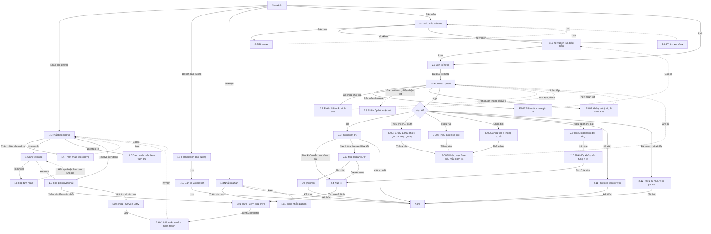

# Nhắc và kiểm tra — User flow

`stage` ghi theo lựa chọn của user: tự chốt, xem ở bản cuối (02/11/2026).

## 1. Sơ đồ tổng

Bản vẽ trên Figma: trang `Research · Fleetio`, frame `7214:221413`, chưa có các màn thêm ở đợt 03/11/2026. Đường liền là luồng thường, nét đứt là quay lại.

## 2. Màn hình

| # | Màn | Slug | Trạng thái | Ảnh |
|---|---|---|---|---|
| 1.1 | Danh sách nhắc | reminders-list | Có dữ liệu | Có |
| 1.4 | Form nhắc | reminder-new | Trống | Có |
| 1.2 | Form bộ lịch | program-new | Trống | Có |
| 1.3 | Danh sách gia hạn | renewals-list | Có dữ liệu | Có |
| 2.1 | Chi tiết biểu mẫu | inspection-form | Có mục | Có |
| 2.2 | Dựng mục | inspection-items-edit | Sửa | Có |
| 2.3 | Trang phiếu | inspection-submission | Có mục lỗi | Có |
| 2.4 | Item Failures | item-failures | Một dòng | Có |
| 2.5 | Lịch kiểm tra | inspection-schedules | Một dòng | Có |
| 1.5 | Chi tiết nhắc | reminder-detail-overdue | Quá hạn | Không |
| 1.6 | Chi tiết nhắc sau khi hoàn thành | reminder-after-work-order | Có lịch sử | Có |
| 1.7 | Danh sách nhắc kèm tuân thủ | reminder-list-compliance | Lọc một xe | Có |
| 1.8 | Hộp tạm hoãn | reminder-snooze | Mở | Không |
| 1.9 | Hộp giải quyết nhắc | reminder-resolve | Thêm vào lệnh, ghi lịch sử | Không |
| 1.10 | Gán xe vào bộ lịch | program-vehicles-add | Có đối chiếu | Không |
| 1.11 | Thêm nhắc gia hạn | renewal-new | Trống | Không |
| 2.6 | Form làm phiếu | inspection-submit-form | Có lỗi từng mục | Không |
| 2.7 | Phiếu thiếu cấu hình trục | inspection-tire-axle-error | Lỗi | Có |
| 2.8 | Phiếu lốp bắt nhận xét | inspection-tire-remark-required | Lỗi | Có |
| 2.9 | Phiếu lốp không đạt, tổng | inspection-tire-fail-summary | Có mục lỗi | Có |
| 2.10 | Phiếu lốp không đạt, từng vị trí | inspection-tire-fail-detail | Mở rộng | Có |
| 2.11 | Phiếu có bản đồ vị trí | inspection-submission-location | Có vị trí | Có |
| 2.12 | Phiếu đủ mục, vị trí giả lập | inspection-pretrip-simulated | Có vị trí | Có |
| 2.13 | Mục lỗi cần xử lý | item-failure-needs-action | Một dòng | Có |
| 2.14 | Thêm workflow | inspection-workflow-add | Trống | Không |
| 2.15 | Xe và lịch của biểu mẫu | inspection-form-vehicles | Một dòng | Không |

Màn ghi "Không" ở cột Ảnh: có mô tả trong ghi chú chạy nhưng không có ảnh lưu lại.

## 3. Flow theo tác vụ

| Flow | Happy path | Nhánh lỗi, ngoại lệ |
|---|---|---|
| Nhắc | 1.1 → 1.4 → 1.5 → 1.9 → lệnh → 1.6 → 1.1 | E-fleetio-reminders-inspection-008, 009, 010; tạm hoãn 1.8; E-fleetio-reminders-inspection-011 đến 014 |
| Tuân thủ | 1.1 → 1.7 | Recalculate xám khi chưa có lịch sử |
| Bộ lịch | 1.2 → 1.10 → xử lý ngầm | Nhắc tay trùng bị thay; gỡ xe chưa bấm |
| Gia hạn | 1.3 → 1.11 → 1.3 | Loại đã có hiện xám; gia hạn là sửa tay |
| Biểu mẫu | 2.1 → 2.2 → 2.14 → 2.15 → 2.5 | E-fleetio-reminders-inspection-017 |
| Kiểm tra | 2.5 → 2.6 → 2.3 hoặc 2.11, 2.12 | E-fleetio-reminders-inspection-001 đến 007, 013, 015, 019; lốp 2.7, 2.8 |
| Lốp | 2.6 → 2.9 → 2.10 → sự cố | Spare không có trong phiếu |
| Lỗi | 2.3 → 2.4 → sự cố → lệnh | Workflow tắt 2.13, ghi nhận không sửa; lỗi lặp gộp; E-fleetio-reminders-inspection-018 |
