# Nhắc và kiểm tra — User flow

`stage` ghi theo lựa chọn của user: tự chốt, xem ở bản cuối (02/11/2026).

## 1. Sơ đồ tổng

```mermaid
flowchart TD
    menu["Menu bên"]
    a["1.1 Nhắc bảo dưỡng"]
    b["1.4 Thêm nhắc bảo dưỡng"]
    sn["1.8 Hộp tạm hoãn"]
    d["1.5 Chi tiết nhắc"]
    d2["1.6 Chi tiết nhắc sau khi hoàn thành"]
    c["1.7 Danh sách nhắc kèm tuân thủ"]
    res["1.9 Hộp giải quyết nhắc"]
    pv["1.10 Gán xe vào bộ lịch"]
    rn["1.11 Thêm nhắc gia hạn"]
    se["Sửa chữa · Service Entry"]
    wo["Sửa chữa · Lệnh sửa chữa"]
    dr["1.12 Hộp xem bản nháp lệnh"]
    rh["1.13 Hộp lịch sử thay đổi"]
    cm["1.14 Chi tiết nhắc nhiều lần hoàn thành"]
    cr["1.15 Panel gia hạn liên hệ"]
    su2["1.16 Đọc hoá đơn bằng AI"]
    km["1.17 Chi tiết nhắc biên km"]
    fs["1.18 Giao dịch vụ thuê ngoài"]
    fc1["1.19 Danh sách có dự báo, popover ngày"]
    fc2["1.20 Chi tiết nhắc, popover phép tính"]
    fc3["1.21 Danh sách nhóm theo tuần"]
    fc4["1.22 Nhắc không có dự báo"]
    fc5["1.23 Cài đặt nhắc bảo dưỡng"]
    su3["2.19 Xem biểu mẫu từ phiếu giấy"]
    wi["2.20 Sự cố từ workflow trên xe"]
    ia["2.21 Lịch sử tồn của phụ tùng"]
    p["1.2 Form bộ lịch bảo dưỡng"]
    r["1.3 Nhắc gia hạn"]
    f["2.1 Biểu mẫu kiểm tra"]
    i["2.2 Sửa mục"]
    v["2.15 Xe và lịch của biểu mẫu"]
    wf["2.14 Thêm workflow"]
    l["2.5 Lịch kiểm tra"]
    lds["2.16 Lịch kiểm tra sắp đến hạn"]
    su["2.18 Hộp xử lý phiếu giấy"]
    wc["2.17 Hộp chụp ảnh không có camera"]
    n["2.6 Form làm phiếu"]
    ax["2.7 Phiếu thiếu cấu hình trục"]
    rm["2.8 Phiếu lốp bắt nhận xét"]
    ts["2.9 Phiếu lốp không đạt, tổng"]
    td["2.10 Phiếu lốp không đạt, từng vị trí"]
    loc["2.11 Phiếu có bản đồ vị trí"]
    pre["2.12 Phiếu đủ mục, vị trí giả lập"]
    na["2.13 Mục lỗi cần xử lý"]
    e7["E-007 Không có vị trí, chỉ cảnh báo"]
    q{"Hợp lệ?"}
    e15["E-001 E-002 E-003 Thiếu ghi chú hoặc giá trị"]
    e4["E-004 Thiếu cấu hình trục"]
    e17["E-017 Biểu mẫu chưa gán xe"]
    e5["E-005 Chưa tick ô không có lỗi"]
    e6["E-006 Không nộp được biểu mẫu kiểm tra"]
    t["2.3 Phiếu kiểm tra"]
    g["2.4 Mục lỗi"]
    ack["Đã ghi nhận"]
    z["Xong"]
    menu -->|"Nhắc bảo dưỡng"| a
    menu -->|"Bộ lịch bảo dưỡng"| p
    menu -->|"Gia hạn"| r
    menu -->|"Biểu mẫu"| f
    menu -->|"Lịch"| l
    a -->|"Thêm nhắc bảo dưỡng"| b
    b -.->|"Lưu"| a
    a -->|"Chọn nhắc"| d
    a -->|"Lọc theo xe"| c
    c -.->|"Bỏ lọc"| a
    d -->|"Tạm hoãn"| sn
    sn -.->|"Hết hạn hoặc Remove Snooze"| d
    d -->|"Resolve"| res
    a -->|"Resolve trên dòng"| res
    res -->|"Thêm vào lệnh sửa chữa"| wo
    res -->|"Ghi lịch sử dịch vụ"| se
    a -->|"Enable Forecasting"| fc5
    fc5 -->|"Tích Forecasting, lưu"| fc1
    fc1 -->|"Chọn nhắc có dự báo"| fc2
    fc1 -->|"Chọn nhắc usage 0"| fc4
    fc1 -->|"Group Week"| fc3
    fc3 -.->|"Group None"| fc1
    fc2 -.->|"Quay lại"| fc1
    fc4 -.->|"Quay lại"| fc1
    res -->|"Find a shop"| fs
    fs -.->|"Đóng"| d
    se -->|"Tải hoá đơn"| su2
    su2 -.->|"Add to Service Entry"| se
    se -->|"Lần làm trễ, chu kỳ km"| km
    km -.->|"Kỳ mới"| a
    res -->|"Soạn nháp bằng AI, nhắc Due Soon hoặc Overdue"| dr
    dr -->|"Thêm vào lệnh, chưa bấm"| wo
    dr -.->|"Discard"| d
    d -->|"Xem lịch sử thay đổi"| rh
    rh -.->|"Đóng"| d
    wo -->|"Lệnh Completed"| d2
    se -->|"Lưu"| d2
    se -->|"Lần hoàn thành tiếp theo"| cm
    cm -.->|"Kỳ mới"| a
    d2 -.->|"Kỳ mới"| a
    p -->|"Lưu"| pv
    pv -->|"Lưu"| z
    r -->|"Thêm gia hạn"| rn
    rn -.->|"Lưu"| r
    r -->|"Bấm dòng liên hệ"| cr
    cr -.->|"Đóng"| r
    cr -->|"Xem lịch sử thay đổi"| rh
    r -->|"Kết thúc"| z
    f -->|"Tải phiếu giấy"| su
    su -.->|"Discard"| f
    su -->|"Ra bản dựng"| su3
    su3 -.->|"Create Inspection Form"| f
    f -->|"Sửa mục"| i
    i -.->|"Lưu"| f
    f -->|"Workflow"| wf
    wf -.->|"Lưu"| f
    f -->|"Xe và lịch"| v
    v -->|"Lưu"| l
    l -->|"Bắt đầu kiểm tra"| n
    l -->|"Sang ngày tài khoản"| lds
    lds -->|"Bắt đầu kiểm tra"| n
    n -->|"Cấm ảnh có sẵn, bấm Pick File"| wc
    wc -.->|"Đóng"| n
    n -->|"Biểu mẫu chưa gán"| e17
    e17 -.->|"Gán xe"| v
    n -->|"Xe chưa khai trục"| ax
    ax -.->|"Khai trục, Done"| n
    n -->|"Gai dưới mức, thiếu nhận xét"| rm
    rm -.->|"Thêm nhận xét"| n
    n -->|"Trình duyệt không cấp vị trí"| e7
    e7 -.->|"Làm tiếp"| n
    n -->|"Nộp"| q
    q -->|"Đạt"| t
    q -->|"Thiếu ghi chú, giá trị"| e15
    q -->|"Thiếu trục"| e4
    q -->|"Chưa tick"| e5
    q -->|"Thiếu ảnh đồng hồ"| e20["E-020 Thiếu ảnh đồng hồ"]
    e20 -->|"Thông báo"| e6
    e15 -->|"Thông báo"| e6
    e4 -->|"Thông báo"| e6
    e5 -->|"Thông báo"| e6
    e6 -.->|"Sửa lại"| n
    q -->|"Phiếu lốp không đạt"| ts
    q -->|"Có vị trí"| loc
    q -->|"Đủ mục, vị trí giả lập"| pre
    ts -->|"Mở rộng"| td
    td -->|"Sự cố tự sinh"| g
    loc -->|"Kết thúc"| z
    pre -->|"Kết thúc"| z
    t -->|"Mục không đạt, workflow bật"| g
    t -->|"Mục không đạt, workflow tắt"| na
    t -->|"Không có lỗi"| z
    t -->|"Nhiều mục lỗi, xem trên xe"| wi
    wi -->|"Mở sự cố"| g
    t -->|"Có chọn phụ tùng, trừ kho"| ia
    ia -->|"Kết thúc"| z
    g -->|"Tạo sự cố, lệnh"| wo
    g -.->|"Reopen sự cố"| g
    na -->|"Ghi nhận"| ack
    na -->|"Create Issue"| g
    ack -->|"Kết thúc"| z
```

Bản vẽ trên Figma: trang `Research · Fleetio`, frame `7214:221413`, chưa có các màn thêm ở đợt 03/11/2026 (gồm 1.12 đến 1.23, 2.16 đến 2.21). Đường liền là luồng thường, nét đứt là quay lại.

## 2. Màn hình

| # | Màn | Slug | Trạng thái | Ảnh |
|---|---|---|---|---|
| 1.1 | Danh sách nhắc | reminders-list | Có dữ liệu | Có |
| 1.4 | Form nhắc | reminder-new | Trống | Có |
| 1.2 | Form bộ lịch | program-new | Trống | Có |
| 1.3 | Danh sách gia hạn | renewals-list | Có dữ liệu | Có |
| 2.1 | Chi tiết biểu mẫu | inspection-form | Có mục | Có |
| 2.2 | Dựng mục | inspection-items-edit | Sửa | Có |
| 2.3 | Trang phiếu | inspection-submission | Có mục lỗi | Có |
| 2.4 | Item Failures | item-failures | Một dòng | Có |
| 2.5 | Lịch kiểm tra | inspection-schedules | Một dòng | Có |
| 1.5 | Chi tiết nhắc | reminder-detail-overdue | Quá hạn | Có |
| 1.6 | Chi tiết nhắc sau khi hoàn thành | reminder-after-work-order | Có lịch sử | Có |
| 1.7 | Danh sách nhắc kèm tuân thủ | reminder-list-compliance | Lọc một xe | Có |
| 1.8 | Hộp tạm hoãn | reminder-snooze | Mở | Có |
| 1.9 | Hộp giải quyết nhắc | reminder-resolve | Menu mở; ảnh chưa có 2 hộp con | Có |
| 1.10 | Gán xe vào bộ lịch | program-vehicles-add | Chưa khớp xe, nút khoá; ảnh chưa có bảng đối chiếu | Có |
| 1.11 | Thêm nhắc gia hạn | renewal-new | Trống | Có |
| 2.6 | Form làm phiếu | inspection-submit-form | Vừa chọn xe; lỗi từng mục không có trong ảnh | Có |
| 2.7 | Phiếu thiếu cấu hình trục | inspection-tire-axle-error | Lỗi | Có |
| 2.8 | Phiếu lốp bắt nhận xét | inspection-tire-remark-required | Lỗi | Có |
| 2.9 | Phiếu lốp không đạt, tổng | inspection-tire-fail-summary | Có mục lỗi | Có |
| 2.10 | Phiếu lốp không đạt, từng vị trí | inspection-tire-fail-detail | Mở rộng | Có |
| 2.11 | Phiếu có bản đồ vị trí | inspection-submission-location | Có vị trí | Có |
| 2.12 | Phiếu đủ mục, vị trí giả lập | inspection-pretrip-simulated | Có vị trí | Có |
| 2.13 | Mục lỗi cần xử lý | item-failure-needs-action | Một dòng | Có |
| 2.14 | Thêm workflow | inspection-workflow-add | Trống, bước 1 | Có |
| 2.15 | Xe và lịch của biểu mẫu | inspection-form-vehicles | Một dòng | Có |
| 1.12 | Hộp xem bản nháp lệnh | reminder-draft-work-order | Có bản nháp, lệnh đang mở | Có |
| 1.13 | Hộp lịch sử thay đổi | reminder-record-history | Nhiều dòng | Có |
| 1.14 | Chi tiết nhắc nhiều lần hoàn thành | reminder-compliance-multi | 2 lần, 1 Late | Có |
| 1.15 | Panel gia hạn liên hệ | contact-renewal-panel | Mở | Không |
| 2.16 | Lịch kiểm tra sắp đến hạn | inspection-schedule-due-soon | Due Soon | Có |
| 2.17 | Hộp chụp ảnh không có camera | inspection-photo-webcam-only | Webcam Disabled | Có |
| 2.18 | Hộp xử lý phiếu giấy | inspection-smart-upload | Processing, Taking longer | Không |
| 1.16 | Đọc hoá đơn bằng AI | service-smart-upload-review | Review, có dòng đọc được | Có |
| 1.17 | Chi tiết nhắc biên km | reminder-compliance-km-boundary | 2 lần, 1 Late | Có, độ phân giải thấp |
| 1.18 | Giao dịch vụ thuê ngoài | reminder-find-shop | Service Details, Confirm | Không |
| 2.19 | Xem biểu mẫu từ phiếu giấy | inspection-form-smart-upload-review | Review | Có |
| 2.20 | Sự cố từ workflow trên xe | inspection-workflow-fail-issues | 5 sự cố | Có |
| 2.21 | Lịch sử tồn của phụ tùng | inspection-inventory-adjustment-deduct | Có dòng từ phiếu | Có |
| 1.19 | Danh sách có dự báo, popover ngày | reminder-forecast-next-due-popover | Forecasting bật | Có |
| 1.20 | Chi tiết nhắc, popover phép tính | reminder-forecast-meter-popover | Có dự báo | Có |
| 1.21 | Danh sách nhóm theo tuần | reminder-forecast-group-week | Group Week | Có |
| 1.22 | Nhắc không có dự báo | reminder-forecast-not-available | Forecast not available | Có |
| 1.23 | Cài đặt nhắc bảo dưỡng | reminder-settings-forecasting | Ô Forecasting | Không |

Màn ghi "Không" ở cột Ảnh: có mô tả trong ghi chú chạy nhưng không có ảnh lưu lại.

## 3. Flow theo tác vụ

| Flow | Happy path | Nhánh lỗi, ngoại lệ |
|---|---|---|
| Nhắc | 1.1 → 1.4 → 1.5 → 1.9 → lệnh → 1.6 → 1.1 | E-fleetio-reminders-inspection-008, 009, 010; tạm hoãn 1.8; E-fleetio-reminders-inspection-011 đến 014; lịch sử thay đổi 1.13 |
| Bản nháp AI | 1.5 → 1.9 → 1.12 → lệnh | Discard về 1.5; Add to chưa bấm; xám trên Upcoming, E-fleetio-reminders-inspection-030 |
| Dự báo | 1.1 → 1.23 → 1.19 → 1.20 hoặc 1.21 | Usage 0: 1.22, E-fleetio-reminders-inspection-032; tắt về nguyên trạng |
| Giao ngoài | 1.9 → 1.18 | Assign chưa bấm; E-fleetio-reminders-inspection-031 |
| Hoá đơn | Service Entry → 1.16 → Service Entry → 1.6 hoặc 1.17 | Nhắc không đóng nếu thiếu đúng đầu việc |
| Tuân thủ | 1.1 → 1.7; 1.5 → 1.14 | Recalculate xám khi chưa có lịch sử |
| Bộ lịch | 1.2 → 1.10 → xử lý ngầm | Nhắc tay trùng bị thay; gỡ xe chưa bấm; E-fleetio-reminders-inspection-024, 025, 026, 029 |
| Gia hạn | 1.3 → 1.11 → 1.3; 1.3 → 1.15 → 1.13 | Loại đã có hiện xám; gia hạn là sửa tay |
| Biểu mẫu | 2.1 → 2.2 → 2.14 → 2.15 → 2.5 | E-fleetio-reminders-inspection-017, 023; phiếu giấy 2.18 → 2.19, E-fleetio-reminders-inspection-027 |
| Kiểm tra | 2.5 hoặc 2.16 → 2.6 → 2.3 hoặc 2.11, 2.12 | E-fleetio-reminders-inspection-001 đến 007, 013, 015, 019, 020, 022, 028; không camera 2.17, E-fleetio-reminders-inspection-021; lốp 2.7, 2.8; trừ kho 2.21 |
| Lốp | 2.6 → 2.9 → 2.10 → sự cố | Spare không có trong phiếu |
| Lỗi | 2.3 → 2.4 hoặc 2.20 → sự cố → lệnh | Workflow tắt 2.13, ghi nhận không sửa, Create Issue sang sự cố; lỗi lặp gộp; Reopen về Open Issue; E-fleetio-reminders-inspection-018 |
