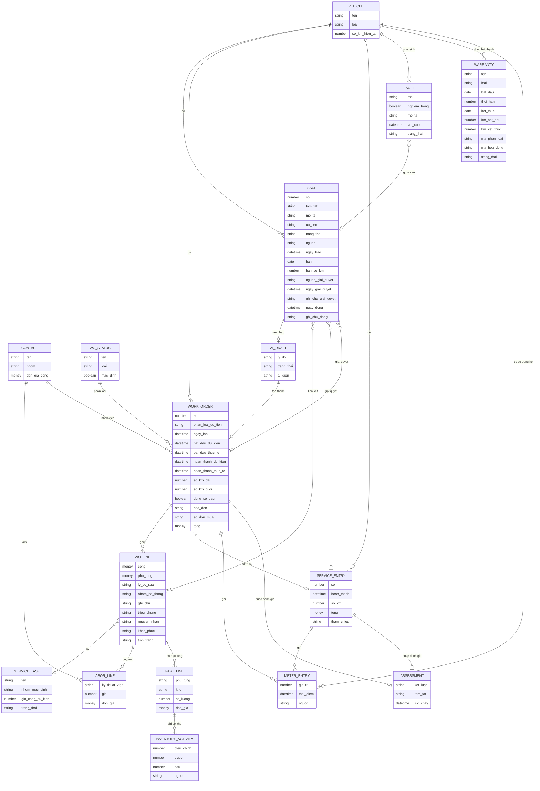

# Sửa chữa — ERD nghiệp vụ

Suy ra từ form, cột danh sách, kết quả chạy và tài liệu hãng; không phải sơ đồ cơ sở dữ liệu thật của Fleetio. Thuộc tính ghi ở mức nghiệp vụ.

| Quan hệ | Bằng chứng |
|---|---|
| Lệnh sinh một Service Entry | `Chạy` #99 và 57837459; #104 và 57857945. Mở lại thì entry bị xoá, hoàn thành lại sinh entry mới: một lệnh có một entry tại một thời điểm, nhiều entry theo thời gian nhưng entry cũ không còn |
| Sửa so với bản trước: một sự cố thuộc một lệnh | `Chạy` dòng đã ở lệnh khác có ổ khoá, tooltip yêu cầu gỡ. Bản trước vẽ nhiều nhiều. Tooltip viết "all Work Orders", cột cũng là số nhiều; đường Draft Work Order trên sự cố đã gắn chưa thử: OQ-14 |
| Một Service Entry giải quyết nhiều sự cố; Reopen tháo liên kết | `Chạy` hộp chọn nhiều, #37 tháo liên kết. `Suy` một sự cố chỉ ở một entry |
| Dòng việc liên kết sự cố | `Xem` Link Issues, cột Linked Line Items |
| Nhiều mã lỗi vào một sự cố | `Xem` Issue #13, #14, #15 nhận nhiều mã |
| Trường Triệu chứng, Nguyên nhân, Khắc phục | `Docs`, chỉ hiện khi bật cấu hình |
| Dòng phụ tùng ghi sổ kho | `Chạy` Inventory Activity ghi trước, sau, nguồn số lệnh. Tồn, kho chi tiết ở [[docs/_research/fleetio/srs/fleetio-parts-purchasing-fuel-erd.md|Kho, mua]] |
| Dòng đồng hồ có nguồn lệnh, entry | `Chạy` nguồn "Work Order #104", "Service Entry #57858956" |
| Contact có đơn giá công | `Chạy` TEST-SUA-KTV |
| Trạng thái lệnh thuộc danh mục có loại | `Xem` Work Order Statuses |
| Một Assessment trên một lệnh hay entry | `Chạy` khối trên lệnh, entry. Lịch sử các lần chạy lại: `Suy` chỉ giữ lần mới nhất |
| Overdue không có thuộc tính lưu | `Chạy` giá trị tính từ `han`, `han_so_km`, đồng hồ của xe |
| Đầu kéo, mooc là hai Vehicle, không có bản ghi tổ hợp trên lệnh | `Chạy` nhóm Lốp về Vehicle; `Suy` về lệnh |
