# Sửa chữa — Màn hình thật

Ảnh chụp từ tài khoản dùng thử ngày 02/11/2026 và 03/11/2026, dùng nội bộ để phân tích.

## 1.1 Danh sách sự cố

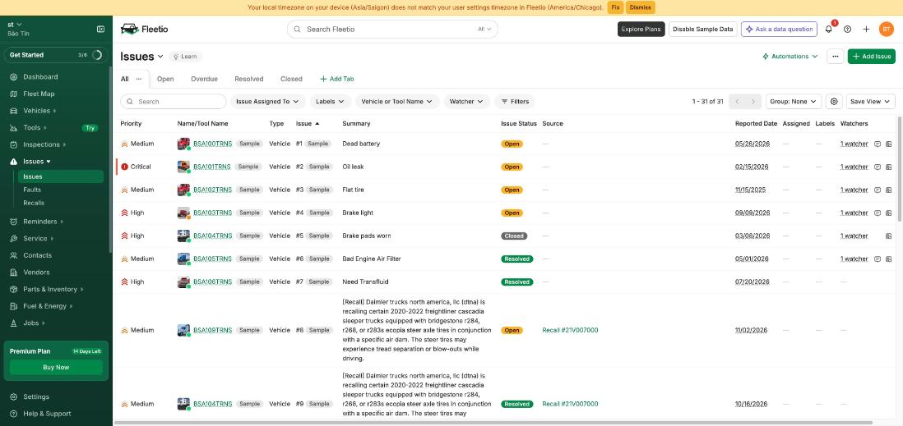

| # | Items | Control type | Data type | Description |
|---|---|---|---|---|
| 1 | Tab All, Open, Overdue, Resolved, Closed | Tab | — | Lọc theo trạng thái. Có Add Tab để tạo tab riêng |
| 2 | Tìm, Assigned To, Labels, Xe, Watcher, Filters | Lọc | — | Lọc nhanh; Filters mở nhóm điều kiện |
| 3 | Priority | Cột | Icon, chữ | Mức ưu tiên; dấu sao khi AI gán |
| 4 | Name/Tool, Type, Issue, Summary | Cột | Chữ, liên kết | Xe, loại, số, tóm tắt |
| 5 | Issue Status, Source | Cột | Badge, liên kết | Nguồn dẫn về Recall, phiếu kiểm tra |
| 6 | Reported Date, Assigned, Labels, Watchers | Cột | Ngày, chữ | — |
| 7 | Group, View Settings, Save View | Nút | — | Nhóm dòng, chọn cột, lưu chế độ xem |
| 8 | Automations, Add Issue | Nút | — | Vào luật tự động; tạo mới |

## 1.2 Chi tiết sự cố đang mở

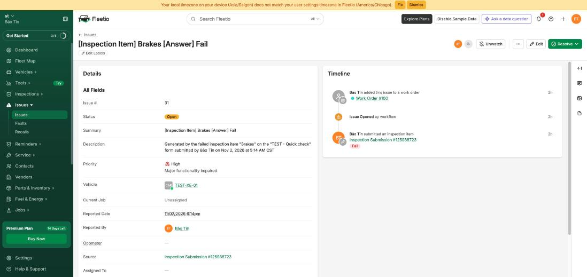

| # | Items | Control type | Data type | Description |
|---|---|---|---|---|
| 1 | Details | Khối | Chữ | Số, trạng thái, tóm tắt, mô tả sinh tự động nếu từ phiếu, ưu tiên, xe, người báo, nguồn, hạn |
| 2 | Timeline | Khối | Sự kiện | Ai làm gì, kể cả workflow, kèm liên kết |
| 3 | Resolve | Menu | — | Add to Service Entry · Draft Work Order · Add to Work Order · Get Service at Shop · Resolve with Note |
| 4 | Menu ba chấm | Menu | — | Close · View Record History · Delete |
| 5 | Watch, Edit, Labels | Nút | — | Người tạo mặc định đang theo dõi |
| 6 | Cột phải | Thanh | — | Bình luận, ảnh, tài liệu |

## 1.3 Chi tiết sự cố đã xử lý

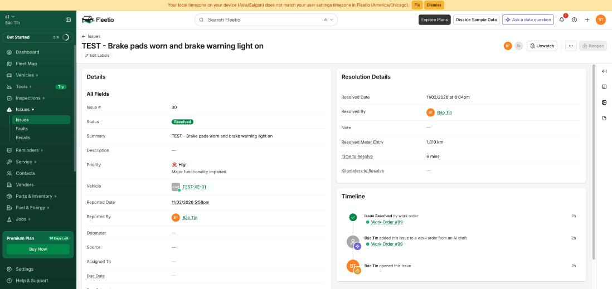

| # | Items | Control type | Data type | Description |
|---|---|---|---|---|
| 1 | Resolution Details | Khối | Chữ, số | Resolved Date, By, Note, Resolved Meter Entry, Time to Resolve, Kilometers to Resolve |
| 2 | Reopen | Nút | — | Khoá khi giải quyết bằng lệnh, phải đổi lệnh về chưa xong; mở được khi giải quyết bằng ghi chú, bằng entry |
| 3 | Timeline | Khối | Sự kiện | "Issue Resolved by work order", "added ... from an AI draft" |

## 2.1 Danh sách lệnh, ba chế độ xem

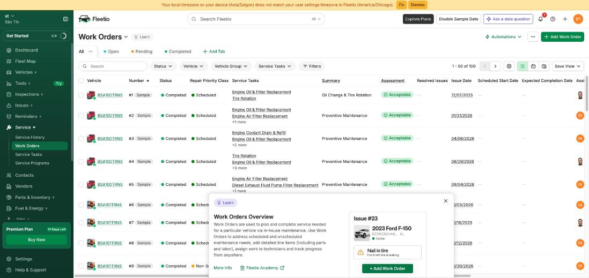

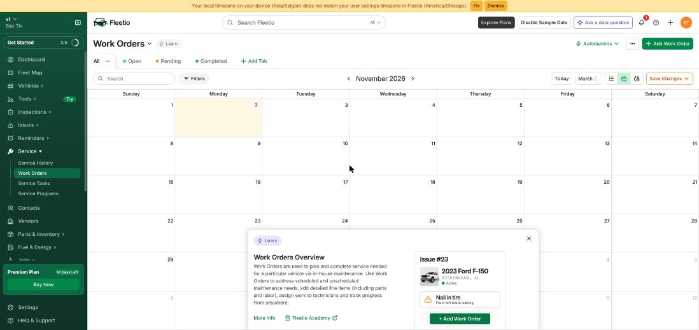

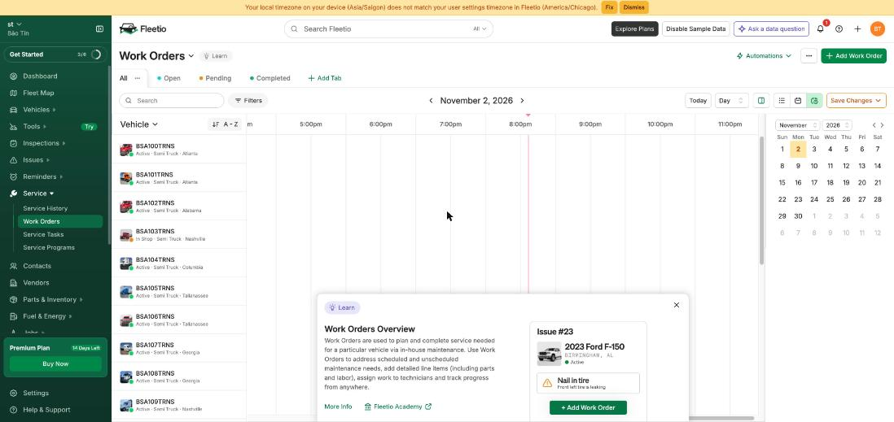

| # | Items | Control type | Data type | Description |
|---|---|---|---|---|
| 1 | Tab All, Open, Pending, Completed | Tab | — | Theo trạng thái, có chấm màu |
| 2 | Cột | Bảng | — | Vehicle, Number, Status, Repair Priority Class, Service Tasks, Summary, Assessment, Resolved Issues, ngày, Assigned, Watchers, Operator, Total Cost, Labels |
| 3 | List, Calendar, Resource Scheduler | Nút | — | Đổi chế độ; đổi xong hiện Save Changes để lưu vào tab |
| 4 | Lịch tài nguyên | Lưới | Giờ, xe | Mỗi xe một hàng, trục giờ, lịch tháng bên phải, gom theo Vehicle |

## 2.2 Sửa lệnh

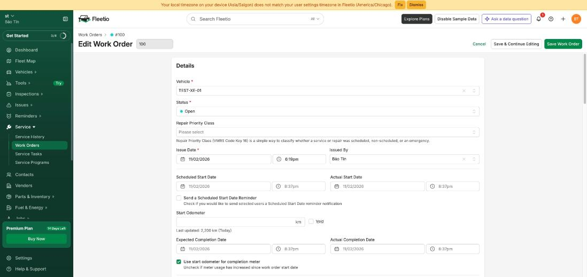

| # | Items | Control type | Data type | Description |
|---|---|---|---|---|
| 1 | Vehicle, Status | Chọn | Bắt buộc | — |
| 2 | Repair Priority Class | Chọn | Mã | Scheduled, Non-Scheduled, Emergency |
| 3 | Issue Date, Issued By | Ngày, chọn | Bắt buộc ngày | — |
| 4 | Scheduled Start, Actual Start | Ngày giờ | — | Có nhắc ngày bắt đầu |
| 5 | Start Odometer, Void | Số, tick | km | Hiện lần cập nhật gần nhất. Có số thì bắt buộc Actual Start (E-fleetio-repair-001) |
| 6 | Expected, Actual Completion | Ngày giờ | — | Tính thời lượng |
| 7 | Use start odometer for completion meter | Tick | — | Khỏi nhập số km cuối |
| 8 | Issues | Bảng tick | — | Tab Open, Resolved, Closed; Link to Line Items |
| 9 | Line Items | Tab | — | Service Tasks, Labor, Parts; Customize |
| 10 | Dòng việc | Số, chọn | Tiền | Labor, Parts, Subtotal; Add Labor, Add Part, Link Issues; ghi chú; Reason, Category, System, Assembly |
| 11 | Cost Summary | Số | Tiền | Markup công, markup phụ tùng, tín dụng bảo hành, giảm giá, thuế, tổng |
| 12 | Save & Continue, Save and ..., Save | Nút | — | Lưu theo nhiều kiểu |

## 2.3 Chi tiết lệnh

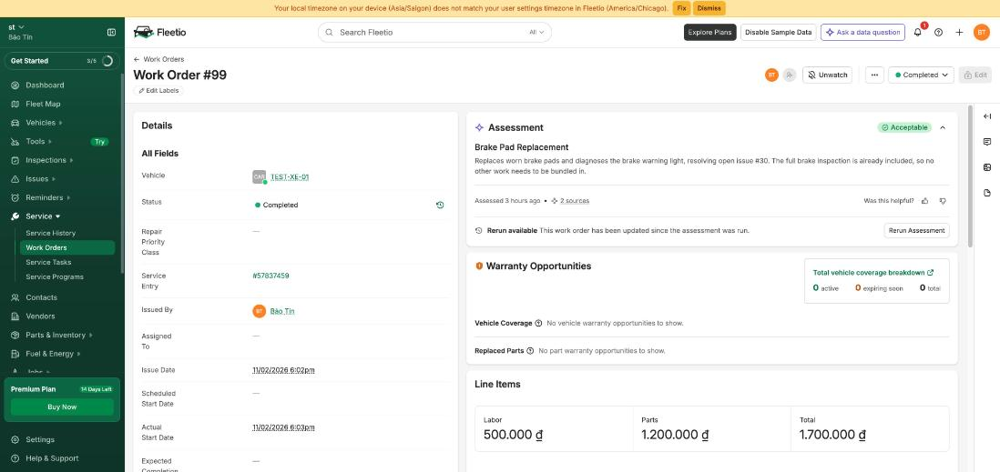

| # | Items | Control type | Data type | Description |
|---|---|---|---|---|
| 1 | Status | Menu | — | Open, Pending, Completed có dấu khoá |
| 2 | Edit | Nút | — | Khoá sau khi hoàn thành |
| 3 | Assessment | Khối | AI | Kết luận, tóm tắt, số nguồn, phản hồi, Rerun Assessment |
| 4 | Warranty Opportunities | Khối | — | Xe còn bảo hành, phụ tùng thay được bảo hành |
| 5 | Line Items | Khối | Tiền | Thẻ Labor, Parts, Total; từng dòng |
| 6 | Menu ba chấm | Menu | — | Run Assessment, Print, Make a Copy, View Record History, Email PDF, Delete |
| 7 | Details | Khối | — | Thêm Service Entry, Users to Notify, Last Emailed Quote, Work Order, Invoice |

## 3.1 Service Entry

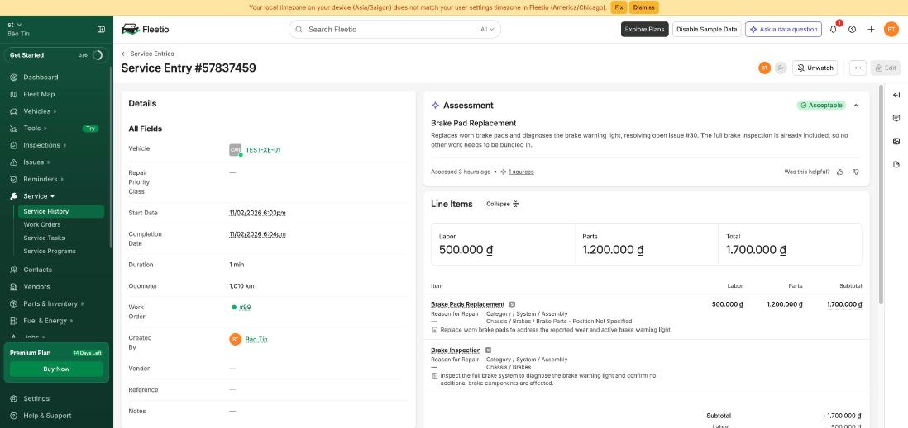

| # | Items | Control type | Data type | Description |
|---|---|---|---|---|
| 1 | Details | Khối | — | Start, Completion, Duration, Odometer, Work Order, Created By, Vendor, Reference, Notes |
| 2 | Line Items | Khối | Tiền | Kế thừa từ lệnh, kèm Reason, Category, System, Assembly đầy đủ |
| 3 | Assessment | Khối | AI | Kế thừa từ lệnh ở lượt #99; ở entry từ #104 phải bấm Run Assessment, xem màn 3.2 |

## 4.1 Mã lỗi

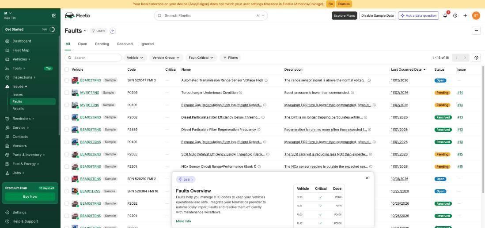

| # | Items | Control type | Data type | Description |
|---|---|---|---|---|
| 1 | Tab All, Open, Pending, Resolved, Ignored | Tab | — | — |
| 2 | Cột | Bảng | — | Vehicle, Code, Critical, Name, Description, Last Occurred, Status, Issue |
| 3 | Issue | Liên kết | Số | Nhiều mã cùng trỏ một sự cố |

## 5.1 Đầu việc

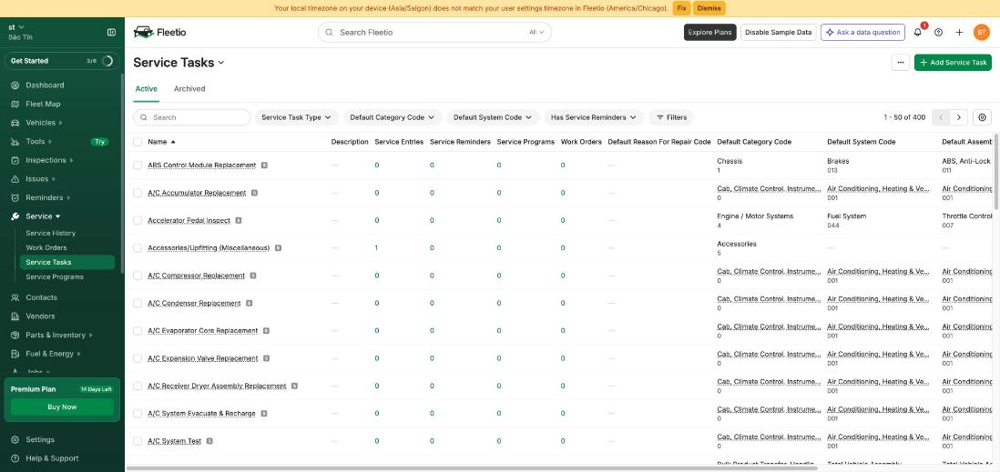

| # | Items | Control type | Data type | Description |
|---|---|---|---|---|
| 1 | Tab Active, Archived | Tab | — | Fleetio: 400 đầu việc có sẵn; Actions có Update Service Tasks, Archive; không thấy Merge |
| 2 | Cột | Bảng | — | Tên, số lần dùng ở entry, nhắc, bộ lịch, lệnh; mã mặc định; giờ công; phụ tùng |

## 6.1 Thêm bảo hành

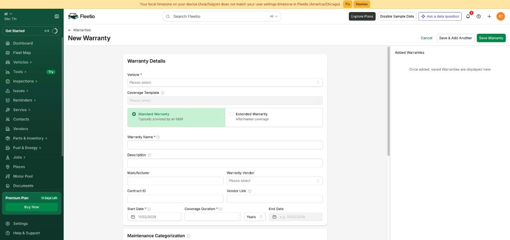

| # | Items | Control type | Data type | Description |
|---|---|---|---|---|
| 1 | Vehicle, Coverage Template | Chọn | Bắt buộc xe | Mẫu mở sau khi chọn xe (`Suy`) |
| 2 | Standard, Extended | Chọn một | — | Của hãng hay mua thêm |
| 3 | Name, Description, Manufacturer, Vendor, Contract ID, Link | Chữ | — | — |
| 4 | Start Date, Coverage Duration, End Date | Ngày, số | Bắt buộc | Tự tính ngày hết hạn |
| 5 | Maintenance Categorization | Chọn | — | Phạm vi theo nhóm hệ thống |
| 6 | Added Warranties | Khối | — | Hiện các bảo hành vừa thêm khi dùng Save & Add Another |

## 1.4 Hộp đóng sự cố

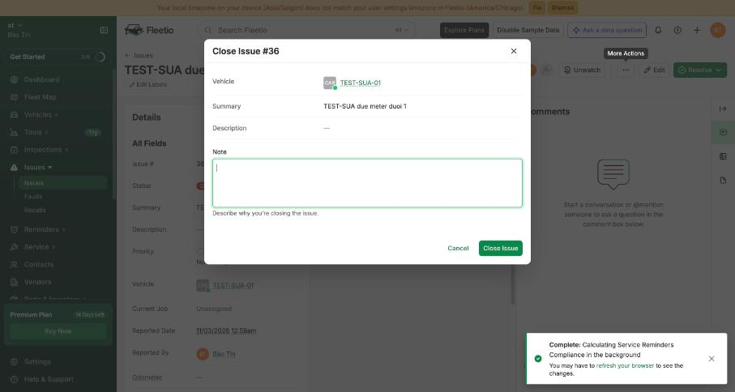

| # | Items | Control type | Data type | Description |
|---|---|---|---|---|
| 1 | Vehicle, Summary, Description | Chỉ đọc | Chữ | Tiêu đề hộp "Close Issue #36" |
| 2 | Note | Ô nhập | Chữ | Không bắt buộc. Gợi ý "Describe why you're closing the issue."; lưu xong thành một Comment của người đóng |
| 3 | Close Issue | Nút | — | Chuyển Closed. Toast "Issue #36 was closed." |

## 1.5 Sự cố đã đóng

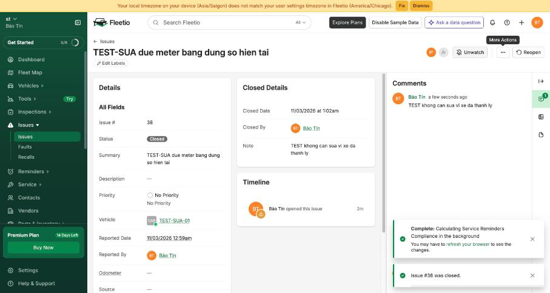

| # | Items | Control type | Data type | Description |
|---|---|---|---|---|
| 1 | Status | Nhãn | Chữ | "Closed" |
| 2 | Closed Details | Khối | Chữ, ngày | Closed Date, Closed By, Note. Mất khi mở lại |
| 3 | Unwatch, ba chấm, Reopen | Nút | — | Không còn Edit, Resolve. Reopen mở hộp "Are you sure you want to reopen the selected issue(s)?" |

## 1.6 Hộp xử lý kèm ghi chú

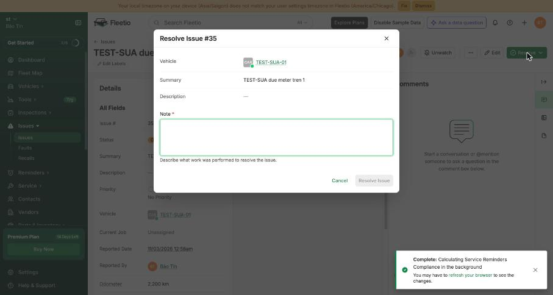

| # | Items | Control type | Data type | Description |
|---|---|---|---|---|
| 1 | Note | Ô nhập | Chữ | Bắt buộc. Gợi ý "Describe what work was performed to resolve the issue." |
| 2 | Resolve Issue | Nút | — | Khoá khi Note trống. Toast "Issue #35 was resolved." |

## 1.7 Sự cố đã xử lý bằng ghi chú

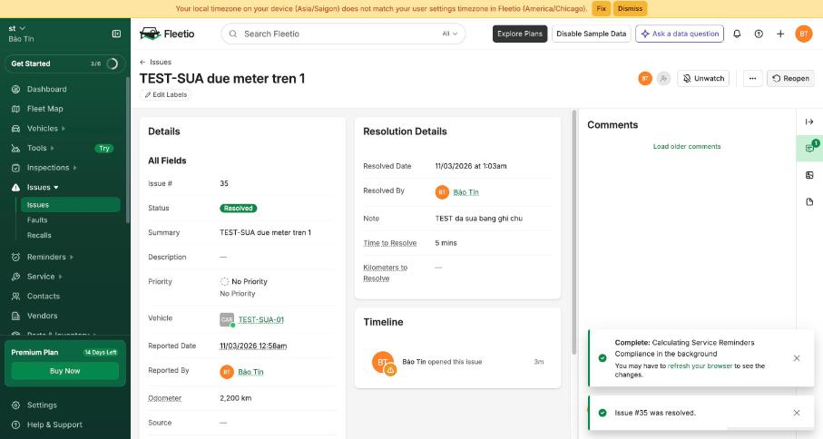

| # | Items | Control type | Data type | Description |
|---|---|---|---|---|
| 1 | Status | Nhãn | Chữ | "Resolved" |
| 2 | Resolution Details | Khối | Chữ, ngày, số | Resolved Date, Resolved By, Note, Time to Resolve 5 mins, Kilometers to Resolve trống |
| 3 | Reopen | Nút | — | Mở được, không điều kiện. Không còn Edit |

## 1.8 Giới thiệu mạng lưới xưởng

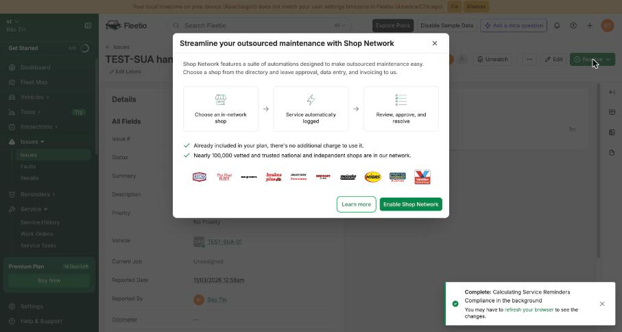

| # | Items | Control type | Data type | Description |
|---|---|---|---|---|
| 1 | Tiêu đề, mô tả | Chữ | — | "Streamline your outsourced maintenance with Shop Network"; "Already included in your plan, there's no additional charge to use it." |
| 2 | Learn more, Enable Shop Network | Nút | — | Không bấm bật, các màn sau chưa xem |

## 1.9 Nháp AI đang soạn

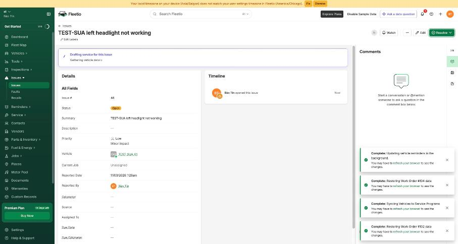

| # | Items | Control type | Data type | Description |
|---|---|---|---|---|
| 1 | Banner trên sự cố | Dải | Chữ | Đổi chữ: "Drafting service for this issue", "Gathering vehicle details", "Reviewing this issue". Khoảng 40 giây; rời trang vẫn chạy |

## 1.10 Nháp AI sẵn sàng

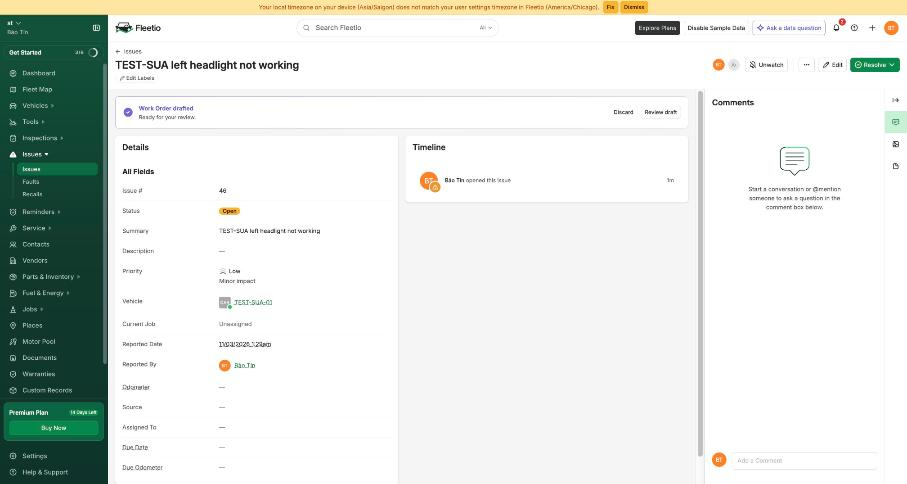

| # | Items | Control type | Data type | Description |
|---|---|---|---|---|
| 1 | Banner | Dải | Chữ | "Work Order drafted", "Ready for your review." |
| 2 | Discard | Nút | — | Mất ngay, không hỏi, không ghi Timeline |
| 3 | Review draft | Nút | — | Mở màn 2.8 |

## 1.11 Sự cố khoá mở lại

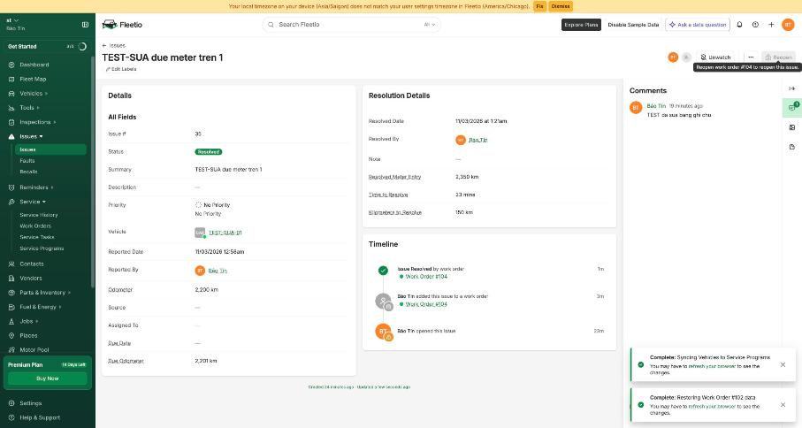

| # | Items | Control type | Data type | Description |
|---|---|---|---|---|
| 1 | Reopen | Nút khoá | — | Tooltip "Reopen work order #104 to reopen this issue." Phải mở lại lệnh |
| 2 | Resolution Details | Khối | Chữ, số | Resolved Meter Entry 2,350 km, Time to Resolve 23 mins, Kilometers to Resolve 150 km |
| 3 | Timeline | Khối | Sự kiện | "Issue Resolved by work order", "added this issue to a work order" |

## 1.12 Menu xử lý, sự cố đã gắn lệnh

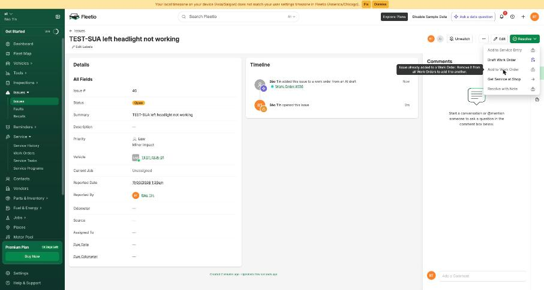

| # | Items | Control type | Data type | Description |
|---|---|---|---|---|
| 1 | Add to Service Entry, Add to Work Order, Resolve with Note | Mục khoá | — | Xám có khoá. Tooltip của Add to Work Order: "Issue already added to a Work Order. Remove it from all Work Orders to add it to another." |
| 2 | Draft Work Order, Get Service at Shop | Mục menu | — | Ảnh của lượt 2: vẫn dùng được. Lượt 3 trên #45 Draft Work Order xám có khoá, chưa rõ lý do; Close cũng xám; chưa có ảnh của lần đó |

## 1.13 Menu xử lý sự cố

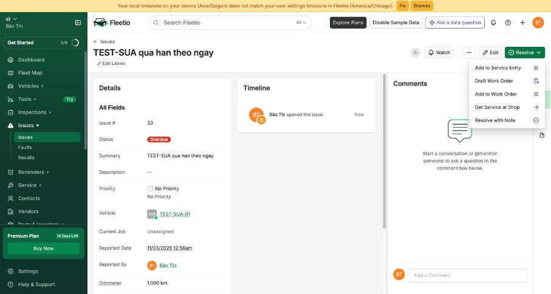

| # | Items | Control type | Data type | Description |
|---|---|---|---|---|
| 1 | Add to Service Entry, Draft Work Order, Add to Work Order, Get Service at Shop, Resolve with Note | Mục menu | — | Đủ năm mục khi sự cố chưa gắn lệnh. Run-notes không mô tả riêng ảnh này |

## 2.4 Mục sự cố và dòng việc trên form

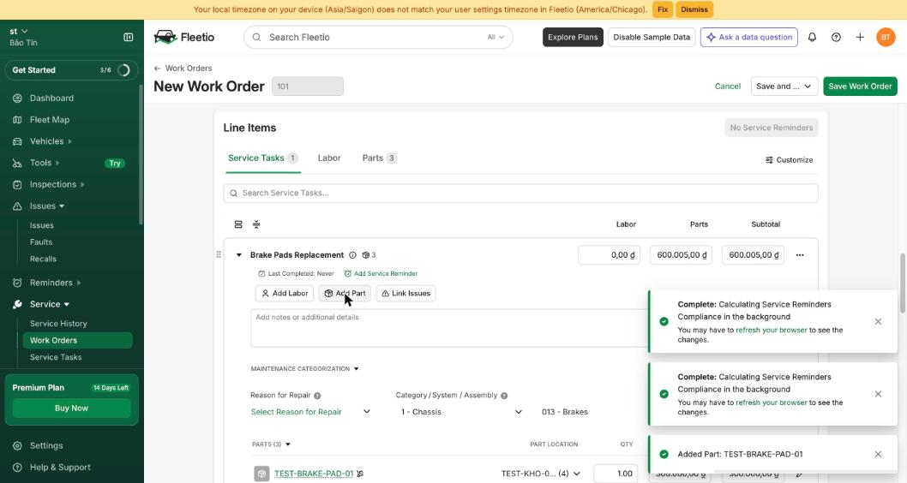

| # | Items | Control type | Data type | Description |
|---|---|---|---|---|
| 1 | Tab Open, Resolved, Closed | Tab | — | Overdue nằm trong tab Open. Cảnh báo "Select any issues that were resolved as part of this service" |
| 2 | Bảng sự cố | Bảng tick | — | Priority, Issue, Summary, Linked Line Items, Status, Labels, Assigned, Work Orders, Due Date, Due Meter. Dòng đã ở lệnh khác có ổ khoá |
| 3 | Tab Service Tasks, Labor, Parts | Tab | — | "No Service Reminders" khi không có nhắc |
| 4 | Dòng việc | Khối | Chữ, tiền | Last Completed, Add Service Reminder, Add Labor, Add Part, Link Issues |
| 5 | MAINTENANCE CATEGORIZATION | Chọn | Mã | Reason for Repair; Category, System, Assembly tự điền |

## 2.5 Hộp thêm phụ tùng

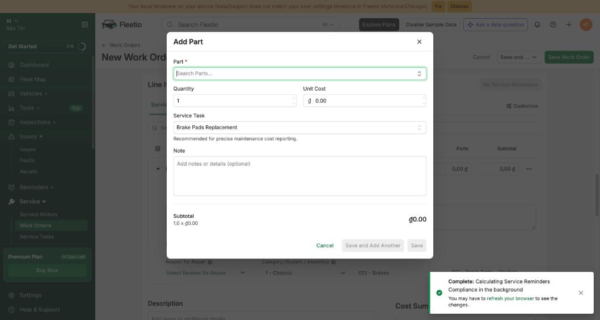

| # | Items | Control type | Data type | Description |
|---|---|---|---|---|
| 1 | Part Location | Chọn | — | Kho kèm tồn, hoặc "None (No Inventory Adjustment)"; có kho thì ghi "This will make an inventory adjustment". Không cảnh báo vượt tồn. Lượt 4: danh sách có nhóm "PULL FROM INVENTORY" kèm tồn từng kho |
| 2 | Giá, số lượng | Số | Tiền, số | Unit Cost tự điền từ danh mục. Form đúng; trang chi tiết sau lưu gấp 100 lần với ₫ (E-fleetio-repair-005), gõ đơn giá chia 100 thì chi tiết đúng. Các ô khác: run-notes không liệt kê |

## 2.6 Hộp thêm công

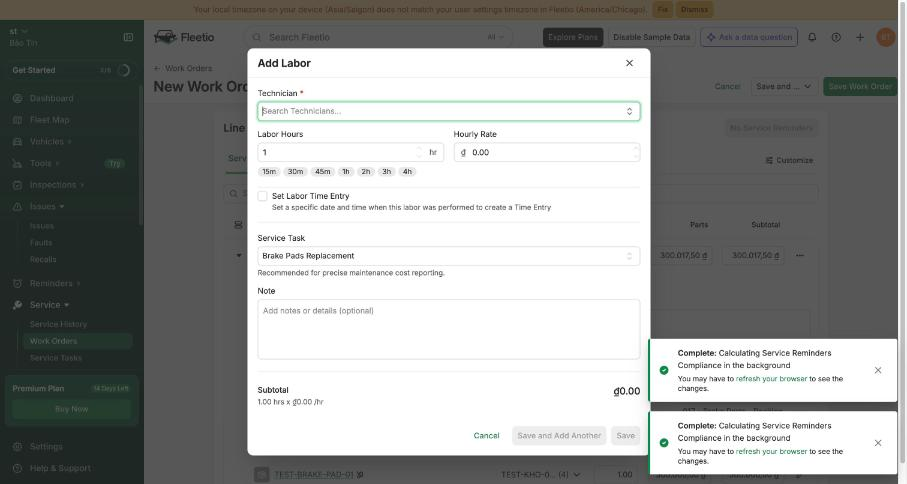

| # | Items | Control type | Data type | Description |
|---|---|---|---|---|
| 1 | Technician | Chọn | Chữ, tiền | Danh sách kèm đơn giá ₫/hr, lệch so với dòng (E-fleetio-repair-014). Contact mẫu gây E-fleetio-repair-010 về sau |
| 2 | Labor Hours, Hourly Rate | Số | Tiền | Mặc định 1 giờ, nút chọn nhanh 15m, 30m, 45m, 1h, 2h, 3h, 4h. Hộp sửa ghi "Current default labor rate is ₫100000.00" |
| 3 | Set Labor Time Entry | Ô tick | — | "Set a specific date and time when this labor was performed to create a Time Entry". Tick hiện Start Date, End Date, lúc này End bằng Start cộng số giờ; ảnh này chụp lúc chưa tick |
| 4 | Service Task | Chọn | Chữ | "Recommended for precise maintenance cost reporting." |
| 5 | Note, Subtotal | Ô, số | Chữ, tiền | Note tuỳ chọn. Subtotal "1.00 hrs x ₫0.00 /hr" |
| 6 | Cancel, Save and Add Another, Save | Nút | — | Hai nút lưu khoá khi chưa chọn Technician |

## 2.7 Hộp liên kết sự cố

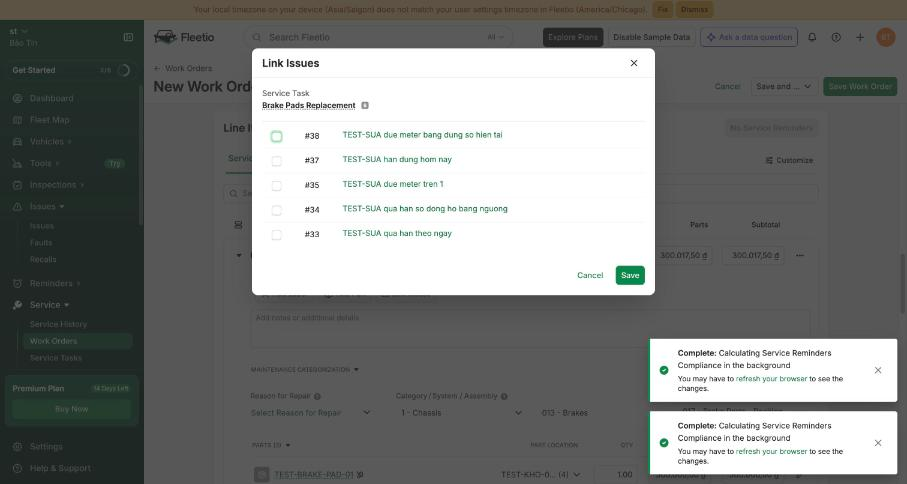

| # | Items | Control type | Data type | Description |
|---|---|---|---|---|
| 1 | Service Task | Chữ | — | Tên dòng việc đang liên kết. Ảnh là Brake Pads Replacement trên form lệnh mới |
| 2 | Danh sách sự cố | Ô tick | Số, chữ | Sự cố của xe, cột số và tóm tắt. Sự cố đã ở lệnh khác có ổ khoá, tooltip "...to a Work Order. Remove it from ...orders to add it to another." bị che một phần; ảnh này chưa có dòng khoá |
| 3 | Cancel, Save | Nút | — | Sau Save, sự cố tự tick ở khối Issues, cột Linked Line Items hiện tên dòng. Save ngay sau tick thì hộp đóng mà không tick: E-fleetio-repair-025 |

## 2.8 Duyệt nháp AI

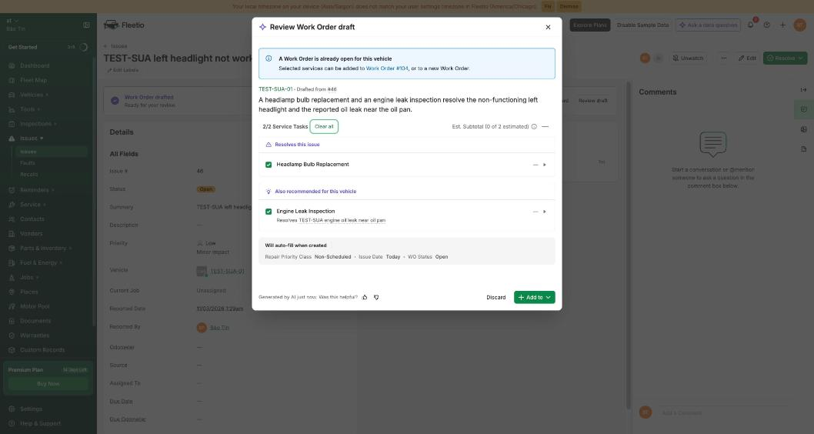

| # | Items | Control type | Data type | Description |
|---|---|---|---|---|
| 1 | Cảnh báo | Dải | Chữ | "A Work Order is already open for this vehicle", "Selected services can be added to Work Order #104, or to a new Work Order." |
| 2 | Drafted from, câu tóm tắt | Chữ | Chữ | "Drafted from #46" |
| 3 | Service Tasks | Tick | — | "2/2 Service Tasks", "Clear all"; bỏ tick đổi "1/2", nút "Select all" |
| 4 | Est. Subtotal | Số | Tiền | "(0 of 2 estimated)", "No estimate available" |
| 5 | Resolves this issue, Also recommended for this vehicle | Nhóm | — | Nhóm sau gom sự cố khác cùng xe |
| 6 | Will auto-fill when created | Chữ | — | Repair Priority Class Non-Scheduled, Issue Date Today, WO Status Open. Phân loại ưu tiên thực tế trống (E-fleetio-repair-017) |
| 7 | Discard, Add to | Nút | — | "Generated by AI just now. Was this helpful?" |

## 2.9 Menu tạo lệnh từ nháp

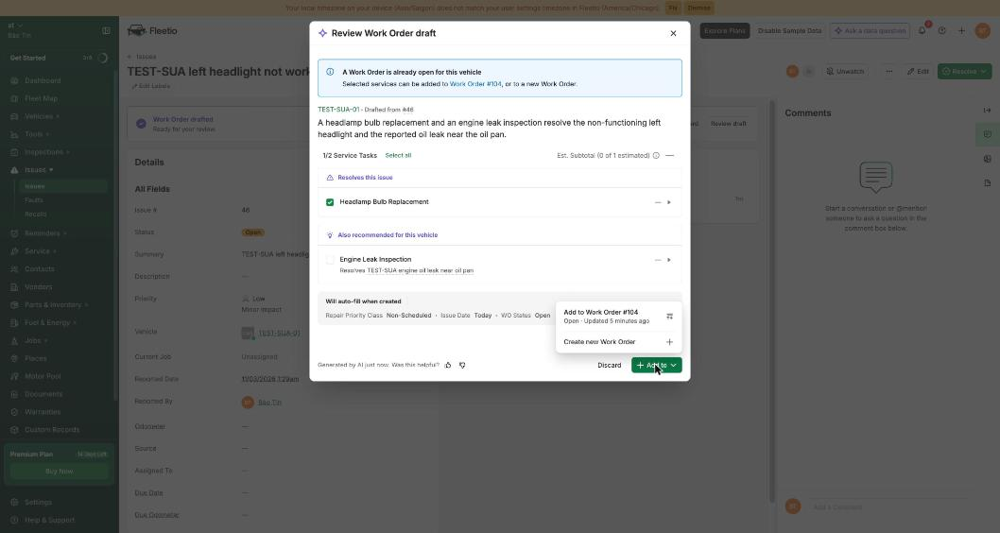

| # | Items | Control type | Data type | Description |
|---|---|---|---|---|
| 1 | Add to Work Order #104 | Mục menu | — | Hiện khi xe có lệnh mở, chỉ nêu lệnh mở mới nhất. Lượt 3 chạy trên #110: thêm dòng, sự cố vào "Resolved Issues", toast "Work Order successfully updated" |
| 2 | Create new Work Order | Mục menu | — | Tạo lệnh mới, toast "Work Order successfully created" |

## 2.10 Lệnh tạo từ nháp

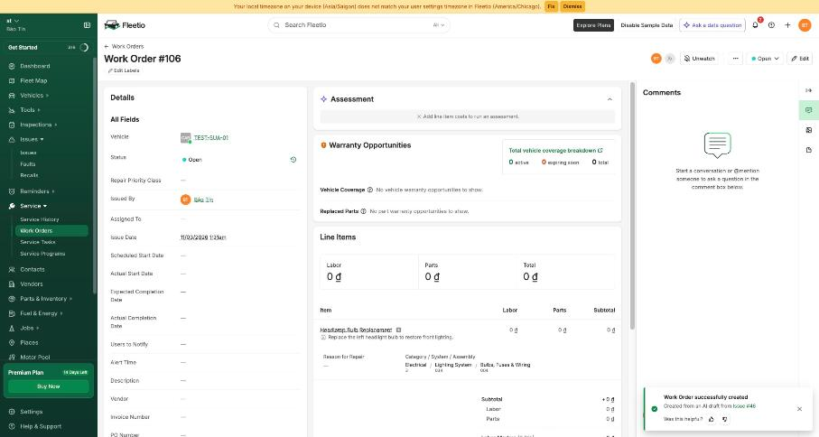

| # | Items | Control type | Data type | Description |
|---|---|---|---|---|
| 1 | Thông báo | Toast | Chữ | "Created from an AI draft from Issue #46" |
| 2 | Đầu việc | Dòng | Chữ, mã | Mô tả AI, phân loại 2 Electrical, 034 Lighting System, 004 Bulbs, Fuses & Wiring |
| 3 | Repair Priority Class | Trường | Mã | Trống "—" |

## 2.11 Lệnh đã hoàn thành

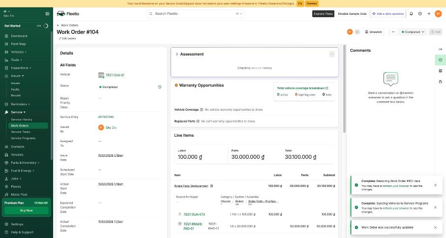

| # | Items | Control type | Data type | Description |
|---|---|---|---|---|
| 1 | Status | Menu | — | "Completed"; đổi về chưa xong mở màn 2.12 |
| 2 | Service Entry, Duration | Trường | Liên kết, chữ | "Service Entry #57857945", "Duration 2 minutes" |
| 3 | Odometer, Completion Odometer | Trường | km | 2,300 km; 2,350 km |
| 4 | Edit | Nút | — | Khoá |

## 2.12 Hộp mở lại lệnh

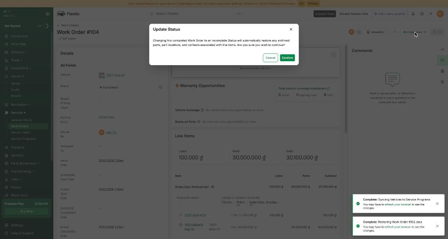

| # | Items | Control type | Data type | Description |
|---|---|---|---|---|
| 1 | Update Status | Hộp | Chữ | "Changing this completed Work Order to an incomplete Status will automatically restore any archived parts, part locations, and contacts associated with line items. Are you sure you wish to continue?" Không báo entry bị xoá, sự cố mở lại |
| 2 | Cancel, Confirm | Nút | — | Confirm: toast cập nhật, toast "Restoring Work Order #104 data"; vài giây trang vẫn Completed |

## 2.13 Bản sao lệnh

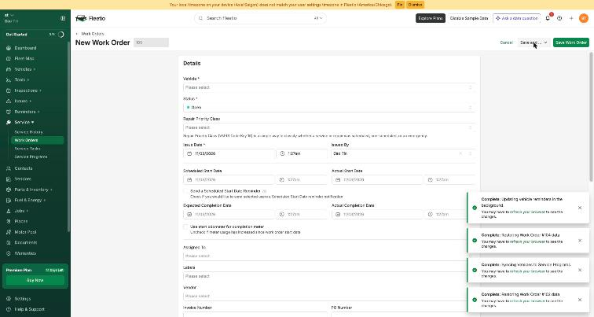

| # | Items | Control type | Data type | Description |
|---|---|---|---|---|
| 1 | Vehicle | Chọn | — | Trống, phải chọn lại; chọn xong dòng việc, dòng công được chép |
| 2 | Status, Issue Date | Trường | — | Open, thời điểm hiện tại |
| 3 | Issues, ngày, đồng hồ | Trường | — | Không chép. Không có số lệnh mới tới khi lưu |

## 2.14 Lỗi điều kiện hoàn thành

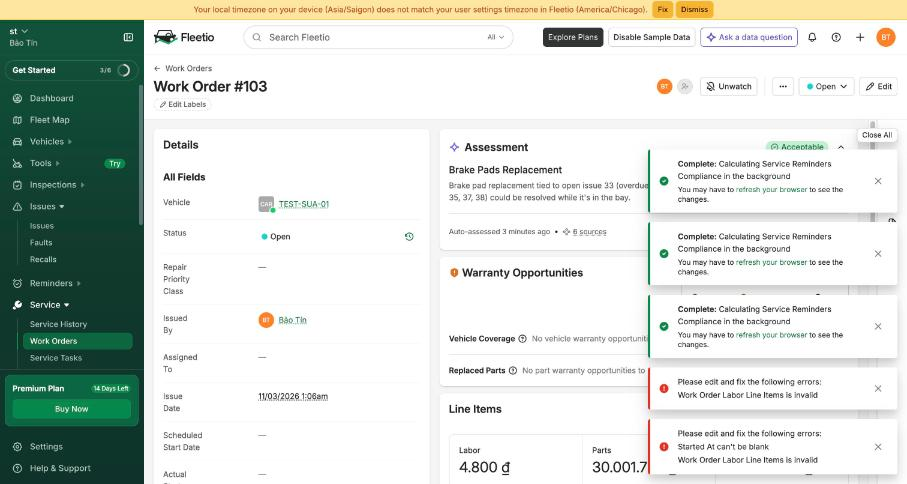

| # | Items | Control type | Data type | Description |
|---|---|---|---|---|
| 1 | Thông báo lỗi | Toast | Chữ | E-fleetio-repair-006: "Please edit and fix the following errors: Started At can't be blank"; E-fleetio-repair-007 ở bước sau. Trạng thái giữ nguyên |

## 2.15 Chi tiết lệnh lệch tiền

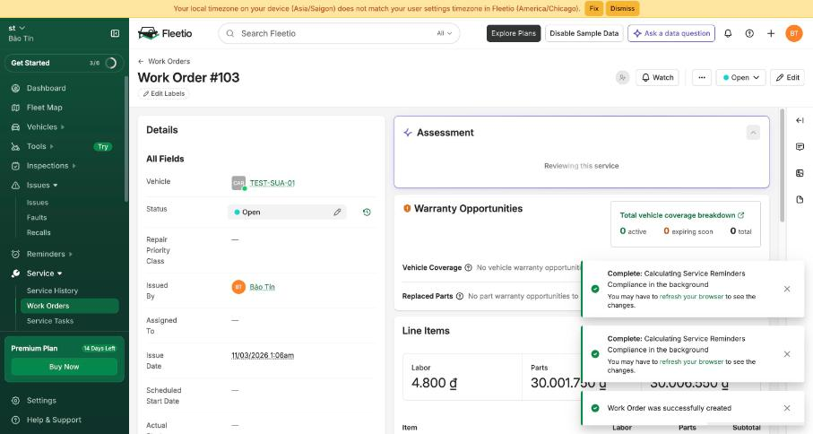

| # | Items | Control type | Data type | Description |
|---|---|---|---|---|
| 1 | Dòng phụ tùng | Dòng | Tiền | Nhập 300.000 hiện 30.000.000 ₫; 5 hiện 500 ₫; 12,5 hiện 1.250 ₫. Không báo (E-fleetio-repair-005) |
| 2 | Tổng Parts | Số | Tiền | 30.001.750 ₫ thay vì 300.017,50 ₫ |
| 3 | Assessment | Khối | AI | Vẫn "Acceptable" |

## 2.16 Khối bảo hành, chưa có cơ hội

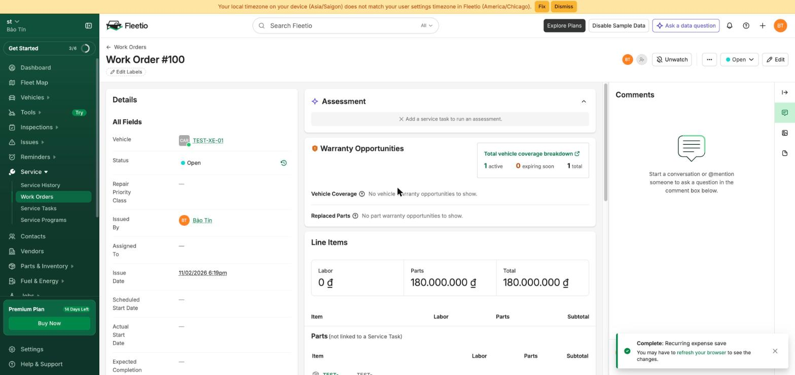

| # | Items | Control type | Data type | Description |
|---|---|---|---|---|
| 1 | Total vehicle coverage breakdown | Số | Đếm | 1 active, 0 expiring soon, 1 total |
| 2 | Vehicle Coverage | Khối | — | "No vehicle warranty opportunities to show." |
| 3 | Replaced Parts | Khối | — | "No part warranty opportunities to show." Phụ tùng cùng hệ thống đứng riêng không gợi ý |

## 2.17 Cơ hội bảo hành

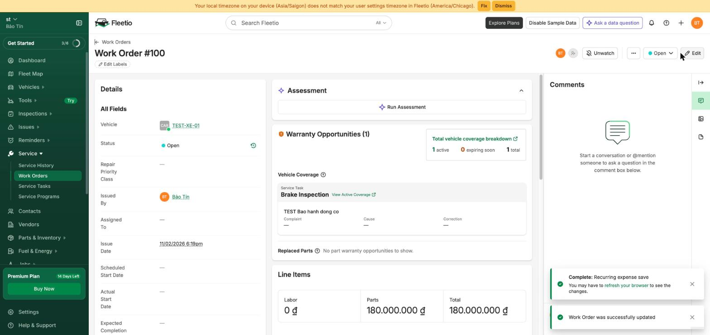

| # | Items | Control type | Data type | Description |
|---|---|---|---|---|
| 1 | Warranty Opportunities (1) | Khối | Đếm | Hiện sau khi thêm đầu việc cùng mã |
| 2 | Vehicle Coverage | Dòng | Liên kết | Service Task "Brake Inspection", "View Active Coverage" |
| 3 | Complaint, Cause, Correction | Ô | Chữ | Trống; không có nút claim, xem 2.18 |

## 3.2 Service Entry từ lệnh

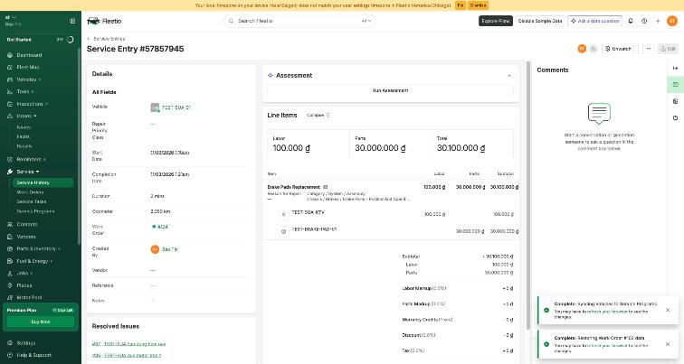

| # | Items | Control type | Data type | Description |
|---|---|---|---|---|
| 1 | Edit | Nút | — | Khoá |
| 2 | Details | Khối | Liên kết, số | "Work Order #104", Start Date, Duration 2 mins, Odometer lấy số cuối 2.350 |
| 3 | Run Assessment | Nút | — | Phải bấm; trên lệnh thì tự chạy |
| 4 | Line Items | Khối | Tiền | Đủ dòng, tiền gấp 100 như lệnh |
| 5 | Resolved Issues | Khối | Liên kết | #35, #37 |

## 3.3 Service Entry đã xoá

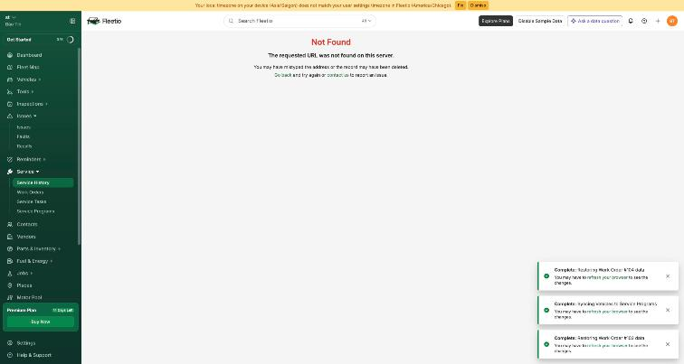

| # | Items | Control type | Data type | Description |
|---|---|---|---|---|
| 1 | Not Found | Trang lỗi | Chữ | "the record may have been deleted". Mở lại URL entry sau khi mở lại lệnh |

## 6.2 Form bảo hành

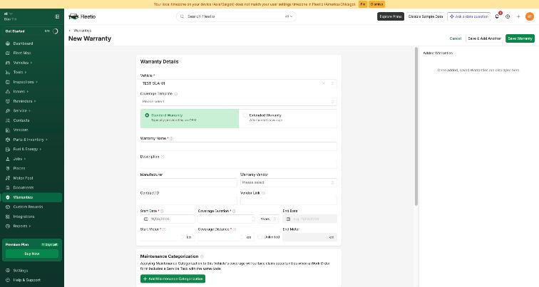

| # | Items | Control type | Data type | Description |
|---|---|---|---|---|
| 1 | Vehicle, Coverage Template | Chọn | — | Standard Warranty "Typically provided by an OEM", Extended Warranty "Aftermarket coverage" |
| 2 | Warranty Name, Description, Manufacturer, Warranty Vendor, Contract ID, Vendor Link | Chữ | — | Theo form |
| 3 | Start Date, Coverage Duration, End Date | Ngày, số | Năm, tháng | Ô Start Date chỉ có placeholder, lưu trống báo "can't be blank" |
| 4 | Start Meter, Coverage Distance, End Meter | Số | km | Có "Unlimited" |
| 5 | Maintenance Categorization, Components | Chọn | Mã | "will surface claim opportunities when a Work Order form includes a Service Task with the same code" |

## 6.3 Chọn xe bảo hành

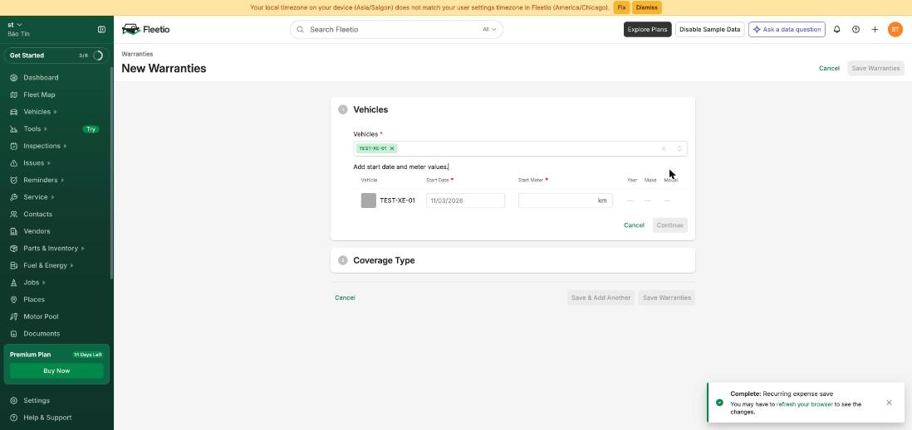

| # | Items | Control type | Data type | Description |
|---|---|---|---|---|
| 1 | Vehicles | Chọn nhiều | — | Bước 1. Mỗi xe một Start Date, Start Meter; hiện Year, Make, Model |

## 6.4 Mẫu bảo hành

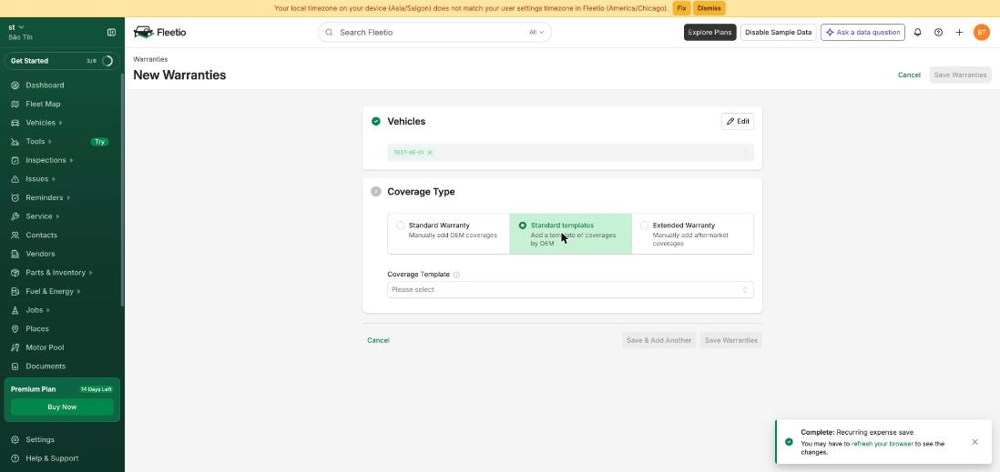

| # | Items | Control type | Data type | Description |
|---|---|---|---|---|
| 1 | Standard templates | Chọn | — | "Add a template of coverages by OEM". Tooltip "Coverage templates contain a collection of coverages based on manufacturer guidelines"; xe không có Make, Model hiện "No options" |

## 6.5 Bảo hành chuẩn

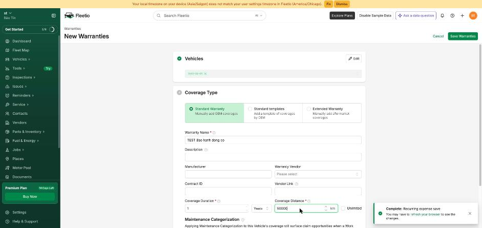

| # | Items | Control type | Data type | Description |
|---|---|---|---|---|
| 1 | Standard Warranty | Chọn | — | "Manually add OEM coverages" |
| 2 | Coverage Duration, Coverage Distance | Số | Đơn vị, km | Tự tính End Date, End Meter |

## 6.6 Mã phân loại bảo hành

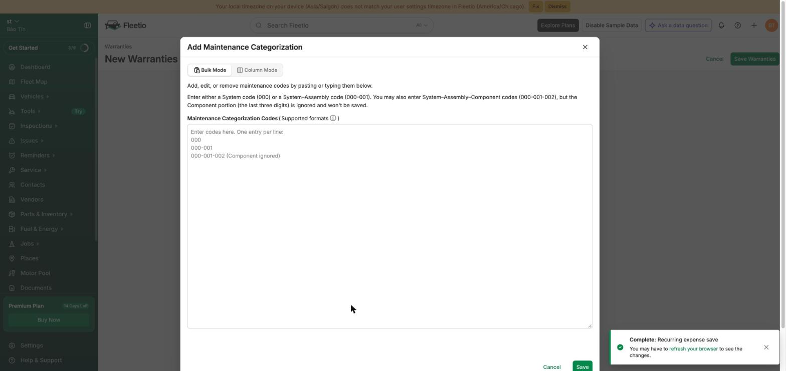

| # | Items | Control type | Data type | Description |
|---|---|---|---|---|
| 1 | Maintenance Categorization | Chọn | Mã | Nhập 013 hiện "1 - Chassis", "013 - Brakes". Có Bulk Mode, Column Mode |

## 6.7 Danh sách bảo hành

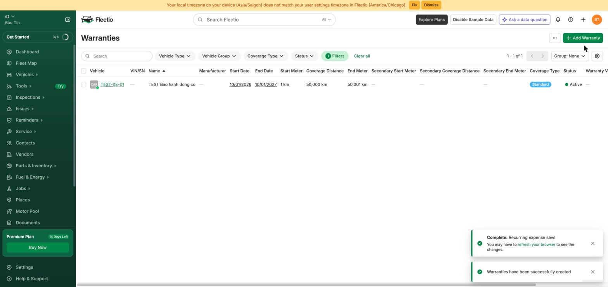

| # | Items | Control type | Data type | Description |
|---|---|---|---|---|
| 1 | Dòng bảo hành | Bảng | Ngày, km | Status "Active"; End Date 10/01/2027; Start Meter 1 km, End Meter 50,001 km dù nhập 1000. Cột khác: run-notes không liệt kê |

## 7.1 Cài đặt bảo dưỡng

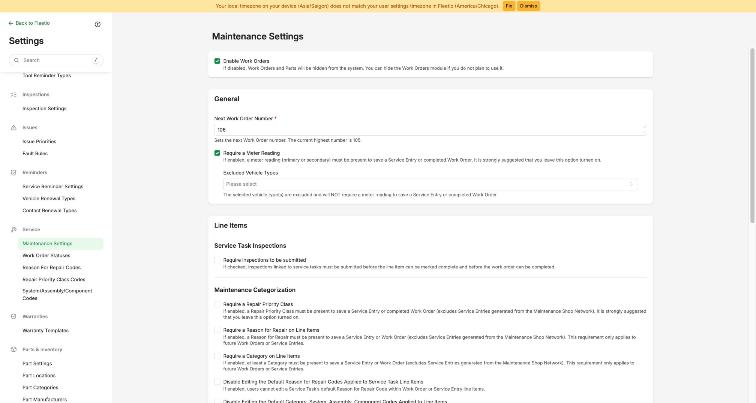

| # | Items | Control type | Data type | Description |
|---|---|---|---|---|
| 1 | Enable Work Orders | Bật tắt | — | Đang bật |
| 2 | Next Work Order Number | Số | — | "Sets the next Work Order number. The current highest number is 105" |
| 3 | Require a Meter Reading | Bật tắt | — | Đang bật. "If enabled, a meter reading (primary or secondary) must be present to save a Service Entry or completed Work Order"; có Excluded Vehicle Types |
| 4 | Require Inspections to be submitted | Bật tắt | — | Đang tắt |
| 5 | Require a Repair Priority Class, Reason for Repair, Category on Line Items | Bật tắt | — | Đang tắt |
| 6 | Hai mục chặn sửa mã mặc định | Bật tắt | — | Đang tắt. Xem, không đổi |

## 1.14 Sự cố đã xử lý, thời gian xử lý âm

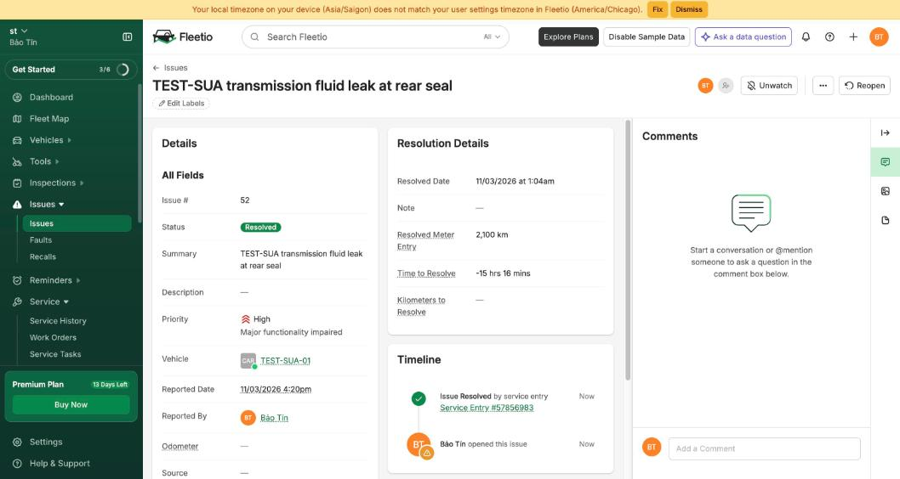

| # | Items | Control type | Data type | Description |
|---|---|---|---|---|
| 1 | Details, All Fields | Khối | Chữ | Issue # 52, Status Resolved, Summary, Priority High "Major functionality impaired", Vehicle TEST-SUA-01, Reported Date 11/03/2026 4:20pm, Reported By, Odometer "—", Source "—" |
| 2 | Resolved Date | Chữ | Ngày giờ | 11/03/2026 at 1:04am, lấy theo entry có sẵn, trước lúc báo sự cố |
| 3 | Note | Chữ | — | "—" vì giải quyết qua entry |
| 4 | Resolved Meter Entry | Chữ | Số | 2,100 km |
| 5 | Time to Resolve | Chữ | Thời lượng | "-15 hrs 16 mins". Không cảnh báo, không chặn: E-fleetio-repair-020 |
| 6 | Kilometers to Resolve | Chữ | Số | "—" |
| 7 | Timeline | Khối | Sự kiện | "Issue Resolved by service entry", liên kết Service Entry #57856983; "opened this issue". Bỏ tick trong entry sau đó thì mất dòng này |
| 8 | Unwatch, menu ba chấm, Reopen | Nút | — | Reopen không khoá vì giải quyết bằng entry |
| 9 | Comments | Khung | Chữ | Trống, ô Add a Comment |

Ảnh chỉ tới phần trên của Details; các trường dưới Source không thấy trong khung.

## 2.18 Hồ sơ bảo hành trên lệnh

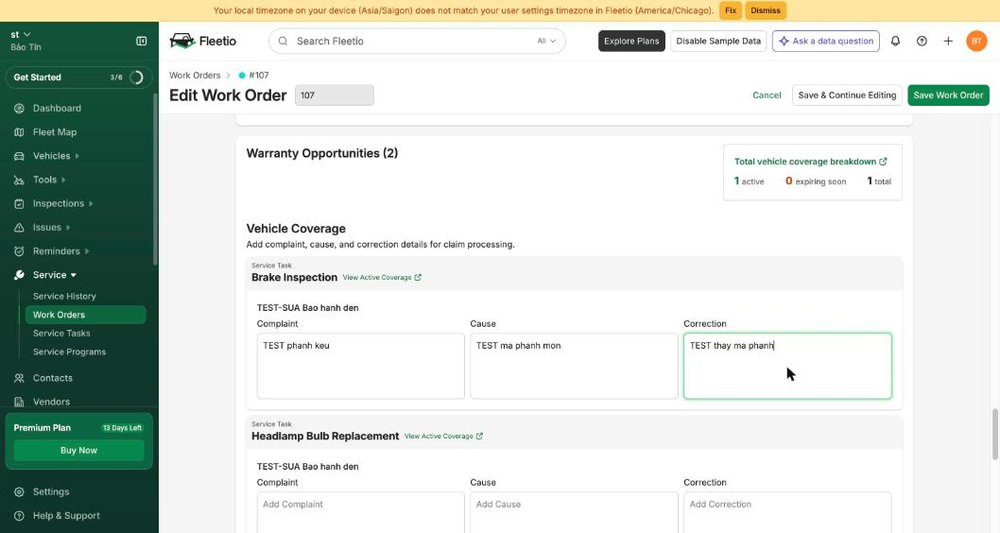

| # | Items | Control type | Data type | Description |
|---|---|---|---|---|
| 1 | Warranty Opportunities (2) | Tiêu đề | Đếm | Form Edit Work Order #107. Số cơ hội đổi ngay trên form |
| 2 | Total vehicle coverage breakdown | Liên kết, số | Đếm | 1 active, 0 expiring soon, 1 total lúc chụp, trước khi thêm hai bảo hành Extended. Liên kết sang tab bảo hành của xe, không phải quy trình claim |
| 3 | Vehicle Coverage | Khối | Chữ | "Add complaint, cause, and correction details for claim processing." |
| 4 | Service Task, View Active Coverage | Chữ, liên kết | — | Brake Inspection, Headlamp Bulb Replacement; mỗi đầu việc khớp một thẻ |
| 5 | Tên bảo hành | Chữ | — | TEST-SUA Bao hanh den |
| 6 | Complaint, Cause, Correction | Ô nhiều dòng | Chữ | Tuỳ chọn. Placeholder "Add Complaint", "Add Cause", "Add Correction" ở thẻ Headlamp. Lưu xong chi tiết hiện đúng ba nội dung |
| 7 | Cancel, Save & Continue Editing, Save Work Order | Nút | — | Không có nút claim, trạng thái claim, gửi hãng; Warranty Credits vẫn nhập tay |

Thẻ Headlamp bị cắt ở đáy ảnh. Khối Replaced Parts nếu có nằm dưới khung, không thấy trong ảnh.

## 4.2 Luật mã lỗi

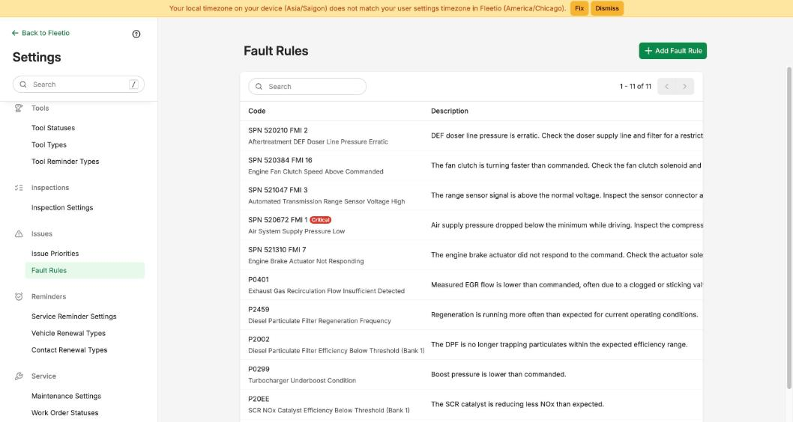

| # | Items | Control type | Data type | Description |
|---|---|---|---|---|
| 1 | Menu Settings › Issues | Menu | — | Issue Priorities, Fault Rules đang chọn; các nhóm Tools, Inspections, Reminders, Service cùng cột |
| 2 | Search, 1 - 11 of 11, phân trang | Ô, chữ | — | Tìm trong bảng; đếm 11 dòng. Ảnh hiện 10 dòng, dòng cuối ngoài khung |
| 3 | Code | Cột | Mã, chữ | Mã và tên dưới mã. Hai hệ OBD (P0401) và SPN/FMI (SPN 520672 FMI 1); nhãn Critical đỏ cạnh mã |
| 4 | Description | Cột | Chữ | Mô tả, kèm cách kiểm tra. Cột bị cắt bên phải, không đọc hết câu |
| 5 | Add Fault Rule | Nút | — | Mở hộp, không có trong ảnh này: Code bắt buộc "The Code value of an incoming Fault must precisely match this Code to trigger this Fault Rule."; Name, Description ghi đè giá trị của mã đến; Priority Handling bắt buộc: Off, Ignore Code, Flag as Critical. Mở rồi Cancel, không lưu |

## 6.8 Tab bảo hành của xe

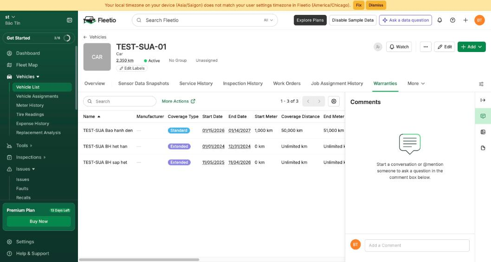

| # | Items | Control type | Data type | Description |
|---|---|---|---|---|
| 1 | Đầu trang xe | Khối | Chữ | TEST-SUA-01, Car, 2,350 km, Active, No Group, Unassigned; Watch, Edit, Add. Xe không tự theo dõi |
| 2 | Tab xe | Tab | — | Overview, Sensor Data Snapshots, Service History, Inspection History, Work Orders, Job Assignment History, Warranties đang chọn, More |
| 3 | Search, More Actions, 1 - 3 of 3 | Ô, nút | — | Tìm, đếm; biểu tượng cài đặt cột |
| 4 | Name, Manufacturer | Cột | Chữ | TEST-SUA Bao hanh den, TEST-SUA BH het han, TEST-SUA BH sap het; Manufacturer "—" |
| 5 | Coverage Type | Cột | Badge | Standard, Extended |
| 6 | Start Date, End Date | Cột | Ngày | 01/15/2026 đến 01/14/2027; 01/01/2024 đến 12/31/2024; 11/05/2025 đến 11/04/2026. Sớm hơn form 1 ngày: E-fleetio-repair-023 |
| 7 | Start Meter, Coverage Distance, End Meter | Cột | Số | 1,000 km, 50,000 km, 51,000 km; hai dòng kia 0 km, Unlimited km. Cột End Meter bị cắt ở hai dòng Unlimited |
| 8 | Status | Cột | Badge | Run-notes có nêu; cột ở ngoài khung ảnh, không đọc được ở đây |
| 9 | Comments | Khung | Chữ | Trống, che phần bên phải của bảng |

## 2.19 Bản in lệnh

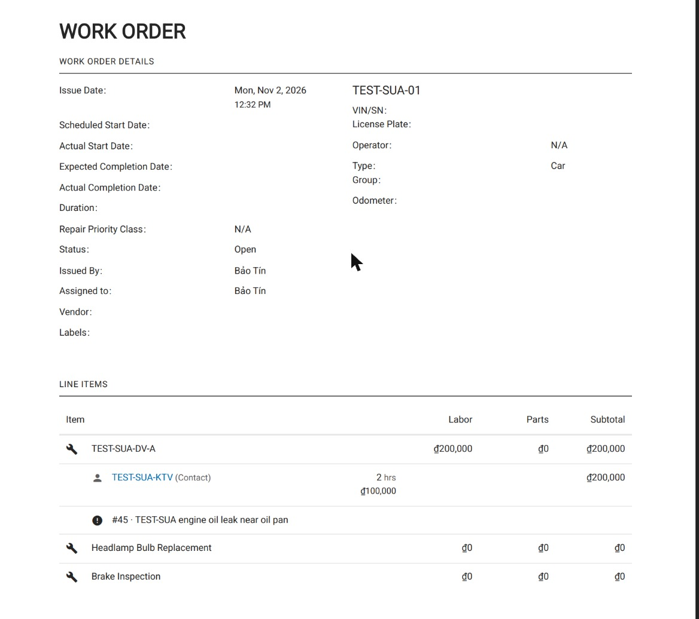

| # | Items | Control type | Data type | Description |
|---|---|---|---|---|
| 1 | WORK ORDER DETAILS | Khối | Chữ, ngày | Issue Date "Mon, Nov 2, 2026 12:32 PM", web 11/03/2026 1:32am: E-fleetio-repair-028. Scheduled Start Date, Actual Start Date, Expected Completion Date, Actual Completion Date, Duration, Vendor, Labels trống; Repair Priority Class N/A; Status Open; Issued By, Assigned to |
| 2 | Khối xe | Khối | Chữ | TEST-SUA-01, VIN/SN, License Plate trống, Operator N/A, Type Car, Group, Odometer trống |
| 3 | LINE ITEMS | Bảng | Tiền | Item, Labor, Parts, Subtotal. TEST-SUA-DV-A ₫200,000; dòng công "TEST-SUA-KTV (Contact)" 2 hrs ₫100,000; dòng sự cố "#45 · TEST-SUA engine oil leak near oil pan"; Headlamp Bulb Replacement, Brake Inspection ₫0. Tiền dạng US |
| 4 | Đầu trang PDF | Khối | Chữ | Run-notes ghi tên, địa chỉ tài khoản, Work Order Number, Invoice Number, PO Number; ảnh đã cắt phần này, không đọc được ở đây |
| 5 | Trang 2: DESCRIPTION, SUMMARY | Khối | Tiền | Run-notes ghi Labor Markup + ₫20,000 (10.0%), Parts Markup + ₫0 (Fixed), Warranty Credits - ₫30,000 (Fixed), Discount - ₫10,000 (5.0%), Tax +₫18,000 (10.0%), Total ₫198,000; ảnh không có trang 2. Complaint, Cause, Correction không in trong phần đọc được |
