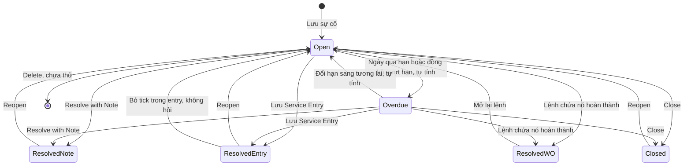
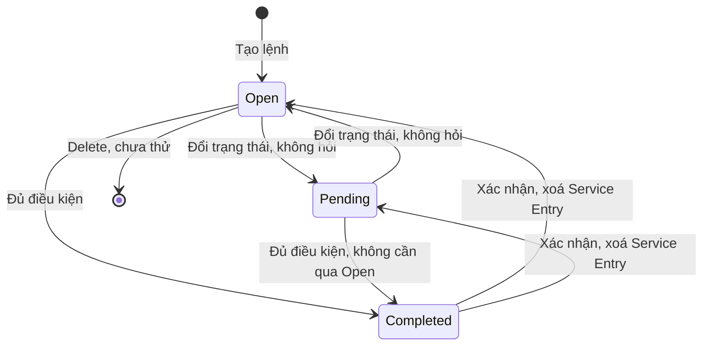
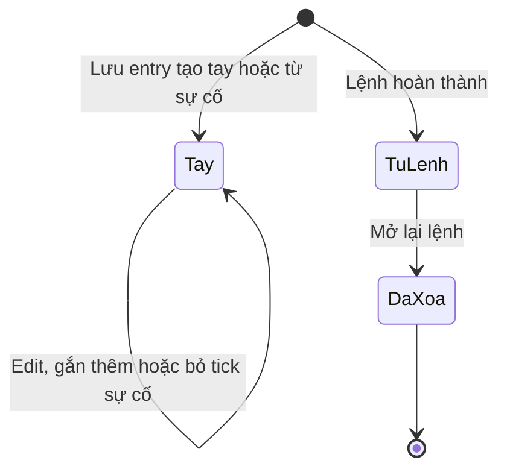
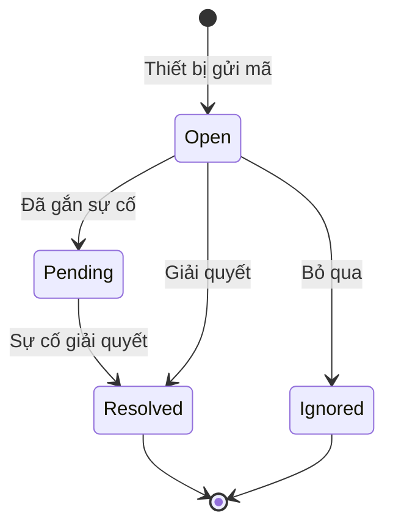
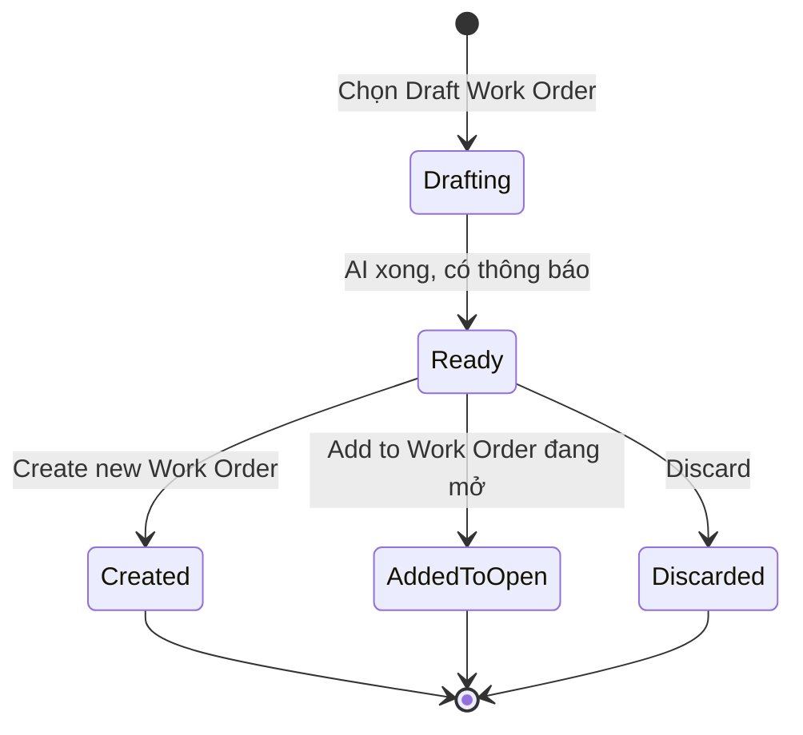
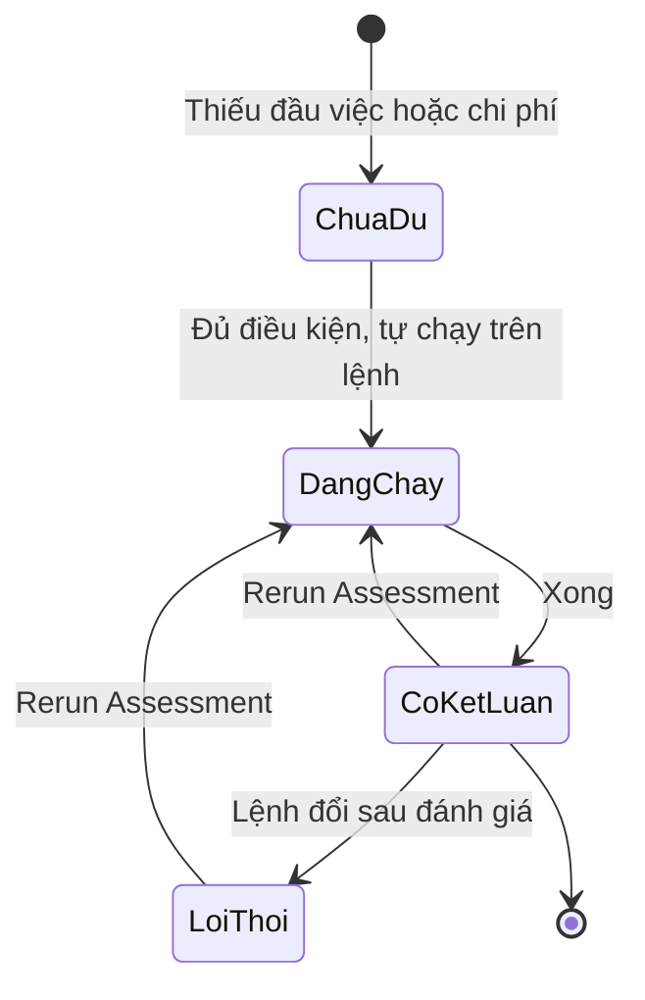
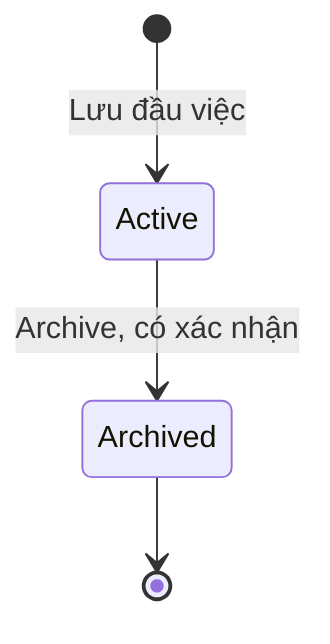
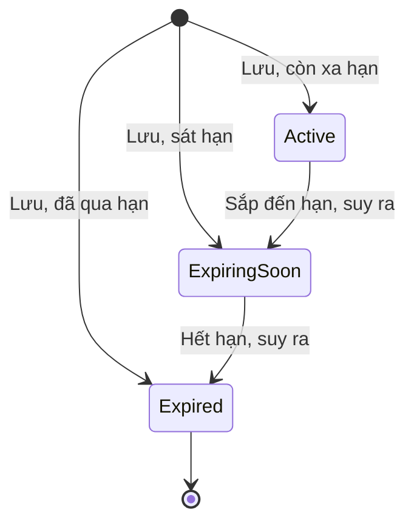
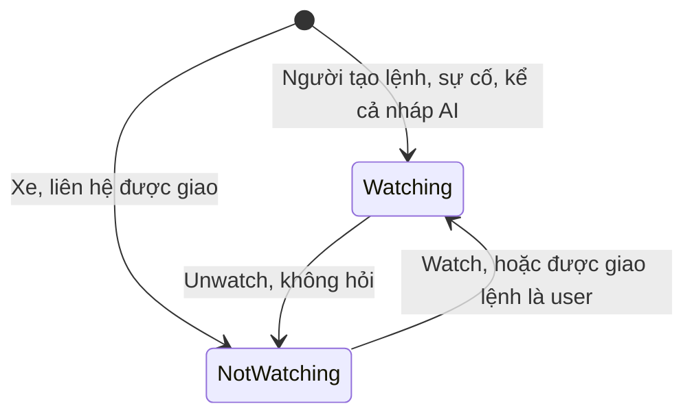

# Sửa chữa — States

Ô "Không có" nghĩa là đã quan sát và không xảy ra, trừ khi có ghi "chưa thử". Mức theo bản ghi chạy 03/11/2026.

## Sự cố

Fleetio lưu ba giá trị: Open, Resolved, Closed. **Overdue là giá trị tính**, không phải trạng thái lưu: đọc từ hạn và đồng hồ hiện tại, không có sự kiện chuyển. Sơ đồ vẽ tách Resolved theo nguồn vì ba nguồn có cách mở lại khác nhau; Fleetio chỉ hiện một chữ Resolved. "Đã gắn lệnh" cũng là điều kiện trên Open, không phải giá trị trạng thái.

| Trạng thái | Hành động | Sang | Điều kiện | Hiệu ứng | Câu chữ | Mức |
|---|---|---|---|---|---|---|
| Open | Close | Closed | Note tuỳ chọn | Closed Details; ghi chú thành Comment; mất Edit, Resolve; Timeline không ghi | "Close Issue", "Describe why you're closing the issue." | `Chạy` |
| Open | Resolve with Note | Resolved bằng ghi chú | Note bắt buộc, nút khoá khi trống | Resolution Details; Time to Resolve; mất Edit | "Describe what work was performed to resolve the issue.", "Issue #35 was resolved." | `Chạy` |
| Open | Add to Service Entry rồi lưu entry | Resolved bằng entry | Entry đủ Odometer, Completion Date; chưa lưu thì vẫn Open | Resolved Meter Entry; Timeline ghi | "1 Issue will be added", "Issue Resolved by service entry" | `Chạy` |
| Open | Add to Service Entry, chọn Add to Existing, lưu | Resolved bằng entry | Chọn một entry của đúng xe, Continue khoá tới khi chọn | Resolved Date theo entry; không chặn entry cũ hơn lúc báo, Time to Resolve có thể âm (E-020) | "1 Issue(s) were added to the form", "Issue Resolved by service entry" | `Chạy` #52 |
| Open | Draft Work Order | Giữ Open | AI bật | Banner nền; xem đối tượng Bản nháp AI | "Drafting service for this issue" | `Chạy` |
| Open | Link Issues trên dòng việc | Giữ Open, thành đã gắn lệnh | Chưa ở lệnh nào, lưu lệnh | Linked Line Items, dòng đếm sự cố; hiện dưới "Resolved Issues" dù lệnh còn Open | Không có | `Chạy` #45 |
| Open | Add to Work Order hoặc tick ở form lệnh | Giữ Open, thành đã gắn lệnh | Sự cố chưa ở lệnh nào; lưu lệnh | Khoá ba lối; Timeline "added this issue to a work order" | "Issue already added to a Work Order. Remove it from all Work Orders to add it to another." | `Chạy` |
| Open | Get Service at Shop | Giữ Open | Cần bật Shop Network, không bật | Hộp giới thiệu | "Streamline your outsourced maintenance with Shop Network" | `Xem` |
| Open | Edit, View Record History | Giữ Open | Không có | Đổi hạn thì tính lại Overdue | Không có | `Chạy` |
| Open | Delete | Không rõ | Không có | Chưa thử | Không rõ | `Xem` |
| Open | Tự tính | Overdue | Ngày hiện tại qua Due Date, hoặc đồng hồ lớn hơn Due Odometer; đúng bằng thì không | Hiện ở Issue Status, tab Overdue; không có sự kiện | "Considered overdue after this date", "Considered overdue above this value" | `Chạy` |
| Overdue | Mọi hành động của Open | Như Open | Y hệt Open, vẫn thuộc `state_scope=opened` | Như Open | Như Open | `Chạy` |
| Overdue | Đổi hạn sang tương lai | Open | Tự tính khi lưu | Không có sự kiện, không có nút | Không có | `Chạy` |
| Open, đã gắn lệnh | Add to Service Entry, Add to Work Order, Resolve with Note | Không đổi được | Mục xám có khoá, phải gỡ khỏi lệnh trước | Không có | "Issue already added to a Work Order. Remove it from all Work Orders to add it to another." | `Chạy` |
| Open, đã gắn lệnh | Close | Không đổi được | Mục xám, phải gỡ khỏi lệnh trước | Không có | "...already added to a Work Order. Remove it from all Work Orders to close" | `Chạy` #45 |
| Open, đã gắn lệnh | Draft Work Order | Không đổi được ở lượt 3 | Xám có khoá trên #45; lượt trước mục này còn dùng được, chưa rõ lý do (OQ-19) | Không có | "Issue already added to a Work Order. Remove it from all Work Orders to add it to another." | `Chạy` #45 |
| Open, đã gắn lệnh | Được AI gợi ý từ nháp của sự cố khác | Giữ nguyên lệnh cũ | Tạo lệnh mới từ nháp | Sự cố không chuyển; đầu việc vào lệnh mới thành dòng trùng (E-022) | "Also recommended for this vehicle" | `Chạy` #45, #110 |
| Open, đã gắn lệnh | Edit, Get Service at Shop | Giữ Open | Mục vẫn sáng; Get Service at Shop bấm tiếp cần đổi Cài đặt, không chạy | Không có | Không có | `Chạy` một phần |
| Open, đã gắn lệnh | Delete | Không rõ | Vẫn sáng, không bấm | Chưa thử | Không rõ | `Xem` |
| Open, đã gắn lệnh | Bỏ tick ở form lệnh rồi lưu | Open, tự do | Lệnh chưa Completed | Timeline xoá dòng "added this issue" | "No issues to show." | `Chạy` |
| Open, đã gắn lệnh | Lệnh Completed | Resolved bằng lệnh | Lệnh đủ điều kiện | Xem đối tượng Lệnh | "Issue Resolved by work order" | `Chạy` |
| Resolved bằng ghi chú | Reopen | Open | Không điều kiện, có hộp xác nhận | Mất Resolution Details; Comment giữ | "Are you sure you want to reopen the selected issue(s)?" | `Chạy` |
| Resolved bằng ghi chú | View Record History | Giữ nguyên | Không có | Không có Edit | Không có | `Chạy` |
| Resolved bằng entry | Reopen | Open | Không điều kiện, nút **không** khoá | Entry còn, mất liên kết, "No issues to show"; Timeline vẫn giữ dòng cũ, không ghi mở lại | "Successfully reopened Issue." | `Chạy` |
| Resolved bằng entry | Bỏ tick trong entry | Open | Sửa entry, tab Resolved, lưu; không hỏi xác nhận | Mất Resolution Details; Timeline chỉ còn "opened this issue", không để vết đã từng Resolved | Không có | `Chạy` #52 |
| Resolved bằng lệnh | Reopen | Không đổi được | Nút khoá, phải mở lại lệnh | Không có | "Reopen work order #104 to reopen this issue." | `Chạy` |
| Resolved bằng lệnh | Mở lại lệnh | Open | Lệnh về Open hoặc Pending | Mất Resolution Details, xoá dòng "Issue Resolved by work order", giữ "added this issue" | "Changing this completed Work Order to an incomplete Status..." | `Chạy` |
| Closed | Reopen | Open | Không điều kiện, có hộp xác nhận | Closed Details mất, Comment còn; Timeline chỉ có "opened this issue" | "Are you sure you want to reopen the selected issue(s)?" | `Chạy` |
| Closed | View Record History | Giữ nguyên | Không có | Không có Edit, Resolve | Không có | `Chạy` |

**Mở lại đều không để vết**, ở cả ba nguồn, kể cả bỏ tick trong entry. Entry không đóng cũng không gợi ý đóng sự cố khớp nội dung với cấu hình hiện tại (`Chạy` entry 57902070 sau khoảng 1 đến 2 giờ, entry 57903452 sau khoảng 15 phút). Từ phiếu kiểm tra, lỗi tái diễn sau khi Resolved sinh sự cố mới, không mở lại sự cố cũ (`Chạy` nhóm Nhắc).

## Lệnh sửa

Danh mục có 3 trạng thái mặc định; mỗi trạng thái thuộc loại Incomplete hoặc Completed. Khách thêm được là `Docs`, không thử vì là danh mục dùng chung trong Settings. Tình trạng riêng từng dòng: web không thấy ô đánh dấu (`Chạy` #107).

| Trạng thái | Hành động | Sang | Điều kiện | Hiệu ứng | Câu chữ | Mức |
|---|---|---|---|---|---|---|
| Open | Lưu lệnh có dòng phụ tùng chọn kho | Giữ Open | Không chặn khi vượt tồn | Tồn trừ ngay, sổ nguồn số lệnh | "This will make an inventory adjustment" | `Chạy` |
| Open | Đổi Pending | Pending | Không điều kiện, không hỏi | Không có | "Work Order was successfully updated" | `Chạy` |
| Open | Đổi Completed, thiếu ngày | Giữ Open | Started At trống | Không có | "Please edit and fix the following errors: Started At can't be blank" | `Chạy` |
| Open | Đổi Completed, thiếu đồng hồ | Giữ Open | Require a Meter Reading bật | Không có | "Starting Meter Entry can't be blank (per your account settings)" | `Chạy` |
| Open | Đổi Completed, đủ điều kiện | Completed | Started At, đồng hồ theo cài đặt | Xem dòng Completed | "Work Order was successfully updated" | `Chạy` |
| Open | Edit, Rerun Assessment, Print, Make a Copy, View Record History | Giữ Open | Không có | Sửa dòng ghi bù kho; lệnh đổi sau đánh giá hiện Rerun available | "Rerun available." | `Chạy` |
| Open | Xoá dòng phụ tùng có kho, lưu | Giữ Open | Hộp "Confirm Line Item Deletion" | Tồn trả lại, WO Current Qty về 0; form không có vết số đã trả | "Are you sure you want to permanently delete this line item?" | `Chạy` #107 |
| Open | Thêm nháp AI "Add to Work Order" | Giữ Open | Chỉ lệnh mở mới nhất của xe | Thêm dòng, gắn sự cố của nháp | "Updated from an AI draft from Issue #53" | `Chạy` #110 |
| Open | Mở form sửa, lưu | Giữ Open | Không có | Tính lại cơ hội bảo hành; trang chi tiết giữ kết quả cũ tới khi lưu | "Warranty Opportunities (1)" | `Chạy` #110 |
| Open | Email PDF, Delete | Không rõ | Chưa thử; Delete báo xoá vĩnh viễn | Chưa biết có hoàn kho không | "All data will be lost forever." | `Xem` |
| Open, có contact mẫu trên xe thường | Sửa, đổi trạng thái | Giữ Open, lệnh kẹt | Tạo qua được, về sau luôn lỗi | Không xoá được dòng công ở lần thử | "Contact is a sample, and cannot be used with non sample vehicles" | `Chạy` |
| Pending | Như Open | Open, Completed | Như Open, không phải quay qua Open | Như Open | "Work Order was successfully updated" | `Chạy` |
| Completed | Edit | Không đổi được | Nút khoá | Không có | Không có | `Chạy` |
| Completed | Đổi Open hoặc Pending | Open hoặc Pending | Hộp "Update Status", Confirm | Xoá entry, sự cố về Open; đồng hồ GIỮ; tồn GIỮ; khôi phục archive chạy nền, vài giây trang vẫn Completed | "Changing this completed Work Order to an incomplete Status will automatically restore any archived parts, part locations, and contacts associated with line items. Are you sure you wish to continue?" | `Chạy` |
| Completed | Run Assessment, Print, View Record History | Giữ Completed | Không có | Không có | Không có | `Chạy` |
| Open, đã từng Completed | Đổi Completed lần nữa | Completed | Dữ liệu cũ còn, không hỏi lại | Entry mới số khác; Resolved Date, Time to Resolve như lần đầu; thêm dòng đồng hồ trùng nguồn entry | "Issue Resolved by work order" | `Chạy` |

Trạng thái lệnh không tác động lên nhắc khi Open; Completed mới tính lại nhắc (`Chạy` nhóm Nhắc, lệnh #101). Mở lại với nhắc: chưa kiểm.

## Service Entry

**Không có trường trạng thái.** Bản ghi chỉ có hai nguồn với quyền khác nhau, và có thể biến mất. Sơ đồ vẽ để thấy vòng đời, các tên dưới đây không xuất hiện trên giao diện.

| Trạng thái | Hành động | Sang | Điều kiện | Hiệu ứng | Câu chữ | Mức |
|---|---|---|---|---|---|---|
| Tạo tay, từ sự cố | Edit | Giữ nguyên | Lưu lại không đổi gì vẫn thành công | Không có | Không có | `Chạy` |
| Tạo tay, từ sự cố | Sự cố được Reopen | Giữ nguyên | Không có | Mất liên kết sự cố | "No issues to show" | `Chạy` |
| Tạo tay, từ sự cố | Add to Existing từ sự cố | Giữ nguyên | Entry của đúng xe, cũ hơn lúc báo vẫn nhận | Sự cố Resolved theo ngày, đồng hồ của entry | "1 Issue(s) were added to the form" | `Chạy` 57856983 |
| Tạo tay, từ sự cố | Bỏ tick sự cố ở tab Resolved | Giữ nguyên | Sự cố không ở lệnh khác; có ổ khoá thì không bỏ được | Sự cố về Open, không hỏi | Không có | `Chạy` #52, #35, #37 |
| Tạo tay, từ sự cố | Xoá | Không rõ | Chưa thử; không tự xoá | Chưa biết | Không rõ | Không chạy |
| Từ lệnh | Edit | Không đổi được | Nút khoá | Không có | Không có | `Chạy` |
| Từ lệnh | Run Assessment | Giữ nguyên | Không tự chạy, khác lệnh | Có kết luận | "Run Assessment" | `Chạy` |
| Từ lệnh | Mở lại lệnh | Đã xoá | Xác nhận ở lệnh | URL ra Not Found; hoàn thành lại sinh entry số khác | "the record may have been deleted" | `Chạy` |

## Mã lỗi

Chuyển trạng thái mã lỗi là `Suy` từ các tab và cột Issue trên danh sách mẫu; xe TEST không có thiết bị, không chạy hành động trên dữ liệu Sample. Luật mã lỗi tác động lúc mã đến: Ignore Code thì Ignored, Flag as Critical thì gắn nhãn Critical (`Xem` câu trong hộp Add Fault Rule, không lưu).

| Trạng thái | Hành động | Sang | Điều kiện | Hiệu ứng | Câu chữ | Mức |
|---|---|---|---|---|---|---|
| Open | Create Issue | Pending | Suy từ cột Issue | Không rõ | "Create Issue" | `Xem`, chuyển là `Suy` |
| Open | Ignore | Ignored | Suy từ tab | Không rõ | "Ignore" | `Xem`, chuyển là `Suy` |
| Open | View Fault Rule | Giữ nguyên | Không có | Không rõ | "View Fault Rule" | `Xem` |
| Pending | Sự cố giải quyết | Resolved | Suy | Không rõ | Không rõ | `Suy` |
| Resolved | Không rõ | Không rõ | Không thao tác | Không rõ | Không rõ | `Xem` |
| Ignored | Không rõ | Không rõ | Không thao tác | Không rõ | Không rõ | `Xem` |

## Bản nháp AI

| Trạng thái | Hành động | Sang | Điều kiện | Hiệu ứng | Câu chữ | Mức |
|---|---|---|---|---|---|---|
| Drafting | Chờ, rời trang | Ready | Khoảng 40 giây | Banner đổi chữ, chạy nền | "Drafting service for this issue", "Gathering vehicle details", "Reviewing this issue" | `Chạy` |
| Ready | Review draft | Giữ Ready | Không có | Mở hộp; cảnh báo lệnh mở; gom sự cố cùng xe | "Review Work Order draft", "A Work Order is already open for this vehicle" | `Chạy` |
| Ready | Bỏ tick việc | Giữ Ready | Không có | Số đếm đổi, nút "Select all" | "1/2 Service Tasks" | `Chạy` |
| Ready | Create new Work Order | Created | Có ít nhất một việc: `Suy` | Lệnh mới; sự cố được tick vào lệnh; sự cố bỏ tick không vào; phân loại ưu tiên vẫn trống dù hộp hứa | "Created from an AI draft from Issue #46" | `Chạy` |
| Ready | Create new Work Order, sự cố khác đang ở lệnh | Created | Việc gợi ý từ sự cố khác vẫn tick | Sự cố khác không vào lệnh mới; đầu việc thành dòng trùng, không hỏi; câu AI có thể sai thực tế (E-021, E-022) | "Also recommended for this vehicle" | `Chạy` #52, #110 |
| Ready | Add to Work Order đang mở | Đã thêm | Xe đang có lệnh mở; hộp chỉ nêu lệnh mở mới nhất, không cho chọn | Lệnh có thêm dòng, sự cố vào "Resolved Issues"; không tạo lệnh mới | "Add to Work Order #110", "Updated from an AI draft from Issue #53" | `Chạy` #53 |
| Ready | Discard | Discarded | Không hỏi lại | Mất ngay, không ghi Timeline | "Discard" | `Chạy` |
| Created | Không có | Kết thúc | Không có | Timeline "added this issue to a work order from an AI draft" | "Work Order successfully created" | `Chạy` |
| Đã thêm | Không có | Kết thúc | Không có | "Resolved Issues" gồm sự cố cũ và mới | "Work Order successfully updated" | `Chạy` #110 |
| Discarded | Không có | Kết thúc | Có thể soạn lại: chưa thử | Không có | Không có | `Chạy` |

## Đánh giá AI

Không phải trường trạng thái riêng; là khối trên lệnh, entry.

| Trạng thái | Hành động | Sang | Điều kiện | Hiệu ứng | Câu chữ | Mức |
|---|---|---|---|---|---|---|
| Chưa đủ | Thêm đầu việc, chi phí | Đang chạy | Lệnh có đầu việc và tiền | Tự chạy | "Add a service task to run an assessment.", "Add line item costs to run an assessment.", "Add a line item to run an assessment." | `Chạy` |
| Đang chạy | Chờ | Có kết luận | Không có | Đổi chữ tiến độ | "Reviewing this service", "Checking labor rates and times", "Reviewing parts and pricing" | `Chạy` |
| Có kết luận | Rerun Assessment | Đang chạy | Không có | Kết luận Acceptable hoặc Needs Review, số nguồn | "Auto-assessed 3 minutes ago", "Was this helpful?" | `Chạy` |
| Lỗi thời | Rerun Assessment | Đang chạy | Lệnh đổi sau đánh giá | Không có | "Rerun available." | `Chạy` |

## Đầu việc

| Trạng thái | Hành động | Sang | Điều kiện | Hiệu ứng | Câu chữ | Mức |
|---|---|---|---|---|---|---|
| Active | Archive | Archived | Hộp xác nhận | Bản ghi liên quan cập nhật nền; không dùng được nữa | "Archiving a record does not remove it from Fleetio, but it will no longer be usable." | `Chạy` |
| Active | Update Service Tasks, Import, Export | Giữ Active | Không có | Chưa thử | Không có | `Xem` |
| Archived | Khôi phục | Không rõ | Chưa thử | Chưa biết | Không rõ | Không chạy |

## Bảo hành

Thấy đủ ba Status "Active", "Expiring Soon", "Expired" nhờ tạo bảo hành với ngày phù hợp (`Chạy` 356513, 356515, "TEST-SUA BH het han"). Không đợi trôi qua thời gian: Status theo ngày là `Suy`, ngưỡng Expiring Soon chưa biết, một bảo hành còn 1 ngày đã mang nhãn này. Khối trên lệnh đếm active, expiring soon, total; Expired vẫn tính vào total.

| Trạng thái | Hành động | Sang | Điều kiện | Hiệu ứng | Câu chữ | Mức |
|---|---|---|---|---|---|---|
| Active | Lệnh có đầu việc khớp mã đúng mức | Giữ Active | Mã bảo hành cùng mức với dòng: 027 khớp 2/027, 034-004 khớp 3/034/004 | Hiện cơ hội trên lệnh khi mở form hoặc sau lưu | "Warranty Opportunities (1)", "View Active Coverage" | `Chạy` |
| Active | Mã hệ thống, dòng có assembly | Giữ Active | 027 với 2/027/036, 034 với 3/034/004 | **Không** gợi ý | "No vehicle warranty opportunities found." | `Chạy` |
| Active | Điền Complaint, Cause, Correction trên lệnh | Giữ Active | Có cơ hội | Ghi chữ trên dòng lệnh; không có trạng thái claim | "Add complaint, cause, and correction details for claim processing." | `Chạy` #107 |
| Active | Sửa mã, Clear Codes | Giữ Active | Không có | Lệnh khác không sửa thì không tính lại | "VMRS codes have been updated" | `Chạy` Edit; `Xem` Clear Codes |
| Expiring soon | Lệnh có đầu việc khớp mã | Giữ nguyên | Dòng 2/027 trùng mã, còn 1 ngày | **Không** gợi ý dù còn hiệu lực, một lần đo; đếm ở khối | "1 expiring soon" | `Chạy` |
| Expired | Lệnh có đầu việc khớp mã | Giữ nguyên | Dòng 4/045/020 trùng mã | **Không** gợi ý; tính vào total | "3 total" | `Chạy` |
| Expired | Gia hạn, sửa ngày | Không rõ | Không thử | Không rõ | Không rõ | Không chạy |

## Người theo dõi

Không phải trường trạng thái của bản ghi, là quan hệ giữa một user với lệnh, sự cố hoặc xe.

| Trạng thái | Hành động | Sang | Điều kiện | Hiệu ứng | Câu chữ | Mức |
|---|---|---|---|---|---|---|
| Đang theo dõi | Unwatch | Không theo dõi | Không hỏi lại | Avatar biến mất, nút thành "Watch" | "You're watching this record, so you will receive all Watched Notifications." | `Chạy` #110 |
| Không theo dõi | Watch | Đang theo dõi | Không có | Nút thành "Unwatch" | "Watch" | `Chạy` #110 |
| Đang theo dõi | ADD WATCHER | Giữ nguyên | Chỉ có "Fleetio Automation", "Service Advisor", xám khoá | Không chọn | "Search users" | `Xem` |
| Không theo dõi | Được giao lệnh, là liên hệ | Giữ nguyên | Liên hệ không phải user | Lệnh vẫn "1 watcher" | Không có | `Chạy` #106 |
| Không theo dõi | Được giao lệnh, là user | Đang theo dõi | Lưu lệnh, không hỏi; thử trên chính tài khoản đăng nhập, user thứ hai không chạy | Nút thành "Unwatch", "WATCHERS · 1"; có email hay không: không kiểm được | Không có | `Chạy` #107 |

## Đối tượng không có trạng thái thật

- **Dòng việc:** tình trạng từng dòng và luật bắt buộc xong hết là `Docs`; web không thấy ô đánh dấu dòng (`Chạy` #107), chưa kiểm luật vì không đổi Settings.
- **Luật mã lỗi:** không có trạng thái; Priority Handling là giá trị cấu hình Off, Ignore Code, Flag as Critical (`Xem`).
- **Hồ sơ bảo hành trên lệnh:** ba ô chữ, không có trạng thái (`Chạy` #107). Câu hỏi về chuyển trạng thái claim không áp dụng.
- **Dòng phụ tùng, tồn:** dòng không có trạng thái, chỉ có sửa, xoá. Tồn theo kho có Low Stock, Out of Stock: xem [[docs/_research/fleetio/srs/fleetio-parts-purchasing-fuel-states.md|Kho, mua]].
- **Dòng đồng hồ:** không có trạng thái, không bị đảo khi mở lại lệnh.
