# Sửa chữa — User flow

`stage` ghi theo lựa chọn của user: tự chốt, xem ở bản cuối (02/11/2026).

## 1. Sơ đồ tổng

```mermaid
flowchart TD
    menu["Menu bên"]
    a["1.1 Danh sách sự cố"]
    n["Form sự cố, chưa có ảnh"]
    e3["E-003 Lưu form trống"]
    b["1.2 Sự cố, Đang mở"]
    rm["1.13 Menu xử lý sự cố"]
    lockm["1.12 Menu xử lý, sự cố đã gắn lệnh"]
    dr["1.9 Nháp AI đang soạn"]
    dy["1.10 Nháp AI sẵn sàng"]
    dv["2.8 Duyệt nháp AI"]
    dm["2.9 Menu tạo lệnh từ nháp"]
    wd["2.10 Lệnh tạo từ nháp"]
    sh["1.8 Giới thiệu mạng lưới xưởng"]
    cld["1.4 Hộp đóng sự cố"]
    cl["1.5 Sự cố, Đã đóng"]
    rnd["1.6 Hộp xử lý kèm ghi chú"]
    rn["1.7 Sự cố, Đã xử lý bằng ghi chú"]
    c["1.3 Sự cố, Đã xử lý"]
    ttr["1.14 Sự cố đã xử lý, thời gian xử lý âm"]
    rl["1.11 Sự cố, Khoá mở lại"]
    sen["Hộp thêm vào phiếu dịch vụ, chưa có ảnh"]
    sef["Form phiếu dịch vụ, chưa có ảnh"]
    e12["E-012 Thiếu ngày phiếu dịch vụ"]
    e["2.1 Danh sách lệnh sửa chữa"]
    f["2.3 Chi tiết lệnh sửa chữa"]
    h["2.2 Sửa lệnh sửa chữa"]
    fi["2.4 Mục sự cố và dòng việc trên form"]
    ap["2.5 Hộp thêm phụ tùng"]
    al["2.6 Hộp thêm công"]
    li["2.7 Hộp liên kết sự cố"]
    cp["2.13 Bản sao lệnh"]
    pdf["2.19 Bản in lệnh"]
    e1["E-001 Số đồng hồ đầu không hợp lệ"]
    e89["E-008, E-009 Số đồng hồ cuối sai"]
    e1011["E-010, E-011 Kỹ thuật viên mẫu"]
    e5["2.15 E-005 Chi tiết lệnh lệch tiền 100 lần, không báo"]
    e4["E-004 Không chạy được đánh giá"]
    wb["2.16 Khối bảo hành, chưa có cơ hội"]
    wo["2.17 Cơ hội bảo hành"]
    wcl["2.18 Hồ sơ bảo hành trên lệnh"]
    dc{"Đủ điều kiện hoàn thành?"}
    e2["2.14 E-002, E-006, E-007 Thiếu điều kiện hoàn thành"]
    wc["2.11 Lệnh đã hoàn thành"]
    i["3.1 Phiếu dịch vụ"]
    sw["3.2 Phiếu dịch vụ từ lệnh"]
    ro["2.12 Hộp mở lại lệnh"]
    nf["3.3 Phiếu dịch vụ đã xoá"]
    j["4.1 Mã lỗi"]
    fr["4.2 Luật mã lỗi"]
    t["5.1 Đầu việc"]
    w["6.1 Thêm bảo hành"]
    wf["6.2 Form bảo hành"]
    wv["6.3 Chọn xe bảo hành"]
    wt["6.4 Mẫu bảo hành"]
    ws["6.5 Bảo hành chuẩn, 6.6 Mã phân loại"]
    wl["6.7 Danh sách bảo hành"]
    vw["6.8 Tab bảo hành của xe"]
    ms["7.1 Cài đặt bảo dưỡng"]
    z["Xong"]
    menu -->|"Sự cố"| a
    menu -->|"Lệnh sửa chữa"| e
    menu -->|"Mã lỗi"| j
    menu -->|"Đầu việc"| t
    menu -->|"Bảo hành"| wl
    menu -->|"Cài đặt"| ms
    a -->|"Thêm sự cố"| n
    a -->|"Mở dòng"| b
    n -->|"Lưu"| b
    n -->|"Lưu, để trống"| e3
    e3 -.->|"Điền tiếp"| n
    b -->|"Xử lý"| rm
    b -->|"Sự cố đã gắn lệnh"| lockm
    lockm -->|"Nháp lệnh sửa chữa, lượt 3 xám trên #45"| dr
    lockm -.->|"Đóng menu"| b
    rm -->|"Nháp lệnh sửa chữa"| dr
    dr -->|"AI xong"| dy
    dy -->|"Xem nháp"| dv
    dy -.->|"Bỏ nháp, không hỏi"| b
    dv -->|"Thêm vào"| dm
    dm -->|"Tạo lệnh mới"| wd
    dm -->|"Thêm vào lệnh đang mở mới nhất"| f
    dv -.->|"Bỏ nháp"| b
    wd -->|"Xem lệnh"| f
    rm -->|"Thêm vào lệnh sửa chữa, tab mới"| h
    rm -->|"Xử lý kèm ghi chú"| rnd
    rnd -->|"Lưu"| rn
    rnd -.->|"Huỷ"| b
    rn -.->|"Mở lại"| b
    rm -->|"Xưởng ngoài"| sh
    sh -.->|"Đóng"| b
    rm -->|"Thêm vào phiếu dịch vụ"| sen
    sen -->|"Tiếp tục"| sef
    sef -->|"Lưu"| i
    sef -->|"Lưu, không gõ ngày"| e12
    e12 -.->|"Điền ngày"| sef
    i -->|"Sự cố tự chuyển Đã xử lý"| c
    sen -->|"Chọn phiếu có sẵn, phiếu cũ hơn lúc báo"| ttr
    ttr -.->|"Sửa phiếu, bỏ tick, không hỏi"| b
    i -.->|"Sửa phiếu, bỏ tick sự cố"| b
    c -.->|"Mở lại, xử lý không bằng lệnh"| b
    b -->|"Đóng"| cld
    cld -->|"Đóng sự cố"| cl
    cld -.->|"Huỷ"| b
    cl -.->|"Mở lại"| b
    cl -->|"Kết thúc"| z
    c -->|"Xử lý bằng lệnh"| rl
    rl -.->|"Quay lại"| c
    c -->|"Kết thúc"| z
    e -->|"Mở dòng"| f
    e -->|"Thêm lệnh sửa chữa"| h
    f -->|"Sửa"| h
    h -->|"Mục sự cố và dòng việc"| fi
    fi -->|"Thêm phụ tùng"| ap
    fi -->|"Thêm công"| al
    fi -->|"Liên kết sự cố"| li
    ap -.->|"Lưu dòng"| fi
    al -.->|"Lưu dòng"| fi
    li -.->|"Lưu"| fi
    f -->|"Sao chép"| cp
    cp -->|"Lưu"| f
    f -->|"In, tab mới"| pdf
    pdf -.->|"Quay lại tab lệnh"| f
    f -->|"Chạy đánh giá, thiếu dữ liệu"| e4
    e4 -.->|"Thêm chi phí, đầu việc"| f
    h -->|"Lưu lệnh sửa chữa"| f
    h -->|"Lưu, có số km thiếu ngày"| e1
    e1 -.->|"Sửa lại"| h
    h -->|"Lưu, số cuối sai"| e89
    e89 -.->|"Sửa lại"| h
    h -->|"Lưu, kỹ thuật viên mẫu"| e1011
    e1011 -.->|"Lệnh kẹt"| f
    f -->|"Xem tiền sau lưu"| e5
    e5 -.->|"Chỉ né bằng gõ đơn giá chia 100"| f
    f -->|"Khối bảo hành"| wb
    wb -->|"Thêm đầu việc cùng mã đúng mức"| wo
    wo -.->|"Quay lại"| f
    wo -->|"Điền ba ô chữ"| wcl
    wcl -->|"Lưu lệnh"| f
    wo -->|"View Active Coverage, liên kết"| vw
    f -->|"Trạng thái Hoàn thành"| dc
    dc -->|"Có"| wc
    dc -->|"Không"| e2
    e2 -.->|"Sửa lại"| f
    wc -->|"Phiếu sinh ra"| sw
    sw -->|"Sự cố tự chuyển Đã xử lý"| c
    wc -->|"Trạng thái về Đang mở hoặc Đang chờ"| ro
    ro -.->|"Huỷ"| wc
    ro -->|"Xác nhận"| f
    ro -->|"Mở lại địa chỉ phiếu cũ"| nf
    nf -->|"Kết thúc"| z
    j -->|"Liên kết sự cố"| b
    j -->|"View Fault Rule"| fr
    fr -->|"Kết thúc"| z
    t -->|"Kết thúc"| z
    wl -->|"Thêm bảo hành"| wv
    wv -->|"Chọn xe"| w
    w -->|"Mẫu bảo hành"| wt
    w -->|"Bảo hành chuẩn"| ws
    w -->|"Form đầy đủ"| wf
    wt -->|"Lưu"| wl
    ws -->|"Lưu"| wl
    wf -->|"Lưu"| wl
    wl -->|"Kết thúc"| z
    vw -->|"Kết thúc"| z
    ms -->|"Cài đặt, Luật mã lỗi"| fr
    ms -->|"Kết thúc"| z
```

Bản vẽ trên Figma: trang `Research · Fleetio`, frame `7214:221224`, chỉ có các màn của lượt 02/11; các màn từ 1.4 trở đi chưa vẽ. Đường liền là luồng thường, nét đứt là quay lại.

## 2. Màn hình

| # | Màn | Slug | Trạng thái | Ảnh |
|---|---|---|---|---|
| 1.1 | Danh sách sự cố | issues-list | Có dữ liệu | Có |
| 1.2 | Chi tiết sự cố mở | issue-open | Open | Có |
| 1.3 | Chi tiết sự cố đã xử lý | issue-resolved | Resolved | Có |
| 2.1 | Danh sách lệnh | wo-list | List, Calendar, Scheduler | Có |
| 2.2 | Sửa lệnh | wo-edit | Open | Có |
| 2.3 | Chi tiết lệnh | wo-detail | Completed | Có |
| 3.1 | Chi tiết Service Entry | service-entry | Khoá | Có |
| 4.1 | Mã lỗi | faults | Có dữ liệu | Có |
| 5.1 | Đầu việc | service-tasks | Có dữ liệu | Có |
| 6.1 | Thêm bảo hành | warranty-new | Trống | Có |
| 1.4 | Hộp đóng sự cố | issue-close-dialog | Note tuỳ chọn | Có |
| 1.5 | Sự cố đã đóng | issue-closed | Closed | Có |
| 1.6 | Hộp xử lý kèm ghi chú | issue-resolve-note-dialog | Nút khoá khi trống | Có |
| 1.7 | Sự cố đã xử lý bằng ghi chú | issue-resolved-note | Resolved | Có |
| 1.8 | Giới thiệu mạng lưới xưởng | issue-shop-network | Chưa bật | Có |
| 1.9 | Nháp AI đang soạn | issue-draft-running | Đang chạy | Có |
| 1.10 | Nháp AI sẵn sàng | issue-draft-ready | Sẵn sàng | Có |
| 1.11 | Sự cố khoá mở lại | issue-reopen-locked | Resolved bằng lệnh | Có |
| 1.12 | Menu xử lý, sự cố đã gắn lệnh | issue-menu-locked-tooltip | Ba mục khoá | Có |
| 1.13 | Menu xử lý sự cố | issue-resolve-menu | Đủ năm mục | Có |
| 2.4 | Mục sự cố và dòng việc trên form | wo-form-issues-lines | Open | Có |
| 2.5 | Hộp thêm phụ tùng | wo-add-part | Có kho | Có |
| 2.6 | Hộp thêm công | wo-add-labor | Có kỹ thuật viên | Có |
| 2.7 | Hộp liên kết sự cố | wo-link-issues | Có dữ liệu | Có |
| 2.8 | Duyệt nháp AI | wo-draft-review | Có cảnh báo lệnh mở | Có |
| 2.9 | Menu tạo lệnh từ nháp | wo-draft-add-menu | Hai lựa chọn | Có |
| 2.10 | Lệnh tạo từ nháp | wo-from-draft | Open | Có |
| 2.11 | Lệnh đã hoàn thành | wo-completed | Completed, khoá | Có |
| 2.12 | Hộp mở lại lệnh | wo-reopen-confirm | Chờ xác nhận | Có |
| 2.13 | Bản sao lệnh | wo-make-copy | Xe trống | Có |
| 2.14 | Lỗi điều kiện hoàn thành | wo-complete-errors | Trạng thái giữ nguyên | Có |
| 2.15 | Chi tiết lệnh lệch tiền | wo-100x-after-save | Sau lưu | Có |
| 2.16 | Khối bảo hành, chưa có cơ hội | wo-warranty-before | Rỗng | Có |
| 2.17 | Cơ hội bảo hành | wo-warranty-opportunity | Có một cơ hội | Có |
| 3.2 | Service Entry từ lệnh | se-from-wo | Khoá | Có |
| 3.3 | Service Entry đã xoá | se-deleted-not-found | Not Found | Có |
| 6.2 | Form bảo hành | warranty-form | Trống | Có |
| 6.3 | Chọn xe bảo hành | warranty-new-vehicles | Bước 1 | Có |
| 6.4 | Mẫu bảo hành | warranty-new-template | Bước 2 | Có |
| 6.5 | Bảo hành chuẩn | warranty-new-standard | Bước 2 | Có |
| 6.6 | Mã phân loại bảo hành | warranty-maintenance-codes | Có mã | Có |
| 6.7 | Danh sách bảo hành | warranty-list | Có dữ liệu | Có |
| 7.1 | Cài đặt bảo dưỡng | maintenance-settings | Chỉ đọc | Có |
| 1.14 | Sự cố đã xử lý, thời gian xử lý âm | issue-resolved-negative-ttr | Resolved, số âm | Có |
| 2.18 | Hồ sơ bảo hành trên lệnh | wo-warranty-claim-fields | Đang sửa, hai cơ hội | Có |
| 4.2 | Luật mã lỗi | fault-rules | Có dữ liệu | Có |
| 6.8 | Tab bảo hành của xe | vehicle-warranties-tab | Ba bảo hành | Có |
| 2.19 | Bản in lệnh | wo-print-pdf | Trang 1, đã cắt đầu trang | Có |

Màn chưa có ảnh riêng: form sự cố, hộp thêm vào Service Entry, form Service Entry.

## 3. Flow theo tác vụ

| Flow | Happy path | Nhánh lỗi, ngoại lệ |
|---|---|---|
| Báo và xử lý | 1.1 → form → 1.2 → 1.13 → 1.9 → 1.10 → 2.8 → 2.9 → 2.10 → 2.3 | Form trống: E-fleetio-repair-003. Discard nháp. Phân loại ưu tiên hứa mà trống: E-fleetio-repair-017. Câu AI sai, dòng trùng: E-fleetio-repair-021, 022. Sự cố đã gắn lệnh: 1.12 |
| Xử lý bằng ghi chú | 1.2 → 1.13 → 1.6 → 1.7 | Nút khoá khi trống. Mở lại về 1.2 |
| Đóng | 1.2 → 1.4 → 1.5 | Mở lại về 1.2 |
| Ghi lịch sử từ sự cố | 1.2 → 1.13 → hộp → form → 3.1 → 1.3 | E-fleetio-repair-012. Mở lại về 1.2, phiếu còn. Chọn phiếu có sẵn cũ hơn lúc báo: 1.14, E-fleetio-repair-020. Bỏ tick trong phiếu về 1.2, không hỏi |
| Thực hiện lệnh | 2.1 → 2.3 → 2.2 → 2.4 → 2.5, 2.6, 2.7 → 2.3 | E-fleetio-repair-001, 005, 008, 009, 010, 011, 014, 015, 016, 018, 019, 025, 026, 027 |
| Hoàn thành | 2.3 → 2.11 → 3.2 → 1.3 → 1.11 | E-fleetio-repair-002, 006, 007 tại 2.14 |
| Mở lại | 2.11 → 2.12 → 2.3 → 2.2 → 2.3 → 2.11 → 3.2 mới | Phiếu cũ thành 3.3. Không báo trước hậu quả |
| Sao chép | 2.3 → 2.13 → 2.3 mới | Không chép sự cố, ngày, đồng hồ |
| In lệnh | 2.3 → 2.19 | Giờ PDF lệch ngày với web: E-fleetio-repair-028 |
| Bảo hành | 6.7 → 6.3 → 6.1 → 6.4 hoặc 6.5, 6.6 → 6.7; 2.16 → 2.17 → 2.18 → 2.3; 2.17 → 6.8 | Xe không có Make, Model: "No options". Mã hệ thống không phủ assembly. Expired, Expiring Soon không gợi ý. End Date lệch: E-fleetio-repair-023. Thiếu đơn vị: E-fleetio-repair-024 |
| Luật mã lỗi | 4.1 → 4.2; 7.1 → 4.2 | Mở hộp Add Fault Rule rồi Cancel, không lưu |
| Cấu hình | 7.1 | Không đổi cài đặt |

Soát theo vai trò: thiếu thao tác của Operator trên web vì lái xe dùng Fleetio Go; chưa xem app.
