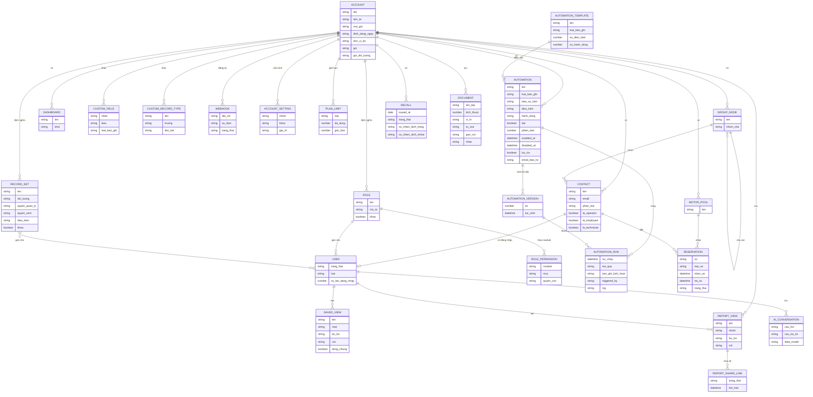

# Nền tảng SaaS — ERD nghiệp vụ

Suy ra từ giao diện và tài liệu hãng, không phải sơ đồ cơ sở dữ liệu thật.

**Ghi chú nghiệp vụ:**

- Contact là bảng gốc; User là Contact được bật truy cập (`Chạy` phần No Access). Lái xe, thợ, kế toán chung một hồ sơ, phân vai bằng tick.
- Automation sinh phiên bản khi bật (`Chạy` v.1); chưa thấy v.2.
- Group gán cho cả xe và liên hệ; xe thuộc nhóm Phương tiện nên không vẽ lại ở đây (`Xem`).
- Report Share Link không lưu trong sơ đồ giá trị đường dẫn vì tài liệu này không ghi link đã chia sẻ.
- Quan hệ Reservation với xe và Recall với xe, Issue thuộc nhóm khác, chưa chạy.
