# Nền tảng SaaS — ERD nghiệp vụ

Suy ra từ giao diện và tài liệu hãng, không phải sơ đồ cơ sở dữ liệu thật.

```mermaid
erDiagram
    ACCOUNT ||--o{ CONTACT : "có"
    CONTACT ||--o| USER : "có đăng nhập"
    ROLE ||--o{ USER : "gán cho"
    RECORD_SET }o--o{ USER : "gán cho"
    ACCOUNT ||--o{ ROLE : "định nghĩa"
    ROLE ||--o{ ROLE_PERMISSION : "theo module"
    ACCOUNT ||--o{ RECORD_SET : "định nghĩa"
    USER ||--o{ SAVED_VIEW : "tạo"
    ACCOUNT ||--o{ AUTOMATION : "có"
    AUTOMATION ||--o{ AUTOMATION_VERSION : "sinh khi bật lần đầu, khi lưu bản sửa"
    AUTOMATION ||--o{ AUTOMATION_RUN : "chạy"
    AUTOMATION_VERSION ||--o{ AUTOMATION_RUN : "được ghi ở"
    AUTOMATION_TEMPLATE ||--o{ AUTOMATION : "điền sẵn"
    ACCOUNT ||--o{ DASHBOARD : "có"
    ACCOUNT ||--o{ CUSTOM_FIELD : "khai"
    ACCOUNT ||--o{ CUSTOM_RECORD_TYPE : "khai"
    ACCOUNT ||--o{ WEBHOOK : "đăng ký"
    ACCOUNT ||--o{ ACCOUNT_SETTING : "cấu hình"
    ACCOUNT ||--o{ PLAN_LIMIT : "giới hạn"
    ACCOUNT ||--o{ GROUP_NODE : "có"
    GROUP_NODE ||--o{ GROUP_NODE : "cha con"
    GROUP_NODE ||--o{ CONTACT : "chứa"
    ACCOUNT ||--o{ REPORT_VIEW : "lưu"
    USER ||--o{ REPORT_VIEW : "tạo"
    REPORT_VIEW ||--o{ REPORT_SHARE_LINK : "chia sẻ"
    USER ||--o{ AI_CONVERSATION : "lưu"
    ACCOUNT ||--o{ RECALL : "có"
    ACCOUNT ||--o{ MOTOR_POOL : "có"
    MOTOR_POOL ||--o{ RESERVATION : "nhận"
    MOTOR_POOL ||--o{ AUTO_APPROVAL_WINDOW : "có"
    RATE_TABLE ||--o{ MOTOR_POOL : "tính phí cho"
    RESERVATION ||--o| VEHICLE_ASSIGNMENT : "sinh khi duyệt"
    RESERVATION ||--o{ RESERVATION_LINE_ITEM : "có"
    FLAT_FEE ||--o{ RESERVATION_LINE_ITEM : "thêm vào"
    ACCOUNT ||--o{ RATE_TABLE : "có"
    ACCOUNT ||--o{ FLAT_FEE : "có"
    CONTACT ||--o{ RESERVATION : "đặt"
    ACCOUNT ||--o{ DOCUMENT : "lưu"
    DOCUMENT ||--o{ DOCUMENT_ATTACHMENT : "gắn"
    REPORT_VIEW ||--o{ SAVED_REPORT : "lưu thành"
    USER ||--o{ SAVED_REPORT : "tạo"
    USER ||--o{ WATCH : "theo dõi"
    USER ||--o{ COMMENT : "viết"
    AUTOMATION ||--o{ COMMENT : "viết"
    USER ||--o{ NOTIFICATION : "nhận"
    ACCOUNT ||--o{ NOTIFICATION_PROFILE : "có"
    NOTIFICATION_PROFILE ||--o{ USER : "gán cho"
    USER ||--o{ API_KEY : "có"

    ACCOUNT {
        string ten
        string tien_te
        string mui_gio
        string dinh_dang_ngay
        string don_vi_do
        string goi
        string goi_doi_tuong
    }
    PLAN_LIMIT {
        string loai
        number da_dung
        number gioi_han
    }
    CONTACT {
        string ten
        string email
        string phan_loai
        boolean la_operator
        boolean la_employee
        boolean la_technician
    }
    USER {
        string trang_thai
        string loai
        number so_lan_dang_nhap
    }
    GROUP_NODE {
        string ten
        string nhom_cha
    }
    ROLE {
        string ten
        string mo_ta
        boolean khoa
    }
    ROLE_PERMISSION {
        string module
        string muc
        string quyen_con
    }
    RECORD_SET {
        string ten
        string doi_tuong
        string quyen_quan_ly
        string quyen_xem
        string dieu_kien
        boolean khoa
    }
    SAVED_VIEW {
        string ten
        string man
        string bo_loc
        string cot
        string pham_vi_chia_se
    }
    AUTOMATION {
        string ten
        string loai_ban_ghi
        string kieu_su_kien
        string dieu_kien
        string hanh_dong
        boolean bat
        number phien_ban
        datetime enabled_at
        datetime disabled_at
        boolean luu_tru
        string email_bao_loi
    }
    AUTOMATION_VERSION {
        number so
        datetime luc_sinh
        string nguoi_tao
        string noi_dung_buoc
    }
    AUTOMATION_RUN {
        datetime luc_chay
        datetime luc_xu_ly
        string ket_qua
        string loi_nguyen_van
        string records
        string ban_ghi_kich_hoat
        string kieu_su_kien
        string triggered_by
        string log
    }
    AUTOMATION_TEMPLATE {
        string ten
        string loai_ban_ghi
        number so_dieu_kien
        number so_hanh_dong
    }
    DASHBOARD {
        string ten
        string khoi
    }
    CUSTOM_FIELD {
        string nhan
        string kieu
        string loai_ban_ghi
    }
    CUSTOM_RECORD_TYPE {
        string ten
        string truong
        string lien_ket
    }
    WEBHOOK {
        string dia_chi
        string su_kien
        string trang_thai
    }
    ACCOUNT_SETTING {
        string nhom
        string khoa
        string gia_tri
    }
    REPORT_VIEW {
        string ten
        string nhom
        string bo_loc
        string cot
    }
    REPORT_SHARE_LINK {
        string trang_thai
        datetime het_han
    }
    AI_CONVERSATION {
        string cau_hoi
        string cau_tra_loi
        string data_model
    }
    RECALL {
        date issued_at
        string trang_thai
        string so_chien_dich_hang
        string so_chien_dich_nhtsa
    }
    MOTOR_POOL {
        string ten
        string nhom
        string loai_xe
        string trang_thai_xe
        boolean tinh_phi_tu_dong
        boolean bat_buoc_ly_do
        boolean tu_duyet
    }
    AUTO_APPROVAL_WINDOW {
        string mui_gio
        string ngay
        string gio_bat_dau
        string gio_ket_thuc
        boolean ca_ngay
    }
    RATE_TABLE {
        string ten
        string trang_thai
        string loai_xe
        number gia_gio
        number gia_ngay
        number gia_tuan
        number gia_thang
        number gia_km
        number nguong_gio
    }
    FLAT_FEE {
        string ten
        string trang_thai
        number so_tien
        string loai_xe
    }
    RESERVATION {
        string so
        string loai_xe
        string xe
        string ly_do
        datetime nhan_xe
        datetime tra_xe
        datetime checked_out_at
        datetime returned_at
        number start_meter
        number end_meter
        string ly_do_tu_choi
        string ly_do_huy
        string trang_thai
    }
    VEHICLE_ASSIGNMENT {
        string xe
        string nguoi_lai
        datetime bat_dau
        datetime ket_thuc
        number start_meter
        number end_meter
    }
    RESERVATION_LINE_ITEM {
        string loai
        number don_gia
        number so_luong
        number thanh_tien
    }
    DOCUMENT {
        string ten_tep
        number kich_thuoc
        string vi_tri
        string tu_xoa
        string gan_voi
        string nhan
        string loai_tep
        string mo_ta
    }
    DOCUMENT_ATTACHMENT {
        string loai_ban_ghi
        string ban_ghi
    }
    SAVED_REPORT {
        string ten
        string mo_ta
        string pham_vi
        string lich_email
        string bo_loc
        boolean yeu_thich
    }
    WATCH {
        string loai_ban_ghi
        string ban_ghi
    }
    COMMENT {
        string loai_ban_ghi
        string noi_dung
        datetime luc_viet
    }
    NOTIFICATION {
        string loai
        string ban_ghi
        string hop
    }
    NOTIFICATION_PROFILE {
        string ten
        string mo_ta
        string trang_thai
    }
    API_KEY {
        string nhan
        string phien_ban_api
        datetime ngay_them
        string trang_thai
    }
```

**Ghi chú nghiệp vụ:**

- Contact là bảng gốc; User là Contact được bật truy cập (`Chạy` phần No Access). Lái xe, thợ, kế toán chung một hồ sơ, phân vai bằng tick.
- Automation sinh phiên bản khi bật lần đầu và khi lưu bản sửa lúc đang bật (`Chạy` v.1, v.2); tắt rồi bật lại không sinh. Mở v.1 hiện nội dung v.2 (E-fleetio-saas-platform-018) nên chưa chắc mỗi bản lưu riêng nội dung bước.
- Lượt thất bại lưu câu lỗi nguyên văn và log từng bước (`Chạy`). "Triggered By" ghi người, không ghi automation; tác giả comment và Status Updates lại ghi "Fleetio Automation", nên nguồn gây ra được ghi không đồng nhất giữa các chỗ.
- Saved Report giữ bộ lọc, cột của báo cáo chuẩn, phạm vi Public hoặc Private, lịch email (`Chạy` Private). Saved View có phạm vi Private, Admins Only, Specific Roles, Specific Users, Everyone (`Chạy` Private).
- Tài liệu gắn nhiều bản ghi qua Document Attachment; Fleetio hiện xe, nhóm và loại xe trên hộp gắn, chỉ gắn thử 1 xe (`Chạy`).
- Comment, Watch không vào Record History; Watch, Notification là bảng suy ra từ giao diện (`Suy`). Notification chạy kể cả khi 0 Notification Profile (`Chạy`).
- API Key không vẽ giá trị khoá; không tạo khoá trong lượt chạy (`Xem`).
- Group gán cho cả xe và liên hệ; xe thuộc nhóm Phương tiện nên không vẽ lại ở đây (`Xem`).
- Report Share Link không lưu trong sơ đồ giá trị đường dẫn vì tài liệu này không ghi link đã chia sẻ.
- Quan hệ Reservation với xe và Recall với xe, Issue thuộc nhóm khác, chưa chạy. Reservation ghi loại xe trước, xe cụ thể gán lúc duyệt hoặc tự duyệt (`Chạy`). Duyệt sinh Vehicle Assignment thật, nên trùng lịch được chặn từ đây (`Chạy`); Vehicle Assignment thuộc nhóm Phương tiện, ở đây chỉ vẽ phần nối.
- Contact đặt xe phải vừa có User vừa có tick Operator (`Chạy`). Motor Pool cấu hình đọc từ form (`Chạy`); Auto Approval Window, Rate Table, Flat Fee đã tạo thật ở lượt 6 (`Chạy`); bảng giá thứ hai "If greater than N days" chưa thử, nên quan hệ Rate Table với Motor Pool mới vẽ một bảng.
